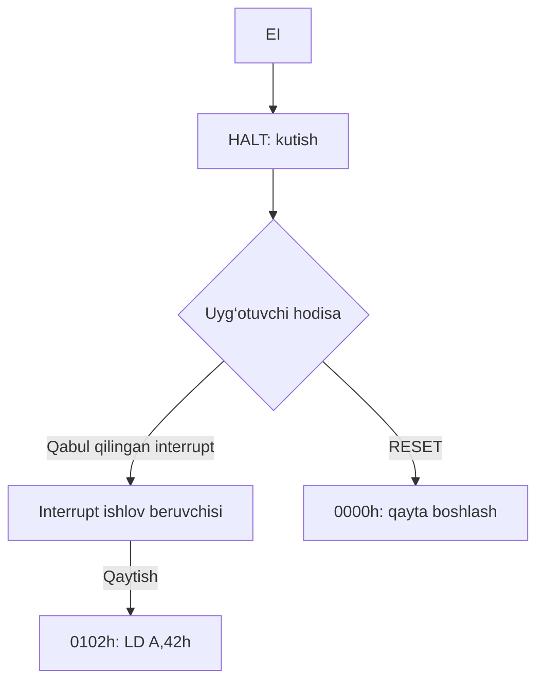

# Z80 CPU — HALT buyrug‘i va kutish holati

**HALT — protsessorni tashqi hodisani kutish holatiga o‘tkazadigan buyruq.** Uni dastur tugaganining belgisi sifatida ham, interrupt kelguncha kutish uchun ham ishlatish mumkin. Uning foydasini tushunish uchun dastur oqimi, takt va interruptni alohida tasavvur qilish kerak.

Asosiy protsessor haqida: [[Electronics/Processors/Z80|Zilog Z80]].

## 1. Texnik tayanch

| Xususiyat | Mazmuni |
| --- | --- |
| Yozilishi | `HALT` |
| Mashina kodi | `76h`, ikkilikda `01110110` |
| Hajmi | 1 bayt |
| Kirish sikli | 1 M-sikl, 4 T-holat; kutish davomiyligi bundan alohida |
| Flaglar | O‘zgarmaydi |
| Kutishdagi ish | M1 sikllari; xotiradan o‘qilgan bayt e’tiborga olinmaydi, ichki NOP bajariladi |
| Refresh | Davom etadi |
| Holat signali | `/HALT` — aktiv-past chiqish |

HALTdan chiqish: ruxsat etilgan `INT` (`IFF1=1`), `NMI` yoki `RESET`. `DI` maskalanadigan interruptni o‘chiradi. `EI`dan keyingi bitta buyruq tugaguncha INT qabul qilinmaydi. NMI DI bilan bloklanmaydi.

IM 1 da INT ishlov beruvchisi `0038h`dan, NMI ishlov beruvchisi `0066h`dan boshlanadi. IM 0 da tashqi qurilma buyruq beradi; IM 2 da vektor jadvali ishlatiladi. INT qabul qilinganda interrupt ruxsati o‘chiriladi; qayta ruxsat uchun EI kerak. NMI ishlov beruvchisi odatda RETN bilan tugaydi.

HALTning o‘zi taktni to‘xtatmaydi. CMOS modeldagi taktni to‘xtatish orqali quvvat tejash alohida mexanizm; NMOSga uni umumlashtirmang.

Manba: [Zilog Z80 CPU User Manual — HALT Exit, Interrupt Response, HALT va EI bo‘limlari](https://www.z80ne.com/datasheets/z80.pdf).

## 2. “Dastur kutmoqda” degani nima?

Tasavvur qiling, asosiy dastur sensor natijasini kutishi kerak. Uch xil yondashuv bor:

- Portni qayta-qayta o‘qish: “Natija tayyormi?” deb doimiy so‘rash.
- Bo‘sh siklda aylanish: vaqt o‘tkazish, lekin hodisa vaqtini taxmin qilish.
- HALT va interrupt: natija tayyor bo‘lganda qurilma CPUga xabar berishi.

Uchinchi yo‘l uchun sensorning o‘zi yoki uning interfeysi interrupt hosil qila olishi kerak. Faqat dasturga HALT yozish tashqi qurilmada yangi imkoniyat paydo qilmaydi.

Masalan, qurilmangiz tayyorlik signalini faqat oddiy kirish portidagi bit orqali bildirsa, HALTdan uyg‘otadigan zanjir yo‘q. Bunday sxemada portni so‘rab turish yoki taymer interrupti orqali davriy tekshirish ma’qul.

## 3. Birinchi misol: HALTdan keyingi buyruq

Quyidagi parcha uchun stek, interrupt rejimi va ishlov beruvchi oldindan tayyorlangan deb olamiz:

```asm
    EI
    HALT
    LD A, 42h
```

Bu yerda `LD A, 42h` kutish paytida bajarilmaydi. Odatdagi interrupt ishlov beruvchisi qaytish manzilini buzmay qaytsa, dastur HALTdan keyingi buyruqqa keladi va A ga `42h` yozadi.

[Zilog qo‘llanmasi — interrupt javobi va qaytish mexanizmi](https://zany80.github.io/documentation/Z80/UserManual.html).

Misolni manzillar bilan tasavvur qilish qulay:

```text
0100h: FB       EI
0101h: 76       HALT
0102h: 3E 42    LD A,42h
```

Kutiladigan oqim:



RESETdan keyin oldingi nuqtaga avtomatik qaytish rejasini tuzmang: boshlang‘ich kod qurilmaning holatini qayta tayyorlashi kerak.

## 4. Nega EI va HALT yonma-yon yoziladi?

Quyidagi ketma-ketlik foydali:

```asm
    EI
    HALT
```

EIning bir buyruqlik kechikishi sababli INT xizmatiga o‘tishdan avval HALT bajariladi. Kutish nuqtasini shu tarzda tashkil qilish qulay.

Quyidagi variantni esa shu ma’noda teng deb bo‘lmaydi:

```asm
    EI
    NOP
    HALT
```

Bu yerda kutilayotgan INT NOPdan keyin qabul qilinishi mumkin. Agar o‘sha yagona hodisaga xizmat ko‘rsatilib bo‘lingan bo‘lsa, keyingi HALT boshqa hodisani kutib qoladi. Bu — dastur oqimidan kelib chiqadigan amaliy xulosa.

Shuning uchun “kutishdan oldin istalgancha tayyorgarlik qilaman” yondashuviga ehtiyot bo‘ling. Uyg‘otish va hodisani qayd etish tartibini birgalikda loyihalang.

## 5. IM 1 bilan kutish sikli

Quyidagi o‘quv misolida:

- kod ROMda joylashadi;
- `8000h–FFFFh` oralig‘ida yoziladigan RAM bor;
- tashqi qurilma INT beradi;
- `ack_irq` ichida qurilmaga mos interruptni tasdiqlash yoki manbasini tozalash amali yozilishi kerak.

```asm
    ORG 0000h
    JP start

    ORG 0038h
irq_handler:
    PUSH AF
    CALL ack_irq
    POP AF
    EI
    RETI

    ORG 0066h
nmi_handler:
    RETN

    ORG 0100h
start:
    DI
    LD SP, 0FFFEh
    IM 1

idle:
    EI
    HALT

    ; Har uyg‘onishdan keyingi asosiy ish shu yerda.
    ; Masalan, tayyor ma’lumotni qayta ishlash.

    JR idle

ack_irq:
    ; Qurilmaga xos amalni shu yerga yozing.
    ; Masalan, status registrini o‘qish yoki flagni tozalash.
    RET
```

Bu apparatga moslashtiriladigan skelet. `ack_irq` bo‘sh qolsa va qurilma INTni aktiv tutsa, protsessor takror-takror ishlov beruvchiga kirishi mumkin. Ishlov beruvchi boshqa registrlarni ishlatsa, ularni ham saqlang.

Stek uchun ajratilgan soha asosiy ma’lumotlar bilan ustma-ust tushmasin. Misoldagi `0FFFEh` faqat yuqoridagi RAM xaritasi uchun tanlangan.

## 6. DI; HALT nimaga olib keladi?

```asm
    DI
    HALT
    LD A, 55h
```

Oddiy INTga tayangan tizimda oxirgi qatorga yetib borishni kutmang: DI aynan shu uyg‘otish yo‘lini yopgan. Biroq “CPU endi hech qachon davom etmaydi” degan xulosa ham noto‘g‘ri: NMI yoki RESET hali mavjud.

Shu sababli bu parchani “hamma turdagi hodisalardan himoyalangan yakuniy to‘xtash” sifatida ishlatish mos emas.

Agar maqsad asosiy dasturni yakunlab, uyg‘onsa ham yana kutishga qaytarish bo‘lsa, quyidagicha yozish mumkin:

```asm
    DI
stop:
    HALT
    JR stop
```

Bu ham tashqi resetni yoki NMI ishlov beruvchisini yo‘q qilmaydi. U faqat qaytishdan keyingi asosiy oqimni yana kutishga yo‘naltiradi.

## 7. Vaqtni hisoblash

4 MHz takt uchun bitta T-holat:

$$
T = \frac{1}{4\,000\,000} = 0.25\,\mu s
$$

To‘rtta T-holat:

$$
4T = 1\,\mu s
$$

Bu hisobni “HALTdan bir mikrosekund keyin dastur davom etadi” deb talqin qilmang. Masalan, tashqi qurilma 20 ms dan keyin interrupt bersa, dastur ham shu hodisagacha kutadi; xizmatga kirish va ishlov berish vaqti ham qo‘shiladi.

Shuning uchun aniq vaqtli ish uchun avval “meni qaysi taymer yoki qurilma uyg‘otadi?” degan savolga javob bering. HALTning o‘zi vaqt manbasi emas.

## 8. HALT, WAIT va bo‘sh siklni tanlash

| Ehtiyoj | Mos yondashuv |
| --- | --- |
| Qurilma natijasi tayyor bo‘lganda ishlash | Interrupt bilan HALT |
| Faqat portdagi tayyorlik biti mavjud | Portni so‘rash yoki taymer asosida tekshirish |
| Sekin xotira bilan shina vaqtini moslash | WAIT mexanizmi |
| Dastur oqimini ma’lum joyda aylantirish | `JR` yoki `JP` sikli |
| Juda kam quvvat sarfi | Aniq CPU modeli va apparat quvvat rejimini tanlash |

WAIT tashqi shina siklini cho‘zadi; HALT esa dasturdagi kutish nuqtasidir. [Zilog qo‘llanmasi — Timing](https://zany80.github.io/documentation/Z80/UserManual.html).

Amaliy tanlovda quvvat sarfi, interrupt apparati va javob berish vaqti birgalikda hisobga olinadi.

## 9. HALTni ishlatishdan oldingi savollar

1. **Uyg‘otuvchi manba nima?** Taymer, UART, tugma interfeysi yoki boshqa qurilmami?
2. **INT yo‘li tayyormi?** Rejim, vektor va EI joylashuvi mosmi?
3. **Stek qayerda?** U haqiqatan yoziladigan RAM ichidami?
4. **Interrupt manbasi qanday tozalanadi?** Kerakli amal qurilma hujjatida ko‘rsatilgan bo‘lishi kerak.
5. **Uyg‘onish aynan kerakli hodisani bildiradimi?** Bir necha interrupt manbasi bo‘lsa, dastur statusni tekshirsin.
6. **Hodisa oldinroq kelgan bo‘lsa-chi?** Faqat uyg‘onishga tayanmay, zarur bo‘lsa bayroq, hisoblagich yoki navbatda hodisani saqlang.

Masalan, UARTdan uchta bayt kelgan bo‘lsa, “bir marta uyg‘ondim, demak bitta bayt bor” deb xulosa qilish shart emas. Qabul buferi va status registri ish hajmini belgilashi kerak.

## Bog‘liq qaydlar

- [[Electronics/Processors/Z80|Z80 — umumiy tuzilish va pinout]]
- [[Electronics/Processors/Z80 IO uchun custom qurilma yaratish|Z80 uchun I/O qurilmasi]]
