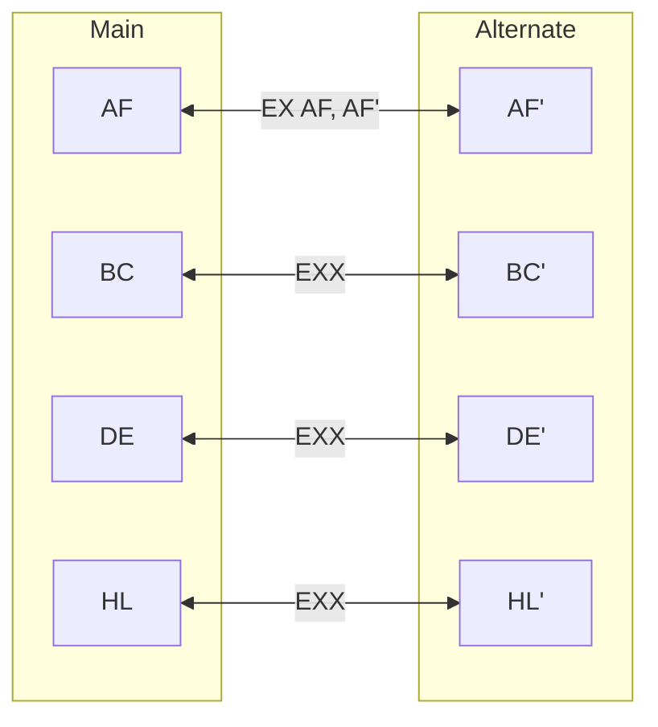

# CPU Register

Z80 CPU dasturchi foydalanishi mumkin bo‘lgan 208 bit read/write register xotirasiga ega. U 18 ta 8-bit register va to‘rtta 16-bit register sifatida tashkil etilgan. Zilog qo‘llanmasida registerlar static RAM yordamida amalga oshirilgani ko‘rsatilgan. Registerlar tarkibiga oltitadan general-purpose registerga ega ikkita to‘plam, Accumulator va Flag registerlarining ikkita juftligi hamda oltita special-purpose register kiradi.

Manba: Z80 CPU User Manual, UM008011-0816. Quyidagi amaliy misollar va undocumented xususiyatlar qo‘shimcha tushuntirish sifatida kiritilgan.

## Mundarija

- [CPU Register Configuration](#cpu-register-configuration)
- [Register Pair](#register-pair)
- [Special-Purpose Registers](#special-purpose-registers)
  - [Program Counter (PC)](#program-counter-pc)
  - [Stack Pointer (SP)](#stack-pointer-sp)
  - [Two Index Registers (IX and IY)](#two-index-registers-ix-and-iy)
  - [Interrupt Page Address (I) Register](#interrupt-page-address-i-register)
  - [Memory Refresh (R) Register](#memory-refresh-r-register)
- [Accumulator and Flag Registers](#accumulator-and-flag-registers)
- [General Purpose Registers](#general-purpose-registers)
- [Alternate Register Set](#alternate-register-set)
- [Registerlarning maxsus vazifalari](#registerlarning-maxsus-vazifalari)
- [Arithmetic Logic Unit](#arithmetic-logic-unit)
- [Instruction Register and CPU Control](#instruction-register-and-cpu-control)
- [RESET vaqtida registerlar](#reset-vaqtida-registerlar)

## CPU Register Configuration

2-rasm mazmuni: Main Register Set va Alternate Register Set.

| Vazifasi | Main Register Set | Alternate Register Set | Hajmi |
|---|---|---|---|
| Accumulator | A | A' | 8-bit |
| Flags | F | F' | 8-bit |
| General-purpose register | B | B' | 8-bit |
| General-purpose register | C | C' | 8-bit |
| General-purpose register | D | D' | 8-bit |
| General-purpose register | E | E' | 8-bit |
| General-purpose register | H | H' | 8-bit |
| General-purpose register | L | L' | 8-bit |

Special-purpose registerlar:

| Vazifasi | Register | Hajmi |
|---|---|---|
| Index Register | IX | 16-bit |
| Index Register | IY | 16-bit |
| Stack Pointer | SP | 16-bit |
| Program Counter | PC | 16-bit |
| Interrupt Page Address | I | 8-bit |
| Memory Refresh | R | 8-bit |

| Register guruhi | Soni | Hajmi | Jami |
|---|---:|---:|---:|
| Main Register Set | 8 | 8-bit | 64 bit |
| Alternate Register Set | 8 | 8-bit | 64 bit |
| IX, IY, SP, PC | 4 | 16-bit | 64 bit |
| I, R | 2 | 8-bit | 16 bit |
| Jami | 22 | — | 208 bit |

208 bit = 26 byte. Bu hisobga Instruction Register, ichki vaqtinchalik registerlar, IFF1, IFF2 va interrupt mode holati kiritilmagan.

## Register Pair

General-purpose registerlar alohida 8-bit yoki juftlangan 16-bit registerlar sifatida ishlatilishi mumkin.

| Register Pair | High byte | Low byte |
|---|---|---|
| AF | A | F |
| BC | B | C |
| DE | D | E |
| HL | H | L |
| AF' | A' | F' |
| BC' | B' | C' |
| DE' | D' | E' |
| HL' | H' | L' |

```asm
LD BC, 1234h
```

Natijada B = 12h, C = 34h va BC = 1234h.

```asm
LD BC, 12FFh
INC BC
```

Natijada BC = 1300h, B = 13h va C = 00h. Biroq `INC C` bajarilganda overflow B registeriga uzatilmaydi.

## Special-Purpose Registers

### Program Counter (PC)

Program Counter memorydan navbatdagi fetch qilinadigan instruction yoki operand byte’ining 16-bit addressini saqlaydi. Instruction va uning operand byte’lari o‘qilganda PC avtomatik increment qilinadi. Program jump sodir bo‘lganda yangi qiymat PCga joylashtiriladi va incrementer natijasining o‘rnini egallaydi. PC 16-bit bo‘lgani sababli FFFFh dan keyin 0000h ga o‘tadi.

### Stack Pointer (SP)

Stack Pointer tashqi tizim RAM memorysida joylashgan stackning joriy tepasidagi 16-bit addressni saqlaydi. Stack last-in first-out (LIFO) tartibida tashkil etilgan. PUSH va POP instructionlari orqali muayyan CPU registerlaridan ma’lumotni stackka saqlash yoki qayta olish mumkin. Eng oxirgi push qilingan ma’lumot birinchi pop qilinadi.

Stack multiple level interruptlarni, subroutine nestingni va ma’lumotlar bilan ishlashni soddalashtiradi. Nesting chuqurligi mavjud yoziladigan RAM hajmi bilan chegaralangan. PUSH SPni ikki byte kamaytiradi, POP ikki byte oshiradi. CALL va interrupt return addressni stackka saqlaydi (IM 0 da bu taqdim etilgan instructionga bog‘liq).

### Two Index Registers (IX and IY)

Ikkita mustaqil Index Register indexed addressing modelarida ishlatiladigan 16-bit base addressni saqlaydi. Indexed instructionlarda qo‘shimcha byte basedan displacementni belgilaydi. Displacement two’s complement signed integer sifatida beriladi. Bu addressing mode ayniqsa data tablelardan foydalanadigan programlarni soddalashtiradi.

$$
Address = (Index + d) \\bmod 65536
$$

`d` — signed 8-bit displacement, −128 dan +127 gacha.

| Displacement | Binary | Hex |
|---:|---|---|
| −128 | 10000000 | 80h |
| −2 | 11111110 | FEh |
| −1 | 11111111 | FFh |
| 0 | 00000000 | 00h |
| 1 | 00000001 | 01h |
| 127 | 01111111 | 7Fh |

```asm
LD IX, 4000h
LD (IX+5), 42h
LD (IX-2), 21h
```

| Address | Qiymat |
|---|---|
| 3FFEh | 21h |
| 4005h | 42h |

IX qiymati 4000h bo‘lib qoladi. Displacement index register tarkibini o‘zgartirmaydi.

Klassik Z80 da alohida index register byte’lariga murojaat qiluvchi undocumented instructionlar mavjud:

| Register | High byte | Low byte |
|---|---|---|
| IX | IXH | IXL |
| IY | IYH | IYL |

Assembler va CPU modelining mosligini hisobga olish kerak.

### Interrupt Page Address (I) Register

Z80 IM 2 rejimida interruptga javoban istalgan memory locationga indirect call qilishi mumkin. I register vector table pointerining yuqori sakkiz bitini, interrupt yuborayotgan device esa quyi sakkiz bitini taqdim etadi. CPU pointer ko‘rsatgan xotiradan avval quyi, keyin yuqori byte’ni o‘qib ISR manzilini hosil qiladi. Bu interrupt routinelarni memoryning istalgan joyida dinamik joylashtirish imkonini beradi.

### Memory Refresh (R) Register

Z80 memory refresh counterga ega. Bu dynamic memory bilan ishlashni soddalashtiradi. R registerining quyi yetti biti har bir M1 cycle davomida avtomatik increment qilinadi. Bit 7 `LD R, A` orqali dasturlangan holatida qoladi. Refresh counter qiymati refresh control signal bilan birga address busning quyi qismiga, I register qiymati esa yuqori sakkiz bitiga chiqariladi. Refresh odatdagi M1 cycle tarkibida bajariladi va dasturchining aralashuvini talab qilmaydi. R registerga sinov maqsadida qiymat yuklash mumkin.

| Bit | 7 | 6 | 5 | 4 | 3 | 2 | 1 | 0 |
|---|---|---|---|---|---|---|---|---|
| R | Saqlanadi | r₆ | r₅ | r₄ | r₃ | r₂ | r₁ | r₀ |

R instructionlar sonini aniq hisoblamaydi, chunki prefixli instructionlar bir nechta M1 cycle talab qilishi mumkin.

| Instruction | Opcode | R increment |
|---|---|---:|
| NOP | 00 | +1 |
| LD A, n | 3E n | +1 |
| LD BC, nn | 01 n n | +1 |
| NEG | ED 44 | +2 |
| RLC B | CB 00 | +2 |
| LD IX, nn | DD 21 n n | +2 |
| LD A, (IX+d) | DD 7E d | +2 |
| BIT 0, (IX+d) | DD CB d 46 | +2 |

Immediate operand va displacement byte’larini oddiy memory read cycle orqali o‘qish Rni increment qilmaydi. HALT holatida ham takroriy M1 cycle’lar sababli R o‘zgarishda davom etadi.

## Accumulator and Flag Registers

CPU ikkita mustaqil 8-bit Accumulator va ularga tegishli 8-bit Flag registerlarga ega. Accumulator ko‘plab 8-bit arithmetic yoki logical operationlar natijalarini saqlaydi. Flag Register 8-bit yoki 16-bit operationlarning muayyan holatlarini, masalan, natija nolga tengligini ko‘rsatadi. Dasturchi `EX AF, AF'` yordamida ikkala juftlikni almashtirishi mumkin.

### Flag Register (F)

| Bit | 7 | 6 | 5 | 4 | 3 | 2 | 1 | 0 |
|---|---|---|---|---|---|---|---|---|
| Flag | S | Z | Y | H | X | P/V | N | C |

| Flag | Nomi | Vazifasi |
|---|---|---|
| S | Sign | Natijaning sign biti |
| Z | Zero | Natija nolga tengligini bildiradi |
| Y | Undocumented | Instructionga bog‘liq flag |
| H | Half Carry | Half carry yoki half borrow |
| X | Undocumented | Instructionga bog‘liq flag |
| P/V | Parity / Overflow | Instructionga qarab parity, signed overflow yoki boshqa holat |
| N | Add/Subtract | Asosan BCD correction uchun amal turi |
| C | Carry | Carry, borrow yoki shift orqali chiqarilgan bit |

X va Y klassik Z80 da mavjud, ammo rasmiy instruction tavsiflarida odatda hujjatlashtirilmagan. Barcha instructionlar barcha flaglarni o‘zgartirmaydi. F registeriga `LD F, n` orqali qiymat yuklab bo‘lmaydi. `PUSH AF`, `POP AF` va `EX AF, AF'` orqali uni saqlash, tiklash yoki almashtirish mumkin.

## General Purpose Registers

Har biri oltita 8-bit registerdan iborat ikkita mos general-purpose register to‘plami mavjud. Ular alohida yoki 16-bit register pair sifatida ishlatiladi. Bir to‘plam BC, DE, HL, ikkinchisi BC', DE', HL' deb ataladi. Dasturchi `EXX` orqali ushbu uchta juftlikni birgalikda almashtirishi mumkin.

Tez interrupt response talab qilinadigan tizimlarda bitta general-purpose registerlar to‘plami va bitta Accumulator/Flag juftligi tezkor routine uchun ajratilishi mumkin. Registerlarni tashqi stackka saqlash va qayta tiklash zarurati kamaygani sababli interrupt service vaqti qisqaradi. General-purpose registerlar ayniqsa tashqi read/write memory hajmi kam bo‘lgan ROM-based tizimlarda programlashni soddalashtiradi.

## Alternate Register Set

Alternate Register Set — mustaqil qo‘shimcha registerlar to‘plami, asosiy registerlarning avtomatik nusxasi emas.



| Instruction | Opcode | Almashtiriladigan registerlar | T States |
|---|---|---|---:|
| EX AF, AF' | 08h | AF ↔ AF' | 4 |
| EXX | D9h | BC ↔ BC', DE ↔ DE', HL ↔ HL' | 4 |

Alternate registerlarga `LD B', n` kabi instruction orqali bevosita murojaat qilib bo‘lmaydi. Barcha sakkizta asosiy 8-bit registerni almashtirish uchun ikkita instruction va jami 8 T States kerak.

```asm
EX AF, AF'
EXX
```

Interrupt Service Routine misoli:

```asm
ISR:
    EX AF, AF'
    EXX

    ; Interrupt service amallari

    EXX
    EX AF, AF'
    EI
    RETI
```

Bu usul registerlarni stack orqali saqlashga qaraganda tezroq. Ammo alternate registerlar faqat bitta qo‘shimcha to‘plamdan iborat. Nested interruptlarda yoki asosiy dastur alternate registerlardan foydalansa, ularning tarkibini himoyalash zarur. Misol maskalanadigan interrupt uchun; qurilmaga xos interrupt manbasini tozalash amali alohida bajariladi.

## Registerlarning maxsus vazifalari

| Register | Maxsus vazifasi |
|---|---|
| A | 8-bit arithmetic, logical va ayrim I/O amallari |
| F | CPU flaglari |
| B | DJNZ va Block I/O counter |
| C | Register Indirect I/O port manzilining quyi byte’i |
| BC | Block Transfer va Block Search counter |
| DE | Block Transfer destination pointer |
| HL | Memory pointer, Block Transfer source pointer va 16-bit arithmetic |
| IX, IY | Indexed Addressing |
| SP | Stack pointer |
| PC | Instruction va operand fetch manzili |
| I | IM 2 vector table pointer va refresh address yuqori byte’i |
| R | Memory refresh counter |

## Arithmetic Logic Unit

CPUning 8-bit arithmetic va logical instructionlari Arithmetic Logic Unit (ALU)da bajariladi. ALU ichki data bus orqali registerlar va tashqi data bus bilan ma’lumot almashadi. ALU quyidagi funksiyalarni bajaradi:

- Add
- Subtract
- Logical AND
- Logical OR
- Logical exclusive OR
- Compare
- Chapga yoki o‘ngga shift yoxud rotate (arithmetic va logical)
- Increment
- Decrement
- Set bit
- Reset bit
- Test bit

## Instruction Register and CPU Control

Instruction opcode memorydan fetch qilinganda ichki Instruction Register va decode mexanizmi orqali qayta ishlanadi. Control bo‘limi registerlardan ma’lumot o‘qish yoki ularga yozish, ALUni boshqarish va zarur tashqi control signallarni hosil qilish vazifasini bajaradi. Instruction Register dasturchi bevosita murojaat qila olmaydigan ichki registerdir. Ko‘p byte’li instructionlarda prefix, opcode va operandlar tegishli bosqichlarda qayta ishlanadi.

## RESET vaqtida registerlar

CPU reset qilinganda barcha general-purpose registerlar nolga teng bo‘ladi deb hisoblash mumkin emas.

| Register yoki holat | RESET natijasi |
|---|---|
| PC | 0000h |
| I | 00h |
| R | 00h |
| IFF1 | 0 |
| IFF2 | 0 |
| Interrupt Mode | IM 0 |
| A, F | Kafolatlanmagan |
| BC, DE, HL | Kafolatlanmagan |
| Alternate registers | Kafolatlanmagan |
| IX, IY | Kafolatlanmagan |
| SP | Kafolatlanmagan |

Dastur boshlanishida ishlatiladigan registerlarni kerakli qiymatlar bilan initialization qilish zarur.

```asm
ORG 0000h

    DI
    LD SP, 8000h
    LD BC, 0000h
    LD DE, 0000h
    LD HL, 0000h
    XOR A
    IM 1
```

Bu misolda stack uchun 8000h dan pastdagi tegishli xotira manzillari yoziladigan RAM bo‘lishi kerak. Barcha registerlarni initialization qilish majburiy emas. Faqat dastur foydalanadigan va boshlang‘ich qiymati muhim bo‘lgan registerlarni sozlash yetarli.
