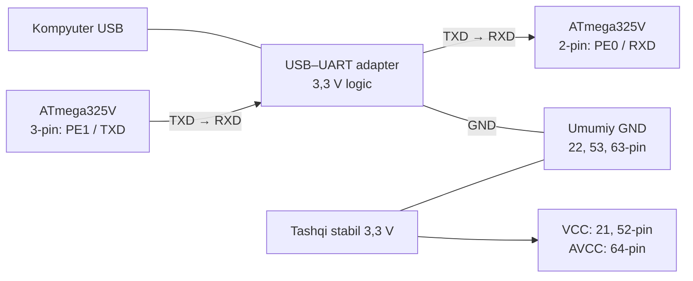

# ATmega325V-8AU

ATmega325V — 8-bit AVR mikrokontroller. Ushbu note **ATmega325V-8AU, TQFP-64** korpusi uchun; ATmega3250 va ATmega325P bilan adashtirmang.

## Asosiy xususiyatlar

| Parametr | Qiymat |
| --- | --- |
| Flash / SRAM / EEPROM | 32 KB / 2 KB / 1 KB |
| Korpus | TQFP-64, 14 × 14 mm, qadam 0,8 mm |
| Ta’minot | 1,8–5,5 V |
| V versiyasining chastotasi | 1,8–5,5 V da 0–4 MHz; 2,7–5,5 V da 0–8 MHz |
| Interfeyslar | USART, SPI, USI, JTAG |
| ADC | 8 kanal, 10 bit |
| Ish harorati | −40…+85 °C |

**8** — maksimal tezlik sinfi; chip avtomatik ravishda 8 MHz da ishlaydi degani emas. Haqiqiy chastota clock manbasi va fuse sozlamalariga bog‘liq.

## Pinout — yuqoridan ko‘rinish

Quyidagi IC blok note ichida pinout chizmasi sifatida ko‘rinadi. Bu PCB footprint emas. Pin raqamlari pin-1 belgisidan soat miliga teskari sanaladi. Muqobil funksiyalar qisqartirib berilgan.

```ic{TQFP-64} ATmega325V-8AU
1: DNC
2: PE0 / RXD
3: PE1 / TXD
4: PE2 / XCK / AIN0
5: PE3 / AIN1
6: PE4 / USCK / SCL
7: PE5 / DI / SDA
8: PE6 / DO
9: PE7 / CLKO
10: PB0 / SS
11: PB1 / SCK
12: PB2 / MOSI
13: PB3 / MISO
14: PB4 / OC0A
15: PB5 / OC1A
16: PB6 / OC1B
17: PB7 / OC2A
18: PG3 / T1
19: PG4 / T0
20: RESET / PG5
21: VCC
22: GND
23: XTAL2 / TOSC2
24: XTAL1 / TOSC1
25: PD0 / ICP1
26: PD1 / INT0
27: PD2
28: PD3
29: PD4
30: PD5
31: PD6
32: PD7
33: PG0
34: PG1
35: PC0
36: PC1
37: PC2
38: PC3
39: PC4
40: PC5
41: PC6
42: PC7
43: PG2
44: PA7
45: PA6
46: PA5
47: PA4
48: PA3
49: PA2
50: PA1
51: PA0
52: VCC
53: GND
54: PF7 / ADC7 / TDI
55: PF6 / ADC6 / TDO
56: PF5 / ADC5 / TMS
57: PF4 / ADC4 / TCK
58: PF3 / ADC3
59: PF2 / ADC2
60: PF1 / ADC1
61: PF0 / ADC0
62: AREF
63: AGND
64: AVCC
```

DNC — ulanmasin. To‘liq muqobil funksiyalar uchun datasheetdagi **Figure 1-2, 3-bet**ga qarang.

## Custom UART connection

Bu — **3,3 V da ishlaydigan MCU va 3,3 V mantiq darajali USB–UART adapter** uchun taklif qilingan ulanish. Muayyan tayyor plataning sxemasi emas.



| Custom J1 kontakt | MCU tomoni | Adapter tomoni |
| --- | --- | --- |
| 1 — GND | GND | GND |
| 2 — MCU_TX | PE1/TXD, 3-pin | RXD |
| 3 — MCU_RX | PE0/RXD, 2-pin | TXD |
| 4 — VREF | 3,3 V daraja belgisi | Quvvat chiqishiga ulamang |

J1 tartibi shu note uchun tanlangan; adapterlarda kontakt tartibi farq qiladi. Diagrammadagi strelkalar ma’lumot yo‘nalishini bildiradi.

> [!WARNING]
> UART — mantiq darajali signal. RS-232 portining ± kuchlanishini bevosita ulamang. Adapterdagi “3,3 V” quvvat belgisi uning TXD signali ham 3,3 V ekanini kafolatlamaydi. Tashqi manba ishlatilganda adapter VCC chiqishini ulamang.

### Minimal yordamchi ulanishlar

- Har bir VCC–GND juftiga va AVCC–AGND yoniga 100 nF keramika kondensator qo‘yish tavsiya etiladi; barcha quvvat va yer pinlarini ulang.
- RESET, 20-pin uchun 10 kΩ bilan 3,3 V ga pull-up — odatiy loyiha tanlovi.
- AREF quvvat pini emas; uning ulanishi tanlangan ADC reference rejimiga mos bo‘lsin.
- Asinxron UART uchun XCK talab qilinmaydi.
- Taklif etilgan aloqa formati: **9600 baud, 8N1**, flow control o‘chiq. Ikki tomon bir xil formatda ishlashi kerak.
- Baud generatorini haqiqiy CPU chastotasiga moslang: normal rejimda $UBRR = f_{CPU}/(16\,baud)-1$. 8 MHz va 9600 baud uchun UBRR = 51, taxminiy xato +0,16%.
- UART orqali firmware yozish uchun mos bootloader oldindan o‘rnatilgan bo‘lishi kerak; oddiy UART ulanishi ISP dasturlagichini almashtirmaydi.

## Manbalar va rasmlar haqida

- [Microchip — ATmega325 mahsulot sahifasi](https://www.microchip.com/en-us/product/ATmega325)
- [Rasmiy to‘liq datasheet](https://ww1.microchip.com/downloads/aemDocuments/documents/OTH/ProductDocuments/DataSheets/doc2570.pdf): pinout — Figure 1-2; USART; Ordering Information — 32.1.
- [Rasmiy qisqa datasheet](https://ww1.microchip.com/downloads/en/DeviceDoc/2570S.pdf)

Alohida PNG/JPG fayllari biriktirilmagan: mavjud note vositalari asset yaratishni qo‘llamaydi. Yuqoridagi pinout va UART chizmalari Git Notes ichida diagramma sifatida render qilinadi.
