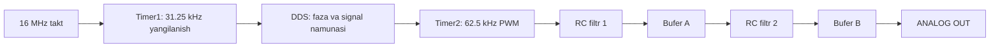

# ATmega8-16PU orqali function generator

**Maqsad:** sinus, uchburchak, arrasimon va to‘rtburchak signallar hosil qiladigan, 5 V bilan ishlaydigan boshlang‘ich function generator qurish.

Boshlash uchun **PWM → past chastotalarni o‘tkazuvchi filtr → bufer** yo‘lini taklif qilaman. Maxsus DAC kerak bo‘lmaydi. Quyidagi sxema va chastota diapazonlari — ushbu note uchun tanlangan loyiha; tayyor qurilmaning kafolatlangan texnik tavsifi emas.

Pinlar va taymer rejimlari uchun manba: [ATmega8/L to‘liq datasheet — Pin Configurations, Timer/Counter1, Timer/Counter2](https://ww1.microchip.com/downloads/en/DeviceDoc/Atmel-2486-8-bit-AVR-microcontroller-ATmega8_L_datasheet.pdf). Quyidagi RC, DDS va chastota misollari shu note uchun hisoblangan loyiha qiymatlaridir.

Timer asoslari uchun: [[Microcontroller/AVR — Timer va Prescaler|AVR — Timer va Prescaler]].

## 1. Qanday imkoniyatlarni kutish mumkin?

| Rejim | Taklif etilgan diapazon | Chiqish | Izoh |
|---|---|---|---|
| Sinus | 1–500 Hz boshlang‘ich maqsad; 1 kHz gacha tajriba | ANALOG OUT | Filtrlangan PWM |
| Uchburchak | 1–500 Hz; yuqorida burchaklar yumaloqlashadi | ANALOG OUT | Yuqori garmonikalar filtrda susayadi |
| Arrasimon | 1–500 Hz; keskin qaytish yumaloqlashadi | ANALOG OUT | Ideal vertikal qaytish chiqmaydi |
| To‘rtburchak | 1 Hz–100 kHz loyiha maqsadi | DIGITAL OUT | Alohida Timer1 rejimi, 50% duty |

Analog rejimda dasturiy amplituda maqsadi **0.5–4 Vpp**, signal markazi **2.5 V**. Masalan, 4 Vpp signal taxminan 0.5–4.5 V oralig‘ida bo‘ladi. Bu qiymatlar filtrdan oldingi ideal o‘rtacha signalga tegishli; haqiqiy chiqish yuk, chastota va PWM xatolariga bog‘liq.

**Vpp** — eng yuqori va eng past kuchlanishlar farqi. 4 Vpp degani ±4 V emas.

To‘rtburchak chiqish mantiqiy 0–5 V ga yaqin bo‘ladi; analog amplituda sozlamasi unga ta’sir qilmaydi. Bazaviy loyihada analog va raqamli rejimlar navbat bilan ishlaydi.

> [!IMPORTANT]
> Bu bitta 5 V manbali qurilma. Bazaviy chiqish manfiy kuchlanish hosil qilmaydi va 50 Ω yukni haydash uchun mo‘ljallanmagan. Analog chiqish uchun kamida 10 kΩ yuk, yaxshisi osiloskopning 1 MΩ kirishi nazarda tutiladi.

## 2. Interaktiv signal ko‘rinishlari

Shaklni tanlang, chastota va amplitudani o‘zgartiring. Grafik doim ikkita davrni ko‘rsatadi: chastota oshganda vaqt o‘qining qiymatlari qisqaradi.

<interactive src="atmega8-function-generator" />

Blok ideal shakllarni va hisoblashlarni ko‘rsatadi. U PWM impulslarini, real filtrni, op-amp cheklovlarini yoki MCU dasturining bajarilishini simulyatsiya qilmaydi. Blokdagi holat vaqtinchalik; qayta yuklanganda boshlang‘ich holatga qaytadi.

## 3. Nega faqat MCU pinidan sinus chiqmaydi?

Raqamli pin LOW yoki HIGH bo‘ladi. Sinus esa oraliq kuchlanishlarni ham talab qiladi.

PWM shu muammoni o‘rtacha qiymat orqali hal qiladi:

- 20% duty → taxminan 1 V;
- 50% duty → taxminan 2.5 V;
- 80% duty → taxminan 4 V.

Bu munosabat ideal 5 V impulslar va ularni o‘rtachalashtiruvchi filtr uchun. Duty vaqt davomida sinus qonuni bilan o‘zgarsa, filtr chiqishida sinusga yaqin signal olinadi.

**PWM tashuvchi chastotasi**, **namunalar yangilanish chastotasi** va **chiqish signalining chastotasi** uch xil kattalikdir.



## 4. ATmega8 uchun muhim ulanishlar

ATmega8-16PU — 28 pinli PDIP variant; 16 MHz uchun 5 V tanlanadi. Uning kuchlanish diapazoni 4.5–5.5 V. [ATmega8/L qisqa datasheet, Ordering Information](https://ww1.microchip.com/downloads/en/DeviceDoc/Atmel-2486-8-bit-AVR-microcontroller-ATmega8_L_summary.pdf).

Quyidagi pin raqamlari **PDIP-28**, yuqoridan ko‘rinish uchun:

| Vazifa | Pin |
|---|---|
| VCC / GND | 7 / 8 va 22 |
| AVCC / AREF | 20 / 21 |
| RESET | 1 |
| XTAL1 / XTAL2 | 9 / 10 |
| PB3: OC2 va MOSI | 17 |
| PB1: OC1A | 15 |
| PB4: MISO / PB5: SCK | 18 / 19 |
| PC0 / PC1 / PC2 | 23 / 24 / 25 |

Taymer registrlari va pinlar uchun manba: [ATmega8/L to‘liq datasheet](https://ww1.microchip.com/downloads/en/DeviceDoc/Atmel-2486-8-bit-AVR-microcontroller-ATmega8_L_datasheet.pdf), Pin Configurations, Timer/Counter1 va Timer/Counter2 bo‘limlari.

### MCU atrofidagi sxema

- Pin 7 va pin 20 → +5 V; har biri yoniga 100 nF → GND.
- Pin 8 va pin 22 → GND.
- Pin 1 → 10 kΩ orqali +5 V; shu nuqta ISP RESET bilan ham ulanadi.
- 16 MHz kvarts → pin 9 va pin 10 orasiga.
- Kvartsning har ikki uchidan GND ga alohida kondensator. **22 pF boshlang‘ich qiymat**, aniq qiymat kvartsning load capacitance talabi va montaj sig‘imiga moslanadi.
- AREF → 100 nF → GND; bu loyihada AREF ni bevosita +5 V ga ulamang.
- 5 V shinasiga 10 µF va kirish yaqiniga 47 µF.

**16PU yozuvi chip o‘z-o‘zidan 16 MHz da ishlaydi degani emas.** Kvartsni o‘rnatish va clock fuse sozlamalarini moslash kerak. `F_CPU=16000000UL` faqat dasturga takt qiymatini bildiradi. Fuse uchun tasodifiy hex qiymat ishlatmang; aynan ATmega8 clock bo‘limiga qarang, RESET va ISP imkoniyatini saqlang.

### ISP ulagichi

Programmerning signal nomlari bo‘yicha ulang:

- MOSI → PB3, pin 17;
- MISO → PB4, pin 18;
- SCK → PB5, pin 19;
- RESET → pin 1;
- GND → umumiy GND;
- VCC → 5 V daraja/reference, programmerning quvvatlash tartibiga mos.

PB3 dasturlashda MOSI, ish rejimida PWM bo‘ladi. Dasturlash vaqtida analog chiqishda begona impulslar paydo bo‘lishi mumkin; chiqishni tashqi qurilmadan ajratib turing. Quvvat manbai va programmer bir vaqtda quvvat bersa, ularning chiqishlarini bevosita parallel ulashdan saqlaning.

## 5. Analog filtr va bufer

Ikki bir xil RC bosqich orasiga bufer qo‘yiladi. Shu sabab ikkinchi bosqich birinchisini sezilarli yuklamaydi.

```text
PB3 / OC2 -- R1 3.3k -- A -- U1A voltage follower
                         |
                       C1 10nF
                         |
                        GND

U1A OUT -- R2 3.3k -- B -- U1B voltage follower
                         |
                       C2 10nF
                         |
                        GND

U1B OUT -- 100 ohm -- ANALOG OUT
GND ---------------- ANALOG GND
```

Har bir voltage follower uchun signal **+ kirishga**, op-amp chiqishi esa bevosita **− kirishga** ulanadi. U1A va U1B — bitta MCP6002 ning ikki kanali. Mikrosxema +5 V/GND bilan quvvatlanadi, yoniga 100 nF qo‘yiladi.

MCP6002 ikki kanalli, rail-to-rail kirish/chiqishli, 1.8–6 V ta’minotli va 1 MHz gain-bandwidth mahsulotiga ega op-amp. U bu past chastotali bufer uchun mos; rail-to-rail bo‘lsa ham, yuk ostida chiqish relslarga aynan yetmaydi. [Microchip MCP6002](https://www.microchip.com/en-us/product/MCP6002).

Bir bosqichning kesish chastotasi:

$$
f_c=\frac{1}{2\pi RC}
=\frac{1}{2\pi\cdot3300\cdot10\,\mathrm{nF}}
\approx4.82\,\mathrm{kHz}
$$

Ikki buferlangan bosqich uchun ideal amplituda koeffitsiyenti:

$$
|H(f)|=\frac{1}{1+(f/f_c)^2}
$$

Hisob bo‘yicha 1 kHz da taxminan 0.96, 62.5 kHz da taxminan 0.0059 bo‘ladi. Demak, tashuvchi chastotadagi komponent taxminan 44.6 dB susayadi. Bu hisob butun chiqishning buzilish yoki shovqin kafolati emas: PWM spektri, montaj va ta’minot ham ta’sir qiladi.

Ikki bosqichning umumiy −3 dB nuqtasi taxminan 3.1 kHz. Sinus uchun qulay, ammo uchburchak va arrasimon signalning yuqori garmonikalari susayib, burchaklar yumaloqlashadi.

**LM358 ni MCP6002 o‘rniga shunchaki almashtirmang:** 5 V ta’minotda kirish/chiqishning yuqori relsga yaqin ishlashi bir xil emas. Tanlangan sxemada MCP6002 ishlatiladi.

## 6. Taymer va DDS hisoblari

Timer asoslarini bog‘lash uchun: [[Microcontroller/AVR — Timer va Prescaler|AVR — Timer va Prescaler]].

### Timer2 — PWM tashuvchi

Fast PWM, 8 bit, TOP = 255, prescaler N = 1:

$$
f_{PWM}=\frac{16\,000\,000}{1\cdot256}=62\,500\,\mathrm{Hz}
$$

PWM PB3/OC2 dan chiqadi. Duty qiymati OCR2 orqali yangilanadi.

### Timer1 — namuna yangilanishi

CTC rejimi, N = 1, OCR1A = 511:

$$
f_s=\frac{16\,000\,000}{1\cdot(511+1)}
=31\,250\,\mathrm{namuna/s}
$$

Bu compare interrupt chastotasi; bu yerda formulada 2 yo‘q. Har ikki PWM davriga bitta yangi namuna to‘g‘ri keladi.

Har interrupt oralig‘ida **512 CPU takti** mavjud. ISR qisqa bo‘lishi kerak: unda `sin()`, suzuvchi nuqtali hisob, displey yangilash va kechiktirish ishlatilmaydi.

### DDS — jadval bo‘ylab boshqariladigan tezlikda yurish

Oddiy usul har interruptda jadvalning keyingi elementini chiqaradi. DDS esa 32 bitli faza akkumulyatoriga har safar belgilangan qadam qo‘shadi:

$$
K=\operatorname{round}\left(\frac{f_{out}\cdot2^{32}}{f_s}\right)
$$

$$
phase\leftarrow(phase+K)\bmod2^{32}
$$

Fazaning yuqori 8 biti 256 elementli jadval indeksini beradi. 1 kHz uchun K ≈ 137438953, 100 Hz uchun K ≈ 13743895.

```text
Har Timer1 compare interruptida:
    phase = phase + K       // uint32, overflow tabiiy
    index = phase >> 24
    sample = tanlangan_shakl(index)
    duty = markaz + amplituda_bilan_masshtablash(sample)
    OCR2 = chegaralangan_8_bit_duty
```

Sinus jadvalini Flash/PROGMEM da saqlash mumkin. Uchburchak va arrasimon qiymatlarini butun sonli hisob bilan hosil qilish mumkin. Yuqoridagi yozuv algoritm; to‘liq firmware emas.

Nominal 5 V uchun namunani taxminan 10–90% duty oralig‘ida saqlash 0.5–4.5 V signal maqsadiga mos keladi. 8 bitli PWM ning ideal kuchlanish qadami taxminan 5/256 ≈ 19.5 mV; bu yuqori aniqlikdagi DAC emas.

| Chiqish chastotasi | Bir davrdagi yangilanishlar, fs/f |
|---|---:|
| 10 Hz | 3125 |
| 100 Hz | 312.5 |
| 500 Hz | 62.5 |
| 1 kHz | 31.25 |

Yangilanishlar soni noyob jadval qiymatlari soniga teng bo‘lishi shart emas. Nyquist chegarasi fs/2 = 15.625 kHz bo‘lsa ham, shu chegaraga yaqin sifatli sinus yoki keskin arrasimon signal chiqadi degani emas.

Dasturda asosiy sikl tugmalarni o‘qiydi; ISR signal chiqaradi. Asosiy sikldan 32 bitli K ni almashtirish atomar bajariladi. Amplituda va shaklni davr chegarasida almashtirish chiqishdagi sakrashlarni kamaytiradi.

## 7. To‘rtburchak signalning alohida rejimi

PB1/OC1A → **1 kΩ** → DIGITAL OUT. GND alohida chiqariladi. Bu yo‘l analog RC filtrga ulanmaydi.

Timer1 CTC da compare hodisasida OC1A holati apparat orqali almashadi:

$$
f_{square}=\frac{f_{CPU}}{2N(1+OCR1A)}
$$

| Kerakli chastota | N | OCR1A |
|---|---:|---:|
| 1 Hz | 256 | 31249 |
| 1 kHz | 1 | 7999 |
| 100 kHz | 1 | 79 |

Duty 50%. Boshqa chastotalarda OCR butun songa yaxlitlangani sabab kichik xato bo‘lishi mumkin. N uchun Timer1 variantlari: 1, 8, 64, 256, 1024.

**Resurs to‘qnashuvi:** Timer1 analog rejimda namuna taktini beradi. Square rejimiga o‘tganda uning DDS interrupti o‘chiriladi va taymer qayta sozlanadi. Analog rejimga qaytganda CTC sample clock tiklanadi. Ushbu bazaviy loyiha ikki chiqishni mustaqil va bir vaqtda boshqarmaydi.

## 8. Kerakli komponentlar — bazaviy BOM

| Komponent | Miqdor | Vazifasi |
|---|---:|---|
| ATmega8-16PU | 1 | MCU, PDIP-28 |
| DIP-28 soket | 1 | MCU ni almashtirish qulayligi |
| 16 MHz kvarts | 1 | Takt |
| 22 pF keramika | 2 | Kvarts uchun boshlang‘ich qiymat; kvartsga moslanadi |
| MCP6002-I/P yoki MCP6002-E/P | 1 | Ikki bufer, PDIP-8 |
| DIP-8 soket | 1 | Op-amp uchun |
| 3.3 kΩ, 1% rezistor | 2 | RC filtrlari |
| 10 nF kondensator, C0G/plyonka afzal | 2 | RC filtrlari |
| 100 Ω rezistor | 1 | Analog chiqish ketma-ket rezistori |
| 1 kΩ rezistor | 1 | Raqamli chiqish ketma-ket rezistori |
| 10 kΩ rezistor | 1 | RESET pull-up |
| 100 nF keramika | 4 | VCC, AVCC, MCP6002, AREF |
| 10 µF elektrolit | 1 | Ta’minot filtri |
| 47 µF elektrolit | 1 | Quvvat kirishi yaqinida |
| Oddiy bosma tugma | 3 | Shakl/rejim, chastota +, chastota − |
| ISP 2×3 ulagich | 1 | Programmer ulash |
| Signal/GND ulagich juftligi yoki BNC | 2 | Analog va raqamli chiqish |
| Barqaror 5 V manba | 1 | 100 mA yoki ko‘proq quvvat zaxirasi |
| Plata, sim, quvvat ulagichi | ehtiyojga ko‘ra | Montaj |

Tugmalarni PC0, PC1, PC2 dan GND ga ulang; ichki pull-up yoqiladi. Dastur kontakt sakrashini filtrlashi kerak. Analog amplituda dasturda boshqariladi; uch tugmali interfeysda uzoq bosish bilan amplituda rejimiga o‘tishni loyihalash mumkin.

**Dasturlash va signalni ko‘rish uchun:** USBasp yoki boshqa mos AVR ISP programmer, multimetr, osiloskop. Signal shakli va PWM qoldig‘ini oddiy multimetr to‘liq ko‘rsatmaydi.

Ixtiyoriy qismlar:

- I²C LCD yoki OLED — chastota, shakl va amplitudani ko‘rsatish; modul ta’minoti va I/O darajasi 5 V tizimga mos bo‘lsin.
- Encoder — tugmalar o‘rniga qulay boshqarish.
- DIP kalit — tayyor chastotalarni tanlash.
- AC coupling kondensatori — faqat doimiy offsetni chiqarish kerak bo‘lsa. Masalan, 10 µF va 100 kΩ yerga rezistor taxminan 0.16 Hz yuqori o‘tkazuvchi chegarani beradi, lekin tashqi yuk uni o‘zgartiradi. Elektrolitning musbat tomoni 2.5 V offsetli chiqishga qaraydi; ikki qutbli kondensator qulayroq.

## 9. Montaj va ish tartibi

1. MCU ta’minoti, RESET, kvarts va ISP qismini yig‘ing.
2. Takt manbai va dasturdagi takt qiymatini bir-biriga moslang.
3. Timer2 PWM va Timer1 DDS qismini ulang; dastlab bitta sinus shaklidan boshlash qulay.
4. Ikki RC bosqichi va buferlarni qo‘shing.
5. Analog rejim va alohida square rejimi almashishini kiriting.
6. Tugma, displey va amplituda boshqaruvini qo‘shing.

Kvarts va uning kondensatorlari MCU ga yaqin, PWM yo‘li esa qisqa bo‘lsin. Analog chiqish yo‘lini kvarts va raqamli simlardan uzoqroq olib boring. Barcha GND umumiy bo‘ladi; yuk toki analog filtr yer yo‘li bo‘ylab oqmasin.

Chiqishlarni tarmoq kuchlanishi yoki noma’lum yuqori kuchlanishli sxemaga bevosita ulamang. Op-amp buferi quvvat kuchaytirgich emas: dinamik, motor yoki 50 Ω terminatsiya uchun alohida drayver kerak.

## 10. Keyingi yaxshilash yo‘llari

| Yo‘l | Afzalligi | Nima qo‘shiladi yoki murakkablashadi? |
|---|---|---|
| Hozirgi PWM + filtr | Eng kam qismlar, o‘rganish oson | Tashuvchi qoldig‘i va filtr shaklga ta’sir qiladi |
| 8 bit R–2R DAC | PWM tashuvchisi yo‘q | 8 GPIO, aniq nisbatli rezistorlar, chiqish buferi |
| Tashqi SPI DAC | Rezistor aniqligi muammosi kamayadi | DAC, SPI uzatish tezligi, rekonstruksiya filtri |
| Alohida DDS chip | Yuqori chastotalarga qulayroq | Qo‘shimcha modul/chip va analog chiqish qismi |

Birinchi qurilma uchun shu notadagi **16 MHz + Timer2 PWM + Timer1 DDS + MCP6002** varianti yetarlicha sodda. Keng chastota diapazoni, manfiy offset yoki 50 Ω da belgilangan amplituda kerak bo‘lsa, analog chiqish bosqichini alohida loyihalash kerak.
