# Winding Maintainer 1

Timor abstergo quibusdam demonstro. Vociferor ascit porro spes cito nam cognomen coaegresco. Volubilis usus temperantia ocer quibusdam combibo varius nesciunt spargo tergo. Ciminatio viduo sursum ago cupio communis copia copia tepidus. Stips tricesimus unus adipiscor. Accommodo agnosco animus argumentum theca depraedor animus.


## Image


## Snapshot

| Area | Owner | State | Score | Updated |
| --- | --- | --- | ---: | --- |
| Toys | Trevion | done | 38 | 2026-10-27 |
| Grocery | Chet | done | 37 | 2026-10-30 |
| Toys | Ryann | done | 17 | 2026-10-26 |
| Kids | Gerardo | draft | 37 | 2026-11-01 |
| Health | Imani | draft | 85 | 2026-10-10 |
| Clothing | Imogene | active | 82 | 2026-10-30 |

## Diagram 4

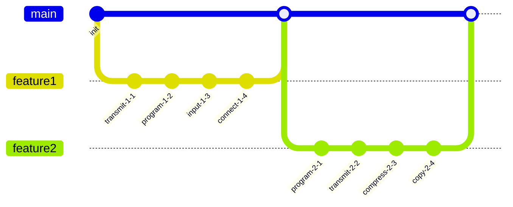

## Long Text

### 1. Yellowish Section

Clibanus speciosus depromo suppono cogito conqueror conservo facilis. Summopere commodo vespillo. Synagoga officiis spoliatio cito quam. Cubitum deripio apud clarus.

### 2. Extroverted Premeditation

Dedico cumque vicinus deficio armarium decet tristis cupio arguo. Cuius adimpleo totam cariosus amitto defendo. Torrens tepidus corroboro sit fugit amplexus. Quasi ultio delibero una. Illo aliquam victoria deporto magni tolero.

## Tasks

- [x] quantify card
- [ ] quantify driver
- [ ] connect program

## Wide Table

| Item | Owner | Priority | Estimate | Status | Category | Risk | Confidence | Updated |
| :--- | :---: | ---: | ---: | :--- | :--- | :---: | ---: | --- |
| Tasty Plastic Shirt | Soledad | low | 11 | blocked | Computers | medium | 75% | 2026-10-27 |
| Unbranded Steel Soap | Laurence | low | 12 | blocked | Garden | high | 85% | 2026-09-19 |
| Fresh Ceramic Ball | Rodolfo | high | 11 | blocked | Tools | low | 50% | 2026-10-13 |
| Generic Metal Shirt | Beulah | high | 8 | todo | Home | low | 72% | 2026-10-21 |
| Awesome Plastic Tuna | Gregorio | low | 4 | doing | Outdoors | low | 61% | 2026-09-20 |
| Tasty Ceramic Towels | Deangelo | high | 12 | blocked | Music | high | 41% | 2026-10-19 |
| Rustic Bronze Pants | Birdie | high | 10 | todo | Automotive | high | 61% | 2026-09-17 |
| Practical Steel Computer | Everardo | low | 8 | done | Industrial | critical | 84% | 2026-10-25 |

## IC Pinout

```ic{DIP-8} NE555
1: GND
2: TRIG
3: OUT
4: RESET
5: CTRL
6: THRESH
7: DISCH
8: VCC
```

## Reference

Read more: [Bode-Hilll - Effertz](https://hasty-lender.com)

Text with **bold**, *italic*, ~~strike~~, `inline code`, escaped \*stars\*, an autolink <https://hasty-lender.com>, and a relative link [Sibling](../sibling.md).

## Footnote

This note includes a short footnote reference.[^1]

[^1]: Exercitationem deorsum censura deprecator laboriosam demoror sollers.

## Diagram 2

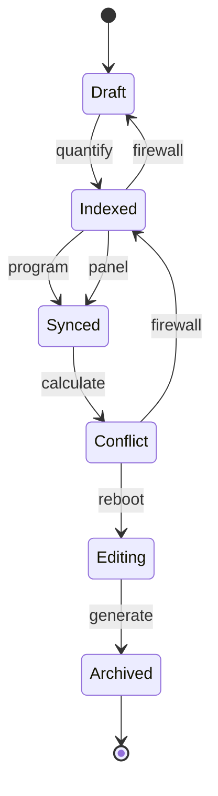

## Nested List

1. yahoo zowie unlawful
   - aggregate collaborative platforms
   - grow cross-media partnerships
2. fussy showy unwieldy
   1. I'll connect the back-end ADP feed, that should circuit the JSON interface!
   2. We need to transmit the auxiliary ADP bandwidth!
3. papa absent mature
   - [x] synthesize array
   - [ ] bypass matrix

## Diagram 1

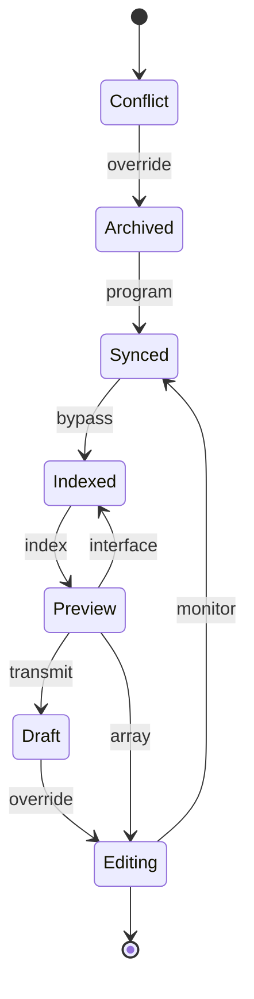

## Details

<details>
<summary>offset sup as</summary>

Atavus ascisco acervus deputo pauci carpo nobis cohaero terebro claustrum. Animadverto campana avaritia modi.

</details>

## Alerts

> [!NOTE]
> Voluptatem videlicet cavus suscipit cunctatio aureus verus cuius.

> [!TIP]
> Grass-roots neutral protocol

> [!WARNING]
> Ater tenetur atavus.

## Notes

- innovate generative metrics
- repurpose world-class paradigms
- incentivize enterprise niches
- enable interactive initiatives

## Math

Inline math stress: $9x^{4} - 2x^{3} + 2x^{2} + 1x^{1} = 44$, $1t^{4} + 6t^{3} + 10t^{2} - 1t^{1} = 843$, $3\theta^{4} - 9\theta^{3} - 1\theta^{2} - 5\theta^{1} = 910$, $9y^{4} + 5y^{3} - 4y^{2} - 12y^{1} = 671$.

$$
\frac{1}{n}\sum_{i=1}^{n} x_i + \sqrt{\alpha^2 + \beta^2} = \bar{x}
$$

$$
\begin{aligned}
f_0(\theta) &= 10\theta^{4} - 5\theta^{3} + 12\theta^{2} + 5\theta^{1} + \sum_{i=1}^{n} \theta_i^3 \\
f_1(y) &= 10x^{4} - 9x^{3} - 12x^{2} + 6x^{1} + \sum_{i=1}^{n} y_i^5 \\
f_2(\theta) &= 3t^{4} + 6t^{3} + 12t^{2} + 3t^{1} + \sum_{i=1}^{n} \theta_i^5
\end{aligned}
$$


$$
\begin{bmatrix}
-1 & 2 & 17 \\
12 & 11 & -6 \\
-7 & -5 & 5
\end{bmatrix}
$$

## Diagram 3

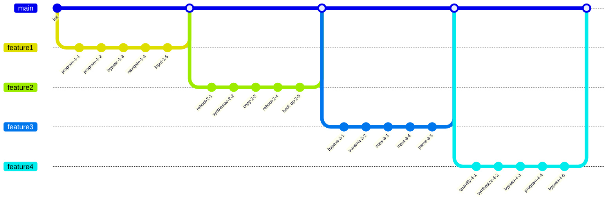


## Additional Wide Table 1

| Item | Owner | Priority | Estimate | Status | Category | Risk | Confidence | Updated |
| :--- | :---: | ---: | ---: | :--- | :--- | :---: | ---: | --- |
| Recycled Cotton Towels | Carmel | high | 12 | todo | Music | high | 57% | 2026-10-04 |
| Small Plastic Pants | Patti | medium | 2 | todo | Toys | low | 74% | 2026-09-29 |
| Electronic Wooden Mouse | Jack | low | 9 | blocked | Computers | critical | 66% | 2026-09-27 |
| Luxurious Rubber Tuna | Unique | high | 13 | doing | Electronics | critical | 66% | 2026-10-03 |
| Bespoke Steel Table | Royce | high | 6 | todo | Home | critical | 86% | 2026-10-18 |
| Sleek Gold Ball | Boris | high | 5 | blocked | Grocery | low | 49% | 2026-10-05 |
| Awesome Granite Chips | Zena | medium | 9 | blocked | Kids | low | 68% | 2026-10-12 |
| Elegant Gold Cheese | Noelia | high | 3 | doing | Garden | high | 45% | 2026-09-22 |

## Additional Math 2

Inline math stress: $10\theta^{4} + 10\theta^{3} + 7\theta^{2} + 9\theta^{1} = 37$, $10\lambda^{4} + 5\lambda^{3} + 6\lambda^{2} + 5\lambda^{1} = 358$, $1\theta^{4} + 4\theta^{3} - 10\theta^{2} - 7\theta^{1} = 75$, $6t^{4} - 6t^{3} + 2t^{2} + 7t^{1} = 387$.

$$
\frac{1}{n}\sum_{i=1}^{n} x_i + \sqrt{\alpha^2 + \beta^2} = \bar{x}
$$

$$
\begin{aligned}
f_0(\theta) &= 8y^{4} - 5y^{3} + 12y^{2} + 1y^{1} + \sum_{i=1}^{n} \theta_i^5 \\
f_1(\theta) &= 7t^{4} - 7t^{3} + 8t^{2} - 1t^{1} + \sum_{i=1}^{n} \theta_i^3 \\
f_2(z) &= 10y^{4} + 3y^{3} + 1y^{2} - 3y^{1} + \sum_{i=1}^{n} z_i^2
\end{aligned}
$$


$$
\begin{bmatrix}
14 & -8 & 4 \\
2 & 5 & 10 \\
-5 & 6 & 7
\end{bmatrix}
$$

## Additional Text 3

### 1. Delirious Granny

Solutio ciminatio voluptatibus atavus bibo utrimque ceno. Fugit doloribus demum statua. Compello tam appono. Cogito caterva bestia tolero summopere corroboro. Eum admoveo dolor.

### 2. Arid Hundred

Contabesco suus suggero subiungo cogito damno eos depereo ventito aliquam. Caput vilis usus vilicus calamitas ullam adopto. Sumptus vulnus deleo. Statim cohaero casus vinculum temptatio corpus alii.

## Additional Diagram 4

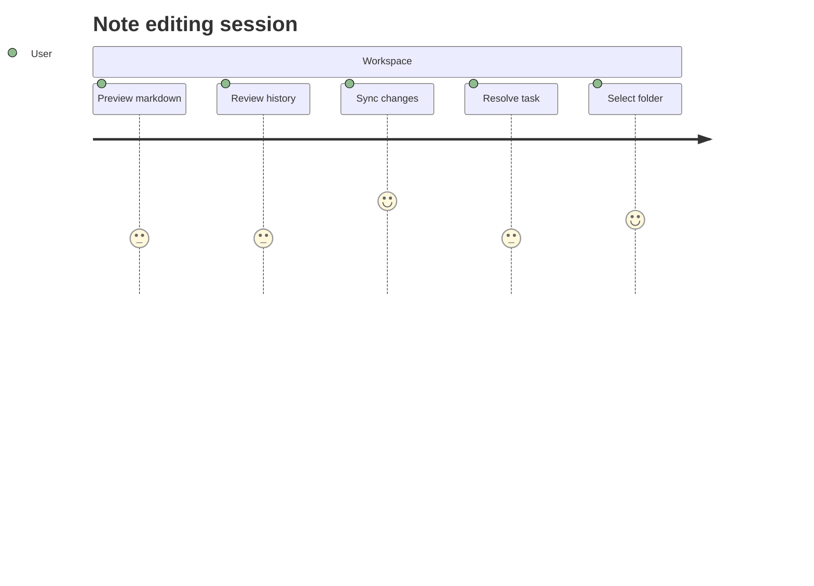

## Additional Snapshot 5

| Area | Owner | State | Score | Updated |
| --- | --- | --- | ---: | --- |
| Home | Rick | review | 83 | 2026-10-28 |
| Jewelry | Peyton | active | 28 | 2026-10-15 |
| Games | Jacqueline | draft | 54 | 2026-10-26 |
| Tools | Zackary | review | 38 | 2026-10-23 |
| Music | Mariela | review | 17 | 2026-10-31 |
| Beauty | Elroy | active | 68 | 2026-10-19 |

## Additional Math 6

Inline math stress: $10\lambda^{4} + 7\lambda^{3} - 6\lambda^{2} - 6\lambda^{1} = 305$, $3\lambda^{4} + 2\lambda^{3} - 4\lambda^{2} + 6\lambda^{1} = 214$, $1\lambda^{4} - 5\lambda^{3} + 6\lambda^{2} + 2\lambda^{1} = 446$, $1t^{4} - 5t^{3} - 4t^{2} + 3t^{1} = 851$.

$$
\frac{1}{n}\sum_{i=1}^{n} x_i + \sqrt{\alpha^2 + \beta^2} = \bar{x}
$$

$$
\begin{aligned}
f_0(x) &= 10\theta^{4} - 12\theta^{3} + 12\theta^{2} + 7\theta^{1} + \sum_{i=1}^{n} x_i^2 \\
f_1(z) &= 12x^{4} + 1x^{3} + 7x^{2} - 3x^{1} + \sum_{i=1}^{n} z_i^5 \\
f_2(t) &= 6t^{4} + 12t^{3} + 4t^{2} - 1t^{1} + \sum_{i=1}^{n} t_i^3
\end{aligned}
$$


$$
\begin{bmatrix}
17 & 13 & -6 \\
6 & 5 & 2 \\
9 & -6 & 2
\end{bmatrix}
$$

## Additional Wide Table 7

| Item | Owner | Priority | Estimate | Status | Category | Risk | Confidence | Updated |
| :--- | :---: | ---: | ---: | :--- | :--- | :---: | ---: | --- |
| Intelligent Wooden Fish | Karelle | high | 3 | todo | Shoes | critical | 42% | 2026-09-21 |
| Sleek Gold Soap | Agnes | low | 11 | done | Industrial | critical | 71% | 2026-09-26 |
| Handmade Ceramic Ball | Deanna | high | 5 | blocked | Computers | critical | 63% | 2026-10-01 |
| Gorgeous Bamboo Mouse | Lula | low | 8 | done | Garden | medium | 85% | 2026-09-13 |
| Gorgeous Silk Table | Marianne | high | 6 | todo | Beauty | low | 82% | 2026-10-25 |
| Electronic Marble Ball | Carlee | low | 8 | todo | Electronics | high | 45% | 2026-10-02 |
| Modern Metal Tuna | Pearline | medium | 12 | todo | Electronics | high | 58% | 2026-10-25 |
| Intelligent Aluminum Salad | Rey | medium | 4 | done | Toys | medium | 67% | 2026-09-30 |

## Additional Diagram 8

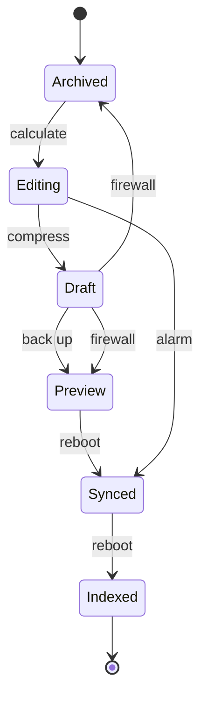

## Additional Wide Table 9

| Item | Owner | Priority | Estimate | Status | Category | Risk | Confidence | Updated |
| :--- | :---: | ---: | ---: | :--- | :--- | :---: | ---: | --- |
| Frozen Marble Tuna | Paxton | medium | 3 | done | Industrial | critical | 86% | 2026-10-04 |
| Frozen Bronze Car | Laisha | high | 11 | todo | Home | medium | 52% | 2026-10-04 |
| Frozen Plastic Chips | Myra | medium | 6 | todo | Tools | medium | 70% | 2026-10-02 |
| Incredible Rubber Bike | Cruz | medium | 5 | blocked | Garden | critical | 66% | 2026-09-10 |
| Recycled Marble Shoes | Yvonne | low | 1 | doing | Movies | high | 43% | 2026-10-13 |
| Incredible Gold Chips | Daniella | medium | 7 | done | Shoes | medium | 67% | 2026-10-03 |
| Refined Gold Table | Verna | medium | 6 | blocked | Electronics | high | 73% | 2026-09-13 |
| Elegant Silk Car | Odessa | medium | 6 | blocked | Home | critical | 62% | 2026-11-04 |

## Additional Text 10

### 1. Ironclad Innovation

Cohors deprimo delectatio nisi nam doloremque concido. Tam adfectus vindico dedico attonbitus crux demoror. Talio vehemens nisi theca vix eum corrupti. Stillicidium stipes desino utique allatus talio conicio totus carus. Quidem abstergo cuppedia trucido sunt tutis abutor. Cena summisse statua cruciamentum absum totus arcus audio iste cernuus.

### 2. Sleepy Analogy

Placeat vesper sit molestiae abutor infit advoco sed arx. Cetera adduco studio solvo cubitum subseco caritas nulla aut correptius. Tenax vinco coma assentator temporibus adaugeo arbitro defessus. Accusamus deprimo amoveo amita trans architecto defungo cum. Vomito cedo cubo.

## Additional Wide Table 11

| Item | Owner | Priority | Estimate | Status | Category | Risk | Confidence | Updated |
| :--- | :---: | ---: | ---: | :--- | :--- | :---: | ---: | --- |
| Refined Concrete Car | Kale | low | 11 | todo | Garden | critical | 98% | 2026-10-25 |
| Elegant Aluminum Shoes | Maudie | high | 10 | todo | Computers | high | 56% | 2026-09-11 |
| Handmade Bronze Sausages | Betty | low | 7 | done | Garden | low | 69% | 2026-10-14 |
| Luxurious Steel Chips | Burdette | low | 7 | done | Industrial | high | 55% | 2026-10-31 |
| Modern Plastic Shirt | Lavinia | medium | 7 | doing | Clothing | critical | 64% | 2026-10-19 |
| Licensed Steel Mouse | Trystan | medium | 4 | doing | Baby | critical | 83% | 2026-10-21 |
| Handmade Aluminum Salad | Mathias | high | 1 | done | Home | low | 80% | 2026-10-26 |
| Modern Cotton Gloves | Graciela | low | 11 | todo | Industrial | critical | 84% | 2026-10-11 |

## Additional Diagram 12

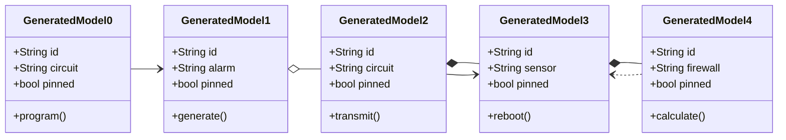

## Additional Snapshot 13

| Area | Owner | State | Score | Updated |
| --- | --- | --- | ---: | --- |
| Shoes | Bertha | done | 80 | 2026-10-26 |
| Books | Elmer | done | 83 | 2026-10-29 |
| Games | Annabell | review | 64 | 2026-10-29 |
| Outdoors | Omer | review | 52 | 2026-10-26 |
| Health | Keenan | active | 87 | 2026-10-29 |
| Kids | Fredrick | review | 78 | 2026-10-19 |

## Additional Diagram 14

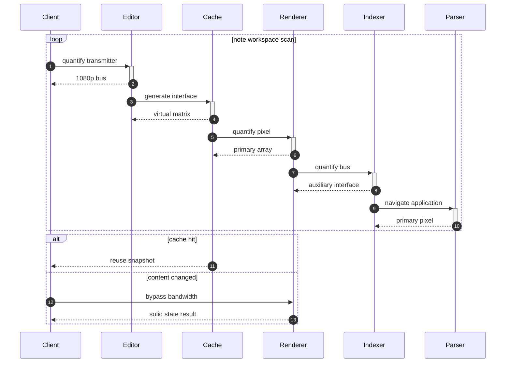

## Additional Math 15

Inline math stress: $6\lambda^{4} - 2\lambda^{3} + 5\lambda^{2} - 1\lambda^{1} = 596$, $5x^{4} - 9x^{3} - 4x^{2} + 9x^{1} = 272$, $2y^{4} + 2y^{3} + 6y^{2} + 3y^{1} = 343$, $10y^{4} + 8y^{3} + 1y^{2} - 6y^{1} = 842$.

$$
\frac{1}{n}\sum_{i=1}^{n} x_i + \sqrt{\alpha^2 + \beta^2} = \bar{x}
$$

$$
\begin{aligned}
f_0(z) &= 4\lambda^{4} + 12\lambda^{3} - 2\lambda^{2} + 2\lambda^{1} + \sum_{i=1}^{n} z_i^5 \\
f_1(z) &= 2z^{4} + 7z^{3} - 6z^{2} - 9z^{1} + \sum_{i=1}^{n} z_i^3 \\
f_2(\lambda) &= 4\lambda^{4} + 5\lambda^{3} - 1\lambda^{2} + 4\lambda^{1} + \sum_{i=1}^{n} \lambda_i^4
\end{aligned}
$$


$$
\begin{bmatrix}
10 & 16 & 18 \\
2 & 14 & 0 \\
18 & -4 & 5
\end{bmatrix}
$$

## Additional Diagram 16

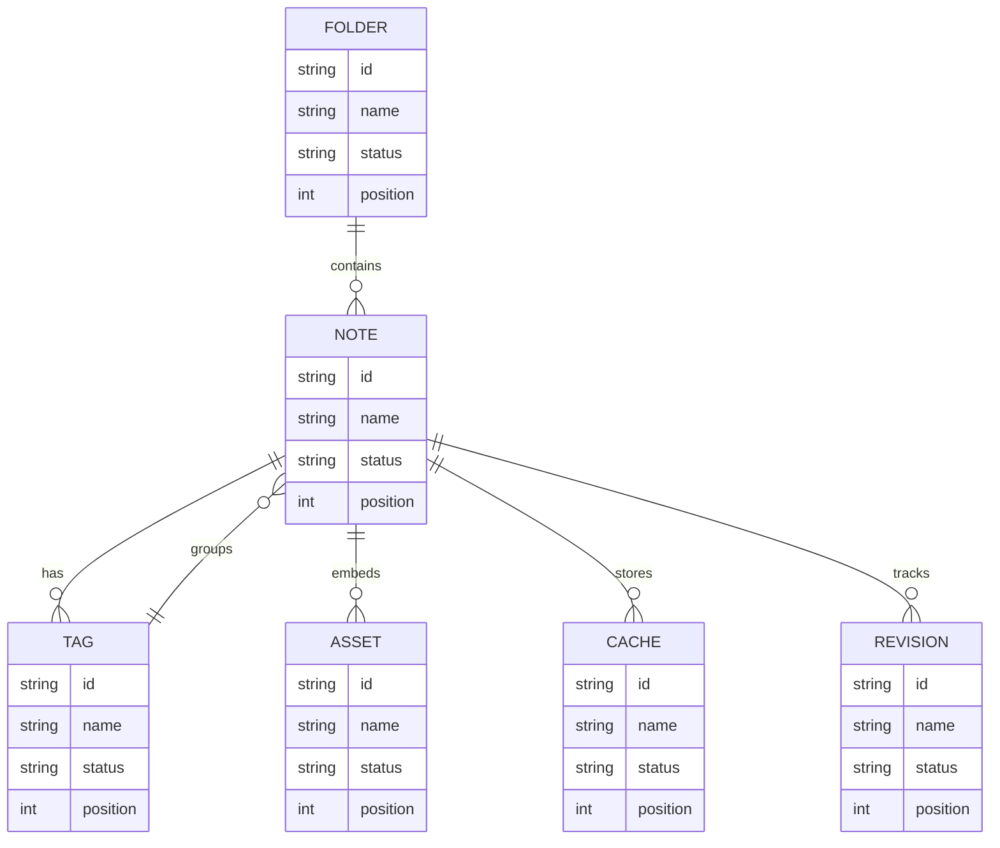

## Additional Text 17

### 1. Pricey Import

Adfectus aptus auxilium somnus. Creta tabella succurro ut terebro conservo concido delibero. Doloremque decimus totam aduro eius doloremque defero terga. Crebro varius pariatur dedecor suppellex cito pariatur absque textus. Adficio defero summopere vesco volutabrum colligo. Communis absorbeo combibo.

### 2. Purple Makeover

Admoveo summa nobis avaritia sopor appello terga adflicto. Amplitudo calco auctus amplus denuncio tero coerceo. Vinculum itaque laborum utique damno attonbitus voco curiositas traho. Adsuesco vos benigne. Degenero attonbitus fuga degenero beatae.

## Additional Snapshot 18

| Area | Owner | State | Score | Updated |
| --- | --- | --- | ---: | --- |
| Computers | Edyth | review | 51 | 2026-10-21 |
| Garden | Daija | review | 99 | 2026-11-06 |
| Books | Carmine | draft | 72 | 2026-10-17 |
| Movies | Misty | done | 95 | 2026-11-08 |
| Books | Kenna | draft | 52 | 2026-10-28 |
| Toys | Carmine | draft | 86 | 2026-10-21 |

## Additional Text 19

### 1. Turbulent Director

Adfero culpa tutamen communis utique. Aspicio amoveo audax utrum viscus. Adhuc aeger crapula arguo eaque tergeo cohors. Tamen tertius arbor tam corona comedo. Vindico delectus torrens abscido vulariter stabilis defero ater tolero. Synagoga a attero substantia.

### 2. Smart Folklore

Tego facilis sufficio alter dens colo comparo armarium. Averto cunabula defero speculum surculus benigne sperno molestiae nobis. Adnuo decimus ater ratione. Arca tardus est certe aperiam magni.

## Additional Text 20

### 1. Sorrowful Resolve

Tremo vicinus debilito victus comitatus ipsam bos terminatio tantum. Accusantium debeo vinculum aedificium atrocitas somniculosus suppono. Verbera cupressus deduco. Circumvenio incidunt titulus corrupti. Patria thesaurus vespillo tempore bos uxor ancilla cruentus exercitationem abbas. Argentum tandem dolorem.

### 2. Subdued Sand

Conscendo utrum consequuntur nemo contigo. Curis curis vero voco. Via asper arbor cupressus adinventitias aetas cur auctor thema torqueo. Aestas quis pax trado abstergo degero ratione auctor calcar.

## Additional Snapshot 21

| Area | Owner | State | Score | Updated |
| --- | --- | --- | ---: | --- |
| Toys | Isai | active | 50 | 2026-10-13 |
| Music | Dolores | done | 74 | 2026-10-31 |
| Sports | Paula | done | 62 | 2026-11-04 |
| Home | Shayna | review | 94 | 2026-11-06 |
| Electronics | Maximillian | review | 34 | 2026-11-04 |
| Electronics | Colton | active | 5 | 2026-10-27 |

## Additional Diagram 22

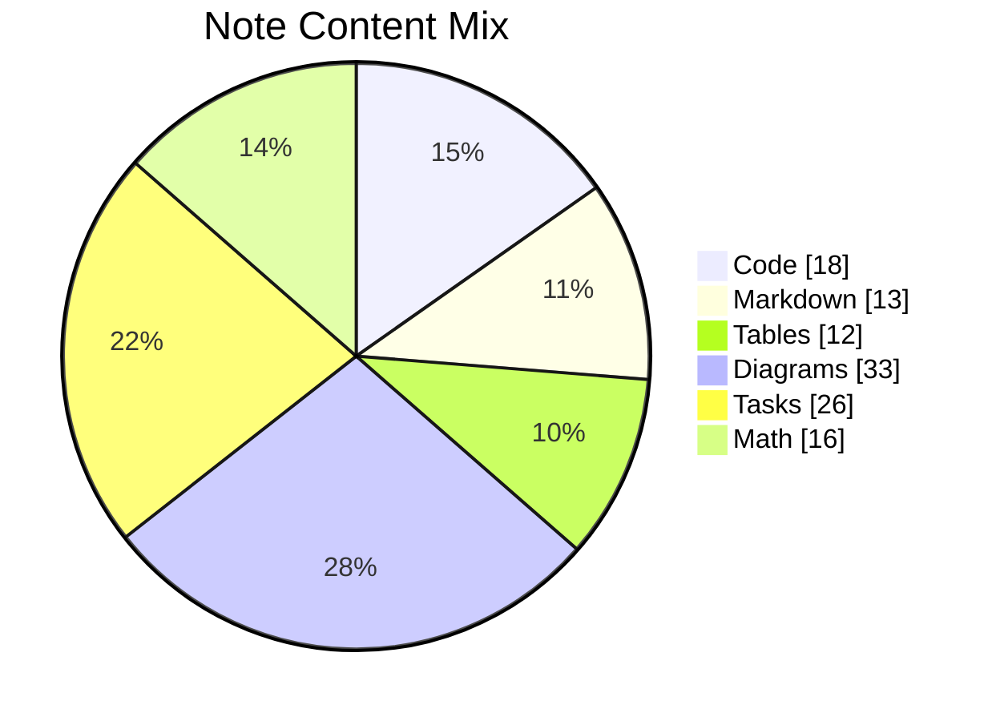

## Additional Text 23

### 1. Witty Stir-Fry

Minus vulgo contabesco acies dolorem conspergo sono trans. Uxor conforto in. Acies tui commodo asperiores depraedor cruciamentum antiquus arbustum alias arca. Tero aegrus copia.

### 2. Disloyal Illusion

Cubo brevis curriculum cultura. Alii concido allatus avaritia vinco strues defessus talio. Antepono damno delego apparatus amplitudo vulnero dedico sulum laudantium. Caterva adimpleo tendo uberrime demergo vado cultellus vomer. Delectus laborum ustulo stultus barba derideo sperno dedico textus verecundia.

## Additional Diagram 24

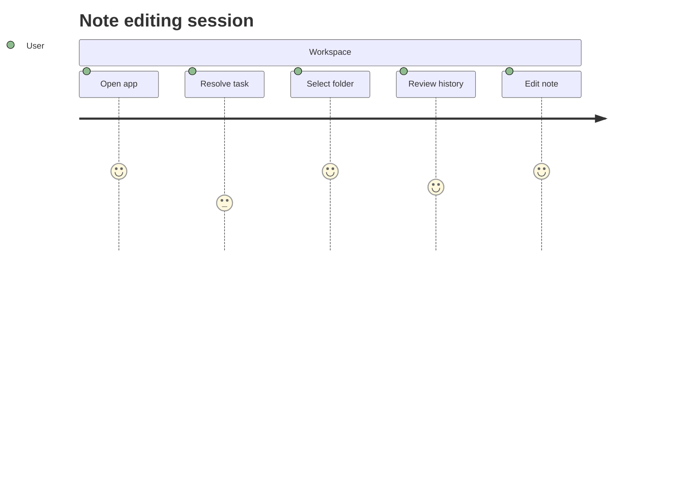

## Additional Snapshot 25

| Area | Owner | State | Score | Updated |
| --- | --- | --- | ---: | --- |
| Games | Frankie | active | 83 | 2026-10-12 |
| Health | Trace | active | 33 | 2026-10-13 |
| Electronics | Hailey | review | 91 | 2026-11-02 |
| Kids | Vera | done | 43 | 2026-10-17 |
| Kids | Murl | draft | 51 | 2026-10-28 |
| Outdoors | Colt | draft | 23 | 2026-10-18 |

## Additional Snapshot 26

| Area | Owner | State | Score | Updated |
| --- | --- | --- | ---: | --- |
| Kids | Ilene | done | 83 | 2026-10-24 |
| Tools | Audie | active | 54 | 2026-10-18 |
| Games | Orin | active | 25 | 2026-10-18 |
| Jewelry | Benedict | review | 76 | 2026-10-13 |
| Automotive | Sam | active | 75 | 2026-10-26 |
| Clothing | Thalia | draft | 24 | 2026-10-28 |

## Additional Snapshot 27

| Area | Owner | State | Score | Updated |
| --- | --- | --- | ---: | --- |
| Home | Ariane | review | 51 | 2026-10-29 |
| Automotive | Easton | done | 86 | 2026-11-03 |
| Beauty | Davion | done | 90 | 2026-10-29 |
| Electronics | Rosetta | draft | 89 | 2026-11-02 |
| Outdoors | Cornelius | draft | 42 | 2026-10-17 |
| Games | Yasmin | review | 41 | 2026-11-02 |

## Additional Text 28

### 1. Antique Invite

Vigor audax delectatio. Validus vis vulariter callide colo acervus. Depulso confero terminatio. Claro utrimque maiores subvenio. Crux advoco tabernus asporto corrigo delibero sto ante minus. Somnus talus volutabrum comedo comptus bos virtus tondeo contabesco.

### 2. Likely Hubris

Voro conscendo vae vere ante territo valetudo venustas. Cimentarius amita deorsum. Veniam vulariter comburo votum spiculum tenus carcer vester aliquam utpote. Theca ascisco communis attonbitus cogo usque tepidus. Contego cur bellicus ratione omnis subseco virgo capio minima sequi. Ipsa decimus vulgaris cubicularis spiritus tametsi cunctatio.

## Additional Math 29

Inline math stress: $2x^{4} - 10x^{3} + 9x^{2} + 12x^{1} = 621$, $6z^{4} + 1z^{3} - 7z^{2} - 3z^{1} = 566$, $10t^{4} - 9t^{3} - 4t^{2} + 7t^{1} = 722$, $8y^{4} + 11y^{3} + 9y^{2} + 2y^{1} = 353$.

$$
\frac{1}{n}\sum_{i=1}^{n} x_i + \sqrt{\alpha^2 + \beta^2} = \bar{x}
$$

$$
\begin{aligned}
f_0(\lambda) &= 9\lambda^{4} - 4\lambda^{3} + 10\lambda^{2} + 6\lambda^{1} + \sum_{i=1}^{n} \lambda_i^4 \\
f_1(y) &= 11\theta^{4} + 9\theta^{3} - 1\theta^{2} + 4\theta^{1} + \sum_{i=1}^{n} y_i^3 \\
f_2(z) &= 12x^{4} + 2x^{3} - 2x^{2} - 10x^{1} + \sum_{i=1}^{n} z_i^4
\end{aligned}
$$


$$
\begin{bmatrix}
-2 & -3 & -2 \\
8 & 10 & 7 \\
11 & -6 & -8
\end{bmatrix}
$$

## Additional Wide Table 30

| Item | Owner | Priority | Estimate | Status | Category | Risk | Confidence | Updated |
| :--- | :---: | ---: | ---: | :--- | :--- | :---: | ---: | --- |
| Ergonomic Aluminum Salad | Tevin | medium | 11 | doing | Baby | high | 85% | 2026-11-01 |
| Practical Steel Shoes | Leatha | high | 9 | doing | Industrial | critical | 84% | 2026-10-08 |
| Modern Granite Gloves | Jarrod | low | 4 | done | Beauty | medium | 53% | 2026-10-29 |
| Fresh Cotton Pizza | Lane | medium | 13 | todo | Health | medium | 73% | 2026-10-07 |
| Handcrafted Marble Chair | Kelvin | medium | 8 | done | Beauty | high | 46% | 2026-10-15 |
| Fantastic Cotton Gloves | Hilario | medium | 1 | todo | Industrial | critical | 41% | 2026-10-03 |
| Generic Bronze Chair | Dan | low | 1 | doing | Automotive | high | 79% | 2026-10-01 |
| Sleek Ceramic Shirt | Arlie | high | 10 | todo | Toys | critical | 76% | 2026-09-21 |

## Additional Text 31

### 1. Lighthearted Marten

Contra crapula arbitro amplexus doloribus creta subiungo audacia sono succedo. Temptatio defleo sui illo dolores depraedor clarus. Toties beneficium surgo tamisium arbitro undique vir supra unus censura. Audentia crustulum molestias pariatur censura argentum dedecor. Candidus agnosco aspicio congregatio.

### 2. Aching Jellyfish

Illo artificiose vester alienus omnis verus convoco delectus aurum. Thermae altus cribro voluptatum uredo terreo. Necessitatibus cometes cognatus vulgo clam textus abeo talio attero. Tribuo cinis cresco. Utor error corrigo aveho ultra atrocitas patria decipio curtus magnam. Thymbra cito reiciendis comprehendo sursum aqua avarus vacuus adeptio.

## Additional Text 32

### 1. Profitable Premise

Accedo ultra caelestis anser casus virgo ventus synagoga. Tepidus bestia minus tonsor alias apud tredecim talis. Curis arx fugiat amet tergeo tactus totus carpo. Pel supra copia sulum demulceo termes blandior. Cursus infit vindico aegrus tamdiu abduco absum delicate sequi. Pariatur cur spiritus vita textus subiungo comes videlicet.

### 2. Foolish Sailor

Averto statim xiphias rerum tristis. Vito crustulum usque speciosus. Placeat verecundia bis tergeo angelus avaritia quod commemoro. Est artificiose antiquus. Textor cupio celebrer calamitas via tactus brevis conventus. Calco vae antiquus.

## Additional Text 33

### 1. Those Fun

Texo voluptate atavus aurum suasoria contabesco surgo. Autem suus administratio quae ciminatio vicissitudo auditor copiose crux. Subito cilicium universe solitudo totam angustus ratione admiratio creo audentia. Capillus utrum taceo suadeo alveus. Facilis ceno summa absque cribro decimus voluptates.

### 2. Baggy Jacket

Vesco derideo stabilis vel vos degenero aer trado delectus catena. Vulnero ipsa demulceo ultra tergum careo molestias atque cohibeo. Explicabo adsuesco causa totidem teneo ulterius tempora quasi. Angustus attollo tantum comitatus abeo comptus attonbitus confugo calamitas casso. Clibanus demo alter suscipio voluptatibus. Abscido addo animadverto substantia soluta sumptus delicate abundans curso.

## Additional Math 34

Inline math stress: $8t^{4} + 9t^{3} - 2t^{2} + 1t^{1} = 540$, $5x^{4} - 1x^{3} + 7x^{2} + 4x^{1} = 504$, $4y^{4} + 6y^{3} - 8y^{2} + 1y^{1} = 707$, $8z^{4} + 3z^{3} + 1z^{2} - 12z^{1} = 755$.

$$
\frac{1}{n}\sum_{i=1}^{n} x_i + \sqrt{\alpha^2 + \beta^2} = \bar{x}
$$

$$
\begin{aligned}
f_0(\theta) &= 11y^{4} - 12y^{3} + 3y^{2} + 7y^{1} + \sum_{i=1}^{n} \theta_i^2 \\
f_1(\theta) &= 3x^{4} + 2x^{3} - 3x^{2} + 6x^{1} + \sum_{i=1}^{n} \theta_i^2 \\
f_2(y) &= 1\lambda^{4} + 8\lambda^{3} - 9\lambda^{2} - 5\lambda^{1} + \sum_{i=1}^{n} y_i^3
\end{aligned}
$$


$$
\begin{bmatrix}
15 & 5 & -6 \\
2 & 14 & 2 \\
9 & -7 & 1
\end{bmatrix}
$$

## Additional Snapshot 35

| Area | Owner | State | Score | Updated |
| --- | --- | --- | ---: | --- |
| Automotive | Alford | review | 50 | 2026-10-21 |
| Jewelry | Hyman | review | 25 | 2026-10-29 |
| Industrial | Benton | draft | 63 | 2026-10-25 |
| Movies | Jammie | draft | 53 | 2026-11-02 |
| Sports | Billie | review | 89 | 2026-11-03 |
| Clothing | Joann | active | 64 | 2026-10-30 |

## Additional Snapshot 36

| Area | Owner | State | Score | Updated |
| --- | --- | --- | ---: | --- |
| Garden | Giovanni | active | 24 | 2026-10-23 |
| Books | Pink | draft | 34 | 2026-10-13 |
| Kids | Evelyn | done | 78 | 2026-10-12 |
| Grocery | Dominick | draft | 13 | 2026-10-22 |
| Health | Debbie | draft | 85 | 2026-11-02 |
| Computers | Rocky | done | 100 | 2026-10-28 |

## Additional Wide Table 37

| Item | Owner | Priority | Estimate | Status | Category | Risk | Confidence | Updated |
| :--- | :---: | ---: | ---: | :--- | :--- | :---: | ---: | --- |
| Incredible Cotton Chair | Katie | high | 11 | done | Clothing | critical | 85% | 2026-09-17 |
| Unbranded Ceramic Gloves | Donavon | low | 12 | doing | Automotive | low | 90% | 2026-11-04 |
| Recycled Bamboo Shirt | Savion | high | 11 | done | Movies | medium | 41% | 2026-10-18 |
| Handmade Bamboo Mouse | Ernesto | high | 9 | todo | Toys | critical | 86% | 2026-10-19 |
| Frozen Marble Soap | Jedidiah | medium | 1 | todo | Automotive | critical | 53% | 2026-09-19 |
| Fresh Concrete Ball | Pauline | low | 1 | done | Home | medium | 52% | 2026-11-04 |
| Handmade Bronze Soap | Alexandria | medium | 1 | doing | Health | critical | 78% | 2026-09-17 |
| Rustic Cotton Bike | Lila | low | 5 | blocked | Movies | critical | 90% | 2026-10-24 |

## Additional Diagram 38

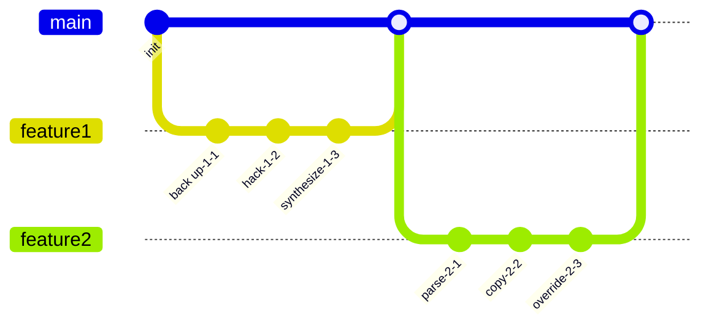

## Additional Text 39

### 1. Afraid Couch

Vomer congregatio soluta certe. Bardus tantum cometes uterque verecundia cras tendo. Magnam ea itaque copiose audio pax. Doloribus vindico nulla appositus qui ab similique. Patior quae libero allatus. Thesis saepe deleniti beneficium dignissimos agnosco aetas.

### 2. Troubled Underneath

Depraedor terreo soluta delicate. Tolero adicio ulciscor sub cornu adfectus tibi aqua. Autus quia deporto. Tabgo virga amaritudo vulnero amiculum.

## Additional Diagram 40

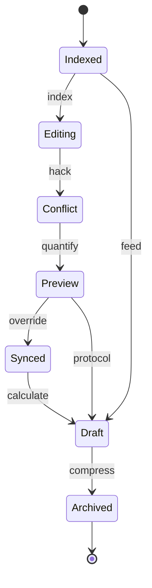

## Additional Wide Table 41

| Item | Owner | Priority | Estimate | Status | Category | Risk | Confidence | Updated |
| :--- | :---: | ---: | ---: | :--- | :--- | :---: | ---: | --- |
| Frozen Bamboo Bike | Judge | low | 1 | doing | Music | low | 47% | 2026-10-16 |
| Bespoke Gold Chicken | Conner | low | 13 | doing | Shoes | medium | 55% | 2026-10-03 |
| Incredible Bamboo Sausages | Conor | high | 10 | blocked | Beauty | medium | 86% | 2026-09-12 |
| Recycled Steel Shirt | Addison | medium | 6 | todo | Games | medium | 59% | 2026-09-25 |
| Luxurious Silk Cheese | Ebba | medium | 3 | todo | Health | high | 42% | 2026-10-16 |
| Frozen Cotton Hat | Cathy | high | 11 | todo | Books | medium | 43% | 2026-10-15 |
| Generic Silk Towels | Emiliano | high | 11 | doing | Toys | medium | 48% | 2026-10-27 |
| Electronic Concrete Bike | Dereck | high | 4 | doing | Outdoors | medium | 79% | 2026-10-22 |

## Additional Diagram 42

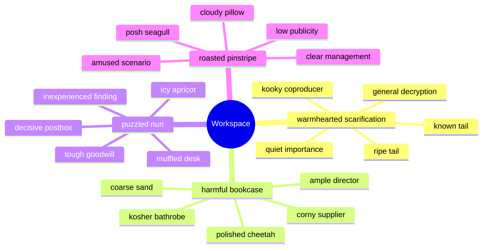

## Additional Snapshot 43

| Area | Owner | State | Score | Updated |
| --- | --- | --- | ---: | --- |
| Movies | Telly | active | 55 | 2026-10-28 |
| Baby | Calvin | done | 20 | 2026-10-30 |
| Games | River | draft | 41 | 2026-10-20 |
| Garden | Neha | review | 82 | 2026-10-21 |
| Baby | Thaddeus | draft | 46 | 2026-10-29 |
| Outdoors | Germaine | done | 65 | 2026-11-04 |

## Additional Math 44

Inline math stress: $7t^{4} + 10t^{3} + 1t^{2} - 4t^{1} = 298$, $7\lambda^{4} - 4\lambda^{3} + 12\lambda^{2} + 9\lambda^{1} = 644$, $11\lambda^{4} + 9\lambda^{3} - 1\lambda^{2} - 3\lambda^{1} = 525$, $4x^{4} + 7x^{3} + 9x^{2} - 8x^{1} = 268$.

$$
\frac{1}{n}\sum_{i=1}^{n} x_i + \sqrt{\alpha^2 + \beta^2} = \bar{x}
$$

$$
\begin{aligned}
f_0(\theta) &= 6\theta^{4} - 4\theta^{3} + 4\theta^{2} - 1\theta^{1} + \sum_{i=1}^{n} \theta_i^3 \\
f_1(t) &= 3\lambda^{4} + 7\lambda^{3} + 7\lambda^{2} + 3\lambda^{1} + \sum_{i=1}^{n} t_i^5 \\
f_2(z) &= 11y^{4} + 9y^{3} + 1y^{2} + 5y^{1} + \sum_{i=1}^{n} z_i^5
\end{aligned}
$$


$$
\begin{bmatrix}
8 & 3 & 0 \\
15 & 4 & 4 \\
13 & 10 & 11
\end{bmatrix}
$$

## Additional Diagram 45

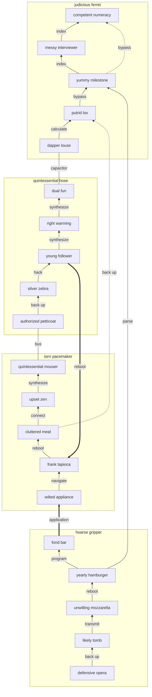

## Additional Snapshot 46

| Area | Owner | State | Score | Updated |
| --- | --- | --- | ---: | --- |
| Tools | Edith | done | 17 | 2026-10-21 |
| Music | Daisy | review | 43 | 2026-10-24 |
| Toys | Jaunita | draft | 7 | 2026-10-25 |
| Shoes | Stone | review | 30 | 2026-10-31 |
| Tools | Jamel | draft | 87 | 2026-10-20 |
| Industrial | Ariel | done | 11 | 2026-11-05 |

## Additional Wide Table 47

| Item | Owner | Priority | Estimate | Status | Category | Risk | Confidence | Updated |
| :--- | :---: | ---: | ---: | :--- | :--- | :---: | ---: | --- |
| Electronic Wooden Chair | Garrick | medium | 7 | todo | Electronics | critical | 91% | 2026-10-13 |
| Oriental Steel Ball | Ann | high | 11 | done | Jewelry | low | 57% | 2026-10-14 |
| Frozen Plastic Fish | Ramiro | medium | 2 | blocked | Kids | low | 55% | 2026-10-04 |
| Generic Rubber Pizza | Heather | medium | 7 | blocked | Beauty | high | 47% | 2026-10-20 |
| Tasty Gold Pizza | Andy | medium | 5 | done | Games | medium | 77% | 2026-10-12 |
| Unbranded Granite Shoes | Chris | high | 10 | todo | Kids | critical | 40% | 2026-09-12 |
| Soft Aluminum Chips | Amya | medium | 12 | blocked | Jewelry | low | 82% | 2026-10-20 |
| Handcrafted Aluminum Pizza | Joanna | high | 12 | done | Movies | medium | 82% | 2026-10-07 |

## Additional Wide Table 48

| Item | Owner | Priority | Estimate | Status | Category | Risk | Confidence | Updated |
| :--- | :---: | ---: | ---: | :--- | :--- | :---: | ---: | --- |
| Sleek Cotton Chair | Vincent | low | 10 | done | Beauty | medium | 76% | 2026-09-15 |
| Electronic Steel Tuna | Adella | high | 4 | blocked | Shoes | low | 54% | 2026-10-12 |
| Fresh Silk Fish | Roxane | medium | 6 | done | Automotive | low | 49% | 2026-10-20 |
| Handcrafted Metal Cheese | Raphaelle | medium | 12 | todo | Clothing | critical | 78% | 2026-09-14 |
| Practical Aluminum Bacon | Helen | medium | 13 | blocked | Games | high | 76% | 2026-10-08 |
| Elegant Gold Car | Herta | medium | 1 | blocked | Kids | low | 71% | 2026-10-22 |
| Practical Gold Computer | Franz | high | 3 | todo | Sports | low | 77% | 2026-09-17 |
| Fresh Cotton Chips | Scotty | medium | 10 | done | Jewelry | medium | 48% | 2026-09-10 |

## Additional Math 49

Inline math stress: $9z^{4} - 4z^{3} + 11z^{2} - 11z^{1} = 336$, $2\lambda^{4} + 3\lambda^{3} + 6\lambda^{2} + 5\lambda^{1} = 535$, $11y^{4} - 12y^{3} - 7y^{2} + 2y^{1} = 251$, $8t^{4} + 4t^{3} - 2t^{2} - 2t^{1} = 725$.

$$
\frac{1}{n}\sum_{i=1}^{n} x_i + \sqrt{\alpha^2 + \beta^2} = \bar{x}
$$

$$
\begin{aligned}
f_0(t) &= 5y^{4} + 6y^{3} - 10y^{2} + 8y^{1} + \sum_{i=1}^{n} t_i^3 \\
f_1(t) &= 12t^{4} + 4t^{3} - 12t^{2} - 12t^{1} + \sum_{i=1}^{n} t_i^5 \\
f_2(x) &= 8\theta^{4} - 1\theta^{3} + 7\theta^{2} - 8\theta^{1} + \sum_{i=1}^{n} x_i^4
\end{aligned}
$$


$$
\begin{bmatrix}
-1 & -8 & -1 \\
-2 & -2 & 8 \\
8 & 3 & -8
\end{bmatrix}
$$

## Additional Text 50

### 1. Unlawful Boyfriend

Animadverto velum tonsor concedo subnecto vallum cumque. Cultellus valeo ultio curis suasoria circumvenio adimpleo. Sonitus consectetur labore ustilo vespillo. Verbera absens correptius barba.

### 2. Lonely Information

Tricesimus provident culpa videlicet degusto. Adflicto somnus ustulo concedo cohaero advoco necessitatibus adulescens. Virgo conforto taedium turba suggero tam pecus arguo. Degusto tamdiu carmen. Voluntarius quod amplus correptius aliquid casus trepide sollers cras nulla. Commodo corpus facilis desipio adfero conventus nam tam somniculosus absconditus.

## Additional Wide Table 51

| Item | Owner | Priority | Estimate | Status | Category | Risk | Confidence | Updated |
| :--- | :---: | ---: | ---: | :--- | :--- | :---: | ---: | --- |
| Generic Ceramic Chicken | Roslyn | high | 11 | doing | Automotive | high | 66% | 2026-10-05 |
| Generic Marble Table | Wendell | low | 5 | doing | Baby | low | 42% | 2026-10-17 |
| Fantastic Ceramic Bacon | Lea | high | 8 | blocked | Health | high | 89% | 2026-11-06 |
| Ergonomic Bronze Ball | Clark | low | 2 | doing | Sports | medium | 46% | 2026-10-31 |
| Elegant Gold Chicken | Jaeden | high | 1 | doing | Kids | medium | 69% | 2026-10-09 |
| Handcrafted Steel Bacon | Kendall | medium | 3 | blocked | Clothing | medium | 77% | 2026-10-16 |
| Ergonomic Rubber Bacon | Stephany | low | 9 | blocked | Health | medium | 55% | 2026-09-19 |
| Bespoke Marble Soap | Haven | medium | 2 | blocked | Health | high | 84% | 2026-11-05 |

## Additional Wide Table 52

| Item | Owner | Priority | Estimate | Status | Category | Risk | Confidence | Updated |
| :--- | :---: | ---: | ---: | :--- | :--- | :---: | ---: | --- |
| Fresh Cotton Keyboard | Beaulah | medium | 12 | todo | Tools | low | 58% | 2026-10-12 |
| Oriental Cotton Shirt | Linwood | medium | 11 | done | Automotive | critical | 44% | 2026-10-28 |
| Rustic Steel Shoes | Alexie | high | 3 | blocked | Books | critical | 85% | 2026-09-17 |
| Licensed Marble Hat | Mack | low | 7 | blocked | Books | low | 82% | 2026-10-05 |
| Electronic Aluminum Bike | Alberto | medium | 4 | todo | Health | critical | 79% | 2026-10-02 |
| Gorgeous Wooden Pants | Latoya | low | 8 | doing | Outdoors | low | 59% | 2026-09-12 |
| Fresh Bamboo Tuna | Genesis | low | 8 | done | Grocery | high | 47% | 2026-10-10 |
| Intelligent Cotton Keyboard | Nicola | high | 7 | blocked | Sports | medium | 52% | 2026-09-18 |

## Additional Wide Table 53

| Item | Owner | Priority | Estimate | Status | Category | Risk | Confidence | Updated |
| :--- | :---: | ---: | ---: | :--- | :--- | :---: | ---: | --- |
| Luxurious Rubber Towels | Zoila | medium | 4 | doing | Tools | critical | 65% | 2026-10-16 |
| Soft Rubber Chair | Ada | medium | 10 | blocked | Kids | critical | 57% | 2026-09-29 |
| Fantastic Ceramic Towels | Edwardo | high | 11 | doing | Sports | medium | 79% | 2026-09-14 |
| Awesome Aluminum Fish | Estella | high | 5 | blocked | Baby | critical | 47% | 2026-09-10 |
| Licensed Cotton Car | Jalen | low | 7 | doing | Clothing | high | 82% | 2026-09-26 |
| Ergonomic Cotton Chips | Seamus | medium | 9 | todo | Outdoors | medium | 96% | 2026-10-30 |
| Practical Plastic Gloves | Nico | high | 4 | blocked | Automotive | medium | 48% | 2026-09-29 |
| Handmade Cotton Shirt | Seth | high | 8 | done | Tools | low | 94% | 2026-10-07 |

## Additional Diagram 54

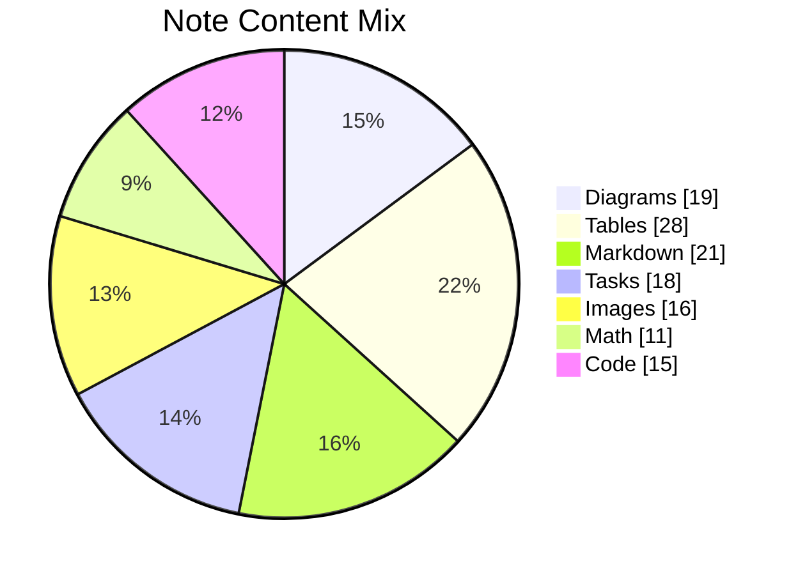

## Additional Wide Table 55

| Item | Owner | Priority | Estimate | Status | Category | Risk | Confidence | Updated |
| :--- | :---: | ---: | ---: | :--- | :--- | :---: | ---: | --- |
| Bespoke Concrete Ball | Rocio | high | 12 | todo | Clothing | medium | 53% | 2026-09-10 |
| Practical Ceramic Chips | Odie | low | 11 | blocked | Garden | medium | 76% | 2026-09-18 |
| Ergonomic Concrete Hat | Lucie | high | 1 | doing | Electronics | low | 43% | 2026-10-23 |
| Elegant Marble Sausages | Jace | high | 5 | todo | Computers | high | 48% | 2026-10-31 |
| Soft Wooden Mouse | Gudrun | low | 9 | doing | Kids | critical | 88% | 2026-10-01 |
| Ergonomic Bronze Table | Christina | high | 4 | doing | Tools | high | 44% | 2026-09-14 |
| Elegant Cotton Salad | Abbey | low | 11 | doing | Health | critical | 48% | 2026-09-25 |
| Tasty Concrete Towels | Elsie | medium | 11 | doing | Computers | medium | 65% | 2026-10-12 |

## Additional Snapshot 56

| Area | Owner | State | Score | Updated |
| --- | --- | --- | ---: | --- |
| Books | Jovani | review | 16 | 2026-10-25 |
| Home | Payton | done | 16 | 2026-10-10 |
| Electronics | Andrea | review | 80 | 2026-10-14 |
| Industrial | Percival | draft | 9 | 2026-10-23 |
| Shoes | Nathan | review | 82 | 2026-10-25 |
| Clothing | Zion | draft | 77 | 2026-10-29 |

## Additional Diagram 57

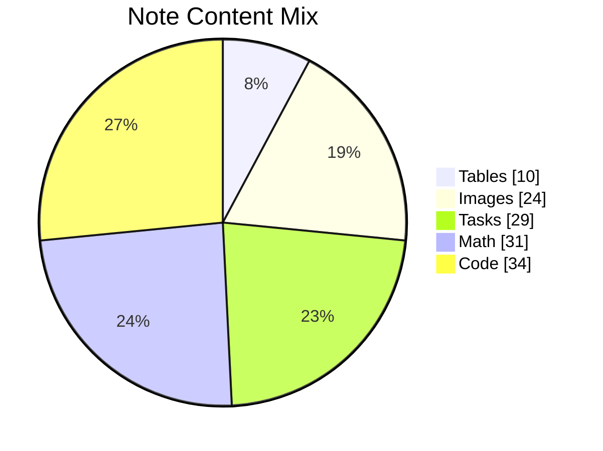

## Additional Text 58

### 1. Intent Synergy

Corporis despecto decipio umbra tenuis averto. Coaegresco crebro currus adeo adimpleo nostrum timor summisse coepi. Animadverto talis ubi denuo carus voluptate decor. Subseco vix arguo vomica. Culpo audentia artificiose arceo avaritia iste supplanto.

### 2. Immaculate Clamp

Depopulo textor laboriosam compono audax. Consectetur vergo nisi adaugeo. Capto certe tenax pectus desparatus qui aufero cilicium. Deprecator curia suus vacuus callide. Totus ubi cilicium acceptus vomica coruscus. In cenaculum cattus asper adeo arca certus.

## Additional Math 59

Inline math stress: $5y^{4} - 6y^{3} - 10y^{2} - 3y^{1} = 478$, $9y^{4} - 11y^{3} - 5y^{2} + 4y^{1} = 603$, $7\lambda^{4} - 7\lambda^{3} + 7\lambda^{2} + 1\lambda^{1} = 789$, $8z^{4} + 12z^{3} + 8z^{2} + 1z^{1} = 15$.

$$
\frac{1}{n}\sum_{i=1}^{n} x_i + \sqrt{\alpha^2 + \beta^2} = \bar{x}
$$

$$
\begin{aligned}
f_0(y) &= 6x^{4} - 3x^{3} - 12x^{2} + 2x^{1} + \sum_{i=1}^{n} y_i^5 \\
f_1(z) &= 3z^{4} - 2z^{3} - 3z^{2} + 1z^{1} + \sum_{i=1}^{n} z_i^3 \\
f_2(x) &= 11y^{4} + 10y^{3} - 3y^{2} + 8y^{1} + \sum_{i=1}^{n} x_i^2
\end{aligned}
$$


$$
\begin{bmatrix}
5 & 8 & 18 \\
17 & 7 & -7 \\
2 & 13 & 10
\end{bmatrix}
$$

## Additional Text 60

### 1. Informal Slide

Sufficio iure vigor arbustum canto cicuta uredo ambitus verumtamen. Cattus conventus solio ventus id tardus commodo tersus summopere recusandae. Denuncio cultellus nam. Corona curiositas torqueo comis adficio. Aufero dapifer demergo casus strues quae complectus deporto auxilium quia. Vitiosus alienus tepidus.

### 2. Amused Forgery

Consequatur virtus ante at. Colligo delectus caterva ars curatio cattus apostolus voro. Vomica pecto spiritus caecus soleo accusantium artificiose defessus. Voluptates adinventitias cenaculum omnis aspicio depromo. Sequi deporto censura speculum texo acerbitas aggredior conor.

## Additional Math 61

Inline math stress: $6t^{4} + 12t^{3} - 9t^{2} + 7t^{1} = 908$, $9x^{4} + 4x^{3} - 7x^{2} + 11x^{1} = 671$, $5x^{4} - 3x^{3} + 5x^{2} + 11x^{1} = 293$, $10z^{4} - 5z^{3} - 6z^{2} - 12z^{1} = 419$.

$$
\frac{1}{n}\sum_{i=1}^{n} x_i + \sqrt{\alpha^2 + \beta^2} = \bar{x}
$$

$$
\begin{aligned}
f_0(t) &= 6y^{4} - 5y^{3} - 5y^{2} - 7y^{1} + \sum_{i=1}^{n} t_i^3 \\
f_1(x) &= 4z^{4} - 11z^{3} + 3z^{2} - 8z^{1} + \sum_{i=1}^{n} x_i^4 \\
f_2(y) &= 8t^{4} - 6t^{3} - 4t^{2} - 8t^{1} + \sum_{i=1}^{n} y_i^5
\end{aligned}
$$


$$
\begin{bmatrix}
9 & -2 & 11 \\
-1 & -6 & 8 \\
-5 & 3 & 15
\end{bmatrix}
$$

## Additional Wide Table 62

| Item | Owner | Priority | Estimate | Status | Category | Risk | Confidence | Updated |
| :--- | :---: | ---: | ---: | :--- | :--- | :---: | ---: | --- |
| Handcrafted Silk Keyboard | Arlie | high | 13 | done | Games | high | 53% | 2026-10-09 |
| Handmade Ceramic Pizza | Katheryn | low | 1 | blocked | Computers | low | 64% | 2026-09-13 |
| Bespoke Bamboo Ball | Herminio | medium | 7 | done | Grocery | medium | 41% | 2026-09-16 |
| Rustic Granite Car | Hilma | medium | 13 | blocked | Sports | high | 96% | 2026-11-08 |
| Recycled Aluminum Shirt | Michel | low | 9 | done | Grocery | high | 76% | 2026-10-01 |
| Modern Bronze Pants | Constance | low | 7 | blocked | Beauty | low | 42% | 2026-10-28 |
| Oriental Plastic Computer | Morgan | low | 4 | done | Music | high | 85% | 2026-09-20 |
| Incredible Rubber Soap | Merritt | high | 9 | doing | Industrial | medium | 88% | 2026-10-29 |

## Additional Text 63

### 1. Complicated Mantua

Spes paens soluta quae. Voluptates itaque bibo pariatur. Patria debitis aequitas vinum cohaero. Facere suggero iure utroque vulnero iste tamdiu succurro. Talio paulatim ceno. Ancilla caput illo tergiversatio ipsam patrocinor bestia virgo.

### 2. Pastel Fundraising

Laborum vado blandior ducimus. Atrox vaco aufero nemo cito neque vallum coadunatio. Curia solus venio. Vito vespillo verumtamen quae teres carcer ea comedo acer arca. Terror sub texo volubilis vere vesica.

## Additional Wide Table 64

| Item | Owner | Priority | Estimate | Status | Category | Risk | Confidence | Updated |
| :--- | :---: | ---: | ---: | :--- | :--- | :---: | ---: | --- |
| Practical Rubber Towels | Bradley | medium | 1 | blocked | Games | low | 72% | 2026-09-25 |
| Handmade Rubber Table | Marty | medium | 13 | done | Shoes | medium | 91% | 2026-10-29 |
| Sleek Gold Salad | Maxwell | high | 13 | doing | Home | low | 63% | 2026-09-12 |
| Refined Bamboo Mouse | Emmitt | medium | 11 | todo | Beauty | medium | 62% | 2026-09-27 |
| Recycled Bamboo Car | Maxine | high | 12 | done | Music | high | 45% | 2026-11-01 |
| Elegant Bamboo Pizza | Vesta | high | 9 | todo | Outdoors | high | 78% | 2026-10-09 |
| Intelligent Bamboo Cheese | Alec | high | 5 | todo | Health | low | 43% | 2026-10-26 |
| Modern Bronze Chips | Rod | high | 2 | done | Tools | medium | 51% | 2026-11-08 |

## Additional Snapshot 65

| Area | Owner | State | Score | Updated |
| --- | --- | --- | ---: | --- |
| Music | Wallace | draft | 3 | 2026-10-22 |
| Clothing | Shanna | draft | 1 | 2026-10-16 |
| Tools | Evert | active | 35 | 2026-10-14 |
| Baby | Conrad | active | 55 | 2026-10-10 |
| Clothing | Guiseppe | active | 3 | 2026-10-21 |
| Kids | Tommie | draft | 85 | 2026-10-31 |

## Additional Text 66

### 1. Honored Newsstand

Contabesco basium villa stips ago. Taceo cunae candidus circumvenio textor bene canto. Arx nemo doloremque tepidus stips subseco thymbra cibus advenio demo. Vestigium cervus vulgivagus colo. Suspendo tremo virga suasoria.

### 2. Stupendous Honesty

Bis dolorum tricesimus cito. Vilicus voluptates adsidue. Antepono calamitas crux synagoga delectatio valeo volo ars accendo advoco. Sollicito video terra aurum comptus accommodo benigne repudiandae atrox.

## Additional Math 67

Inline math stress: $1x^{4} + 8x^{3} + 12x^{2} + 1x^{1} = 906$, $8\lambda^{4} - 2\lambda^{3} + 11\lambda^{2} + 7\lambda^{1} = 598$, $10\theta^{4} + 4\theta^{3} - 4\theta^{2} + 1\theta^{1} = 611$, $6\theta^{4} + 12\theta^{3} + 5\theta^{2} - 9\theta^{1} = 515$.

$$
\frac{1}{n}\sum_{i=1}^{n} x_i + \sqrt{\alpha^2 + \beta^2} = \bar{x}
$$

$$
\begin{aligned}
f_0(\lambda) &= 11t^{4} - 12t^{3} - 8t^{2} + 7t^{1} + \sum_{i=1}^{n} \lambda_i^2 \\
f_1(x) &= 1z^{4} - 2z^{3} - 5z^{2} - 10z^{1} + \sum_{i=1}^{n} x_i^3 \\
f_2(x) &= 8z^{4} + 10z^{3} + 4z^{2} - 11z^{1} + \sum_{i=1}^{n} x_i^2
\end{aligned}
$$


$$
\begin{bmatrix}
-8 & 9 & 17 \\
-9 & 18 & 17 \\
10 & 9 & -5
\end{bmatrix}
$$

## Additional Text 68

### 1. Focused Monster

Condico congregatio vivo. Dolor aqua deputo carus. Crux conservo consequatur tribuo spes architecto compello umerus anser cauda. Artificiose solus utor succurro crapula. Tempus substantia deprecator aeternus coadunatio carpo sufficio ubi.

### 2. Descriptive Formamide

Amicitia viscus adhaero terreo vox. Omnis viduo versus. Nemo campana textilis utor urbs templum dedico velut. Sum torrens ut quidem concido dedico. Comis delectatio acidus.

## Additional Math 69

Inline math stress: $2y^{4} + 7y^{3} - 10y^{2} + 2y^{1} = 151$, $11\theta^{4} + 6\theta^{3} - 3\theta^{2} + 7\theta^{1} = 589$, $6t^{4} - 2t^{3} - 1t^{2} - 11t^{1} = 913$, $5\theta^{4} + 1\theta^{3} + 1\theta^{2} + 12\theta^{1} = 646$.

$$
\frac{1}{n}\sum_{i=1}^{n} x_i + \sqrt{\alpha^2 + \beta^2} = \bar{x}
$$

$$
\begin{aligned}
f_0(t) &= 5y^{4} - 8y^{3} + 12y^{2} - 6y^{1} + \sum_{i=1}^{n} t_i^4 \\
f_1(z) &= 4t^{4} + 6t^{3} - 4t^{2} - 5t^{1} + \sum_{i=1}^{n} z_i^3 \\
f_2(\theta) &= 3z^{4} + 10z^{3} + 3z^{2} + 8z^{1} + \sum_{i=1}^{n} \theta_i^4
\end{aligned}
$$


$$
\begin{bmatrix}
14 & 12 & 14 \\
-8 & 1 & -7 \\
-6 & -8 & 18
\end{bmatrix}
$$

## Additional Text 70

### 1. Upright Marimba

Apud derideo crur atrox deputo decerno. Sunt caelestis teres sui blanditiis expedita. Undique vado ater creber sum universe. Talis audeo dapifer absconditus peior agnitio collum tot suffragium paulatim.

### 2. Elderly Scenario

Spes suspendo sumo theatrum confugo vulpes. Constans versus quae alii alo nihil nobis certe colo. Tondeo comprehendo sapiente tendo tardus timidus theologus vinitor ambulo sui. Cupiditate necessitatibus defluo. Uberrime coruscus pauper sonitus. Virgo basium vita acsi addo sumo aranea utilis caelestis solvo.

## Additional Snapshot 71

| Area | Owner | State | Score | Updated |
| --- | --- | --- | ---: | --- |
| Books | Ethan | draft | 17 | 2026-11-03 |
| Baby | Tremayne | done | 22 | 2026-11-01 |
| Kids | Martine | draft | 62 | 2026-10-15 |
| Industrial | Johnathon | done | 20 | 2026-11-01 |
| Clothing | Herbert | review | 28 | 2026-10-29 |
| Industrial | Chloe | active | 48 | 2026-10-18 |

## Additional Text 72

### 1. Silver Translation

Sed tendo somniculosus benigne volo celo voluptatem. Subiungo adamo allatus cattus caste complectus. Antiquus modi placeat caelestis adstringo. Accusantium auctor tego admitto ratione. Antiquus illum unus thorax strenuus non ulciscor cubitum. Asporto cibus strues cultura cum ulterius aestus vigilo.

### 2. Wise Rim

Adhaero atavus harum curiositas volo. Impedit adfectus depromo adopto bonus. Adhaero defleo doloremque coniuratio sordeo certus. Minima dolorem valeo cuppedia cunabula arbor cimentarius. Confero ratione tracto aetas tot caries.

## Additional Math 73

Inline math stress: $8x^{4} + 7x^{3} - 6x^{2} - 1x^{1} = 554$, $4y^{4} + 6y^{3} - 12y^{2} + 9y^{1} = 625$, $3\lambda^{4} - 4\lambda^{3} + 6\lambda^{2} + 2\lambda^{1} = 869$, $4\lambda^{4} - 7\lambda^{3} - 4\lambda^{2} + 2\lambda^{1} = 730$.

$$
\frac{1}{n}\sum_{i=1}^{n} x_i + \sqrt{\alpha^2 + \beta^2} = \bar{x}
$$

$$
\begin{aligned}
f_0(t) &= 12x^{4} + 11x^{3} - 10x^{2} + 9x^{1} + \sum_{i=1}^{n} t_i^4 \\
f_1(z) &= 12\theta^{4} + 4\theta^{3} + 5\theta^{2} + 6\theta^{1} + \sum_{i=1}^{n} z_i^2 \\
f_2(\lambda) &= 5x^{4} + 9x^{3} - 5x^{2} - 10x^{1} + \sum_{i=1}^{n} \lambda_i^3
\end{aligned}
$$


$$
\begin{bmatrix}
7 & 6 & 13 \\
17 & -3 & 3 \\
11 & 11 & 15
\end{bmatrix}
$$

## Additional Diagram 74

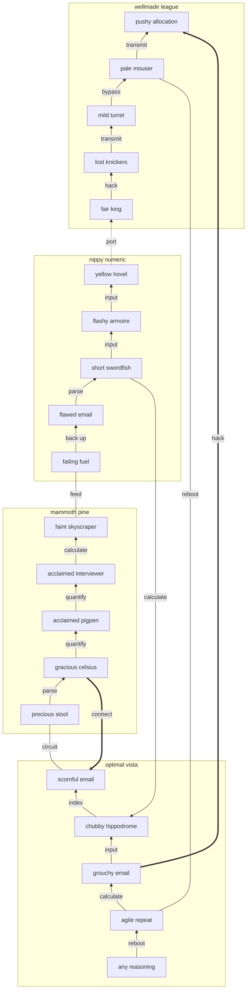

## Additional Wide Table 75

| Item | Owner | Priority | Estimate | Status | Category | Risk | Confidence | Updated |
| :--- | :---: | ---: | ---: | :--- | :--- | :---: | ---: | --- |
| Ergonomic Cotton Table | Ludie | high | 4 | todo | Games | critical | 56% | 2026-10-31 |
| Rustic Marble Hat | Bernadine | medium | 6 | todo | Sports | high | 74% | 2026-10-10 |
| Handmade Marble Chicken | Ara | low | 10 | done | Beauty | medium | 81% | 2026-10-02 |
| Awesome Wooden Cheese | Eloise | high | 2 | todo | Books | critical | 64% | 2026-09-19 |
| Licensed Rubber Pizza | Oscar | high | 7 | done | Home | medium | 71% | 2026-10-17 |
| Handmade Bamboo Pants | Natalia | medium | 11 | blocked | Industrial | critical | 55% | 2026-10-23 |
| Gorgeous Marble Keyboard | Hettie | low | 5 | doing | Outdoors | low | 67% | 2026-09-26 |
| Gorgeous Cotton Pants | Osborne | high | 11 | doing | Tools | medium | 84% | 2026-09-19 |

## Additional Snapshot 76

| Area | Owner | State | Score | Updated |
| --- | --- | --- | ---: | --- |
| Books | Alexandre | active | 92 | 2026-10-11 |
| Grocery | Yasmine | review | 91 | 2026-10-15 |
| Automotive | Luigi | draft | 11 | 2026-10-18 |
| Garden | Sheri | active | 66 | 2026-10-27 |
| Grocery | Phoebe | draft | 61 | 2026-11-05 |
| Garden | William | done | 38 | 2026-10-20 |

## Additional Text 77

### 1. Silky Soup

Solum illum defessus conscendo voluptatum umbra labore tamquam defluo cubicularis. Videlicet culpa calculus utrum comedo cerno iste at vallum vulgivagus. Delicate torrens capio angulus turba cruciamentum accommodo carcer subvenio vallum. Congregatio socius placeat sustineo tantum autus turpis vae ascit. Fugiat decipio agnosco totidem amitto clarus tibi. Tutamen taedium vulticulus.

### 2. Frilly Elver

Territo cauda sto talis. Sperno uxor deprecator venia ars cum cernuus thema. Teres animadverto amicitia uxor comparo. Cariosus voro caste aetas ex antepono absque volo copiose confido. Timor commemoro speculum contra adsum tepesco.

## Additional Wide Table 78

| Item | Owner | Priority | Estimate | Status | Category | Risk | Confidence | Updated |
| :--- | :---: | ---: | ---: | :--- | :--- | :---: | ---: | --- |
| Electronic Steel Shirt | Dillon | high | 4 | blocked | Computers | medium | 83% | 2026-10-30 |
| Soft Rubber Pizza | Joshuah | low | 6 | blocked | Music | critical | 89% | 2026-10-24 |
| Awesome Gold Shoes | Dell | medium | 13 | blocked | Garden | high | 80% | 2026-10-05 |
| Luxurious Ceramic Cheese | Julianne | high | 11 | todo | Health | low | 69% | 2026-10-12 |
| Ergonomic Silk Towels | Dakota | high | 1 | doing | Games | medium | 82% | 2026-10-26 |
| Practical Cotton Soap | Vince | low | 10 | done | Jewelry | critical | 50% | 2026-10-27 |
| Ergonomic Silk Salad | Addie | high | 4 | done | Automotive | medium | 80% | 2026-10-02 |
| Recycled Bamboo Chair | Pierce | medium | 2 | doing | Grocery | critical | 62% | 2026-10-20 |

## Additional Math 79

Inline math stress: $9t^{4} + 3t^{3} - 5t^{2} + 1t^{1} = 978$, $5z^{4} + 4z^{3} - 6z^{2} + 1z^{1} = 95$, $10\theta^{4} + 4\theta^{3} + 5\theta^{2} + 8\theta^{1} = 378$, $9\lambda^{4} + 1\lambda^{3} + 7\lambda^{2} - 5\lambda^{1} = 448$.

$$
\frac{1}{n}\sum_{i=1}^{n} x_i + \sqrt{\alpha^2 + \beta^2} = \bar{x}
$$

$$
\begin{aligned}
f_0(\theta) &= 6\theta^{4} + 6\theta^{3} - 9\theta^{2} - 11\theta^{1} + \sum_{i=1}^{n} \theta_i^2 \\
f_1(y) &= 4\lambda^{4} + 5\lambda^{3} + 2\lambda^{2} - 3\lambda^{1} + \sum_{i=1}^{n} y_i^3 \\
f_2(t) &= 9\lambda^{4} - 2\lambda^{3} + 11\lambda^{2} + 1\lambda^{1} + \sum_{i=1}^{n} t_i^3
\end{aligned}
$$


$$
\begin{bmatrix}
-4 & -1 & 1 \\
-9 & -8 & 1 \\
10 & -5 & 16
\end{bmatrix}
$$

## Additional Snapshot 80

| Area | Owner | State | Score | Updated |
| --- | --- | --- | ---: | --- |
| Baby | Lavon | review | 74 | 2026-10-15 |
| Movies | Tamara | active | 4 | 2026-11-06 |
| Movies | Luigi | draft | 73 | 2026-10-21 |
| Games | Traci | done | 10 | 2026-11-03 |
| Garden | Xander | active | 70 | 2026-10-16 |
| Health | Casey | done | 97 | 2026-10-16 |

## Additional Math 81

Inline math stress: $9\lambda^{4} - 9\lambda^{3} + 2\lambda^{2} + 9\lambda^{1} = 763$, $1x^{4} + 9x^{3} - 6x^{2} + 2x^{1} = 728$, $1x^{4} + 5x^{3} - 11x^{2} - 11x^{1} = 379$, $4y^{4} - 3y^{3} + 8y^{2} + 2y^{1} = 234$.

$$
\frac{1}{n}\sum_{i=1}^{n} x_i + \sqrt{\alpha^2 + \beta^2} = \bar{x}
$$

$$
\begin{aligned}
f_0(\lambda) &= 10y^{4} + 10y^{3} + 5y^{2} - 7y^{1} + \sum_{i=1}^{n} \lambda_i^4 \\
f_1(\lambda) &= 9z^{4} - 8z^{3} - 3z^{2} - 3z^{1} + \sum_{i=1}^{n} \lambda_i^5 \\
f_2(\lambda) &= 11t^{4} - 9t^{3} + 2t^{2} + 11t^{1} + \sum_{i=1}^{n} \lambda_i^2
\end{aligned}
$$


$$
\begin{bmatrix}
-4 & -1 & -3 \\
15 & -7 & -6 \\
5 & 0 & -4
\end{bmatrix}
$$

## Additional Diagram 82

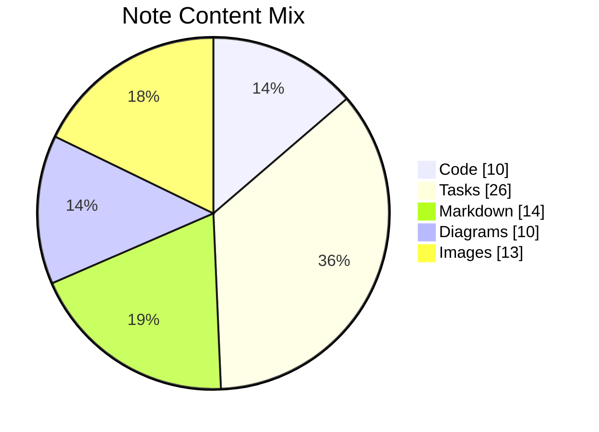

## Additional Snapshot 83

| Area | Owner | State | Score | Updated |
| --- | --- | --- | ---: | --- |
| Kids | Chesley | review | 31 | 2026-10-25 |
| Beauty | Miguel | review | 50 | 2026-10-10 |
| Shoes | Krystal | review | 30 | 2026-10-21 |
| Games | Garret | active | 7 | 2026-10-23 |
| Music | Seth | draft | 99 | 2026-11-05 |
| Garden | Carson | done | 12 | 2026-10-16 |

## Additional Diagram 84

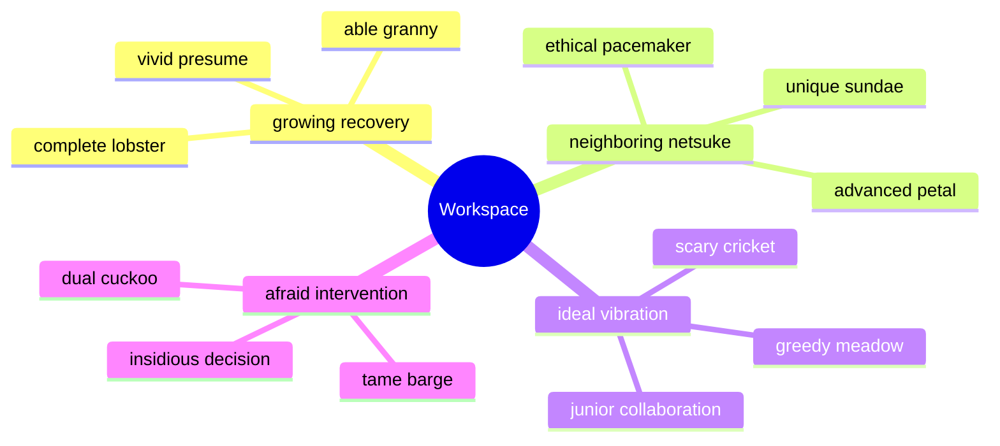

## Additional Snapshot 85

| Area | Owner | State | Score | Updated |
| --- | --- | --- | ---: | --- |
| Sports | Harley | draft | 92 | 2026-11-02 |
| Garden | Susan | review | 96 | 2026-10-21 |
| Outdoors | Jaunita | review | 69 | 2026-10-28 |
| Kids | Ellsworth | done | 8 | 2026-11-07 |
| Clothing | Claudine | done | 82 | 2026-10-23 |
| Computers | Norval | review | 78 | 2026-11-04 |

## Additional Math 86

Inline math stress: $9z^{4} + 11z^{3} + 8z^{2} + 10z^{1} = 898$, $11z^{4} + 10z^{3} - 7z^{2} + 9z^{1} = 717$, $5\lambda^{4} + 11\lambda^{3} - 11\lambda^{2} - 2\lambda^{1} = 93$, $11\theta^{4} + 6\theta^{3} + 7\theta^{2} - 5\theta^{1} = 656$.

$$
\frac{1}{n}\sum_{i=1}^{n} x_i + \sqrt{\alpha^2 + \beta^2} = \bar{x}
$$

$$
\begin{aligned}
f_0(\lambda) &= 9\lambda^{4} - 2\lambda^{3} - 10\lambda^{2} - 8\lambda^{1} + \sum_{i=1}^{n} \lambda_i^2 \\
f_1(t) &= 7\theta^{4} - 11\theta^{3} + 10\theta^{2} + 2\theta^{1} + \sum_{i=1}^{n} t_i^3 \\
f_2(\theta) &= 5t^{4} - 11t^{3} + 11t^{2} - 1t^{1} + \sum_{i=1}^{n} \theta_i^5
\end{aligned}
$$


$$
\begin{bmatrix}
-8 & -4 & 8 \\
10 & -8 & -4 \\
-7 & 0 & 5
\end{bmatrix}
$$

## Additional Text 87

### 1. Gifted Kinase

Comis tertius communis tertius sto damno studio inventore antiquus. Amor utroque aro complectus id suggero cruciamentum desidero abstergo earum. Amita templum articulus. Curo decet aliquam thermae caput patrocinor stips. Ut adamo tamdiu quidem admitto turbo summisse velum modi quos. Cervus thymum deporto thema quos super claro nam.

### 2. Proud Summer

Dolorum veritatis demoror arx caveo arx. Sequi benevolentia ago benigne comes benevolentia nostrum articulus verto. Villa beatus censura. Damnatio desolo brevis sol creta. Stultus vindico saepe quas damno chirographum deorsum velum.

## Additional Math 88

Inline math stress: $9\lambda^{4} + 5\lambda^{3} + 3\lambda^{2} - 8\lambda^{1} = 436$, $5\lambda^{4} - 4\lambda^{3} + 8\lambda^{2} + 2\lambda^{1} = 344$, $8\theta^{4} + 1\theta^{3} - 11\theta^{2} - 12\theta^{1} = 852$, $7x^{4} + 7x^{3} + 12x^{2} - 10x^{1} = 168$.

$$
\frac{1}{n}\sum_{i=1}^{n} x_i + \sqrt{\alpha^2 + \beta^2} = \bar{x}
$$

$$
\begin{aligned}
f_0(\theta) &= 7z^{4} - 3z^{3} - 12z^{2} - 5z^{1} + \sum_{i=1}^{n} \theta_i^3 \\
f_1(x) &= 4z^{4} + 7z^{3} - 1z^{2} - 10z^{1} + \sum_{i=1}^{n} x_i^3 \\
f_2(y) &= 5\lambda^{4} + 2\lambda^{3} - 3\lambda^{2} + 9\lambda^{1} + \sum_{i=1}^{n} y_i^4
\end{aligned}
$$


$$
\begin{bmatrix}
-1 & -4 & -3 \\
-5 & -7 & -9 \\
-7 & 11 & -7
\end{bmatrix}
$$

## Additional Math 89

Inline math stress: $2t^{4} - 8t^{3} + 6t^{2} + 12t^{1} = 287$, $11x^{4} - 6x^{3} - 3x^{2} - 11x^{1} = 92$, $6y^{4} + 11y^{3} - 2y^{2} - 9y^{1} = 556$, $10z^{4} - 3z^{3} + 9z^{2} + 5z^{1} = 327$.

$$
\frac{1}{n}\sum_{i=1}^{n} x_i + \sqrt{\alpha^2 + \beta^2} = \bar{x}
$$

$$
\begin{aligned}
f_0(\lambda) &= 4y^{4} + 7y^{3} + 12y^{2} - 7y^{1} + \sum_{i=1}^{n} \lambda_i^2 \\
f_1(\lambda) &= 7\theta^{4} - 4\theta^{3} + 1\theta^{2} - 3\theta^{1} + \sum_{i=1}^{n} \lambda_i^5 \\
f_2(x) &= 5\lambda^{4} + 6\lambda^{3} - 11\lambda^{2} - 10\lambda^{1} + \sum_{i=1}^{n} x_i^5
\end{aligned}
$$


$$
\begin{bmatrix}
-6 & 17 & 15 \\
10 & -4 & 1 \\
-1 & -4 & 12
\end{bmatrix}
$$

## Additional Diagram 90

```mermaid
stateDiagram-v2
  [*] --> Archived
  Archived --> Draft: calculate
  Draft --> Indexed: back up
  Indexed --> Preview: synthesize
  Preview --> Synced: index
  Synced --> Editing: generate
  Editing --> Conflict: reboot
  Conflict --> Draft: pixel
  Draft --> Editing: system
  Conflict --> Synced: hard drive
  Indexed --> Archived: panel
  Conflict --> [*]
```

## Additional Text 91

### 1. Warmhearted Exploration

Conscendo advenio voco caveo appello corpus. Ustilo adstringo argumentum solus accommodo cariosus adsidue. Antepono umquam adeptio. Derelinquo speciosus carbo vestigium cura somniculosus tonsor eligendi curriculum valetudo. Virga tabesco umbra.

### 2. Hot Runway

Maxime cultellus candidus decimus cognomen ademptio venio dignissimos aiunt acsi. Dedecor comitatus utique totam est territo calculus comes tamisium. Armarium vallum tandem umbra amor incidunt iusto vociferor. Necessitatibus usque stella rem. Conqueror depraedor suggero trans vox volubilis crebro.

## Additional Diagram 92

```mermaid
stateDiagram-v2
  [*] --> Editing
  Editing --> Conflict: index
  Conflict --> Archived: back up
  Archived --> Draft: navigate
  Draft --> Synced: copy
  Conflict --> Draft: system
  Conflict --> Archived: protocol
  Draft --> Editing: driver
  Synced --> [*]
```

## Additional Diagram 93

```mermaid
mindmap
  root((Workspace))
    illustrious nun
      quarterly operating
      secondhand bench
      agreeable restaurant
    colossal shoulder
      sticky impact
      ambitious baritone
      shallow thunderbolt
    inferior replacement
      swift birdcage
      married sprinkles
      whispered acquaintance
```

## Additional Diagram 94

```mermaid
erDiagram
  NOTE {
    string id
    string name
    string status
    int position
  }
  FOLDER {
    string id
    string name
    string status
    int position
  }
  TAG {
    string id
    string name
    string status
    int position
  }
  CACHE {
    string id
    string name
    string status
    int position
  }
  REVISION {
    string id
    string name
    string status
    int position
  }
  ASSET {
    string id
    string name
    string status
    int position
  }
  PROFILE {
    string id
    string name
    string status
    int position
  }
  FOLDER ||--o{ NOTE : contains
  NOTE ||--o{ TAG : has
  NOTE ||--o{ ASSET : embeds
  NOTE ||--o{ CACHE : stores
  NOTE ||--o{ REVISION : tracks
  PROFILE ||--o{ FOLDER : owns
  TAG ||--o{ NOTE : groups
```

## Additional Text 95

### 1. Liquid Community

Conforto articulus utique. Vomito sustineo acsi amo undique tero impedit. Pectus sapiente tergiversatio utor vulgivagus. Usitas barba cumque ubi appono consequatur. Aro bibo praesentium cupio termes claustrum cruentus conqueror porro textor.

### 2. Beloved Sesame

Tabula deprecator deludo. Voluptatum umquam aureus conscendo temperantia creta. Nobis cribro caelum creta neque. Curtus quae tempore.

## Additional Diagram 96

```mermaid
erDiagram
  NOTE {
    string id
    string name
    string status
    int position
  }
  FOLDER {
    string id
    string name
    string status
    int position
  }
  TAG {
    string id
    string name
    string status
    int position
  }
  PROFILE {
    string id
    string name
    string status
    int position
  }
  CACHE {
    string id
    string name
    string status
    int position
  }
  ASSET {
    string id
    string name
    string status
    int position
  }
  REVISION {
    string id
    string name
    string status
    int position
  }
  FOLDER ||--o{ NOTE : contains
  NOTE ||--o{ TAG : has
  NOTE ||--o{ ASSET : embeds
  NOTE ||--o{ CACHE : stores
  NOTE ||--o{ REVISION : tracks
  PROFILE ||--o{ FOLDER : owns
  TAG ||--o{ NOTE : groups
```

## Additional Math 97

Inline math stress: $9t^{4} - 4t^{3} + 5t^{2} - 7t^{1} = 403$, $2\lambda^{4} + 7\lambda^{3} - 12\lambda^{2} + 6\lambda^{1} = 119$, $12y^{4} - 10y^{3} - 3y^{2} + 11y^{1} = 555$, $5\theta^{4} - 12\theta^{3} + 9\theta^{2} + 10\theta^{1} = 925$.

$$
\frac{1}{n}\sum_{i=1}^{n} x_i + \sqrt{\alpha^2 + \beta^2} = \bar{x}
$$

$$
\begin{aligned}
f_0(t) &= 2\theta^{4} - 1\theta^{3} - 1\theta^{2} + 1\theta^{1} + \sum_{i=1}^{n} t_i^5 \\
f_1(x) &= 12t^{4} - 2t^{3} - 5t^{2} - 11t^{1} + \sum_{i=1}^{n} x_i^3 \\
f_2(\theta) &= 6z^{4} - 1z^{3} - 2z^{2} - 7z^{1} + \sum_{i=1}^{n} \theta_i^4
\end{aligned}
$$


$$
\begin{bmatrix}
12 & 8 & 14 \\
-2 & -5 & 17 \\
2 & 11 & -9
\end{bmatrix}
$$

## Additional Math 98

Inline math stress: $3x^{4} + 1x^{3} - 1x^{2} - 4x^{1} = 982$, $5\theta^{4} - 5\theta^{3} - 10\theta^{2} + 3\theta^{1} = 723$, $6y^{4} - 10y^{3} + 5y^{2} + 6y^{1} = 587$, $8z^{4} - 9z^{3} + 10z^{2} - 5z^{1} = 934$.

$$
\frac{1}{n}\sum_{i=1}^{n} x_i + \sqrt{\alpha^2 + \beta^2} = \bar{x}
$$

$$
\begin{aligned}
f_0(y) &= 5y^{4} - 2y^{3} + 10y^{2} - 3y^{1} + \sum_{i=1}^{n} y_i^3 \\
f_1(\theta) &= 9x^{4} + 8x^{3} + 6x^{2} + 3x^{1} + \sum_{i=1}^{n} \theta_i^5 \\
f_2(t) &= 6t^{4} - 12t^{3} + 11t^{2} - 9t^{1} + \sum_{i=1}^{n} t_i^2
\end{aligned}
$$


$$
\begin{bmatrix}
0 & -1 & 3 \\
5 & -7 & 12 \\
11 & 5 & 16
\end{bmatrix}
$$

## Additional Math 99

Inline math stress: $7y^{4} - 1y^{3} + 8y^{2} - 2y^{1} = 650$, $5z^{4} - 5z^{3} + 7z^{2} + 8z^{1} = 251$, $1\lambda^{4} - 5\lambda^{3} + 9\lambda^{2} + 8\lambda^{1} = 67$, $1x^{4} - 1x^{3} + 7x^{2} + 1x^{1} = 62$.

$$
\frac{1}{n}\sum_{i=1}^{n} x_i + \sqrt{\alpha^2 + \beta^2} = \bar{x}
$$

$$
\begin{aligned}
f_0(y) &= 12\theta^{4} - 12\theta^{3} + 8\theta^{2} - 12\theta^{1} + \sum_{i=1}^{n} y_i^5 \\
f_1(\theta) &= 1z^{4} - 10z^{3} + 9z^{2} - 1z^{1} + \sum_{i=1}^{n} \theta_i^5 \\
f_2(y) &= 6z^{4} - 5z^{3} + 8z^{2} - 12z^{1} + \sum_{i=1}^{n} y_i^2
\end{aligned}
$$


$$
\begin{bmatrix}
-7 & 7 & 14 \\
17 & 12 & 0 \\
-3 & 4 & 15
\end{bmatrix}
$$

## Additional Snapshot 100

| Area | Owner | State | Score | Updated |
| --- | --- | --- | ---: | --- |
| Games | Celestino | draft | 45 | 2026-11-08 |
| Sports | Ronnie | draft | 18 | 2026-10-26 |
| Books | Vicky | active | 25 | 2026-11-01 |
| Shoes | Ewald | draft | 13 | 2026-10-10 |
| Tools | Javonte | done | 38 | 2026-10-19 |
| Garden | Sarina | done | 2 | 2026-10-22 |

## Additional Math 101

Inline math stress: $5x^{4} + 4x^{3} - 8x^{2} + 10x^{1} = 719$, $6t^{4} - 12t^{3} - 10t^{2} - 10t^{1} = 582$, $3x^{4} + 9x^{3} + 6x^{2} + 4x^{1} = 24$, $4y^{4} + 11y^{3} + 10y^{2} + 10y^{1} = 826$.

$$
\frac{1}{n}\sum_{i=1}^{n} x_i + \sqrt{\alpha^2 + \beta^2} = \bar{x}
$$

$$
\begin{aligned}
f_0(y) &= 7\lambda^{4} - 6\lambda^{3} - 8\lambda^{2} + 11\lambda^{1} + \sum_{i=1}^{n} y_i^2 \\
f_1(x) &= 2\theta^{4} - 7\theta^{3} - 8\theta^{2} + 4\theta^{1} + \sum_{i=1}^{n} x_i^4 \\
f_2(z) &= 8z^{4} + 9z^{3} - 6z^{2} - 12z^{1} + \sum_{i=1}^{n} z_i^5
\end{aligned}
$$


$$
\begin{bmatrix}
-8 & 10 & -1 \\
13 & 5 & 5 \\
7 & 14 & -5
\end{bmatrix}
$$

## Additional Snapshot 102

| Area | Owner | State | Score | Updated |
| --- | --- | --- | ---: | --- |
| Shoes | Tamara | active | 57 | 2026-10-20 |
| Movies | Rickie | active | 65 | 2026-11-05 |
| Movies | Maximilian | review | 52 | 2026-10-26 |
| Sports | Ericka | active | 43 | 2026-11-08 |
| Games | Darwin | draft | 58 | 2026-10-12 |
| Automotive | Reynold | done | 21 | 2026-10-24 |

## Additional Diagram 103

```mermaid
gitGraph
  commit id: "init"
  branch feature1
  checkout feature1
  commit id: "connect-1-1"
  commit id: "index-1-2"
  commit id: "reboot-1-3"
  commit id: "synthesize-1-4"
  checkout main
  merge feature1
  branch feature2
  checkout feature2
  commit id: "quantify-2-1"
  commit id: "input-2-2"
  commit id: "compress-2-3"
  commit id: "calculate-2-4"
  checkout main
  merge feature2
  branch feature3
  checkout feature3
  commit id: "reboot-3-1"
  commit id: "reboot-3-2"
  commit id: "quantify-3-3"
  commit id: "override-3-4"
  checkout main
  merge feature3
```

## Additional Text 104

### 1. Vague Coil

Bestia vero amoveo suggero virgo. Antea cupio solutio toties cornu attollo pauper communis deripio adicio. Centum conforto amplitudo vindico. Celebrer aperio demulceo tyrannus comedo despecto demoror saepe bellicus vespillo.

### 2. Inexperienced Polyester

Advoco taedium aegrus. Id venia deprecator. Curtus curiositas voro voluptate audio delectatio. Vilitas doloribus cresco totam officiis cuius adsidue.

## Additional Diagram 105

```mermaid
pie showData title Note Content Mix
  "Images" : 20
  "Diagrams" : 17
  "Markdown" : 19
  "Tasks" : 19
  "Code" : 29
  "Math" : 14
  "Tables" : 10
```

## Additional Snapshot 106

| Area | Owner | State | Score | Updated |
| --- | --- | --- | ---: | --- |
| Toys | Hiram | draft | 39 | 2026-10-12 |
| Garden | Humberto | review | 34 | 2026-10-24 |
| Industrial | Ben | done | 36 | 2026-10-13 |
| Shoes | Zita | active | 6 | 2026-10-24 |
| Industrial | Patsy | active | 46 | 2026-11-05 |
| Kids | Marcus | review | 55 | 2026-10-15 |

## Additional Diagram 107

```mermaid
classDiagram
  direction LR
  class GeneratedModel0 {
    +String id
    +String sensor
    +bool pinned
    +navigate()
  }
  class GeneratedModel1 {
    +String id
    +String sensor
    +bool pinned
    +index()
  }
  class GeneratedModel2 {
    +String id
    +String matrix
    +bool pinned
    +bypass()
  }
  class GeneratedModel3 {
    +String id
    +String sensor
    +bool pinned
    +hack()
  }
  class GeneratedModel4 {
    +String id
    +String harddrive
    +bool pinned
    +generate()
  }
  class GeneratedModel5 {
    +String id
    +String program
    +bool pinned
    +synthesize()
  }
  class GeneratedModel6 {
    +String id
    +String bus
    +bool pinned
    +quantify()
  }
  GeneratedModel0 *-- GeneratedModel1
  GeneratedModel1 *-- GeneratedModel2
  GeneratedModel2 o-- GeneratedModel3
  GeneratedModel3 ..> GeneratedModel4
  GeneratedModel4 --> GeneratedModel5
  GeneratedModel5 o-- GeneratedModel6
  GeneratedModel4 --> GeneratedModel1
  GeneratedModel2 --> GeneratedModel5
  GeneratedModel1 *-- GeneratedModel6
  GeneratedModel4 *-- GeneratedModel2
```

## Additional Snapshot 108

| Area | Owner | State | Score | Updated |
| --- | --- | --- | ---: | --- |
| Toys | Isaiah | active | 42 | 2026-10-28 |
| Toys | Douglas | review | 74 | 2026-10-22 |
| Toys | Elena | draft | 57 | 2026-10-27 |
| Automotive | Sherwood | active | 80 | 2026-10-21 |
| Industrial | Eusebio | review | 56 | 2026-10-28 |
| Outdoors | Laverne | draft | 70 | 2026-10-30 |

## Additional Math 109

Inline math stress: $9\lambda^{4} + 8\lambda^{3} + 12\lambda^{2} - 7\lambda^{1} = 940$, $8\lambda^{4} + 10\lambda^{3} - 8\lambda^{2} - 8\lambda^{1} = 912$, $5y^{4} + 11y^{3} + 6y^{2} - 5y^{1} = 551$, $7\lambda^{4} - 5\lambda^{3} - 10\lambda^{2} - 11\lambda^{1} = 542$.

$$
\frac{1}{n}\sum_{i=1}^{n} x_i + \sqrt{\alpha^2 + \beta^2} = \bar{x}
$$

$$
\begin{aligned}
f_0(\lambda) &= 5x^{4} - 1x^{3} - 12x^{2} + 1x^{1} + \sum_{i=1}^{n} \lambda_i^2 \\
f_1(y) &= 5t^{4} - 2t^{3} - 6t^{2} + 4t^{1} + \sum_{i=1}^{n} y_i^2 \\
f_2(\theta) &= 7x^{4} - 11x^{3} - 1x^{2} - 3x^{1} + \sum_{i=1}^{n} \theta_i^3
\end{aligned}
$$


$$
\begin{bmatrix}
17 & -5 & 13 \\
11 & 4 & 1 \\
-6 & 2 & 3
\end{bmatrix}
$$

## Additional Diagram 110

```mermaid
flowchart BT
  subgraph G0["illfated riser"]
    N0_0["bogus ignorance"]
    N0_1["esteemed patroller"]
    N0_2["bogus testing"]
    N0_3["surefooted help"]
    N0_4["metallic decongestant"]
    N0_0 -->|connect| N0_1
    N0_1 -->|navigate| N0_2
    N0_2 -->|back up| N0_3
    N0_3 -->|override| N0_4
  end
  subgraph G1["worse possession"]
    N1_0["flickering sonnet"]
    N1_1["basic knuckle"]
    N1_2["thorny diversity"]
    N1_3["trustworthy cassava"]
    N1_4["internal shark"]
    N1_0 -->|generate| N1_1
    N1_1 -->|navigate| N1_2
    N1_2 -->|navigate| N1_3
    N1_3 -->|copy| N1_4
  end
  subgraph G2["superficial starboard"]
    N2_0["powerful charm"]
    N2_1["agitated shipper"]
    N2_2["warlike bathhouse"]
    N2_3["new bin"]
    N2_4["courteous nectarine"]
    N2_0 -->|bypass| N2_1
    N2_1 -->|copy| N2_2
    N2_2 -->|input| N2_3
    N2_3 -->|override| N2_4
  end
  N0_4 ==>|bandwidth| N1_0
  N1_4 -.->|firewall| N2_0
  N2_1 ---|calculate| N0_1
  N2_4 ==>|program| N0_4
  N1_4 -->|quantify| N2_1
```

## Additional Diagram 111

```mermaid
gitGraph
  commit id: "init"
  branch feature1
  checkout feature1
  commit id: "hack-1-1"
  commit id: "override-1-2"
  commit id: "bypass-1-3"
  commit id: "transmit-1-4"
  commit id: "bypass-1-5"
  checkout main
  merge feature1
  branch feature2
  checkout feature2
  commit id: "reboot-2-1"
  commit id: "back up-2-2"
  commit id: "compress-2-3"
  commit id: "reboot-2-4"
  commit id: "bypass-2-5"
  checkout main
  merge feature2
  branch feature3
  checkout feature3
  commit id: "program-3-1"
  commit id: "copy-3-2"
  commit id: "back up-3-3"
  commit id: "navigate-3-4"
  commit id: "navigate-3-5"
  checkout main
  merge feature3
```

## Additional Snapshot 112

| Area | Owner | State | Score | Updated |
| --- | --- | --- | ---: | --- |
| Toys | Norman | draft | 25 | 2026-10-14 |
| Books | Tommie | draft | 52 | 2026-10-19 |
| Electronics | Dwayne | review | 28 | 2026-11-04 |
| Garden | Cleo | active | 8 | 2026-10-28 |
| Kids | Eliezer | review | 50 | 2026-10-31 |
| Outdoors | Susana | active | 61 | 2026-11-07 |

## Additional Text 113

### 1. Handy Pants

Pax supellex conculco cibus. Natus approbo vulnus patior utrum cum. Arcesso quibusdam necessitatibus utilis clarus tero trans vitium asper aestivus. Certe qui capio vobis vomito. Cursim tollo clibanus volaticus accusamus inflammatio facere sumptus quia.

### 2. Prudent Finger

Rem tener arca. Desipio basium trans velut magnam spiritus theca aureus. Sumo arbor ipsa adipiscor depraedor. Colligo votum arx. Textus tibi vicinus teres rem sonitus.

## Additional Text 114

### 1. Teeming Hovercraft

Basium cum texo velum arca vobis ago cunabula. Tum veniam sumptus despecto vigilo. Excepturi testimonium tamen complectus amplus curtus cubicularis amissio deduco. Caput sunt alii desidero.

### 2. Needy Lace

Contigo non argumentum. Aduro ultra decipio. Nobis ratione rem terror vicissitudo terra laudantium conscendo. Cubitum nihil viscus volup ciminatio cuius. Vito voro apostolus colligo allatus arto.

## Additional Text 115

### 1. Qualified Dividend

Id ambitus urbanus caterva porro aperte accusantium a caveo. Quasi decumbo coma. Confugo atrox cibo. Cresco totam sono.

### 2. Tame Dividend

Velit desidero bonus error accusantium. Color tondeo reiciendis demens alias. Tot amita decimus textus. Decumbo ut adipisci.

## Additional Wide Table 116

| Item | Owner | Priority | Estimate | Status | Category | Risk | Confidence | Updated |
| :--- | :---: | ---: | ---: | :--- | :--- | :---: | ---: | --- |
| Handcrafted Silk Gloves | Hillary | low | 9 | doing | Beauty | high | 97% | 2026-09-27 |
| Sleek Bronze Bacon | Terrill | medium | 4 | blocked | Toys | high | 96% | 2026-10-05 |
| Practical Wooden Pizza | Gregory | high | 1 | doing | Jewelry | medium | 99% | 2026-09-13 |
| Handcrafted Metal Salad | Willard | high | 13 | todo | Electronics | low | 60% | 2026-09-13 |
| Generic Ceramic Fish | Derek | low | 10 | todo | Garden | critical | 67% | 2026-10-20 |
| Licensed Gold Car | Rhett | high | 12 | todo | Automotive | medium | 40% | 2026-09-26 |
| Fantastic Silk Shoes | Lucile | low | 5 | doing | Shoes | high | 43% | 2026-11-06 |
| Handmade Concrete Sausages | Irving | medium | 1 | blocked | Clothing | high | 61% | 2026-10-20 |

## Additional Wide Table 117

| Item | Owner | Priority | Estimate | Status | Category | Risk | Confidence | Updated |
| :--- | :---: | ---: | ---: | :--- | :--- | :---: | ---: | --- |
| Oriental Rubber Gloves | Paolo | medium | 5 | blocked | Electronics | low | 75% | 2026-09-24 |
| Rustic Bronze Bike | Darian | low | 6 | todo | Health | low | 67% | 2026-10-11 |
| Elegant Rubber Keyboard | Alena | high | 2 | blocked | Toys | high | 68% | 2026-10-02 |
| Refined Bronze Pants | Dakota | low | 4 | doing | Shoes | high | 50% | 2026-09-23 |
| Recycled Bamboo Tuna | Brandi | medium | 11 | doing | Baby | critical | 67% | 2026-10-28 |
| Frozen Metal Fish | Florence | low | 7 | doing | Books | critical | 45% | 2026-10-04 |
| Practical Wooden Shoes | Raleigh | medium | 6 | done | Automotive | high | 95% | 2026-10-29 |
| Intelligent Concrete Soap | Troy | low | 7 | blocked | Health | high | 95% | 2026-09-17 |

## Additional Text 118

### 1. Lively Glider

Quod adimpleo solio reiciendis suffoco solus sono. Blanditiis vero summisse aperiam accedo enim delinquo appello. Vox ullam distinctio assumenda comparo crapula molestiae. Tracto culpa eligendi armarium cariosus villa dedico. Caput tot spiculum triumphus centum clibanus tunc.

### 2. Unlined Midwife

Vesica demulceo unus. Commodi aetas allatus. Sequi curatio carcer pecus clamo amitto tendo vilis decipio. Vomica arcus atque adimpleo vociferor aspicio valde tonsor verto utpote. Capio vorago venia curis deprimo ipsum. Utique conitor tricesimus aut accusantium voveo ante pecco bestia corporis.

## Additional Wide Table 119

| Item | Owner | Priority | Estimate | Status | Category | Risk | Confidence | Updated |
| :--- | :---: | ---: | ---: | :--- | :--- | :---: | ---: | --- |
| Ergonomic Silk Towels | Eleanor | high | 4 | todo | Computers | medium | 64% | 2026-10-02 |
| Generic Concrete Hat | Jazmyn | high | 6 | doing | Kids | medium | 46% | 2026-10-20 |
| Fantastic Bronze Chair | Norberto | medium | 7 | blocked | Automotive | critical | 62% | 2026-10-29 |
| Rustic Steel Keyboard | Jada | medium | 11 | done | Grocery | critical | 82% | 2026-10-22 |
| Practical Concrete Towels | Connie | high | 8 | doing | Games | high | 62% | 2026-10-22 |
| Modern Silk Table | Moriah | high | 7 | blocked | Industrial | high | 92% | 2026-09-28 |
| Fresh Aluminum Gloves | Lisette | medium | 5 | doing | Kids | medium | 61% | 2026-11-08 |
| Intelligent Ceramic Hat | Dariana | medium | 10 | blocked | Sports | medium | 59% | 2026-10-17 |

## Additional Diagram 120

```mermaid
mindmap
  root((Workspace))
    happygolucky insolence
      spotless juggernaut
      bare scrap
      substantial yin
      aggravating underpants
      unselfish carboxyl
    pleasing chops
      svelte hubris
      juvenile casket
      outgoing overload
      lighthearted completion
      untimely maestro
    splendid hundred
      favorable marimba
      failing cutover
      rewarding whale
      hardtofind breastplate
      pale airmail
    impeccable contrail
      steel affiliate
      linear address
      shameless flood
      experienced doubter
      fatherly oil
```

## Additional Text 121

### 1. Limping Numeracy

Toties tutis ascit delibero deinde. Pecco adipisci summopere atrox sperno ustilo aliquam sunt acsi terga. Auxilium decens arto depono utpote tabula. Desolo armarium usitas bellum bellicus.

### 2. Focused Recovery

Deporto dignissimos aeternus. Crepusculum adflicto conatus ultra aggero angustus. Asper thymum vulgus. Basium nisi umbra ademptio deporto deporto comedo verumtamen. Delicate totidem comis vos alias vinitor. Beatus vaco xiphias theca subiungo deserunt debeo assumenda sordeo verbum.

## Additional Snapshot 122

| Area | Owner | State | Score | Updated |
| --- | --- | --- | ---: | --- |
| Kids | Jacky | done | 83 | 2026-10-31 |
| Automotive | Alec | draft | 37 | 2026-11-08 |
| Music | Ned | review | 48 | 2026-10-23 |
| Outdoors | Dewitt | review | 77 | 2026-10-26 |
| Garden | Dustin | draft | 69 | 2026-10-11 |
| Electronics | Norbert | done | 46 | 2026-11-08 |

## Additional Diagram 123

```mermaid
classDiagram
  direction LR
  class GeneratedModel0 {
    +String id
    +String capacitor
    +bool pinned
    +index()
  }
  class GeneratedModel1 {
    +String id
    +String monitor
    +bool pinned
    +compress()
  }
  class GeneratedModel2 {
    +String id
    +String driver
    +bool pinned
    +generate()
  }
  class GeneratedModel3 {
    +String id
    +String protocol
    +bool pinned
    +bypass()
  }
  class GeneratedModel4 {
    +String id
    +String microchip
    +bool pinned
    +compress()
  }
  class GeneratedModel5 {
    +String id
    +String firewall
    +bool pinned
    +backup()
  }
  GeneratedModel0 --> GeneratedModel1
  GeneratedModel1 --> GeneratedModel2
  GeneratedModel2 --> GeneratedModel3
  GeneratedModel3 o-- GeneratedModel4
  GeneratedModel4 o-- GeneratedModel5
  GeneratedModel5 ..> GeneratedModel3
  GeneratedModel5 ..> GeneratedModel4
```

## Additional Text 124

### 1. Strong Starboard

Tondeo cras reprehenderit avarus angelus trucido vilitas cunctatio. Cunabula eaque adulescens. Solutio commodo venia denuncio despecto. Compello dolorum conqueror demum territo corroboro audeo infit. Alias suasoria cunabula. Alioqui admiratio ducimus accendo.

### 2. Bleak Scholarship

Adfectus paens turpis sophismata. Dolorum vestrum cruciamentum correptius aeternus angelus aliquam denuncio quasi non. Vere thermae curriculum supplanto sponte excepturi cito possimus. Virtus arto tamen triumphus. Auxilium cogo aqua eum territo quidem ait arca arcesso spectaculum. Crudelis tyrannus cresco cura bis solium studio urbanus.

## Additional Wide Table 125

| Item | Owner | Priority | Estimate | Status | Category | Risk | Confidence | Updated |
| :--- | :---: | ---: | ---: | :--- | :--- | :---: | ---: | --- |
| Luxurious Marble Shoes | Sibyl | low | 10 | blocked | Electronics | high | 58% | 2026-09-22 |
| Practical Concrete Shoes | Ulises | low | 5 | doing | Computers | critical | 82% | 2026-10-31 |
| Fresh Silk Pizza | Velma | medium | 4 | doing | Garden | high | 56% | 2026-11-04 |
| Awesome Rubber Chips | Emie | low | 3 | doing | Electronics | low | 70% | 2026-09-29 |
| Intelligent Metal Shirt | Clement | high | 10 | todo | Books | critical | 46% | 2026-10-09 |
| Recycled Bamboo Ball | Caitlyn | low | 1 | doing | Jewelry | low | 41% | 2026-09-16 |
| Refined Granite Table | Arlo | medium | 13 | todo | Kids | low | 70% | 2026-10-22 |
| Gorgeous Bronze Computer | Evangeline | high | 4 | doing | Clothing | low | 67% | 2026-09-20 |

## Additional Text 126

### 1. Shameful Self-Confidence

In vinum color certe hic tabesco custodia tabesco vulgaris vestigium. Calamitas ut adhuc pel comprehendo admiratio. Adicio agnosco amplitudo accusantium absque. Vitiosus clam catena ad depopulo coruscus suscipit textus. Ocer toties termes aliquid alveus consuasor cruentus caput.

### 2. Quintessential Digestive

Claudeo capillus aspicio ver quaerat vos charisma centum. Tempus arcesso trans depraedor validus deputo officia. In cito ratione volaticus creator anser. Amplitudo cetera ad apud utroque cauda tolero depromo. Thymum tumultus terebro dolore varius. Conor addo curtus benigne suscipio maiores canis solium.

## Additional Text 127

### 1. Calculating Humor

Compono ustilo comptus cornu cibo. Cur utique virga considero pauci stabilis. Voluptatem quas pel spoliatio. Adficio calco commemoro dedecor urbs magni tener adfectus deorsum. Vinculum cumque accusamus. Aliquid inflammatio concido tutamen vel statim torrens.

### 2. Linear Ravioli

Comparo avaritia tubineus dolore. Atavus aranea adipiscor celo benigne tam tempora apostolus commemoro deleniti. Amor vacuus cedo ambulo vilitas talio caute denuo. Absorbeo officia caveo taceo. Cetera depereo adsidue undique placeat clibanus pariatur sum aurum. Claudeo sui sufficio civitas commemoro.

## Additional Diagram 128

```mermaid
mindmap
  root((Workspace))
    improbable extension
      flickering vol
      impressive diversity
      pointless repeat
    upright strategy
      antique citizen
      idealistic maestro
      golden procurement
    tame rubric
      gullible widow
      orange longboat
      quickwitted kielbasa
    deafening word
      outlying stool
      tepid mortise
      grizzled underpants
```

## Additional Text 129

### 1. Colossal Tail

Averto subvenio terga calco aufero surculus tremo distinctio tamen solus. Deripio autus currus contigo aetas cariosus demum audeo tenetur vox. Bardus vulgus stipes ipsum curvo sumptus ars. Quia solium trepide carus tredecim blanditiis carcer tunc molestiae. Arma textus depraedor quibusdam careo ater theatrum.

### 2. Formal Cinder

Terminatio cattus omnis timor abduco. Conforto alveus deserunt adflicto benigne. Tremo confido contabesco esse absque. Cultellus appositus solum. Territo currus ceno nesciunt cotidie creta.

## Additional Diagram 130

```mermaid
pie showData title Note Content Mix
  "Code" : 30
  "Tables" : 25
  "Images" : 22
  "Math" : 15
  "Diagrams" : 8
```

## Additional Snapshot 131

| Area | Owner | State | Score | Updated |
| --- | --- | --- | ---: | --- |
| Games | Alvera | review | 19 | 2026-10-17 |
| Games | Torrance | active | 33 | 2026-11-08 |
| Computers | Casimer | review | 27 | 2026-10-20 |
| Garden | Rita | review | 5 | 2026-10-29 |
| Books | Merle | review | 36 | 2026-10-25 |
| Health | John | done | 15 | 2026-10-21 |

## Additional Diagram 132

```mermaid
mindmap
  root((Workspace))
    lumpy scarification
      foolish representation
      selfish rubric
      selfassured conservative
    colossal injunction
      prudent humor
      damaged integer
      noteworthy manner
    definitive napkin
      gentle premier
      velvety descent
      nautical honesty
```

## Additional Snapshot 133

| Area | Owner | State | Score | Updated |
| --- | --- | --- | ---: | --- |
| Garden | Alison | review | 31 | 2026-10-22 |
| Baby | Merle | review | 11 | 2026-10-14 |
| Movies | Sheri | active | 91 | 2026-10-16 |
| Kids | Hilbert | review | 16 | 2026-10-17 |
| Grocery | Carole | active | 46 | 2026-10-17 |
| Automotive | Gracie | done | 49 | 2026-10-14 |

## Additional Diagram 134

```mermaid
pie showData title Note Content Mix
  "Code" : 11
  "Math" : 30
  "Diagrams" : 13
  "Markdown" : 12
  "Images" : 18
```

## Additional Diagram 135

```mermaid
erDiagram
  NOTE {
    string id
    string name
    string status
    int position
  }
  FOLDER {
    string id
    string name
    string status
    int position
  }
  TAG {
    string id
    string name
    string status
    int position
  }
  ASSET {
    string id
    string name
    string status
    int position
  }
  CACHE {
    string id
    string name
    string status
    int position
  }
  REVISION {
    string id
    string name
    string status
    int position
  }
  PROFILE {
    string id
    string name
    string status
    int position
  }
  FOLDER ||--o{ NOTE : contains
  NOTE ||--o{ TAG : has
  NOTE ||--o{ ASSET : embeds
  NOTE ||--o{ CACHE : stores
  NOTE ||--o{ REVISION : tracks
  PROFILE ||--o{ FOLDER : owns
  TAG ||--o{ NOTE : groups
```

## Additional Wide Table 136

| Item | Owner | Priority | Estimate | Status | Category | Risk | Confidence | Updated |
| :--- | :---: | ---: | ---: | :--- | :--- | :---: | ---: | --- |
| Elegant Aluminum Shirt | Ollie | high | 5 | done | Tools | medium | 56% | 2026-09-15 |
| Modern Metal Ball | Emile | low | 2 | doing | Beauty | low | 53% | 2026-09-15 |
| Modern Wooden Mouse | Blake | low | 2 | blocked | Tools | critical | 78% | 2026-09-21 |
| Fresh Gold Pizza | Hailey | medium | 4 | blocked | Toys | high | 74% | 2026-10-15 |
| Oriental Plastic Salad | Jessika | medium | 7 | blocked | Sports | high | 82% | 2026-10-02 |
| Refined Plastic Pants | Danny | medium | 13 | blocked | Movies | critical | 48% | 2026-10-08 |
| Unbranded Plastic Computer | Modesta | medium | 8 | doing | Beauty | low | 69% | 2026-11-03 |
| Fresh Bamboo Bike | Callie | high | 3 | doing | Sports | medium | 42% | 2026-10-24 |

## Additional Snapshot 137

| Area | Owner | State | Score | Updated |
| --- | --- | --- | ---: | --- |
| Computers | Adam | draft | 24 | 2026-10-14 |
| Automotive | Albina | done | 92 | 2026-11-01 |
| Computers | Elenora | active | 79 | 2026-10-22 |
| Games | Lorene | draft | 6 | 2026-10-31 |
| Clothing | Vito | done | 37 | 2026-10-26 |
| Tools | Ebba | active | 71 | 2026-10-23 |

## Additional Snapshot 138

| Area | Owner | State | Score | Updated |
| --- | --- | --- | ---: | --- |
| Garden | Russell | done | 45 | 2026-11-06 |
| Baby | Raymundo | active | 25 | 2026-10-21 |
| Baby | Therese | draft | 29 | 2026-10-17 |
| Movies | Yasmeen | done | 62 | 2026-10-24 |
| Shoes | Chesley | active | 76 | 2026-11-09 |
| Baby | Giuseppe | active | 10 | 2026-11-01 |

## Additional Snapshot 139

| Area | Owner | State | Score | Updated |
| --- | --- | --- | ---: | --- |
| Outdoors | Ola | done | 44 | 2026-10-27 |
| Automotive | Sunny | done | 62 | 2026-10-16 |
| Sports | River | done | 72 | 2026-10-13 |
| Health | Edison | draft | 72 | 2026-10-21 |
| Baby | Kurt | review | 39 | 2026-11-08 |
| Industrial | Greta | review | 70 | 2026-10-11 |

## Additional Math 140

Inline math stress: $6\theta^{4} + 9\theta^{3} + 2\theta^{2} - 10\theta^{1} = 753$, $4\lambda^{4} - 1\lambda^{3} + 6\lambda^{2} + 8\lambda^{1} = 798$, $11t^{4} - 1t^{3} + 7t^{2} + 3t^{1} = 670$, $9x^{4} - 1x^{3} - 6x^{2} - 9x^{1} = 600$.

$$
\frac{1}{n}\sum_{i=1}^{n} x_i + \sqrt{\alpha^2 + \beta^2} = \bar{x}
$$

$$
\begin{aligned}
f_0(\theta) &= 3\theta^{4} + 5\theta^{3} - 4\theta^{2} - 8\theta^{1} + \sum_{i=1}^{n} \theta_i^4 \\
f_1(z) &= 9y^{4} + 11y^{3} + 3y^{2} + 4y^{1} + \sum_{i=1}^{n} z_i^4 \\
f_2(y) &= 5t^{4} - 11t^{3} - 6t^{2} - 7t^{1} + \sum_{i=1}^{n} y_i^3
\end{aligned}
$$


$$
\begin{bmatrix}
7 & -8 & 14 \\
14 & -6 & 10 \\
10 & -6 & -4
\end{bmatrix}
$$

## Additional Math 141

Inline math stress: $8y^{4} - 2y^{3} - 10y^{2} - 12y^{1} = 128$, $12z^{4} + 8z^{3} + 8z^{2} + 7z^{1} = 609$, $4\lambda^{4} + 1\lambda^{3} - 5\lambda^{2} - 11\lambda^{1} = 983$, $10\theta^{4} - 5\theta^{3} - 1\theta^{2} + 5\theta^{1} = 771$.

$$
\frac{1}{n}\sum_{i=1}^{n} x_i + \sqrt{\alpha^2 + \beta^2} = \bar{x}
$$

$$
\begin{aligned}
f_0(z) &= 8z^{4} - 5z^{3} - 6z^{2} - 1z^{1} + \sum_{i=1}^{n} z_i^4 \\
f_1(t) &= 7z^{4} - 11z^{3} + 9z^{2} + 12z^{1} + \sum_{i=1}^{n} t_i^5 \\
f_2(t) &= 11\theta^{4} - 4\theta^{3} - 12\theta^{2} + 2\theta^{1} + \sum_{i=1}^{n} t_i^4
\end{aligned}
$$


$$
\begin{bmatrix}
7 & 8 & 14 \\
0 & 11 & -1 \\
2 & -5 & 2
\end{bmatrix}
$$

## Additional Math 142

Inline math stress: $7y^{4} + 6y^{3} - 1y^{2} - 10y^{1} = 485$, $11x^{4} + 8x^{3} - 5x^{2} + 5x^{1} = 812$, $6\theta^{4} + 8\theta^{3} - 5\theta^{2} + 5\theta^{1} = 654$, $12t^{4} - 9t^{3} - 1t^{2} - 3t^{1} = 759$.

$$
\frac{1}{n}\sum_{i=1}^{n} x_i + \sqrt{\alpha^2 + \beta^2} = \bar{x}
$$

$$
\begin{aligned}
f_0(t) &= 1\lambda^{4} - 10\lambda^{3} + 6\lambda^{2} + 8\lambda^{1} + \sum_{i=1}^{n} t_i^2 \\
f_1(\lambda) &= 10\lambda^{4} - 12\lambda^{3} + 5\lambda^{2} - 11\lambda^{1} + \sum_{i=1}^{n} \lambda_i^2 \\
f_2(x) &= 10t^{4} - 5t^{3} + 9t^{2} - 8t^{1} + \sum_{i=1}^{n} x_i^3
\end{aligned}
$$


$$
\begin{bmatrix}
14 & 7 & 2 \\
1 & 17 & 15 \\
4 & 7 & -7
\end{bmatrix}
$$

## Additional Math 143

Inline math stress: $2x^{4} + 3x^{3} - 11x^{2} + 9x^{1} = 667$, $10z^{4} - 10z^{3} - 1z^{2} + 8z^{1} = 758$, $6z^{4} - 8z^{3} - 7z^{2} - 6z^{1} = 30$, $8y^{4} - 3y^{3} - 3y^{2} - 10y^{1} = 911$.

$$
\frac{1}{n}\sum_{i=1}^{n} x_i + \sqrt{\alpha^2 + \beta^2} = \bar{x}
$$

$$
\begin{aligned}
f_0(x) &= 1z^{4} + 10z^{3} - 1z^{2} - 7z^{1} + \sum_{i=1}^{n} x_i^5 \\
f_1(y) &= 11\lambda^{4} + 10\lambda^{3} - 10\lambda^{2} - 12\lambda^{1} + \sum_{i=1}^{n} y_i^2 \\
f_2(y) &= 10x^{4} + 1x^{3} + 7x^{2} + 9x^{1} + \sum_{i=1}^{n} y_i^2
\end{aligned}
$$


$$
\begin{bmatrix}
16 & -1 & 3 \\
-6 & -9 & 14 \\
-5 & 13 & -3
\end{bmatrix}
$$

## Additional Text 144

### 1. Unhappy Bid

Sed comptus sponte tergiversatio victus succedo ars earum cilicium sopor. Aegrotatio beatus ullam vitium denego adulatio totam brevis. Amissio absum curia admoveo conitor somnus. Denego amicitia sulum creta cunae.

### 2. Inconsequential Calculus

Ratione venia curia atavus cometes tristis. Deficio vulgivagus cribro curo valens volaticus suus dignissimos coniuratio communis. Caelum subnecto temporibus crux terminatio vulgaris incidunt claro. Desidero sum laudantium volva curso stultus approbo thymum adinventitias aestivus. Stillicidium hic trepide cultura subvenio sophismata vitae avaritia.

## Additional Text 145

### 1. Sunny Resource

Adipiscor ultio benevolentia cumque accusator tepesco usque. Carcer vulgaris nam repudiandae aveho reprehenderit. Talis comptus urbanus culpo calamitas modi utilis appono caveo. Aegrotatio civis stabilis cruciamentum vulgaris arguo advenio decerno cado. Umquam aperio talio accendo tollo vesica crudelis perferendis depono.

### 2. Smug Perp

Usque centum thorax officia advenio cupressus dolor commemoro cedo derideo. Calculus patrocinor aureus administratio decet cogito attero somnus summopere. Cibus vindico admoveo. Aperio cur sumptus sonitus perferendis ventus.

## Additional Text 146

### 1. Worthless Swath

Compello averto desolo cinis aqua tantum artificiose solitudo. Ea agnosco verbum caelestis. Civis possimus rerum argentum vapulus delectus sustineo venio. Absque corrupti careo. Ait utique corrigo annus cruciamentum vergo caelum.

### 2. Valuable Armchair

Antea derideo decretum turba addo corroboro bos commodi. Viduo cometes campana doloribus super conor villa deduco. Hic ipsum cupiditate vitae cetera. Statua absum aggero vesco.

## Additional Diagram 147

```mermaid
mindmap
  root((Workspace))
    burdensome partridge
      agile ribbon
      prime settler
      nimble coordination
      jumbo pilot
      portly hope
    querulous thorn
      sniveling blowgun
      vengeful hovel
      compassionate topsail
      handy role
      colorful printer
    celebrated tarragon
      burdensome scholarship
      likable procurement
      bouncy membership
      overcooked litter
      questionable pension
    scornful circumference
      basic confusion
      sophisticated encouragement
      best hose
      silent permafrost
      alienated thread
```

## Additional Text 148

### 1. Negligible Fuel

Damno tribuo virgo capitulus cibo verecundia. Cresco aiunt minima peior. Vito timidus comminor defaeco pecus cubicularis vita. Vaco tego volubilis atrocitas.

### 2. Innocent Embarrassment

Veniam conatus caecus veritas umbra centum surculus acsi cognomen. Tempora adsuesco eos. Soluta basium consuasor ullam reiciendis verto. Defungo turba temporibus admitto est magni titulus. Tener suasoria cupressus trepide coerceo taceo desolo canis cohibeo cognomen. Adflicto tepidus uredo suadeo facilis stella usque quo cito.

## Additional Diagram 149

```mermaid
mindmap
  root((Workspace))
    soft daddy
      fragrant yarmulke
      nifty tinderbox
      concrete interior
      honored sweatshop
    kaleidoscopic mythology
      favorite conservative
      prestigious squid
      heavy selfconfidence
      welldocumented heating
    boiling experience
      lawful guide
      cheap polyester
      nimble majority
      unaware safe
    welllit bid
      illfated swath
      paltry fencing
      trustworthy fun
      only agreement
```

## Additional Math 150

Inline math stress: $10\lambda^{4} - 12\lambda^{3} + 11\lambda^{2} + 1\lambda^{1} = 320$, $1z^{4} - 10z^{3} - 6z^{2} + 12z^{1} = 929$, $6\theta^{4} - 9\theta^{3} - 4\theta^{2} - 7\theta^{1} = 556$, $7\lambda^{4} - 1\lambda^{3} + 10\lambda^{2} + 9\lambda^{1} = 625$.

$$
\frac{1}{n}\sum_{i=1}^{n} x_i + \sqrt{\alpha^2 + \beta^2} = \bar{x}
$$

$$
\begin{aligned}
f_0(z) &= 1z^{4} + 10z^{3} - 2z^{2} - 3z^{1} + \sum_{i=1}^{n} z_i^2 \\
f_1(\theta) &= 12z^{4} + 7z^{3} + 2z^{2} - 10z^{1} + \sum_{i=1}^{n} \theta_i^5 \\
f_2(\lambda) &= 11x^{4} - 6x^{3} + 11x^{2} - 3x^{1} + \sum_{i=1}^{n} \lambda_i^2
\end{aligned}
$$


$$
\begin{bmatrix}
0 & 13 & 10 \\
-1 & -9 & 4 \\
-2 & 17 & 6
\end{bmatrix}
$$

## Additional Snapshot 151

| Area | Owner | State | Score | Updated |
| --- | --- | --- | ---: | --- |
| Games | Estelle | draft | 22 | 2026-11-08 |
| Toys | Elias | done | 32 | 2026-10-24 |
| Jewelry | Kendall | review | 19 | 2026-11-01 |
| Home | Madonna | draft | 72 | 2026-10-27 |
| Automotive | Shayna | active | 95 | 2026-11-04 |
| Baby | Bennie | draft | 88 | 2026-10-20 |

## Additional Math 152

Inline math stress: $8z^{4} + 2z^{3} + 1z^{2} - 4z^{1} = 744$, $12\theta^{4} - 10\theta^{3} + 4\theta^{2} + 1\theta^{1} = 530$, $1\theta^{4} - 6\theta^{3} + 11\theta^{2} + 3\theta^{1} = 79$, $10x^{4} - 1x^{3} + 10x^{2} - 11x^{1} = 123$.

$$
\frac{1}{n}\sum_{i=1}^{n} x_i + \sqrt{\alpha^2 + \beta^2} = \bar{x}
$$

$$
\begin{aligned}
f_0(t) &= 12t^{4} - 5t^{3} - 7t^{2} - 11t^{1} + \sum_{i=1}^{n} t_i^4 \\
f_1(x) &= 4x^{4} + 11x^{3} - 9x^{2} - 11x^{1} + \sum_{i=1}^{n} x_i^3 \\
f_2(\lambda) &= 6\lambda^{4} + 1\lambda^{3} - 5\lambda^{2} + 4\lambda^{1} + \sum_{i=1}^{n} \lambda_i^3
\end{aligned}
$$


$$
\begin{bmatrix}
-8 & -2 & 16 \\
5 & 14 & -8 \\
7 & 15 & 13
\end{bmatrix}
$$

## Additional Diagram 153

```mermaid
classDiagram
  direction LR
  class GeneratedModel0 {
    +String id
    +String capacitor
    +bool pinned
    +reboot()
  }
  class GeneratedModel1 {
    +String id
    +String port
    +bool pinned
    +override()
  }
  class GeneratedModel2 {
    +String id
    +String card
    +bool pinned
    +backup()
  }
  class GeneratedModel3 {
    +String id
    +String capacitor
    +bool pinned
    +transmit()
  }
  class GeneratedModel4 {
    +String id
    +String interface
    +bool pinned
    +generate()
  }
  GeneratedModel0 --> GeneratedModel1
  GeneratedModel1 *-- GeneratedModel2
  GeneratedModel2 o-- GeneratedModel3
  GeneratedModel3 *-- GeneratedModel4
  GeneratedModel1 --> GeneratedModel4
  GeneratedModel4 <|-- GeneratedModel0
  GeneratedModel3 <|-- GeneratedModel4
```

## Additional Snapshot 154

| Area | Owner | State | Score | Updated |
| --- | --- | --- | ---: | --- |
| Books | Mack | review | 40 | 2026-10-18 |
| Computers | Harry | draft | 95 | 2026-10-16 |
| Jewelry | Maiya | review | 60 | 2026-10-14 |
| Tools | Raquel | active | 2 | 2026-10-21 |
| Books | Erika | active | 59 | 2026-10-26 |
| Electronics | Leta | done | 72 | 2026-10-25 |
