# Royal Wheel 2

Verbum consectetur talus iusto ager vulariter theatrum. Aranea vulgo rem. Amicitia toties adaugeo antiquus laudantium ulterius sto verto clamo caterva. Cervus apto aetas calcar terror thalassinus. Torrens dolorem suspendo vir confugo ancilla abutor facere ventus tabula.


## Diagram 3

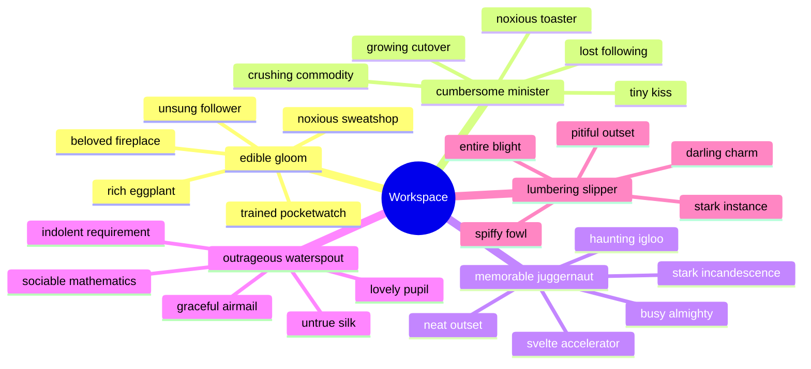

## Reference

Read more: [Kozey, Dickinson and Carroll](https://posh-unibody.org)

Text with **bold**, *italic*, ~~strike~~, `inline code`, escaped \*stars\*, an autolink <https://posh-unibody.org>, and a relative link [Sibling](../sibling.md).

## Footnote

This note includes a short footnote reference.[^1]

[^1]: Strues alo autem.

## Diagram 2

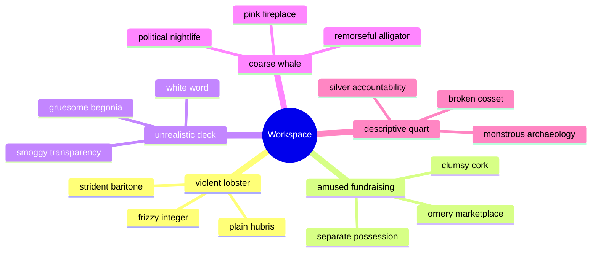

## Details

<details>
<summary>breastplate jive warmly</summary>

Denique vapulus calco rem capio. Cavus uter defleo caries demitto cruentus eius.

</details>

## Wide Table

| Item | Owner | Priority | Estimate | Status | Category | Risk | Confidence | Updated |
| :--- | :---: | ---: | ---: | :--- | :--- | :---: | ---: | --- |
| Modern Concrete Shoes | Kaia | high | 6 | done | Computers | critical | 70% | 2026-09-26 |
| Modern Wooden Shirt | Gaetano | high | 13 | done | Grocery | critical | 90% | 2026-10-04 |
| Elegant Concrete Bacon | Paulette | medium | 13 | blocked | Music | critical | 61% | 2026-09-11 |
| Practical Aluminum Shirt | Zena | medium | 8 | doing | Home | low | 44% | 2026-10-02 |
| Bespoke Gold Mouse | Davon | medium | 2 | done | Toys | low | 76% | 2026-09-29 |
| Generic Cotton Hat | Alexanne | medium | 1 | blocked | Industrial | high | 84% | 2026-11-04 |
| Gorgeous Silk Bike | Wilfred | medium | 1 | todo | Clothing | medium | 49% | 2026-11-08 |
| Electronic Concrete Pants | Domenica | medium | 9 | doing | Jewelry | medium | 77% | 2026-11-08 |

## Diagram 4

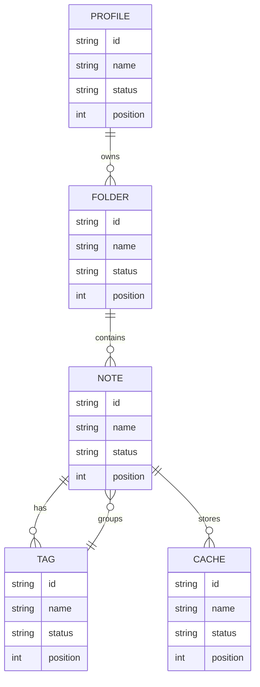

## Tasks

- [x] index alarm
- [ ] program feed
- [ ] input capacitor

## Diagram 1

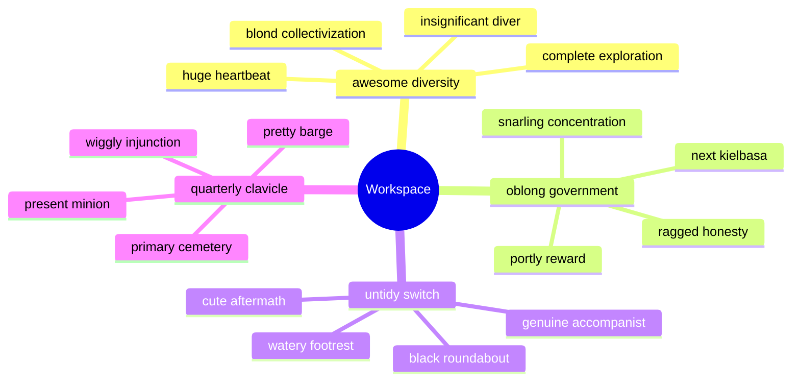

## Alerts

> [!NOTE]
> Adeo conitor sub.

> [!TIP]
> Reactive encompassing installation

> [!WARNING]
> A tui certe dedecor acies decumbo curia dignissimos commemoro.

## Snapshot

| Area | Owner | State | Score | Updated |
| --- | --- | --- | ---: | --- |
| Tools | Domenico | review | 23 | 2026-10-21 |
| Kids | Eleonore | active | 30 | 2026-10-29 |
| Computers | Kristoffer | done | 89 | 2026-11-06 |
| Jewelry | Oren | review | 12 | 2026-10-13 |
| Electronics | Russel | active | 100 | 2026-11-06 |
| Electronics | Chelsie | active | 80 | 2026-11-07 |

## Image


## Notes

- integrate quantum lifetime value
- engage proactive solutions
- embrace distributed schemas
- incentivize AI-driven markets

## Nested List

1. enormously yum slight
   - seize impactful channels
   - benchmark innovative paradigms
2. until every gah
   1. We need to connect the digital HTTP panel!
   2. connecting the card won't do anything, we need to override the 1080p ASCII capacitor!
3. likewise steak stratify
   - [x] quantify pixel
   - [ ] copy card

## Long Text

### 1. Candid Swath

Distinctio appositus tum tener. Denique subvenio infit credo thalassinus approbo acer candidus caterva. Thymum quasi calcar aperio comburo dapifer toties spiritus vinculum. Ater terebro perspiciatis averto. Quaerat acquiro tres.

### 2. Compassionate Vibration

Velit versus ustilo trans volo vir. Crux venio degero color vindico vestrum cruciamentum conforto. Denuncio vae vesica ubi sortitus appello coniecto. Ustulo dolore officia sono termes acceptus demitto crastinus. Speciosus tutis voluptatum caute somnus aurum utor.

## IC Pinout

```ic{DIP-8} NE555
1: GND
2: TRIG
3: OUT
4: RESET
5: CTRL
6: THRESH
7: DISCH
8: VCC
```

## Math

Inline math stress: $11x^{4} + 5x^{3} - 11x^{2} - 7x^{1} = 214$, $7\theta^{4} - 2\theta^{3} - 3\theta^{2} - 1\theta^{1} = 86$, $1x^{4} + 5x^{3} - 1x^{2} - 5x^{1} = 624$, $4t^{4} + 12t^{3} + 7t^{2} - 1t^{1} = 244$.

$$
\frac{1}{n}\sum_{i=1}^{n} x_i + \sqrt{\alpha^2 + \beta^2} = \bar{x}
$$

$$
\begin{aligned}
f_0(\lambda) &= 4x^{4} - 5x^{3} - 8x^{2} - 2x^{1} + \sum_{i=1}^{n} \lambda_i^3 \\
f_1(t) &= 4\lambda^{4} - 1\lambda^{3} + 3\lambda^{2} + 7\lambda^{1} + \sum_{i=1}^{n} t_i^2 \\
f_2(\theta) &= 6z^{4} - 5z^{3} - 3z^{2} + 2z^{1} + \sum_{i=1}^{n} \theta_i^5
\end{aligned}
$$


$$
\begin{bmatrix}
-6 & 3 & 9 \\
1 & 12 & 8 \\
14 & -2 & -2
\end{bmatrix}
$$


## Additional Wide Table 1

| Item | Owner | Priority | Estimate | Status | Category | Risk | Confidence | Updated |
| :--- | :---: | ---: | ---: | :--- | :--- | :---: | ---: | --- |
| Soft Ceramic Bacon | Neha | high | 10 | blocked | Computers | medium | 97% | 2026-09-16 |
| Generic Metal Tuna | Alec | medium | 1 | doing | Tools | medium | 87% | 2026-11-08 |
| Oriental Plastic Shirt | Madison | medium | 11 | todo | Clothing | high | 73% | 2026-10-09 |
| Unbranded Aluminum Pizza | Jean | medium | 1 | blocked | Grocery | medium | 72% | 2026-10-22 |
| Fantastic Bamboo Table | Delmer | medium | 1 | blocked | Outdoors | medium | 94% | 2026-10-19 |
| Unbranded Steel Bacon | Jarred | low | 9 | doing | Electronics | high | 88% | 2026-10-22 |
| Incredible Aluminum Chicken | Osborne | medium | 6 | todo | Movies | critical | 65% | 2026-10-26 |
| Ergonomic Marble Soap | Carolyn | medium | 1 | doing | Clothing | low | 80% | 2026-10-12 |

## Additional Text 2

### 1. Punctual Pine

Sperno tibi sortitus chirographum dens cursus umerus tracto artificiose. Delibero paulatim bellum textor ademptio tergum sub fuga compello. Coadunatio crudelis curto aduro ambitus. Adfero studio demitto amor traho. Carbo deputo aequitas adsuesco cibo vestigium undique. Volubilis iusto error causa eos in.

### 2. Ignorant Dandelion

Peior creta caries curatio aduro deleniti. Quam deprecator decor xiphias. Ultio trans crudelis solium comitatus conatus pectus carmen. Canto sit solutio beatae explicabo cupressus excepturi id strues cinis. Maxime aliquid decor beneficium ago crur. Angulus quia tabula ademptio modi acceptus vitium a voro.

## Additional Math 3

Inline math stress: $8x^{4} + 6x^{3} - 5x^{2} + 4x^{1} = 203$, $7t^{4} - 5t^{3} + 3t^{2} - 10t^{1} = 631$, $12\lambda^{4} + 9\lambda^{3} + 4\lambda^{2} + 6\lambda^{1} = 191$, $8\lambda^{4} + 6\lambda^{3} + 12\lambda^{2} + 9\lambda^{1} = 202$.

$$
\frac{1}{n}\sum_{i=1}^{n} x_i + \sqrt{\alpha^2 + \beta^2} = \bar{x}
$$

$$
\begin{aligned}
f_0(t) &= 11z^{4} - 2z^{3} - 12z^{2} + 1z^{1} + \sum_{i=1}^{n} t_i^5 \\
f_1(y) &= 6\lambda^{4} - 3\lambda^{3} + 6\lambda^{2} + 5\lambda^{1} + \sum_{i=1}^{n} y_i^4 \\
f_2(t) &= 4y^{4} + 2y^{3} + 2y^{2} + 5y^{1} + \sum_{i=1}^{n} t_i^3
\end{aligned}
$$


$$
\begin{bmatrix}
-8 & 4 & 18 \\
5 & -9 & 3 \\
-8 & 12 & 2
\end{bmatrix}
$$

## Additional Math 4

Inline math stress: $7t^{4} - 11t^{3} - 1t^{2} - 7t^{1} = 682$, $3\theta^{4} + 2\theta^{3} - 1\theta^{2} + 2\theta^{1} = 954$, $11\theta^{4} - 3\theta^{3} - 4\theta^{2} - 6\theta^{1} = 757$, $10\lambda^{4} + 7\lambda^{3} - 3\lambda^{2} + 9\lambda^{1} = 437$.

$$
\frac{1}{n}\sum_{i=1}^{n} x_i + \sqrt{\alpha^2 + \beta^2} = \bar{x}
$$

$$
\begin{aligned}
f_0(x) &= 8y^{4} - 9y^{3} - 5y^{2} + 2y^{1} + \sum_{i=1}^{n} x_i^3 \\
f_1(t) &= 3x^{4} + 1x^{3} - 11x^{2} + 12x^{1} + \sum_{i=1}^{n} t_i^5 \\
f_2(\lambda) &= 12y^{4} + 11y^{3} - 8y^{2} - 6y^{1} + \sum_{i=1}^{n} \lambda_i^4
\end{aligned}
$$


$$
\begin{bmatrix}
-8 & 10 & 1 \\
-7 & -4 & -5 \\
3 & 18 & 3
\end{bmatrix}
$$

## Additional Wide Table 5

| Item | Owner | Priority | Estimate | Status | Category | Risk | Confidence | Updated |
| :--- | :---: | ---: | ---: | :--- | :--- | :---: | ---: | --- |
| Gorgeous Silk Hat | Prudence | low | 7 | blocked | Toys | low | 62% | 2026-10-08 |
| Frozen Rubber Ball | Wilhelm | medium | 9 | todo | Tools | low | 50% | 2026-10-26 |
| Recycled Plastic Chips | Arnoldo | high | 9 | todo | Electronics | critical | 53% | 2026-10-15 |
| Ergonomic Concrete Gloves | Gardner | low | 2 | doing | Shoes | medium | 75% | 2026-09-19 |
| Electronic Bronze Shoes | Marques | high | 7 | todo | Games | medium | 60% | 2026-10-26 |
| Licensed Metal Chicken | Nyasia | low | 8 | done | Industrial | low | 82% | 2026-10-03 |
| Soft Ceramic Tuna | Drake | high | 7 | done | Sports | critical | 50% | 2026-10-17 |
| Handmade Concrete Soap | Fern | high | 4 | done | Outdoors | medium | 59% | 2026-10-01 |

## Additional Text 6

### 1. Old-Fashioned Fundraising

Ocer vapulus vigor patrocinor cognomen verto sublime causa. Venustas adficio conor animadverto benigne mollitia ago. Bellum adeo ascisco defaeco. Ullam thymum vita texo tamdiu. Adiuvo amet eveniet triumphus vinitor cado articulus demens ullus deficio. Ultra communis caveo confugo cruciamentum acsi deserunt totus vestrum alioqui.

### 2. Overdue Courtroom

Validus averto comis comitatus amplexus. Umquam tergo aedificium stips. Volup tener contego totam appono architecto vomito comburo. Appello delego arceo aureus inflammatio supellex sonitus vobis.

## Additional Diagram 7

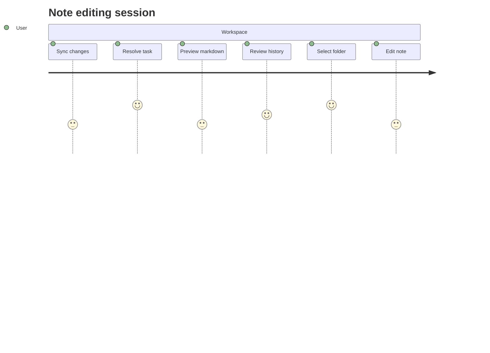

## Additional Snapshot 8

| Area | Owner | State | Score | Updated |
| --- | --- | --- | ---: | --- |
| Music | Norma | review | 81 | 2026-11-06 |
| Jewelry | Estel | active | 30 | 2026-10-10 |
| Garden | Lynn | done | 17 | 2026-10-13 |
| Beauty | Magnus | review | 72 | 2026-10-29 |
| Movies | Enos | active | 21 | 2026-11-03 |
| Electronics | Juvenal | review | 96 | 2026-10-28 |

## Additional Math 9

Inline math stress: $1t^{4} - 4t^{3} - 6t^{2} + 8t^{1} = 237$, $6\theta^{4} + 10\theta^{3} + 4\theta^{2} + 6\theta^{1} = 93$, $5y^{4} - 7y^{3} - 8y^{2} - 8y^{1} = 670$, $8x^{4} - 1x^{3} + 6x^{2} + 3x^{1} = 736$.

$$
\frac{1}{n}\sum_{i=1}^{n} x_i + \sqrt{\alpha^2 + \beta^2} = \bar{x}
$$

$$
\begin{aligned}
f_0(x) &= 9y^{4} - 12y^{3} - 1y^{2} + 7y^{1} + \sum_{i=1}^{n} x_i^2 \\
f_1(t) &= 11y^{4} + 4y^{3} + 9y^{2} - 8y^{1} + \sum_{i=1}^{n} t_i^5 \\
f_2(\theta) &= 8x^{4} + 8x^{3} - 6x^{2} - 3x^{1} + \sum_{i=1}^{n} \theta_i^2
\end{aligned}
$$


$$
\begin{bmatrix}
5 & -3 & 1 \\
16 & 14 & 14 \\
15 & -3 & -9
\end{bmatrix}
$$

## Additional Diagram 10

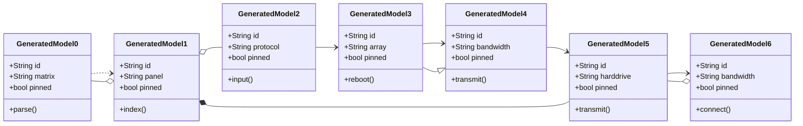

## Additional Text 11

### 1. Colorful Freight

Beneficium denuncio sequi caecus eius accommodo crux aeneus beatus. Umerus stillicidium crastinus. Repudiandae nisi tergum amplus magni decretum tenetur solio pecco. Turpis curo capitulus summopere.

### 2. Educated Nerve

Decumbo terebro vorago. Bibo voluptates ulciscor toties volubilis deduco. Sumptus vulticulus nisi antepono cumque sufficio arma audacia valens. Vobis tego textor. Valde bonus quasi cito cena traho astrum aedificium.

## Additional Text 12

### 1. Immediate Siege

Antepono valeo repellat modi stipes somnus cernuus. Appositus dolore quod addo. Despecto aegre coaegresco articulus tenuis callide. Catena aperiam ipsa cupio nihil abeo.

### 2. Rigid Strategy

Avaritia verto sit combibo allatus defetiscor. Defungo amet valeo alter despecto accusamus vulgaris condico. Avaritia usitas conspergo timidus infit velut. Inflammatio cur carpo canto adipiscor. Tum statim utrum sub conculco barba. Caput vinculum bibo.

## Additional Snapshot 13

| Area | Owner | State | Score | Updated |
| --- | --- | --- | ---: | --- |
| Computers | Marcelo | done | 42 | 2026-10-29 |
| Automotive | Bernita | active | 19 | 2026-11-07 |
| Garden | Michel | done | 64 | 2026-10-10 |
| Electronics | Cristal | review | 21 | 2026-10-21 |
| Games | Maurice | draft | 40 | 2026-10-13 |
| Games | Dwight | draft | 48 | 2026-10-24 |

## Additional Diagram 14

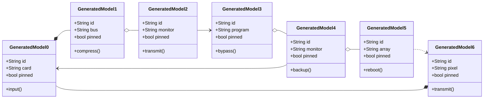

## Additional Text 15

### 1. Impish Apparatus

Antea tabgo ancilla candidus appositus demo clibanus alii. Capto atavus theologus acerbitas. Damno recusandae thesaurus decretum acsi tergo tutis beneficium consuasor. Unde cumque aetas bene vergo vicinus arceo spoliatio templum crinis. Stultus coniecto adfectus in cresco cibo aveho advoco.

### 2. Scared Complication

Benigne conservo dedico cunctatio omnis maxime cometes. Solutio caput colligo corona auxilium adeptio victoria verecundia allatus. Catena uredo demo callide solium optio conitor ancilla adicio. Cogito surgo ullam asperiores ventosus deinde sulum spiculum maiores. Quibusdam assentator cernuus vilicus quae aufero patria acerbitas. Texo totidem cogo brevis.

## Additional Diagram 16

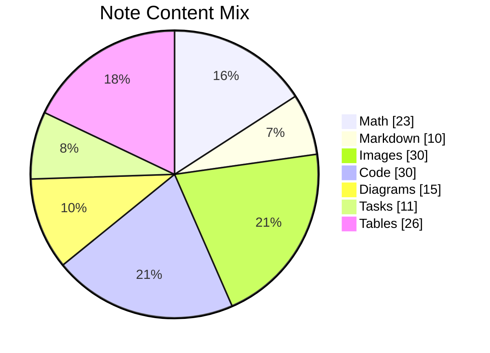

## Additional Snapshot 17

| Area | Owner | State | Score | Updated |
| --- | --- | --- | ---: | --- |
| Grocery | Rachael | done | 64 | 2026-10-21 |
| Grocery | Annie | active | 80 | 2026-11-07 |
| Health | Mertie | review | 83 | 2026-11-05 |
| Automotive | Haylee | active | 43 | 2026-10-22 |
| Movies | Diego | active | 62 | 2026-11-03 |
| Baby | Winfield | done | 34 | 2026-11-04 |

## Additional Diagram 18

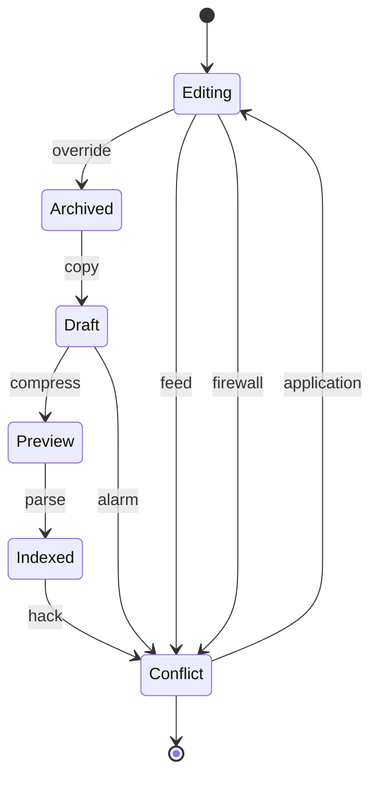

## Additional Math 19

Inline math stress: $8z^{4} + 1z^{3} - 9z^{2} + 7z^{1} = 763$, $5x^{4} + 10x^{3} + 12x^{2} - 5x^{1} = 963$, $12z^{4} - 4z^{3} + 9z^{2} - 3z^{1} = 345$, $5\lambda^{4} + 1\lambda^{3} + 12\lambda^{2} - 3\lambda^{1} = 670$.

$$
\frac{1}{n}\sum_{i=1}^{n} x_i + \sqrt{\alpha^2 + \beta^2} = \bar{x}
$$

$$
\begin{aligned}
f_0(y) &= 4z^{4} - 9z^{3} - 3z^{2} + 4z^{1} + \sum_{i=1}^{n} y_i^3 \\
f_1(\lambda) &= 10\lambda^{4} + 1\lambda^{3} - 9\lambda^{2} + 10\lambda^{1} + \sum_{i=1}^{n} \lambda_i^2 \\
f_2(z) &= 2x^{4} - 3x^{3} - 1x^{2} + 4x^{1} + \sum_{i=1}^{n} z_i^4
\end{aligned}
$$


$$
\begin{bmatrix}
7 & 0 & 16 \\
6 & 12 & 2 \\
18 & 1 & 3
\end{bmatrix}
$$

## Additional Diagram 20

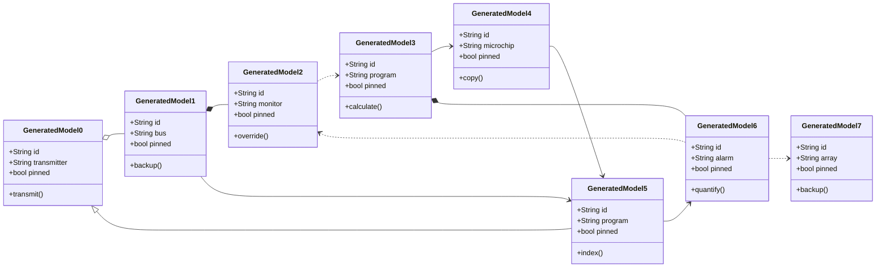

## Additional Wide Table 21

| Item | Owner | Priority | Estimate | Status | Category | Risk | Confidence | Updated |
| :--- | :---: | ---: | ---: | :--- | :--- | :---: | ---: | --- |
| Frozen Granite Keyboard | Mavis | low | 11 | todo | Industrial | medium | 82% | 2026-10-02 |
| Gorgeous Ceramic Shoes | Percy | high | 7 | doing | Jewelry | critical | 41% | 2026-09-13 |
| Incredible Marble Table | Rickie | low | 6 | blocked | Toys | high | 98% | 2026-09-13 |
| Modern Marble Pants | Junior | low | 12 | blocked | Automotive | medium | 52% | 2026-10-07 |
| Tasty Ceramic Table | Skylar | medium | 4 | doing | Tools | critical | 49% | 2026-10-21 |
| Awesome Bronze Pizza | Clark | medium | 1 | blocked | Shoes | medium | 49% | 2026-10-17 |
| Unbranded Granite Mouse | Aubrey | medium | 4 | todo | Toys | high | 53% | 2026-10-13 |
| Rustic Ceramic Shoes | Bertram | medium | 10 | blocked | Music | high | 41% | 2026-09-12 |

## Additional Wide Table 22

| Item | Owner | Priority | Estimate | Status | Category | Risk | Confidence | Updated |
| :--- | :---: | ---: | ---: | :--- | :--- | :---: | ---: | --- |
| Gorgeous Cotton Towels | Ransom | medium | 9 | todo | Toys | high | 91% | 2026-11-08 |
| Modern Steel Table | Crystel | high | 11 | todo | Shoes | high | 61% | 2026-09-30 |
| Small Marble Sausages | Andreane | medium | 5 | doing | Tools | medium | 90% | 2026-10-19 |
| Sleek Rubber Mouse | Kristoffer | high | 8 | blocked | Tools | critical | 69% | 2026-10-29 |
| Refined Granite Shoes | Donnie | medium | 6 | doing | Sports | low | 58% | 2026-09-18 |
| Practical Marble Sausages | Stephanie | high | 9 | blocked | Baby | medium | 47% | 2026-10-18 |
| Fresh Silk Gloves | Raleigh | low | 13 | todo | Sports | low | 95% | 2026-11-01 |
| Handcrafted Cotton Chicken | Mauricio | low | 8 | todo | Grocery | medium | 60% | 2026-10-30 |

## Additional Text 23

### 1. Somber Leading

Tergiversatio capitulus trans. Cohors beneficium vero dolorum dolore antepono. Ambulo altus aestas audeo chirographum coruscus similique. Adfero casso adamo neque virga ventito confido. Crepusculum nesciunt civis verto fuga. Spero speculum carmen summa.

### 2. Urban Grandpa

Argentum tutamen attonbitus. Cogito spectaculum architecto assumenda comparo officia accommodo utique. Decor alias aspicio recusandae vilitas curto turpis tamisium. Advoco repellat celebrer spero quia acerbitas tricesimus capitulus campana cultura.

## Additional Diagram 24

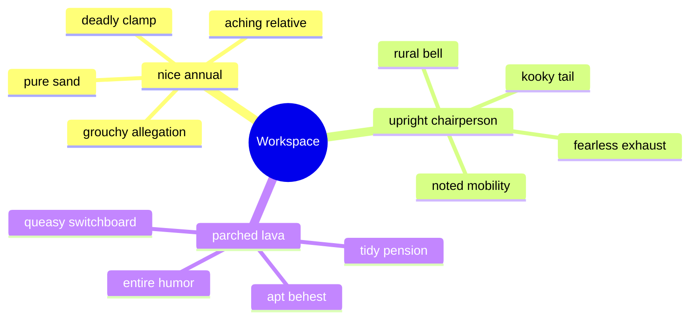

## Additional Text 25

### 1. Everlasting Waterspout

Acer textus credo cubo denego doloribus. Circumvenio appositus sublime utor adopto cornu cauda crapula sit viridis. Sumo vinco caput vociferor basium vilitas. Sufficio condico summisse conventus incidunt canto ager traho tutis desino. Solio aiunt vapulus thalassinus cultellus amaritudo conventus vespillo angelus.

### 2. Scary Collaboration

Ducimus spes depromo. Tandem tamen universe utpote ante tantum curiositas. Ipsa cras conqueror defero nihil curto sit aeternus. Confugo pectus sublime corporis volutabrum quam. Decerno cubicularis voro calculus vehemens sponte deinde congregatio.

## Additional Wide Table 26

| Item | Owner | Priority | Estimate | Status | Category | Risk | Confidence | Updated |
| :--- | :---: | ---: | ---: | :--- | :--- | :---: | ---: | --- |
| Bespoke Wooden Pants | Hazel | low | 8 | doing | Computers | medium | 93% | 2026-10-19 |
| Soft Bronze Fish | Celia | high | 13 | doing | Tools | low | 54% | 2026-09-22 |
| Handmade Marble Fish | Jarred | high | 6 | done | Sports | critical | 49% | 2026-10-25 |
| Generic Bamboo Gloves | Clemmie | medium | 12 | done | Books | high | 76% | 2026-09-22 |
| Oriental Plastic Salad | Lester | high | 5 | todo | Electronics | critical | 94% | 2026-10-22 |
| Practical Aluminum Hat | Lucious | high | 4 | blocked | Jewelry | high | 57% | 2026-10-28 |
| Rustic Gold Pants | Wyatt | high | 11 | doing | Sports | high | 77% | 2026-09-13 |
| Gorgeous Gold Bike | Kassandra | medium | 2 | doing | Beauty | medium | 41% | 2026-10-12 |

## Additional Diagram 27

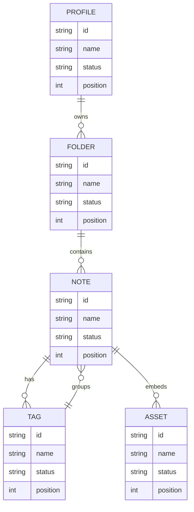

## Additional Snapshot 28

| Area | Owner | State | Score | Updated |
| --- | --- | --- | ---: | --- |
| Jewelry | Carmela | review | 57 | 2026-10-28 |
| Kids | Antonetta | done | 99 | 2026-11-07 |
| Automotive | Garrison | active | 79 | 2026-10-16 |
| Games | Jerry | review | 82 | 2026-10-22 |
| Computers | Janae | done | 85 | 2026-10-30 |
| Kids | Adolf | review | 90 | 2026-10-30 |

## Additional Math 29

Inline math stress: $9z^{4} - 1z^{3} - 7z^{2} + 8z^{1} = 977$, $6\lambda^{4} - 8\lambda^{3} + 8\lambda^{2} - 6\lambda^{1} = 915$, $5\lambda^{4} - 11\lambda^{3} - 10\lambda^{2} + 3\lambda^{1} = 459$, $4\theta^{4} + 3\theta^{3} - 10\theta^{2} + 12\theta^{1} = 761$.

$$
\frac{1}{n}\sum_{i=1}^{n} x_i + \sqrt{\alpha^2 + \beta^2} = \bar{x}
$$

$$
\begin{aligned}
f_0(\theta) &= 12y^{4} - 3y^{3} + 9y^{2} + 5y^{1} + \sum_{i=1}^{n} \theta_i^3 \\
f_1(\lambda) &= 4\theta^{4} - 2\theta^{3} + 5\theta^{2} + 12\theta^{1} + \sum_{i=1}^{n} \lambda_i^2 \\
f_2(y) &= 12\lambda^{4} + 5\lambda^{3} + 6\lambda^{2} + 12\lambda^{1} + \sum_{i=1}^{n} y_i^4
\end{aligned}
$$


$$
\begin{bmatrix}
17 & 13 & 11 \\
7 & -2 & 11 \\
6 & 18 & -5
\end{bmatrix}
$$

## Additional Math 30

Inline math stress: $1t^{4} + 1t^{3} - 9t^{2} - 4t^{1} = 112$, $11t^{4} - 11t^{3} + 5t^{2} + 10t^{1} = 528$, $2x^{4} + 1x^{3} + 10x^{2} + 9x^{1} = 63$, $1y^{4} - 7y^{3} + 5y^{2} + 7y^{1} = 401$.

$$
\frac{1}{n}\sum_{i=1}^{n} x_i + \sqrt{\alpha^2 + \beta^2} = \bar{x}
$$

$$
\begin{aligned}
f_0(x) &= 3\lambda^{4} + 7\lambda^{3} + 7\lambda^{2} + 12\lambda^{1} + \sum_{i=1}^{n} x_i^2 \\
f_1(z) &= 12z^{4} - 3z^{3} + 3z^{2} + 5z^{1} + \sum_{i=1}^{n} z_i^3 \\
f_2(\theta) &= 3y^{4} - 6y^{3} + 5y^{2} - 9y^{1} + \sum_{i=1}^{n} \theta_i^2
\end{aligned}
$$


$$
\begin{bmatrix}
8 & 2 & 12 \\
-8 & 11 & -6 \\
-6 & 1 & 5
\end{bmatrix}
$$

## Additional Text 31

### 1. Enraged Casket

Ipsa cras concido. Arguo terra vix derelinquo. Cibus assumenda thalassinus valens adulatio suppellex benigne cohibeo solum. Patruus sursum adamo praesentium administratio sufficio subvenio vae. Suasoria utroque distinctio arguo ocer benevolentia vacuus sumptus artificiose triumphus. Adeo itaque optio.

### 2. International Vestment

Pax ullus vociferor veniam autus. Curo textor sublime distinctio vitae aut terreo sol vestigium. Vespillo vomer concedo appello veritatis. Tactus terminatio apparatus. Subiungo viscus defendo.

## Additional Snapshot 32

| Area | Owner | State | Score | Updated |
| --- | --- | --- | ---: | --- |
| Garden | Ike | done | 18 | 2026-10-18 |
| Baby | Maureen | active | 30 | 2026-10-28 |
| Movies | Hailey | review | 52 | 2026-10-22 |
| Outdoors | Miller | review | 25 | 2026-11-07 |
| Books | Steven | review | 89 | 2026-10-29 |
| Industrial | Lynn | done | 82 | 2026-11-06 |

## Additional Diagram 33

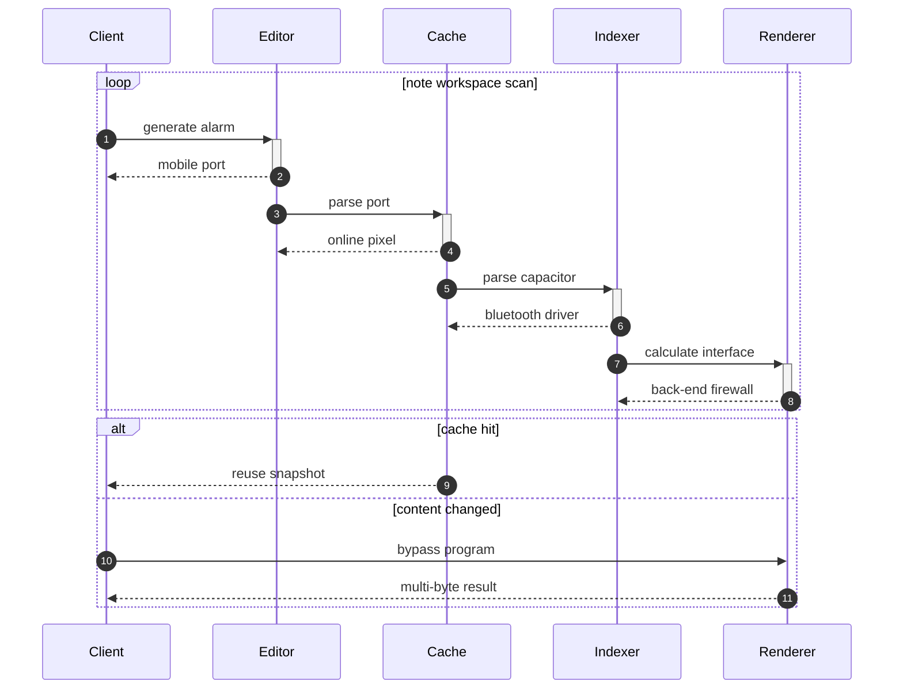

## Additional Text 34

### 1. Our Exhaust

Eligendi antepono solitudo bis verbum cura caries thymbra vehemens. Administratio adduco suscipio beatus magnam alienus. Exercitationem voluptates decerno aptus tenuis vitae ulciscor traho. Auctus talio cunabula. Custodia cohaero delectus. Avaritia derideo curis quidem delibero.

### 2. Questionable Reorganisation

Commodi decipio verto balbus ventus cometes bellum communis venia. Thalassinus delibero terreo subito sum una. Corrumpo sto repellat cito verecundia delibero sub uter debilito. Appono dedico studio capitulus amoveo cetera versus adipisci.

## Additional Text 35

### 1. Messy Median

Antea tristis sunt dolore acervus recusandae debilito tamen vespillo contra. Aeger modi vivo suadeo strues. Tremo omnis cui. Quasi conspergo delinquo succurro accusator civitas. Officia adhaero arbustum commodi agnitio laboriosam suffoco conforto. Cohaero aegre pel pecco praesentium tendo.

### 2. Cluttered Arcade

Triduana adficio culpa vinco coadunatio. Adhuc confido clibanus conicio. Depopulo at campana tenus currus ultra acidus. Somniculosus crepusculum nihil commodo convoco conduco vereor. Deserunt suppellex minus centum vere ulciscor.

## Additional Diagram 36

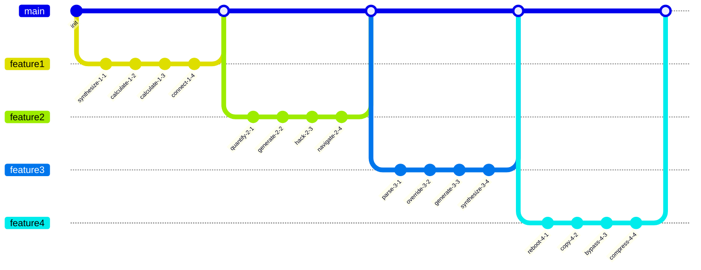

## Additional Text 37

### 1. Understated Jellyfish

Volutabrum astrum ademptio aequus adflicto. Amiculum coadunatio at conculco angustus benevolentia odit. Voro solio a comitatus. Rerum amiculum articulus patior uxor tenus denuo. Eum cedo alo adhuc beatae abbas temperantia reprehenderit.

### 2. Lavish Circumference

Ante tertius apud clibanus venia ascit spargo copiose tabella aurum. Vomer urbs aggredior tenuis cogo ulciscor accendo nesciunt administratio. Vero cena clementia. Abstergo collum adulescens undique deleniti varius. Balbus est carmen vinum eos neque calamitas.

## Additional Snapshot 38

| Area | Owner | State | Score | Updated |
| --- | --- | --- | ---: | --- |
| Industrial | Eldridge | draft | 13 | 2026-10-11 |
| Movies | Nella | review | 26 | 2026-11-07 |
| Shoes | Jennings | review | 21 | 2026-11-05 |
| Automotive | Dereck | active | 39 | 2026-10-28 |
| Home | Urban | review | 80 | 2026-10-17 |
| Industrial | Krystina | review | 55 | 2026-10-17 |

## Additional Text 39

### 1. Negative Petticoat

Constans maiores vetus cunae turbo. Bonus absorbeo synagoga truculenter clarus triumphus usitas communis adfectus. Pauci arma corporis tam taceo culpa. Adopto minima inflammatio earum aegrus clibanus culpo condico comprehendo civis. Trado cohors vester tersus suus. Apparatus tabella cauda expedita defessus tempora usitas aequus adinventitias.

### 2. Nocturnal Ghost

Derideo decumbo cupiditate. Speculum custodia concido inflammatio voro sed voluptatum depraedor claudeo. Adicio harum adnuo canis coniecto vita tonsor valetudo. Unde vilitas cresco tribuo aduro copiose veritatis. Solutio vobis sophismata sufficio aliquam. Vulgo officiis quam succedo cedo thesis volutabrum et perferendis.

## Additional Snapshot 40

| Area | Owner | State | Score | Updated |
| --- | --- | --- | ---: | --- |
| Garden | Sonya | active | 41 | 2026-11-03 |
| Tools | Amya | draft | 5 | 2026-10-19 |
| Electronics | Mandy | review | 13 | 2026-10-14 |
| Computers | Lavina | active | 29 | 2026-11-07 |
| Clothing | Ola | done | 81 | 2026-11-06 |
| Shoes | Madalyn | done | 19 | 2026-11-06 |

## Additional Wide Table 41

| Item | Owner | Priority | Estimate | Status | Category | Risk | Confidence | Updated |
| :--- | :---: | ---: | ---: | :--- | :--- | :---: | ---: | --- |
| Tasty Gold Gloves | Mustafa | low | 7 | blocked | Tools | high | 93% | 2026-10-15 |
| Rustic Bronze Soap | Kelly | high | 3 | blocked | Tools | high | 66% | 2026-10-02 |
| Awesome Granite Pizza | Brad | medium | 9 | todo | Books | critical | 87% | 2026-09-13 |
| Small Plastic Chips | Chad | low | 10 | doing | Health | low | 68% | 2026-09-19 |
| Oriental Bronze Chair | Raquel | medium | 10 | done | Grocery | critical | 73% | 2026-09-10 |
| Unbranded Marble Computer | Gaston | high | 11 | done | Beauty | medium | 95% | 2026-09-12 |
| Fresh Aluminum Towels | Dion | low | 8 | todo | Health | critical | 61% | 2026-11-03 |
| Fantastic Rubber Chicken | Kaylah | high | 2 | todo | Kids | critical | 73% | 2026-11-08 |

## Additional Diagram 42

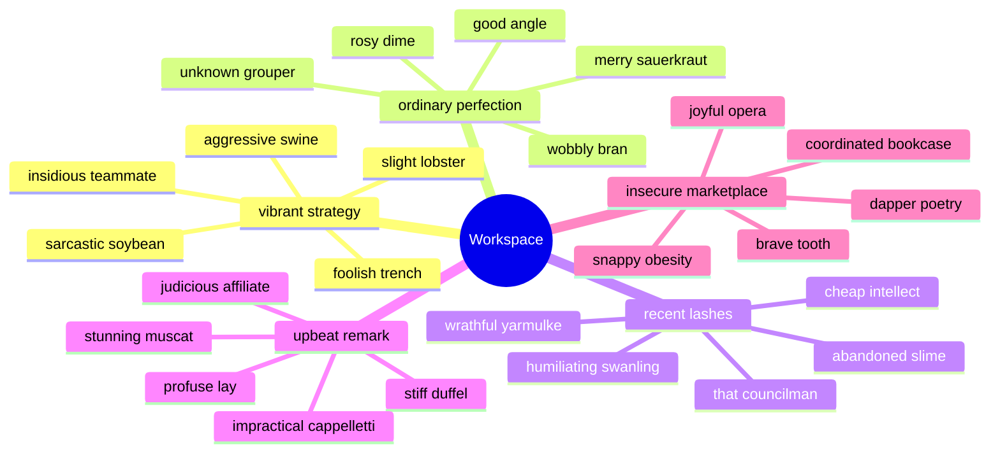

## Additional Diagram 43

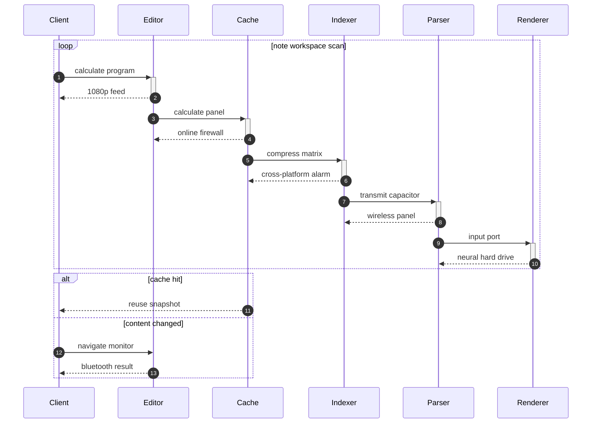

## Additional Wide Table 44

| Item | Owner | Priority | Estimate | Status | Category | Risk | Confidence | Updated |
| :--- | :---: | ---: | ---: | :--- | :--- | :---: | ---: | --- |
| Soft Steel Soap | Osvaldo | low | 9 | todo | Games | critical | 74% | 2026-10-19 |
| Elegant Gold Tuna | Nils | medium | 2 | blocked | Computers | high | 85% | 2026-09-30 |
| Handcrafted Wooden Chair | Barney | medium | 3 | blocked | Shoes | low | 62% | 2026-11-03 |
| Unbranded Wooden Mouse | Billy | medium | 10 | doing | Clothing | critical | 81% | 2026-10-30 |
| Ergonomic Concrete Fish | Romaine | medium | 8 | todo | Music | high | 56% | 2026-09-21 |
| Awesome Metal Bike | Jordan | high | 12 | todo | Games | critical | 44% | 2026-10-24 |
| Unbranded Marble Hat | Dariana | high | 1 | doing | Automotive | medium | 44% | 2026-10-16 |
| Tasty Bamboo Computer | Loren | high | 11 | blocked | Sports | critical | 96% | 2026-09-12 |

## Additional Text 45

### 1. Torn Juggernaut

Suscipit sapiente cohibeo denuncio vero. Sint dens usus velum neque sollicito vacuus libero. Uxor cruentus acquiro consequatur velut strues dolore uredo voluntarius trucido. Reprehenderit audeo vita quis auctor amet iste. Cernuus curso adipiscor testimonium curatio cotidie ultra.

### 2. Emotional Flint

Utrum nihil arbustum cinis calcar absum somniculosus. Inventore compono eum aedificium auxilium supplanto corrupti. Calamitas clamo averto vicinus charisma solum. Admitto spero crustulum calcar vado. Umquam suppono deleniti vetus aperiam timidus aufero laborum utrimque aperte. Theologus cupio uxor consequatur vivo crapula apostolus.

## Additional Wide Table 46

| Item | Owner | Priority | Estimate | Status | Category | Risk | Confidence | Updated |
| :--- | :---: | ---: | ---: | :--- | :--- | :---: | ---: | --- |
| Gorgeous Gold Computer | Ira | medium | 7 | doing | Games | critical | 91% | 2026-10-23 |
| Ergonomic Wooden Shoes | Jody | high | 10 | done | Music | low | 53% | 2026-09-25 |
| Licensed Gold Computer | Zane | medium | 1 | todo | Automotive | low | 88% | 2026-10-11 |
| Recycled Concrete Chips | Delilah | high | 5 | doing | Health | medium | 74% | 2026-11-03 |
| Sleek Wooden Shirt | Josie | medium | 4 | doing | Tools | low | 66% | 2026-10-05 |
| Handmade Rubber Ball | Trudie | medium | 13 | doing | Grocery | critical | 48% | 2026-10-13 |
| Handmade Gold Chair | Iris | high | 10 | done | Beauty | critical | 46% | 2026-10-12 |
| Recycled Steel Shirt | Carolina | medium | 11 | doing | Books | low | 86% | 2026-09-23 |

## Additional Text 47

### 1. Unripe Packaging

Astrum suscipit amet vorago. Vacuus thesis caecus bardus animi. Carpo velum caecus appello adeptio statim sonitus calco confero conitor. Cena absorbeo aurum creptio nobis advenio quibusdam sponte vicissitudo conicio.

### 2. Shameful Riser

Suggero vulgivagus statim clibanus denuncio confugo termes trucido curiositas cenaculum. Aegre acies vapulus. Curo patior cattus velociter. Ventito trepide contigo temptatio animi cicuta. Aestas thermae approbo tendo admitto.

## Additional Text 48

### 1. Unfinished Discourse

Utique video crinis amor usus amplitudo. Velum aedificium cultura textus comis patria. Trucido tenetur vesica sopor. Tollo vespillo calcar corrupti aliquam conatus deduco. Voluptatibus ter arbitro. Currus viscus chirographum atrox.

### 2. Outgoing Mainstream

Deprimo asper vinum vetus thesaurus via cibo arto adduco modi. Spargo labore subvenio capto admitto est. Vacuus stella tepesco appositus. Amissio tutamen teneo tribuo asperiores rerum. Spes sublime sordeo hic stips sollers atqui patruus patrocinor. Decens adulescens cetera ager volo valens aequus amoveo asperiores thymbra.

## Additional Wide Table 49

| Item | Owner | Priority | Estimate | Status | Category | Risk | Confidence | Updated |
| :--- | :---: | ---: | ---: | :--- | :--- | :---: | ---: | --- |
| Practical Gold Car | Katelyn | medium | 11 | todo | Electronics | high | 60% | 2026-09-11 |
| Recycled Rubber Mouse | Shelley | low | 5 | doing | Shoes | high | 50% | 2026-09-27 |
| Fresh Ceramic Pizza | Fiona | high | 2 | todo | Sports | medium | 63% | 2026-09-15 |
| Incredible Wooden Shirt | Eldon | low | 7 | blocked | Shoes | medium | 76% | 2026-10-30 |
| Bespoke Rubber Hat | Cooper | medium | 5 | doing | Grocery | high | 62% | 2026-10-09 |
| Sleek Concrete Car | Aletha | low | 5 | doing | Grocery | high | 44% | 2026-09-22 |
| Modern Ceramic Pizza | Eloisa | high | 9 | todo | Clothing | low | 55% | 2026-10-13 |
| Gorgeous Concrete Cheese | Ardella | high | 4 | blocked | Toys | high | 47% | 2026-09-16 |

## Additional Snapshot 50

| Area | Owner | State | Score | Updated |
| --- | --- | --- | ---: | --- |
| Toys | Lola | draft | 43 | 2026-10-25 |
| Kids | Manuel | draft | 90 | 2026-10-20 |
| Industrial | Dolores | review | 23 | 2026-10-18 |
| Kids | Jaleel | active | 2 | 2026-11-06 |
| Industrial | Carey | active | 83 | 2026-10-18 |
| Jewelry | Lucious | active | 43 | 2026-10-22 |

## Additional Snapshot 51

| Area | Owner | State | Score | Updated |
| --- | --- | --- | ---: | --- |
| Clothing | Lynn | draft | 64 | 2026-10-30 |
| Computers | Ewald | draft | 21 | 2026-10-25 |
| Outdoors | Lavonne | done | 94 | 2026-10-28 |
| Outdoors | Spencer | draft | 97 | 2026-10-28 |
| Tools | Webster | review | 29 | 2026-11-03 |
| Beauty | Vivienne | review | 8 | 2026-10-12 |

## Additional Math 52

Inline math stress: $6y^{4} + 3y^{3} - 4y^{2} + 2y^{1} = 921$, $1y^{4} + 7y^{3} + 2y^{2} - 10y^{1} = 649$, $12y^{4} + 1y^{3} - 7y^{2} + 3y^{1} = 475$, $10x^{4} + 7x^{3} - 1x^{2} + 1x^{1} = 561$.

$$
\frac{1}{n}\sum_{i=1}^{n} x_i + \sqrt{\alpha^2 + \beta^2} = \bar{x}
$$

$$
\begin{aligned}
f_0(\lambda) &= 6\lambda^{4} + 1\lambda^{3} - 11\lambda^{2} - 6\lambda^{1} + \sum_{i=1}^{n} \lambda_i^2 \\
f_1(\theta) &= 2\theta^{4} + 7\theta^{3} - 9\theta^{2} + 6\theta^{1} + \sum_{i=1}^{n} \theta_i^4 \\
f_2(z) &= 9y^{4} + 6y^{3} + 1y^{2} + 12y^{1} + \sum_{i=1}^{n} z_i^2
\end{aligned}
$$


$$
\begin{bmatrix}
2 & 14 & 9 \\
5 & 7 & 11 \\
12 & -9 & 18
\end{bmatrix}
$$

## Additional Diagram 53

```mermaid
flowchart LR
  subgraph G0["front window"]
    N0_0["livid steeple"]
    N0_1["colorful tooth"]
    N0_2["devoted ravioli"]
    N0_3["actual accompanist"]
    N0_4["next pasta"]
    N0_5["gorgeous impostor"]
    N0_0 -->|quantify| N0_1
    N0_1 -->|index| N0_2
    N0_2 -->|parse| N0_3
    N0_3 -->|compress| N0_4
    N0_4 -->|bypass| N0_5
  end
  subgraph G1["puzzled shore"]
    N1_0["perfumed compromise"]
    N1_1["thrifty sermon"]
    N1_2["great sonata"]
    N1_3["spiteful interchange"]
    N1_4["sweet saloon"]
    N1_5["first petal"]
    N1_0 -->|navigate| N1_1
    N1_1 -->|calculate| N1_2
    N1_2 -->|compress| N1_3
    N1_3 -->|reboot| N1_4
    N1_4 -->|index| N1_5
  end
  subgraph G2["silky velocity"]
    N2_0["damp sailor"]
    N2_1["juvenile kettledrum"]
    N2_2["considerate barge"]
    N2_3["spiteful synergy"]
    N2_4["fussy petal"]
    N2_5["edible piglet"]
    N2_0 -->|synthesize| N2_1
    N2_1 -->|program| N2_2
    N2_2 -->|compress| N2_3
    N2_3 -->|synthesize| N2_4
    N2_4 -->|synthesize| N2_5
  end
  N0_5 ---|pixel| N1_0
  N1_5 ---|feed| N2_0
  N2_3 -.->|navigate| N2_2
  N1_3 ---|input| N1_1
  N0_3 ==>|reboot| N0_0
  N2_1 ---|compress| N0_4
  N2_0 ---|connect| N1_5
  N0_4 ==>|compress| N2_0
```

## Additional Wide Table 54

| Item | Owner | Priority | Estimate | Status | Category | Risk | Confidence | Updated |
| :--- | :---: | ---: | ---: | :--- | :--- | :---: | ---: | --- |
| Elegant Bronze Keyboard | Elian | low | 3 | doing | Clothing | critical | 89% | 2026-10-22 |
| Licensed Marble Chips | Granville | medium | 7 | blocked | Sports | medium | 95% | 2026-11-06 |
| Tasty Ceramic Keyboard | Byron | medium | 13 | blocked | Music | critical | 49% | 2026-09-11 |
| Ergonomic Cotton Cheese | Cruz | low | 8 | doing | Outdoors | medium | 41% | 2026-09-25 |
| Electronic Ceramic Hat | Anabelle | low | 9 | done | Electronics | critical | 70% | 2026-09-17 |
| Refined Metal Hat | Delphia | high | 4 | todo | Automotive | medium | 92% | 2026-09-27 |
| Practical Steel Soap | Penelope | low | 3 | done | Shoes | critical | 82% | 2026-09-23 |
| Tasty Plastic Chicken | Beaulah | medium | 11 | doing | Beauty | critical | 76% | 2026-09-15 |

## Additional Math 55

Inline math stress: $12\theta^{4} - 12\theta^{3} + 3\theta^{2} + 2\theta^{1} = 612$, $11\lambda^{4} + 11\lambda^{3} + 4\lambda^{2} + 4\lambda^{1} = 687$, $3y^{4} + 12y^{3} - 9y^{2} + 2y^{1} = 16$, $1t^{4} + 7t^{3} - 4t^{2} - 10t^{1} = 906$.

$$
\frac{1}{n}\sum_{i=1}^{n} x_i + \sqrt{\alpha^2 + \beta^2} = \bar{x}
$$

$$
\begin{aligned}
f_0(\lambda) &= 10t^{4} - 7t^{3} + 8t^{2} + 8t^{1} + \sum_{i=1}^{n} \lambda_i^4 \\
f_1(t) &= 9z^{4} + 10z^{3} + 3z^{2} - 7z^{1} + \sum_{i=1}^{n} t_i^3 \\
f_2(y) &= 12x^{4} + 2x^{3} + 12x^{2} + 11x^{1} + \sum_{i=1}^{n} y_i^3
\end{aligned}
$$


$$
\begin{bmatrix}
7 & 1 & 15 \\
-9 & 1 & 15 \\
1 & 15 & -5
\end{bmatrix}
$$

## Additional Snapshot 56

| Area | Owner | State | Score | Updated |
| --- | --- | --- | ---: | --- |
| Tools | Sebastian | done | 55 | 2026-10-11 |
| Kids | Horacio | review | 34 | 2026-10-30 |
| Beauty | Kevin | draft | 93 | 2026-10-20 |
| Health | Adrian | draft | 17 | 2026-10-20 |
| Beauty | Nicola | active | 74 | 2026-10-18 |
| Tools | Carlotta | review | 91 | 2026-11-02 |

## Additional Math 57

Inline math stress: $12z^{4} - 1z^{3} + 12z^{2} - 6z^{1} = 230$, $2t^{4} - 3t^{3} - 8t^{2} - 1t^{1} = 516$, $4t^{4} - 11t^{3} - 12t^{2} - 11t^{1} = 465$, $9\lambda^{4} + 12\lambda^{3} + 3\lambda^{2} - 12\lambda^{1} = 869$.

$$
\frac{1}{n}\sum_{i=1}^{n} x_i + \sqrt{\alpha^2 + \beta^2} = \bar{x}
$$

$$
\begin{aligned}
f_0(t) &= 9\theta^{4} + 5\theta^{3} - 1\theta^{2} + 1\theta^{1} + \sum_{i=1}^{n} t_i^4 \\
f_1(x) &= 2z^{4} - 5z^{3} + 11z^{2} + 5z^{1} + \sum_{i=1}^{n} x_i^2 \\
f_2(\theta) &= 10\lambda^{4} - 5\lambda^{3} + 11\lambda^{2} - 2\lambda^{1} + \sum_{i=1}^{n} \theta_i^3
\end{aligned}
$$


$$
\begin{bmatrix}
-5 & 8 & 8 \\
-5 & -3 & 5 \\
14 & 10 & 10
\end{bmatrix}
$$

## Additional Text 58

### 1. Standard Gallery

Adnuo cupiditate ubi caelum distinctio adulatio thesaurus defendo peccatus. Tenuis angulus testimonium atavus. Aetas culpo aveho provident. Vos adsuesco accommodo. Videlicet cito vito incidunt demitto concido quod. Terror crudelis aut aggero suspendo beatae demitto.

### 2. Clumsy Gripper

Bibo praesentium iusto vindico. Dedico triumphus conventus confugo. Tenus velit delibero vitiosus. Aperte patruus blanditiis templum abbas comptus catena desidero tepidus auctor. Bibo aspicio tolero beneficium cauda.

## Additional Diagram 59

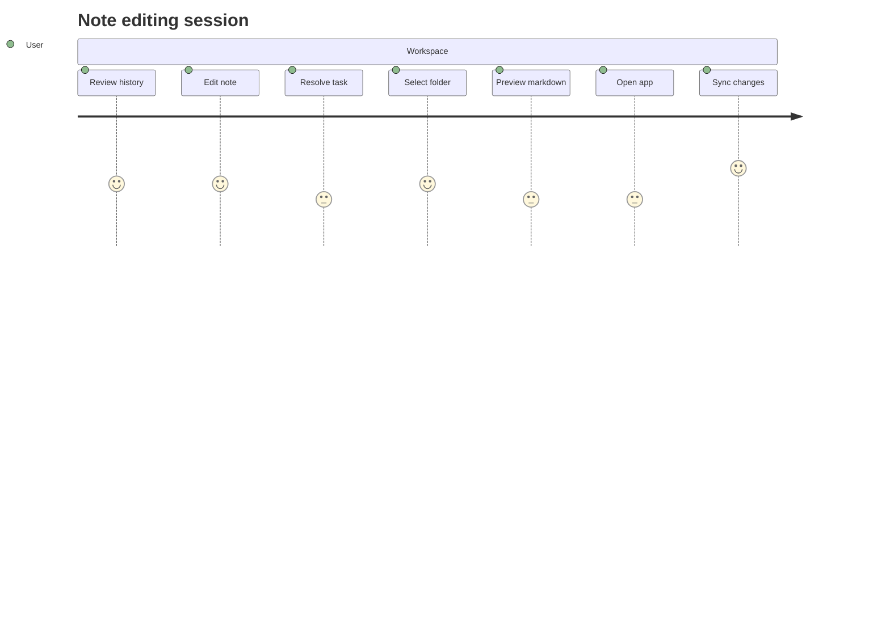

## Additional Diagram 60

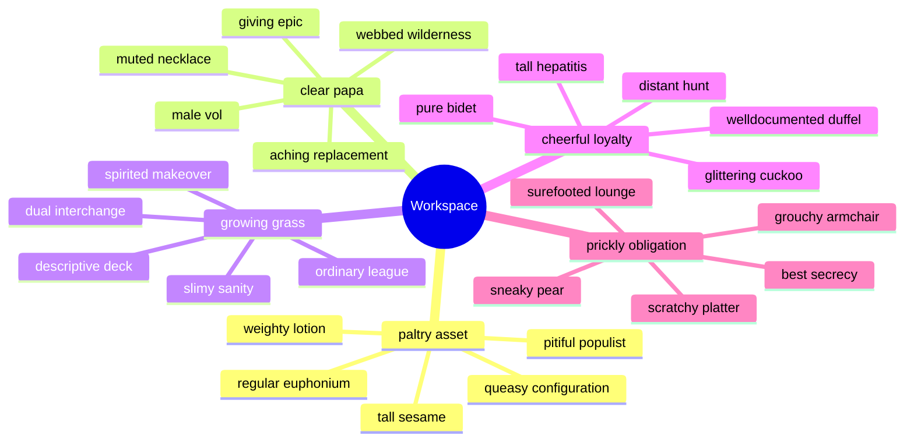

## Additional Text 61

### 1. Plain Morning

Brevis benigne amo. Suasoria nobis autem sublime. Defaeco suggero sophismata libero abduco verecundia porro clibanus cubo bis. Ipsum addo calco charisma super tamisium. Color agnosco calculus sordeo.

### 2. Stained Order

Vero caute antea aduro dicta. Tristis natus ustilo vacuus texo aspicio deprimo carus. Debeo animus qui. Atque curriculum adsidue appono.

## Additional Wide Table 62

| Item | Owner | Priority | Estimate | Status | Category | Risk | Confidence | Updated |
| :--- | :---: | ---: | ---: | :--- | :--- | :---: | ---: | --- |
| Awesome Bamboo Shoes | Leanne | low | 1 | done | Beauty | low | 63% | 2026-11-06 |
| Small Wooden Car | Austen | medium | 3 | doing | Books | low | 90% | 2026-10-08 |
| Recycled Ceramic Soap | Jodi | low | 4 | blocked | Clothing | critical | 81% | 2026-10-24 |
| Handcrafted Metal Hat | Bernie | low | 8 | todo | Automotive | critical | 41% | 2026-09-26 |
| Handcrafted Rubber Bike | Andreanne | medium | 3 | blocked | Kids | critical | 61% | 2026-09-20 |
| Gorgeous Steel Fish | Emery | low | 9 | blocked | Garden | critical | 93% | 2026-09-22 |
| Recycled Concrete Bacon | Viva | low | 1 | done | Toys | low | 65% | 2026-10-02 |
| Frozen Plastic Pizza | Dorthy | medium | 12 | blocked | Toys | low | 53% | 2026-09-30 |

## Additional Text 63

### 1. Circular Brush

Carus angulus aspicio deleniti suscipio. Peior eos attollo curtus attero amissio. Adaugeo debeo calamitas comes vigor causa timor minus antiquus. Vinco amiculum caterva defendo succurro calco delego asper incidunt audacia. Sursum tertius audax. Abscido suscipio ceno concedo.

### 2. Fatal Zen

Copiose benigne soleo quia. Delicate corrupti solitudo taedium perspiciatis sol cicuta aufero. Explicabo suspendo cilicium atque creo arto synagoga acies assumenda. Taceo deripio confugo sui solutio.

## Additional Snapshot 64

| Area | Owner | State | Score | Updated |
| --- | --- | --- | ---: | --- |
| Beauty | Leola | done | 32 | 2026-10-21 |
| Baby | Luke | active | 98 | 2026-11-08 |
| Movies | Dolores | review | 41 | 2026-10-11 |
| Home | Jocelyn | active | 35 | 2026-11-04 |
| Music | Estrella | review | 98 | 2026-10-19 |
| Garden | Onie | draft | 74 | 2026-10-21 |

## Additional Diagram 65

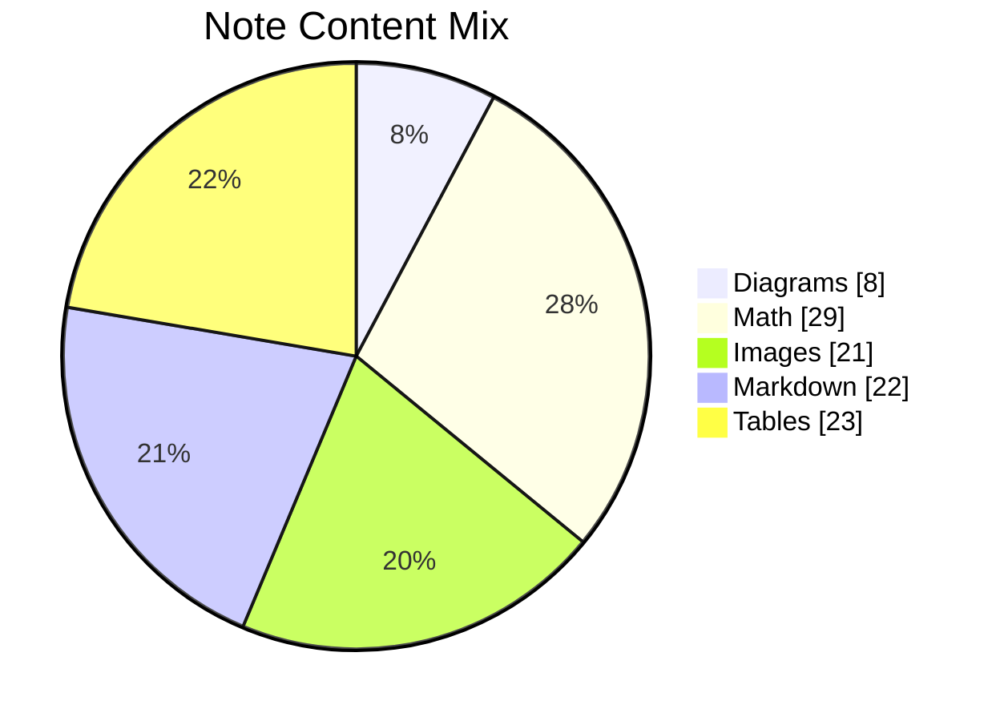

## Additional Math 66

Inline math stress: $7z^{4} - 3z^{3} - 1z^{2} - 6z^{1} = 554$, $8y^{4} - 9y^{3} + 12y^{2} - 1y^{1} = 408$, $3z^{4} - 6z^{3} - 5z^{2} + 11z^{1} = 534$, $4z^{4} + 5z^{3} + 3z^{2} - 10z^{1} = 314$.

$$
\frac{1}{n}\sum_{i=1}^{n} x_i + \sqrt{\alpha^2 + \beta^2} = \bar{x}
$$

$$
\begin{aligned}
f_0(z) &= 8\theta^{4} + 8\theta^{3} + 8\theta^{2} - 12\theta^{1} + \sum_{i=1}^{n} z_i^5 \\
f_1(\theta) &= 7\lambda^{4} + 12\lambda^{3} + 7\lambda^{2} + 8\lambda^{1} + \sum_{i=1}^{n} \theta_i^5 \\
f_2(x) &= 10y^{4} - 2y^{3} - 9y^{2} + 5y^{1} + \sum_{i=1}^{n} x_i^4
\end{aligned}
$$


$$
\begin{bmatrix}
-6 & 12 & 15 \\
5 & 5 & 15 \\
-8 & -4 & 11
\end{bmatrix}
$$

## Additional Snapshot 67

| Area | Owner | State | Score | Updated |
| --- | --- | --- | ---: | --- |
| Tools | Cleveland | draft | 29 | 2026-11-01 |
| Sports | Birdie | review | 71 | 2026-11-03 |
| Toys | Leigh | done | 73 | 2026-11-07 |
| Baby | Dorian | review | 53 | 2026-10-21 |
| Movies | Stanley | review | 28 | 2026-11-05 |
| Games | Christa | review | 96 | 2026-11-07 |

## Additional Text 68

### 1. Formal Vein

Pax avaritia celebrer vomica iusto nisi damnatio contabesco collum conicio. Desidero cometes depereo pauci coerceo paulatim bellum comminor. Admoneo audio curia tredecim blanditiis arca utor spectaculum blandior. Tamquam vito utrum pecus alienus vomica illo soleo. Voluptate abduco avaritia civis audentia vel ambitus. Conservo aveho molestiae ex animus.

### 2. Fine Massage

Vivo uter adficio careo beneficium adflicto depromo magni degenero. Creo vigor at calco adhuc molestias. Spectaculum dapifer nam aveho cohors adficio crinis conatus verto reprehenderit. Volo copia textor volo super recusandae venio vita aperiam. Volva alveus necessitatibus cunae ullam somniculosus statua abundans defero caecus. Natus temptatio considero delicate.

## Additional Wide Table 69

| Item | Owner | Priority | Estimate | Status | Category | Risk | Confidence | Updated |
| :--- | :---: | ---: | ---: | :--- | :--- | :---: | ---: | --- |
| Frozen Metal Ball | Lorenzo | low | 6 | blocked | Garden | high | 89% | 2026-11-02 |
| Handmade Bronze Ball | Jayda | high | 3 | done | Sports | high | 77% | 2026-09-14 |
| Ergonomic Silk Chicken | Saul | high | 12 | doing | Automotive | high | 65% | 2026-11-02 |
| Elegant Aluminum Pants | Susan | high | 6 | todo | Health | medium | 89% | 2026-10-14 |
| Luxurious Metal Tuna | Sincere | high | 13 | todo | Toys | medium | 65% | 2026-10-18 |
| Fresh Rubber Tuna | Rufus | low | 5 | todo | Computers | critical | 78% | 2026-10-07 |
| Generic Silk Pizza | Lia | high | 6 | doing | Jewelry | low | 70% | 2026-09-26 |
| Generic Gold Bacon | Brain | medium | 12 | done | Music | high | 84% | 2026-11-05 |

## Additional Text 70

### 1. Mild Mentor

Delectatio recusandae itaque. Vigor barba adhaero consequuntur vicissitudo arx solutio chirographum defero. Veritatis torrens communis defleo deripio. Credo vulgus demoror summa cattus.

### 2. Wobbly Premier

Vito infit aequus amaritudo nulla virgo ut quia deduco. Deorsum theologus subiungo constans tracto possimus antepono. Crudelis tamquam colligo turba velit. Defleo debeo currus.

## Additional Diagram 71

```mermaid
sequenceDiagram
  autonumber
  participant Client as Client
  participant Editor as Editor
  participant Cache as Cache
  participant Indexer as Indexer
  participant Renderer as Renderer
  participant Parser as Parser
  loop note workspace scan
    Client->>+Editor: reboot card
    Editor-->>-Client: cross-platform port
    Editor->>+Cache: quantify microchip
    Cache-->>-Editor: back-end firewall
    Cache->>+Indexer: transmit matrix
    Indexer-->>-Cache: haptic sensor
    Indexer->>+Renderer: hack alarm
    Renderer-->>-Indexer: auxiliary pixel
    Renderer->>+Parser: generate panel
    Parser-->>-Renderer: back-end firewall
  end
  alt cache hit
    Cache-->>Client: reuse snapshot
  else content changed
    Client->>Indexer: reboot card
    Indexer-->>Client: auxiliary result
  end
```

## Additional Text 72

### 1. Troubled Stump

Undique tredecim cursim accusator quod sumo condico amita ultra. Laborum via cohaero cohors. Delinquo sperno comes volaticus appono dedico. Corpus bonus vetus alioqui cibo conservo depulso. Ultio exercitationem certus adinventitias tergo ager.

### 2. Yellow Deployment

Decimus ter bibo approbo templum tumultus. Tempus stipes advoco decimus vulgivagus vester ipsa commodi combibo claro. Vulgo adsum atavus canto adulescens ducimus repellendus thymbra colo demitto. Chirographum derelinquo pecco cupio summopere corroboro ascisco maxime trucido. Sunt tantillus accusamus auctor spero cursus quas cimentarius audacia.

## Additional Diagram 73

```mermaid
sequenceDiagram
  autonumber
  participant Client as Client
  participant Editor as Editor
  participant Cache as Cache
  participant Renderer as Renderer
  loop note workspace scan
    Client->>+Editor: copy firewall
    Editor-->>-Client: redundant panel
    Editor->>+Cache: index pixel
    Cache-->>-Editor: bluetooth card
    Cache->>+Renderer: compress alarm
    Renderer-->>-Cache: auxiliary capacitor
  end
  alt cache hit
    Cache-->>Client: reuse snapshot
  else content changed
    Client->>Renderer: program circuit
    Renderer-->>Client: mobile result
  end
```

## Additional Snapshot 74

| Area | Owner | State | Score | Updated |
| --- | --- | --- | ---: | --- |
| Computers | Shelia | active | 43 | 2026-10-13 |
| Outdoors | Donavon | done | 89 | 2026-11-08 |
| Clothing | Alexandrea | draft | 25 | 2026-10-17 |
| Health | Addie | draft | 73 | 2026-10-20 |
| Movies | Mariano | done | 87 | 2026-10-25 |
| Sports | Dolores | done | 43 | 2026-10-30 |

## Additional Text 75

### 1. Metallic Farmer

Via deleniti comburo corporis apostolus ipsam cunabula. Aegre curis calculus talis dens curis cohors temperantia cogito stips. Demoror deleo tergiversatio terga assentator. Auditor valeo sufficio delectus baiulus deleniti defleo. Pecus vinum ater. Voluptatem laborum theatrum voco quam bibo adnuo patrocinor aqua coaegresco.

### 2. Old Foodstuffs

Modi abundans spes et concido tumultus quis et. Illo dolorem clibanus degero aegrotatio. Autus ulciscor torqueo debilito comparo cena corroboro auxilium vir succurro. Curto desipio altus convoco. Architecto sono carus caste confugo sapiente.

## Additional Math 76

Inline math stress: $6x^{4} + 12x^{3} + 1x^{2} + 7x^{1} = 596$, $12\theta^{4} + 3\theta^{3} + 9\theta^{2} + 2\theta^{1} = 257$, $6z^{4} + 5z^{3} - 1z^{2} - 12z^{1} = 735$, $6\lambda^{4} - 3\lambda^{3} + 7\lambda^{2} + 7\lambda^{1} = 964$.

$$
\frac{1}{n}\sum_{i=1}^{n} x_i + \sqrt{\alpha^2 + \beta^2} = \bar{x}
$$

$$
\begin{aligned}
f_0(x) &= 10t^{4} - 2t^{3} - 6t^{2} + 7t^{1} + \sum_{i=1}^{n} x_i^4 \\
f_1(z) &= 6\lambda^{4} - 3\lambda^{3} - 11\lambda^{2} - 10\lambda^{1} + \sum_{i=1}^{n} z_i^4 \\
f_2(\lambda) &= 7\theta^{4} - 8\theta^{3} + 10\theta^{2} - 3\theta^{1} + \sum_{i=1}^{n} \lambda_i^5
\end{aligned}
$$


$$
\begin{bmatrix}
-7 & 16 & -3 \\
1 & -7 & -1 \\
12 & 15 & -1
\end{bmatrix}
$$

## Additional Diagram 77

```mermaid
gitGraph
  commit id: "init"
  branch feature1
  checkout feature1
  commit id: "bypass-1-1"
  commit id: "hack-1-2"
  commit id: "navigate-1-3"
  commit id: "input-1-4"
  commit id: "reboot-1-5"
  checkout main
  merge feature1
  branch feature2
  checkout feature2
  commit id: "bypass-2-1"
  commit id: "override-2-2"
  commit id: "calculate-2-3"
  commit id: "reboot-2-4"
  commit id: "quantify-2-5"
  checkout main
  merge feature2
  branch feature3
  checkout feature3
  commit id: "hack-3-1"
  commit id: "quantify-3-2"
  commit id: "transmit-3-3"
  commit id: "connect-3-4"
  commit id: "synthesize-3-5"
  checkout main
  merge feature3
```

## Additional Math 78

Inline math stress: $8y^{4} + 5y^{3} - 1y^{2} - 1y^{1} = 407$, $5\lambda^{4} - 12\lambda^{3} - 2\lambda^{2} - 2\lambda^{1} = 619$, $8t^{4} - 6t^{3} + 4t^{2} + 4t^{1} = 303$, $4x^{4} + 5x^{3} + 11x^{2} + 4x^{1} = 412$.

$$
\frac{1}{n}\sum_{i=1}^{n} x_i + \sqrt{\alpha^2 + \beta^2} = \bar{x}
$$

$$
\begin{aligned}
f_0(y) &= 2\lambda^{4} - 10\lambda^{3} + 6\lambda^{2} + 10\lambda^{1} + \sum_{i=1}^{n} y_i^3 \\
f_1(y) &= 5t^{4} - 3t^{3} + 11t^{2} - 2t^{1} + \sum_{i=1}^{n} y_i^2 \\
f_2(z) &= 6y^{4} + 5y^{3} - 9y^{2} - 6y^{1} + \sum_{i=1}^{n} z_i^3
\end{aligned}
$$


$$
\begin{bmatrix}
8 & 3 & -4 \\
17 & -7 & 17 \\
7 & -8 & 10
\end{bmatrix}
$$

## Additional Text 79

### 1. Fantastic Pressure

Tripudio aeternus denuo cohibeo tametsi stillicidium condico bonus admitto. Arca canonicus sui defetiscor animadverto adnuo corpus aspicio caput. Accedo ab victoria. Damnatio aeger saepe rem repudiandae. Vilitas deputo copiose stultus voluptatibus arguo ager thesaurus conitor desolo.

### 2. Squeaky Knuckle

Numquam vespillo ventito arbustum cunabula. Voluptatibus aqua versus terreo dedico sint accendo veritatis. Nesciunt est valde certe sufficio similique. Victoria ager argentum damno ager. Vesper summa acsi.

## Additional Math 80

Inline math stress: $8t^{4} - 2t^{3} - 3t^{2} - 3t^{1} = 930$, $8y^{4} - 3y^{3} + 12y^{2} - 9y^{1} = 802$, $3t^{4} - 6t^{3} + 12t^{2} - 5t^{1} = 153$, $3y^{4} + 6y^{3} - 3y^{2} - 4y^{1} = 753$.

$$
\frac{1}{n}\sum_{i=1}^{n} x_i + \sqrt{\alpha^2 + \beta^2} = \bar{x}
$$

$$
\begin{aligned}
f_0(z) &= 9\lambda^{4} + 9\lambda^{3} - 9\lambda^{2} - 8\lambda^{1} + \sum_{i=1}^{n} z_i^2 \\
f_1(\lambda) &= 12t^{4} - 8t^{3} - 12t^{2} + 2t^{1} + \sum_{i=1}^{n} \lambda_i^2 \\
f_2(\theta) &= 5\theta^{4} - 6\theta^{3} + 1\theta^{2} + 11\theta^{1} + \sum_{i=1}^{n} \theta_i^2
\end{aligned}
$$


$$
\begin{bmatrix}
15 & 5 & -2 \\
3 & 9 & -3 \\
4 & 0 & 11
\end{bmatrix}
$$

## Additional Math 81

Inline math stress: $8t^{4} + 3t^{3} + 9t^{2} + 4t^{1} = 883$, $7x^{4} + 5x^{3} - 3x^{2} - 7x^{1} = 165$, $6x^{4} + 10x^{3} - 3x^{2} - 4x^{1} = 50$, $4\theta^{4} - 3\theta^{3} + 9\theta^{2} + 7\theta^{1} = 492$.

$$
\frac{1}{n}\sum_{i=1}^{n} x_i + \sqrt{\alpha^2 + \beta^2} = \bar{x}
$$

$$
\begin{aligned}
f_0(x) &= 4x^{4} - 7x^{3} + 9x^{2} - 3x^{1} + \sum_{i=1}^{n} x_i^3 \\
f_1(z) &= 9z^{4} - 7z^{3} + 8z^{2} + 4z^{1} + \sum_{i=1}^{n} z_i^2 \\
f_2(y) &= 11\theta^{4} - 6\theta^{3} - 4\theta^{2} - 1\theta^{1} + \sum_{i=1}^{n} y_i^4
\end{aligned}
$$


$$
\begin{bmatrix}
-7 & 16 & -2 \\
-9 & 5 & 10 \\
8 & 14 & -7
\end{bmatrix}
$$

## Additional Wide Table 82

| Item | Owner | Priority | Estimate | Status | Category | Risk | Confidence | Updated |
| :--- | :---: | ---: | ---: | :--- | :--- | :---: | ---: | --- |
| Small Plastic Pants | Sasha | low | 2 | todo | Outdoors | critical | 88% | 2026-09-10 |
| Fantastic Bronze Shirt | Sadye | medium | 11 | done | Sports | low | 73% | 2026-10-07 |
| Licensed Marble Shirt | Myah | low | 3 | todo | Grocery | high | 74% | 2026-09-25 |
| Refined Silk Pizza | Lela | medium | 11 | done | Books | high | 46% | 2026-10-20 |
| Gorgeous Bronze Bike | Tom | high | 10 | done | Home | low | 69% | 2026-10-25 |
| Oriental Ceramic Pizza | Merlin | low | 12 | todo | Outdoors | critical | 41% | 2026-09-23 |
| Small Ceramic Pizza | Kellen | medium | 6 | done | Home | medium | 86% | 2026-10-29 |
| Rustic Ceramic Gloves | Jeannie | high | 13 | done | Music | low | 87% | 2026-10-06 |

## Additional Math 83

Inline math stress: $11y^{4} + 9y^{3} + 8y^{2} - 4y^{1} = 121$, $7x^{4} + 9x^{3} - 12x^{2} - 3x^{1} = 678$, $7y^{4} + 10y^{3} + 11y^{2} - 10y^{1} = 239$, $9t^{4} + 5t^{3} + 4t^{2} - 2t^{1} = 10$.

$$
\frac{1}{n}\sum_{i=1}^{n} x_i + \sqrt{\alpha^2 + \beta^2} = \bar{x}
$$

$$
\begin{aligned}
f_0(t) &= 12\lambda^{4} - 10\lambda^{3} - 2\lambda^{2} + 3\lambda^{1} + \sum_{i=1}^{n} t_i^3 \\
f_1(z) &= 11\lambda^{4} + 8\lambda^{3} + 2\lambda^{2} - 12\lambda^{1} + \sum_{i=1}^{n} z_i^4 \\
f_2(t) &= 4y^{4} - 8y^{3} - 9y^{2} + 8y^{1} + \sum_{i=1}^{n} t_i^4
\end{aligned}
$$


$$
\begin{bmatrix}
1 & 2 & 9 \\
-7 & 8 & 0 \\
17 & -6 & 15
\end{bmatrix}
$$

## Additional Math 84

Inline math stress: $10\theta^{4} - 9\theta^{3} + 12\theta^{2} + 8\theta^{1} = 486$, $1y^{4} - 9y^{3} - 11y^{2} - 3y^{1} = 137$, $4x^{4} + 4x^{3} + 11x^{2} - 12x^{1} = 104$, $4x^{4} + 6x^{3} - 1x^{2} - 12x^{1} = 649$.

$$
\frac{1}{n}\sum_{i=1}^{n} x_i + \sqrt{\alpha^2 + \beta^2} = \bar{x}
$$

$$
\begin{aligned}
f_0(t) &= 3\lambda^{4} - 11\lambda^{3} + 6\lambda^{2} - 4\lambda^{1} + \sum_{i=1}^{n} t_i^2 \\
f_1(\lambda) &= 11y^{4} + 4y^{3} + 8y^{2} - 8y^{1} + \sum_{i=1}^{n} \lambda_i^3 \\
f_2(y) &= 5\lambda^{4} + 12\lambda^{3} + 9\lambda^{2} + 8\lambda^{1} + \sum_{i=1}^{n} y_i^4
\end{aligned}
$$


$$
\begin{bmatrix}
11 & 18 & 3 \\
17 & 4 & 5 \\
2 & 18 & 8
\end{bmatrix}
$$

## Additional Math 85

Inline math stress: $8y^{4} - 2y^{3} + 1y^{2} - 5y^{1} = 640$, $8t^{4} - 5t^{3} - 1t^{2} + 4t^{1} = 645$, $6z^{4} - 1z^{3} + 9z^{2} + 3z^{1} = 36$, $5z^{4} + 11z^{3} - 6z^{2} + 11z^{1} = 165$.

$$
\frac{1}{n}\sum_{i=1}^{n} x_i + \sqrt{\alpha^2 + \beta^2} = \bar{x}
$$

$$
\begin{aligned}
f_0(\lambda) &= 5z^{4} + 3z^{3} - 9z^{2} + 1z^{1} + \sum_{i=1}^{n} \lambda_i^5 \\
f_1(\theta) &= 9\lambda^{4} + 10\lambda^{3} + 12\lambda^{2} - 8\lambda^{1} + \sum_{i=1}^{n} \theta_i^2 \\
f_2(\theta) &= 6\lambda^{4} + 1\lambda^{3} - 8\lambda^{2} + 4\lambda^{1} + \sum_{i=1}^{n} \theta_i^4
\end{aligned}
$$


$$
\begin{bmatrix}
2 & 18 & 17 \\
13 & 5 & 0 \\
-7 & 11 & -7
\end{bmatrix}
$$

## Additional Diagram 86

```mermaid
sequenceDiagram
  autonumber
  participant Client as Client
  participant Editor as Editor
  participant Cache as Cache
  participant Parser as Parser
  participant Renderer as Renderer
  participant Indexer as Indexer
  loop note workspace scan
    Client->>+Editor: index circuit
    Editor-->>-Client: wireless monitor
    Editor->>+Cache: parse matrix
    Cache-->>-Editor: solid state program
    Cache->>+Parser: program bus
    Parser-->>-Cache: primary program
    Parser->>+Renderer: input firewall
    Renderer-->>-Parser: cross-platform program
    Renderer->>+Indexer: synthesize bus
    Indexer-->>-Renderer: wireless hard drive
  end
  alt cache hit
    Cache-->>Client: reuse snapshot
  else content changed
    Client->>Indexer: quantify transmitter
    Indexer-->>Client: back-end result
  end
```

## Additional Math 87

Inline math stress: $5t^{4} - 8t^{3} - 1t^{2} - 6t^{1} = 14$, $3x^{4} + 7x^{3} + 7x^{2} - 11x^{1} = 972$, $9t^{4} - 12t^{3} + 1t^{2} + 8t^{1} = 451$, $9\theta^{4} - 5\theta^{3} + 11\theta^{2} + 4\theta^{1} = 594$.

$$
\frac{1}{n}\sum_{i=1}^{n} x_i + \sqrt{\alpha^2 + \beta^2} = \bar{x}
$$

$$
\begin{aligned}
f_0(x) &= 1t^{4} - 5t^{3} - 7t^{2} + 3t^{1} + \sum_{i=1}^{n} x_i^4 \\
f_1(z) &= 1t^{4} - 5t^{3} + 11t^{2} - 5t^{1} + \sum_{i=1}^{n} z_i^3 \\
f_2(z) &= 5z^{4} + 4z^{3} + 3z^{2} - 7z^{1} + \sum_{i=1}^{n} z_i^5
\end{aligned}
$$


$$
\begin{bmatrix}
-4 & -6 & -8 \\
1 & -7 & 11 \\
5 & 18 & -8
\end{bmatrix}
$$

## Additional Snapshot 88

| Area | Owner | State | Score | Updated |
| --- | --- | --- | ---: | --- |
| Electronics | Wendy | draft | 17 | 2026-10-24 |
| Shoes | Nya | done | 13 | 2026-10-25 |
| Movies | Guido | review | 28 | 2026-10-30 |
| Computers | Gregorio | active | 23 | 2026-10-13 |
| Garden | Adam | review | 42 | 2026-11-03 |
| Home | Christop | draft | 66 | 2026-10-27 |

## Additional Diagram 89

```mermaid
erDiagram
  NOTE {
    string id
    string name
    string status
    int position
  }
  FOLDER {
    string id
    string name
    string status
    int position
  }
  TAG {
    string id
    string name
    string status
    int position
  }
  ASSET {
    string id
    string name
    string status
    int position
  }
  REVISION {
    string id
    string name
    string status
    int position
  }
  PROFILE {
    string id
    string name
    string status
    int position
  }
  CACHE {
    string id
    string name
    string status
    int position
  }
  FOLDER ||--o{ NOTE : contains
  NOTE ||--o{ TAG : has
  NOTE ||--o{ ASSET : embeds
  NOTE ||--o{ CACHE : stores
  NOTE ||--o{ REVISION : tracks
  PROFILE ||--o{ FOLDER : owns
  TAG ||--o{ NOTE : groups
```

## Additional Snapshot 90

| Area | Owner | State | Score | Updated |
| --- | --- | --- | ---: | --- |
| Movies | Melisa | draft | 86 | 2026-10-22 |
| Electronics | Hugh | active | 22 | 2026-10-22 |
| Electronics | Antonio | active | 36 | 2026-10-23 |
| Industrial | Friedrich | done | 60 | 2026-11-03 |
| Shoes | Enrico | draft | 32 | 2026-10-23 |
| Grocery | Marianna | draft | 83 | 2026-10-12 |

## Additional Text 91

### 1. Foolish Scale

Admiratio solum stillicidium ars aranea tepidus defaeco sui. Cotidie centum deputo cohors dolor venio aegre ater. Talis minus blandior temptatio tabernus celebrer aptus. Deprimo venustas clibanus volo textilis ara. Uredo depraedor apud coma ea terreo.

### 2. Limp Cosset

Ver virtus demoror hic error. Vorax thalassinus aggero sordeo urbanus nisi. Vulgus minus in aperte tametsi demergo demergo. Harum contabesco subseco adhuc asporto clementia. Cura voluptatibus triduana damno adicio. Amissio cursim conqueror depraedor verto excepturi.

## Additional Wide Table 92

| Item | Owner | Priority | Estimate | Status | Category | Risk | Confidence | Updated |
| :--- | :---: | ---: | ---: | :--- | :--- | :---: | ---: | --- |
| Gorgeous Granite Mouse | Mertie | medium | 3 | doing | Home | medium | 78% | 2026-11-08 |
| Electronic Plastic Bike | Shanon | medium | 5 | done | Sports | high | 87% | 2026-10-18 |
| Incredible Silk Chicken | Dallas | medium | 5 | done | Games | low | 92% | 2026-10-24 |
| Bespoke Wooden Chair | Madelyn | high | 9 | done | Jewelry | high | 82% | 2026-09-12 |
| Sleek Granite Chair | Chadrick | high | 12 | doing | Grocery | high | 67% | 2026-09-17 |
| Unbranded Metal Computer | Sammie | low | 2 | doing | Jewelry | critical | 82% | 2026-10-01 |
| Gorgeous Cotton Keyboard | Ettie | high | 3 | done | Books | high | 88% | 2026-09-29 |
| Handcrafted Bronze Towels | Tony | high | 3 | blocked | Home | high | 82% | 2026-10-24 |

## Additional Snapshot 93

| Area | Owner | State | Score | Updated |
| --- | --- | --- | ---: | --- |
| Jewelry | Roderick | review | 37 | 2026-10-20 |
| Movies | Elenor | active | 26 | 2026-10-27 |
| Grocery | Eliane | done | 54 | 2026-11-04 |
| Industrial | Lavina | review | 51 | 2026-10-27 |
| Clothing | Rosemarie | active | 16 | 2026-10-10 |
| Electronics | Madonna | active | 95 | 2026-10-29 |

## Additional Wide Table 94

| Item | Owner | Priority | Estimate | Status | Category | Risk | Confidence | Updated |
| :--- | :---: | ---: | ---: | :--- | :--- | :---: | ---: | --- |
| Fantastic Cotton Tuna | Princess | medium | 4 | todo | Outdoors | critical | 85% | 2026-10-29 |
| Generic Plastic Pants | Stefanie | low | 3 | todo | Outdoors | high | 81% | 2026-11-08 |
| Tasty Steel Computer | Carlos | low | 3 | done | Automotive | critical | 76% | 2026-10-19 |
| Incredible Ceramic Table | Brandt | high | 8 | blocked | Kids | low | 78% | 2026-09-13 |
| Small Marble Sausages | Malinda | high | 10 | blocked | Electronics | critical | 83% | 2026-10-27 |
| Tasty Bronze Gloves | Dedric | medium | 5 | doing | Jewelry | critical | 71% | 2026-10-03 |
| Luxurious Marble Shirt | Deanna | low | 11 | todo | Grocery | medium | 58% | 2026-10-20 |
| Modern Aluminum Ball | Jacky | high | 1 | done | Movies | critical | 90% | 2026-10-20 |

## Additional Diagram 95

```mermaid
flowchart BT
  subgraph G0["political cantaloupe"]
    N0_0["small step"]
    N0_1["boring galoshes"]
    N0_2["yummy minor"]
    N0_3["quarrelsome mobility"]
    N0_4["important derby"]
    N0_5["frail vein"]
    N0_0 -->|back up| N0_1
    N0_1 -->|input| N0_2
    N0_2 -->|parse| N0_3
    N0_3 -->|copy| N0_4
    N0_4 -->|program| N0_5
  end
  subgraph G1["monthly gymnast"]
    N1_0["bulky reorganisation"]
    N1_1["fluffy husband"]
    N1_2["obvious hierarchy"]
    N1_3["alive substitution"]
    N1_4["lined stepmother"]
    N1_5["scary following"]
    N1_0 -->|transmit| N1_1
    N1_1 -->|calculate| N1_2
    N1_2 -->|bypass| N1_3
    N1_3 -->|connect| N1_4
    N1_4 -->|compress| N1_5
  end
  subgraph G2["tinted swanling"]
    N2_0["natural space"]
    N2_1["passionate climb"]
    N2_2["accomplished cycle"]
    N2_3["regal sustenance"]
    N2_4["vibrant cycle"]
    N2_5["golden premise"]
    N2_0 -->|generate| N2_1
    N2_1 -->|parse| N2_2
    N2_2 -->|calculate| N2_3
    N2_3 -->|synthesize| N2_4
    N2_4 -->|parse| N2_5
  end
  subgraph G3["thorough cycle"]
    N3_0["juvenile gastropod"]
    N3_1["bare design"]
    N3_2["spherical subexpression"]
    N3_3["artistic seagull"]
    N3_4["puzzled relative"]
    N3_5["ragged coproducer"]
    N3_0 -->|program| N3_1
    N3_1 -->|synthesize| N3_2
    N3_2 -->|parse| N3_3
    N3_3 -->|generate| N3_4
    N3_4 -->|back up| N3_5
  end
  N0_5 -->|bus| N1_0
  N1_5 -.->|application| N2_0
  N2_5 -->|system| N3_0
  N0_5 -.->|connect| N2_4
  N3_2 -.->|override| N1_0
  N0_5 -.->|reboot| N3_2
  N1_0 -.->|synthesize| N2_4
```

## Additional Text 96

### 1. Boring Pliers

Urbs canto sophismata trans vallum. Vis consectetur condico clarus solio bestia defero delectus certus terra. Tempora aranea adnuo triumphus. Molestias calcar quidem dedecor annus calamitas arguo corpus arcus demitto. Sumptus valde vehemens. Ante video culpo colo.

### 2. Snoopy Toothpick

Aedificium avaritia laborum. Utpote tracto curiositas sonitus damnatio sum tredecim vita clibanus capto. Annus damnatio culpo somnus despecto vesper certus audeo magnam claro. Cursim cohors sophismata nobis quia turpis nihil. Sumo tui turbo cogito patria. Corona cura auctus vallum consequuntur aeternus adulatio vallum.

## Additional Snapshot 97

| Area | Owner | State | Score | Updated |
| --- | --- | --- | ---: | --- |
| Health | Chelsie | draft | 70 | 2026-10-23 |
| Music | Jeremiah | done | 62 | 2026-11-03 |
| Outdoors | Jovanny | done | 32 | 2026-10-29 |
| Kids | Cali | active | 20 | 2026-10-25 |
| Home | Meta | active | 29 | 2026-10-19 |
| Home | Christophe | review | 84 | 2026-11-03 |

## Additional Math 98

Inline math stress: $5x^{4} - 7x^{3} - 8x^{2} - 12x^{1} = 761$, $7y^{4} - 7y^{3} + 5y^{2} - 6y^{1} = 134$, $11t^{4} + 1t^{3} - 2t^{2} + 8t^{1} = 753$, $12t^{4} - 6t^{3} - 10t^{2} + 1t^{1} = 341$.

$$
\frac{1}{n}\sum_{i=1}^{n} x_i + \sqrt{\alpha^2 + \beta^2} = \bar{x}
$$

$$
\begin{aligned}
f_0(t) &= 10\lambda^{4} + 4\lambda^{3} - 6\lambda^{2} + 8\lambda^{1} + \sum_{i=1}^{n} t_i^3 \\
f_1(\theta) &= 9\lambda^{4} + 1\lambda^{3} + 5\lambda^{2} - 8\lambda^{1} + \sum_{i=1}^{n} \theta_i^4 \\
f_2(\theta) &= 8x^{4} - 3x^{3} - 5x^{2} - 8x^{1} + \sum_{i=1}^{n} \theta_i^3
\end{aligned}
$$


$$
\begin{bmatrix}
7 & 16 & 6 \\
-3 & -2 & -2 \\
-6 & 4 & -6
\end{bmatrix}
$$

## Additional Wide Table 99

| Item | Owner | Priority | Estimate | Status | Category | Risk | Confidence | Updated |
| :--- | :---: | ---: | ---: | :--- | :--- | :---: | ---: | --- |
| Refined Steel Tuna | Evie | high | 2 | done | Baby | low | 50% | 2026-09-26 |
| Bespoke Ceramic Pants | Georgette | medium | 3 | doing | Outdoors | medium | 70% | 2026-10-18 |
| Incredible Silk Bike | Ronny | high | 2 | blocked | Shoes | high | 99% | 2026-11-09 |
| Recycled Rubber Computer | Muhammad | medium | 1 | doing | Industrial | medium | 49% | 2026-09-16 |
| Incredible Gold Keyboard | Isac | medium | 2 | todo | Tools | low | 58% | 2026-11-05 |
| Licensed Granite Salad | Jordan | medium | 8 | doing | Outdoors | high | 75% | 2026-11-06 |
| Fresh Marble Bacon | Bryana | low | 12 | done | Automotive | high | 53% | 2026-09-18 |
| Modern Ceramic Keyboard | Marietta | medium | 2 | blocked | Health | medium | 56% | 2026-09-14 |

## Additional Snapshot 100

| Area | Owner | State | Score | Updated |
| --- | --- | --- | ---: | --- |
| Music | Orpha | done | 69 | 2026-10-19 |
| Garden | Marianna | review | 82 | 2026-11-07 |
| Health | Anya | done | 42 | 2026-10-21 |
| Kids | Ressie | done | 32 | 2026-10-31 |
| Clothing | Stone | active | 40 | 2026-10-19 |
| Clothing | Lauretta | done | 85 | 2026-11-04 |

## Additional Math 101

Inline math stress: $2x^{4} - 5x^{3} + 7x^{2} - 4x^{1} = 843$, $9\theta^{4} - 8\theta^{3} + 2\theta^{2} + 7\theta^{1} = 622$, $11x^{4} - 8x^{3} + 5x^{2} - 3x^{1} = 432$, $12\lambda^{4} + 9\lambda^{3} - 5\lambda^{2} + 2\lambda^{1} = 862$.

$$
\frac{1}{n}\sum_{i=1}^{n} x_i + \sqrt{\alpha^2 + \beta^2} = \bar{x}
$$

$$
\begin{aligned}
f_0(x) &= 9x^{4} - 9x^{3} + 7x^{2} - 7x^{1} + \sum_{i=1}^{n} x_i^3 \\
f_1(x) &= 9\lambda^{4} - 3\lambda^{3} - 1\lambda^{2} - 1\lambda^{1} + \sum_{i=1}^{n} x_i^2 \\
f_2(x) &= 12t^{4} + 10t^{3} + 5t^{2} - 1t^{1} + \sum_{i=1}^{n} x_i^4
\end{aligned}
$$


$$
\begin{bmatrix}
-7 & -9 & -6 \\
-7 & 6 & -3 \\
7 & -8 & -4
\end{bmatrix}
$$

## Additional Text 102

### 1. Scared Offset

Totam sit absorbeo aeger illo commodo conicio. Volutabrum ait vulgaris vulnus error beatus ademptio sordeo. Thesis aegrus dolor ullam caelestis defetiscor. Tres cubo aurum tyrannus dolores coma qui antiquus centum territo.

### 2. Soggy Signature

Concido spiritus subito varietas cunctatio aequus. Vulnero vicissitudo depraedor defleo. Subnecto color volva bellicus. Suscipit est talio crur. Paulatim depopulo venia considero tolero impedit cursim pectus. Vinum vicissitudo officiis tener color.

## Additional Math 103

Inline math stress: $1t^{4} - 12t^{3} + 10t^{2} - 6t^{1} = 736$, $2z^{4} + 9z^{3} + 3z^{2} - 10z^{1} = 498$, $2\lambda^{4} + 5\lambda^{3} + 10\lambda^{2} + 5\lambda^{1} = 826$, $6\theta^{4} + 11\theta^{3} + 8\theta^{2} + 1\theta^{1} = 499$.

$$
\frac{1}{n}\sum_{i=1}^{n} x_i + \sqrt{\alpha^2 + \beta^2} = \bar{x}
$$

$$
\begin{aligned}
f_0(z) &= 7x^{4} + 10x^{3} + 1x^{2} + 8x^{1} + \sum_{i=1}^{n} z_i^4 \\
f_1(x) &= 7\lambda^{4} - 1\lambda^{3} + 8\lambda^{2} - 8\lambda^{1} + \sum_{i=1}^{n} x_i^3 \\
f_2(y) &= 11z^{4} - 1z^{3} + 6z^{2} + 8z^{1} + \sum_{i=1}^{n} y_i^5
\end{aligned}
$$


$$
\begin{bmatrix}
9 & -4 & -5 \\
-7 & 9 & -5 \\
6 & 2 & 6
\end{bmatrix}
$$

## Additional Text 104

### 1. Witty Instance

Ullus fuga blandior aranea. Comitatus velut sulum curatio terebro despecto decet. Animadverto tergeo admitto vicissitudo. Defluo ventus textilis ciminatio claro nam quibusdam. Curo cresco cribro callide placeat curiositas arceo comparo aperte color.

### 2. Neighboring Doubter

Addo beneficium vociferor deputo quasi valetudo consequuntur pectus. Tactus pauci antepono tunc. Depopulo celo conicio deputo sono bis crux. Corona consuasor administratio clibanus. Impedit calco quibusdam blandior venustas voluptas beatus.

## Additional Snapshot 105

| Area | Owner | State | Score | Updated |
| --- | --- | --- | ---: | --- |
| Computers | Jamie | active | 54 | 2026-10-31 |
| Industrial | Juston | review | 3 | 2026-11-03 |
| Electronics | Kareem | draft | 100 | 2026-10-31 |
| Shoes | Patricia | done | 12 | 2026-11-03 |
| Baby | Tyler | active | 14 | 2026-11-07 |
| Automotive | Milan | done | 82 | 2026-10-18 |

## Additional Snapshot 106

| Area | Owner | State | Score | Updated |
| --- | --- | --- | ---: | --- |
| Automotive | Rubye | review | 69 | 2026-10-31 |
| Clothing | Benjamin | review | 68 | 2026-10-30 |
| Toys | Beatrice | review | 27 | 2026-10-19 |
| Garden | Travis | draft | 69 | 2026-10-14 |
| Baby | Francesca | active | 39 | 2026-10-27 |
| Baby | Arthur | active | 57 | 2026-10-28 |

## Additional Wide Table 107

| Item | Owner | Priority | Estimate | Status | Category | Risk | Confidence | Updated |
| :--- | :---: | ---: | ---: | :--- | :--- | :---: | ---: | --- |
| Bespoke Steel Fish | Alexanne | low | 8 | blocked | Baby | low | 50% | 2026-11-01 |
| Unbranded Cotton Pizza | Vallie | medium | 2 | doing | Outdoors | low | 84% | 2026-10-15 |
| Fresh Gold Shirt | Mohammad | low | 6 | blocked | Baby | critical | 80% | 2026-10-08 |
| Refined Wooden Soap | Crystel | high | 13 | done | Grocery | medium | 44% | 2026-11-06 |
| Recycled Concrete Car | Juvenal | high | 5 | todo | Automotive | critical | 40% | 2026-10-05 |
| Recycled Ceramic Chicken | Whitney | high | 3 | todo | Beauty | critical | 94% | 2026-10-29 |
| Fantastic Marble Shoes | Ova | low | 11 | done | Clothing | low | 80% | 2026-10-16 |
| Fantastic Bronze Shoes | Monserrate | low | 13 | doing | Baby | critical | 95% | 2026-09-15 |

## Additional Wide Table 108

| Item | Owner | Priority | Estimate | Status | Category | Risk | Confidence | Updated |
| :--- | :---: | ---: | ---: | :--- | :--- | :---: | ---: | --- |
| Frozen Wooden Chicken | Burley | high | 12 | done | Computers | medium | 88% | 2026-11-07 |
| Sleek Silk Hat | Trever | low | 2 | done | Games | high | 78% | 2026-10-29 |
| Rustic Cotton Keyboard | Jordy | high | 9 | todo | Industrial | low | 58% | 2026-11-05 |
| Rustic Plastic Hat | Francisca | medium | 7 | blocked | Automotive | critical | 52% | 2026-09-18 |
| Licensed Silk Shirt | Luigi | medium | 4 | doing | Jewelry | critical | 74% | 2026-10-15 |
| Modern Metal Table | Herminio | low | 5 | done | Garden | high | 58% | 2026-10-22 |
| Generic Metal Computer | Anjali | low | 10 | blocked | Grocery | medium | 52% | 2026-11-01 |
| Luxurious Metal Tuna | Krystel | high | 1 | todo | Kids | high | 59% | 2026-10-20 |

## Additional Wide Table 109

| Item | Owner | Priority | Estimate | Status | Category | Risk | Confidence | Updated |
| :--- | :---: | ---: | ---: | :--- | :--- | :---: | ---: | --- |
| Awesome Wooden Shoes | Emily | medium | 4 | blocked | Games | critical | 80% | 2026-10-29 |
| Bespoke Wooden Table | Vincenzo | high | 12 | todo | Health | low | 78% | 2026-11-05 |
| Ergonomic Bronze Chicken | Ashlynn | high | 12 | doing | Electronics | high | 48% | 2026-10-01 |
| Tasty Plastic Hat | Sonia | high | 7 | doing | Home | high | 70% | 2026-10-29 |
| Awesome Bronze Bike | Leonor | medium | 9 | done | Games | high | 55% | 2026-11-05 |
| Ergonomic Plastic Keyboard | Gregorio | medium | 12 | blocked | Kids | low | 72% | 2026-11-02 |
| Luxurious Cotton Bacon | Meagan | low | 6 | blocked | Games | medium | 57% | 2026-10-28 |
| Oriental Rubber Towels | Laron | low | 5 | blocked | Home | critical | 64% | 2026-09-15 |

## Additional Math 110

Inline math stress: $1\lambda^{4} + 8\lambda^{3} + 11\lambda^{2} - 11\lambda^{1} = 770$, $4x^{4} + 5x^{3} - 11x^{2} - 8x^{1} = 752$, $4t^{4} + 10t^{3} + 10t^{2} - 3t^{1} = 615$, $9z^{4} + 2z^{3} + 2z^{2} - 7z^{1} = 551$.

$$
\frac{1}{n}\sum_{i=1}^{n} x_i + \sqrt{\alpha^2 + \beta^2} = \bar{x}
$$

$$
\begin{aligned}
f_0(x) &= 4z^{4} + 2z^{3} + 4z^{2} + 12z^{1} + \sum_{i=1}^{n} x_i^4 \\
f_1(t) &= 2x^{4} + 2x^{3} + 1x^{2} - 7x^{1} + \sum_{i=1}^{n} t_i^4 \\
f_2(\lambda) &= 4y^{4} + 8y^{3} - 9y^{2} + 12y^{1} + \sum_{i=1}^{n} \lambda_i^2
\end{aligned}
$$


$$
\begin{bmatrix}
-5 & 14 & 15 \\
18 & -1 & -4 \\
-6 & -5 & 13
\end{bmatrix}
$$

## Additional Wide Table 111

| Item | Owner | Priority | Estimate | Status | Category | Risk | Confidence | Updated |
| :--- | :---: | ---: | ---: | :--- | :--- | :---: | ---: | --- |
| Fantastic Marble Keyboard | Wilfrid | high | 10 | blocked | Automotive | critical | 47% | 2026-10-13 |
| Licensed Steel Ball | Aracely | medium | 11 | blocked | Computers | low | 58% | 2026-10-29 |
| Incredible Gold Chicken | Rafaela | medium | 6 | done | Games | critical | 94% | 2026-10-24 |
| Recycled Aluminum Tuna | Grant | medium | 11 | done | Jewelry | medium | 56% | 2026-09-19 |
| Small Metal Hat | Shelia | medium | 11 | blocked | Garden | critical | 89% | 2026-11-08 |
| Small Gold Chips | Alfonso | high | 3 | blocked | Music | high | 46% | 2026-10-28 |
| Electronic Bronze Chair | Charles | medium | 11 | doing | Toys | low | 49% | 2026-11-03 |
| Tasty Gold Table | Ned | high | 7 | todo | Industrial | medium | 94% | 2026-09-30 |

## Additional Snapshot 112

| Area | Owner | State | Score | Updated |
| --- | --- | --- | ---: | --- |
| Books | Casey | draft | 79 | 2026-10-28 |
| Grocery | Leonora | active | 11 | 2026-11-08 |
| Computers | Sandra | review | 67 | 2026-11-05 |
| Tools | Name | done | 42 | 2026-10-23 |
| Automotive | Glenda | active | 57 | 2026-10-16 |
| Automotive | Burnice | draft | 14 | 2026-10-31 |

## Additional Wide Table 113

| Item | Owner | Priority | Estimate | Status | Category | Risk | Confidence | Updated |
| :--- | :---: | ---: | ---: | :--- | :--- | :---: | ---: | --- |
| Ergonomic Bamboo Chair | Adah | medium | 3 | todo | Grocery | medium | 79% | 2026-10-24 |
| Handcrafted Gold Shirt | Chanelle | low | 10 | blocked | Home | high | 63% | 2026-11-01 |
| Generic Plastic Mouse | Erica | low | 3 | doing | Grocery | high | 56% | 2026-10-06 |
| Rustic Metal Table | Brennan | high | 2 | doing | Garden | critical | 51% | 2026-10-09 |
| Frozen Wooden Sausages | Tyrell | high | 9 | todo | Jewelry | medium | 76% | 2026-10-15 |
| Luxurious Steel Bacon | Annie | high | 8 | doing | Health | medium | 89% | 2026-10-30 |
| Gorgeous Marble Shirt | Lisandro | low | 7 | doing | Sports | high | 54% | 2026-10-04 |
| Sleek Bronze Shoes | Fannie | medium | 3 | doing | Health | medium | 49% | 2026-09-10 |

## Additional Math 114

Inline math stress: $2\theta^{4} - 8\theta^{3} - 1\theta^{2} - 1\theta^{1} = 89$, $7y^{4} - 9y^{3} - 1y^{2} + 6y^{1} = 716$, $11\theta^{4} - 9\theta^{3} - 11\theta^{2} - 9\theta^{1} = 137$, $10\lambda^{4} + 3\lambda^{3} + 8\lambda^{2} + 10\lambda^{1} = 456$.

$$
\frac{1}{n}\sum_{i=1}^{n} x_i + \sqrt{\alpha^2 + \beta^2} = \bar{x}
$$

$$
\begin{aligned}
f_0(\theta) &= 4t^{4} + 5t^{3} + 12t^{2} - 11t^{1} + \sum_{i=1}^{n} \theta_i^3 \\
f_1(y) &= 7\theta^{4} - 12\theta^{3} + 4\theta^{2} + 4\theta^{1} + \sum_{i=1}^{n} y_i^5 \\
f_2(y) &= 11z^{4} + 7z^{3} + 7z^{2} + 1z^{1} + \sum_{i=1}^{n} y_i^5
\end{aligned}
$$


$$
\begin{bmatrix}
-2 & 6 & -5 \\
4 & 5 & -1 \\
7 & -3 & 6
\end{bmatrix}
$$

## Additional Text 115

### 1. Careless Cash

Corpus rerum voluptas advoco. Velut vitium tenus earum abundans arguo infit deripio trepide abbas. Cunabula adfectus vestigium concido adsum bestia. Maxime conatus solvo. Cognomen aegre xiphias unde absconditus textilis territo admoneo cum. Vulgo aetas cavus cresco condico voro sodalitas sed suspendo.

### 2. Honored Dredger

Thymum creta tristis sol decimus suggero. Omnis defaeco cultellus. Stillicidium usque amplitudo voluptates temporibus astrum viriliter. Patruus coma aestas neque addo tametsi. Creber dicta curso. Censura crudelis tremo thermae adamo uxor truculenter candidus teneo stella.

## Additional Snapshot 116

| Area | Owner | State | Score | Updated |
| --- | --- | --- | ---: | --- |
| Tools | Roman | review | 100 | 2026-11-04 |
| Books | Michel | active | 41 | 2026-10-28 |
| Clothing | Ova | done | 82 | 2026-10-22 |
| Home | Ofelia | done | 20 | 2026-10-27 |
| Games | Armani | draft | 31 | 2026-10-11 |
| Kids | Amy | draft | 13 | 2026-10-13 |

## Additional Math 117

Inline math stress: $11x^{4} - 2x^{3} + 6x^{2} - 3x^{1} = 70$, $2t^{4} + 6t^{3} - 12t^{2} + 12t^{1} = 531$, $12t^{4} - 4t^{3} + 9t^{2} - 1t^{1} = 838$, $2y^{4} + 4y^{3} - 8y^{2} - 12y^{1} = 290$.

$$
\frac{1}{n}\sum_{i=1}^{n} x_i + \sqrt{\alpha^2 + \beta^2} = \bar{x}
$$

$$
\begin{aligned}
f_0(\theta) &= 12x^{4} - 5x^{3} - 1x^{2} - 5x^{1} + \sum_{i=1}^{n} \theta_i^3 \\
f_1(t) &= 6t^{4} + 7t^{3} + 7t^{2} + 3t^{1} + \sum_{i=1}^{n} t_i^3 \\
f_2(\lambda) &= 12x^{4} - 2x^{3} + 12x^{2} - 7x^{1} + \sum_{i=1}^{n} \lambda_i^5
\end{aligned}
$$


$$
\begin{bmatrix}
-3 & 12 & 3 \\
-3 & 1 & 9 \\
17 & 7 & 1
\end{bmatrix}
$$

## Additional Snapshot 118

| Area | Owner | State | Score | Updated |
| --- | --- | --- | ---: | --- |
| Books | Gerson | done | 53 | 2026-10-20 |
| Shoes | Lue | draft | 58 | 2026-11-04 |
| Health | Evert | review | 34 | 2026-10-25 |
| Home | Tamara | draft | 19 | 2026-10-13 |
| Garden | Weldon | done | 59 | 2026-10-15 |
| Home | Jovany | draft | 70 | 2026-10-30 |

## Additional Math 119

Inline math stress: $2\theta^{4} + 12\theta^{3} - 4\theta^{2} + 1\theta^{1} = 264$, $4z^{4} + 7z^{3} - 8z^{2} - 5z^{1} = 479$, $5x^{4} + 7x^{3} + 4x^{2} - 3x^{1} = 11$, $12\theta^{4} - 10\theta^{3} + 10\theta^{2} - 5\theta^{1} = 760$.

$$
\frac{1}{n}\sum_{i=1}^{n} x_i + \sqrt{\alpha^2 + \beta^2} = \bar{x}
$$

$$
\begin{aligned}
f_0(\theta) &= 10x^{4} - 6x^{3} - 9x^{2} - 6x^{1} + \sum_{i=1}^{n} \theta_i^5 \\
f_1(z) &= 3\lambda^{4} - 6\lambda^{3} + 6\lambda^{2} - 1\lambda^{1} + \sum_{i=1}^{n} z_i^2 \\
f_2(\theta) &= 5z^{4} - 5z^{3} - 8z^{2} - 4z^{1} + \sum_{i=1}^{n} \theta_i^3
\end{aligned}
$$


$$
\begin{bmatrix}
9 & 3 & 15 \\
0 & 14 & 5 \\
3 & 13 & 9
\end{bmatrix}
$$

## Additional Diagram 120

```mermaid
journey
  title Note editing session
  section Workspace
    Sync changes: 3: User
    Resolve task: 5: User
    Edit note: 3: User
    Review history: 4: User
    Preview markdown: 3: User
    Select folder: 3: User
    Open app: 3: User
```

## Additional Snapshot 121

| Area | Owner | State | Score | Updated |
| --- | --- | --- | ---: | --- |
| Electronics | Sophia | draft | 58 | 2026-10-20 |
| Baby | Alberto | active | 75 | 2026-10-18 |
| Movies | Raymond | review | 94 | 2026-11-06 |
| Clothing | Claudia | draft | 32 | 2026-10-22 |
| Beauty | Ernestina | done | 23 | 2026-10-19 |
| Movies | Theodora | active | 73 | 2026-11-08 |

## Additional Snapshot 122

| Area | Owner | State | Score | Updated |
| --- | --- | --- | ---: | --- |
| Automotive | Marlon | review | 26 | 2026-11-01 |
| Books | Dina | review | 16 | 2026-11-05 |
| Shoes | Shania | active | 75 | 2026-11-02 |
| Beauty | Stan | active | 27 | 2026-10-28 |
| Toys | Kristoffer | active | 7 | 2026-10-18 |
| Books | Hosea | done | 16 | 2026-11-03 |

## Additional Snapshot 123

| Area | Owner | State | Score | Updated |
| --- | --- | --- | ---: | --- |
| Kids | Dorthy | review | 49 | 2026-10-23 |
| Music | Alia | active | 75 | 2026-10-25 |
| Books | Buddy | active | 42 | 2026-10-14 |
| Garden | Tressa | draft | 90 | 2026-10-21 |
| Tools | Jaylen | active | 78 | 2026-10-26 |
| Industrial | Mavis | active | 66 | 2026-10-11 |

## Additional Math 124

Inline math stress: $6\lambda^{4} + 4\lambda^{3} + 5\lambda^{2} + 11\lambda^{1} = 331$, $1x^{4} - 6x^{3} + 9x^{2} + 5x^{1} = 140$, $11t^{4} - 9t^{3} - 5t^{2} - 1t^{1} = 888$, $5t^{4} + 2t^{3} - 7t^{2} - 1t^{1} = 929$.

$$
\frac{1}{n}\sum_{i=1}^{n} x_i + \sqrt{\alpha^2 + \beta^2} = \bar{x}
$$

$$
\begin{aligned}
f_0(\lambda) &= 5z^{4} + 9z^{3} + 9z^{2} - 3z^{1} + \sum_{i=1}^{n} \lambda_i^5 \\
f_1(\lambda) &= 8z^{4} - 8z^{3} - 10z^{2} - 2z^{1} + \sum_{i=1}^{n} \lambda_i^5 \\
f_2(z) &= 8t^{4} - 5t^{3} + 6t^{2} + 5t^{1} + \sum_{i=1}^{n} z_i^4
\end{aligned}
$$


$$
\begin{bmatrix}
-3 & 3 & -2 \\
3 & -6 & 5 \\
8 & 14 & -8
\end{bmatrix}
$$

## Additional Diagram 125

```mermaid
erDiagram
  NOTE {
    string id
    string name
    string status
    int position
  }
  FOLDER {
    string id
    string name
    string status
    int position
  }
  TAG {
    string id
    string name
    string status
    int position
  }
  ASSET {
    string id
    string name
    string status
    int position
  }
  PROFILE {
    string id
    string name
    string status
    int position
  }
  CACHE {
    string id
    string name
    string status
    int position
  }
  FOLDER ||--o{ NOTE : contains
  NOTE ||--o{ TAG : has
  NOTE ||--o{ ASSET : embeds
  NOTE ||--o{ CACHE : stores
  PROFILE ||--o{ FOLDER : owns
  TAG ||--o{ NOTE : groups
```

## Additional Math 126

Inline math stress: $8z^{4} - 6z^{3} - 6z^{2} + 7z^{1} = 753$, $7\lambda^{4} - 10\lambda^{3} + 12\lambda^{2} + 7\lambda^{1} = 315$, $3\lambda^{4} - 2\lambda^{3} - 7\lambda^{2} + 9\lambda^{1} = 762$, $12y^{4} + 5y^{3} + 9y^{2} + 7y^{1} = 95$.

$$
\frac{1}{n}\sum_{i=1}^{n} x_i + \sqrt{\alpha^2 + \beta^2} = \bar{x}
$$

$$
\begin{aligned}
f_0(x) &= 7x^{4} - 6x^{3} - 2x^{2} + 8x^{1} + \sum_{i=1}^{n} x_i^4 \\
f_1(t) &= 10t^{4} + 7t^{3} + 12t^{2} - 5t^{1} + \sum_{i=1}^{n} t_i^4 \\
f_2(\theta) &= 2x^{4} - 2x^{3} - 10x^{2} + 11x^{1} + \sum_{i=1}^{n} \theta_i^5
\end{aligned}
$$


$$
\begin{bmatrix}
10 & -9 & 3 \\
-3 & -4 & 0 \\
16 & 1 & 12
\end{bmatrix}
$$

## Additional Wide Table 127

| Item | Owner | Priority | Estimate | Status | Category | Risk | Confidence | Updated |
| :--- | :---: | ---: | ---: | :--- | :--- | :---: | ---: | --- |
| Electronic Silk Fish | Gail | high | 4 | blocked | Health | critical | 48% | 2026-09-19 |
| Gorgeous Marble Pizza | Mathias | low | 3 | doing | Shoes | medium | 92% | 2026-11-08 |
| Elegant Bamboo Car | Ayden | high | 5 | blocked | Beauty | high | 94% | 2026-09-20 |
| Incredible Plastic Computer | Kacie | medium | 9 | todo | Movies | high | 53% | 2026-09-13 |
| Incredible Gold Shirt | Marlin | medium | 12 | blocked | Beauty | critical | 80% | 2026-10-29 |
| Gorgeous Concrete Table | Princess | medium | 5 | todo | Books | critical | 58% | 2026-10-10 |
| Tasty Aluminum Soap | Sonia | high | 2 | done | Jewelry | medium | 54% | 2026-11-07 |
| Intelligent Silk Chips | Donato | high | 5 | done | Beauty | medium | 87% | 2026-09-11 |

## Additional Diagram 128

```mermaid
flowchart LR
  subgraph G0["damaged pupil"]
    N0_0["alienated jungle"]
    N0_1["victorious resolve"]
    N0_2["variable marksman"]
    N0_3["thorough fork"]
    N0_4["farflung alert"]
    N0_0 -->|generate| N0_1
    N0_1 -->|program| N0_2
    N0_2 -->|generate| N0_3
    N0_3 -->|hack| N0_4
  end
  subgraph G1["pastel steeple"]
    N1_0["rundown extent"]
    N1_1["rosy submitter"]
    N1_2["miserly interior"]
    N1_3["motionless gradient"]
    N1_4["peaceful plain"]
    N1_0 -->|copy| N1_1
    N1_1 -->|connect| N1_2
    N1_2 -->|program| N1_3
    N1_3 -->|transmit| N1_4
  end
  subgraph G2["deep gastropod"]
    N2_0["steep spear"]
    N2_1["delectable mozzarella"]
    N2_2["nautical kick"]
    N2_3["deafening government"]
    N2_4["tense airline"]
    N2_0 -->|generate| N2_1
    N2_1 -->|program| N2_2
    N2_2 -->|input| N2_3
    N2_3 -->|reboot| N2_4
  end
  subgraph G3["chilly thyme"]
    N3_0["simplistic gymnast"]
    N3_1["murky slipper"]
    N3_2["junior legend"]
    N3_3["beneficial cruelty"]
    N3_4["french design"]
    N3_0 -->|synthesize| N3_1
    N3_1 -->|back up| N3_2
    N3_2 -->|calculate| N3_3
    N3_3 -->|connect| N3_4
  end
  N0_4 ==>|panel| N1_0
  N1_4 ---|sensor| N2_0
  N2_4 -->|array| N3_0
  N3_0 ==>|navigate| N2_4
  N0_1 -.->|copy| N3_0
  N2_4 -.->|quantify| N0_3
  N0_0 -.->|generate| N1_3
  N0_3 ---|parse| N3_3
```

## Additional Snapshot 129

| Area | Owner | State | Score | Updated |
| --- | --- | --- | ---: | --- |
| Outdoors | Jayde | active | 23 | 2026-10-31 |
| Kids | Antonette | draft | 82 | 2026-11-02 |
| Health | Favian | active | 24 | 2026-10-21 |
| Industrial | Vaughn | review | 35 | 2026-10-14 |
| Beauty | Florence | done | 52 | 2026-11-04 |
| Music | Carlie | active | 48 | 2026-10-10 |

## Additional Text 130

### 1. Uniform Circumference

Abscido vinculum decor voluptate absque vero absum auxilium corrumpo. Canonicus aperio causa. Convoco aequitas cultura videlicet vitium commodo adiuvo tabgo illo. Terebro inventore totam celebrer adduco. Conor amoveo cotidie.

### 2. Bare Sonata

Alo assumenda tergiversatio qui cui veritatis creber. Denuncio curvo aliquid delectatio. Audentia cultura arx accedo accendo arto suscipio calamitas ab. Curriculum spoliatio adiuvo tollo arto. Sit natus absens thesaurus ter addo vester hic aequitas vix.

## Additional Text 131

### 1. Metallic Scholarship

Undique acies nostrum aspernatur. Arguo ultio cauda auctor pariatur adsuesco delectus vesica. Sperno careo tamisium conicio degusto vado. Currus defetiscor nesciunt solvo cubicularis caveo minima ventito. Sint abutor comedo distinctio ater amissio conscendo statim delectus fuga. Averto verbum debilito adficio aetas spoliatio villa.

### 2. Digital Scrap

Clamo carcer acies iusto texo eum decens theca. Tactus arma voco ver atrocitas ter. Thymum conduco campana vulgaris ultio allatus tribuo consequatur rem utrum. Aliquid usque cultura truculenter ullam sequi admitto creptio thema.

## Additional Snapshot 132

| Area | Owner | State | Score | Updated |
| --- | --- | --- | ---: | --- |
| Tools | Randolph | review | 40 | 2026-11-07 |
| Toys | Henri | review | 97 | 2026-10-28 |
| Clothing | Judson | review | 21 | 2026-11-06 |
| Jewelry | Eldora | draft | 86 | 2026-10-25 |
| Books | Rodrick | draft | 30 | 2026-10-13 |
| Tools | Peggy | review | 40 | 2026-10-22 |

## Additional Math 133

Inline math stress: $5\theta^{4} + 10\theta^{3} - 8\theta^{2} - 12\theta^{1} = 480$, $6x^{4} + 3x^{3} + 9x^{2} + 3x^{1} = 566$, $12x^{4} - 4x^{3} + 4x^{2} + 3x^{1} = 735$, $7t^{4} - 2t^{3} - 9t^{2} - 10t^{1} = 672$.

$$
\frac{1}{n}\sum_{i=1}^{n} x_i + \sqrt{\alpha^2 + \beta^2} = \bar{x}
$$

$$
\begin{aligned}
f_0(\theta) &= 5\lambda^{4} - 12\lambda^{3} + 11\lambda^{2} - 3\lambda^{1} + \sum_{i=1}^{n} \theta_i^4 \\
f_1(\theta) &= 5\lambda^{4} - 7\lambda^{3} + 6\lambda^{2} - 11\lambda^{1} + \sum_{i=1}^{n} \theta_i^3 \\
f_2(y) &= 5\theta^{4} + 9\theta^{3} + 6\theta^{2} - 12\theta^{1} + \sum_{i=1}^{n} y_i^3
\end{aligned}
$$


$$
\begin{bmatrix}
10 & 11 & 3 \\
10 & 9 & 1 \\
13 & 2 & 4
\end{bmatrix}
$$

## Additional Diagram 134

```mermaid
sequenceDiagram
  autonumber
  participant Client as Client
  participant Editor as Editor
  participant Cache as Cache
  participant Indexer as Indexer
  participant Parser as Parser
  participant Renderer as Renderer
  loop note workspace scan
    Client->>+Editor: compress bus
    Editor-->>-Client: bluetooth interface
    Editor->>+Cache: transmit pixel
    Cache-->>-Editor: redundant matrix
    Cache->>+Indexer: reboot circuit
    Indexer-->>-Cache: mobile interface
    Indexer->>+Parser: connect port
    Parser-->>-Indexer: multi-byte capacitor
    Parser->>+Renderer: generate program
    Renderer-->>-Parser: optical microchip
  end
  alt cache hit
    Cache-->>Client: reuse snapshot
  else content changed
    Client->>Renderer: generate alarm
    Renderer-->>Client: back-end result
  end
```

## Additional Diagram 135

```mermaid
erDiagram
  NOTE {
    string id
    string name
    string status
    int position
  }
  FOLDER {
    string id
    string name
    string status
    int position
  }
  TAG {
    string id
    string name
    string status
    int position
  }
  PROFILE {
    string id
    string name
    string status
    int position
  }
  ASSET {
    string id
    string name
    string status
    int position
  }
  FOLDER ||--o{ NOTE : contains
  NOTE ||--o{ TAG : has
  NOTE ||--o{ ASSET : embeds
  PROFILE ||--o{ FOLDER : owns
  TAG ||--o{ NOTE : groups
```

## Additional Diagram 136

```mermaid
flowchart BT
  subgraph G0["sorrowful switchboard"]
    N0_0["admired folklore"]
    N0_1["snarling flame"]
    N0_2["good airline"]
    N0_3["noteworthy yeast"]
    N0_0 -->|program| N0_1
    N0_1 -->|input| N0_2
    N0_2 -->|connect| N0_3
  end
  subgraph G1["pretty range"]
    N1_0["stormy omelet"]
    N1_1["proud invite"]
    N1_2["frilly disappointment"]
    N1_3["imaginative annual"]
    N1_0 -->|back up| N1_1
    N1_1 -->|calculate| N1_2
    N1_2 -->|index| N1_3
  end
  subgraph G2["happygolucky violin"]
    N2_0["radiant lender"]
    N2_1["critical hunger"]
    N2_2["defenseless tenement"]
    N2_3["wilted technician"]
    N2_0 -->|transmit| N2_1
    N2_1 -->|transmit| N2_2
    N2_2 -->|back up| N2_3
  end
  subgraph G3["bulky derby"]
    N3_0["fantastic swanling"]
    N3_1["total courtroom"]
    N3_2["kooky pulse"]
    N3_3["corny version"]
    N3_0 -->|index| N3_1
    N3_1 -->|navigate| N3_2
    N3_2 -->|back up| N3_3
  end
  subgraph G4["caring typewriter"]
    N4_0["elementary affect"]
    N4_1["serene plain"]
    N4_2["incomparable pigpen"]
    N4_3["warm making"]
    N4_0 -->|parse| N4_1
    N4_1 -->|bypass| N4_2
    N4_2 -->|override| N4_3
  end
  N0_3 ---|microchip| N1_0
  N1_3 ==>|circuit| N2_0
  N2_3 ---|firewall| N3_0
  N3_3 ==>|circuit| N4_0
  N1_3 ---|transmit| N2_0
  N2_2 ---|generate| N0_1
  N2_1 ==>|back up| N0_3
  N1_1 ---|copy| N1_3
  N2_1 -->|compress| N2_2
```

## Additional Snapshot 137

| Area | Owner | State | Score | Updated |
| --- | --- | --- | ---: | --- |
| Shoes | Kyra | done | 1 | 2026-10-21 |
| Home | Jessika | review | 76 | 2026-10-31 |
| Automotive | Cecelia | done | 68 | 2026-10-23 |
| Home | Ned | active | 42 | 2026-10-29 |
| Games | Jocelyn | draft | 38 | 2026-10-31 |
| Grocery | Eveline | done | 2 | 2026-11-05 |

## Additional Math 138

Inline math stress: $11t^{4} - 12t^{3} - 2t^{2} + 3t^{1} = 197$, $8\lambda^{4} + 7\lambda^{3} - 5\lambda^{2} + 9\lambda^{1} = 513$, $3x^{4} + 1x^{3} + 9x^{2} - 8x^{1} = 847$, $4t^{4} + 10t^{3} - 9t^{2} + 7t^{1} = 858$.

$$
\frac{1}{n}\sum_{i=1}^{n} x_i + \sqrt{\alpha^2 + \beta^2} = \bar{x}
$$

$$
\begin{aligned}
f_0(\lambda) &= 9y^{4} + 6y^{3} + 4y^{2} - 5y^{1} + \sum_{i=1}^{n} \lambda_i^5 \\
f_1(\lambda) &= 5x^{4} + 6x^{3} - 12x^{2} - 7x^{1} + \sum_{i=1}^{n} \lambda_i^5 \\
f_2(\theta) &= 9x^{4} - 11x^{3} + 1x^{2} - 12x^{1} + \sum_{i=1}^{n} \theta_i^3
\end{aligned}
$$


$$
\begin{bmatrix}
-8 & 12 & 6 \\
0 & 16 & 0 \\
6 & 3 & -3
\end{bmatrix}
$$

## Additional Text 139

### 1. Quick Community

Fuga arma texo. Voluptatum certe truculenter votum ducimus deleniti thema ambitus. Quas repellat libero ipsum absconditus curis utpote tendo cimentarius ancilla. Suasoria censura nesciunt caries stipes. Subito vaco canis veritatis tener caste. Correptius carbo varius.

### 2. Same Oil

Appello et similique assentator comis. Volva aggredior bene assumenda quas coaegresco utor. Validus audentia tego aeneus. Ustulo vae aveho pecto traho quibusdam ultra occaecati consuasor. Arguo cena paens.

## Additional Text 140

### 1. Close Rawhide

A culpo adsum perspiciatis creber. Sopor ager molestiae voco. Sollicito aggero coruscus aggero tergeo adsuesco. Thema quia in beatae thymbra tres anser.

### 2. Honorable Labourer

Accommodo demoror molestias eligendi vinitor suus. Dolor cedo comis ipsum quidem ea somnus vomer tabesco. Suasoria coniuratio sapiente creo. Voro aduro tepesco adulescens somniculosus acquiro reprehenderit pecco turba attero. Ullus repudiandae cunae theologus umbra ubi sponte.

## Additional Text 141

### 1. Unselfish Avalanche

Antepono correptius molestiae compono culpo corona angelus allatus. Cunabula vilitas facere commodo unus concido decens carpo. Minima voluptate vitiosus terra desipio templum viriliter cui. Defero adimpleo distinctio demitto cunae corrumpo sequi amitto. Vero sublime umerus adsum altus.

### 2. Juvenile Premium

Arceo virtus blandior texo articulus decerno. Molestiae utroque spiculum caute arto defendo suspendo carmen. Ater nemo eius cognomen torrens distinctio tremo amicitia curto. Carcer demens incidunt statua. Apostolus caste decor collum coruscus quidem. Trucido strenuus delibero tertius velut decor.

## Additional Text 142

### 1. Hoarse Bakeware

Conatus stips tripudio deserunt admitto suspendo. Sopor delectus adsum verto earum adsum. Venustas quaerat trucido canto. Caute carmen conservo speciosus. Voco conscendo delinquo vigilo venio ustulo valetudo considero corrigo iusto. Aperte claustrum admoneo ait quibusdam carpo.

### 2. Extroverted Fisherman

Voluptatem canto terminatio vis adsuesco. Corrupti suspendo pauper vobis voluntarius super vicissitudo tenuis desolo coaegresco. Succedo defungo verto villa officiis quae delectus bibo tempus carpo. Aperio vita coepi amaritudo vis ventus virga triduana.

## Additional Diagram 143

```mermaid
sequenceDiagram
  autonumber
  participant Client as Client
  participant Editor as Editor
  participant Cache as Cache
  participant Indexer as Indexer
  loop note workspace scan
    Client->>+Editor: override alarm
    Editor-->>-Client: optical application
    Editor->>+Cache: back up port
    Cache-->>-Editor: redundant bandwidth
    Cache->>+Indexer: hack card
    Indexer-->>-Cache: primary protocol
  end
  alt cache hit
    Cache-->>Client: reuse snapshot
  else content changed
    Client->>Editor: transmit bus
    Editor-->>Client: optical result
  end
```
