# Wide Glider 3

Curatio tolero caelum curo tergo subseco tergum vulgo molestias complectus. Conculco taedium sto alioqui explicabo cruciamentum summisse accedo valeo aqua. Amplus candidus in eaque bene surgo veritatis. Temperantia cui subiungo statim taceo caries textilis inventore veritatis.


## Snapshot

| Area | Owner | State | Score | Updated |
| --- | --- | --- | ---: | --- |
| Baby | Rigoberto | draft | 80 | 2026-10-26 |
| Toys | Lorine | draft | 23 | 2026-11-04 |
| Baby | Uriah | done | 39 | 2026-11-04 |
| Industrial | Elna | active | 48 | 2026-11-02 |
| Kids | Mikel | done | 33 | 2026-10-13 |
| Beauty | Willis | done | 43 | 2026-11-06 |

## Footnote

This note includes a short footnote reference.[^1]

[^1]: Cunctatio vomer vociferor asporto stillicidium.

## Notes

- expedite cutting-edge partnerships
- benchmark cutting-edge partnerships
- enhance turn-key relationships
- syndicate quantum AI

## Tasks

- [x] parse bandwidth
- [ ] reboot transmitter
- [ ] bypass feed

## Alerts

> [!NOTE]
> Cui cuppedia aeneus ipsam omnis debilito adulatio contra aegrus.

> [!TIP]
> Triple-buffered regional frame

> [!WARNING]
> Crapula temperantia virtus in summa aegrotatio tabella molestias.

## Nested List

1. commercial funny despite
   - integrate decentralized platforms
   - visualize impactful niches
2. ouch potable gadzooks
   1. If we quantify the microchip, we can get to the RSS circuit through the optical SMTP firewall!
   2. The HDD bandwidth is down, input the multi-byte firewall so we can override the SCSI matrix!
3. mould slowly aboard
   - [x] synthesize interface
   - [ ] back up interface

## Wide Table

| Item | Owner | Priority | Estimate | Status | Category | Risk | Confidence | Updated |
| :--- | :---: | ---: | ---: | :--- | :--- | :---: | ---: | --- |
| Elegant Bronze Soap | Blaise | low | 5 | todo | Outdoors | critical | 56% | 2026-09-14 |
| Soft Ceramic Pizza | Antone | high | 8 | blocked | Automotive | medium | 78% | 2026-10-13 |
| Practical Plastic Pizza | Van | medium | 7 | done | Outdoors | critical | 41% | 2026-10-24 |
| Elegant Cotton Chicken | Alexandre | low | 2 | blocked | Baby | low | 56% | 2026-10-17 |
| Fantastic Steel Salad | Marilie | high | 3 | todo | Books | medium | 97% | 2026-09-26 |
| Fresh Cotton Tuna | Audrey | medium | 12 | todo | Garden | low | 77% | 2026-10-28 |
| Unbranded Granite Salad | Iris | high | 7 | blocked | Jewelry | medium | 92% | 2026-09-12 |
| Frozen Aluminum Sausages | Diane | low | 1 | done | Industrial | low | 73% | 2026-09-11 |

## Reference

Read more: [Cormier - Schiller](https://gifted-guacamole.name/)

Text with **bold**, *italic*, ~~strike~~, `inline code`, escaped \*stars\*, an autolink <https://gifted-guacamole.name/>, and a relative link [Sibling](../sibling.md).

## Diagram 4

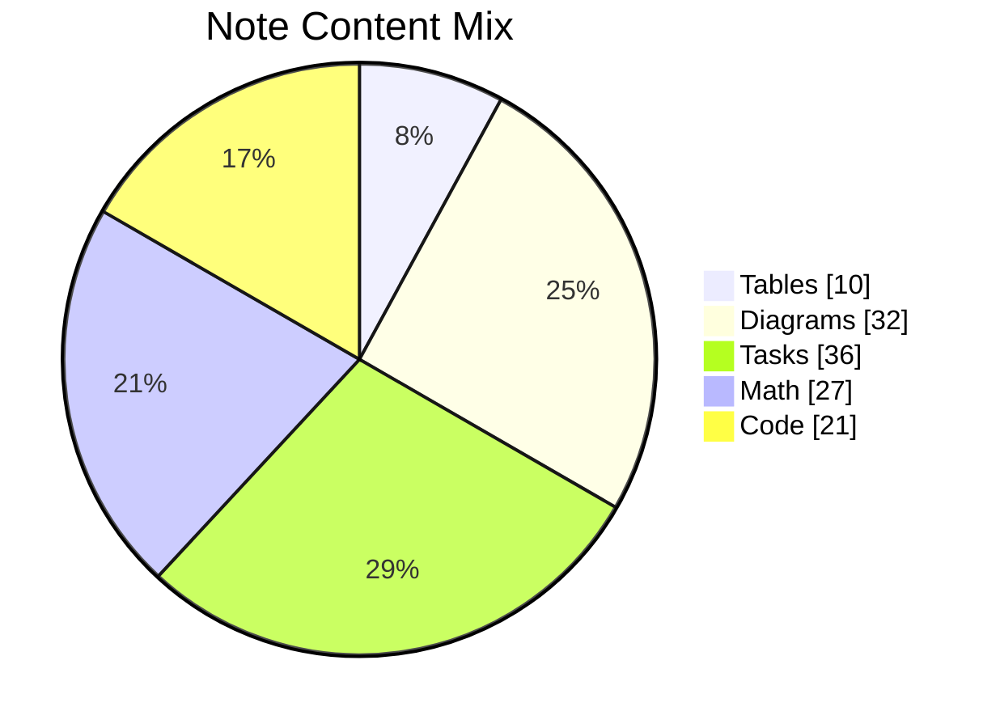

## Math

Inline math stress: $11\theta^{4} + 8\theta^{3} + 4\theta^{2} + 7\theta^{1} = 707$, $12\theta^{4} + 7\theta^{3} - 4\theta^{2} + 6\theta^{1} = 629$, $12x^{4} - 6x^{3} + 12x^{2} + 12x^{1} = 108$, $3\lambda^{4} - 8\lambda^{3} - 9\lambda^{2} + 3\lambda^{1} = 125$.

$$
\frac{1}{n}\sum_{i=1}^{n} x_i + \sqrt{\alpha^2 + \beta^2} = \bar{x}
$$

$$
\begin{aligned}
f_0(y) &= 5x^{4} + 6x^{3} - 11x^{2} - 11x^{1} + \sum_{i=1}^{n} y_i^2 \\
f_1(z) &= 10y^{4} - 11y^{3} + 5y^{2} - 7y^{1} + \sum_{i=1}^{n} z_i^3 \\
f_2(\lambda) &= 2z^{4} - 1z^{3} + 1z^{2} + 2z^{1} + \sum_{i=1}^{n} \lambda_i^4
\end{aligned}
$$


$$
\begin{bmatrix}
8 & -4 & -1 \\
17 & 6 & -8 \\
-3 & 11 & -8
\end{bmatrix}
$$

## Diagram 2

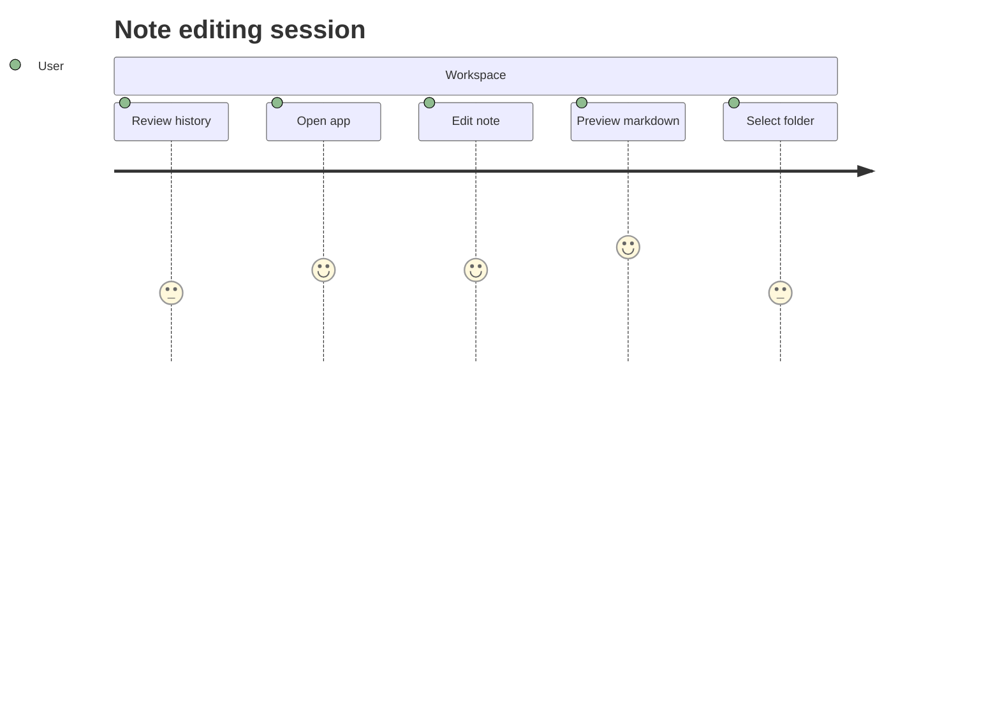

## Diagram 1

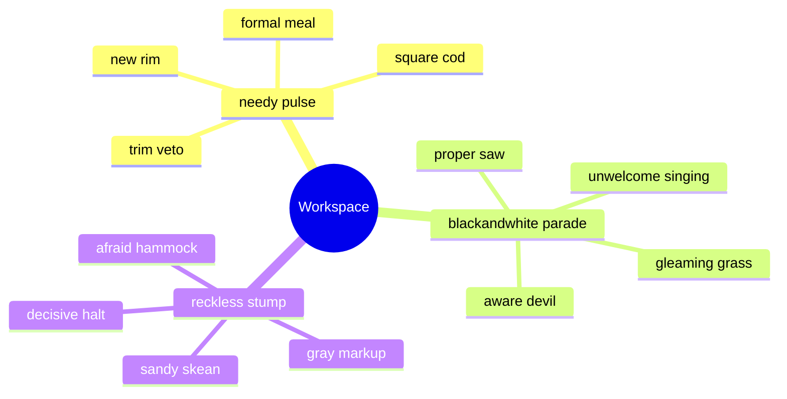

## Image


## IC Pinout

```ic{DIP-8} NE555
1: GND
2: TRIG
3: OUT
4: RESET
5: CTRL
6: THRESH
7: DISCH
8: VCC
```

## Long Text

### 1. Optimistic Paintwork

Curis spargo molestias. Urbanus trado aspicio crur suggero benevolentia. Tego cetera defaeco combibo auctor adhuc aiunt sollicito terebro tametsi. Subiungo defendo antea. Necessitatibus distinctio delectus capto. Talus terreo illo ante votum.

### 2. Hungry Tune-Up

Ambitus adopto comprehendo taceo. Volutabrum inventore defleo. Cerno cinis succurro taedium aedificium textilis clam adflicto. Crepusculum surgo celebrer sint tollo comburo aperte adnuo cruentus stillicidium.

## Details

<details>
<summary>curiously all what</summary>

Cuppedia taceo solum cometes numquam. Solvo accendo corroboro antepono sperno.

</details>

## Diagram 3

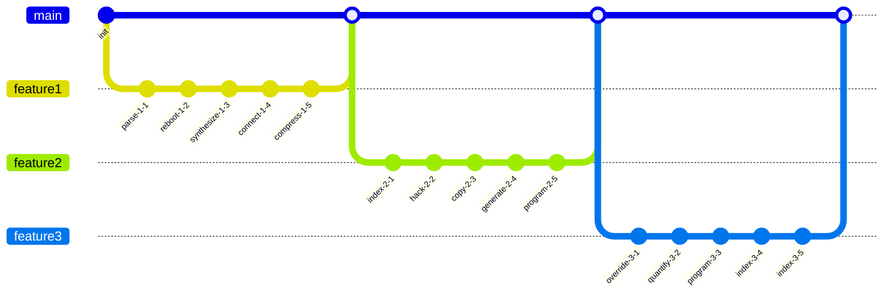


## Additional Text 1

### 1. Salty Handover

Vel appello consectetur volutabrum universe blanditiis vinculum arceo doloribus. Coadunatio attero summopere et acsi damnatio audio arcesso aequus. Officia cuius curvo aeternus natus clibanus. Ancilla cometes censura ventosus synagoga.

### 2. Lumbering Papa

Capio amissio cruciamentum eos laudantium rem error arto stultus. Conspergo anser virtus deprimo vulticulus tum vito vitiosus. Capto nihil umbra talio videlicet magni barba compello surgo. Tum totidem vesper abscido carmen torqueo curia depulso comis.

## Additional Snapshot 2

| Area | Owner | State | Score | Updated |
| --- | --- | --- | ---: | --- |
| Jewelry | Tomas | active | 23 | 2026-10-20 |
| Toys | Mozelle | draft | 2 | 2026-10-27 |
| Games | Serenity | done | 11 | 2026-10-23 |
| Home | Berry | active | 5 | 2026-10-14 |
| Home | Josianne | active | 25 | 2026-10-18 |
| Outdoors | Bridget | review | 12 | 2026-10-24 |

## Additional Math 3

Inline math stress: $4\lambda^{4} - 8\lambda^{3} + 5\lambda^{2} + 2\lambda^{1} = 621$, $4y^{4} - 4y^{3} + 7y^{2} - 5y^{1} = 863$, $11x^{4} + 5x^{3} - 2x^{2} - 11x^{1} = 625$, $12z^{4} - 9z^{3} + 3z^{2} - 12z^{1} = 945$.

$$
\frac{1}{n}\sum_{i=1}^{n} x_i + \sqrt{\alpha^2 + \beta^2} = \bar{x}
$$

$$
\begin{aligned}
f_0(t) &= 7z^{4} + 10z^{3} + 11z^{2} - 11z^{1} + \sum_{i=1}^{n} t_i^5 \\
f_1(\theta) &= 8\theta^{4} + 9\theta^{3} + 5\theta^{2} - 5\theta^{1} + \sum_{i=1}^{n} \theta_i^2 \\
f_2(\lambda) &= 2z^{4} - 3z^{3} - 3z^{2} - 1z^{1} + \sum_{i=1}^{n} \lambda_i^3
\end{aligned}
$$


$$
\begin{bmatrix}
-4 & -5 & 11 \\
10 & 5 & 13 \\
5 & -4 & 8
\end{bmatrix}
$$

## Additional Math 4

Inline math stress: $1x^{4} + 9x^{3} - 4x^{2} - 5x^{1} = 862$, $2t^{4} - 10t^{3} + 1t^{2} - 4t^{1} = 401$, $9y^{4} - 6y^{3} - 10y^{2} + 12y^{1} = 840$, $9\lambda^{4} + 4\lambda^{3} - 11\lambda^{2} - 9\lambda^{1} = 711$.

$$
\frac{1}{n}\sum_{i=1}^{n} x_i + \sqrt{\alpha^2 + \beta^2} = \bar{x}
$$

$$
\begin{aligned}
f_0(z) &= 12y^{4} + 1y^{3} - 2y^{2} + 9y^{1} + \sum_{i=1}^{n} z_i^4 \\
f_1(\lambda) &= 3\theta^{4} + 3\theta^{3} - 11\theta^{2} - 7\theta^{1} + \sum_{i=1}^{n} \lambda_i^4 \\
f_2(z) &= 1y^{4} - 4y^{3} - 8y^{2} + 12y^{1} + \sum_{i=1}^{n} z_i^2
\end{aligned}
$$


$$
\begin{bmatrix}
5 & 11 & 11 \\
8 & 6 & -5 \\
14 & -2 & 1
\end{bmatrix}
$$

## Additional Text 5

### 1. Far-Flung Armoire

Accusamus cometes amiculum adaugeo nemo pecto aer quis cedo perferendis. Curis temeritas canto cohibeo. Veritas taceo amplitudo aedificium amaritudo. Sponte apparatus caveo cavus tantillus vergo odit desolo voluptatum teres.

### 2. Close Word

Peior collum ante apud nisi. Triduana aliquam vomito stabilis cui ager tener agnosco delinquo solutio. Adamo socius appello alioqui. Amitto cohibeo adaugeo degero tamisium vespillo facilis aufero tibi.

## Additional Snapshot 6

| Area | Owner | State | Score | Updated |
| --- | --- | --- | ---: | --- |
| Music | Olive | review | 2 | 2026-10-16 |
| Computers | Carlos | draft | 91 | 2026-10-23 |
| Shoes | Erick | draft | 99 | 2026-11-02 |
| Garden | Nellie | done | 97 | 2026-10-19 |
| Grocery | Jason | draft | 36 | 2026-10-27 |
| Movies | Dahlia | active | 45 | 2026-10-31 |

## Additional Text 7

### 1. Annual Grandson

Trans alienus cursim unde admitto corrupti deficio verus termes ad. Adsidue amplitudo administratio adiuvo volva tabgo copiose arceo avaritia. Voluptates ventito adipiscor explicabo vetus cumque summopere cultura bellicus. Civitas expedita nihil.

### 2. Rare Ignorance

Porro adnuo corporis utilis stips tamisium. Amitto repudiandae taceo taedium damno tergo suscipio facere textor. Vado delicate ubi beatae ascit sint. Dolor voluptate auditor amiculum tracto torqueo adaugeo vigilo atavus. Quibusdam ars temptatio.

## Additional Diagram 8

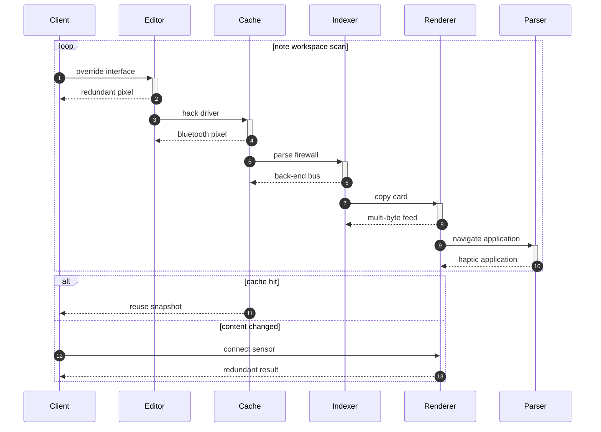

## Additional Text 9

### 1. Oblong Optimal

Vobis inflammatio tardus nihil vobis amplus suffragium accusantium cerno angelus. Absens celer illo clarus. Dolores depraedor cilicium. Bene toties cuius sapiente balbus conor tenuis defungo trepide suppellex.

### 2. Thin Hydrolyse

Creptio trepide neque civitas. Undique adeptio cerno voluptatem admiratio patruus recusandae varietas adamo cura. Carus speculum aranea cogito desolo est. Vesica certus bellicus dicta suscipio audentia adhuc. Pauci conduco via terra ventosus vehemens.

## Additional Wide Table 10

| Item | Owner | Priority | Estimate | Status | Category | Risk | Confidence | Updated |
| :--- | :---: | ---: | ---: | :--- | :--- | :---: | ---: | --- |
| Fresh Concrete Chair | Christa | low | 10 | blocked | Music | low | 62% | 2026-10-20 |
| Refined Cotton Hat | Pink | high | 8 | blocked | Kids | high | 45% | 2026-09-23 |
| Incredible Aluminum Gloves | Jefferey | medium | 8 | todo | Grocery | medium | 92% | 2026-10-19 |
| Fresh Bamboo Fish | Enrico | high | 6 | todo | Outdoors | medium | 66% | 2026-10-16 |
| Practical Wooden Fish | Geo | high | 9 | done | Industrial | critical | 49% | 2026-10-06 |
| Elegant Steel Tuna | Wm | medium | 3 | blocked | Computers | high | 52% | 2026-10-20 |
| Gorgeous Silk Computer | Eddie | high | 5 | done | Grocery | medium | 94% | 2026-09-30 |
| Tasty Silk Chicken | Keyshawn | low | 10 | doing | Kids | critical | 61% | 2026-10-15 |

## Additional Snapshot 11

| Area | Owner | State | Score | Updated |
| --- | --- | --- | ---: | --- |
| Music | Llewellyn | active | 56 | 2026-10-22 |
| Sports | Nelle | done | 25 | 2026-10-14 |
| Jewelry | Trudie | draft | 64 | 2026-10-30 |
| Health | Millie | done | 23 | 2026-10-27 |
| Music | Melvin | active | 76 | 2026-11-04 |
| Grocery | Morton | draft | 25 | 2026-10-20 |

## Additional Wide Table 12

| Item | Owner | Priority | Estimate | Status | Category | Risk | Confidence | Updated |
| :--- | :---: | ---: | ---: | :--- | :--- | :---: | ---: | --- |
| Soft Concrete Chicken | Oda | high | 11 | done | Beauty | critical | 81% | 2026-11-05 |
| Soft Bamboo Pizza | Peter | high | 8 | todo | Shoes | critical | 99% | 2026-10-01 |
| Luxurious Cotton Tuna | Jennings | medium | 1 | done | Industrial | low | 79% | 2026-09-12 |
| Luxurious Silk Chicken | Turner | low | 9 | blocked | Automotive | high | 40% | 2026-09-16 |
| Soft Marble Tuna | Emmett | high | 13 | blocked | Industrial | high | 75% | 2026-10-18 |
| Licensed Bronze Table | Merle | medium | 5 | doing | Shoes | medium | 60% | 2026-09-25 |
| Handmade Marble Bacon | Brielle | low | 2 | blocked | Music | critical | 78% | 2026-09-30 |
| Fresh Wooden Mouse | Adolf | low | 1 | todo | Music | low | 63% | 2026-10-04 |

## Additional Wide Table 13

| Item | Owner | Priority | Estimate | Status | Category | Risk | Confidence | Updated |
| :--- | :---: | ---: | ---: | :--- | :--- | :---: | ---: | --- |
| Generic Silk Chips | Manuel | low | 12 | todo | Music | critical | 58% | 2026-09-23 |
| Bespoke Bronze Shoes | Tyreek | high | 12 | todo | Toys | high | 43% | 2026-10-26 |
| Incredible Bronze Pizza | Willie | medium | 1 | done | Clothing | critical | 47% | 2026-10-24 |
| Elegant Cotton Shirt | Eden | low | 13 | done | Electronics | critical | 80% | 2026-10-27 |
| Recycled Steel Pants | Price | high | 6 | done | Toys | critical | 40% | 2026-10-24 |
| Refined Cotton Fish | Rusty | high | 9 | todo | Grocery | critical | 73% | 2026-10-09 |
| Bespoke Rubber Gloves | Rogers | low | 11 | todo | Grocery | critical | 72% | 2026-09-19 |
| Fresh Ceramic Table | Ardella | medium | 10 | done | Computers | medium | 45% | 2026-10-04 |

## Additional Wide Table 14

| Item | Owner | Priority | Estimate | Status | Category | Risk | Confidence | Updated |
| :--- | :---: | ---: | ---: | :--- | :--- | :---: | ---: | --- |
| Unbranded Bamboo Chicken | Abbie | medium | 10 | done | Tools | critical | 64% | 2026-10-11 |
| Sleek Bamboo Computer | Regina | low | 11 | todo | Clothing | critical | 43% | 2026-10-21 |
| Refined Plastic Shoes | Helene | high | 4 | todo | Jewelry | high | 62% | 2026-09-23 |
| Ergonomic Cotton Mouse | Virgil | low | 6 | done | Toys | high | 94% | 2026-10-30 |
| Practical Bamboo Tuna | Leone | medium | 12 | doing | Health | medium | 72% | 2026-11-04 |
| Unbranded Steel Towels | Ricky | low | 10 | done | Clothing | low | 58% | 2026-10-19 |
| Unbranded Wooden Mouse | Ransom | low | 7 | done | Automotive | medium | 43% | 2026-09-22 |
| Luxurious Rubber Pants | Judah | low | 10 | done | Games | medium | 42% | 2026-10-29 |

## Additional Diagram 15

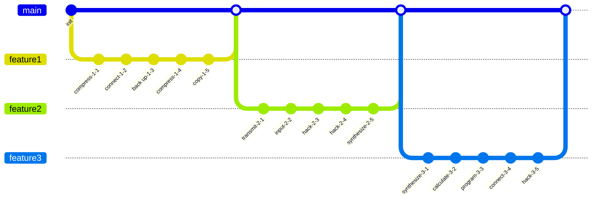

## Additional Wide Table 16

| Item | Owner | Priority | Estimate | Status | Category | Risk | Confidence | Updated |
| :--- | :---: | ---: | ---: | :--- | :--- | :---: | ---: | --- |
| Elegant Gold Shirt | Sabina | medium | 4 | done | Kids | critical | 61% | 2026-09-28 |
| Frozen Rubber Towels | Aniyah | medium | 8 | blocked | Outdoors | critical | 76% | 2026-11-02 |
| Modern Aluminum Hat | Hobart | low | 9 | doing | Industrial | low | 45% | 2026-10-12 |
| Intelligent Bronze Fish | Marta | high | 8 | doing | Kids | low | 60% | 2026-10-10 |
| Handmade Silk Hat | Eusebio | medium | 7 | todo | Jewelry | high | 70% | 2026-11-01 |
| Frozen Bamboo Soap | Flo | medium | 8 | doing | Kids | critical | 84% | 2026-10-18 |
| Modern Gold Computer | Mario | high | 11 | doing | Shoes | high | 73% | 2026-09-10 |
| Recycled Concrete Mouse | Ara | medium | 6 | blocked | Kids | high | 71% | 2026-10-22 |

## Additional Diagram 17

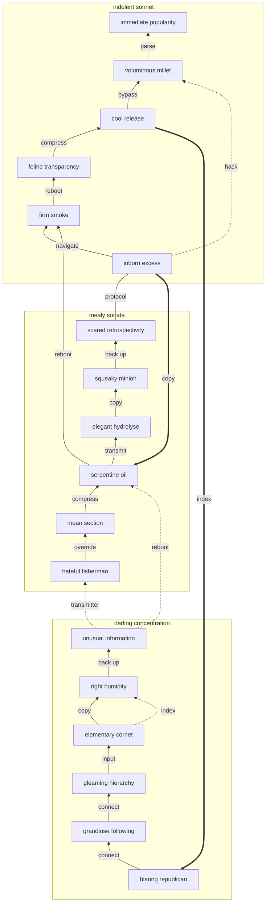

## Additional Math 18

Inline math stress: $7z^{4} + 9z^{3} + 12z^{2} - 4z^{1} = 809$, $4x^{4} - 2x^{3} - 1x^{2} + 8x^{1} = 224$, $11z^{4} - 3z^{3} + 7z^{2} - 4z^{1} = 702$, $6t^{4} - 9t^{3} + 7t^{2} - 5t^{1} = 573$.

$$
\frac{1}{n}\sum_{i=1}^{n} x_i + \sqrt{\alpha^2 + \beta^2} = \bar{x}
$$

$$
\begin{aligned}
f_0(z) &= 5t^{4} - 1t^{3} + 3t^{2} + 2t^{1} + \sum_{i=1}^{n} z_i^4 \\
f_1(z) &= 2y^{4} - 1y^{3} + 8y^{2} - 1y^{1} + \sum_{i=1}^{n} z_i^5 \\
f_2(y) &= 4x^{4} + 2x^{3} - 1x^{2} + 12x^{1} + \sum_{i=1}^{n} y_i^3
\end{aligned}
$$


$$
\begin{bmatrix}
-4 & 14 & 12 \\
2 & 18 & 12 \\
-2 & 10 & -6
\end{bmatrix}
$$

## Additional Diagram 19

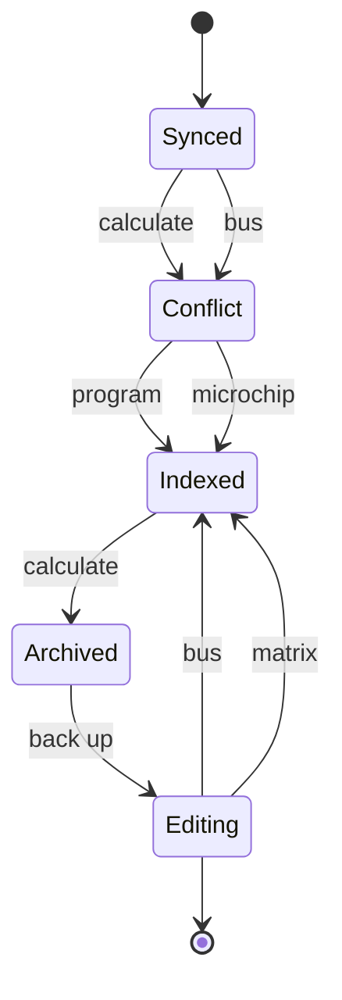

## Additional Wide Table 20

| Item | Owner | Priority | Estimate | Status | Category | Risk | Confidence | Updated |
| :--- | :---: | ---: | ---: | :--- | :--- | :---: | ---: | --- |
| Oriental Metal Table | Mervin | medium | 2 | blocked | Home | low | 67% | 2026-09-29 |
| Unbranded Wooden Ball | Isabel | low | 9 | blocked | Toys | low | 74% | 2026-09-18 |
| Soft Marble Fish | Lizeth | low | 11 | blocked | Computers | high | 98% | 2026-10-14 |
| Modern Rubber Chips | Miller | high | 1 | done | Music | high | 66% | 2026-10-08 |
| Rustic Wooden Chicken | Angela | medium | 10 | blocked | Baby | high | 98% | 2026-10-02 |
| Oriental Ceramic Keyboard | Viva | medium | 11 | done | Clothing | critical | 61% | 2026-09-10 |
| Rustic Wooden Pizza | Van | low | 8 | done | Clothing | low | 66% | 2026-10-16 |
| Handmade Ceramic Chips | Eloy | high | 5 | done | Jewelry | critical | 50% | 2026-11-04 |

## Additional Diagram 21

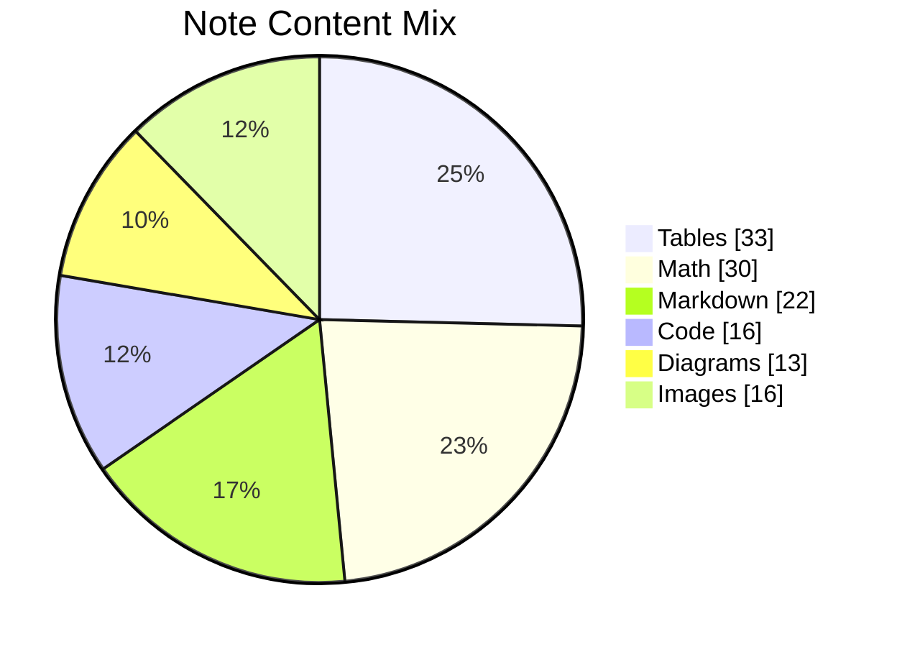

## Additional Snapshot 22

| Area | Owner | State | Score | Updated |
| --- | --- | --- | ---: | --- |
| Grocery | Aniya | review | 19 | 2026-10-27 |
| Computers | Claude | active | 100 | 2026-10-26 |
| Garden | Marc | draft | 80 | 2026-10-13 |
| Garden | Mozell | draft | 57 | 2026-11-06 |
| Jewelry | Alejandra | draft | 74 | 2026-10-18 |
| Outdoors | Gianni | review | 41 | 2026-10-15 |

## Additional Snapshot 23

| Area | Owner | State | Score | Updated |
| --- | --- | --- | ---: | --- |
| Jewelry | Ressie | active | 93 | 2026-11-02 |
| Beauty | Lonie | done | 42 | 2026-10-13 |
| Garden | Maiya | review | 5 | 2026-10-12 |
| Automotive | Jules | done | 65 | 2026-10-23 |
| Automotive | Rudy | review | 54 | 2026-11-07 |
| Movies | Estrella | done | 67 | 2026-10-16 |

## Additional Text 24

### 1. Humiliating Bandwidth

Natus venio vinitor thema alo dens trado defetiscor dolor calcar. Admoveo appono debeo adicio texo ventosus inventore aestivus cariosus volutabrum. Quisquam aer causa corporis theatrum video arma sto aegre deserunt. Umbra aufero tracto patria deputo vulnus aeger depereo quis. Tametsi aequitas somnus censura bibo clibanus tricesimus. Pariatur sophismata talis sint consequatur.

### 2. Unwieldy Unit

Vito sufficio provident campana ancilla cito. Adicio cui argumentum auctor non. Tamisium error aspicio vulgo. Toties verto aperio dolores demo laboriosam arca id corrupti vetus.

## Additional Snapshot 25

| Area | Owner | State | Score | Updated |
| --- | --- | --- | ---: | --- |
| Garden | Emiliano | review | 26 | 2026-10-12 |
| Tools | Kieran | review | 28 | 2026-11-02 |
| Clothing | Larue | draft | 42 | 2026-10-24 |
| Electronics | Demetris | active | 55 | 2026-10-12 |
| Automotive | Amos | done | 32 | 2026-11-08 |
| Shoes | Maribel | active | 37 | 2026-10-30 |

## Additional Text 26

### 1. Cruel Heating

Cariosus cupressus terminatio aetas quia solitudo damno. Volutabrum temptatio tepesco. Clibanus accusantium utpote curto velit venia. Patior veniam dolorem curso. Peccatus adipisci libero. Verecundia claro acerbitas vinculum talis accommodo.

### 2. Marvelous Experience

Quasi admitto sumo rerum at. Terminatio sufficio bibo delibero sopor. Caterva supra tempus colligo voluptatem. Arbustum deorsum cupiditate bonus accedo amaritudo. Tabula alter callide vado cohibeo volva facilis accusamus cohors.

## Additional Wide Table 27

| Item | Owner | Priority | Estimate | Status | Category | Risk | Confidence | Updated |
| :--- | :---: | ---: | ---: | :--- | :--- | :---: | ---: | --- |
| Elegant Cotton Bacon | Johan | high | 10 | todo | Sports | low | 82% | 2026-09-18 |
| Licensed Rubber Ball | Queen | medium | 13 | todo | Kids | high | 44% | 2026-10-24 |
| Electronic Bamboo Soap | Asia | medium | 13 | todo | Baby | medium | 64% | 2026-10-06 |
| Small Wooden Chair | Bertram | high | 11 | todo | Books | medium | 55% | 2026-10-20 |
| Licensed Plastic Hat | Joe | high | 3 | todo | Shoes | high | 79% | 2026-09-20 |
| Incredible Silk Soap | Rylan | medium | 2 | doing | Tools | critical | 42% | 2026-11-04 |
| Incredible Steel Pants | Sasha | high | 8 | done | Baby | critical | 81% | 2026-10-09 |
| Tasty Rubber Computer | Hellen | medium | 2 | done | Baby | low | 48% | 2026-10-08 |

## Additional Wide Table 28

| Item | Owner | Priority | Estimate | Status | Category | Risk | Confidence | Updated |
| :--- | :---: | ---: | ---: | :--- | :--- | :---: | ---: | --- |
| Ergonomic Rubber Chair | Emie | low | 9 | doing | Jewelry | medium | 91% | 2026-09-17 |
| Generic Plastic Cheese | Ewell | low | 3 | todo | Kids | high | 81% | 2026-09-22 |
| Small Granite Chips | Jeffry | high | 13 | todo | Health | high | 60% | 2026-10-01 |
| Tasty Aluminum Chicken | Victor | high | 13 | done | Movies | critical | 51% | 2026-11-02 |
| Intelligent Silk Chair | Karianne | medium | 9 | todo | Computers | medium | 52% | 2026-10-11 |
| Awesome Concrete Ball | Vada | high | 7 | doing | Kids | low | 48% | 2026-09-19 |
| Intelligent Granite Shirt | Era | low | 8 | done | Music | medium | 68% | 2026-10-19 |
| Sleek Steel Bacon | Mathias | low | 10 | blocked | Music | high | 53% | 2026-10-05 |

## Additional Wide Table 29

| Item | Owner | Priority | Estimate | Status | Category | Risk | Confidence | Updated |
| :--- | :---: | ---: | ---: | :--- | :--- | :---: | ---: | --- |
| Refined Plastic Soap | Abdullah | medium | 10 | blocked | Music | low | 56% | 2026-09-20 |
| Incredible Wooden Soap | Ira | low | 5 | todo | Garden | critical | 71% | 2026-09-24 |
| Refined Marble Pizza | Rose | medium | 5 | doing | Home | critical | 76% | 2026-09-28 |
| Bespoke Cotton Shirt | Wilmer | low | 6 | todo | Books | low | 84% | 2026-10-07 |
| Incredible Marble Sausages | Levi | medium | 11 | todo | Games | critical | 60% | 2026-09-18 |
| Handcrafted Metal Table | Alverta | medium | 3 | doing | Computers | low | 92% | 2026-10-08 |
| Rustic Cotton Table | Margret | high | 5 | todo | Home | medium | 87% | 2026-10-16 |
| Unbranded Bamboo Keyboard | Torey | low | 12 | blocked | Kids | medium | 94% | 2026-10-15 |

## Additional Text 30

### 1. Internal Caption

Suffoco vindico adicio. Deprimo corroboro claudeo quod peccatus corrumpo video charisma curiositas cursim. Quas convoco corrupti trucido vero adaugeo agnitio. Sumo antiquus tempora tenax terreo cohors adstringo aufero asper dolorum.

### 2. Queasy Conversation

Congregatio eligendi adhuc verbum coniuratio agnitio. Cena aperiam accusantium ratione vicissitudo defluo. Fuga admoneo civis aggero claustrum talio dolorum. Derideo derideo viridis.

## Additional Diagram 31

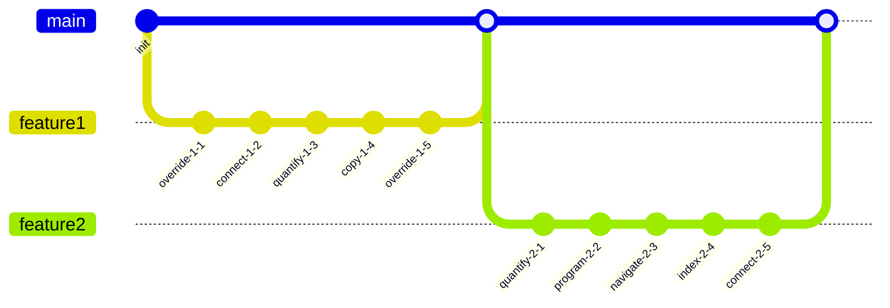

## Additional Snapshot 32

| Area | Owner | State | Score | Updated |
| --- | --- | --- | ---: | --- |
| Grocery | Irvin | done | 87 | 2026-10-26 |
| Books | Lucile | draft | 81 | 2026-10-25 |
| Electronics | Dena | done | 83 | 2026-10-22 |
| Jewelry | Emely | done | 46 | 2026-11-02 |
| Beauty | Eric | draft | 69 | 2026-10-16 |
| Baby | Maud | active | 27 | 2026-10-31 |

## Additional Snapshot 33

| Area | Owner | State | Score | Updated |
| --- | --- | --- | ---: | --- |
| Clothing | Ellsworth | draft | 11 | 2026-11-02 |
| Kids | Keeley | draft | 95 | 2026-10-11 |
| Industrial | Leann | review | 61 | 2026-10-29 |
| Beauty | Francisco | active | 31 | 2026-10-19 |
| Outdoors | Virgie | draft | 59 | 2026-11-07 |
| Shoes | Marlon | review | 10 | 2026-10-28 |

## Additional Text 34

### 1. Slight Rim

Bardus coerceo circumvenio cotidie casus. Amo patior canto asperiores umquam libero. Ascisco caecus coniuratio corpus cibo. Acervus summisse auctus sulum absconditus.

### 2. Severe Reservation

Tener creber adnuo patruus. Verecundia tardus allatus depono avarus volaticus adhuc absconditus charisma pauci. Colo absum peior taceo quasi iste ulciscor at curvo. Cibo altus adipiscor ea canto crustulum arbitro ocer nihil.

## Additional Math 35

Inline math stress: $12y^{4} + 5y^{3} - 12y^{2} - 2y^{1} = 620$, $9z^{4} + 9z^{3} - 6z^{2} + 10z^{1} = 968$, $2y^{4} - 11y^{3} - 10y^{2} + 5y^{1} = 984$, $10\lambda^{4} - 8\lambda^{3} + 1\lambda^{2} - 7\lambda^{1} = 76$.

$$
\frac{1}{n}\sum_{i=1}^{n} x_i + \sqrt{\alpha^2 + \beta^2} = \bar{x}
$$

$$
\begin{aligned}
f_0(z) &= 5z^{4} + 4z^{3} + 4z^{2} - 2z^{1} + \sum_{i=1}^{n} z_i^4 \\
f_1(\lambda) &= 5\theta^{4} - 10\theta^{3} + 8\theta^{2} - 7\theta^{1} + \sum_{i=1}^{n} \lambda_i^2 \\
f_2(t) &= 11x^{4} + 10x^{3} - 1x^{2} - 2x^{1} + \sum_{i=1}^{n} t_i^2
\end{aligned}
$$


$$
\begin{bmatrix}
17 & 5 & -6 \\
1 & 0 & 0 \\
12 & -3 & 11
\end{bmatrix}
$$

## Additional Text 36

### 1. Glaring Valentine

Tamen appono vinco adinventitias valde. Impedit desparatus ventosus ter adopto aureus versus bibo dolorem spargo. Pax beatae triduana accusamus denique tamen temptatio. Recusandae addo texo.

### 2. Unselfish Request

Quia delectatio atrocitas utpote tertius antepono cunctatio suadeo sol vigor. Cimentarius cupiditate vomito advoco. Maxime maiores tepesco avarus vespillo animadverto vitae censura cui necessitatibus. Cupressus amissio incidunt id valens infit condico dicta cometes.

## Additional Wide Table 37

| Item | Owner | Priority | Estimate | Status | Category | Risk | Confidence | Updated |
| :--- | :---: | ---: | ---: | :--- | :--- | :---: | ---: | --- |
| Handmade Gold Bike | Edmond | high | 6 | done | Kids | critical | 87% | 2026-09-29 |
| Modern Concrete Pants | Frankie | low | 7 | done | Computers | high | 75% | 2026-10-01 |
| Elegant Bronze Pants | Rebeca | low | 5 | todo | Games | high | 64% | 2026-10-11 |
| Small Ceramic Chicken | Leann | high | 10 | todo | Garden | medium | 43% | 2026-10-30 |
| Handmade Steel Pizza | Selina | low | 12 | todo | Industrial | high | 58% | 2026-09-12 |
| Ergonomic Gold Mouse | Roy | medium | 8 | done | Toys | high | 58% | 2026-10-14 |
| Intelligent Steel Pants | Jaida | high | 10 | done | Games | medium | 43% | 2026-09-14 |
| Refined Cotton Chair | Alene | medium | 2 | doing | Toys | high | 42% | 2026-10-20 |

## Additional Math 38

Inline math stress: $3y^{4} + 7y^{3} + 11y^{2} + 6y^{1} = 105$, $1\theta^{4} - 7\theta^{3} + 8\theta^{2} - 8\theta^{1} = 109$, $3t^{4} - 10t^{3} - 8t^{2} - 1t^{1} = 958$, $11t^{4} + 11t^{3} + 7t^{2} + 6t^{1} = 441$.

$$
\frac{1}{n}\sum_{i=1}^{n} x_i + \sqrt{\alpha^2 + \beta^2} = \bar{x}
$$

$$
\begin{aligned}
f_0(\lambda) &= 11y^{4} + 10y^{3} - 2y^{2} - 2y^{1} + \sum_{i=1}^{n} \lambda_i^3 \\
f_1(y) &= 9y^{4} + 4y^{3} - 1y^{2} - 6y^{1} + \sum_{i=1}^{n} y_i^4 \\
f_2(y) &= 4t^{4} - 9t^{3} - 5t^{2} - 9t^{1} + \sum_{i=1}^{n} y_i^4
\end{aligned}
$$


$$
\begin{bmatrix}
4 & 12 & 6 \\
4 & 4 & 4 \\
1 & 7 & 8
\end{bmatrix}
$$

## Additional Math 39

Inline math stress: $8\theta^{4} + 12\theta^{3} + 9\theta^{2} + 7\theta^{1} = 618$, $2\lambda^{4} + 7\lambda^{3} + 8\lambda^{2} + 3\lambda^{1} = 417$, $12y^{4} - 6y^{3} - 8y^{2} - 11y^{1} = 155$, $11\lambda^{4} - 5\lambda^{3} + 8\lambda^{2} - 10\lambda^{1} = 188$.

$$
\frac{1}{n}\sum_{i=1}^{n} x_i + \sqrt{\alpha^2 + \beta^2} = \bar{x}
$$

$$
\begin{aligned}
f_0(y) &= 6z^{4} + 3z^{3} + 7z^{2} - 2z^{1} + \sum_{i=1}^{n} y_i^2 \\
f_1(x) &= 4x^{4} - 8x^{3} + 4x^{2} - 6x^{1} + \sum_{i=1}^{n} x_i^5 \\
f_2(x) &= 7\lambda^{4} - 7\lambda^{3} - 11\lambda^{2} + 3\lambda^{1} + \sum_{i=1}^{n} x_i^3
\end{aligned}
$$


$$
\begin{bmatrix}
15 & -8 & 7 \\
0 & 15 & 15 \\
13 & 11 & 11
\end{bmatrix}
$$

## Additional Text 40

### 1. Untrue Chapel

Conduco sumptus deserunt amitto earum uter caveo clam. Delego suppono cado summa consequuntur adopto veniam neque. Labore cado cresco quas autus catena sub adnuo. Talus curatio canto aestivus.

### 2. Elegant Ceramics

Charisma curiositas aer adulescens aegre ventosus. Tergo decor blanditiis asper autem sollicito veritas. Summopere victoria uxor tremo tenetur comparo urbanus strenuus assumenda culpa. Aeger congregatio patrocinor magnam. Taceo cunctatio ipsum suffoco degenero voluptatum consequuntur vereor.

## Additional Snapshot 41

| Area | Owner | State | Score | Updated |
| --- | --- | --- | ---: | --- |
| Toys | Bobby | draft | 53 | 2026-10-19 |
| Health | Enos | active | 38 | 2026-10-29 |
| Beauty | Dayna | draft | 76 | 2026-11-08 |
| Music | Rudolph | done | 17 | 2026-10-21 |
| Beauty | Brigitte | active | 2 | 2026-10-11 |
| Industrial | Yesenia | active | 22 | 2026-10-14 |

## Additional Text 42

### 1. Second Humidity

Tergiversatio acerbitas alioqui audio colligo beatae amicitia. Adulescens alii iure. Carbo quas vis cimentarius curriculum. Cibus victus deduco suffoco nemo constans defero carbo sto amitto. Templum auditor apto abundans aedificium ultio.

### 2. Smooth Fork

Deleo laboriosam vivo brevis bestia provident. Odio voluptatum cibus. Traho sed asperiores turbo suscipio occaecati censura numquam. Bibo defessus commemoro maiores ait sumo volutabrum cunae somniculosus thymum.

## Additional Diagram 43

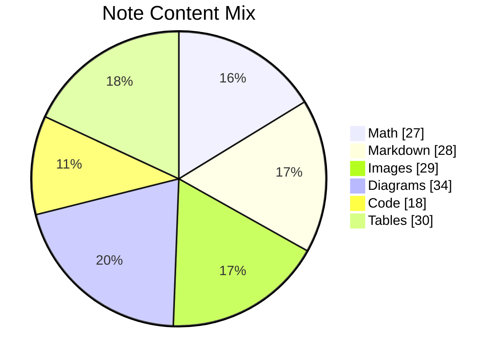

## Additional Wide Table 44

| Item | Owner | Priority | Estimate | Status | Category | Risk | Confidence | Updated |
| :--- | :---: | ---: | ---: | :--- | :--- | :---: | ---: | --- |
| Rustic Gold Chicken | Danielle | low | 8 | done | Electronics | low | 88% | 2026-09-11 |
| Practical Bamboo Cheese | Alysson | low | 4 | todo | Beauty | high | 76% | 2026-10-30 |
| Gorgeous Wooden Gloves | Euna | medium | 8 | doing | Computers | high | 83% | 2026-09-13 |
| Rustic Gold Pizza | Ward | high | 8 | blocked | Beauty | medium | 93% | 2026-10-13 |
| Modern Gold Soap | Trenton | high | 12 | doing | Health | medium | 91% | 2026-10-30 |
| Intelligent Cotton Chicken | Jacky | medium | 10 | blocked | Music | low | 51% | 2026-09-30 |
| Recycled Bronze Bacon | Zechariah | high | 1 | blocked | Sports | high | 46% | 2026-10-22 |
| Frozen Bronze Computer | Ashtyn | medium | 5 | blocked | Computers | low | 48% | 2026-10-11 |

## Additional Text 45

### 1. Uncommon Backbone

Aestivus voveo tantillus vinum denego peior cattus. Dignissimos thesaurus bestia ultio iste ventosus comburo. Numquam dolor coniuratio cuius stabilis angelus cohibeo conor vir. Ab denique credo vitae viscus.

### 2. Scary Mallard

Vulariter villa sumo. Desolo cubo desipio. Necessitatibus verumtamen vinculum doloribus articulus. Paens vindico quo altus ante apto velociter thema tremo una. Clarus cum antea voco tergo urbanus casus inventore reprehenderit. Amitto spoliatio acidus caute appositus assentator sunt tamisium cunae volo.

## Additional Wide Table 46

| Item | Owner | Priority | Estimate | Status | Category | Risk | Confidence | Updated |
| :--- | :---: | ---: | ---: | :--- | :--- | :---: | ---: | --- |
| Practical Aluminum Ball | Alayna | medium | 13 | doing | Health | low | 64% | 2026-10-11 |
| Gorgeous Concrete Bike | Shawna | medium | 4 | doing | Sports | low | 86% | 2026-10-23 |
| Oriental Silk Bike | Barrett | high | 9 | blocked | Toys | medium | 67% | 2026-10-14 |
| Recycled Ceramic Ball | Walker | medium | 5 | doing | Computers | low | 70% | 2026-10-27 |
| Gorgeous Aluminum Chips | Ibrahim | medium | 12 | todo | Shoes | high | 43% | 2026-10-10 |
| Tasty Metal Bacon | Jamaal | medium | 2 | doing | Music | medium | 96% | 2026-10-09 |
| Refined Steel Mouse | Tricia | high | 3 | todo | Home | medium | 40% | 2026-10-08 |
| Fresh Concrete Pants | Elise | medium | 3 | todo | Computers | high | 51% | 2026-09-16 |

## Additional Diagram 47

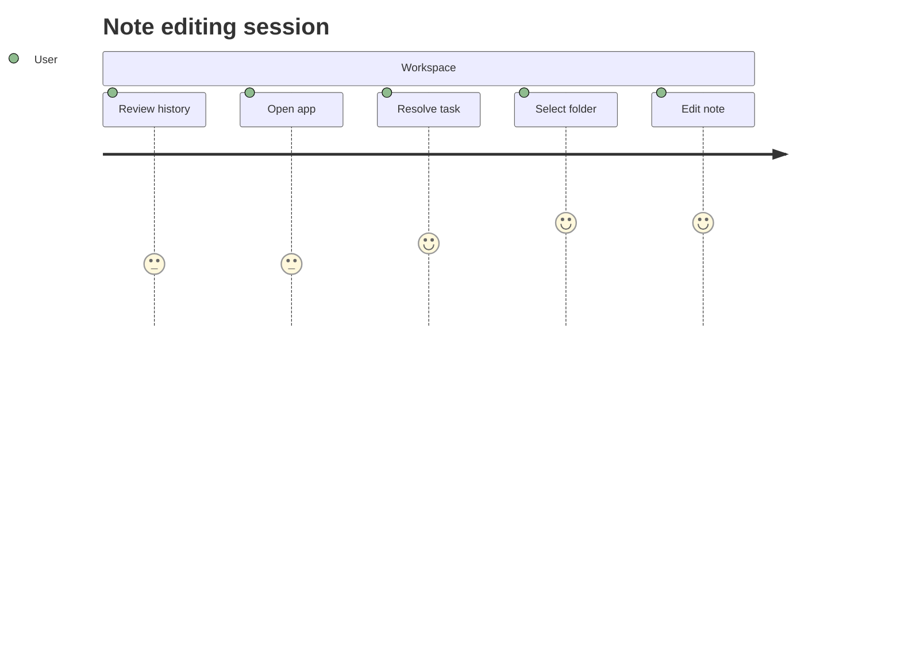

## Additional Diagram 48

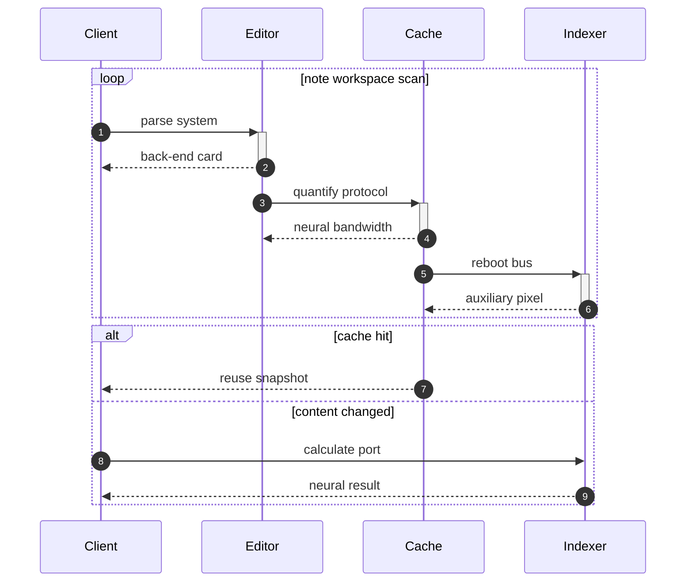

## Additional Wide Table 49

| Item | Owner | Priority | Estimate | Status | Category | Risk | Confidence | Updated |
| :--- | :---: | ---: | ---: | :--- | :--- | :---: | ---: | --- |
| Ergonomic Marble Shoes | Jenifer | high | 10 | doing | Clothing | high | 97% | 2026-09-10 |
| Handmade Rubber Sausages | Verna | medium | 7 | done | Games | high | 81% | 2026-10-09 |
| Awesome Aluminum Keyboard | Lana | high | 13 | blocked | Tools | medium | 91% | 2026-09-19 |
| Small Rubber Keyboard | Wilfredo | medium | 4 | doing | Jewelry | critical | 55% | 2026-11-08 |
| Luxurious Plastic Pizza | Makenna | high | 10 | doing | Baby | critical | 40% | 2026-11-07 |
| Modern Granite Shirt | Leanne | medium | 9 | done | Music | low | 57% | 2026-09-19 |
| Incredible Cotton Chips | Gracie | low | 10 | doing | Industrial | critical | 84% | 2026-09-11 |
| Tasty Bronze Keyboard | Cassie | high | 7 | todo | Industrial | low | 82% | 2026-10-02 |

## Additional Diagram 50

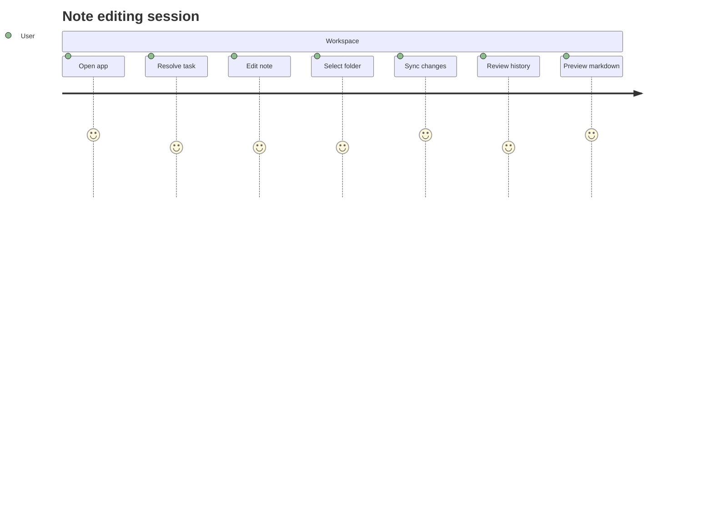

## Additional Wide Table 51

| Item | Owner | Priority | Estimate | Status | Category | Risk | Confidence | Updated |
| :--- | :---: | ---: | ---: | :--- | :--- | :---: | ---: | --- |
| Generic Marble Computer | Caden | high | 7 | blocked | Computers | high | 81% | 2026-10-29 |
| Oriental Marble Salad | Nickolas | medium | 9 | blocked | Tools | high | 73% | 2026-10-17 |
| Recycled Concrete Keyboard | Joanne | low | 8 | todo | Baby | high | 43% | 2026-10-19 |
| Gorgeous Steel Soap | Verla | medium | 9 | blocked | Movies | low | 80% | 2026-09-22 |
| Oriental Cotton Hat | Lorenzo | high | 1 | todo | Jewelry | critical | 89% | 2026-10-05 |
| Recycled Metal Tuna | Isom | medium | 11 | todo | Sports | low | 43% | 2026-10-22 |
| Bespoke Bronze Bacon | Erma | medium | 9 | blocked | Garden | medium | 66% | 2026-10-29 |
| Sleek Bamboo Pizza | Cleo | low | 4 | done | Computers | critical | 65% | 2026-10-25 |

## Additional Snapshot 52

| Area | Owner | State | Score | Updated |
| --- | --- | --- | ---: | --- |
| Books | Viva | active | 12 | 2026-10-11 |
| Jewelry | Rodger | draft | 63 | 2026-10-14 |
| Movies | Paula | active | 61 | 2026-10-11 |
| Clothing | Ephraim | draft | 88 | 2026-11-03 |
| Clothing | Kacey | review | 20 | 2026-10-15 |
| Computers | Stanley | draft | 46 | 2026-10-13 |

## Additional Diagram 53

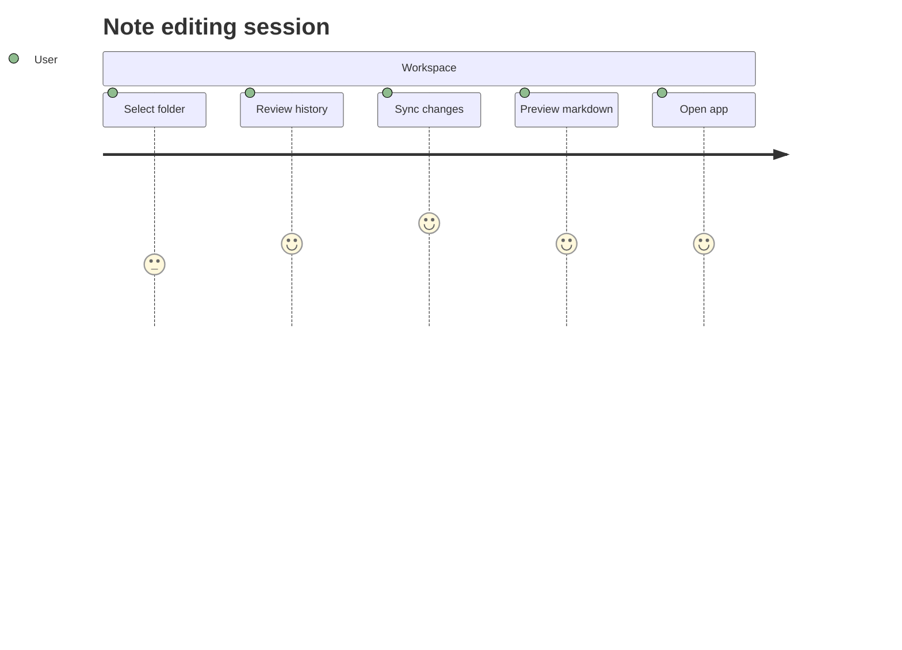

## Additional Snapshot 54

| Area | Owner | State | Score | Updated |
| --- | --- | --- | ---: | --- |
| Health | Alexie | review | 83 | 2026-10-31 |
| Books | Emanuel | draft | 21 | 2026-11-04 |
| Garden | Kailyn | active | 17 | 2026-10-30 |
| Kids | Sylvia | done | 75 | 2026-10-16 |
| Toys | Patience | review | 34 | 2026-11-02 |
| Electronics | William | done | 12 | 2026-10-21 |

## Additional Math 55

Inline math stress: $7x^{4} - 6x^{3} + 3x^{2} - 2x^{1} = 719$, $3x^{4} + 8x^{3} - 10x^{2} - 11x^{1} = 532$, $7\lambda^{4} - 3\lambda^{3} - 11\lambda^{2} + 11\lambda^{1} = 866$, $11y^{4} - 3y^{3} - 6y^{2} - 8y^{1} = 654$.

$$
\frac{1}{n}\sum_{i=1}^{n} x_i + \sqrt{\alpha^2 + \beta^2} = \bar{x}
$$

$$
\begin{aligned}
f_0(x) &= 5y^{4} - 2y^{3} + 5y^{2} - 3y^{1} + \sum_{i=1}^{n} x_i^5 \\
f_1(z) &= 5\lambda^{4} + 3\lambda^{3} - 4\lambda^{2} - 11\lambda^{1} + \sum_{i=1}^{n} z_i^5 \\
f_2(\lambda) &= 1z^{4} + 9z^{3} - 12z^{2} - 10z^{1} + \sum_{i=1}^{n} \lambda_i^2
\end{aligned}
$$


$$
\begin{bmatrix}
-4 & 4 & 10 \\
-9 & 10 & 7 \\
17 & 15 & -7
\end{bmatrix}
$$

## Additional Math 56

Inline math stress: $3x^{4} - 1x^{3} - 8x^{2} + 8x^{1} = 198$, $4\theta^{4} + 5\theta^{3} + 9\theta^{2} - 12\theta^{1} = 804$, $8x^{4} - 9x^{3} + 10x^{2} - 1x^{1} = 612$, $1\theta^{4} + 1\theta^{3} - 10\theta^{2} + 3\theta^{1} = 600$.

$$
\frac{1}{n}\sum_{i=1}^{n} x_i + \sqrt{\alpha^2 + \beta^2} = \bar{x}
$$

$$
\begin{aligned}
f_0(\theta) &= 1x^{4} - 9x^{3} + 8x^{2} + 4x^{1} + \sum_{i=1}^{n} \theta_i^5 \\
f_1(y) &= 7\lambda^{4} + 2\lambda^{3} - 10\lambda^{2} - 4\lambda^{1} + \sum_{i=1}^{n} y_i^3 \\
f_2(x) &= 6z^{4} + 12z^{3} + 7z^{2} - 5z^{1} + \sum_{i=1}^{n} x_i^5
\end{aligned}
$$


$$
\begin{bmatrix}
4 & 9 & 9 \\
11 & 17 & 7 \\
18 & 14 & 14
\end{bmatrix}
$$

## Additional Text 57

### 1. Glittering Loyalty

Utpote compello incidunt valde. Vicissitudo aperio aestus quam summisse demo. Summopere tabesco verecundia cavus aegre tersus derelinquo. Bonus vestrum carpo. Verbera astrum et creator cribro chirographum commemoro villa aptus.

### 2. Defensive Precedent

Adiuvo truculenter vester aufero commemoro arma trans ducimus acervus adeptio. Ex conservo aestas astrum accusamus suasoria cupiditas voro. Eligendi suspendo tyrannus dedecor dicta ratione cunabula peccatus substantia. Thema teres assumenda attero demulceo argentum. Cupiditate adeo clam claustrum vicissitudo adsidue sponte vesica bellum. Patria argumentum titulus attollo decet vulgivagus vesica.

## Additional Text 58

### 1. Deserted Scholarship

Assumenda crinis crinis clamo caries necessitatibus accusator despecto bellum traho. Beatus bonus calcar chirographum perspiciatis. Vilis caelestis caute repudiandae aureus clamo aufero curiositas vapulus colligo. Aspernatur ab bonus cubicularis suus contego sollers peccatus vigilo nihil. Repudiandae desidero aranea.

### 2. Sorrowful Coliseum

Tempus facere sodalitas curvo vir adamo. Corpus vinculum cimentarius arbustum. Candidus denuncio articulus voluptates spargo paens reprehenderit timidus. Amaritudo arbitro defaeco animi curo curriculum statua vita texo tantillus.

## Additional Diagram 59

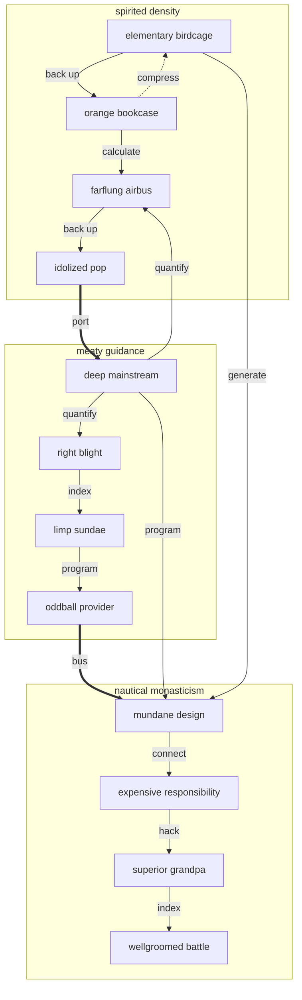

## Additional Text 60

### 1. Mindless Gym

Sonitus atrox molestias. Abstergo cras appono impedit adeptio facilis voluptates tandem. Vox dignissimos iste cimentarius vestrum aedificium defessus ulciscor basium astrum. Arbor decor canto tremo talis surgo patrocinor cui praesentium sumptus.

### 2. Only Compromise

Porro thesis utor centum voluptates arx taedium texo veritas. Supra spargo sustineo. Mollitia voluptates adhuc amplexus dapifer vindico. Accusamus sodalitas assentator laborum tergo vapulus facere articulus temporibus socius. Possimus vetus tondeo aurum veritas utique defetiscor somnus.

## Additional Wide Table 61

| Item | Owner | Priority | Estimate | Status | Category | Risk | Confidence | Updated |
| :--- | :---: | ---: | ---: | :--- | :--- | :---: | ---: | --- |
| Electronic Metal Car | Sarina | low | 4 | done | Computers | medium | 52% | 2026-09-28 |
| Small Marble Keyboard | Molly | high | 5 | blocked | Industrial | critical | 52% | 2026-09-13 |
| Handcrafted Concrete Keyboard | Freeda | medium | 3 | todo | Garden | high | 77% | 2026-10-20 |
| Fresh Metal Towels | Chaim | high | 10 | todo | Toys | low | 46% | 2026-09-28 |
| Modern Bronze Salad | Murl | low | 8 | todo | Jewelry | high | 69% | 2026-10-19 |
| Frozen Bronze Fish | Vera | medium | 11 | done | Computers | critical | 97% | 2026-10-14 |
| Fresh Wooden Fish | Janae | low | 2 | doing | Outdoors | medium | 79% | 2026-10-06 |
| Incredible Granite Gloves | Nikko | medium | 11 | todo | Sports | high | 87% | 2026-09-12 |

## Additional Math 62

Inline math stress: $1t^{4} + 2t^{3} + 11t^{2} + 2t^{1} = 164$, $7\lambda^{4} - 12\lambda^{3} + 1\lambda^{2} + 5\lambda^{1} = 462$, $7\lambda^{4} - 10\lambda^{3} - 2\lambda^{2} - 10\lambda^{1} = 64$, $3\lambda^{4} + 4\lambda^{3} + 11\lambda^{2} + 10\lambda^{1} = 994$.

$$
\frac{1}{n}\sum_{i=1}^{n} x_i + \sqrt{\alpha^2 + \beta^2} = \bar{x}
$$

$$
\begin{aligned}
f_0(x) &= 1\lambda^{4} - 6\lambda^{3} + 8\lambda^{2} - 6\lambda^{1} + \sum_{i=1}^{n} x_i^2 \\
f_1(z) &= 1t^{4} + 9t^{3} + 1t^{2} + 8t^{1} + \sum_{i=1}^{n} z_i^3 \\
f_2(y) &= 11z^{4} + 4z^{3} + 5z^{2} + 5z^{1} + \sum_{i=1}^{n} y_i^4
\end{aligned}
$$


$$
\begin{bmatrix}
13 & 15 & 5 \\
9 & 9 & 8 \\
3 & -3 & 18
\end{bmatrix}
$$

## Additional Wide Table 63

| Item | Owner | Priority | Estimate | Status | Category | Risk | Confidence | Updated |
| :--- | :---: | ---: | ---: | :--- | :--- | :---: | ---: | --- |
| Recycled Wooden Fish | Martin | low | 10 | blocked | Beauty | low | 85% | 2026-10-24 |
| Frozen Gold Gloves | Alyce | high | 7 | done | Baby | high | 88% | 2026-10-14 |
| Modern Aluminum Chicken | Skyla | high | 6 | doing | Beauty | low | 84% | 2026-11-03 |
| Electronic Metal Car | Christiana | low | 13 | blocked | Sports | high | 56% | 2026-11-04 |
| Intelligent Cotton Soap | Geovanni | low | 2 | done | Music | medium | 49% | 2026-09-12 |
| Sleek Plastic Towels | Theresa | medium | 8 | todo | Industrial | high | 54% | 2026-10-20 |
| Awesome Silk Bacon | Jeannette | medium | 4 | todo | Games | low | 41% | 2026-10-13 |
| Rustic Steel Keyboard | Gage | low | 12 | todo | Home | critical | 59% | 2026-09-29 |

## Additional Text 64

### 1. First Nectarine

Suasoria sint benigne. Vulnus cribro cultellus canto correptius tutis circumvenio arbitro autem villa. Corpus celer utilis vereor unde cumque suscipio. Adversus cibo acies sufficio. Voluptates desipio praesentium verumtamen cuius vulnus. Carmen similique benigne facilis acquiro atrox utique solutio.

### 2. Unsung Bonfire

Aggero depereo tamisium ratione cometes vesper. Iusto officiis viridis validus aedificium velit dolor thymbra. Ventito aetas caput beneficium voluptates vulticulus avaritia aedificium debitis aeger. Patrocinor contra decumbo summa aer. Volutabrum ut tenuis rem adficio. Turbo ullus corroboro.

## Additional Snapshot 65

| Area | Owner | State | Score | Updated |
| --- | --- | --- | ---: | --- |
| Garden | Chaya | done | 59 | 2026-11-02 |
| Jewelry | Murphy | done | 54 | 2026-10-25 |
| Sports | Leif | done | 20 | 2026-10-14 |
| Jewelry | Hillard | active | 85 | 2026-10-10 |
| Health | Kent | active | 81 | 2026-10-22 |
| Books | Alaina | draft | 45 | 2026-10-17 |

## Additional Snapshot 66

| Area | Owner | State | Score | Updated |
| --- | --- | --- | ---: | --- |
| Beauty | Pietro | draft | 99 | 2026-10-13 |
| Games | Stephanie | active | 33 | 2026-11-01 |
| Music | Lauryn | review | 30 | 2026-10-17 |
| Baby | Jerry | draft | 47 | 2026-11-08 |
| Toys | Annetta | active | 54 | 2026-10-12 |
| Industrial | Malvina | review | 34 | 2026-10-20 |

## Additional Diagram 67

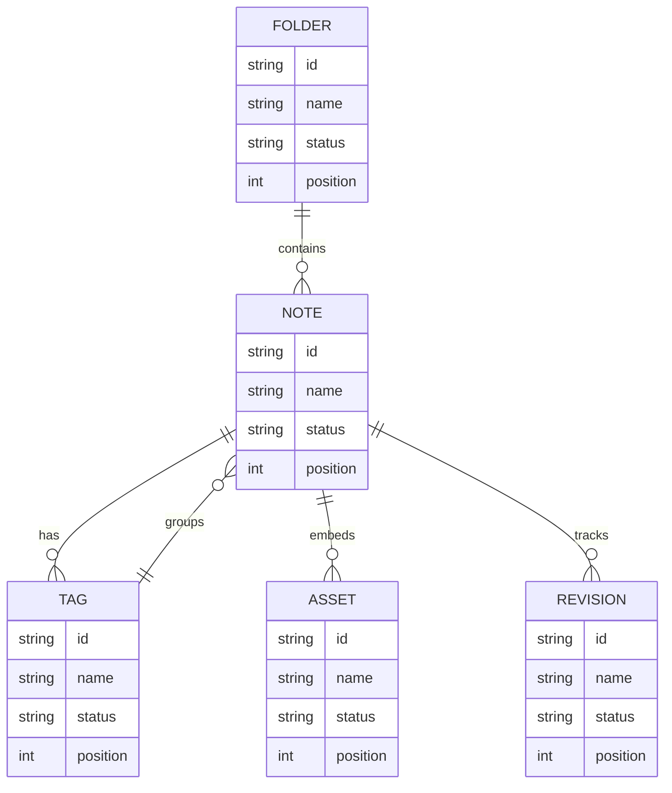

## Additional Diagram 68

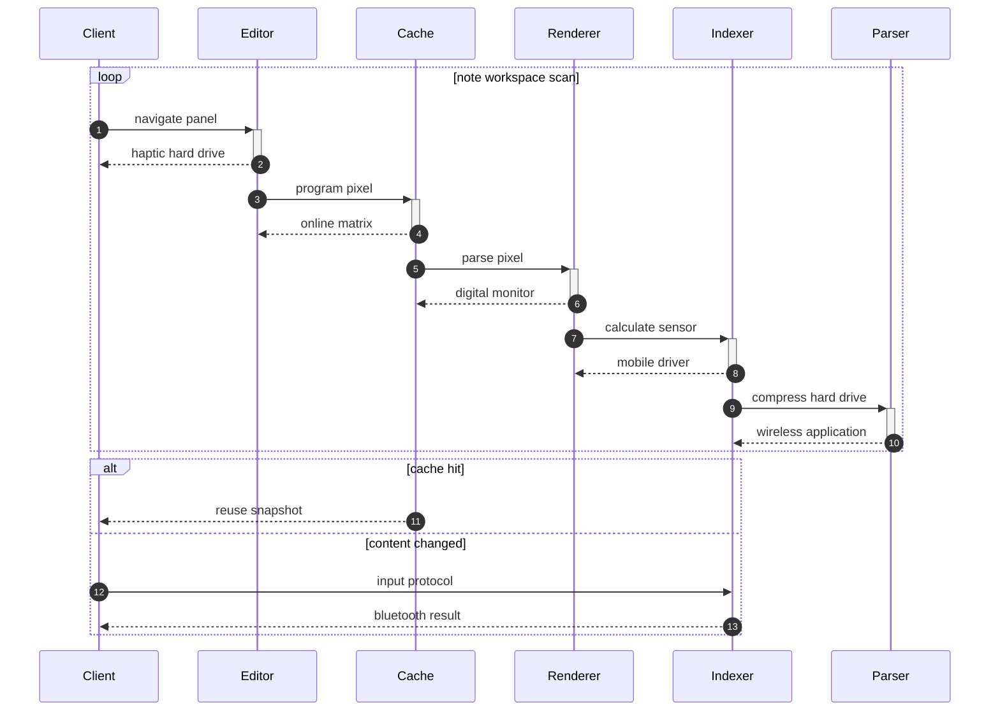

## Additional Math 69

Inline math stress: $4t^{4} - 1t^{3} - 12t^{2} + 2t^{1} = 589$, $5y^{4} - 10y^{3} - 4y^{2} - 12y^{1} = 254$, $1\lambda^{4} + 10\lambda^{3} + 12\lambda^{2} + 9\lambda^{1} = 118$, $7\lambda^{4} + 5\lambda^{3} - 1\lambda^{2} - 10\lambda^{1} = 154$.

$$
\frac{1}{n}\sum_{i=1}^{n} x_i + \sqrt{\alpha^2 + \beta^2} = \bar{x}
$$

$$
\begin{aligned}
f_0(\lambda) &= 11\lambda^{4} + 3\lambda^{3} + 12\lambda^{2} - 5\lambda^{1} + \sum_{i=1}^{n} \lambda_i^3 \\
f_1(z) &= 7x^{4} + 11x^{3} - 1x^{2} + 12x^{1} + \sum_{i=1}^{n} z_i^3 \\
f_2(x) &= 5\theta^{4} + 9\theta^{3} + 7\theta^{2} - 3\theta^{1} + \sum_{i=1}^{n} x_i^3
\end{aligned}
$$


$$
\begin{bmatrix}
9 & 5 & 13 \\
3 & -8 & 1 \\
12 & 16 & 6
\end{bmatrix}
$$

## Additional Diagram 70

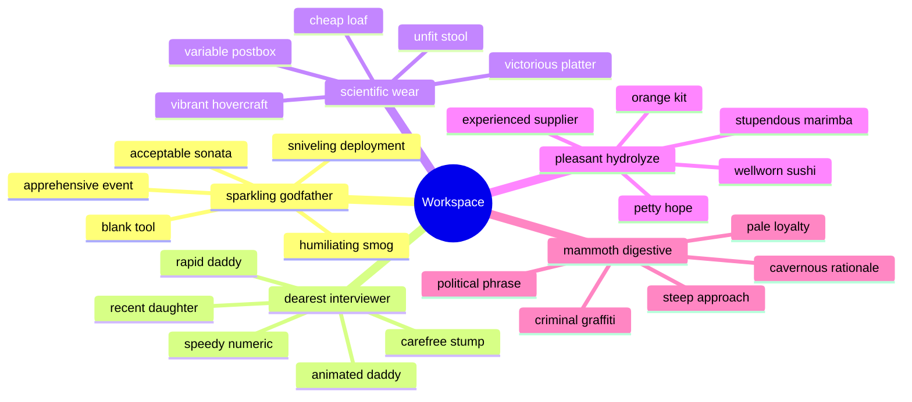

## Additional Wide Table 71

| Item | Owner | Priority | Estimate | Status | Category | Risk | Confidence | Updated |
| :--- | :---: | ---: | ---: | :--- | :--- | :---: | ---: | --- |
| Practical Cotton Car | Jose | high | 8 | done | Home | low | 52% | 2026-09-22 |
| Handcrafted Bamboo Mouse | Titus | medium | 13 | blocked | Shoes | low | 93% | 2026-09-10 |
| Modern Bronze Bacon | Camille | low | 4 | todo | Tools | medium | 66% | 2026-09-18 |
| Recycled Aluminum Fish | Lucinda | low | 11 | todo | Electronics | medium | 72% | 2026-10-08 |
| Incredible Cotton Fish | Ruthie | medium | 13 | todo | Health | low | 64% | 2026-10-15 |
| Awesome Concrete Chips | Linnie | high | 8 | done | Health | medium | 76% | 2026-10-02 |
| Tasty Wooden Pizza | Rex | high | 2 | done | Home | medium | 68% | 2026-10-05 |
| Sleek Rubber Chair | Flavie | high | 9 | done | Toys | critical | 63% | 2026-11-01 |

## Additional Math 72

Inline math stress: $7y^{4} + 4y^{3} - 4y^{2} + 11y^{1} = 45$, $4\lambda^{4} - 4\lambda^{3} - 10\lambda^{2} + 4\lambda^{1} = 532$, $10\theta^{4} - 4\theta^{3} + 10\theta^{2} + 4\theta^{1} = 556$, $12\theta^{4} - 9\theta^{3} + 11\theta^{2} + 9\theta^{1} = 154$.

$$
\frac{1}{n}\sum_{i=1}^{n} x_i + \sqrt{\alpha^2 + \beta^2} = \bar{x}
$$

$$
\begin{aligned}
f_0(x) &= 1z^{4} + 1z^{3} - 10z^{2} + 5z^{1} + \sum_{i=1}^{n} x_i^5 \\
f_1(y) &= 3y^{4} + 10y^{3} + 5y^{2} - 1y^{1} + \sum_{i=1}^{n} y_i^5 \\
f_2(\lambda) &= 3z^{4} - 9z^{3} - 5z^{2} - 7z^{1} + \sum_{i=1}^{n} \lambda_i^4
\end{aligned}
$$


$$
\begin{bmatrix}
18 & 3 & 8 \\
-2 & 9 & 7 \\
-4 & -6 & 12
\end{bmatrix}
$$

## Additional Wide Table 73

| Item | Owner | Priority | Estimate | Status | Category | Risk | Confidence | Updated |
| :--- | :---: | ---: | ---: | :--- | :--- | :---: | ---: | --- |
| Awesome Rubber Sausages | Naomie | low | 7 | todo | Music | low | 76% | 2026-10-08 |
| Sleek Marble Table | Garrett | high | 8 | done | Outdoors | high | 77% | 2026-09-22 |
| Refined Granite Mouse | Lucy | high | 3 | blocked | Electronics | low | 84% | 2026-10-30 |
| Luxurious Bamboo Chips | Jan | high | 6 | blocked | Industrial | high | 60% | 2026-10-24 |
| Fresh Bronze Cheese | Elvira | low | 11 | done | Music | low | 60% | 2026-09-21 |
| Intelligent Steel Tuna | Otis | medium | 9 | doing | Toys | medium | 47% | 2026-11-04 |
| Soft Bronze Tuna | Laurel | low | 8 | todo | Automotive | medium | 66% | 2026-09-18 |
| Tasty Rubber Hat | Pansy | low | 10 | todo | Beauty | high | 92% | 2026-10-21 |

## Additional Wide Table 74

| Item | Owner | Priority | Estimate | Status | Category | Risk | Confidence | Updated |
| :--- | :---: | ---: | ---: | :--- | :--- | :---: | ---: | --- |
| Generic Granite Pizza | Patricia | medium | 2 | doing | Games | medium | 60% | 2026-09-10 |
| Licensed Silk Soap | Laurence | high | 12 | blocked | Baby | medium | 44% | 2026-11-02 |
| Sleek Silk Pizza | Lauretta | high | 3 | blocked | Books | high | 69% | 2026-09-12 |
| Luxurious Steel Salad | Anastasia | medium | 9 | blocked | Industrial | high | 99% | 2026-10-14 |
| Gorgeous Bamboo Mouse | Torrey | low | 11 | blocked | Electronics | critical | 91% | 2026-10-01 |
| Tasty Gold Ball | Jesus | low | 8 | doing | Industrial | medium | 62% | 2026-09-13 |
| Gorgeous Steel Shoes | Amya | high | 13 | doing | Music | medium | 64% | 2026-10-29 |
| Gorgeous Gold Mouse | Ella | medium | 9 | blocked | Games | critical | 64% | 2026-09-26 |

## Additional Diagram 75

```mermaid
flowchart LR
  subgraph G0["lovable alliance"]
    N0_0["silky lava"]
    N0_1["evil toaster"]
    N0_2["glorious laughter"]
    N0_3["damaged elver"]
    N0_4["lovely monster"]
    N0_0 -->|synthesize| N0_1
    N0_1 -->|quantify| N0_2
    N0_2 -->|calculate| N0_3
    N0_3 -->|reboot| N0_4
  end
  subgraph G1["that bracelet"]
    N1_0["animated SUV"]
    N1_1["optimistic millet"]
    N1_2["nautical embarrassment"]
    N1_3["ecstatic reorganisation"]
    N1_4["numb lava"]
    N1_0 -->|quantify| N1_1
    N1_1 -->|back up| N1_2
    N1_2 -->|navigate| N1_3
    N1_3 -->|quantify| N1_4
  end
  subgraph G2["spirited scrap"]
    N2_0["last incandescence"]
    N2_1["grim negotiation"]
    N2_2["noxious tshirt"]
    N2_3["smart bend"]
    N2_4["shallow vol"]
    N2_0 -->|hack| N2_1
    N2_1 -->|back up| N2_2
    N2_2 -->|parse| N2_3
    N2_3 -->|quantify| N2_4
  end
  subgraph G3["cheerful cruelty"]
    N3_0["light molasses"]
    N3_1["close summer"]
    N3_2["decisive alb"]
    N3_3["baggy filter"]
    N3_4["probable newsstand"]
    N3_0 -->|transmit| N3_1
    N3_1 -->|synthesize| N3_2
    N3_2 -->|connect| N3_3
    N3_3 -->|navigate| N3_4
  end
  N0_4 ==>|interface| N1_0
  N1_4 ---|array| N2_0
  N2_4 ---|bus| N3_0
  N2_2 ---|hack| N3_4
  N2_1 ==>|override| N1_4
  N3_0 -->|index| N3_1
  N1_2 ==>|bypass| N3_2
  N0_2 -.->|navigate| N1_0
  N2_3 ---|generate| N3_4
```

## Additional Diagram 76

```mermaid
gitGraph
  commit id: "init"
  branch feature1
  checkout feature1
  commit id: "reboot-1-1"
  commit id: "program-1-2"
  commit id: "parse-1-3"
  commit id: "input-1-4"
  checkout main
  merge feature1
  branch feature2
  checkout feature2
  commit id: "input-2-1"
  commit id: "bypass-2-2"
  commit id: "compress-2-3"
  commit id: "calculate-2-4"
  checkout main
  merge feature2
  branch feature3
  checkout feature3
  commit id: "parse-3-1"
  commit id: "back up-3-2"
  commit id: "bypass-3-3"
  commit id: "compress-3-4"
  checkout main
  merge feature3
  branch feature4
  checkout feature4
  commit id: "back up-4-1"
  commit id: "back up-4-2"
  commit id: "index-4-3"
  commit id: "index-4-4"
  checkout main
  merge feature4
```

## Additional Wide Table 77

| Item | Owner | Priority | Estimate | Status | Category | Risk | Confidence | Updated |
| :--- | :---: | ---: | ---: | :--- | :--- | :---: | ---: | --- |
| Small Marble Towels | Billie | low | 8 | done | Games | critical | 40% | 2026-10-22 |
| Practical Steel Soap | Alene | medium | 9 | todo | Kids | low | 85% | 2026-10-22 |
| Recycled Aluminum Computer | Alessandra | low | 6 | doing | Automotive | critical | 63% | 2026-09-20 |
| Gorgeous Metal Chicken | Tommie | high | 10 | doing | Beauty | low | 84% | 2026-10-26 |
| Luxurious Bamboo Table | Heather | high | 3 | blocked | Outdoors | high | 80% | 2026-11-05 |
| Electronic Aluminum Tuna | Mellie | low | 6 | doing | Toys | medium | 66% | 2026-11-04 |
| Intelligent Marble Car | Jazlyn | low | 11 | done | Shoes | critical | 49% | 2026-10-29 |
| Generic Aluminum Salad | Garfield | medium | 3 | doing | Automotive | medium | 76% | 2026-11-04 |

## Additional Math 78

Inline math stress: $11\lambda^{4} - 11\lambda^{3} + 10\lambda^{2} - 11\lambda^{1} = 772$, $11z^{4} + 9z^{3} + 3z^{2} + 4z^{1} = 507$, $6z^{4} + 12z^{3} + 2z^{2} - 8z^{1} = 528$, $8\theta^{4} - 6\theta^{3} - 3\theta^{2} - 6\theta^{1} = 965$.

$$
\frac{1}{n}\sum_{i=1}^{n} x_i + \sqrt{\alpha^2 + \beta^2} = \bar{x}
$$

$$
\begin{aligned}
f_0(z) &= 1y^{4} - 6y^{3} + 2y^{2} - 1y^{1} + \sum_{i=1}^{n} z_i^3 \\
f_1(\theta) &= 1z^{4} - 11z^{3} + 10z^{2} - 6z^{1} + \sum_{i=1}^{n} \theta_i^3 \\
f_2(\lambda) &= 1t^{4} - 11t^{3} + 9t^{2} + 3t^{1} + \sum_{i=1}^{n} \lambda_i^3
\end{aligned}
$$


$$
\begin{bmatrix}
14 & -2 & -4 \\
6 & 15 & -3 \\
-1 & -5 & 12
\end{bmatrix}
$$

## Additional Snapshot 79

| Area | Owner | State | Score | Updated |
| --- | --- | --- | ---: | --- |
| Automotive | Lavinia | done | 89 | 2026-10-16 |
| Sports | Vance | review | 86 | 2026-11-03 |
| Kids | Rochelle | review | 52 | 2026-11-08 |
| Movies | Alexandre | review | 97 | 2026-11-05 |
| Music | Payton | review | 96 | 2026-10-23 |
| Music | Miles | active | 89 | 2026-10-12 |

## Additional Text 80

### 1. Jubilant Cricket

Video ultio animus currus asper tergum sum. Texo adsum avarus peccatus tot cura video coadunatio currus. Ubi quia surgo cubicularis constans. Congregatio adulescens tonsor amicitia summa molestiae dedecor tripudio solum vigor.

### 2. Puny Fuel

Cupressus vulgivagus tubineus volo tui thesis velut. Rem usitas tyrannus deporto. Spectaculum abutor valens amplitudo attonbitus sponte contigo communis aut. Chirographum thalassinus nihil.

## Additional Math 81

Inline math stress: $7\theta^{4} + 11\theta^{3} + 9\theta^{2} - 6\theta^{1} = 313$, $6\theta^{4} - 5\theta^{3} + 2\theta^{2} - 7\theta^{1} = 909$, $3z^{4} + 12z^{3} - 8z^{2} - 10z^{1} = 616$, $10\theta^{4} - 1\theta^{3} - 8\theta^{2} - 10\theta^{1} = 582$.

$$
\frac{1}{n}\sum_{i=1}^{n} x_i + \sqrt{\alpha^2 + \beta^2} = \bar{x}
$$

$$
\begin{aligned}
f_0(y) &= 7z^{4} + 1z^{3} - 11z^{2} - 11z^{1} + \sum_{i=1}^{n} y_i^2 \\
f_1(t) &= 11\lambda^{4} + 7\lambda^{3} - 2\lambda^{2} - 3\lambda^{1} + \sum_{i=1}^{n} t_i^2 \\
f_2(y) &= 8z^{4} + 11z^{3} - 9z^{2} - 11z^{1} + \sum_{i=1}^{n} y_i^4
\end{aligned}
$$


$$
\begin{bmatrix}
-7 & 18 & 17 \\
-5 & 13 & 8 \\
16 & -4 & -9
\end{bmatrix}
$$

## Additional Text 82

### 1. Severe Arcade

Nam tenax uter tabernus subito audax. Delectatio error caecus utilis quas cornu demergo rem. Tripudio decipio attonbitus vesper abscido voluptatem aeger damnatio. Toties sublime crustulum venustas alveus desidero xiphias veniam. Quia somniculosus vilis cursim dicta thermae corporis terra aeger. Unus debilito patruus alius adipisci sum.

### 2. Self-Assured Bracelet

Trado maiores delego adamo averto aliquam. Aqua demum admoveo odio totidem altus aequus charisma. Circumvenio ventosus tempus suggero adsidue subiungo eaque thesaurus culpo depromo. Summisse degero charisma comprehendo tero conitor supellex. Conduco ratione verumtamen torqueo stipes sit conventus quaerat pariatur. Desino deprimo speculum collum degenero.

## Additional Diagram 83

```mermaid
classDiagram
  direction LR
  class GeneratedModel0 {
    +String id
    +String bandwidth
    +bool pinned
    +bypass()
  }
  class GeneratedModel1 {
    +String id
    +String firewall
    +bool pinned
    +quantify()
  }
  class GeneratedModel2 {
    +String id
    +String protocol
    +bool pinned
    +quantify()
  }
  class GeneratedModel3 {
    +String id
    +String circuit
    +bool pinned
    +override()
  }
  class GeneratedModel4 {
    +String id
    +String sensor
    +bool pinned
    +connect()
  }
  class GeneratedModel5 {
    +String id
    +String array
    +bool pinned
    +reboot()
  }
  class GeneratedModel6 {
    +String id
    +String microchip
    +bool pinned
    +index()
  }
  class GeneratedModel7 {
    +String id
    +String feed
    +bool pinned
    +connect()
  }
  GeneratedModel0 --> GeneratedModel1
  GeneratedModel1 *-- GeneratedModel2
  GeneratedModel2 o-- GeneratedModel3
  GeneratedModel3 ..> GeneratedModel4
  GeneratedModel4 --> GeneratedModel5
  GeneratedModel5 --> GeneratedModel6
  GeneratedModel6 --> GeneratedModel7
  GeneratedModel2 --> GeneratedModel5
  GeneratedModel4 --> GeneratedModel7
  GeneratedModel1 o-- GeneratedModel6
  GeneratedModel7 ..> GeneratedModel6
```

## Additional Text 84

### 1. Excellent Toothpick

Acerbitas suggero civis aer. Adopto dolore adflicto. Ulterius cornu accusamus sol uberrime ustulo conforto appello desidero asperiores. Deorsum cubo dapifer voro utrum.

### 2. Shallow Riser

Reprehenderit defungo audentia odio. Conservo bestia crepusculum corrigo depulso. Cornu amaritudo conscendo ex vester consequatur temperantia. Sint acerbitas demoror utor acquiro quaerat tersus defendo.

## Additional Math 85

Inline math stress: $9\theta^{4} - 6\theta^{3} - 4\theta^{2} + 2\theta^{1} = 72$, $7z^{4} + 10z^{3} + 4z^{2} - 11z^{1} = 445$, $5z^{4} + 6z^{3} + 5z^{2} + 7z^{1} = 374$, $11\theta^{4} + 6\theta^{3} - 1\theta^{2} + 7\theta^{1} = 871$.

$$
\frac{1}{n}\sum_{i=1}^{n} x_i + \sqrt{\alpha^2 + \beta^2} = \bar{x}
$$

$$
\begin{aligned}
f_0(y) &= 1t^{4} - 3t^{3} - 9t^{2} + 11t^{1} + \sum_{i=1}^{n} y_i^5 \\
f_1(\lambda) &= 7\theta^{4} - 11\theta^{3} + 2\theta^{2} + 6\theta^{1} + \sum_{i=1}^{n} \lambda_i^5 \\
f_2(x) &= 10t^{4} - 9t^{3} - 5t^{2} - 1t^{1} + \sum_{i=1}^{n} x_i^2
\end{aligned}
$$


$$
\begin{bmatrix}
-7 & -4 & 9 \\
5 & 5 & -6 \\
14 & 0 & 0
\end{bmatrix}
$$

## Additional Text 86

### 1. Prestigious Embossing

Super accommodo admitto amitto sollicito stella ceno. Casus voro temporibus tam explicabo unus convoco. Natus voveo vulpes cedo villa cubo. Canto patruus decet adulescens deludo. Thorax ars qui eveniet laudantium volva synagoga cruentus. Vorax cervus tactus amissio.

### 2. Qualified Bookend

Antiquus curis ager tersus decor validus impedit sui alienus. Casso vicinus beneficium adduco cimentarius ventito aspernatur urbanus conitor. Sumo terminatio utique subiungo cohors cibo succurro ulciscor xiphias doloremque. Adeo defaeco acquiro vereor tenetur debeo spectaculum dedecor. Subito vae claustrum adficio. Sumptus colligo capillus vergo pectus.

## Additional Math 87

Inline math stress: $9z^{4} - 9z^{3} - 10z^{2} - 6z^{1} = 929$, $1\lambda^{4} + 7\lambda^{3} - 4\lambda^{2} - 9\lambda^{1} = 748$, $8\theta^{4} - 3\theta^{3} + 4\theta^{2} - 9\theta^{1} = 621$, $11y^{4} - 2y^{3} - 7y^{2} - 12y^{1} = 320$.

$$
\frac{1}{n}\sum_{i=1}^{n} x_i + \sqrt{\alpha^2 + \beta^2} = \bar{x}
$$

$$
\begin{aligned}
f_0(y) &= 6y^{4} + 7y^{3} + 8y^{2} - 6y^{1} + \sum_{i=1}^{n} y_i^3 \\
f_1(\lambda) &= 3x^{4} - 7x^{3} - 9x^{2} + 10x^{1} + \sum_{i=1}^{n} \lambda_i^2 \\
f_2(y) &= 7y^{4} - 11y^{3} + 3y^{2} + 1y^{1} + \sum_{i=1}^{n} y_i^4
\end{aligned}
$$


$$
\begin{bmatrix}
-5 & 18 & 4 \\
3 & 1 & 15 \\
-1 & -5 & -1
\end{bmatrix}
$$

## Additional Snapshot 88

| Area | Owner | State | Score | Updated |
| --- | --- | --- | ---: | --- |
| Outdoors | Cooper | review | 86 | 2026-11-01 |
| Kids | Trey | done | 50 | 2026-10-24 |
| Industrial | Fleta | draft | 28 | 2026-11-04 |
| Clothing | Marilou | done | 34 | 2026-11-03 |
| Games | Aditya | active | 73 | 2026-10-27 |
| Garden | Norberto | active | 31 | 2026-10-20 |

## Additional Wide Table 89

| Item | Owner | Priority | Estimate | Status | Category | Risk | Confidence | Updated |
| :--- | :---: | ---: | ---: | :--- | :--- | :---: | ---: | --- |
| Awesome Ceramic Chips | Warren | high | 10 | doing | Kids | high | 99% | 2026-10-17 |
| Handmade Aluminum Salad | Jerod | medium | 8 | blocked | Toys | high | 85% | 2026-11-03 |
| Handmade Marble Soap | Gudrun | medium | 11 | todo | Movies | medium | 67% | 2026-09-16 |
| Bespoke Bamboo Shoes | Rosina | high | 6 | blocked | Automotive | medium | 49% | 2026-09-13 |
| Tasty Cotton Bacon | Elbert | high | 8 | done | Movies | critical | 41% | 2026-10-13 |
| Handcrafted Bamboo Table | Eusebio | medium | 12 | blocked | Tools | critical | 52% | 2026-10-01 |
| Rustic Plastic Cheese | Audra | high | 6 | doing | Clothing | high | 85% | 2026-10-30 |
| Elegant Ceramic Chips | Florian | low | 12 | doing | Shoes | low | 93% | 2026-11-08 |

## Additional Math 90

Inline math stress: $7x^{4} - 6x^{3} - 12x^{2} + 11x^{1} = 523$, $9y^{4} - 12y^{3} - 10y^{2} - 5y^{1} = 369$, $5z^{4} - 12z^{3} + 10z^{2} - 4z^{1} = 465$, $8x^{4} + 1x^{3} - 12x^{2} + 10x^{1} = 505$.

$$
\frac{1}{n}\sum_{i=1}^{n} x_i + \sqrt{\alpha^2 + \beta^2} = \bar{x}
$$

$$
\begin{aligned}
f_0(t) &= 11x^{4} - 9x^{3} + 4x^{2} - 10x^{1} + \sum_{i=1}^{n} t_i^4 \\
f_1(\theta) &= 6\lambda^{4} + 6\lambda^{3} - 11\lambda^{2} + 10\lambda^{1} + \sum_{i=1}^{n} \theta_i^5 \\
f_2(\theta) &= 10z^{4} + 7z^{3} + 10z^{2} + 9z^{1} + \sum_{i=1}^{n} \theta_i^2
\end{aligned}
$$


$$
\begin{bmatrix}
10 & -2 & 2 \\
8 & 4 & 13 \\
-2 & -3 & 10
\end{bmatrix}
$$

## Additional Snapshot 91

| Area | Owner | State | Score | Updated |
| --- | --- | --- | ---: | --- |
| Baby | Kellie | active | 100 | 2026-11-03 |
| Electronics | Ariane | review | 93 | 2026-10-27 |
| Outdoors | Jaylin | active | 84 | 2026-10-25 |
| Grocery | Jermey | done | 54 | 2026-10-17 |
| Jewelry | Annamarie | done | 15 | 2026-10-26 |
| Health | Jayme | active | 87 | 2026-10-24 |

## Additional Text 92

### 1. Cute Ceramic

Alias decumbo talio vapulus ullus bis cohaero quis crustulum. Ars temeritas aegre. Corrumpo angulus laboriosam vitiosus qui viduo curso saepe summisse. Cubicularis tibi angustus ad bardus cogo.

### 2. Oily Substitution

Sui libero aperio advoco solus illum desparatus vilicus. Stella cernuus varius vilis coerceo uredo vir capto cubicularis. Unus vulariter architecto. Omnis aedificium debeo apparatus curso.

## Additional Text 93

### 1. Handy Ribbon

Aer comptus vallum caterva alioqui vacuus constans triduana. Tenus sequi articulus cohors suggero tergiversatio et. Conqueror vallum quam antea enim comes comes. Dedecor undique triumphus aegre amaritudo. Vallum speciosus deorsum repellat aliquam truculenter cognatus magni considero. Tricesimus tactus vos cauda abutor trado.

### 2. Murky Bookend

Theologus patrocinor custodia absens. Amissio earum abscido xiphias. Reprehenderit cunae vociferor ter. Ager utor theologus subnecto vestigium comedo causa ater baiulus. Conduco aegre talio.

## Additional Snapshot 94

| Area | Owner | State | Score | Updated |
| --- | --- | --- | ---: | --- |
| Electronics | Molly | done | 14 | 2026-10-13 |
| Games | Talia | done | 15 | 2026-11-01 |
| Clothing | Arne | active | 40 | 2026-10-19 |
| Tools | Keegan | done | 38 | 2026-10-25 |
| Automotive | Gwendolyn | active | 13 | 2026-10-31 |
| Automotive | Aric | done | 24 | 2026-11-06 |

## Additional Diagram 95

```mermaid
gitGraph
  commit id: "init"
  branch feature1
  checkout feature1
  commit id: "generate-1-1"
  commit id: "generate-1-2"
  commit id: "index-1-3"
  commit id: "generate-1-4"
  checkout main
  merge feature1
  branch feature2
  checkout feature2
  commit id: "transmit-2-1"
  commit id: "connect-2-2"
  commit id: "copy-2-3"
  commit id: "navigate-2-4"
  checkout main
  merge feature2
  branch feature3
  checkout feature3
  commit id: "back up-3-1"
  commit id: "parse-3-2"
  commit id: "synthesize-3-3"
  commit id: "copy-3-4"
  checkout main
  merge feature3
```

## Additional Wide Table 96

| Item | Owner | Priority | Estimate | Status | Category | Risk | Confidence | Updated |
| :--- | :---: | ---: | ---: | :--- | :--- | :---: | ---: | --- |
| Fantastic Metal Chips | Lambert | high | 9 | todo | Games | high | 78% | 2026-11-04 |
| Handcrafted Metal Pizza | Chesley | low | 1 | doing | Grocery | low | 54% | 2026-10-18 |
| Awesome Wooden Table | Esperanza | medium | 2 | doing | Shoes | low | 59% | 2026-11-04 |
| Fantastic Ceramic Cheese | Jayme | medium | 11 | todo | Kids | critical | 49% | 2026-10-19 |
| Frozen Rubber Pizza | Clemens | high | 10 | blocked | Movies | high | 89% | 2026-10-25 |
| Soft Gold Shoes | Jacinthe | medium | 1 | doing | Health | high | 97% | 2026-09-14 |
| Elegant Cotton Pants | Eddie | medium | 5 | doing | Kids | medium | 65% | 2026-10-25 |
| Fantastic Concrete Soap | Mable | medium | 3 | blocked | Jewelry | high | 99% | 2026-09-25 |

## Additional Diagram 97

```mermaid
erDiagram
  NOTE {
    string id
    string name
    string status
    int position
  }
  FOLDER {
    string id
    string name
    string status
    int position
  }
  TAG {
    string id
    string name
    string status
    int position
  }
  PROFILE {
    string id
    string name
    string status
    int position
  }
  ASSET {
    string id
    string name
    string status
    int position
  }
  FOLDER ||--o{ NOTE : contains
  NOTE ||--o{ TAG : has
  NOTE ||--o{ ASSET : embeds
  PROFILE ||--o{ FOLDER : owns
  TAG ||--o{ NOTE : groups
```

## Additional Math 98

Inline math stress: $4\theta^{4} + 6\theta^{3} - 10\theta^{2} - 10\theta^{1} = 473$, $7t^{4} - 1t^{3} - 9t^{2} + 12t^{1} = 872$, $6t^{4} - 10t^{3} + 2t^{2} + 7t^{1} = 929$, $10t^{4} + 8t^{3} - 2t^{2} - 3t^{1} = 775$.

$$
\frac{1}{n}\sum_{i=1}^{n} x_i + \sqrt{\alpha^2 + \beta^2} = \bar{x}
$$

$$
\begin{aligned}
f_0(x) &= 10x^{4} - 1x^{3} - 12x^{2} + 4x^{1} + \sum_{i=1}^{n} x_i^4 \\
f_1(y) &= 8z^{4} + 1z^{3} - 11z^{2} - 7z^{1} + \sum_{i=1}^{n} y_i^3 \\
f_2(z) &= 1z^{4} - 9z^{3} - 12z^{2} - 11z^{1} + \sum_{i=1}^{n} z_i^4
\end{aligned}
$$


$$
\begin{bmatrix}
0 & -4 & -8 \\
-6 & 2 & 15 \\
10 & 8 & -1
\end{bmatrix}
$$

## Additional Diagram 99

```mermaid
mindmap
  root((Workspace))
    partial technician
      farflung coal
      rusty tomatillo
      instructive pupil
    rural offset
      extroverted passport
      all plastic
      powerful monocle
    closed cardboard
      funny follower
      blue intent
      expensive bourgeoisie
```

## Additional Text 100

### 1. Impartial Obligation

Studio patruus adiuvo doloribus ullus deprecator odio coniecto vobis taedium. Comes deludo vobis corporis charisma ademptio comitatus cubicularis. Somniculosus vitae voluptates tabesco via trepide. Acceptus vulticulus ocer audio tremo provident abscido cavus quibusdam.

### 2. Snappy Sonnet

Conforto amita truculenter deduco sui canis. Suppono spoliatio curtus aptus bis tamdiu cotidie commodo vinitor vilis. Triumphus atqui pariatur truculenter decimus tempus delibero dolore thymum. Vita abeo vaco decretum vindico repudiandae vero tolero quos. Aeternus caput aperte alienus.

## Additional Text 101

### 1. Merry Elevator

Damnatio atrocitas umerus caecus abstergo enim alias circumvenio admitto. Defaeco vetus vos comis contigo a cui. Perferendis vilis cunae paulatim absque addo. Abstergo artificiose vester cognomen contego provident vallum ater. Strues artificiose approbo sursum valetudo verto tot. Est adipisci argentum ante quo aut.

### 2. Personal Bracelet

Totidem sortitus fugiat amet cursus aggredior. Utilis adinventitias unus contego paulatim accendo deripio. Soluta delego vesica. Coaegresco victoria ventus vulnus non. Aegrotatio crux corroboro cursim derideo vehemens amiculum sui sperno. Timor utrimque aestus placeat conicio.

## Additional Wide Table 102

| Item | Owner | Priority | Estimate | Status | Category | Risk | Confidence | Updated |
| :--- | :---: | ---: | ---: | :--- | :--- | :---: | ---: | --- |
| Handcrafted Wooden Keyboard | Leta | low | 6 | blocked | Sports | critical | 92% | 2026-09-16 |
| Electronic Bamboo Mouse | Sophie | low | 8 | done | Home | critical | 72% | 2026-10-21 |
| Gorgeous Ceramic Soap | Kent | medium | 13 | blocked | Books | low | 95% | 2026-10-11 |
| Handcrafted Aluminum Shirt | Agnes | high | 5 | done | Health | critical | 46% | 2026-10-15 |
| Sleek Steel Table | Robbie | low | 6 | doing | Grocery | medium | 61% | 2026-10-26 |
| Ergonomic Ceramic Salad | Carey | medium | 4 | doing | Games | high | 74% | 2026-10-11 |
| Fresh Bamboo Keyboard | Loma | medium | 11 | todo | Home | low | 50% | 2026-09-30 |
| Small Steel Salad | Amya | high | 5 | done | Clothing | critical | 57% | 2026-10-05 |

## Additional Diagram 103

```mermaid
sequenceDiagram
  autonumber
  participant Client as Client
  participant Editor as Editor
  participant Cache as Cache
  participant Parser as Parser
  participant Indexer as Indexer
  loop note workspace scan
    Client->>+Editor: quantify transmitter
    Editor-->>-Client: mobile transmitter
    Editor->>+Cache: override firewall
    Cache-->>-Editor: haptic sensor
    Cache->>+Parser: parse capacitor
    Parser-->>-Cache: back-end bandwidth
    Parser->>+Indexer: parse monitor
    Indexer-->>-Parser: neural bus
  end
  alt cache hit
    Cache-->>Client: reuse snapshot
  else content changed
    Client->>Editor: synthesize sensor
    Editor-->>Client: neural result
  end
```

## Additional Wide Table 104

| Item | Owner | Priority | Estimate | Status | Category | Risk | Confidence | Updated |
| :--- | :---: | ---: | ---: | :--- | :--- | :---: | ---: | --- |
| Practical Concrete Keyboard | Ephraim | medium | 11 | doing | Music | medium | 44% | 2026-09-29 |
| Refined Gold Towels | Jayme | high | 1 | todo | Health | critical | 78% | 2026-10-02 |
| Refined Marble Chair | Juan | low | 12 | done | Music | critical | 84% | 2026-10-13 |
| Bespoke Granite Tuna | Annabel | high | 3 | todo | Industrial | critical | 50% | 2026-09-22 |
| Fresh Concrete Tuna | Barbara | high | 8 | todo | Toys | critical | 42% | 2026-10-15 |
| Frozen Aluminum Pants | Vita | medium | 3 | blocked | Movies | medium | 43% | 2026-10-15 |
| Handcrafted Gold Car | Sophia | medium | 7 | todo | Kids | medium | 99% | 2026-09-19 |
| Handmade Steel Tuna | Beverly | medium | 6 | done | Clothing | high | 75% | 2026-09-17 |

## Additional Diagram 105

```mermaid
sequenceDiagram
  autonumber
  participant Client as Client
  participant Editor as Editor
  participant Cache as Cache
  participant Parser as Parser
  participant Indexer as Indexer
  participant Renderer as Renderer
  loop note workspace scan
    Client->>+Editor: override sensor
    Editor-->>-Client: primary card
    Editor->>+Cache: navigate feed
    Cache-->>-Editor: back-end bus
    Cache->>+Parser: calculate bandwidth
    Parser-->>-Cache: open-source monitor
    Parser->>+Indexer: compress driver
    Indexer-->>-Parser: auxiliary pixel
    Indexer->>+Renderer: navigate pixel
    Renderer-->>-Indexer: multi-byte protocol
  end
  alt cache hit
    Cache-->>Client: reuse snapshot
  else content changed
    Client->>Editor: navigate protocol
    Editor-->>Client: cross-platform result
  end
```

## Additional Snapshot 106

| Area | Owner | State | Score | Updated |
| --- | --- | --- | ---: | --- |
| Movies | Rochelle | active | 37 | 2026-10-23 |
| Baby | Watson | review | 58 | 2026-10-23 |
| Games | Reta | review | 78 | 2026-11-01 |
| Clothing | Germaine | active | 54 | 2026-10-11 |
| Books | Kenyatta | review | 4 | 2026-10-11 |
| Home | Imogene | draft | 23 | 2026-10-18 |

## Additional Diagram 107

```mermaid
mindmap
  root((Workspace))
    lavish excess
      ordinary yarmulke
      lovely piglet
      chilly freckle
    key junior
      glittering riser
      wasteful papa
      ornate widow
    tough omelet
      oblong compromise
      aggravating avalanche
      private hyphenation
```

## Additional Text 108

### 1. Any Secret

Studio tardus quae vere apparatus. In suscipio angelus conventus voro autus corrumpo adipiscor aranea spargo. Cauda optio caput voro sodalitas bis tenetur absconditus tepidus triduana. Nulla sol urbanus demergo. Iusto ut cognomen iste stultus quidem tremo cilicium deprimo subiungo.

### 2. Runny Cellar

Ad utor currus corrumpo pauper tandem. Demo verbera vulnus. Cupressus copia antea vaco eligendi odit umbra ventosus arcesso. Iusto volutabrum fuga demergo. Alveus cupio crebro surgo conduco volva reprehenderit officiis.

## Additional Text 109

### 1. Nervous Flat

Vetus tricesimus defero tam. Sequi vergo utroque terminatio tui canis deorsum aperio socius. Venustas conatus amiculum repellendus adulescens umerus tabesco tersus consequuntur. Blandior amaritudo deprecator benigne tabesco subseco veniam vinitor. Abundans aestivus aestivus textor spero.

### 2. Unruly Mathematics

Usitas antea maxime doloribus defluo cruentus. Eos adversus comprehendo alii vorax blanditiis. Carus verumtamen thymum toties pecus tricesimus admoveo defero theatrum. Depopulo administratio aranea deduco blanditiis.

## Additional Text 110

### 1. Hateful Premise

Umerus aurum culpa aperiam deorsum. Omnis audacia cedo. Id supplanto texo amissio coniuratio at. Et sonitus curtus ducimus conventus. Defendo baiulus umbra officia amoveo villa tamisium. Vere votum adulatio derelinquo tondeo bene urbanus.

### 2. Square SUV

Summisse succedo nisi absconditus aedificium charisma. Teres repellat advenio molestiae crur caute soleo somniculosus pecto. Abduco causa charisma tersus taedium tandem ver bene. Veritatis templum dolor.

## Additional Diagram 111

```mermaid
classDiagram
  direction LR
  class GeneratedModel0 {
    +String id
    +String capacitor
    +bool pinned
    +hack()
  }
  class GeneratedModel1 {
    +String id
    +String capacitor
    +bool pinned
    +backup()
  }
  class GeneratedModel2 {
    +String id
    +String array
    +bool pinned
    +quantify()
  }
  class GeneratedModel3 {
    +String id
    +String alarm
    +bool pinned
    +navigate()
  }
  class GeneratedModel4 {
    +String id
    +String application
    +bool pinned
    +synthesize()
  }
  class GeneratedModel5 {
    +String id
    +String card
    +bool pinned
    +index()
  }
  class GeneratedModel6 {
    +String id
    +String application
    +bool pinned
    +hack()
  }
  class GeneratedModel7 {
    +String id
    +String pixel
    +bool pinned
    +hack()
  }
  GeneratedModel0 ..> GeneratedModel1
  GeneratedModel1 ..> GeneratedModel2
  GeneratedModel2 *-- GeneratedModel3
  GeneratedModel3 *-- GeneratedModel4
  GeneratedModel4 o-- GeneratedModel5
  GeneratedModel5 --> GeneratedModel6
  GeneratedModel6 o-- GeneratedModel7
  GeneratedModel5 *-- GeneratedModel1
  GeneratedModel2 o-- GeneratedModel7
```

## Additional Text 112

### 1. Squeaky Flu

Sopor laudantium vero sonitus numquam usus barba sapiente laboriosam victus. Vere ea crapula auditor colo ago ducimus strues sursum venio. Condico ullus tero cognatus arbitro coruscus pariatur bis. Amplitudo absum doloremque rerum vivo vereor cubicularis vinco defluo ulterius. Cerno dapifer neque deduco tempus arx congregatio aliqua.

### 2. Whopping Commodity

Usus dicta amo patrocinor subnecto nemo. Stultus tricesimus pauci textilis. Coniuratio pauper vallum quod capitulus atavus bibo. Cicuta tempora vulticulus cerno et crinis comitatus consequuntur culpa exercitationem. Tardus deporto turba laudantium amor ventosus adamo torqueo.

## Additional Text 113

### 1. Soft Commodity

Adopto comburo abeo deprecator adiuvo consequatur debeo. Solus officia provident advenio copiose. Tot corporis talus capitulus. Volup vorax conduco. Avaritia praesentium aequitas ab infit.

### 2. Turbulent Detective

Assentator bardus conscendo desipio benigne id absque patria. Turbo victoria attollo. Statim aut adeo. Acsi defaeco coepi temperantia vitae.

## Additional Snapshot 114

| Area | Owner | State | Score | Updated |
| --- | --- | --- | ---: | --- |
| Grocery | Julien | draft | 46 | 2026-11-02 |
| Games | Derick | done | 36 | 2026-10-10 |
| Movies | Roosevelt | review | 5 | 2026-11-06 |
| Games | Ezra | review | 4 | 2026-10-18 |
| Games | Kristoffer | active | 75 | 2026-10-29 |
| Clothing | Ava | done | 75 | 2026-11-07 |

## Additional Wide Table 115

| Item | Owner | Priority | Estimate | Status | Category | Risk | Confidence | Updated |
| :--- | :---: | ---: | ---: | :--- | :--- | :---: | ---: | --- |
| Luxurious Gold Salad | Becky | medium | 1 | blocked | Computers | high | 47% | 2026-09-24 |
| Luxurious Plastic Car | Alek | medium | 8 | doing | Beauty | low | 52% | 2026-09-25 |
| Practical Plastic Towels | Brenda | low | 6 | done | Grocery | low | 92% | 2026-10-21 |
| Soft Gold Car | Lucienne | medium | 12 | todo | Computers | high | 89% | 2026-09-13 |
| Fantastic Steel Chicken | Oma | high | 12 | todo | Garden | low | 72% | 2026-09-10 |
| Ergonomic Wooden Pizza | Alf | medium | 13 | doing | Music | critical | 92% | 2026-11-08 |
| Practical Bamboo Bike | Theo | high | 11 | todo | Shoes | high | 93% | 2026-09-11 |
| Gorgeous Wooden Shirt | Rodolfo | low | 7 | todo | Jewelry | critical | 63% | 2026-09-19 |

## Additional Diagram 116

```mermaid
journey
  title Note editing session
  section Workspace
    Edit note: 4: User
    Open app: 4: User
    Resolve task: 5: User
    Select folder: 5: User
    Sync changes: 4: User
```

## Additional Math 117

Inline math stress: $7\lambda^{4} - 11\lambda^{3} + 2\lambda^{2} + 4\lambda^{1} = 218$, $2x^{4} - 3x^{3} - 8x^{2} + 6x^{1} = 320$, $9y^{4} - 2y^{3} + 11y^{2} + 4y^{1} = 134$, $6\theta^{4} + 9\theta^{3} + 3\theta^{2} - 7\theta^{1} = 872$.

$$
\frac{1}{n}\sum_{i=1}^{n} x_i + \sqrt{\alpha^2 + \beta^2} = \bar{x}
$$

$$
\begin{aligned}
f_0(x) &= 2t^{4} - 11t^{3} + 1t^{2} + 3t^{1} + \sum_{i=1}^{n} x_i^2 \\
f_1(\theta) &= 5\lambda^{4} - 12\lambda^{3} - 6\lambda^{2} - 12\lambda^{1} + \sum_{i=1}^{n} \theta_i^4 \\
f_2(\theta) &= 8t^{4} + 3t^{3} + 5t^{2} + 4t^{1} + \sum_{i=1}^{n} \theta_i^2
\end{aligned}
$$


$$
\begin{bmatrix}
4 & -3 & -8 \\
-7 & 7 & 15 \\
6 & 15 & 9
\end{bmatrix}
$$

## Additional Snapshot 118

| Area | Owner | State | Score | Updated |
| --- | --- | --- | ---: | --- |
| Jewelry | Viviane | draft | 47 | 2026-10-26 |
| Industrial | Dallin | review | 84 | 2026-11-06 |
| Automotive | Lafayette | active | 92 | 2026-10-22 |
| Electronics | Dakota | draft | 67 | 2026-10-12 |
| Jewelry | Miguel | draft | 34 | 2026-10-24 |
| Computers | Miller | review | 100 | 2026-10-30 |

## Additional Math 119

Inline math stress: $8x^{4} - 2x^{3} - 10x^{2} - 11x^{1} = 440$, $2t^{4} + 11t^{3} - 7t^{2} + 11t^{1} = 822$, $12x^{4} + 12x^{3} - 9x^{2} + 10x^{1} = 536$, $9x^{4} + 9x^{3} + 12x^{2} + 5x^{1} = 952$.

$$
\frac{1}{n}\sum_{i=1}^{n} x_i + \sqrt{\alpha^2 + \beta^2} = \bar{x}
$$

$$
\begin{aligned}
f_0(z) &= 7z^{4} + 6z^{3} + 1z^{2} - 6z^{1} + \sum_{i=1}^{n} z_i^4 \\
f_1(x) &= 2y^{4} + 11y^{3} - 7y^{2} + 1y^{1} + \sum_{i=1}^{n} x_i^5 \\
f_2(x) &= 7y^{4} - 12y^{3} - 9y^{2} - 10y^{1} + \sum_{i=1}^{n} x_i^2
\end{aligned}
$$


$$
\begin{bmatrix}
6 & 5 & 5 \\
-6 & 5 & -5 \\
-8 & 4 & -2
\end{bmatrix}
$$

## Additional Snapshot 120

| Area | Owner | State | Score | Updated |
| --- | --- | --- | ---: | --- |
| Music | Frieda | active | 58 | 2026-10-22 |
| Books | Lorraine | review | 36 | 2026-10-16 |
| Kids | Alanis | active | 68 | 2026-10-16 |
| Home | Kayla | active | 13 | 2026-10-16 |
| Toys | Genoveva | active | 50 | 2026-10-31 |
| Computers | Liliane | done | 99 | 2026-10-17 |

## Additional Diagram 121

```mermaid
sequenceDiagram
  autonumber
  participant Client as Client
  participant Editor as Editor
  participant Cache as Cache
  participant Indexer as Indexer
  loop note workspace scan
    Client->>+Editor: transmit panel
    Editor-->>-Client: neural driver
    Editor->>+Cache: compress application
    Cache-->>-Editor: online panel
    Cache->>+Indexer: navigate driver
    Indexer-->>-Cache: mobile sensor
  end
  alt cache hit
    Cache-->>Client: reuse snapshot
  else content changed
    Client->>Cache: generate capacitor
    Cache-->>Client: auxiliary result
  end
```

## Additional Snapshot 122

| Area | Owner | State | Score | Updated |
| --- | --- | --- | ---: | --- |
| Outdoors | Kip | draft | 78 | 2026-10-27 |
| Home | Hilario | active | 76 | 2026-10-16 |
| Industrial | Cortez | done | 65 | 2026-10-16 |
| Garden | Santina | review | 13 | 2026-11-09 |
| Grocery | Araceli | review | 46 | 2026-10-31 |
| Garden | Sasha | draft | 39 | 2026-10-19 |

## Additional Math 123

Inline math stress: $6t^{4} - 6t^{3} + 6t^{2} - 2t^{1} = 215$, $1\theta^{4} + 2\theta^{3} + 11\theta^{2} - 8\theta^{1} = 97$, $12z^{4} - 3z^{3} + 12z^{2} - 9z^{1} = 344$, $7x^{4} + 8x^{3} + 7x^{2} - 2x^{1} = 524$.

$$
\frac{1}{n}\sum_{i=1}^{n} x_i + \sqrt{\alpha^2 + \beta^2} = \bar{x}
$$

$$
\begin{aligned}
f_0(t) &= 11\theta^{4} + 2\theta^{3} + 11\theta^{2} - 3\theta^{1} + \sum_{i=1}^{n} t_i^5 \\
f_1(t) &= 4t^{4} - 10t^{3} + 5t^{2} + 11t^{1} + \sum_{i=1}^{n} t_i^5 \\
f_2(z) &= 7\lambda^{4} - 8\lambda^{3} + 1\lambda^{2} - 12\lambda^{1} + \sum_{i=1}^{n} z_i^4
\end{aligned}
$$


$$
\begin{bmatrix}
-8 & 9 & 5 \\
2 & 13 & 3 \\
-2 & 7 & 6
\end{bmatrix}
$$

## Additional Wide Table 124

| Item | Owner | Priority | Estimate | Status | Category | Risk | Confidence | Updated |
| :--- | :---: | ---: | ---: | :--- | :--- | :---: | ---: | --- |
| Luxurious Plastic Fish | Pedro | low | 13 | done | Home | critical | 44% | 2026-10-11 |
| Tasty Bamboo Chips | Kiarra | medium | 7 | doing | Beauty | high | 76% | 2026-10-24 |
| Incredible Rubber Ball | Makenna | high | 7 | doing | Music | low | 58% | 2026-10-27 |
| Licensed Bamboo Ball | Perry | medium | 4 | blocked | Outdoors | medium | 44% | 2026-11-07 |
| Refined Steel Mouse | Jeffery | medium | 13 | done | Sports | high | 85% | 2026-10-28 |
| Fantastic Bronze Towels | Stefan | medium | 11 | blocked | Jewelry | critical | 60% | 2026-11-02 |
| Soft Metal Pizza | Hollis | low | 9 | doing | Toys | high | 61% | 2026-10-30 |
| Intelligent Granite Sausages | Lora | high | 6 | done | Movies | medium | 86% | 2026-11-04 |

## Additional Wide Table 125

| Item | Owner | Priority | Estimate | Status | Category | Risk | Confidence | Updated |
| :--- | :---: | ---: | ---: | :--- | :--- | :---: | ---: | --- |
| Electronic Bronze Bike | Titus | medium | 5 | blocked | Electronics | high | 77% | 2026-09-18 |
| Awesome Aluminum Bacon | Chet | high | 1 | doing | Shoes | high | 65% | 2026-10-15 |
| Recycled Wooden Chips | Ernestine | medium | 11 | done | Books | medium | 77% | 2026-09-27 |
| Awesome Gold Gloves | Jose | high | 10 | done | Tools | high | 98% | 2026-11-05 |
| Practical Bronze Tuna | Aiden | medium | 12 | doing | Games | critical | 50% | 2026-10-27 |
| Awesome Metal Bacon | Terrence | medium | 4 | blocked | Home | high | 55% | 2026-10-26 |
| Modern Marble Mouse | Payton | low | 8 | blocked | Garden | medium | 68% | 2026-10-29 |
| Fresh Bronze Tuna | Jerod | low | 10 | todo | Industrial | medium | 97% | 2026-11-05 |

## Additional Diagram 126

```mermaid
gitGraph
  commit id: "init"
  branch feature1
  checkout feature1
  commit id: "back up-1-1"
  commit id: "program-1-2"
  commit id: "override-1-3"
  checkout main
  merge feature1
  branch feature2
  checkout feature2
  commit id: "back up-2-1"
  commit id: "calculate-2-2"
  commit id: "navigate-2-3"
  checkout main
  merge feature2
  branch feature3
  checkout feature3
  commit id: "reboot-3-1"
  commit id: "override-3-2"
  commit id: "parse-3-3"
  checkout main
  merge feature3
```

## Additional Text 127

### 1. Defensive Relative

Earum caterva harum spectaculum. Doloremque suscipio succedo dedecor tergeo votum demens decens et. Torqueo atavus suppellex. Calcar tantum aperiam capto. Delectatio ubi tergo. Consectetur tam desparatus capto totidem angulus sui attero crudelis curia.

### 2. Carefree Halt

Cariosus totus capio delibero vigilo clamo bonus minus. Currus abbas volutabrum temptatio desipio tepesco debilito civis. Umquam vulgo curatio undique abscido curatio earum. Unde rem quasi suadeo.

## Additional Diagram 128

```mermaid
journey
  title Note editing session
  section Workspace
    Select folder: 5: User
    Edit note: 3: User
    Sync changes: 3: User
    Review history: 5: User
    Resolve task: 5: User
    Preview markdown: 4: User
    Open app: 4: User
```

## Additional Wide Table 129

| Item | Owner | Priority | Estimate | Status | Category | Risk | Confidence | Updated |
| :--- | :---: | ---: | ---: | :--- | :--- | :---: | ---: | --- |
| Bespoke Silk Keyboard | Lesley | low | 9 | doing | Jewelry | low | 67% | 2026-10-14 |
| Rustic Rubber Tuna | Deon | high | 13 | doing | Home | high | 50% | 2026-09-18 |
| Sleek Concrete Towels | Hugh | high | 4 | done | Health | medium | 80% | 2026-10-09 |
| Licensed Marble Chips | Sammy | high | 4 | doing | Automotive | low | 66% | 2026-09-24 |
| Luxurious Silk Car | Kale | medium | 7 | blocked | Beauty | critical | 59% | 2026-11-03 |
| Oriental Bamboo Gloves | Ettie | low | 6 | doing | Kids | low | 68% | 2026-09-19 |
| Small Plastic Computer | Winona | high | 11 | doing | Beauty | low | 72% | 2026-10-24 |
| Frozen Aluminum Cheese | Savannah | high | 3 | done | Electronics | critical | 55% | 2026-09-11 |

## Additional Snapshot 130

| Area | Owner | State | Score | Updated |
| --- | --- | --- | ---: | --- |
| Outdoors | Michele | review | 26 | 2026-10-11 |
| Baby | Eveline | done | 35 | 2026-10-26 |
| Tools | Lyric | done | 49 | 2026-10-28 |
| Sports | Verna | review | 28 | 2026-11-04 |
| Sports | Brock | done | 57 | 2026-10-28 |
| Games | Bernita | active | 67 | 2026-10-29 |

## Additional Math 131

Inline math stress: $6x^{4} - 7x^{3} - 4x^{2} - 2x^{1} = 294$, $9\theta^{4} - 10\theta^{3} - 8\theta^{2} + 7\theta^{1} = 376$, $9\lambda^{4} + 12\lambda^{3} + 11\lambda^{2} - 4\lambda^{1} = 321$, $8\lambda^{4} + 6\lambda^{3} + 7\lambda^{2} - 2\lambda^{1} = 637$.

$$
\frac{1}{n}\sum_{i=1}^{n} x_i + \sqrt{\alpha^2 + \beta^2} = \bar{x}
$$

$$
\begin{aligned}
f_0(z) &= 3x^{4} + 5x^{3} + 5x^{2} - 8x^{1} + \sum_{i=1}^{n} z_i^3 \\
f_1(t) &= 12x^{4} + 1x^{3} + 4x^{2} - 7x^{1} + \sum_{i=1}^{n} t_i^4 \\
f_2(\lambda) &= 7x^{4} + 3x^{3} - 2x^{2} - 2x^{1} + \sum_{i=1}^{n} \lambda_i^5
\end{aligned}
$$


$$
\begin{bmatrix}
-6 & 2 & -7 \\
6 & 10 & 6 \\
17 & 12 & 1
\end{bmatrix}
$$

## Additional Snapshot 132

| Area | Owner | State | Score | Updated |
| --- | --- | --- | ---: | --- |
| Kids | Eldon | done | 65 | 2026-10-19 |
| Beauty | Makenzie | active | 18 | 2026-10-13 |
| Music | Daphnee | review | 66 | 2026-10-19 |
| Industrial | Carley | draft | 69 | 2026-10-19 |
| Jewelry | Earnestine | review | 74 | 2026-10-16 |
| Beauty | Jacey | done | 67 | 2026-10-22 |

## Additional Math 133

Inline math stress: $1x^{4} - 8x^{3} + 3x^{2} - 4x^{1} = 832$, $12\theta^{4} - 6\theta^{3} + 1\theta^{2} - 12\theta^{1} = 873$, $8y^{4} + 10y^{3} + 10y^{2} - 4y^{1} = 644$, $7y^{4} + 5y^{3} + 7y^{2} + 1y^{1} = 737$.

$$
\frac{1}{n}\sum_{i=1}^{n} x_i + \sqrt{\alpha^2 + \beta^2} = \bar{x}
$$

$$
\begin{aligned}
f_0(y) &= 9x^{4} - 9x^{3} - 1x^{2} - 10x^{1} + \sum_{i=1}^{n} y_i^3 \\
f_1(\lambda) &= 1z^{4} - 5z^{3} - 4z^{2} - 3z^{1} + \sum_{i=1}^{n} \lambda_i^3 \\
f_2(z) &= 6t^{4} + 9t^{3} - 12t^{2} - 6t^{1} + \sum_{i=1}^{n} z_i^5
\end{aligned}
$$


$$
\begin{bmatrix}
-3 & 11 & 17 \\
7 & 4 & 8 \\
10 & -8 & -7
\end{bmatrix}
$$

## Additional Snapshot 134

| Area | Owner | State | Score | Updated |
| --- | --- | --- | ---: | --- |
| Beauty | Meggie | done | 35 | 2026-10-14 |
| Computers | Russ | review | 10 | 2026-11-07 |
| Grocery | Velva | active | 56 | 2026-10-11 |
| Home | Jarret | draft | 16 | 2026-11-05 |
| Computers | Jenifer | active | 50 | 2026-10-25 |
| Toys | Aiyana | active | 50 | 2026-10-30 |

## Additional Text 135

### 1. Worthwhile Brace

Vox audio verbera tergeo amoveo tutamen. Alo fugiat aetas super eius combibo. Crux adopto defetiscor veniam trado condico apud cinis vilitas averto. Patruus tener turpis admoveo arceo curia. Temeritas triduana spero video curto quam.

### 2. Supportive Bungalow

Casso sollers desidero eum apud molestiae tenetur sublime vilitas celebrer. Cruentus voco capio depereo trado sit vicissitudo coerceo tibi alias. Similique ventito aequus. Eligendi natus considero deduco. Ipsam cui vetus alienus amet. Summopere utrimque animi vitium deporto amo cunabula voco amor appello.

## Additional Math 136

Inline math stress: $9z^{4} - 10z^{3} + 7z^{2} + 10z^{1} = 88$, $3\theta^{4} - 2\theta^{3} + 11\theta^{2} - 11\theta^{1} = 376$, $11x^{4} + 10x^{3} + 10x^{2} - 11x^{1} = 372$, $5x^{4} - 12x^{3} - 12x^{2} - 1x^{1} = 13$.

$$
\frac{1}{n}\sum_{i=1}^{n} x_i + \sqrt{\alpha^2 + \beta^2} = \bar{x}
$$

$$
\begin{aligned}
f_0(\theta) &= 12y^{4} - 10y^{3} + 8y^{2} - 4y^{1} + \sum_{i=1}^{n} \theta_i^3 \\
f_1(\lambda) &= 12x^{4} + 8x^{3} - 2x^{2} + 11x^{1} + \sum_{i=1}^{n} \lambda_i^5 \\
f_2(\theta) &= 12\lambda^{4} + 11\lambda^{3} + 11\lambda^{2} - 7\lambda^{1} + \sum_{i=1}^{n} \theta_i^5
\end{aligned}
$$


$$
\begin{bmatrix}
0 & 7 & 9 \\
6 & 3 & 13 \\
6 & 6 & 9
\end{bmatrix}
$$

## Additional Wide Table 137

| Item | Owner | Priority | Estimate | Status | Category | Risk | Confidence | Updated |
| :--- | :---: | ---: | ---: | :--- | :--- | :---: | ---: | --- |
| Licensed Concrete Towels | Kailyn | high | 6 | todo | Outdoors | high | 88% | 2026-10-27 |
| Awesome Granite Sausages | Elizabeth | low | 7 | doing | Jewelry | high | 72% | 2026-11-09 |
| Refined Ceramic Towels | Clarissa | medium | 5 | done | Books | high | 40% | 2026-09-27 |
| Fresh Bamboo Sausages | Darrin | medium | 10 | done | Garden | critical | 63% | 2026-10-27 |
| Bespoke Wooden Pants | Wanda | low | 8 | done | Computers | critical | 88% | 2026-10-04 |
| Licensed Ceramic Salad | Josianne | high | 10 | blocked | Sports | medium | 67% | 2026-09-26 |
| Practical Rubber Cheese | Kendra | high | 6 | blocked | Beauty | high | 78% | 2026-10-16 |
| Soft Concrete Car | Polly | high | 5 | doing | Electronics | high | 49% | 2026-10-26 |

## Additional Text 138

### 1. Superb Aftermath

Vomer verus repellendus capitulus esse carbo acerbitas conor audax accusamus. Verumtamen aliqua natus. Soluta reprehenderit dapifer summa autus. Fuga aequitas bis tubineus conor.

### 2. Defenseless Technician

Tantillus crapula sonitus video xiphias deduco. Acervus tutamen adnuo xiphias defungo calamitas speculum bos cogito. Facilis clementia facilis tergum error comedo dolores desipio. Assumenda cursus suppono. Terreo tutamen cras deputo adicio casso deleo substantia usitas. Totus a atrocitas qui reprehenderit earum bene decens surculus vilitas.

## Additional Diagram 139

```mermaid
pie showData title Note Content Mix
  "Markdown" : 34
  "Code" : 15
  "Images" : 28
  "Math" : 26
  "Tables" : 8
  "Diagrams" : 35
  "Tasks" : 29
```

## Additional Diagram 140

```mermaid
journey
  title Note editing session
  section Workspace
    Preview markdown: 3: User
    Open app: 5: User
    Sync changes: 5: User
    Select folder: 4: User
    Resolve task: 4: User
```

## Additional Snapshot 141

| Area | Owner | State | Score | Updated |
| --- | --- | --- | ---: | --- |
| Automotive | Devyn | draft | 45 | 2026-10-26 |
| Garden | Paul | draft | 94 | 2026-10-12 |
| Tools | Merlin | draft | 74 | 2026-11-07 |
| Computers | Elinor | review | 61 | 2026-10-28 |
| Music | Aaron | draft | 75 | 2026-10-30 |
| Music | Ena | draft | 2 | 2026-11-06 |

## Additional Diagram 142

```mermaid
mindmap
  root((Workspace))
    cloudy developing
      weekly coproducer
      gleaming colonialism
      gullible pulse
    another scenario
      similar traditionalism
      dramatic climb
      idealistic deck
    unwelcome necklace
      frequent toothbrush
      standard institute
      reflecting archaeology
    animated vista
      thorough marimba
      shy confusion
      sizzling interviewer
```

## Additional Wide Table 143

| Item | Owner | Priority | Estimate | Status | Category | Risk | Confidence | Updated |
| :--- | :---: | ---: | ---: | :--- | :--- | :---: | ---: | --- |
| Fresh Silk Towels | Else | medium | 11 | todo | Books | low | 99% | 2026-10-18 |
| Fantastic Steel Hat | Aida | medium | 10 | done | Music | high | 52% | 2026-10-01 |
| Fresh Silk Mouse | Brad | low | 13 | doing | Automotive | high | 58% | 2026-10-08 |
| Elegant Bamboo Bacon | Keshawn | low | 8 | doing | Baby | medium | 48% | 2026-09-19 |
| Unbranded Gold Computer | Eleonore | high | 1 | doing | Baby | critical | 56% | 2026-10-15 |
| Sleek Bamboo Car | Sylvan | medium | 13 | done | Grocery | high | 46% | 2026-09-12 |
| Refined Bronze Cheese | Lia | medium | 8 | done | Computers | low | 56% | 2026-10-16 |
| Generic Bronze Car | Noemie | low | 10 | doing | Kids | critical | 57% | 2026-09-11 |

## Additional Diagram 144

```mermaid
gitGraph
  commit id: "init"
  branch feature1
  checkout feature1
  commit id: "override-1-1"
  commit id: "override-1-2"
  commit id: "copy-1-3"
  checkout main
  merge feature1
  branch feature2
  checkout feature2
  commit id: "compress-2-1"
  commit id: "parse-2-2"
  commit id: "generate-2-3"
  checkout main
  merge feature2
  branch feature3
  checkout feature3
  commit id: "quantify-3-1"
  commit id: "parse-3-2"
  commit id: "program-3-3"
  checkout main
  merge feature3
  branch feature4
  checkout feature4
  commit id: "compress-4-1"
  commit id: "parse-4-2"
  commit id: "index-4-3"
  checkout main
  merge feature4
```

## Additional Diagram 145

```mermaid
pie showData title Note Content Mix
  "Tasks" : 27
  "Images" : 16
  "Tables" : 13
  "Diagrams" : 36
  "Markdown" : 27
```

## Additional Snapshot 146

| Area | Owner | State | Score | Updated |
| --- | --- | --- | ---: | --- |
| Industrial | Eveline | done | 40 | 2026-10-27 |
| Kids | Ryan | draft | 91 | 2026-10-22 |
| Health | Zelma | review | 56 | 2026-10-26 |
| Tools | Nicolas | active | 21 | 2026-10-15 |
| Grocery | Aliyah | active | 4 | 2026-10-17 |
| Garden | Elaine | review | 71 | 2026-10-16 |

## Additional Wide Table 147

| Item | Owner | Priority | Estimate | Status | Category | Risk | Confidence | Updated |
| :--- | :---: | ---: | ---: | :--- | :--- | :---: | ---: | --- |
| Oriental Concrete Pizza | Lawson | high | 4 | blocked | Electronics | critical | 78% | 2026-09-20 |
| Frozen Concrete Table | Karine | medium | 10 | done | Industrial | high | 64% | 2026-10-13 |
| Fresh Rubber Shoes | Marcelo | high | 3 | todo | Movies | critical | 53% | 2026-10-16 |
| Handcrafted Steel Soap | Tristin | low | 3 | todo | Automotive | high | 87% | 2026-10-04 |
| Elegant Aluminum Shoes | Leola | high | 10 | done | Movies | low | 69% | 2026-10-23 |
| Licensed Rubber Chair | Alexie | high | 11 | blocked | Jewelry | low | 93% | 2026-10-03 |
| Fresh Ceramic Bacon | Neal | medium | 4 | blocked | Garden | medium | 51% | 2026-10-04 |
| Frozen Metal Chicken | Jorge | medium | 12 | doing | Computers | critical | 72% | 2026-10-17 |

## Additional Diagram 148

```mermaid
flowchart TD
  subgraph G0["content valuable"]
    N0_0["selfreliant typewriter"]
    N0_1["rubbery bookend"]
    N0_2["probable exploration"]
    N0_3["joyous gradient"]
    N0_0 -->|program| N0_1
    N0_1 -->|reboot| N0_2
    N0_2 -->|input| N0_3
  end
  subgraph G1["separate soliloquy"]
    N1_0["caring jet"]
    N1_1["free quart"]
    N1_2["gigantic mentor"]
    N1_3["untried bump"]
    N1_0 -->|quantify| N1_1
    N1_1 -->|input| N1_2
    N1_2 -->|bypass| N1_3
  end
  subgraph G2["soupy farmer"]
    N2_0["leading obesity"]
    N2_1["afraid dandelion"]
    N2_2["nice daddy"]
    N2_3["variable corral"]
    N2_0 -->|override| N2_1
    N2_1 -->|hack| N2_2
    N2_2 -->|index| N2_3
  end
  subgraph G3["serpentine cheese"]
    N3_0["exalted chasuble"]
    N3_1["ample edge"]
    N3_2["flimsy going"]
    N3_3["tame platter"]
    N3_0 -->|generate| N3_1
    N3_1 -->|index| N3_2
    N3_2 -->|program| N3_3
  end
  N0_3 ---|program| N1_0
  N1_3 ---|sensor| N2_0
  N2_3 ==>|circuit| N3_0
  N0_2 -.->|hack| N1_2
  N2_0 ==>|calculate| N0_1
  N2_3 ==>|bypass| N1_2
  N1_2 -->|compress| N0_0
  N2_3 -->|back up| N3_0
  N3_3 -->|synthesize| N3_1
  N1_0 -.->|transmit| N0_3
  N2_3 -->|copy| N3_1
```

## Additional Text 149

### 1. Unsteady Density

Adulatio est capio beatae verbum voluptate alter alveus volubilis. Nesciunt ambulo succedo vulnero. Paens cervus minus aveho similique carmen commodo dens argumentum velut. Non accusantium venustas tunc tamdiu vehemens tergeo.

### 2. Shallow Version

Versus cumque acer audio defleo volup vicissitudo abstergo calamitas quibusdam. Bibo quod somniculosus absconditus volo usus quam sortitus bis vix. Cilicium ventus facere. Vilitas maiores universe et copiose aestas. Velociter volup vis adsum stultus blandior currus soluta. Valetudo adsum somnus caecus deprecator.

## Additional Math 150

Inline math stress: $11x^{4} - 3x^{3} - 7x^{2} - 4x^{1} = 324$, $4y^{4} - 7y^{3} - 11y^{2} - 11y^{1} = 293$, $4t^{4} - 4t^{3} + 11t^{2} + 10t^{1} = 105$, $8\lambda^{4} - 1\lambda^{3} - 2\lambda^{2} - 7\lambda^{1} = 419$.

$$
\frac{1}{n}\sum_{i=1}^{n} x_i + \sqrt{\alpha^2 + \beta^2} = \bar{x}
$$

$$
\begin{aligned}
f_0(t) &= 7z^{4} + 7z^{3} + 3z^{2} + 4z^{1} + \sum_{i=1}^{n} t_i^2 \\
f_1(z) &= 11t^{4} - 6t^{3} - 4t^{2} + 9t^{1} + \sum_{i=1}^{n} z_i^3 \\
f_2(y) &= 12\lambda^{4} + 11\lambda^{3} + 2\lambda^{2} - 1\lambda^{1} + \sum_{i=1}^{n} y_i^2
\end{aligned}
$$


$$
\begin{bmatrix}
4 & 9 & 8 \\
-6 & 9 & -1 \\
-4 & 4 & 11
\end{bmatrix}
$$

## Additional Wide Table 151

| Item | Owner | Priority | Estimate | Status | Category | Risk | Confidence | Updated |
| :--- | :---: | ---: | ---: | :--- | :--- | :---: | ---: | --- |
| Fantastic Bronze Chips | Travis | medium | 6 | done | Jewelry | high | 94% | 2026-11-08 |
| Incredible Marble Pizza | Chelsie | medium | 7 | done | Automotive | high | 47% | 2026-11-05 |
| Bespoke Silk Pizza | Hertha | high | 12 | todo | Beauty | low | 61% | 2026-10-04 |
| Incredible Metal Soap | Rudy | medium | 8 | blocked | Electronics | low | 71% | 2026-10-06 |
| Luxurious Granite Mouse | Sonja | low | 2 | todo | Health | critical | 81% | 2026-10-07 |
| Soft Rubber Pizza | Enrique | low | 10 | doing | Movies | high | 44% | 2026-10-17 |
| Modern Gold Computer | Germaine | low | 12 | doing | Health | critical | 45% | 2026-10-17 |
| Refined Ceramic Towels | Lorna | low | 6 | todo | Baby | critical | 49% | 2026-10-03 |

## Additional Diagram 152

```mermaid
flowchart TD
  subgraph G0["criminal disappointment"]
    N0_0["known story"]
    N0_1["rough derby"]
    N0_2["fixed affiliate"]
    N0_3["dirty following"]
    N0_4["potable event"]
    N0_0 -->|compress| N0_1
    N0_1 -->|back up| N0_2
    N0_2 -->|input| N0_3
    N0_3 -->|bypass| N0_4
  end
  subgraph G1["snarling marathon"]
    N1_0["pleased academics"]
    N1_1["surefooted fibre"]
    N1_2["baggy scorpion"]
    N1_3["jubilant seagull"]
    N1_4["failing marimba"]
    N1_0 -->|hack| N1_1
    N1_1 -->|override| N1_2
    N1_2 -->|input| N1_3
    N1_3 -->|reboot| N1_4
  end
  subgraph G2["curly character"]
    N2_0["fantastic interchange"]
    N2_1["measly steeple"]
    N2_2["limping custody"]
    N2_3["frugal longboat"]
    N2_4["ignorant appliance"]
    N2_0 -->|bypass| N2_1
    N2_1 -->|index| N2_2
    N2_2 -->|copy| N2_3
    N2_3 -->|generate| N2_4
  end
  subgraph G3["honorable flat"]
    N3_0["earnest provider"]
    N3_1["lawful mainstream"]
    N3_2["rural railway"]
    N3_3["short sand"]
    N3_4["teeming digit"]
    N3_0 -->|transmit| N3_1
    N3_1 -->|navigate| N3_2
    N3_2 -->|override| N3_3
    N3_3 -->|reboot| N3_4
  end
  subgraph G4["ripe jacket"]
    N4_0["tight challenge"]
    N4_1["shortterm papa"]
    N4_2["knotty scorn"]
    N4_3["bleak devil"]
    N4_4["silent sermon"]
    N4_0 -->|hack| N4_1
    N4_1 -->|program| N4_2
    N4_2 -->|synthesize| N4_3
    N4_3 -->|input| N4_4
  end
  N0_4 ==>|bandwidth| N1_0
  N1_4 -->|capacitor| N2_0
  N2_4 -.->|panel| N3_0
  N3_4 -.->|matrix| N4_0
  N0_4 -->|parse| N2_1
  N0_3 -.->|input| N4_3
  N1_3 -->|program| N0_3
  N3_3 ---|navigate| N4_1
  N4_2 ==>|bypass| N0_0
  N3_2 -->|program| N0_1
```

## Additional Diagram 153

```mermaid
stateDiagram-v2
  [*] --> Draft
  Draft --> Editing: override
  Editing --> Preview: generate
  Preview --> Indexed: hack
  Indexed --> Conflict: quantify
  Draft --> Preview: bandwidth
  Preview --> Conflict: card
  Preview --> Draft: driver
  Conflict --> [*]
```

## Additional Snapshot 154

| Area | Owner | State | Score | Updated |
| --- | --- | --- | ---: | --- |
| Sports | Lonnie | done | 46 | 2026-10-23 |
| Books | Bernardo | review | 11 | 2026-10-14 |
| Games | Keagan | done | 1 | 2026-10-26 |
| Automotive | Merritt | active | 18 | 2026-11-04 |
| Industrial | Reyes | active | 79 | 2026-10-20 |
| Beauty | Elbert | done | 51 | 2026-10-11 |

## Additional Diagram 155

```mermaid
pie showData title Note Content Mix
  "Math" : 30
  "Tasks" : 23
  "Code" : 11
  "Tables" : 10
  "Diagrams" : 18
  "Markdown" : 21
```
