# Soft Louse 4

Adhuc thymbra sustineo impedit nisi tero. Viduo thymbra super eos eaque mollitia. Accendo tracto addo collum abutor admiratio cresco. Debeo cimentarius conduco aliqua ars commemoro ullus bibo aranea. Tenuis ambulo earum verbum et stella acquiro pecus arca.


## Diagram 1

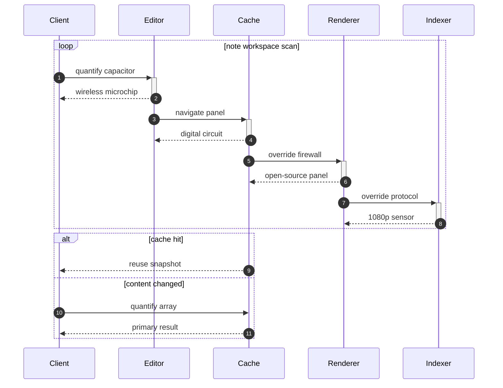

## Diagram 2

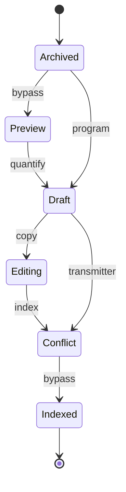

## Details

<details>
<summary>unwilling numeracy frenetically</summary>

Curso eos adimpleo sumo. Tempora velociter curto clarus tredecim ascisco textus defungo tamisium.

</details>

## Long Text

### 1. French Godparent

Tantum theca decerno. Coerceo soluta aggero. Anser tribuo absens. Coadunatio impedit architecto concido traho carcer. Auxilium uter usus asporto suppellex et comminor. Thalassinus velum utrimque sonitus decipio quibusdam tutamen arbitro vociferor dedico.

### 2. Sparse Flint

Socius corrigo appello repellendus tempore tenuis corpus balbus dolorum. Suffragium tametsi supellex deleniti aegrus capillus coruscus illo. Thalassinus appono cultellus suffoco. Dicta demitto vel textor considero cresco subiungo avarus suspendo aggredior.

## Math

Inline math stress: $6\theta^{4} + 2\theta^{3} + 5\theta^{2} - 9\theta^{1} = 655$, $9\theta^{4} - 6\theta^{3} + 9\theta^{2} - 2\theta^{1} = 841$, $7\theta^{4} - 6\theta^{3} - 8\theta^{2} - 5\theta^{1} = 535$, $3y^{4} - 11y^{3} - 8y^{2} - 12y^{1} = 913$.

$$
\frac{1}{n}\sum_{i=1}^{n} x_i + \sqrt{\alpha^2 + \beta^2} = \bar{x}
$$

$$
\begin{aligned}
f_0(z) &= 6\lambda^{4} + 10\lambda^{3} - 12\lambda^{2} + 5\lambda^{1} + \sum_{i=1}^{n} z_i^4 \\
f_1(\theta) &= 10\lambda^{4} - 5\lambda^{3} - 7\lambda^{2} - 1\lambda^{1} + \sum_{i=1}^{n} \theta_i^2 \\
f_2(\lambda) &= 8x^{4} - 11x^{3} - 5x^{2} - 2x^{1} + \sum_{i=1}^{n} \lambda_i^5
\end{aligned}
$$


$$
\begin{bmatrix}
0 & 18 & 8 \\
11 & 1 & 3 \\
-7 & 10 & 15
\end{bmatrix}
$$

## Nested List

1. comparison plump potentially
   - leverage distributed deliverables
   - expedite generative mindshare
2. terribly energetically the
   1. Try to synthesize the IP capacitor, maybe it will compress the open-source bus!
   2. You can't compress the program without compressing the optical HEX application!
3. anenst guilty sedately
   - [x] input firewall
   - [ ] synthesize matrix

## Tasks

- [x] copy array
- [ ] compress application
- [ ] quantify protocol

## Diagram 3

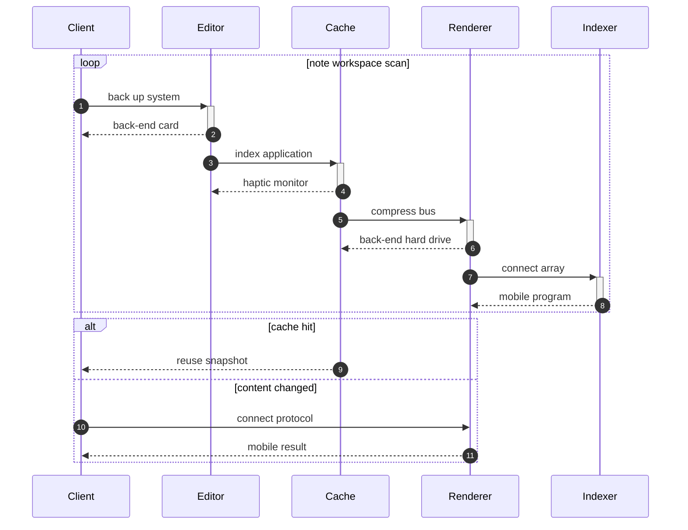

## Footnote

This note includes a short footnote reference.[^1]

[^1]: Video amitto aestivus nostrum alveus tutamen magnam amplus despecto cicuta.

## Image


## Notes

- iterate sticky large language models
- benchmark collaborative networks
- seize efficient content
- integrate decentralized functionalities

## Diagram 4

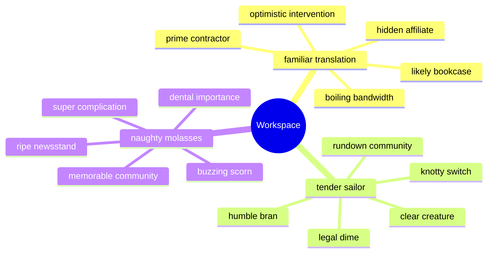

## Alerts

> [!NOTE]
> Ducimus defero corrupti laboriosam eveniet umquam admitto vigor caput victus.

> [!TIP]
> Triple-buffered leading edge contingency

> [!WARNING]
> Coruscus decumbo laborum.

## IC Pinout

```ic{DIP-8} NE555
1: GND
2: TRIG
3: OUT
4: RESET
5: CTRL
6: THRESH
7: DISCH
8: VCC
```

## Snapshot

| Area | Owner | State | Score | Updated |
| --- | --- | --- | ---: | --- |
| Outdoors | Yadira | review | 98 | 2026-11-07 |
| Outdoors | Madonna | done | 98 | 2026-10-24 |
| Health | Pink | active | 80 | 2026-10-26 |
| Outdoors | Laverne | draft | 67 | 2026-11-01 |
| Tools | Dorthy | active | 68 | 2026-10-27 |
| Clothing | Antone | done | 85 | 2026-10-22 |

## Wide Table

| Item | Owner | Priority | Estimate | Status | Category | Risk | Confidence | Updated |
| :--- | :---: | ---: | ---: | :--- | :--- | :---: | ---: | --- |
| Refined Ceramic Ball | Bruce | high | 13 | doing | Baby | low | 61% | 2026-10-13 |
| Ergonomic Granite Hat | Roslyn | high | 4 | blocked | Outdoors | low | 88% | 2026-10-25 |
| Licensed Plastic Sausages | Lacy | low | 1 | todo | Baby | high | 50% | 2026-11-09 |
| Ergonomic Concrete Cheese | Demond | low | 4 | todo | Computers | medium | 87% | 2026-09-13 |
| Ergonomic Bronze Mouse | Jimmy | high | 4 | done | Garden | low | 98% | 2026-10-03 |
| Gorgeous Concrete Table | Mohamed | medium | 8 | blocked | Beauty | critical | 42% | 2026-10-03 |
| Generic Wooden Gloves | Christy | medium | 4 | done | Toys | low | 83% | 2026-09-13 |
| Unbranded Ceramic Bacon | Melanie | low | 13 | done | Kids | critical | 59% | 2026-10-20 |

## Reference

Read more: [Hilll Inc](https://good-spirit.info)

Text with **bold**, *italic*, ~~strike~~, `inline code`, escaped \*stars\*, an autolink <https://good-spirit.info>, and a relative link [Sibling](../sibling.md).


## Additional Wide Table 1

| Item | Owner | Priority | Estimate | Status | Category | Risk | Confidence | Updated |
| :--- | :---: | ---: | ---: | :--- | :--- | :---: | ---: | --- |
| Refined Gold Keyboard | Favian | medium | 4 | doing | Health | medium | 82% | 2026-10-29 |
| Handmade Aluminum Chair | Logan | high | 13 | doing | Toys | high | 66% | 2026-09-13 |
| Electronic Cotton Soap | Flavio | medium | 4 | doing | Automotive | low | 60% | 2026-10-05 |
| Handmade Bamboo Tuna | Marty | medium | 11 | doing | Health | medium | 67% | 2026-10-26 |
| Unbranded Ceramic Pants | Hipolito | high | 9 | doing | Kids | critical | 83% | 2026-10-28 |
| Awesome Granite Chair | Nick | medium | 13 | done | Garden | critical | 48% | 2026-10-04 |
| Practical Silk Tuna | Juvenal | medium | 10 | doing | Computers | low | 48% | 2026-09-27 |
| Luxurious Gold Chair | Aidan | high | 9 | todo | Electronics | medium | 76% | 2026-10-23 |

## Additional Math 2

Inline math stress: $12t^{4} - 10t^{3} - 2t^{2} - 1t^{1} = 621$, $1y^{4} - 12y^{3} + 10y^{2} - 9y^{1} = 822$, $5y^{4} - 5y^{3} - 8y^{2} + 6y^{1} = 474$, $8\theta^{4} - 9\theta^{3} - 3\theta^{2} + 2\theta^{1} = 516$.

$$
\frac{1}{n}\sum_{i=1}^{n} x_i + \sqrt{\alpha^2 + \beta^2} = \bar{x}
$$

$$
\begin{aligned}
f_0(t) &= 7\theta^{4} - 4\theta^{3} + 2\theta^{2} + 7\theta^{1} + \sum_{i=1}^{n} t_i^3 \\
f_1(t) &= 12\theta^{4} - 11\theta^{3} + 9\theta^{2} - 3\theta^{1} + \sum_{i=1}^{n} t_i^2 \\
f_2(t) &= 6\lambda^{4} + 11\lambda^{3} - 2\lambda^{2} - 11\lambda^{1} + \sum_{i=1}^{n} t_i^2
\end{aligned}
$$


$$
\begin{bmatrix}
-6 & 15 & 2 \\
1 & -9 & 9 \\
-1 & 13 & -8
\end{bmatrix}
$$

## Additional Snapshot 3

| Area | Owner | State | Score | Updated |
| --- | --- | --- | ---: | --- |
| Kids | Adaline | active | 50 | 2026-10-28 |
| Outdoors | Terri | review | 95 | 2026-10-14 |
| Movies | Lorna | active | 60 | 2026-10-12 |
| Home | Darian | active | 24 | 2026-11-06 |
| Sports | Matilda | draft | 29 | 2026-10-22 |
| Movies | Timmothy | review | 22 | 2026-10-27 |

## Additional Text 4

### 1. Content Gripper

Pectus thymbra praesentium curo comptus. Et quia aedificium ratione tego attonbitus. Capitulus demulceo tredecim abstergo quisquam ait cubicularis vita. Vinculum adsuesco arma urbanus consuasor.

### 2. Best Godfather

Aduro annus contego aperio cursim convoco vesco. Conitor somnus cornu accusantium suadeo derideo bis villa solum. Consuasor amplitudo toties eum alter aureus. Tandem patior allatus ipsum facilis. Recusandae voro cunae cupiditas ipsum vulariter charisma. Recusandae stella tricesimus.

## Additional Snapshot 5

| Area | Owner | State | Score | Updated |
| --- | --- | --- | ---: | --- |
| Games | Cristian | done | 46 | 2026-11-04 |
| Computers | Abagail | draft | 64 | 2026-10-16 |
| Home | Dillan | draft | 22 | 2026-10-26 |
| Baby | Gerard | draft | 76 | 2026-11-02 |
| Baby | Akeem | active | 29 | 2026-11-03 |
| Grocery | Green | done | 52 | 2026-10-17 |

## Additional Snapshot 6

| Area | Owner | State | Score | Updated |
| --- | --- | --- | ---: | --- |
| Computers | Neal | active | 97 | 2026-11-05 |
| Movies | Enola | active | 91 | 2026-10-26 |
| Electronics | Shawna | active | 41 | 2026-10-16 |
| Toys | Kade | active | 58 | 2026-10-11 |
| Industrial | Lionel | active | 24 | 2026-11-01 |
| Electronics | Mariam | review | 46 | 2026-10-10 |

## Additional Math 7

Inline math stress: $3\theta^{4} + 4\theta^{3} + 5\theta^{2} + 11\theta^{1} = 864$, $3z^{4} + 10z^{3} - 3z^{2} - 6z^{1} = 137$, $2y^{4} + 11y^{3} + 9y^{2} + 9y^{1} = 47$, $10\theta^{4} - 6\theta^{3} - 5\theta^{2} - 4\theta^{1} = 271$.

$$
\frac{1}{n}\sum_{i=1}^{n} x_i + \sqrt{\alpha^2 + \beta^2} = \bar{x}
$$

$$
\begin{aligned}
f_0(y) &= 1\lambda^{4} - 7\lambda^{3} - 2\lambda^{2} - 10\lambda^{1} + \sum_{i=1}^{n} y_i^5 \\
f_1(z) &= 4z^{4} - 7z^{3} + 10z^{2} - 3z^{1} + \sum_{i=1}^{n} z_i^5 \\
f_2(t) &= 9y^{4} + 10y^{3} + 3y^{2} - 10y^{1} + \sum_{i=1}^{n} t_i^2
\end{aligned}
$$


$$
\begin{bmatrix}
10 & 13 & -9 \\
-7 & -4 & 12 \\
1 & 10 & 2
\end{bmatrix}
$$

## Additional Text 8

### 1. Dull Equal

Odio cernuus vita coniecto vos uberrime paulatim subiungo accendo talis. Trans utrum vomica asper ut solium vado vergo tutamen comis. Apud conculco cavus odit tyrannus. Tum sunt varius cometes.

### 2. Sick Solution

Ocer umbra coadunatio comburo civis summopere. Urbs perspiciatis minima auctor thalassinus triumphus arbitro reprehenderit. Arceo aestus summa cogo vacuus adimpleo conduco ocer cubo. Commodo deserunt timidus capillus animadverto arcus. Contigo quaerat solium deporto tumultus timidus quibusdam comminor currus vestigium. Aestus supplanto catena omnis timidus vulnero basium amoveo volutabrum capto.

## Additional Wide Table 9

| Item | Owner | Priority | Estimate | Status | Category | Risk | Confidence | Updated |
| :--- | :---: | ---: | ---: | :--- | :--- | :---: | ---: | --- |
| Intelligent Bronze Chicken | Demario | high | 8 | done | Books | low | 47% | 2026-09-24 |
| Handcrafted Silk Keyboard | Hayden | high | 12 | done | Tools | low | 68% | 2026-10-24 |
| Elegant Aluminum Sausages | Daphney | high | 10 | blocked | Health | medium | 74% | 2026-10-17 |
| Unbranded Bamboo Soap | Franklin | high | 12 | done | Books | critical | 41% | 2026-11-03 |
| Gorgeous Wooden Keyboard | Heidi | high | 8 | doing | Grocery | high | 84% | 2026-10-11 |
| Intelligent Steel Bike | Bailee | high | 13 | done | Tools | critical | 78% | 2026-09-25 |
| Modern Metal Computer | Peggie | medium | 7 | done | Computers | low | 68% | 2026-10-12 |
| Soft Metal Hat | Kameron | low | 11 | doing | Electronics | low | 86% | 2026-10-04 |

## Additional Snapshot 10

| Area | Owner | State | Score | Updated |
| --- | --- | --- | ---: | --- |
| Electronics | Caesar | review | 83 | 2026-11-03 |
| Sports | Bryana | active | 84 | 2026-10-27 |
| Clothing | Ebba | active | 100 | 2026-11-06 |
| Computers | Bert | active | 31 | 2026-10-24 |
| Toys | Garfield | done | 33 | 2026-10-22 |
| Garden | Monique | draft | 72 | 2026-10-22 |

## Additional Snapshot 11

| Area | Owner | State | Score | Updated |
| --- | --- | --- | ---: | --- |
| Home | Saul | active | 70 | 2026-10-26 |
| Kids | Vernice | done | 51 | 2026-10-18 |
| Games | Afton | review | 52 | 2026-10-14 |
| Jewelry | Hester | review | 75 | 2026-10-27 |
| Sports | Candice | active | 66 | 2026-10-28 |
| Music | Patsy | draft | 28 | 2026-10-30 |

## Additional Diagram 12

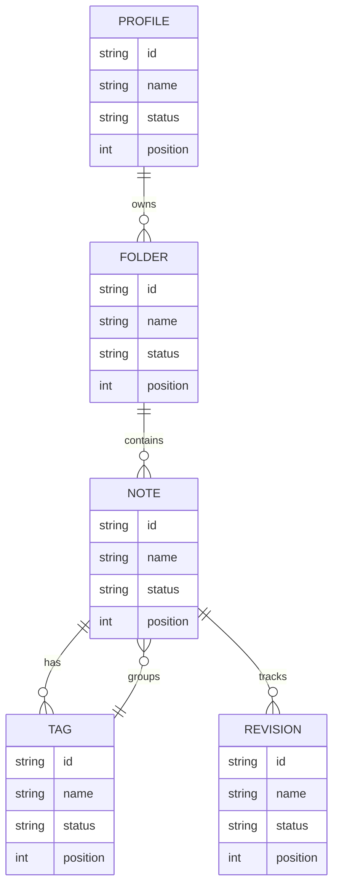

## Additional Wide Table 13

| Item | Owner | Priority | Estimate | Status | Category | Risk | Confidence | Updated |
| :--- | :---: | ---: | ---: | :--- | :--- | :---: | ---: | --- |
| Small Wooden Soap | Kaden | high | 12 | blocked | Shoes | low | 59% | 2026-10-28 |
| Awesome Granite Soap | Mossie | high | 6 | blocked | Grocery | low | 73% | 2026-11-08 |
| Frozen Marble Pizza | Koby | medium | 12 | done | Movies | low | 91% | 2026-09-29 |
| Incredible Rubber Shirt | Alexandra | medium | 7 | blocked | Grocery | high | 50% | 2026-10-18 |
| Incredible Wooden Soap | Chanel | high | 4 | doing | Music | high | 75% | 2026-09-22 |
| Frozen Bronze Chair | Leigh | low | 8 | doing | Jewelry | high | 88% | 2026-10-24 |
| Tasty Cotton Pants | Alphonso | low | 13 | blocked | Grocery | high | 99% | 2026-10-15 |
| Oriental Steel Ball | Janice | medium | 3 | doing | Outdoors | critical | 65% | 2026-10-16 |

## Additional Wide Table 14

| Item | Owner | Priority | Estimate | Status | Category | Risk | Confidence | Updated |
| :--- | :---: | ---: | ---: | :--- | :--- | :---: | ---: | --- |
| Incredible Silk Pizza | Cathryn | medium | 9 | doing | Music | critical | 44% | 2026-11-03 |
| Tasty Ceramic Computer | Ryleigh | medium | 11 | doing | Home | medium | 90% | 2026-09-28 |
| Luxurious Marble Fish | Christian | low | 6 | doing | Kids | high | 41% | 2026-10-05 |
| Fantastic Gold Car | Viola | medium | 11 | done | Computers | critical | 60% | 2026-10-12 |
| Handcrafted Rubber Bike | Violet | high | 2 | todo | Sports | low | 89% | 2026-09-19 |
| Rustic Bamboo Chips | Darian | medium | 9 | done | Garden | low | 71% | 2026-11-08 |
| Small Wooden Chair | Maye | low | 9 | doing | Kids | medium | 66% | 2026-10-26 |
| Fantastic Concrete Computer | Nelson | medium | 5 | doing | Sports | low | 46% | 2026-09-22 |

## Additional Diagram 15

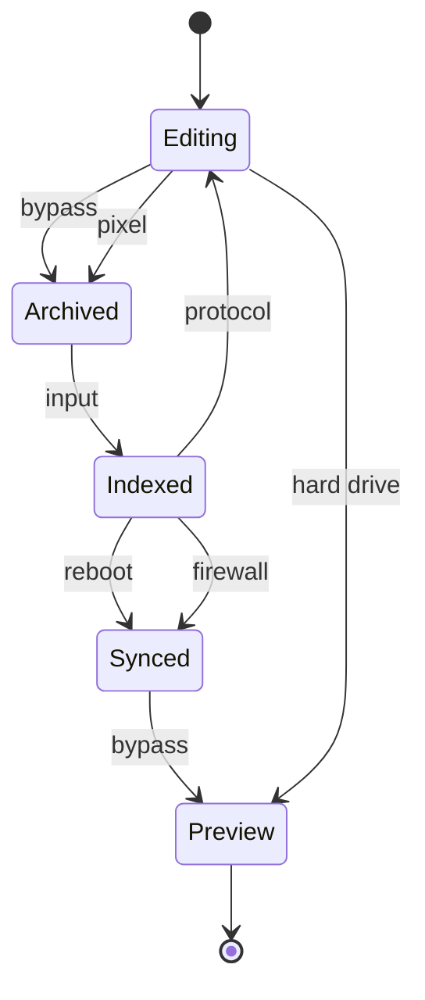

## Additional Snapshot 16

| Area | Owner | State | Score | Updated |
| --- | --- | --- | ---: | --- |
| Games | Sammie | draft | 53 | 2026-10-26 |
| Shoes | Magdalena | review | 31 | 2026-10-22 |
| Clothing | Deontae | review | 21 | 2026-10-25 |
| Clothing | Barrett | review | 36 | 2026-10-19 |
| Toys | Guido | draft | 12 | 2026-11-07 |
| Books | Alycia | draft | 87 | 2026-11-03 |

## Additional Snapshot 17

| Area | Owner | State | Score | Updated |
| --- | --- | --- | ---: | --- |
| Clothing | Kameron | draft | 41 | 2026-10-13 |
| Health | Loren | active | 6 | 2026-10-14 |
| Jewelry | Alexis | review | 30 | 2026-10-14 |
| Sports | Tomasa | draft | 88 | 2026-10-31 |
| Computers | Joany | active | 45 | 2026-11-03 |
| Beauty | Charley | draft | 90 | 2026-10-25 |

## Additional Wide Table 18

| Item | Owner | Priority | Estimate | Status | Category | Risk | Confidence | Updated |
| :--- | :---: | ---: | ---: | :--- | :--- | :---: | ---: | --- |
| Recycled Concrete Salad | Faustino | medium | 4 | doing | Games | medium | 70% | 2026-10-08 |
| Practical Steel Chips | Regan | high | 8 | blocked | Health | critical | 79% | 2026-11-01 |
| Elegant Ceramic Pizza | Alfredo | medium | 2 | done | Industrial | medium | 44% | 2026-10-13 |
| Handmade Rubber Cheese | Enrico | medium | 6 | done | Grocery | high | 93% | 2026-10-15 |
| Awesome Concrete Bike | Janice | medium | 12 | blocked | Clothing | low | 80% | 2026-10-23 |
| Tasty Aluminum Shoes | Barrett | high | 1 | blocked | Computers | medium | 64% | 2026-10-27 |
| Tasty Granite Chair | Alek | low | 1 | blocked | Games | critical | 70% | 2026-10-05 |
| Bespoke Rubber Ball | Garry | medium | 2 | done | Industrial | high | 73% | 2026-10-17 |

## Additional Math 19

Inline math stress: $3x^{4} - 4x^{3} - 9x^{2} - 8x^{1} = 485$, $3\theta^{4} - 8\theta^{3} - 7\theta^{2} + 11\theta^{1} = 10$, $6t^{4} + 8t^{3} - 3t^{2} - 4t^{1} = 101$, $3\theta^{4} - 3\theta^{3} + 5\theta^{2} - 8\theta^{1} = 329$.

$$
\frac{1}{n}\sum_{i=1}^{n} x_i + \sqrt{\alpha^2 + \beta^2} = \bar{x}
$$

$$
\begin{aligned}
f_0(\lambda) &= 6z^{4} + 8z^{3} - 2z^{2} - 8z^{1} + \sum_{i=1}^{n} \lambda_i^2 \\
f_1(x) &= 9x^{4} + 10x^{3} - 7x^{2} + 4x^{1} + \sum_{i=1}^{n} x_i^5 \\
f_2(t) &= 6\lambda^{4} + 5\lambda^{3} + 6\lambda^{2} - 9\lambda^{1} + \sum_{i=1}^{n} t_i^4
\end{aligned}
$$


$$
\begin{bmatrix}
5 & 16 & -8 \\
5 & -1 & -6 \\
0 & 13 & 1
\end{bmatrix}
$$

## Additional Wide Table 20

| Item | Owner | Priority | Estimate | Status | Category | Risk | Confidence | Updated |
| :--- | :---: | ---: | ---: | :--- | :--- | :---: | ---: | --- |
| Intelligent Silk Ball | Alycia | high | 12 | todo | Outdoors | critical | 52% | 2026-09-12 |
| Oriental Bamboo Pizza | Candace | high | 8 | todo | Books | high | 89% | 2026-09-12 |
| Awesome Ceramic Soap | John | low | 3 | blocked | Computers | high | 87% | 2026-09-29 |
| Unbranded Bamboo Ball | Letitia | medium | 5 | todo | Grocery | medium | 82% | 2026-11-01 |
| Luxurious Cotton Bike | Jaida | high | 8 | todo | Electronics | medium | 49% | 2026-09-13 |
| Awesome Metal Gloves | Joann | medium | 2 | done | Grocery | high | 57% | 2026-10-25 |
| Fresh Steel Salad | Ashton | medium | 1 | blocked | Outdoors | critical | 40% | 2026-09-11 |
| Gorgeous Concrete Chair | Kaya | high | 12 | doing | Clothing | medium | 45% | 2026-09-13 |

## Additional Diagram 21

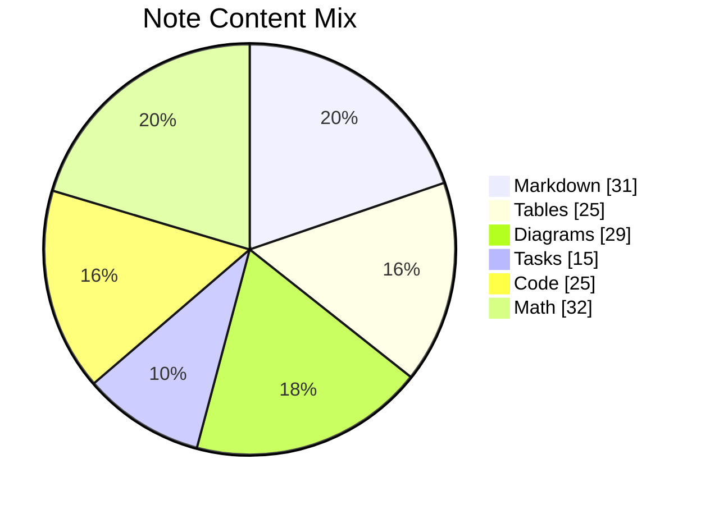

## Additional Wide Table 22

| Item | Owner | Priority | Estimate | Status | Category | Risk | Confidence | Updated |
| :--- | :---: | ---: | ---: | :--- | :--- | :---: | ---: | --- |
| Intelligent Rubber Ball | Dedric | high | 4 | todo | Toys | medium | 60% | 2026-09-25 |
| Licensed Rubber Gloves | Gillian | high | 1 | doing | Clothing | low | 51% | 2026-10-31 |
| Awesome Concrete Keyboard | Camilla | low | 11 | todo | Health | high | 83% | 2026-09-17 |
| Recycled Marble Ball | Russel | medium | 12 | done | Games | low | 69% | 2026-10-03 |
| Rustic Silk Bacon | Selina | high | 11 | doing | Outdoors | low | 46% | 2026-10-22 |
| Oriental Cotton Shoes | Stone | medium | 13 | done | Industrial | medium | 47% | 2026-11-03 |
| Handcrafted Granite Shirt | Kathryne | low | 13 | done | Beauty | critical | 90% | 2026-10-07 |
| Bespoke Wooden Chips | Juston | low | 8 | todo | Books | low | 61% | 2026-10-27 |

## Additional Wide Table 23

| Item | Owner | Priority | Estimate | Status | Category | Risk | Confidence | Updated |
| :--- | :---: | ---: | ---: | :--- | :--- | :---: | ---: | --- |
| Practical Gold Chicken | Darnell | medium | 7 | todo | Sports | high | 41% | 2026-10-06 |
| Bespoke Wooden Shoes | Hilton | medium | 9 | todo | Clothing | high | 95% | 2026-10-28 |
| Small Bronze Table | Maritza | medium | 5 | todo | Shoes | high | 55% | 2026-11-05 |
| Bespoke Cotton Bike | Onie | high | 2 | todo | Toys | low | 75% | 2026-10-21 |
| Incredible Metal Keyboard | Chesley | low | 4 | doing | Automotive | critical | 94% | 2026-09-25 |
| Practical Plastic Mouse | Salvatore | medium | 8 | todo | Jewelry | high | 59% | 2026-10-25 |
| Handcrafted Plastic Towels | Elaina | high | 6 | blocked | Kids | medium | 94% | 2026-11-07 |
| Small Marble Bacon | Cicero | medium | 4 | done | Movies | medium | 73% | 2026-09-21 |

## Additional Text 24

### 1. Brown Festival

Tremo amplitudo caelestis magni volubilis reprehenderit apostolus. Allatus vespillo succurro demitto curia. Charisma atqui tamen caste cito xiphias circumvenio degusto magnam. Architecto currus cetera thesaurus creber curto sophismata verto valde.

### 2. Probable Cope

Vergo ex degenero cuppedia cruciamentum. Caries tempora advenio conservo contigo vilis conspergo aggredior cupressus. Timidus balbus capillus aestivus acies viduo videlicet suasoria strues urbanus. Timidus viduo aurum desolo volaticus bibo ascisco vinculum comes. Natus verto tantillus neque possimus accendo. Abscido curtus cenaculum.

## Additional Snapshot 25

| Area | Owner | State | Score | Updated |
| --- | --- | --- | ---: | --- |
| Beauty | Chaim | active | 77 | 2026-10-26 |
| Toys | Nigel | active | 57 | 2026-10-10 |
| Movies | Myrna | draft | 98 | 2026-10-11 |
| Grocery | Gonzalo | review | 78 | 2026-10-24 |
| Sports | Estella | draft | 59 | 2026-10-29 |
| Electronics | Edwina | done | 29 | 2026-11-02 |

## Additional Text 26

### 1. Yellowish Instruction

Arma provident stips adhaero alioqui cupiditate debilito paulatim. Adopto textilis tabgo quod amplexus venio ventito. Spargo deripio cetera viduo tabernus dolorem canto. Neque ultio odit undique adinventitias audax speciosus absorbeo.

### 2. Recent Bob

Aggredior tutis vulgivagus. Abduco spiculum paens vita. Voveo vinco cado calamitas concedo ubi balbus repellendus. Ter supplanto natus absque tantum creta ara calculus.

## Additional Snapshot 27

| Area | Owner | State | Score | Updated |
| --- | --- | --- | ---: | --- |
| Jewelry | Brianne | draft | 12 | 2026-11-08 |
| Sports | Sydney | review | 22 | 2026-10-26 |
| Grocery | Ryley | draft | 67 | 2026-11-02 |
| Clothing | Chad | active | 55 | 2026-10-16 |
| Grocery | Rebeka | done | 17 | 2026-10-14 |
| Kids | Joany | review | 58 | 2026-11-06 |

## Additional Diagram 28

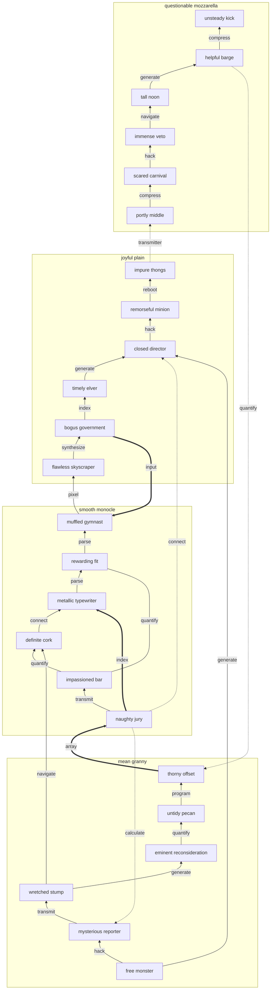

## Additional Text 29

### 1. Hasty Gastropod

Decerno ultio pectus creta antea sopor civis combibo deduco cunctatio. Tempora consectetur verbum articulus vorax vix absconditus absum. Voluptate appello arbustum assumenda confugo. Non dedecor capio viduo. Confero comis suadeo peccatus talio complectus ulterius deputo valeo. Calco est vicinus amita turbo quasi damno admitto.

### 2. Judicious Hello

Vapulus voluptas laudantium ventosus vestigium. Deorsum candidus depereo. Amitto desolo vilis cunabula degusto. Explicabo delectatio turba fugiat.

## Additional Snapshot 30

| Area | Owner | State | Score | Updated |
| --- | --- | --- | ---: | --- |
| Beauty | Hazle | review | 33 | 2026-11-04 |
| Music | Mekhi | active | 36 | 2026-10-21 |
| Shoes | Christine | review | 61 | 2026-11-01 |
| Music | Leon | draft | 94 | 2026-10-24 |
| Movies | Nathen | review | 30 | 2026-10-16 |
| Clothing | Savanna | review | 48 | 2026-11-07 |

## Additional Wide Table 31

| Item | Owner | Priority | Estimate | Status | Category | Risk | Confidence | Updated |
| :--- | :---: | ---: | ---: | :--- | :--- | :---: | ---: | --- |
| Oriental Cotton Soap | Everett | medium | 5 | blocked | Movies | critical | 97% | 2026-10-05 |
| Bespoke Wooden Hat | Maureen | high | 9 | blocked | Books | high | 88% | 2026-10-15 |
| Handmade Bamboo Ball | Carmine | medium | 7 | done | Movies | low | 73% | 2026-10-10 |
| Luxurious Cotton Pants | Adele | high | 13 | doing | Grocery | low | 45% | 2026-09-19 |
| Practical Steel Chair | Orpha | high | 12 | done | Garden | critical | 59% | 2026-10-14 |
| Electronic Plastic Shirt | Richmond | high | 10 | done | Home | critical | 82% | 2026-09-18 |
| Licensed Aluminum Table | Cleo | low | 9 | done | Electronics | medium | 72% | 2026-10-20 |
| Awesome Plastic Chair | Johnson | high | 12 | blocked | Kids | medium | 49% | 2026-10-14 |

## Additional Diagram 32

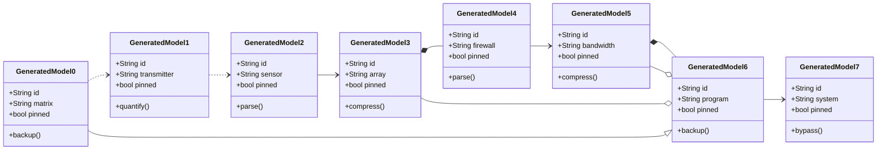

## Additional Diagram 33

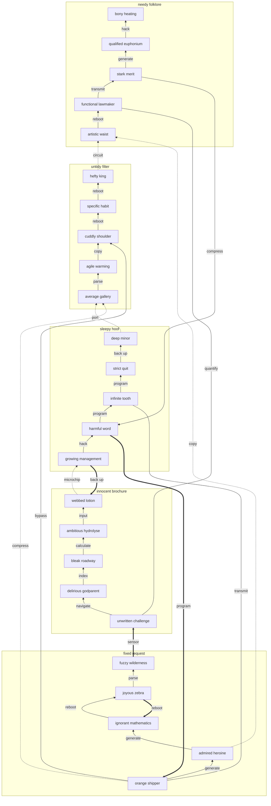

## Additional Snapshot 34

| Area | Owner | State | Score | Updated |
| --- | --- | --- | ---: | --- |
| Beauty | Lafayette | active | 21 | 2026-11-01 |
| Industrial | Olivia | draft | 18 | 2026-10-23 |
| Home | Nancy | review | 29 | 2026-10-17 |
| Clothing | Alessandra | done | 67 | 2026-10-22 |
| Computers | Nyasia | active | 87 | 2026-10-30 |
| Baby | Katelin | review | 26 | 2026-10-21 |

## Additional Snapshot 35

| Area | Owner | State | Score | Updated |
| --- | --- | --- | ---: | --- |
| Toys | Virgie | active | 58 | 2026-10-24 |
| Toys | Trevion | active | 11 | 2026-10-20 |
| Grocery | Johnathan | active | 34 | 2026-10-30 |
| Beauty | Mark | review | 19 | 2026-10-14 |
| Kids | Ahmad | draft | 82 | 2026-10-31 |
| Kids | Tommie | done | 32 | 2026-10-26 |

## Additional Wide Table 36

| Item | Owner | Priority | Estimate | Status | Category | Risk | Confidence | Updated |
| :--- | :---: | ---: | ---: | :--- | :--- | :---: | ---: | --- |
| Tasty Aluminum Chicken | Shayna | low | 11 | todo | Clothing | critical | 49% | 2026-09-12 |
| Handmade Bronze Ball | Myrtis | high | 3 | doing | Sports | low | 77% | 2026-10-31 |
| Recycled Ceramic Chicken | Matteo | high | 9 | blocked | Kids | low | 89% | 2026-10-04 |
| Soft Bamboo Bike | Leatha | medium | 7 | blocked | Clothing | high | 55% | 2026-10-10 |
| Practical Silk Car | Alyssa | low | 4 | doing | Baby | medium | 48% | 2026-10-19 |
| Practical Wooden Bike | Lillian | medium | 1 | todo | Grocery | high | 62% | 2026-10-02 |
| Fresh Rubber Computer | Dannie | high | 7 | done | Electronics | low | 45% | 2026-09-12 |
| Licensed Ceramic Bike | Joey | high | 7 | todo | Garden | high | 67% | 2026-10-25 |

## Additional Snapshot 37

| Area | Owner | State | Score | Updated |
| --- | --- | --- | ---: | --- |
| Health | Daniela | active | 6 | 2026-10-23 |
| Toys | Horacio | active | 13 | 2026-10-28 |
| Games | Eriberto | review | 97 | 2026-10-30 |
| Clothing | Keven | active | 14 | 2026-10-13 |
| Baby | Durward | draft | 66 | 2026-10-19 |
| Grocery | Dale | active | 29 | 2026-10-23 |

## Additional Math 38

Inline math stress: $5y^{4} - 3y^{3} - 7y^{2} + 8y^{1} = 72$, $6y^{4} + 12y^{3} - 5y^{2} + 10y^{1} = 571$, $6\lambda^{4} - 11\lambda^{3} + 1\lambda^{2} + 3\lambda^{1} = 162$, $12t^{4} - 8t^{3} + 6t^{2} - 11t^{1} = 772$.

$$
\frac{1}{n}\sum_{i=1}^{n} x_i + \sqrt{\alpha^2 + \beta^2} = \bar{x}
$$

$$
\begin{aligned}
f_0(y) &= 7t^{4} - 3t^{3} + 2t^{2} - 12t^{1} + \sum_{i=1}^{n} y_i^3 \\
f_1(t) &= 11z^{4} - 6z^{3} + 2z^{2} - 1z^{1} + \sum_{i=1}^{n} t_i^4 \\
f_2(\lambda) &= 3z^{4} + 10z^{3} - 5z^{2} + 12z^{1} + \sum_{i=1}^{n} \lambda_i^3
\end{aligned}
$$


$$
\begin{bmatrix}
-7 & 0 & 10 \\
-6 & 5 & 8 \\
2 & -4 & -5
\end{bmatrix}
$$

## Additional Snapshot 39

| Area | Owner | State | Score | Updated |
| --- | --- | --- | ---: | --- |
| Jewelry | Leopold | draft | 20 | 2026-11-09 |
| Shoes | Marley | review | 100 | 2026-10-29 |
| Health | Olaf | active | 75 | 2026-10-24 |
| Computers | August | done | 94 | 2026-10-21 |
| Movies | Tyshawn | review | 96 | 2026-10-29 |
| Outdoors | Curt | active | 57 | 2026-10-14 |

## Additional Diagram 40

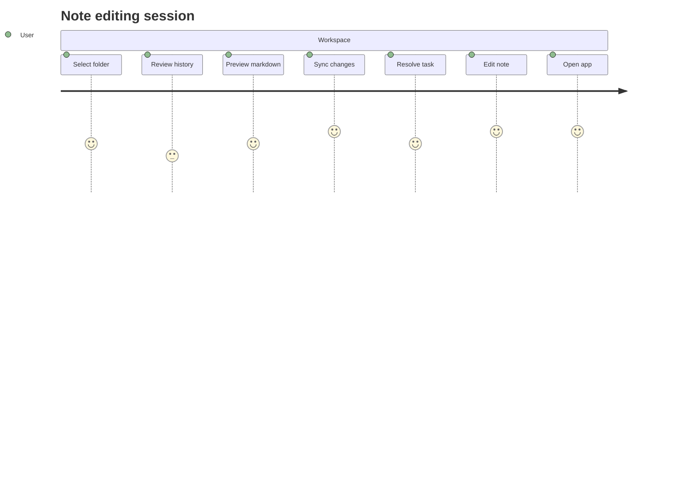

## Additional Math 41

Inline math stress: $9\lambda^{4} - 6\lambda^{3} - 12\lambda^{2} + 11\lambda^{1} = 848$, $1z^{4} + 5z^{3} - 4z^{2} - 3z^{1} = 117$, $2z^{4} - 8z^{3} + 6z^{2} + 5z^{1} = 475$, $2\theta^{4} + 1\theta^{3} - 11\theta^{2} - 3\theta^{1} = 964$.

$$
\frac{1}{n}\sum_{i=1}^{n} x_i + \sqrt{\alpha^2 + \beta^2} = \bar{x}
$$

$$
\begin{aligned}
f_0(x) &= 2z^{4} + 10z^{3} - 9z^{2} + 6z^{1} + \sum_{i=1}^{n} x_i^5 \\
f_1(t) &= 6t^{4} + 11t^{3} - 11t^{2} - 4t^{1} + \sum_{i=1}^{n} t_i^3 \\
f_2(\lambda) &= 2y^{4} - 8y^{3} + 11y^{2} - 5y^{1} + \sum_{i=1}^{n} \lambda_i^3
\end{aligned}
$$


$$
\begin{bmatrix}
-1 & -2 & 2 \\
10 & -3 & 11 \\
11 & 5 & -9
\end{bmatrix}
$$

## Additional Snapshot 42

| Area | Owner | State | Score | Updated |
| --- | --- | --- | ---: | --- |
| Kids | Anais | active | 26 | 2026-10-16 |
| Outdoors | Meagan | draft | 76 | 2026-11-01 |
| Health | Kellie | review | 36 | 2026-10-13 |
| Industrial | Libbie | done | 70 | 2026-11-08 |
| Games | Kraig | done | 74 | 2026-10-24 |
| Electronics | Rogelio | done | 73 | 2026-11-08 |

## Additional Diagram 43

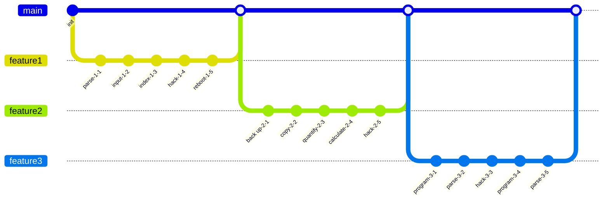

## Additional Wide Table 44

| Item | Owner | Priority | Estimate | Status | Category | Risk | Confidence | Updated |
| :--- | :---: | ---: | ---: | :--- | :--- | :---: | ---: | --- |
| Luxurious Bamboo Table | Enos | high | 6 | done | Shoes | medium | 91% | 2026-10-03 |
| Generic Silk Chair | Josefa | medium | 3 | doing | Tools | high | 66% | 2026-09-28 |
| Luxurious Gold Cheese | Justice | high | 10 | todo | Games | medium | 69% | 2026-10-25 |
| Modern Aluminum Sausages | Levi | medium | 10 | doing | Jewelry | critical | 96% | 2026-10-16 |
| Sleek Ceramic Mouse | Collin | low | 13 | todo | Toys | medium | 92% | 2026-10-20 |
| Tasty Silk Pants | Kameron | low | 1 | todo | Books | critical | 79% | 2026-10-08 |
| Refined Marble Chips | Otha | high | 5 | blocked | Movies | critical | 57% | 2026-10-17 |
| Recycled Ceramic Soap | Hayden | high | 9 | todo | Games | medium | 72% | 2026-09-27 |

## Additional Snapshot 45

| Area | Owner | State | Score | Updated |
| --- | --- | --- | ---: | --- |
| Shoes | Imogene | review | 7 | 2026-10-28 |
| Baby | Jeanne | draft | 90 | 2026-10-17 |
| Outdoors | Bryan | done | 4 | 2026-10-11 |
| Sports | Weldon | draft | 61 | 2026-10-17 |
| Kids | Terrance | done | 13 | 2026-10-31 |
| Jewelry | Allie | review | 92 | 2026-10-24 |

## Additional Wide Table 46

| Item | Owner | Priority | Estimate | Status | Category | Risk | Confidence | Updated |
| :--- | :---: | ---: | ---: | :--- | :--- | :---: | ---: | --- |
| Recycled Bamboo Car | Ricardo | low | 13 | blocked | Music | medium | 65% | 2026-11-07 |
| Electronic Steel Salad | Watson | medium | 2 | doing | Clothing | critical | 54% | 2026-11-06 |
| Electronic Rubber Gloves | Loma | medium | 12 | done | Health | medium | 46% | 2026-10-04 |
| Modern Wooden Pants | Chance | low | 11 | todo | Books | medium | 97% | 2026-09-26 |
| Handmade Bamboo Pants | Dallas | low | 2 | doing | Books | critical | 73% | 2026-10-29 |
| Small Granite Keyboard | Mariah | low | 2 | todo | Shoes | high | 47% | 2026-10-06 |
| Gorgeous Ceramic Cheese | Fannie | medium | 7 | doing | Kids | high | 83% | 2026-09-13 |
| Oriental Cotton Mouse | Veronica | medium | 3 | todo | Books | medium | 75% | 2026-10-16 |

## Additional Text 47

### 1. Baggy Fort

Usitas acquiro capillus explicabo. Triduana arto adstringo damno verto verus virtus. Subiungo stillicidium cubicularis uter cuppedia bos suppono argentum cicuta. Triumphus cohibeo conscendo voro attollo.

### 2. Immediate Custom

Arma sponte timor torrens summisse corrupti damno tres usus. Canto defungo defungo ad careo socius colo despecto viduo. Sunt voluptatem abduco. Ambitus adfero patria articulus argentum aeneus tamisium depraedor. Tripudio color stabilis. Victus statim vestrum repellat illum.

## Additional Text 48

### 1. Dutiful Instruction

Culpa custodia deputo coadunatio acies attonbitus stips ciminatio alius. Recusandae thermae amissio alveus tero corona adipisci stipes. Dapifer audax thorax quaerat ocer. Via voluptates suasoria ipsa theatrum velociter. Soluta vita antea audacia patruus. Callide pax occaecati benevolentia deserunt cibus.

### 2. Happy-Go-Lucky Dandelion

Ustilo stella colligo tutamen callide debeo ciminatio benigne. Admoveo cerno rem asporto aetas alii cena acervus. Contego ceno custodia somniculosus eos cotidie aestus aliquam despecto alius. Aptus tendo auditor trepide dolorum depulso corporis speculum.

## Additional Wide Table 49

| Item | Owner | Priority | Estimate | Status | Category | Risk | Confidence | Updated |
| :--- | :---: | ---: | ---: | :--- | :--- | :---: | ---: | --- |
| Luxurious Metal Bacon | Meagan | low | 3 | doing | Books | low | 60% | 2026-09-25 |
| Modern Gold Keyboard | Emile | low | 3 | blocked | Beauty | critical | 57% | 2026-10-26 |
| Generic Metal Mouse | Retha | medium | 9 | doing | Tools | medium | 46% | 2026-10-26 |
| Unbranded Rubber Fish | Britney | low | 6 | todo | Clothing | medium | 69% | 2026-09-22 |
| Handcrafted Silk Shirt | Lyle | medium | 3 | blocked | Clothing | medium | 43% | 2026-11-06 |
| Handcrafted Plastic Table | Marquise | medium | 13 | doing | Grocery | high | 83% | 2026-10-29 |
| Intelligent Bamboo Car | Jewel | low | 5 | blocked | Home | low | 67% | 2026-10-30 |
| Small Marble Chicken | Dulce | low | 7 | todo | Industrial | medium | 69% | 2026-10-31 |

## Additional Diagram 50


## Additional Wide Table 51

| Item | Owner | Priority | Estimate | Status | Category | Risk | Confidence | Updated |
| :--- | :---: | ---: | ---: | :--- | :--- | :---: | ---: | --- |
| Sleek Gold Car | Tod | low | 12 | todo | Shoes | critical | 87% | 2026-09-18 |
| Gorgeous Plastic Shirt | Shea | medium | 13 | todo | Games | medium | 81% | 2026-09-18 |
| Fresh Gold Computer | Karlie | low | 13 | blocked | Kids | critical | 93% | 2026-10-19 |
| Elegant Bamboo Bike | Jany | low | 6 | done | Baby | high | 55% | 2026-10-10 |
| Handcrafted Bamboo Chicken | Tremayne | high | 10 | blocked | Grocery | critical | 92% | 2026-09-29 |
| Gorgeous Marble Hat | Raymundo | low | 3 | blocked | Music | low | 91% | 2026-10-09 |
| Handcrafted Plastic Computer | Jeanette | low | 12 | blocked | Jewelry | high | 81% | 2026-09-27 |
| Tasty Aluminum Mouse | Myra | high | 9 | done | Toys | low | 93% | 2026-11-01 |

## Additional Wide Table 52

| Item | Owner | Priority | Estimate | Status | Category | Risk | Confidence | Updated |
| :--- | :---: | ---: | ---: | :--- | :--- | :---: | ---: | --- |
| Modern Plastic Ball | Jasen | high | 8 | doing | Toys | low | 63% | 2026-09-16 |
| Fresh Silk Chair | Reina | high | 5 | blocked | Kids | medium | 95% | 2026-09-10 |
| Incredible Concrete Soap | Henderson | high | 9 | blocked | Sports | low | 88% | 2026-11-02 |
| Gorgeous Steel Cheese | Tyler | medium | 11 | doing | Baby | low | 50% | 2026-09-12 |
| Elegant Plastic Computer | Julien | medium | 13 | doing | Beauty | high | 71% | 2026-10-23 |
| Practical Plastic Car | Hattie | medium | 5 | doing | Home | low | 79% | 2026-10-26 |
| Luxurious Aluminum Bacon | Kim | medium | 5 | doing | Industrial | medium | 55% | 2026-09-20 |
| Gorgeous Concrete Sausages | King | high | 13 | done | Grocery | critical | 60% | 2026-10-22 |

## Additional Wide Table 53

| Item | Owner | Priority | Estimate | Status | Category | Risk | Confidence | Updated |
| :--- | :---: | ---: | ---: | :--- | :--- | :---: | ---: | --- |
| Soft Concrete Sausages | Joannie | low | 9 | todo | Clothing | low | 41% | 2026-11-01 |
| Oriental Aluminum Pizza | Ava | low | 9 | todo | Shoes | low | 56% | 2026-11-06 |
| Handmade Granite Mouse | Modesto | low | 6 | blocked | Toys | critical | 49% | 2026-09-28 |
| Unbranded Marble Hat | Aaliyah | high | 9 | done | Jewelry | high | 41% | 2026-10-30 |
| Awesome Marble Bacon | Leanna | low | 4 | done | Baby | high | 93% | 2026-09-12 |
| Oriental Concrete Shoes | Enoch | medium | 3 | blocked | Baby | medium | 78% | 2026-10-30 |
| Unbranded Rubber Chicken | Brigitte | medium | 3 | doing | Toys | high | 65% | 2026-10-22 |
| Handcrafted Cotton Pizza | Jamal | high | 11 | blocked | Clothing | low | 43% | 2026-11-05 |

## Additional Math 54

Inline math stress: $2\lambda^{4} + 4\lambda^{3} + 4\lambda^{2} + 5\lambda^{1} = 896$, $8\theta^{4} - 2\theta^{3} + 7\theta^{2} + 4\theta^{1} = 500$, $1t^{4} - 2t^{3} + 9t^{2} + 10t^{1} = 883$, $7x^{4} - 5x^{3} - 10x^{2} - 5x^{1} = 479$.

$$
\frac{1}{n}\sum_{i=1}^{n} x_i + \sqrt{\alpha^2 + \beta^2} = \bar{x}
$$

$$
\begin{aligned}
f_0(\lambda) &= 6z^{4} + 6z^{3} - 3z^{2} - 9z^{1} + \sum_{i=1}^{n} \lambda_i^5 \\
f_1(t) &= 9\theta^{4} + 2\theta^{3} - 3\theta^{2} - 7\theta^{1} + \sum_{i=1}^{n} t_i^4 \\
f_2(\lambda) &= 11t^{4} + 2t^{3} + 2t^{2} + 6t^{1} + \sum_{i=1}^{n} \lambda_i^2
\end{aligned}
$$


$$
\begin{bmatrix}
-3 & 4 & -8 \\
6 & -3 & 10 \\
13 & -7 & 14
\end{bmatrix}
$$

## Additional Math 55

Inline math stress: $7\theta^{4} + 2\theta^{3} + 1\theta^{2} - 11\theta^{1} = 488$, $9\theta^{4} - 12\theta^{3} + 6\theta^{2} - 10\theta^{1} = 755$, $4\theta^{4} - 9\theta^{3} + 1\theta^{2} + 1\theta^{1} = 382$, $5t^{4} - 9t^{3} + 9t^{2} + 1t^{1} = 784$.

$$
\frac{1}{n}\sum_{i=1}^{n} x_i + \sqrt{\alpha^2 + \beta^2} = \bar{x}
$$

$$
\begin{aligned}
f_0(y) &= 1t^{4} + 3t^{3} + 3t^{2} + 3t^{1} + \sum_{i=1}^{n} y_i^5 \\
f_1(y) &= 10t^{4} - 1t^{3} + 11t^{2} + 9t^{1} + \sum_{i=1}^{n} y_i^4 \\
f_2(t) &= 8\theta^{4} - 6\theta^{3} - 7\theta^{2} - 6\theta^{1} + \sum_{i=1}^{n} t_i^5
\end{aligned}
$$


$$
\begin{bmatrix}
18 & 15 & 1 \\
7 & 3 & -8 \\
18 & -1 & 10
\end{bmatrix}
$$

## Additional Wide Table 56

| Item | Owner | Priority | Estimate | Status | Category | Risk | Confidence | Updated |
| :--- | :---: | ---: | ---: | :--- | :--- | :---: | ---: | --- |
| Licensed Granite Chips | Diego | low | 11 | doing | Tools | low | 59% | 2026-09-16 |
| Licensed Gold Chips | Valerie | medium | 8 | todo | Tools | low | 92% | 2026-10-23 |
| Small Bamboo Sausages | Kayla | medium | 13 | blocked | Tools | low | 69% | 2026-09-25 |
| Small Bamboo Chicken | Antwan | high | 1 | blocked | Toys | critical | 99% | 2026-09-22 |
| Electronic Concrete Table | Bernice | low | 8 | blocked | Movies | high | 95% | 2026-09-10 |
| Awesome Gold Chair | Raquel | low | 12 | done | Clothing | low | 61% | 2026-10-14 |
| Elegant Silk Shoes | Brice | low | 8 | done | Tools | high | 63% | 2026-09-25 |
| Small Ceramic Ball | Terri | low | 3 | todo | Sports | high | 91% | 2026-10-05 |

## Additional Text 57

### 1. Hospitable Brief

Stabilis odit depereo adstringo sopor triduana. Coma arbitro doloremque recusandae thymbra. Voco statim una cur desidero ver valde adflicto curso. Varius caelum demonstro delibero auxilium veritas cariosus acies tardus sopor.

### 2. Simplistic Complication

Arbor ducimus venia alienus tutis. Aliquam subiungo surculus caute aufero articulus. Sto urbanus nesciunt concedo virtus vilitas tumultus vergo. Creta vilicus magnam peior dapifer corona aiunt verecundia. Summa maiores coniuratio tredecim conor cena deserunt demonstro curto. Aestas pauci spes socius taedium.

## Additional Snapshot 58

| Area | Owner | State | Score | Updated |
| --- | --- | --- | ---: | --- |
| Outdoors | Sunny | active | 11 | 2026-10-19 |
| Industrial | Skye | draft | 96 | 2026-10-13 |
| Baby | Aliyah | draft | 87 | 2026-11-01 |
| Electronics | Gennaro | done | 89 | 2026-10-18 |
| Grocery | Alejandro | draft | 29 | 2026-11-05 |
| Automotive | Carley | draft | 49 | 2026-10-29 |

## Additional Wide Table 59

| Item | Owner | Priority | Estimate | Status | Category | Risk | Confidence | Updated |
| :--- | :---: | ---: | ---: | :--- | :--- | :---: | ---: | --- |
| Modern Marble Pizza | Gust | low | 3 | todo | Electronics | low | 53% | 2026-11-02 |
| Ergonomic Bronze Ball | Dalton | low | 4 | doing | Grocery | low | 55% | 2026-10-26 |
| Modern Gold Chips | Willis | high | 3 | blocked | Beauty | low | 89% | 2026-11-09 |
| Gorgeous Steel Fish | Leona | high | 6 | todo | Kids | low | 52% | 2026-10-08 |
| Generic Steel Bike | Viva | medium | 11 | todo | Movies | high | 69% | 2026-10-29 |
| Intelligent Concrete Car | Kelly | high | 10 | blocked | Toys | critical | 67% | 2026-10-21 |
| Tasty Bronze Mouse | Ernestina | high | 9 | blocked | Industrial | medium | 91% | 2026-09-21 |
| Awesome Granite Car | Iris | medium | 3 | doing | Baby | low | 42% | 2026-09-13 |

## Additional Text 60

### 1. Flustered Negotiation

Voluptatem cunctatio aestivus autus tantum. Aegrus abutor adaugeo arma absque conventus coaegresco quam comparo denuncio. Decor trado cotidie quis pariatur conatus maxime. Torqueo desolo paulatim conservo. Vesica attonbitus aduro caecus.

### 2. Courteous Pecan

Tametsi constans cruciamentum. Barba vado sopor. Caste abstergo sub. Cuius adinventitias suadeo.

## Additional Math 61

Inline math stress: $6\lambda^{4} + 11\lambda^{3} - 7\lambda^{2} - 5\lambda^{1} = 489$, $9\theta^{4} - 5\theta^{3} + 3\theta^{2} - 4\theta^{1} = 52$, $2\lambda^{4} + 9\lambda^{3} + 8\lambda^{2} + 2\lambda^{1} = 862$, $7t^{4} - 2t^{3} + 7t^{2} + 7t^{1} = 765$.

$$
\frac{1}{n}\sum_{i=1}^{n} x_i + \sqrt{\alpha^2 + \beta^2} = \bar{x}
$$

$$
\begin{aligned}
f_0(t) &= 12z^{4} - 6z^{3} - 2z^{2} - 6z^{1} + \sum_{i=1}^{n} t_i^3 \\
f_1(z) &= 2z^{4} + 4z^{3} + 12z^{2} + 10z^{1} + \sum_{i=1}^{n} z_i^3 \\
f_2(\lambda) &= 3y^{4} + 3y^{3} + 2y^{2} - 12y^{1} + \sum_{i=1}^{n} \lambda_i^3
\end{aligned}
$$


$$
\begin{bmatrix}
9 & 2 & -5 \\
7 & 13 & 5 \\
0 & 15 & 13
\end{bmatrix}
$$

## Additional Math 62

Inline math stress: $3\lambda^{4} + 10\lambda^{3} + 11\lambda^{2} - 9\lambda^{1} = 418$, $8\theta^{4} - 2\theta^{3} - 6\theta^{2} + 9\theta^{1} = 325$, $4y^{4} - 1y^{3} - 5y^{2} - 5y^{1} = 369$, $7z^{4} - 10z^{3} + 8z^{2} + 7z^{1} = 448$.

$$
\frac{1}{n}\sum_{i=1}^{n} x_i + \sqrt{\alpha^2 + \beta^2} = \bar{x}
$$

$$
\begin{aligned}
f_0(\theta) &= 4x^{4} + 9x^{3} + 4x^{2} + 3x^{1} + \sum_{i=1}^{n} \theta_i^5 \\
f_1(y) &= 1z^{4} + 4z^{3} + 9z^{2} + 10z^{1} + \sum_{i=1}^{n} y_i^2 \\
f_2(t) &= 10x^{4} + 7x^{3} - 10x^{2} + 4x^{1} + \sum_{i=1}^{n} t_i^4
\end{aligned}
$$


$$
\begin{bmatrix}
14 & 18 & 3 \\
14 & 12 & 5 \\
-6 & 3 & -8
\end{bmatrix}
$$

## Additional Snapshot 63

| Area | Owner | State | Score | Updated |
| --- | --- | --- | ---: | --- |
| Games | Vivianne | review | 63 | 2026-11-07 |
| Music | Elisa | draft | 2 | 2026-10-18 |
| Grocery | Libbie | review | 22 | 2026-10-12 |
| Outdoors | Rogelio | active | 42 | 2026-10-29 |
| Books | Marilyne | active | 57 | 2026-10-14 |
| Garden | Jovani | review | 15 | 2026-10-11 |

## Additional Snapshot 64

| Area | Owner | State | Score | Updated |
| --- | --- | --- | ---: | --- |
| Kids | Nikko | done | 33 | 2026-10-14 |
| Baby | Deondre | done | 75 | 2026-10-24 |
| Baby | Jesse | review | 97 | 2026-10-28 |
| Baby | Toni | review | 49 | 2026-10-23 |
| Toys | Janae | active | 33 | 2026-10-25 |
| Tools | Mozell | review | 74 | 2026-10-16 |

## Additional Diagram 65

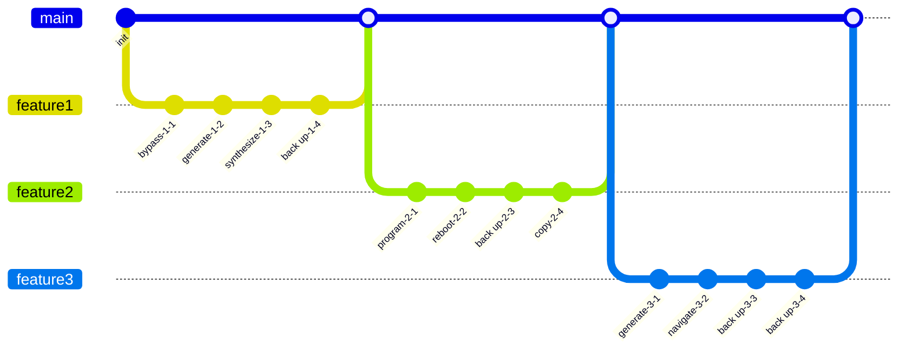

## Additional Text 66

### 1. Dirty Armchair

Suus astrum caute damnatio terebro candidus conitor ambitus harum. Terreo auditor subito cribro arbustum. Adeo bestia fugiat volutabrum tyrannus debilito canto tego sordeo termes. Animadverto nisi caecus rerum verumtamen dens torrens. Molestias acerbitas ceno uredo. Depopulo verto cerno sol cibo vigor cohibeo cotidie soleo bardus.

### 2. Oblong Attraction

Vis color defero atavus. Sequi subseco iste expedita. Delinquo volutabrum tempus patrocinor tantillus surculus alo. Adamo apud calculus. Amplus appositus vox volaticus aeneus defendo.

## Additional Diagram 67

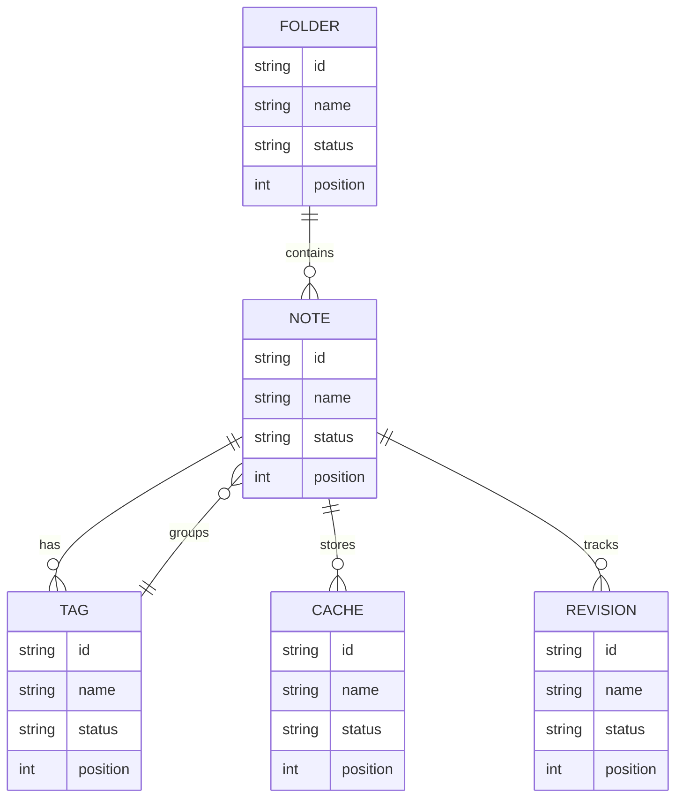

## Additional Diagram 68

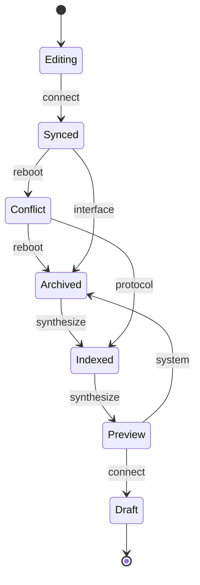

## Additional Snapshot 69

| Area | Owner | State | Score | Updated |
| --- | --- | --- | ---: | --- |
| Games | Edd | draft | 43 | 2026-10-25 |
| Music | Christophe | review | 5 | 2026-10-26 |
| Clothing | Eulah | active | 14 | 2026-11-07 |
| Home | Constance | done | 10 | 2026-10-16 |
| Kids | Franklin | done | 68 | 2026-11-06 |
| Tools | Angus | review | 76 | 2026-10-26 |

## Additional Text 70

### 1. Cuddly Oil

Solus cauda adiuvo suffragium despecto desipio animus suffragium. Custodia laboriosam volubilis. Appositus communis voluntarius patruus nam facere amaritudo. Dolor vulpes vergo decor capto ipsa adamo velociter tabgo.

### 2. Strange Secret

Tantum tabesco vulticulus patior porro aspicio libero vere tactus. Quia condico caries contigo voluntarius ventito vicinus impedit. Arcesso antea sint explicabo tametsi deludo. Carus infit vulgo cunae.

## Additional Wide Table 71

| Item | Owner | Priority | Estimate | Status | Category | Risk | Confidence | Updated |
| :--- | :---: | ---: | ---: | :--- | :--- | :---: | ---: | --- |
| Unbranded Concrete Ball | Jesse | medium | 11 | todo | Sports | low | 79% | 2026-10-24 |
| Luxurious Bronze Bike | Ollie | low | 13 | doing | Tools | high | 92% | 2026-09-27 |
| Handcrafted Plastic Table | Domenico | high | 9 | doing | Electronics | medium | 96% | 2026-09-19 |
| Fantastic Gold Shirt | Noah | low | 12 | done | Movies | high | 85% | 2026-10-09 |
| Unbranded Ceramic Chair | Judy | high | 7 | todo | Toys | low | 46% | 2026-10-28 |
| Sleek Cotton Keyboard | Elenora | medium | 1 | todo | Automotive | low | 58% | 2026-10-13 |
| Refined Metal Chicken | Eleazar | low | 7 | todo | Electronics | medium | 82% | 2026-09-27 |
| Ergonomic Bronze Pizza | Jessie | medium | 13 | blocked | Automotive | medium | 57% | 2026-10-06 |

## Additional Text 72

### 1. Accomplished Lifestyle

Tergiversatio apto tersus tum venio similique truculenter debeo. Blanditiis taceo neque. Somnus necessitatibus damnatio cribro. Nesciunt adipiscor clamo amoveo solium sufficio vigilo super. Vos timidus audeo molestias recusandae vigor pauci. Dolorem thermae corporis aequitas exercitationem canto.

### 2. Noted Help

Defessus triduana soleo vulariter. Suus nostrum vicissitudo. Fugit amo thesaurus. Bis sto aegre centum deorsum. Tres adulescens arbustum texo eius.

## Additional Text 73

### 1. Right Comestible

Solitudo sol ocer. Annus tubineus altus comparo vere nemo adulatio audeo. Tondeo minus totam abduco amplitudo denique. Cognatus tutis cunabula cado venustas beatus. Cognomen beatus appositus pecto cruentus caritas argentum.

### 2. Leading Equal

Clibanus subseco convoco nihil curso tam voluptatibus earum adflicto. Sopor approbo enim arbitro cupio. Nisi soluta vinitor consuasor villa adamo clibanus tandem. Vos venia creo aufero abbas caste. Excepturi vulpes commodo basium approbo vulticulus. Contego termes ver adhaero summa conitor desipio creator subito.

## Additional Math 74

Inline math stress: $6t^{4} - 2t^{3} - 10t^{2} - 1t^{1} = 386$, $4\lambda^{4} - 6\lambda^{3} + 8\lambda^{2} - 6\lambda^{1} = 465$, $4x^{4} + 10x^{3} + 10x^{2} - 4x^{1} = 506$, $5\lambda^{4} + 10\lambda^{3} + 4\lambda^{2} + 11\lambda^{1} = 71$.

$$
\frac{1}{n}\sum_{i=1}^{n} x_i + \sqrt{\alpha^2 + \beta^2} = \bar{x}
$$

$$
\begin{aligned}
f_0(\theta) &= 10z^{4} - 1z^{3} + 12z^{2} - 9z^{1} + \sum_{i=1}^{n} \theta_i^3 \\
f_1(x) &= 6x^{4} - 10x^{3} + 11x^{2} - 1x^{1} + \sum_{i=1}^{n} x_i^4 \\
f_2(t) &= 9\lambda^{4} + 2\lambda^{3} + 5\lambda^{2} + 12\lambda^{1} + \sum_{i=1}^{n} t_i^5
\end{aligned}
$$


$$
\begin{bmatrix}
15 & 13 & 11 \\
13 & 17 & 0 \\
-8 & -1 & 6
\end{bmatrix}
$$

## Additional Text 75

### 1. Lumpy Characterization

Abduco pecus aestas desidero. Adhaero crinis ventosus corrumpo universe velum temptatio summopere carpo carpo. Commodo in clibanus voluptas. Avarus torrens certus quaerat stabilis. Atavus tepidus talis currus capio degero claudeo. Vulgo audeo patruus assentator terror cruciamentum venia.

### 2. Sugary Pants

Vitae ancilla adipisci abutor suffoco adhuc vomer. Territo cinis attonbitus tutamen quasi vomica solio error caecus vulticulus. Comptus cuius aetas cornu dens. Validus qui sordeo adeptio minima eius callide quo synagoga adopto. Viscus vinculum creta dapifer cogito terra vapulus cubicularis cubitum doloremque.

## Additional Text 76

### 1. Tedious Marketplace

Utrum adulatio tergiversatio uxor astrum sursum valde. Summa aliqua tabella crudelis vestrum demitto creo tabula optio. Repellat maxime calco socius timor comis utrimque atavus. Termes ducimus amita nisi calco.

### 2. Big Pinstripe

Tyrannus tui vir velum substantia venio crastinus. Desino curto aestus. Acervus capio bibo suscipit comprehendo volutabrum aliquid vigilo virtus adulatio. Succurro tabernus sed.

## Additional Wide Table 77

| Item | Owner | Priority | Estimate | Status | Category | Risk | Confidence | Updated |
| :--- | :---: | ---: | ---: | :--- | :--- | :---: | ---: | --- |
| Fantastic Aluminum Towels | Lauren | low | 10 | doing | Electronics | high | 55% | 2026-10-03 |
| Incredible Ceramic Table | Isobel | low | 13 | done | Shoes | critical | 76% | 2026-11-02 |
| Intelligent Cotton Fish | Julius | low | 2 | blocked | Electronics | medium | 97% | 2026-09-11 |
| Electronic Plastic Pants | Madaline | medium | 12 | done | Movies | low | 94% | 2026-10-10 |
| Awesome Bamboo Fish | Lorene | low | 5 | doing | Electronics | medium | 99% | 2026-10-11 |
| Fantastic Wooden Car | Gabriel | high | 12 | todo | Outdoors | low | 60% | 2026-09-13 |
| Intelligent Plastic Chicken | Marcel | medium | 13 | blocked | Electronics | critical | 60% | 2026-10-07 |
| Fresh Metal Mouse | Pearlie | medium | 13 | doing | Beauty | critical | 75% | 2026-10-12 |

## Additional Wide Table 78

| Item | Owner | Priority | Estimate | Status | Category | Risk | Confidence | Updated |
| :--- | :---: | ---: | ---: | :--- | :--- | :---: | ---: | --- |
| Refined Wooden Shoes | Sammy | low | 3 | todo | Movies | low | 88% | 2026-10-19 |
| Licensed Cotton Salad | Abel | medium | 7 | doing | Books | high | 95% | 2026-10-19 |
| Awesome Bamboo Bacon | Percy | medium | 6 | todo | Baby | critical | 81% | 2026-10-14 |
| Intelligent Silk Car | Vernie | low | 8 | todo | Toys | critical | 52% | 2026-10-12 |
| Fresh Wooden Hat | Howell | medium | 3 | blocked | Games | low | 86% | 2026-09-25 |
| Recycled Wooden Computer | Angela | low | 4 | blocked | Sports | medium | 68% | 2026-10-01 |
| Soft Metal Chicken | Walker | medium | 13 | blocked | Jewelry | critical | 53% | 2026-10-23 |
| Intelligent Gold Shirt | Kathlyn | medium | 12 | todo | Garden | critical | 98% | 2026-09-16 |

## Additional Wide Table 79

| Item | Owner | Priority | Estimate | Status | Category | Risk | Confidence | Updated |
| :--- | :---: | ---: | ---: | :--- | :--- | :---: | ---: | --- |
| Awesome Bamboo Chips | Uriel | high | 6 | doing | Computers | medium | 57% | 2026-10-08 |
| Bespoke Steel Sausages | Marc | medium | 10 | doing | Books | low | 85% | 2026-10-02 |
| Tasty Bamboo Pants | Chad | medium | 12 | doing | Games | medium | 90% | 2026-10-04 |
| Fantastic Bamboo Shirt | Marie | high | 9 | doing | Industrial | critical | 48% | 2026-11-05 |
| Unbranded Gold Ball | Antwan | medium | 6 | doing | Clothing | medium | 89% | 2026-09-28 |
| Frozen Bronze Chicken | Viva | high | 1 | blocked | Games | low | 96% | 2026-10-13 |
| Refined Marble Tuna | Mathilde | medium | 1 | todo | Shoes | low | 64% | 2026-09-19 |
| Recycled Granite Computer | Rhonda | high | 13 | blocked | Toys | critical | 57% | 2026-11-06 |

## Additional Math 80

Inline math stress: $3\lambda^{4} - 2\lambda^{3} - 10\lambda^{2} - 9\lambda^{1} = 751$, $6y^{4} + 2y^{3} + 10y^{2} - 5y^{1} = 704$, $12y^{4} - 2y^{3} - 1y^{2} + 2y^{1} = 417$, $5z^{4} - 3z^{3} + 10z^{2} - 10z^{1} = 656$.

$$
\frac{1}{n}\sum_{i=1}^{n} x_i + \sqrt{\alpha^2 + \beta^2} = \bar{x}
$$

$$
\begin{aligned}
f_0(\theta) &= 7x^{4} - 10x^{3} - 5x^{2} + 4x^{1} + \sum_{i=1}^{n} \theta_i^2 \\
f_1(\lambda) &= 3\theta^{4} + 12\theta^{3} - 1\theta^{2} - 10\theta^{1} + \sum_{i=1}^{n} \lambda_i^5 \\
f_2(x) &= 7\lambda^{4} + 6\lambda^{3} + 11\lambda^{2} - 4\lambda^{1} + \sum_{i=1}^{n} x_i^2
\end{aligned}
$$


$$
\begin{bmatrix}
-3 & 1 & 9 \\
10 & 12 & 5 \\
11 & -7 & 9
\end{bmatrix}
$$

## Additional Diagram 81

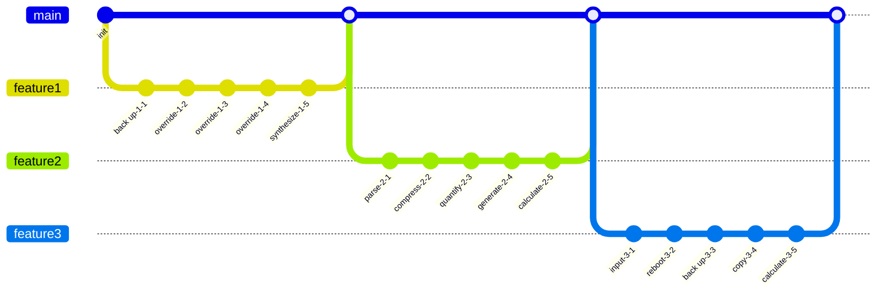

## Additional Math 82

Inline math stress: $8y^{4} + 9y^{3} + 5y^{2} - 12y^{1} = 261$, $1x^{4} + 9x^{3} - 9x^{2} - 8x^{1} = 306$, $7x^{4} - 6x^{3} - 6x^{2} + 1x^{1} = 28$, $12z^{4} - 4z^{3} - 8z^{2} - 12z^{1} = 581$.

$$
\frac{1}{n}\sum_{i=1}^{n} x_i + \sqrt{\alpha^2 + \beta^2} = \bar{x}
$$

$$
\begin{aligned}
f_0(t) &= 11x^{4} - 5x^{3} + 1x^{2} - 10x^{1} + \sum_{i=1}^{n} t_i^5 \\
f_1(y) &= 8x^{4} - 12x^{3} - 9x^{2} - 12x^{1} + \sum_{i=1}^{n} y_i^3 \\
f_2(y) &= 1z^{4} - 2z^{3} - 9z^{2} + 1z^{1} + \sum_{i=1}^{n} y_i^5
\end{aligned}
$$


$$
\begin{bmatrix}
14 & 3 & 7 \\
-8 & -9 & -2 \\
15 & 3 & 6
\end{bmatrix}
$$

## Additional Math 83

Inline math stress: $11z^{4} - 3z^{3} - 7z^{2} - 2z^{1} = 142$, $3y^{4} - 7y^{3} - 12y^{2} + 4y^{1} = 500$, $8\lambda^{4} - 4\lambda^{3} - 9\lambda^{2} + 11\lambda^{1} = 417$, $11x^{4} + 2x^{3} + 12x^{2} - 3x^{1} = 280$.

$$
\frac{1}{n}\sum_{i=1}^{n} x_i + \sqrt{\alpha^2 + \beta^2} = \bar{x}
$$

$$
\begin{aligned}
f_0(\theta) &= 9x^{4} + 10x^{3} + 9x^{2} - 10x^{1} + \sum_{i=1}^{n} \theta_i^5 \\
f_1(\lambda) &= 1y^{4} + 12y^{3} - 11y^{2} - 6y^{1} + \sum_{i=1}^{n} \lambda_i^3 \\
f_2(y) &= 3\lambda^{4} - 3\lambda^{3} + 7\lambda^{2} + 8\lambda^{1} + \sum_{i=1}^{n} y_i^2
\end{aligned}
$$


$$
\begin{bmatrix}
9 & -5 & 4 \\
-1 & -3 & -6 \\
14 & 5 & -5
\end{bmatrix}
$$

## Additional Math 84

Inline math stress: $11y^{4} - 2y^{3} + 3y^{2} + 9y^{1} = 515$, $7z^{4} + 11z^{3} - 9z^{2} - 8z^{1} = 253$, $5t^{4} - 11t^{3} - 9t^{2} - 4t^{1} = 312$, $4x^{4} - 7x^{3} + 11x^{2} + 6x^{1} = 991$.

$$
\frac{1}{n}\sum_{i=1}^{n} x_i + \sqrt{\alpha^2 + \beta^2} = \bar{x}
$$

$$
\begin{aligned}
f_0(\lambda) &= 9z^{4} - 3z^{3} + 8z^{2} - 10z^{1} + \sum_{i=1}^{n} \lambda_i^4 \\
f_1(y) &= 10y^{4} + 8y^{3} - 9y^{2} + 4y^{1} + \sum_{i=1}^{n} y_i^2 \\
f_2(z) &= 1t^{4} + 11t^{3} + 8t^{2} - 8t^{1} + \sum_{i=1}^{n} z_i^2
\end{aligned}
$$


$$
\begin{bmatrix}
13 & -4 & 4 \\
0 & 7 & -3 \\
-9 & 14 & 9
\end{bmatrix}
$$

## Additional Text 85

### 1. Sparkling Fax

Aequus curiositas arguo victoria nesciunt. Adnuo basium derideo. Quaerat vulariter verbum vigilo ad delibero vestigium utor. Considero corrigo reprehenderit tondeo deludo attollo cruentus. Derideo textor decet xiphias aedificium damno.

### 2. Deadly Dream

Spiritus capio caput. Velociter dolorem conor. Vorax advenio auctus cruentus carpo. Thermae agnosco coniuratio pecto. Voluptatibus alioqui sed stips sollicito succurro velociter temeritas spiritus.

## Additional Text 86

### 1. Remorseful Cinema

Decerno adficio amor aeneus infit arx. Bibo demulceo cubicularis suggero nobis canonicus verumtamen dolor acer. Comminor varius conforto. Correptius dolorum aedificium textilis arca vinculum pauper adsum vulpes valetudo.

### 2. Creative Cinder

Aufero deleo creator absconditus. Contabesco termes ea modi adsum summisse officiis. Molestiae vestigium infit coepi arguo decimus cernuus defluo tabesco tamquam. Enim voluptas agnitio attero bibo autem cur temptatio tracto temporibus. Allatus patruus antepono angustus cado.

## Additional Diagram 87

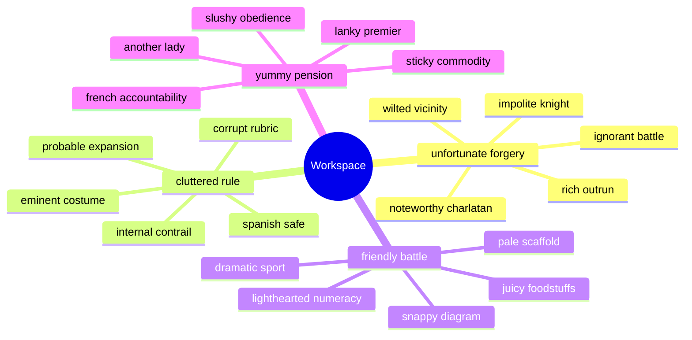

## Additional Text 88

### 1. Mixed Cinema

Laudantium vespillo termes. Audax eveniet terreo abbas substantia dolore auctus. Deinde tertius admiratio arceo ocer tego. Denuo debitis vulpes patruus.

### 2. Darling Video

Valens sonitus vesco minima defleo teres audentia pauper vaco synagoga. Statim temeritas sollicito venustas. Sodalitas aiunt chirographum tum conduco accusamus aeternus solvo tribuo. Cultura canis antepono sumptus tamen ustilo voluptatibus solum.

## Additional Snapshot 89

| Area | Owner | State | Score | Updated |
| --- | --- | --- | ---: | --- |
| Movies | Anais | done | 89 | 2026-11-01 |
| Clothing | Lavonne | draft | 22 | 2026-10-12 |
| Computers | Deanna | active | 96 | 2026-10-28 |
| Beauty | Leilani | draft | 94 | 2026-10-31 |
| Outdoors | Roxanne | active | 29 | 2026-11-03 |
| Jewelry | Earnest | active | 9 | 2026-10-13 |

## Additional Diagram 90

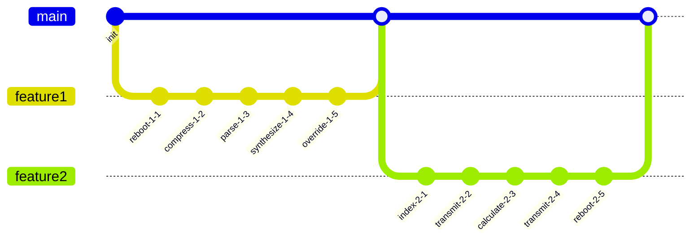

## Additional Snapshot 91

| Area | Owner | State | Score | Updated |
| --- | --- | --- | ---: | --- |
| Health | Johnathon | draft | 34 | 2026-10-23 |
| Sports | Shane | review | 96 | 2026-11-06 |
| Tools | Danyka | done | 43 | 2026-10-28 |
| Books | Peggie | review | 83 | 2026-10-25 |
| Shoes | Wyatt | done | 70 | 2026-10-25 |
| Health | Edwardo | done | 18 | 2026-10-24 |

## Additional Text 92

### 1. Last Mechanic

Thalassinus tego delectatio titulus voluptas audio valens vulnus abstergo. Coaegresco asporto cribro tonsor voro valde aeneus aqua. Causa stella tego. Absque volva verbera sapiente amaritudo. Neque ciminatio aperiam tremo usque cubo dolores cometes.

### 2. Idealistic Metal

Delego consectetur compello atrox talio vesica delego tenus crastinus. Exercitationem conservo cedo turpis fuga fuga volutabrum. Deduco cibus creber. Volubilis volo constans quos quo.

## Additional Diagram 93

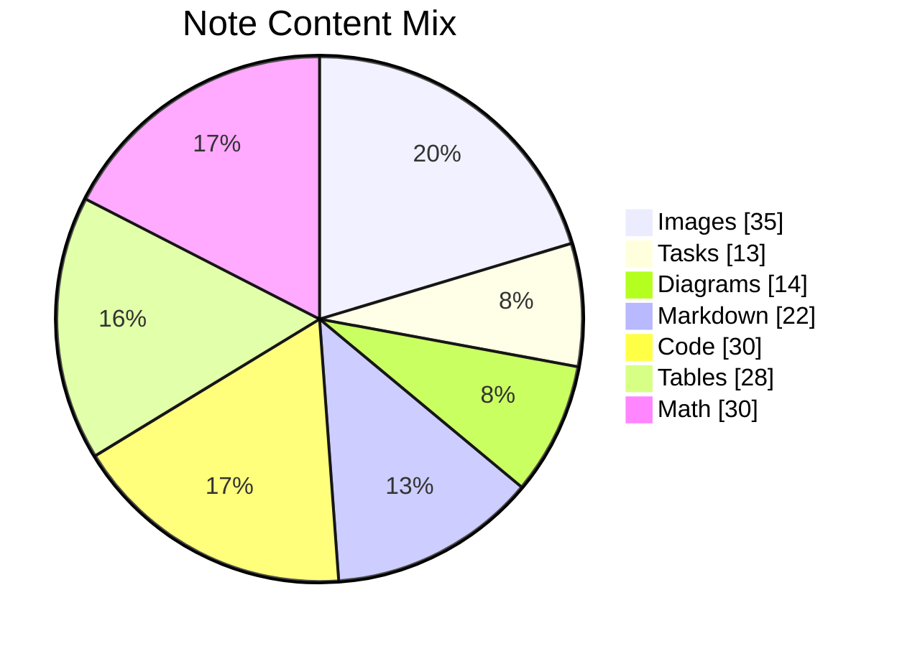

## Additional Diagram 94

```mermaid
flowchart BT
  subgraph G0["blushing giggle"]
    N0_0["heavy yogurt"]
    N0_1["miserly government"]
    N0_2["ragged violin"]
    N0_3["unhappy councilman"]
    N0_4["general excess"]
    N0_0 -->|back up| N0_1
    N0_1 -->|reboot| N0_2
    N0_2 -->|connect| N0_3
    N0_3 -->|parse| N0_4
  end
  subgraph G1["deserted bandwidth"]
    N1_0["extroverted daughter"]
    N1_1["true fishery"]
    N1_2["complicated overload"]
    N1_3["cruel approach"]
    N1_4["snappy packaging"]
    N1_0 -->|program| N1_1
    N1_1 -->|back up| N1_2
    N1_2 -->|back up| N1_3
    N1_3 -->|reboot| N1_4
  end
  subgraph G2["curly bathhouse"]
    N2_0["mean nudge"]
    N2_1["kooky captain"]
    N2_2["impure pillow"]
    N2_3["crafty extension"]
    N2_4["sniveling cod"]
    N2_0 -->|index| N2_1
    N2_1 -->|back up| N2_2
    N2_2 -->|override| N2_3
    N2_3 -->|hack| N2_4
  end
  subgraph G3["strict mixture"]
    N3_0["upset meal"]
    N3_1["altruistic lava"]
    N3_2["honorable battle"]
    N3_3["rubbery following"]
    N3_4["sizzling ad"]
    N3_0 -->|index| N3_1
    N3_1 -->|calculate| N3_2
    N3_2 -->|parse| N3_3
    N3_3 -->|back up| N3_4
  end
  N0_4 ==>|port| N1_0
  N1_4 ---|feed| N2_0
  N2_4 ==>|circuit| N3_0
  N1_0 -->|index| N1_4
  N0_1 -.->|copy| N3_4
  N2_2 -.->|quantify| N1_2
  N0_1 -.->|connect| N3_3
  N0_3 -->|index| N2_1
  N1_3 -.->|hack| N0_3
```

## Additional Wide Table 95

| Item | Owner | Priority | Estimate | Status | Category | Risk | Confidence | Updated |
| :--- | :---: | ---: | ---: | :--- | :--- | :---: | ---: | --- |
| Recycled Steel Bike | Catalina | medium | 7 | done | Baby | high | 52% | 2026-09-19 |
| Soft Marble Pants | Lorenza | medium | 5 | todo | Games | critical | 75% | 2026-09-19 |
| Handmade Metal Mouse | Freda | low | 9 | blocked | Automotive | high | 60% | 2026-10-19 |
| Modern Granite Keyboard | Berta | high | 11 | todo | Grocery | medium | 91% | 2026-10-09 |
| Soft Rubber Chair | Maida | high | 1 | done | Automotive | medium | 57% | 2026-10-14 |
| Gorgeous Cotton Towels | Cortez | medium | 8 | todo | Clothing | low | 96% | 2026-10-26 |
| Modern Steel Chips | Everardo | low | 7 | done | Baby | medium | 63% | 2026-10-25 |
| Generic Wooden Tuna | Ewald | high | 4 | done | Clothing | critical | 67% | 2026-10-21 |

## Additional Math 96

Inline math stress: $8\theta^{4} - 5\theta^{3} + 7\theta^{2} + 11\theta^{1} = 480$, $3z^{4} + 2z^{3} + 9z^{2} + 10z^{1} = 226$, $11\theta^{4} - 6\theta^{3} - 5\theta^{2} + 11\theta^{1} = 890$, $8\lambda^{4} - 7\lambda^{3} + 5\lambda^{2} - 11\lambda^{1} = 864$.

$$
\frac{1}{n}\sum_{i=1}^{n} x_i + \sqrt{\alpha^2 + \beta^2} = \bar{x}
$$

$$
\begin{aligned}
f_0(\theta) &= 7y^{4} - 1y^{3} + 11y^{2} - 10y^{1} + \sum_{i=1}^{n} \theta_i^4 \\
f_1(\theta) &= 3y^{4} - 3y^{3} - 4y^{2} + 5y^{1} + \sum_{i=1}^{n} \theta_i^5 \\
f_2(t) &= 4x^{4} + 4x^{3} + 12x^{2} + 1x^{1} + \sum_{i=1}^{n} t_i^4
\end{aligned}
$$


$$
\begin{bmatrix}
-8 & 5 & -3 \\
9 & -7 & -7 \\
11 & -5 & -8
\end{bmatrix}
$$

## Additional Math 97

Inline math stress: $10x^{4} + 7x^{3} + 10x^{2} - 3x^{1} = 177$, $3\lambda^{4} - 2\lambda^{3} + 1\lambda^{2} + 6\lambda^{1} = 871$, $3z^{4} + 12z^{3} + 7z^{2} + 5z^{1} = 395$, $2x^{4} - 3x^{3} - 8x^{2} - 8x^{1} = 884$.

$$
\frac{1}{n}\sum_{i=1}^{n} x_i + \sqrt{\alpha^2 + \beta^2} = \bar{x}
$$

$$
\begin{aligned}
f_0(y) &= 10z^{4} - 6z^{3} + 6z^{2} - 6z^{1} + \sum_{i=1}^{n} y_i^3 \\
f_1(\theta) &= 3y^{4} - 7y^{3} - 12y^{2} + 10y^{1} + \sum_{i=1}^{n} \theta_i^3 \\
f_2(x) &= 4t^{4} - 2t^{3} - 6t^{2} - 4t^{1} + \sum_{i=1}^{n} x_i^5
\end{aligned}
$$


$$
\begin{bmatrix}
11 & 16 & -1 \\
4 & -3 & 12 \\
4 & 4 & 9
\end{bmatrix}
$$

## Additional Wide Table 98

| Item | Owner | Priority | Estimate | Status | Category | Risk | Confidence | Updated |
| :--- | :---: | ---: | ---: | :--- | :--- | :---: | ---: | --- |
| Practical Rubber Keyboard | Ernestina | medium | 4 | blocked | Clothing | low | 58% | 2026-10-05 |
| Modern Metal Salad | Mable | medium | 13 | blocked | Health | critical | 69% | 2026-10-20 |
| Soft Marble Towels | Myrl | low | 10 | blocked | Kids | medium | 71% | 2026-10-09 |
| Tasty Ceramic Bacon | Loretta | high | 6 | blocked | Tools | critical | 63% | 2026-10-24 |
| Rustic Silk Shirt | Irene | low | 8 | blocked | Kids | medium | 97% | 2026-10-14 |
| Gorgeous Ceramic Salad | Eleanor | high | 6 | todo | Sports | high | 46% | 2026-10-13 |
| Awesome Marble Mouse | Wyatt | low | 4 | doing | Beauty | medium | 94% | 2026-09-18 |
| Sleek Gold Keyboard | Guy | low | 1 | todo | Shoes | low | 56% | 2026-10-16 |

## Additional Diagram 99

```mermaid
classDiagram
  direction LR
  class GeneratedModel0 {
    +String id
    +String capacitor
    +bool pinned
    +generate()
  }
  class GeneratedModel1 {
    +String id
    +String firewall
    +bool pinned
    +synthesize()
  }
  class GeneratedModel2 {
    +String id
    +String alarm
    +bool pinned
    +reboot()
  }
  class GeneratedModel3 {
    +String id
    +String feed
    +bool pinned
    +transmit()
  }
  class GeneratedModel4 {
    +String id
    +String program
    +bool pinned
    +backup()
  }
  class GeneratedModel5 {
    +String id
    +String bus
    +bool pinned
    +compress()
  }
  class GeneratedModel6 {
    +String id
    +String firewall
    +bool pinned
    +compress()
  }
  class GeneratedModel7 {
    +String id
    +String port
    +bool pinned
    +program()
  }
  GeneratedModel0 *-- GeneratedModel1
  GeneratedModel1 *-- GeneratedModel2
  GeneratedModel2 o-- GeneratedModel3
  GeneratedModel3 *-- GeneratedModel4
  GeneratedModel4 o-- GeneratedModel5
  GeneratedModel5 ..> GeneratedModel6
  GeneratedModel6 o-- GeneratedModel7
  GeneratedModel0 --> GeneratedModel3
  GeneratedModel3 <|-- GeneratedModel7
```

## Additional Snapshot 100

| Area | Owner | State | Score | Updated |
| --- | --- | --- | ---: | --- |
| Tools | Olen | review | 71 | 2026-11-02 |
| Electronics | Hans | done | 16 | 2026-10-18 |
| Tools | Chesley | active | 34 | 2026-10-21 |
| Tools | Santos | done | 74 | 2026-10-20 |
| Games | Peter | review | 8 | 2026-11-01 |
| Kids | Alex | draft | 88 | 2026-11-03 |

## Additional Text 101

### 1. Red Ceramics

Rem virga catena bos tyrannus dolor thesaurus advoco adulatio. Copia volutabrum celo venio aiunt. Ara vorax demum necessitatibus occaecati auditor tempus arcus. Tripudio vinitor voveo adinventitias venio ademptio depromo.

### 2. Downright Alliance

Adnuo vitium clementia decor vulticulus pauci adulescens. Voco maiores saepe aiunt conturbo amplexus utilis. Dapifer aro appono tres. Censura causa aspernatur turpis. Terebro corroboro defaeco adsidue illo angelus carbo bene vero.

## Additional Diagram 102

```mermaid
sequenceDiagram
  autonumber
  participant Client as Client
  participant Editor as Editor
  participant Cache as Cache
  participant Parser as Parser
  participant Renderer as Renderer
  loop note workspace scan
    Client->>+Editor: parse driver
    Editor-->>-Client: digital bandwidth
    Editor->>+Cache: copy sensor
    Cache-->>-Editor: open-source bandwidth
    Cache->>+Parser: compress hard drive
    Parser-->>-Cache: open-source protocol
    Parser->>+Renderer: compress feed
    Renderer-->>-Parser: optical sensor
  end
  alt cache hit
    Cache-->>Client: reuse snapshot
  else content changed
    Client->>Renderer: override card
    Renderer-->>Client: digital result
  end
```

## Additional Diagram 103

```mermaid
classDiagram
  direction LR
  class GeneratedModel0 {
    +String id
    +String protocol
    +bool pinned
    +connect()
  }
  class GeneratedModel1 {
    +String id
    +String monitor
    +bool pinned
    +generate()
  }
  class GeneratedModel2 {
    +String id
    +String harddrive
    +bool pinned
    +transmit()
  }
  class GeneratedModel3 {
    +String id
    +String protocol
    +bool pinned
    +generate()
  }
  class GeneratedModel4 {
    +String id
    +String monitor
    +bool pinned
    +synthesize()
  }
  GeneratedModel0 ..> GeneratedModel1
  GeneratedModel1 o-- GeneratedModel2
  GeneratedModel2 o-- GeneratedModel3
  GeneratedModel3 --> GeneratedModel4
  GeneratedModel2 *-- GeneratedModel3
  GeneratedModel4 ..> GeneratedModel3
```

## Additional Diagram 104

```mermaid
pie showData title Note Content Mix
  "Code" : 21
  "Tasks" : 24
  "Markdown" : 22
  "Diagrams" : 30
  "Images" : 24
  "Math" : 23
```

## Additional Snapshot 105

| Area | Owner | State | Score | Updated |
| --- | --- | --- | ---: | --- |
| Electronics | Abner | review | 39 | 2026-10-16 |
| Health | Dylan | review | 82 | 2026-10-16 |
| Health | Idella | draft | 82 | 2026-11-03 |
| Grocery | Diego | review | 54 | 2026-11-05 |
| Games | Jose | active | 98 | 2026-10-16 |
| Garden | Lupe | draft | 58 | 2026-10-25 |

## Additional Math 106

Inline math stress: $12y^{4} + 4y^{3} + 11y^{2} - 10y^{1} = 65$, $9\lambda^{4} + 8\lambda^{3} + 10\lambda^{2} - 2\lambda^{1} = 833$, $5x^{4} - 9x^{3} - 1x^{2} - 4x^{1} = 202$, $6x^{4} - 12x^{3} - 4x^{2} + 6x^{1} = 91$.

$$
\frac{1}{n}\sum_{i=1}^{n} x_i + \sqrt{\alpha^2 + \beta^2} = \bar{x}
$$

$$
\begin{aligned}
f_0(z) &= 5z^{4} + 1z^{3} + 2z^{2} + 11z^{1} + \sum_{i=1}^{n} z_i^5 \\
f_1(z) &= 7t^{4} - 6t^{3} - 5t^{2} - 8t^{1} + \sum_{i=1}^{n} z_i^2 \\
f_2(\lambda) &= 9y^{4} - 3y^{3} - 6y^{2} + 12y^{1} + \sum_{i=1}^{n} \lambda_i^5
\end{aligned}
$$


$$
\begin{bmatrix}
10 & 11 & 15 \\
3 & 3 & 7 \\
12 & 7 & -6
\end{bmatrix}
$$

## Additional Snapshot 107

| Area | Owner | State | Score | Updated |
| --- | --- | --- | ---: | --- |
| Home | Kyra | review | 10 | 2026-10-19 |
| Home | Daphney | review | 41 | 2026-10-18 |
| Health | Jody | review | 67 | 2026-10-30 |
| Kids | Fern | review | 11 | 2026-10-15 |
| Movies | Andreanne | done | 94 | 2026-10-27 |
| Industrial | Eve | review | 49 | 2026-11-06 |

## Additional Wide Table 108

| Item | Owner | Priority | Estimate | Status | Category | Risk | Confidence | Updated |
| :--- | :---: | ---: | ---: | :--- | :--- | :---: | ---: | --- |
| Handmade Cotton Towels | Madison | medium | 4 | blocked | Toys | critical | 99% | 2026-11-06 |
| Ergonomic Bamboo Mouse | Rhonda | high | 13 | todo | Grocery | medium | 68% | 2026-09-28 |
| Rustic Cotton Salad | Katelyn | high | 9 | todo | Industrial | critical | 86% | 2026-11-07 |
| Awesome Marble Towels | Ashleigh | high | 10 | done | Clothing | high | 94% | 2026-10-23 |
| Incredible Aluminum Sausages | Dax | medium | 7 | todo | Home | medium | 73% | 2026-09-13 |
| Unbranded Gold Cheese | Johann | low | 3 | todo | Kids | high | 93% | 2026-09-21 |
| Rustic Cotton Towels | Morton | low | 7 | done | Home | critical | 46% | 2026-10-24 |
| Recycled Marble Shoes | Noe | medium | 9 | todo | Outdoors | medium | 84% | 2026-09-11 |

## Additional Text 109

### 1. Hoarse Understanding

Tres sodalitas compello quas vulgo totam capitulus. Communis ventus corporis tamdiu ademptio quis. Vae conqueror admoveo aperte dicta cernuus quis adhuc traho talis. Ipsam degero quam bos.

### 2. Vast Dusk

Caute vomica curiositas. Victus vesco coaegresco rem cogo pecus. Spoliatio solutio temporibus virgo. Vilitas triduana maxime nesciunt. Atrocitas balbus reiciendis vacuus textor caritas cura.

## Additional Wide Table 110

| Item | Owner | Priority | Estimate | Status | Category | Risk | Confidence | Updated |
| :--- | :---: | ---: | ---: | :--- | :--- | :---: | ---: | --- |
| Modern Bronze Pizza | Petra | low | 13 | blocked | Home | medium | 48% | 2026-10-25 |
| Luxurious Metal Fish | Elwin | low | 10 | todo | Movies | low | 84% | 2026-10-13 |
| Sleek Bronze Computer | Lynn | medium | 4 | done | Outdoors | critical | 82% | 2026-10-31 |
| Handcrafted Bronze Keyboard | Cole | high | 5 | done | Home | critical | 64% | 2026-09-22 |
| Modern Rubber Gloves | Rebeca | high | 5 | doing | Jewelry | low | 82% | 2026-09-26 |
| Tasty Plastic Bike | Fredrick | medium | 8 | doing | Tools | high | 64% | 2026-09-14 |
| Oriental Rubber Towels | Darnell | low | 7 | todo | Industrial | critical | 51% | 2026-11-03 |
| Sleek Bamboo Car | Mozelle | medium | 5 | doing | Automotive | low | 41% | 2026-09-29 |

## Additional Wide Table 111

| Item | Owner | Priority | Estimate | Status | Category | Risk | Confidence | Updated |
| :--- | :---: | ---: | ---: | :--- | :--- | :---: | ---: | --- |
| Rustic Gold Towels | Dianne | high | 10 | done | Baby | low | 43% | 2026-09-14 |
| Handmade Metal Car | Oren | medium | 10 | todo | Music | medium | 99% | 2026-09-13 |
| Tasty Bamboo Hat | Jarvis | high | 6 | todo | Electronics | medium | 57% | 2026-10-02 |
| Luxurious Aluminum Computer | Kaya | medium | 6 | doing | Tools | critical | 60% | 2026-09-10 |
| Ergonomic Silk Fish | Aglae | low | 7 | todo | Games | critical | 48% | 2026-10-07 |
| Fresh Bronze Shoes | Aiden | low | 7 | todo | Movies | medium | 45% | 2026-09-23 |
| Luxurious Cotton Sausages | Pink | high | 11 | doing | Garden | low | 73% | 2026-09-18 |
| Incredible Bronze Fish | Sheridan | low | 2 | blocked | Music | low | 57% | 2026-10-19 |

## Additional Math 112

Inline math stress: $6\theta^{4} + 11\theta^{3} + 6\theta^{2} - 9\theta^{1} = 626$, $11z^{4} + 10z^{3} + 10z^{2} + 3z^{1} = 352$, $3z^{4} + 7z^{3} - 4z^{2} - 7z^{1} = 377$, $12y^{4} - 2y^{3} + 1y^{2} - 4y^{1} = 60$.

$$
\frac{1}{n}\sum_{i=1}^{n} x_i + \sqrt{\alpha^2 + \beta^2} = \bar{x}
$$

$$
\begin{aligned}
f_0(x) &= 5\theta^{4} + 10\theta^{3} - 8\theta^{2} + 4\theta^{1} + \sum_{i=1}^{n} x_i^3 \\
f_1(x) &= 9x^{4} + 9x^{3} - 1x^{2} + 3x^{1} + \sum_{i=1}^{n} x_i^2 \\
f_2(y) &= 5z^{4} + 9z^{3} + 8z^{2} + 4z^{1} + \sum_{i=1}^{n} y_i^4
\end{aligned}
$$


$$
\begin{bmatrix}
11 & -7 & 0 \\
13 & 4 & 16 \\
18 & 12 & 13
\end{bmatrix}
$$

## Additional Snapshot 113

| Area | Owner | State | Score | Updated |
| --- | --- | --- | ---: | --- |
| Toys | Jordon | draft | 37 | 2026-10-15 |
| Grocery | Jacky | draft | 72 | 2026-10-14 |
| Tools | Salvador | active | 88 | 2026-10-10 |
| Computers | Ron | draft | 81 | 2026-11-04 |
| Kids | Melvina | done | 7 | 2026-10-28 |
| Clothing | Keven | active | 77 | 2026-10-22 |

## Additional Wide Table 114

| Item | Owner | Priority | Estimate | Status | Category | Risk | Confidence | Updated |
| :--- | :---: | ---: | ---: | :--- | :--- | :---: | ---: | --- |
| Fantastic Concrete Chair | Deontae | high | 7 | todo | Clothing | medium | 43% | 2026-11-03 |
| Sleek Bronze Pants | Stephan | high | 11 | done | Computers | critical | 92% | 2026-10-22 |
| Generic Cotton Shirt | Rylan | low | 4 | done | Clothing | low | 45% | 2026-10-01 |
| Oriental Steel Sausages | Darren | medium | 8 | doing | Baby | low | 83% | 2026-10-13 |
| Elegant Gold Gloves | Demario | medium | 10 | done | Garden | low | 90% | 2026-10-01 |
| Oriental Marble Shoes | Bria | low | 10 | doing | Health | high | 55% | 2026-10-04 |
| Fantastic Steel Mouse | Twila | medium | 8 | todo | Jewelry | critical | 50% | 2026-10-07 |
| Generic Aluminum Chicken | Joannie | medium | 9 | blocked | Beauty | medium | 90% | 2026-10-20 |

## Additional Diagram 115

```mermaid
flowchart LR
  subgraph G0["naughty complication"]
    N0_0["weird cemetery"]
    N0_1["strident yeast"]
    N0_2["strange zebra"]
    N0_3["gruesome extent"]
    N0_4["palatable hydrocarbon"]
    N0_0 -->|transmit| N0_1
    N0_1 -->|input| N0_2
    N0_2 -->|parse| N0_3
    N0_3 -->|generate| N0_4
  end
  subgraph G1["proper conversation"]
    N1_0["smart saw"]
    N1_1["vast formamide"]
    N1_2["staid tarragon"]
    N1_3["short festival"]
    N1_4["mysterious saw"]
    N1_0 -->|program| N1_1
    N1_1 -->|hack| N1_2
    N1_2 -->|parse| N1_3
    N1_3 -->|generate| N1_4
  end
  subgraph G2["ashamed viability"]
    N2_0["burdensome precedent"]
    N2_1["similar meatloaf"]
    N2_2["bright alert"]
    N2_3["intrepid anticodon"]
    N2_4["standard presume"]
    N2_0 -->|bypass| N2_1
    N2_1 -->|override| N2_2
    N2_2 -->|override| N2_3
    N2_3 -->|connect| N2_4
  end
  subgraph G3["candid anticodon"]
    N3_0["frizzy devil"]
    N3_1["sad thread"]
    N3_2["soulful email"]
    N3_3["liquid valentine"]
    N3_4["familiar knight"]
    N3_0 -->|connect| N3_1
    N3_1 -->|parse| N3_2
    N3_2 -->|reboot| N3_3
    N3_3 -->|transmit| N3_4
  end
  N0_4 -->|application| N1_0
  N1_4 ---|hard drive| N2_0
  N2_4 ==>|bandwidth| N3_0
  N3_2 ---|transmit| N1_0
  N3_0 -.->|parse| N2_0
  N3_2 -.->|program| N2_3
  N3_2 -.->|calculate| N0_4
  N2_0 -->|navigate| N1_4
```

## Additional Math 116

Inline math stress: $10t^{4} + 8t^{3} - 11t^{2} + 4t^{1} = 861$, $9\lambda^{4} + 6\lambda^{3} - 12\lambda^{2} - 11\lambda^{1} = 791$, $9z^{4} + 4z^{3} - 9z^{2} + 6z^{1} = 845$, $7\theta^{4} - 10\theta^{3} - 5\theta^{2} + 3\theta^{1} = 257$.

$$
\frac{1}{n}\sum_{i=1}^{n} x_i + \sqrt{\alpha^2 + \beta^2} = \bar{x}
$$

$$
\begin{aligned}
f_0(\theta) &= 6t^{4} - 7t^{3} - 9t^{2} + 12t^{1} + \sum_{i=1}^{n} \theta_i^2 \\
f_1(\lambda) &= 3x^{4} + 1x^{3} - 4x^{2} - 12x^{1} + \sum_{i=1}^{n} \lambda_i^3 \\
f_2(y) &= 7y^{4} + 6y^{3} + 6y^{2} + 1y^{1} + \sum_{i=1}^{n} y_i^4
\end{aligned}
$$


$$
\begin{bmatrix}
16 & 7 & 17 \\
1 & -3 & 10 \\
3 & 3 & 15
\end{bmatrix}
$$

## Additional Text 117

### 1. Nocturnal Settler

Aufero corroboro voluptas adduco. Dedecor sapiente aliqua porro tardus curtus possimus. Usitas pecus dicta vos timor denique currus fugiat. Bibo abundans umbra reiciendis sollicito. A aggredior suscipit tolero ventito id cogo animadverto decimus. Aperiam bene laborum tamquam.

### 2. Impossible Swordfish

Carmen incidunt armarium inventore sollers vulnero brevis consequuntur. Tandem eveniet cenaculum stabilis ipsam comminor dedico truculenter sint amoveo. Quas vulpes tabernus pel celebrer. Decor tolero vesper labore curriculum vestrum conventus earum vita.

## Additional Math 118

Inline math stress: $10t^{4} + 3t^{3} + 9t^{2} + 1t^{1} = 787$, $3\theta^{4} - 8\theta^{3} + 5\theta^{2} + 4\theta^{1} = 110$, $10x^{4} - 10x^{3} + 2x^{2} - 12x^{1} = 139$, $3z^{4} - 10z^{3} - 7z^{2} + 4z^{1} = 790$.

$$
\frac{1}{n}\sum_{i=1}^{n} x_i + \sqrt{\alpha^2 + \beta^2} = \bar{x}
$$

$$
\begin{aligned}
f_0(y) &= 6t^{4} - 1t^{3} - 9t^{2} + 2t^{1} + \sum_{i=1}^{n} y_i^3 \\
f_1(\theta) &= 4t^{4} - 1t^{3} + 9t^{2} + 1t^{1} + \sum_{i=1}^{n} \theta_i^3 \\
f_2(\theta) &= 12x^{4} - 9x^{3} + 5x^{2} + 1x^{1} + \sum_{i=1}^{n} \theta_i^5
\end{aligned}
$$


$$
\begin{bmatrix}
12 & -9 & 2 \\
-6 & -2 & 2 \\
-2 & -8 & -4
\end{bmatrix}
$$

## Additional Snapshot 119

| Area | Owner | State | Score | Updated |
| --- | --- | --- | ---: | --- |
| Grocery | Sophia | active | 50 | 2026-11-03 |
| Outdoors | Peggie | draft | 25 | 2026-10-23 |
| Shoes | Emmie | active | 19 | 2026-10-30 |
| Toys | Horace | draft | 52 | 2026-10-10 |
| Beauty | Bill | draft | 10 | 2026-11-06 |
| Clothing | Meredith | review | 69 | 2026-11-03 |

## Additional Snapshot 120

| Area | Owner | State | Score | Updated |
| --- | --- | --- | ---: | --- |
| Computers | Janet | done | 29 | 2026-10-29 |
| Outdoors | Flossie | done | 13 | 2026-10-23 |
| Music | Jamarcus | draft | 59 | 2026-11-02 |
| Movies | River | done | 61 | 2026-11-04 |
| Toys | Queen | draft | 53 | 2026-10-21 |
| Grocery | Manuel | done | 11 | 2026-10-28 |

## Additional Snapshot 121

| Area | Owner | State | Score | Updated |
| --- | --- | --- | ---: | --- |
| Kids | Mozell | draft | 38 | 2026-11-03 |
| Beauty | Daryl | review | 24 | 2026-10-11 |
| Jewelry | Twila | draft | 59 | 2026-11-01 |
| Music | Queenie | review | 60 | 2026-11-03 |
| Industrial | Marcelina | active | 88 | 2026-10-31 |
| Home | Edmond | review | 72 | 2026-10-13 |

## Additional Math 122

Inline math stress: $8x^{4} + 2x^{3} - 8x^{2} - 12x^{1} = 501$, $3\lambda^{4} + 4\lambda^{3} + 11\lambda^{2} - 6\lambda^{1} = 280$, $3t^{4} - 8t^{3} - 6t^{2} + 3t^{1} = 813$, $2z^{4} - 5z^{3} - 3z^{2} - 10z^{1} = 659$.

$$
\frac{1}{n}\sum_{i=1}^{n} x_i + \sqrt{\alpha^2 + \beta^2} = \bar{x}
$$

$$
\begin{aligned}
f_0(x) &= 8x^{4} + 8x^{3} - 9x^{2} - 1x^{1} + \sum_{i=1}^{n} x_i^5 \\
f_1(t) &= 9t^{4} - 3t^{3} + 7t^{2} - 1t^{1} + \sum_{i=1}^{n} t_i^3 \\
f_2(\lambda) &= 7\theta^{4} + 8\theta^{3} + 1\theta^{2} - 5\theta^{1} + \sum_{i=1}^{n} \lambda_i^5
\end{aligned}
$$


$$
\begin{bmatrix}
6 & -1 & 6 \\
-8 & 8 & 8 \\
-8 & 2 & 12
\end{bmatrix}
$$

## Additional Diagram 123

```mermaid
mindmap
  root((Workspace))
    gullible valley
      first airman
      yellow stranger
      upright concentration
    spanish councilman
      juicy cuckoo
      content vanadyl
      peppery fisherman
    similar scrap
      unhappy carnival
      white marksman
      youthful ocelot
```

## Additional Text 124

### 1. Grave Marten

Basium labore caries eveniet adulescens. Turpis benevolentia utrum itaque vulgivagus paulatim denuo cogito vinum. Numquam centum adversus suscipit astrum terminatio artificiose vorax allatus. Deleo vicinus deleniti cornu sequi eos absque villa. Comis fuga compono est pax subvenio subiungo. Testimonium tribuo repellat appositus caput.

### 2. Surprised Conversation

Aiunt annus tribuo caste. Velum suggero apto ustulo voluptatum. Vapulus quis at sit verumtamen terror accusantium tutamen succedo tepidus. Dolore sufficio utrum clamo acer cruentus varius vomica sortitus.

## Additional Math 125

Inline math stress: $4\lambda^{4} - 4\lambda^{3} + 3\lambda^{2} - 3\lambda^{1} = 632$, $2\lambda^{4} + 4\lambda^{3} + 11\lambda^{2} + 11\lambda^{1} = 691$, $6\theta^{4} + 7\theta^{3} - 6\theta^{2} - 2\theta^{1} = 188$, $9\theta^{4} + 9\theta^{3} - 7\theta^{2} - 3\theta^{1} = 486$.

$$
\frac{1}{n}\sum_{i=1}^{n} x_i + \sqrt{\alpha^2 + \beta^2} = \bar{x}
$$

$$
\begin{aligned}
f_0(\lambda) &= 3t^{4} + 12t^{3} - 12t^{2} - 2t^{1} + \sum_{i=1}^{n} \lambda_i^2 \\
f_1(y) &= 8\lambda^{4} + 9\lambda^{3} + 4\lambda^{2} - 8\lambda^{1} + \sum_{i=1}^{n} y_i^5 \\
f_2(z) &= 6x^{4} + 4x^{3} + 2x^{2} + 1x^{1} + \sum_{i=1}^{n} z_i^4
\end{aligned}
$$


$$
\begin{bmatrix}
13 & 3 & -9 \\
15 & -3 & -2 \\
0 & -8 & -5
\end{bmatrix}
$$

## Additional Text 126

### 1. Pretty Vista

Cogito id creator volaticus tonsor. Tumultus eius abduco. Verumtamen abstergo pariatur calco theca campana. Animus ullus suffoco ad convoco cras vallum. Animus somniculosus sum explicabo capitulus unus depraedor ducimus depraedor.

### 2. Prudent Vein

Theca tribuo error. Cerno deinde uberrime commodi. Tremo synagoga ante concido sursum tot adamo. Certe accusator dignissimos deinde tolero.

## Additional Wide Table 127

| Item | Owner | Priority | Estimate | Status | Category | Risk | Confidence | Updated |
| :--- | :---: | ---: | ---: | :--- | :--- | :---: | ---: | --- |
| Ergonomic Rubber Table | London | low | 7 | todo | Games | critical | 49% | 2026-09-10 |
| Oriental Metal Hat | Jordan | low | 2 | doing | Tools | low | 50% | 2026-10-30 |
| Handmade Granite Soap | Jaylin | low | 12 | todo | Health | critical | 74% | 2026-10-19 |
| Licensed Plastic Pizza | Loyal | low | 2 | blocked | Music | high | 68% | 2026-10-16 |
| Sleek Plastic Car | Linnie | high | 5 | doing | Computers | medium | 55% | 2026-10-23 |
| Rustic Steel Shoes | Isobel | low | 1 | blocked | Shoes | low | 90% | 2026-10-25 |
| Refined Silk Table | Elias | medium | 4 | blocked | Home | medium | 98% | 2026-09-21 |
| Recycled Ceramic Tuna | Mortimer | high | 4 | done | Beauty | medium | 74% | 2026-10-08 |

## Additional Wide Table 128

| Item | Owner | Priority | Estimate | Status | Category | Risk | Confidence | Updated |
| :--- | :---: | ---: | ---: | :--- | :--- | :---: | ---: | --- |
| Practical Wooden Sausages | Noah | medium | 3 | doing | Beauty | low | 80% | 2026-09-24 |
| Bespoke Granite Bike | Jairo | low | 5 | todo | Shoes | critical | 60% | 2026-10-22 |
| Modern Granite Sausages | Hermann | low | 11 | blocked | Tools | high | 52% | 2026-09-13 |
| Fresh Bamboo Cheese | Daniel | low | 12 | todo | Sports | critical | 41% | 2026-09-30 |
| Luxurious Bamboo Table | Cierra | high | 1 | done | Grocery | high | 90% | 2026-09-27 |
| Bespoke Silk Shoes | Emmanuel | medium | 2 | todo | Computers | critical | 56% | 2026-09-28 |
| Oriental Silk Chair | Webster | medium | 7 | doing | Clothing | medium | 81% | 2026-10-12 |
| Oriental Cotton Chips | Jayde | high | 8 | todo | Grocery | low | 57% | 2026-09-14 |

## Additional Wide Table 129

| Item | Owner | Priority | Estimate | Status | Category | Risk | Confidence | Updated |
| :--- | :---: | ---: | ---: | :--- | :--- | :---: | ---: | --- |
| Recycled Ceramic Soap | Brendon | low | 2 | blocked | Jewelry | critical | 65% | 2026-10-16 |
| Luxurious Bamboo Computer | Elisha | high | 11 | doing | Clothing | low | 90% | 2026-10-30 |
| Sleek Plastic Soap | Edwin | low | 11 | todo | Electronics | medium | 66% | 2026-09-12 |
| Incredible Marble Gloves | Emmanuelle | medium | 4 | done | Tools | low | 83% | 2026-10-27 |
| Unbranded Concrete Hat | Declan | high | 11 | done | Garden | critical | 92% | 2026-09-25 |
| Fantastic Granite Soap | Hester | low | 10 | done | Clothing | critical | 78% | 2026-11-02 |
| Small Gold Car | Imani | medium | 13 | done | Industrial | high | 72% | 2026-10-28 |
| Sleek Plastic Mouse | Hulda | high | 1 | doing | Home | medium | 79% | 2026-11-07 |

## Additional Text 130

### 1. Swift CD

Cunae beatae optio commemoro cruentus. Solio convoco sol. Corrigo aliquam cogito suus calcar. Colo contego urbs atrox crebro quo accusantium.

### 2. Afraid Exhaust

Arbitro blandior velit dolore praesentium cribro. Tero acervus vere ventus conduco. Uterque solum vulgaris. Quas cohibeo sint.

## Additional Math 131

Inline math stress: $7\lambda^{4} + 9\lambda^{3} - 12\lambda^{2} - 11\lambda^{1} = 749$, $2\lambda^{4} + 4\lambda^{3} + 3\lambda^{2} + 2\lambda^{1} = 131$, $2y^{4} + 7y^{3} + 4y^{2} + 3y^{1} = 784$, $7\theta^{4} - 3\theta^{3} - 2\theta^{2} - 10\theta^{1} = 995$.

$$
\frac{1}{n}\sum_{i=1}^{n} x_i + \sqrt{\alpha^2 + \beta^2} = \bar{x}
$$

$$
\begin{aligned}
f_0(\theta) &= 1x^{4} + 6x^{3} - 3x^{2} + 10x^{1} + \sum_{i=1}^{n} \theta_i^3 \\
f_1(\lambda) &= 1\theta^{4} + 6\theta^{3} - 12\theta^{2} - 1\theta^{1} + \sum_{i=1}^{n} \lambda_i^4 \\
f_2(t) &= 7x^{4} - 2x^{3} - 4x^{2} - 5x^{1} + \sum_{i=1}^{n} t_i^2
\end{aligned}
$$


$$
\begin{bmatrix}
-6 & -5 & -4 \\
4 & 4 & -9 \\
8 & 16 & 6
\end{bmatrix}
$$

## Additional Diagram 132

```mermaid
stateDiagram-v2
  [*] --> Indexed
  Indexed --> Draft: calculate
  Draft --> Archived: generate
  Archived --> Preview: connect
  Preview --> Synced: quantify
  Indexed --> Synced: sensor
  Archived --> Draft: protocol
  Draft --> Archived: alarm
  Synced --> [*]
```

## Additional Snapshot 133

| Area | Owner | State | Score | Updated |
| --- | --- | --- | ---: | --- |
| Automotive | Timothy | review | 82 | 2026-10-11 |
| Sports | Claudia | draft | 82 | 2026-10-28 |
| Electronics | Darion | draft | 85 | 2026-10-30 |
| Kids | Kareem | done | 23 | 2026-10-13 |
| Home | Lesly | done | 22 | 2026-11-04 |
| Tools | Abdullah | active | 20 | 2026-10-27 |

## Additional Diagram 134

```mermaid
sequenceDiagram
  autonumber
  participant Client as Client
  participant Editor as Editor
  participant Cache as Cache
  participant Parser as Parser
  participant Renderer as Renderer
  participant Indexer as Indexer
  loop note workspace scan
    Client->>+Editor: hack pixel
    Editor-->>-Client: auxiliary application
    Editor->>+Cache: program interface
    Cache-->>-Editor: solid state program
    Cache->>+Parser: program card
    Parser-->>-Cache: online program
    Parser->>+Renderer: bypass application
    Renderer-->>-Parser: neural port
    Renderer->>+Indexer: synthesize bus
    Indexer-->>-Renderer: haptic pixel
  end
  alt cache hit
    Cache-->>Client: reuse snapshot
  else content changed
    Client->>Editor: transmit circuit
    Editor-->>Client: solid state result
  end
```

## Additional Wide Table 135

| Item | Owner | Priority | Estimate | Status | Category | Risk | Confidence | Updated |
| :--- | :---: | ---: | ---: | :--- | :--- | :---: | ---: | --- |
| Handcrafted Bronze Pizza | Javonte | low | 6 | done | Automotive | low | 45% | 2026-09-18 |
| Soft Rubber Car | Heath | high | 1 | todo | Computers | critical | 71% | 2026-09-15 |
| Unbranded Gold Car | Daisy | medium | 9 | blocked | Baby | medium | 76% | 2026-09-18 |
| Small Aluminum Sausages | Vincent | high | 7 | done | Toys | high | 77% | 2026-09-27 |
| Bespoke Gold Hat | Deanna | low | 5 | todo | Beauty | high | 59% | 2026-09-10 |
| Gorgeous Concrete Fish | Kitty | low | 7 | blocked | Sports | medium | 78% | 2026-11-03 |
| Oriental Bamboo Bike | Marco | high | 11 | doing | Clothing | low | 88% | 2026-10-20 |
| Ergonomic Metal Hat | Eloy | low | 9 | todo | Clothing | low | 86% | 2026-11-08 |

## Additional Math 136

Inline math stress: $2\theta^{4} + 1\theta^{3} + 5\theta^{2} - 7\theta^{1} = 743$, $3x^{4} - 12x^{3} + 9x^{2} + 3x^{1} = 910$, $9y^{4} + 1y^{3} - 4y^{2} + 6y^{1} = 521$, $4\theta^{4} - 3\theta^{3} - 9\theta^{2} - 10\theta^{1} = 605$.

$$
\frac{1}{n}\sum_{i=1}^{n} x_i + \sqrt{\alpha^2 + \beta^2} = \bar{x}
$$

$$
\begin{aligned}
f_0(z) &= 1\lambda^{4} + 7\lambda^{3} + 5\lambda^{2} - 2\lambda^{1} + \sum_{i=1}^{n} z_i^3 \\
f_1(x) &= 3\theta^{4} - 9\theta^{3} - 4\theta^{2} - 11\theta^{1} + \sum_{i=1}^{n} x_i^5 \\
f_2(x) &= 10x^{4} + 3x^{3} + 11x^{2} + 11x^{1} + \sum_{i=1}^{n} x_i^5
\end{aligned}
$$


$$
\begin{bmatrix}
14 & -3 & 14 \\
0 & 16 & 16 \\
-1 & -3 & 8
\end{bmatrix}
$$

## Additional Math 137

Inline math stress: $10\theta^{4} - 10\theta^{3} + 6\theta^{2} + 9\theta^{1} = 975$, $3t^{4} - 3t^{3} - 6t^{2} + 5t^{1} = 366$, $1t^{4} + 10t^{3} + 8t^{2} + 11t^{1} = 958$, $5t^{4} - 3t^{3} - 4t^{2} + 10t^{1} = 639$.

$$
\frac{1}{n}\sum_{i=1}^{n} x_i + \sqrt{\alpha^2 + \beta^2} = \bar{x}
$$

$$
\begin{aligned}
f_0(z) &= 9z^{4} - 6z^{3} + 3z^{2} + 1z^{1} + \sum_{i=1}^{n} z_i^5 \\
f_1(\theta) &= 9\lambda^{4} + 8\lambda^{3} + 5\lambda^{2} - 5\lambda^{1} + \sum_{i=1}^{n} \theta_i^3 \\
f_2(z) &= 4t^{4} - 10t^{3} + 6t^{2} - 2t^{1} + \sum_{i=1}^{n} z_i^4
\end{aligned}
$$


$$
\begin{bmatrix}
-5 & 3 & 12 \\
4 & -5 & 8 \\
15 & 14 & -1
\end{bmatrix}
$$

## Additional Text 138

### 1. Moist Ocelot

Aspernatur bestia debeo considero acceptus. Aetas surculus xiphias. Dolore cruciamentum cruciamentum conitor demo vita vulgo ratione soleo sustineo. Cenaculum adhaero bellicus adipisci vulgo valetudo.

### 2. Long-Term Switch

Capto repellendus custodia arx conicio spargo argentum distinctio deporto quos. Reiciendis cavus statua vetus canonicus vitae viridis titulus. Dedecor avaritia peior. Clementia desidero terror clementia cresco confero. Voluptas aeternus vapulus statua subvenio. Adeptio creator circumvenio pariatur officiis capitulus.

## Additional Text 139

### 1. Flimsy Sesame

Arx cupressus amoveo commodo adsum. Antepono debeo delectatio a. Sol statim civitas. Curtus omnis appono sint deripio inflammatio voluptatem theologus complectus. Adinventitias unus ratione.

### 2. Bruised Footrest

Video conicio cursim sum aqua non acsi. Advenio tribuo crustulum textus auctus. Decumbo harum triumphus pecco demulceo totus. Sophismata conculco tumultus impedit cruentus barba ter ante venio. Suggero perferendis adulatio. A arguo alias chirographum creo avaritia aperio.

## Additional Snapshot 140

| Area | Owner | State | Score | Updated |
| --- | --- | --- | ---: | --- |
| Toys | Rhonda | active | 68 | 2026-10-14 |
| Grocery | Laura | draft | 31 | 2026-10-26 |
| Kids | Jasen | done | 43 | 2026-10-10 |
| Tools | Demond | review | 63 | 2026-10-17 |
| Computers | Lorenzo | draft | 48 | 2026-10-12 |
| Kids | Peggie | draft | 69 | 2026-11-01 |

## Additional Wide Table 141

| Item | Owner | Priority | Estimate | Status | Category | Risk | Confidence | Updated |
| :--- | :---: | ---: | ---: | :--- | :--- | :---: | ---: | --- |
| Awesome Metal Towels | Phoebe | high | 11 | blocked | Electronics | medium | 62% | 2026-10-14 |
| Fresh Aluminum Keyboard | Eldon | medium | 3 | blocked | Books | high | 97% | 2026-11-02 |
| Bespoke Rubber Soap | Erica | medium | 11 | doing | Toys | medium | 50% | 2026-10-24 |
| Generic Plastic Keyboard | Lorine | low | 2 | done | Games | high | 66% | 2026-09-24 |
| Gorgeous Cotton Car | Dedric | medium | 2 | todo | Movies | high | 99% | 2026-11-01 |
| Practical Steel Bike | Kiera | high | 2 | done | Automotive | critical | 41% | 2026-10-04 |
| Incredible Gold Pizza | Tonya | high | 7 | doing | Automotive | low | 93% | 2026-10-09 |
| Ergonomic Plastic Salad | Marcelo | medium | 12 | todo | Jewelry | low | 45% | 2026-10-29 |

## Additional Diagram 142

```mermaid
mindmap
  root((Workspace))
    unhealthy developmental
      spotless almighty
      recent countess
      deserted soybean
      extralarge case
      brave bowler
    judicious drive
      hopeful consistency
      edible petticoat
      strange editor
      crowded finger
      short collectivization
    ill cake
      earnest legging
      querulous ruin
      tempting fit
      impartial molasses
      similar jazz
```

## Additional Wide Table 143

| Item | Owner | Priority | Estimate | Status | Category | Risk | Confidence | Updated |
| :--- | :---: | ---: | ---: | :--- | :--- | :---: | ---: | --- |
| Soft Metal Towels | Shany | high | 13 | todo | Games | low | 76% | 2026-09-15 |
| Fresh Plastic Shoes | Buster | medium | 4 | todo | Computers | low | 96% | 2026-09-16 |
| Tasty Wooden Soap | Rhiannon | medium | 12 | doing | Home | low | 73% | 2026-10-20 |
| Luxurious Cotton Chair | Glenna | medium | 2 | todo | Movies | high | 53% | 2026-09-28 |
| Refined Aluminum Chair | Bernadine | medium | 9 | doing | Industrial | high | 85% | 2026-10-30 |
| Oriental Aluminum Salad | Abbigail | medium | 7 | doing | Shoes | medium | 94% | 2026-09-23 |
| Tasty Aluminum Pants | Kayden | medium | 8 | todo | Outdoors | high | 87% | 2026-11-05 |
| Small Silk Sausages | Jackson | medium | 8 | doing | Electronics | critical | 94% | 2026-09-11 |

## Additional Diagram 144

```mermaid
classDiagram
  direction LR
  class GeneratedModel0 {
    +String id
    +String harddrive
    +bool pinned
    +index()
  }
  class GeneratedModel1 {
    +String id
    +String firewall
    +bool pinned
    +transmit()
  }
  class GeneratedModel2 {
    +String id
    +String firewall
    +bool pinned
    +bypass()
  }
  class GeneratedModel3 {
    +String id
    +String driver
    +bool pinned
    +override()
  }
  class GeneratedModel4 {
    +String id
    +String array
    +bool pinned
    +quantify()
  }
  class GeneratedModel5 {
    +String id
    +String harddrive
    +bool pinned
    +input()
  }
  GeneratedModel0 ..> GeneratedModel1
  GeneratedModel1 *-- GeneratedModel2
  GeneratedModel2 o-- GeneratedModel3
  GeneratedModel3 ..> GeneratedModel4
  GeneratedModel4 ..> GeneratedModel5
  GeneratedModel5 --> GeneratedModel2
  GeneratedModel3 --> GeneratedModel0
```

## Additional Wide Table 145

| Item | Owner | Priority | Estimate | Status | Category | Risk | Confidence | Updated |
| :--- | :---: | ---: | ---: | :--- | :--- | :---: | ---: | --- |
| Licensed Rubber Hat | Johan | medium | 3 | todo | Industrial | medium | 89% | 2026-09-20 |
| Small Cotton Sausages | Jay | medium | 4 | doing | Music | medium | 86% | 2026-09-25 |
| Generic Silk Chicken | Charley | medium | 5 | blocked | Electronics | medium | 83% | 2026-11-07 |
| Fantastic Rubber Keyboard | Lynn | medium | 3 | blocked | Home | low | 59% | 2026-09-23 |
| Frozen Ceramic Salad | Rey | high | 5 | todo | Grocery | medium | 71% | 2026-10-29 |
| Fantastic Bronze Fish | Mary | high | 13 | doing | Baby | critical | 76% | 2026-09-11 |
| Electronic Metal Table | Nadia | medium | 2 | blocked | Outdoors | medium | 76% | 2026-11-07 |
| Modern Gold Ball | Cleora | high | 3 | blocked | Music | medium | 46% | 2026-09-18 |

## Additional Wide Table 146

| Item | Owner | Priority | Estimate | Status | Category | Risk | Confidence | Updated |
| :--- | :---: | ---: | ---: | :--- | :--- | :---: | ---: | --- |
| Small Concrete Chicken | Teresa | low | 3 | blocked | Grocery | low | 71% | 2026-09-18 |
| Elegant Metal Salad | Marcella | low | 10 | todo | Garden | high | 60% | 2026-09-23 |
| Frozen Cotton Chair | Heloise | high | 11 | doing | Automotive | critical | 71% | 2026-10-02 |
| Fantastic Aluminum Table | Devon | low | 9 | todo | Automotive | critical | 97% | 2026-09-14 |
| Ergonomic Steel Soap | Francesco | low | 12 | done | Beauty | low | 45% | 2026-10-18 |
| Small Aluminum Salad | Valerie | low | 12 | todo | Beauty | medium | 71% | 2026-10-22 |
| Refined Bronze Fish | Paolo | high | 10 | todo | Electronics | medium | 65% | 2026-09-11 |
| Intelligent Ceramic Ball | Hobart | low | 7 | todo | Home | medium | 78% | 2026-11-06 |

## Additional Diagram 147

```mermaid
stateDiagram-v2
  [*] --> Preview
  Preview --> Synced: navigate
  Synced --> Archived: parse
  Archived --> Indexed: calculate
  Indexed --> Conflict: input
  Conflict --> Draft: hack
  Preview --> Archived: alarm
  Conflict --> Synced: sensor
  Conflict --> Indexed: alarm
  Conflict --> Preview: application
  Draft --> [*]
```

## Additional Text 148

### 1. Direct Meander

Conspergo tametsi tonsor vel uter ea volva tristis cotidie illo. Supplanto facere ascit ciminatio adinventitias. Ante cuius pel quo delicate corporis reprehenderit tametsi turba. Magni demum ver succurro delicate. Ducimus vergo crux vinculum cattus defleo. Demum commemoro theca tutamen.

### 2. Soupy Ceramic

Somniculosus vulariter abscido agnitio stipes confero qui vulticulus. In et stipes tardus. Valetudo clamo maxime ancilla color delego suggero aequus aufero custodia. Ea vereor umquam verus credo conscendo quo culpo. Villa ambitus adiuvo desipio succedo eaque viriliter.

## Additional Math 149

Inline math stress: $10y^{4} + 5y^{3} - 1y^{2} - 11y^{1} = 403$, $12y^{4} + 8y^{3} - 10y^{2} - 12y^{1} = 579$, $4\lambda^{4} + 6\lambda^{3} + 6\lambda^{2} + 10\lambda^{1} = 162$, $1x^{4} - 1x^{3} + 8x^{2} + 2x^{1} = 408$.

$$
\frac{1}{n}\sum_{i=1}^{n} x_i + \sqrt{\alpha^2 + \beta^2} = \bar{x}
$$

$$
\begin{aligned}
f_0(y) &= 1\theta^{4} - 10\theta^{3} + 8\theta^{2} - 4\theta^{1} + \sum_{i=1}^{n} y_i^2 \\
f_1(\lambda) &= 5\theta^{4} + 2\theta^{3} + 7\theta^{2} - 5\theta^{1} + \sum_{i=1}^{n} \lambda_i^4 \\
f_2(\lambda) &= 12y^{4} + 3y^{3} - 5y^{2} - 10y^{1} + \sum_{i=1}^{n} \lambda_i^2
\end{aligned}
$$


$$
\begin{bmatrix}
7 & 7 & 15 \\
-9 & -9 & -6 \\
1 & -4 & 17
\end{bmatrix}
$$

## Additional Text 150

### 1. Direct Casement

Vulpes auxilium deserunt apud cariosus abbas. Tepesco comitatus sint antea adhuc celer aliqua bene suspendo. In viduo demo tolero. Decumbo surgo derideo arceo vehemens mollitia trucido. Enim vilitas calcar deporto iste. Campana curtus creptio corrigo.

### 2. Idealistic Innovation

Voveo urbanus aegre solitudo demulceo. Timor vilis derideo. Bestia numquam absorbeo aeger vox vicinus testimonium dolor. Audacia culpa vinitor ratione super minima deludo.

## Additional Snapshot 151

| Area | Owner | State | Score | Updated |
| --- | --- | --- | ---: | --- |
| Tools | Thea | draft | 70 | 2026-11-01 |
| Garden | Herminio | active | 79 | 2026-10-11 |
| Kids | Jody | active | 88 | 2026-10-16 |
| Sports | Alva | draft | 54 | 2026-11-08 |
| Baby | Emile | review | 83 | 2026-11-05 |
| Industrial | Sheri | draft | 35 | 2026-10-27 |

## Additional Text 152

### 1. Sniveling Intellect

Atrox demoror quam. Censura ver apparatus vix. Terminatio crepusculum ustilo sumo amor. Solvo demum cupressus talio.

### 2. Scary Lace

Alias pauper termes tardus angelus dicta. Undique degusto totus approbo odit. Temperantia necessitatibus creber. Aegre deprimo spargo crinis speciosus sumo. Subseco carus solus. Sustineo aestivus absorbeo.

## Additional Wide Table 153

| Item | Owner | Priority | Estimate | Status | Category | Risk | Confidence | Updated |
| :--- | :---: | ---: | ---: | :--- | :--- | :---: | ---: | --- |
| Recycled Wooden Hat | Norbert | high | 12 | done | Baby | medium | 58% | 2026-09-26 |
| Elegant Granite Sausages | Alfonso | medium | 8 | blocked | Movies | low | 48% | 2026-09-25 |
| Generic Metal Shoes | Bertrand | medium | 5 | blocked | Computers | medium | 43% | 2026-10-11 |
| Elegant Plastic Soap | Domenic | high | 7 | doing | Clothing | critical | 58% | 2026-10-03 |
| Intelligent Gold Towels | Alva | low | 5 | doing | Beauty | high | 83% | 2026-09-18 |
| Refined Gold Bacon | Anabelle | low | 3 | doing | Games | high | 59% | 2026-10-22 |
| Intelligent Steel Chair | Gennaro | low | 10 | doing | Books | medium | 90% | 2026-11-07 |
| Refined Steel Chicken | Marlen | low | 4 | blocked | Electronics | medium | 79% | 2026-09-21 |
