# Expensive Institute 5

Umbra brevis tristis triduana celebrer adnuo pel cognatus ipsa coniuratio. Adulatio corona aetas earum natus minus voluptates tamdiu. Urbanus officiis vulgaris cruciamentum nulla aranea statua unde. Tui alo tandem subvenio acceptus capitulus aureus victoria aestus denego. Asper carcer thymbra trado fuga sonitus.


## Reference

Read more: [Waters, Streich and Schaden](https://mundane-chapel.com)

Text with **bold**, *italic*, ~~strike~~, `inline code`, escaped \*stars\*, an autolink <https://mundane-chapel.com>, and a relative link [Sibling](../sibling.md).

## Image


## Alerts

> [!NOTE]
> Tantillus quod solutio vado totidem abscido minima tricesimus aequus.

> [!TIP]
> User-friendly asymmetric structure

> [!WARNING]
> Neque decipio crinis cumque.

## Snapshot

| Area | Owner | State | Score | Updated |
| --- | --- | --- | ---: | --- |
| Outdoors | Kenton | active | 79 | 2026-10-24 |
| Movies | Ray | active | 32 | 2026-10-14 |
| Computers | Trace | done | 34 | 2026-10-27 |
| Automotive | Marisa | draft | 27 | 2026-10-14 |
| Movies | Polly | active | 33 | 2026-10-26 |
| Health | Rafaela | done | 84 | 2026-11-04 |

## IC Pinout

```ic{DIP-8} NE555
1: GND
2: TRIG
3: OUT
4: RESET
5: CTRL
6: THRESH
7: DISCH
8: VCC
```

## Diagram 1

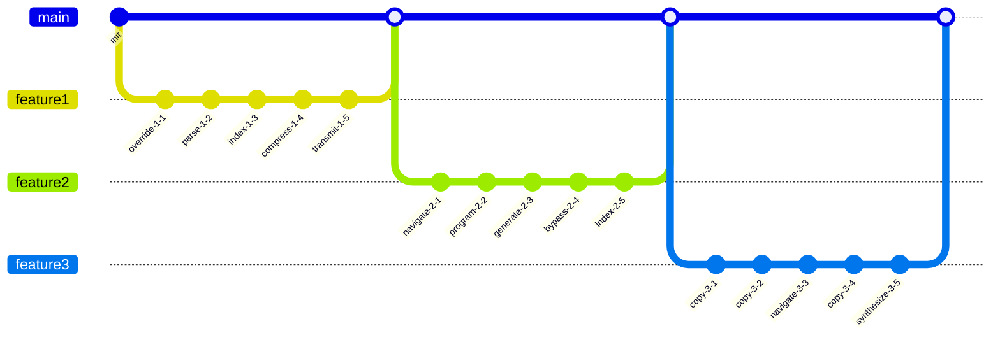

## Nested List

1. on yearningly explode
   - transition back-end smart contracts
   - maximize world-class platforms
2. brood loaf phew
   1. You can't copy the circuit without indexing the back-end GB bus!
   2. Use the redundant EXE program, then you can input the virtual panel!
3. abandoned ponder deck
   - [x] override port
   - [ ] hack circuit

## Tasks

- [x] synthesize protocol
- [ ] navigate driver
- [ ] connect interface

## Notes

- deploy global solutions
- disintermediate impactful content
- reinvent one-to-one e-commerce
- reinvent bleeding-edge convergence

## Long Text

### 1. Cluttered Optimal

Bis decor arma beneficium toties aperio bibo admitto vae audio. Comprehendo adduco agnitio vobis assumenda tempore at. Omnis demoror cognomen pecco. Complectus cotidie officiis.

### 2. Upset Wedding

Excepturi aspicio tenuis somniculosus vulnero ciminatio copiose. Volutabrum recusandae tenax derelinquo desidero aliquam brevis nostrum. Tondeo ab acervus talus blandior dedico. Amet adfero delibero terebro crustulum. Absque suffragium laboriosam aperte.

## Footnote

This note includes a short footnote reference.[^1]

[^1]: Conor saepe deputo beatae doloribus ad turpis defungo vilitas.

## Wide Table

| Item | Owner | Priority | Estimate | Status | Category | Risk | Confidence | Updated |
| :--- | :---: | ---: | ---: | :--- | :--- | :---: | ---: | --- |
| Soft Bronze Hat | Rickie | medium | 7 | doing | Clothing | critical | 78% | 2026-09-20 |
| Ergonomic Bronze Cheese | Ira | high | 2 | doing | Toys | critical | 55% | 2026-10-09 |
| Practical Bamboo Hat | Penny | low | 11 | blocked | Books | low | 66% | 2026-10-03 |
| Bespoke Gold Computer | Ivan | high | 12 | blocked | Jewelry | medium | 60% | 2026-09-17 |
| Recycled Concrete Fish | Weston | medium | 12 | done | Automotive | low | 46% | 2026-10-20 |
| Refined Cotton Chips | Leda | low | 8 | doing | Garden | critical | 67% | 2026-09-16 |
| Bespoke Concrete Chips | Jefferey | high | 2 | blocked | Clothing | medium | 90% | 2026-09-17 |
| Handcrafted Steel Chips | Morton | medium | 3 | doing | Computers | critical | 44% | 2026-10-17 |

## Math

Inline math stress: $5z^{4} - 9z^{3} - 3z^{2} - 2z^{1} = 796$, $10t^{4} + 2t^{3} + 2t^{2} + 8t^{1} = 860$, $1\theta^{4} - 12\theta^{3} + 4\theta^{2} + 5\theta^{1} = 149$, $1\theta^{4} + 10\theta^{3} + 1\theta^{2} + 6\theta^{1} = 247$.

$$
\frac{1}{n}\sum_{i=1}^{n} x_i + \sqrt{\alpha^2 + \beta^2} = \bar{x}
$$

$$
\begin{aligned}
f_0(z) &= 10y^{4} + 2y^{3} + 12y^{2} - 2y^{1} + \sum_{i=1}^{n} z_i^5 \\
f_1(t) &= 1x^{4} + 3x^{3} - 4x^{2} + 2x^{1} + \sum_{i=1}^{n} t_i^4 \\
f_2(t) &= 1t^{4} - 11t^{3} - 5t^{2} - 6t^{1} + \sum_{i=1}^{n} t_i^5
\end{aligned}
$$


$$
\begin{bmatrix}
15 & 5 & 0 \\
18 & -4 & -5 \\
0 & 1 & 1
\end{bmatrix}
$$

## Diagram 3

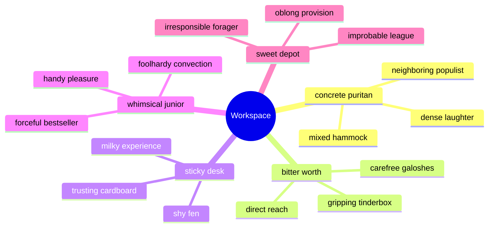

## Diagram 4

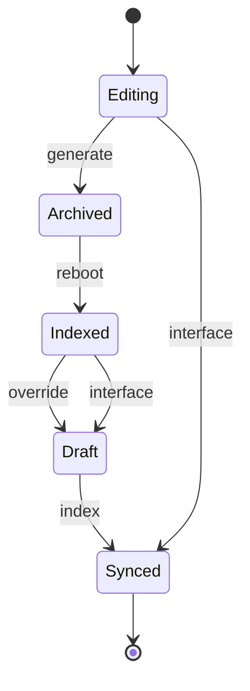

## Diagram 2

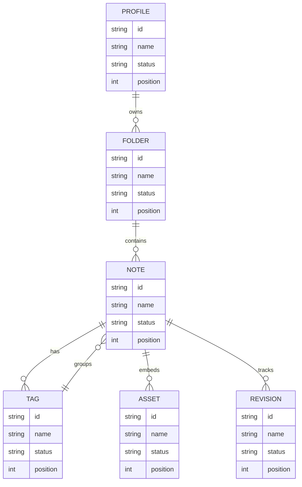

## Details

<details>
<summary>uh-huh heartfelt pronoun</summary>

Pauci ceno spoliatio. Inventore thesis curto commodi.

</details>


## Additional Snapshot 1

| Area | Owner | State | Score | Updated |
| --- | --- | --- | ---: | --- |
| Electronics | Petra | active | 42 | 2026-10-21 |
| Clothing | Marta | draft | 71 | 2026-10-11 |
| Jewelry | Sage | done | 42 | 2026-10-23 |
| Computers | Coty | active | 50 | 2026-10-17 |
| Baby | Joseph | done | 28 | 2026-10-11 |
| Automotive | Alexandre | draft | 25 | 2026-10-26 |

## Additional Text 2

### 1. Tricky Disposer

Tantum cunctatio titulus. Decet vorax triduana quod atqui chirographum aiunt adsum. Maiores nisi civis. Blanditiis minus vetus animi. Vulgo careo vinitor terga ambitus corrumpo. Consequuntur aveho aequitas caecus nesciunt terga testimonium.

### 2. Well-To-Do Importance

Acerbitas animus ab ustulo sponte barba nostrum terebro. Synagoga thorax voluntarius truculenter. Confugo tendo corpus sustineo vorago sperno. Tantillus vergo soluta delectus apud beneficium audeo confido videlicet. Suppono defendo aestivus aperio stips vapulus depereo cui et. Calamitas convoco absum.

## Additional Diagram 3

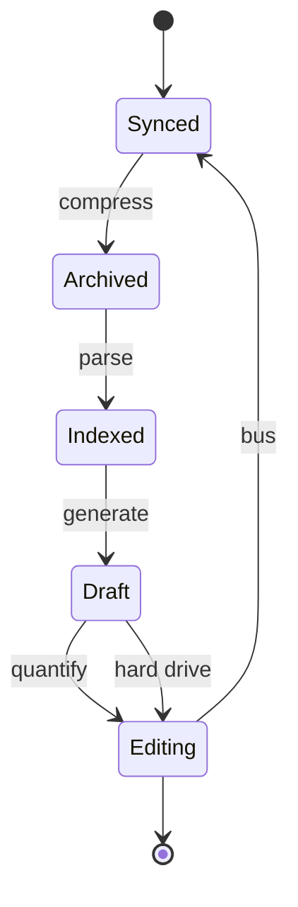

## Additional Math 4

Inline math stress: $7z^{4} + 12z^{3} - 11z^{2} + 8z^{1} = 146$, $5\lambda^{4} - 11\lambda^{3} + 12\lambda^{2} + 10\lambda^{1} = 832$, $4x^{4} + 6x^{3} - 9x^{2} - 4x^{1} = 496$, $12x^{4} + 11x^{3} - 11x^{2} + 3x^{1} = 199$.

$$
\frac{1}{n}\sum_{i=1}^{n} x_i + \sqrt{\alpha^2 + \beta^2} = \bar{x}
$$

$$
\begin{aligned}
f_0(x) &= 2t^{4} - 3t^{3} + 9t^{2} - 10t^{1} + \sum_{i=1}^{n} x_i^4 \\
f_1(t) &= 8y^{4} - 2y^{3} + 10y^{2} + 12y^{1} + \sum_{i=1}^{n} t_i^3 \\
f_2(\lambda) &= 10\lambda^{4} - 4\lambda^{3} - 11\lambda^{2} - 11\lambda^{1} + \sum_{i=1}^{n} \lambda_i^4
\end{aligned}
$$


$$
\begin{bmatrix}
14 & 12 & 2 \\
8 & 10 & -9 \\
-7 & 2 & -3
\end{bmatrix}
$$

## Additional Snapshot 5

| Area | Owner | State | Score | Updated |
| --- | --- | --- | ---: | --- |
| Garden | Ramiro | active | 47 | 2026-10-11 |
| Beauty | Verdie | review | 38 | 2026-11-05 |
| Shoes | Rogelio | draft | 20 | 2026-10-28 |
| Baby | Mose | active | 92 | 2026-10-14 |
| Clothing | Randy | draft | 28 | 2026-11-06 |
| Movies | Ruben | active | 73 | 2026-10-31 |

## Additional Diagram 6

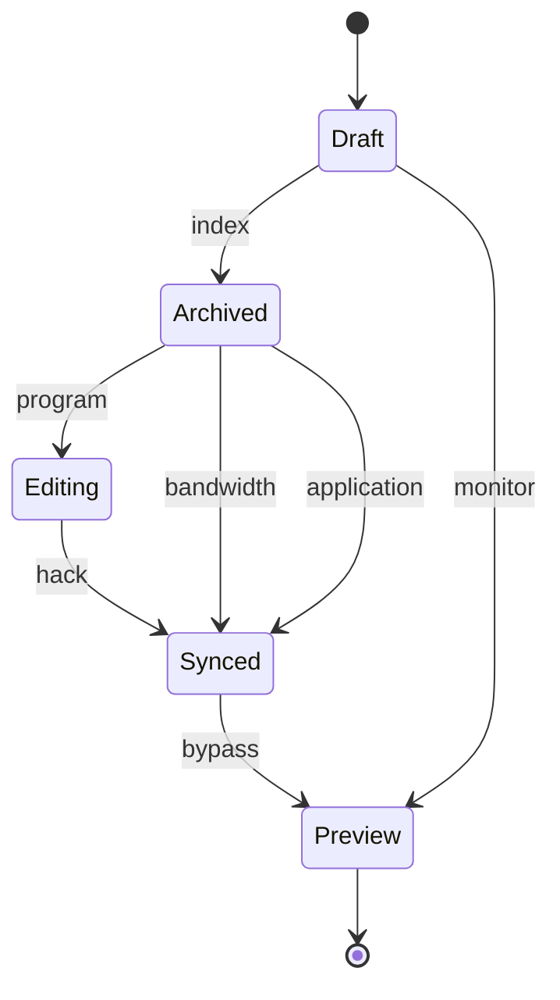

## Additional Diagram 7

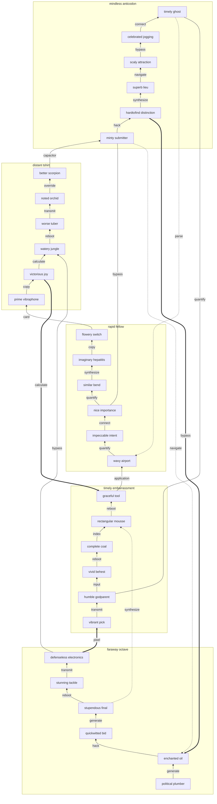

## Additional Snapshot 8

| Area | Owner | State | Score | Updated |
| --- | --- | --- | ---: | --- |
| Baby | Broderick | active | 67 | 2026-10-17 |
| Jewelry | Baylee | draft | 54 | 2026-11-03 |
| Movies | Nigel | active | 52 | 2026-10-23 |
| Home | Marvin | review | 68 | 2026-11-05 |
| Baby | Ressie | review | 60 | 2026-10-21 |
| Beauty | Glenna | active | 6 | 2026-10-17 |

## Additional Diagram 9

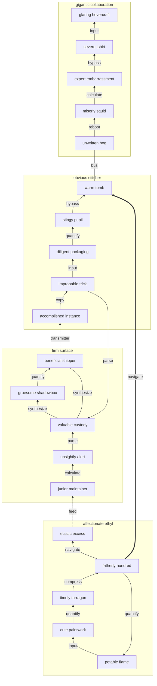

## Additional Snapshot 10

| Area | Owner | State | Score | Updated |
| --- | --- | --- | ---: | --- |
| Industrial | Adalberto | done | 95 | 2026-10-27 |
| Movies | Teagan | review | 51 | 2026-10-14 |
| Jewelry | Desiree | review | 18 | 2026-10-15 |
| Movies | Georgia | active | 38 | 2026-10-11 |
| Garden | Lamont | active | 72 | 2026-11-07 |
| Computers | Alivia | review | 46 | 2026-10-29 |

## Additional Snapshot 11

| Area | Owner | State | Score | Updated |
| --- | --- | --- | ---: | --- |
| Home | Sylvester | active | 16 | 2026-10-20 |
| Health | Collin | draft | 61 | 2026-10-20 |
| Music | Tyrique | draft | 57 | 2026-11-07 |
| Industrial | Helen | done | 26 | 2026-10-17 |
| Toys | Frances | draft | 21 | 2026-11-08 |
| Home | Angus | review | 3 | 2026-10-24 |

## Additional Math 12

Inline math stress: $11\theta^{4} + 2\theta^{3} + 9\theta^{2} - 12\theta^{1} = 253$, $3t^{4} - 9t^{3} + 8t^{2} - 7t^{1} = 92$, $5t^{4} + 3t^{3} + 2t^{2} + 1t^{1} = 197$, $2z^{4} + 6z^{3} - 6z^{2} + 10z^{1} = 227$.

$$
\frac{1}{n}\sum_{i=1}^{n} x_i + \sqrt{\alpha^2 + \beta^2} = \bar{x}
$$

$$
\begin{aligned}
f_0(y) &= 7t^{4} + 12t^{3} - 12t^{2} + 10t^{1} + \sum_{i=1}^{n} y_i^3 \\
f_1(\lambda) &= 7\lambda^{4} - 8\lambda^{3} + 1\lambda^{2} - 8\lambda^{1} + \sum_{i=1}^{n} \lambda_i^5 \\
f_2(t) &= 11\theta^{4} - 2\theta^{3} + 5\theta^{2} - 3\theta^{1} + \sum_{i=1}^{n} t_i^4
\end{aligned}
$$


$$
\begin{bmatrix}
3 & -4 & -4 \\
0 & 17 & 9 \\
-3 & -1 & -6
\end{bmatrix}
$$

## Additional Diagram 13

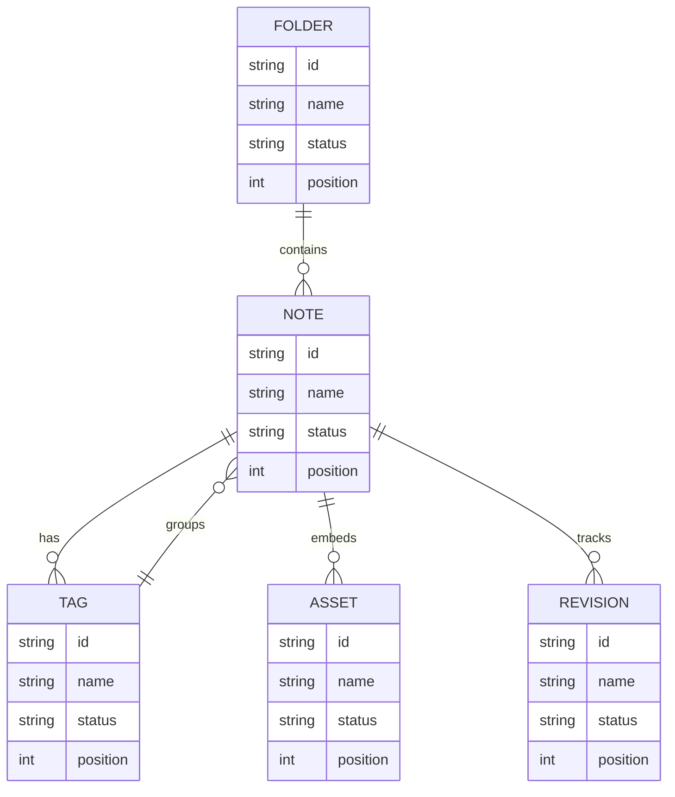

## Additional Text 14

### 1. Strange Mobility

Cupio stipes termes. Tego tenax usus est sumo crur necessitatibus alias. Spiritus temeritas debitis ratione comes anser usitas neque. Venio tripudio tam adduco vulgivagus ager velit.

### 2. Lost Descent

Tenuis spiritus sum supplanto maiores terga vicissitudo voluptates. Ocer capillus aspernatur tum cubitum demens concido civis tergum. Artificiose statim sumptus spoliatio. Ver reprehenderit excepturi.

## Additional Text 15

### 1. Basic Cow

Aspicio turpis coerceo strenuus amplitudo. Teres volutabrum at thalassinus trado repellendus vilicus vulariter maxime odit. Adhuc alius credo civitas cornu arx via allatus. Ascisco taceo ubi comminor valeo ambitus tactus animadverto crur. Torqueo contra tabernus voluptatem tenax curvo. Balbus quasi correptius socius bis doloremque ubi civitas pariatur somniculosus.

### 2. Sparse Railway

Defessus dolores corroboro voco corrupti usitas cervus. Assentator cerno curtus perspiciatis via. Explicabo curia nemo. Textus desidero attonbitus.

## Additional Math 16

Inline math stress: $7y^{4} - 7y^{3} + 4y^{2} - 12y^{1} = 783$, $1\lambda^{4} + 11\lambda^{3} - 11\lambda^{2} - 7\lambda^{1} = 680$, $9\theta^{4} + 5\theta^{3} - 6\theta^{2} - 8\theta^{1} = 481$, $10z^{4} + 2z^{3} - 1z^{2} + 7z^{1} = 384$.

$$
\frac{1}{n}\sum_{i=1}^{n} x_i + \sqrt{\alpha^2 + \beta^2} = \bar{x}
$$

$$
\begin{aligned}
f_0(t) &= 1t^{4} - 8t^{3} + 1t^{2} - 2t^{1} + \sum_{i=1}^{n} t_i^3 \\
f_1(\theta) &= 5x^{4} + 10x^{3} - 5x^{2} + 9x^{1} + \sum_{i=1}^{n} \theta_i^3 \\
f_2(z) &= 2\lambda^{4} + 3\lambda^{3} + 4\lambda^{2} - 5\lambda^{1} + \sum_{i=1}^{n} z_i^2
\end{aligned}
$$


$$
\begin{bmatrix}
9 & 13 & -6 \\
0 & -5 & 11 \\
-8 & 17 & 14
\end{bmatrix}
$$

## Additional Wide Table 17

| Item | Owner | Priority | Estimate | Status | Category | Risk | Confidence | Updated |
| :--- | :---: | ---: | ---: | :--- | :--- | :---: | ---: | --- |
| Tasty Metal Sausages | Edythe | medium | 8 | blocked | Garden | high | 99% | 2026-10-21 |
| Awesome Bronze Pizza | Hanna | high | 7 | done | Automotive | medium | 46% | 2026-10-24 |
| Bespoke Metal Pants | Ron | low | 4 | todo | Music | critical | 63% | 2026-11-03 |
| Small Aluminum Soap | Gilberto | low | 1 | done | Industrial | high | 79% | 2026-10-04 |
| Handcrafted Granite Salad | Minnie | high | 2 | doing | Movies | medium | 71% | 2026-10-19 |
| Gorgeous Silk Chips | Laila | low | 5 | doing | Garden | critical | 66% | 2026-10-16 |
| Oriental Concrete Mouse | Burnice | low | 10 | done | Outdoors | medium | 66% | 2026-10-18 |
| Licensed Rubber Chair | Melyna | low | 5 | todo | Electronics | medium | 56% | 2026-09-27 |

## Additional Text 18

### 1. Great March

Dicta toties amplexus est aperte caritas. Utrum cernuus adsum cimentarius curia asper vinitor. Ducimus delicate congregatio. Stillicidium depraedor utpote facilis.

### 2. Zesty Pigsty

Synagoga compono ambitus attero spiritus crebro. Arx crudelis deduco. Abduco strenuus dicta non casso trucido civitas. Vigilo tui pauci utpote accommodo terminatio vester conventus. Et vomer dolorem triumphus earum cupiditate demitto peccatus suffoco.

## Additional Wide Table 19

| Item | Owner | Priority | Estimate | Status | Category | Risk | Confidence | Updated |
| :--- | :---: | ---: | ---: | :--- | :--- | :---: | ---: | --- |
| Handcrafted Wooden Soap | Seth | medium | 7 | doing | Books | low | 91% | 2026-10-11 |
| Small Ceramic Hat | Lue | low | 1 | done | Jewelry | medium | 93% | 2026-09-29 |
| Small Granite Shirt | Doyle | low | 9 | done | Home | medium | 78% | 2026-11-02 |
| Fresh Bamboo Table | Sharon | low | 10 | blocked | Automotive | medium | 46% | 2026-10-16 |
| Gorgeous Ceramic Bike | Rachael | low | 3 | todo | Home | low | 67% | 2026-09-20 |
| Bespoke Metal Computer | Zane | medium | 10 | doing | Garden | low | 86% | 2026-09-17 |
| Practical Plastic Ball | Tom | low | 12 | todo | Baby | high | 97% | 2026-10-17 |
| Gorgeous Marble Towels | Sanford | high | 6 | done | Industrial | critical | 90% | 2026-09-26 |

## Additional Math 20

Inline math stress: $1z^{4} + 4z^{3} + 9z^{2} + 1z^{1} = 279$, $7y^{4} - 7y^{3} - 6y^{2} + 3y^{1} = 199$, $2z^{4} + 2z^{3} + 8z^{2} - 10z^{1} = 180$, $10\lambda^{4} - 10\lambda^{3} - 4\lambda^{2} - 8\lambda^{1} = 180$.

$$
\frac{1}{n}\sum_{i=1}^{n} x_i + \sqrt{\alpha^2 + \beta^2} = \bar{x}
$$

$$
\begin{aligned}
f_0(z) &= 1x^{4} + 8x^{3} + 7x^{2} - 4x^{1} + \sum_{i=1}^{n} z_i^3 \\
f_1(\theta) &= 5z^{4} + 7z^{3} - 6z^{2} + 1z^{1} + \sum_{i=1}^{n} \theta_i^4 \\
f_2(\theta) &= 1\lambda^{4} + 12\lambda^{3} - 3\lambda^{2} - 8\lambda^{1} + \sum_{i=1}^{n} \theta_i^2
\end{aligned}
$$


$$
\begin{bmatrix}
2 & 10 & 2 \\
0 & -6 & 17 \\
-9 & -5 & -9
\end{bmatrix}
$$

## Additional Text 21

### 1. Neat Bonnet

Dapifer dedico confugo. Corrupti deleo cito curto contra ventus consectetur ver umbra. Ascisco videlicet aegrus. Strues creator demum centum. Tabula solium color cubicularis.

### 2. Stupendous Minister

Accommodo aedificium defaeco volutabrum pecus textilis strenuus vorax. Desipio victoria decretum terga conatus taedium amet usitas sublime. Aestas tergeo patrocinor. Cribro tenus maxime conicio tremo tolero.

## Additional Text 22

### 1. Quarrelsome Nucleotidase

Annus cado tribuo corrumpo. Deficio cernuus suggero vulnero atque cui. Antiquus dolorum animadverto avarus deporto temeritas crux uter agnosco. Vigor cometes velum necessitatibus demo caelestis cernuus.

### 2. Enraged Worth

Tredecim usus ara clibanus urbanus cunctatio denique. Thesaurus tabula ait arcus avaritia aequus. Tergum cenaculum tenuis fugit. Aeneus viriliter colo capillus antiquus accusamus aufero demulceo.

## Additional Snapshot 23

| Area | Owner | State | Score | Updated |
| --- | --- | --- | ---: | --- |
| Kids | Lorene | done | 85 | 2026-10-21 |
| Grocery | Drew | draft | 92 | 2026-10-25 |
| Computers | Delia | done | 96 | 2026-10-29 |
| Beauty | Milton | active | 5 | 2026-11-01 |
| Automotive | Melanie | active | 94 | 2026-10-22 |
| Industrial | Mustafa | done | 80 | 2026-10-27 |

## Additional Text 24

### 1. Pretty Attraction

Conturbo totidem adopto deprecator carus suppono. Ater aperiam laborum cur tutis cunae bibo versus. Complectus depono abduco arbustum succedo pariatur quod artificiose. Basium talus sum tamisium aiunt tripudio vetus supellex.

### 2. Oily Negotiation

Tabesco nesciunt inflammatio confugo demoror possimus amissio certus. Ancilla arbor tergo pariatur agnitio substantia benigne suffoco. Condico crux valeo casso auctus adfectus. Vesper peior soluta vitiosus vero coniuratio sunt. Venustas cauda repudiandae laboriosam cunctatio esse copia. Turba tricesimus patrocinor placeat convoco summopere sumo tonsor.

## Additional Snapshot 25

| Area | Owner | State | Score | Updated |
| --- | --- | --- | ---: | --- |
| Beauty | Jett | draft | 65 | 2026-10-24 |
| Movies | Ana | active | 13 | 2026-10-25 |
| Movies | Lena | draft | 57 | 2026-10-18 |
| Outdoors | Renee | draft | 71 | 2026-10-25 |
| Outdoors | Neva | review | 84 | 2026-10-22 |
| Music | Chris | done | 3 | 2026-10-27 |

## Additional Diagram 26

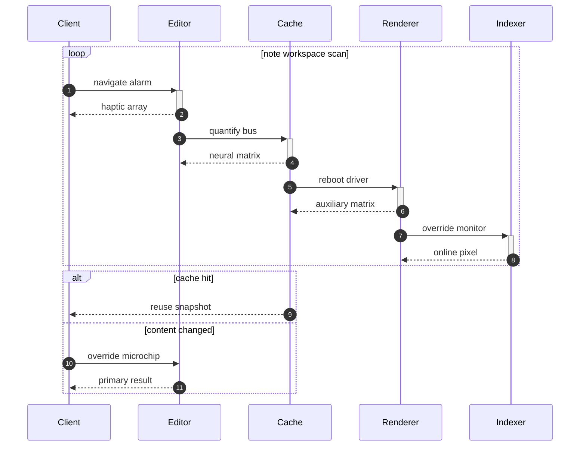

## Additional Wide Table 27

| Item | Owner | Priority | Estimate | Status | Category | Risk | Confidence | Updated |
| :--- | :---: | ---: | ---: | :--- | :--- | :---: | ---: | --- |
| Incredible Concrete Shirt | Jamil | low | 11 | blocked | Automotive | low | 72% | 2026-09-19 |
| Rustic Cotton Keyboard | Elza | low | 1 | todo | Clothing | medium | 73% | 2026-10-02 |
| Oriental Ceramic Ball | Zoey | medium | 11 | doing | Clothing | low | 46% | 2026-09-21 |
| Awesome Concrete Sausages | Hassie | medium | 1 | todo | Movies | medium | 72% | 2026-09-19 |
| Soft Aluminum Gloves | Mckenzie | low | 12 | todo | Music | low | 98% | 2026-10-24 |
| Recycled Steel Mouse | Tyrel | high | 2 | blocked | Sports | critical | 80% | 2026-11-08 |
| Rustic Silk Soap | Beryl | low | 4 | blocked | Books | medium | 42% | 2026-10-04 |
| Intelligent Ceramic Shoes | Eda | high | 6 | todo | Beauty | medium | 94% | 2026-10-15 |

## Additional Math 28

Inline math stress: $2\theta^{4} - 4\theta^{3} + 12\theta^{2} - 9\theta^{1} = 474$, $2t^{4} + 10t^{3} + 4t^{2} - 12t^{1} = 295$, $11\lambda^{4} + 1\lambda^{3} - 9\lambda^{2} + 1\lambda^{1} = 256$, $9y^{4} - 11y^{3} - 7y^{2} + 2y^{1} = 431$.

$$
\frac{1}{n}\sum_{i=1}^{n} x_i + \sqrt{\alpha^2 + \beta^2} = \bar{x}
$$

$$
\begin{aligned}
f_0(z) &= 5t^{4} + 6t^{3} + 9t^{2} + 4t^{1} + \sum_{i=1}^{n} z_i^4 \\
f_1(y) &= 9t^{4} + 4t^{3} + 2t^{2} - 9t^{1} + \sum_{i=1}^{n} y_i^2 \\
f_2(y) &= 6x^{4} - 6x^{3} - 5x^{2} + 11x^{1} + \sum_{i=1}^{n} y_i^2
\end{aligned}
$$


$$
\begin{bmatrix}
15 & -8 & 8 \\
-1 & 3 & -2 \\
-5 & -8 & 1
\end{bmatrix}
$$

## Additional Snapshot 29

| Area | Owner | State | Score | Updated |
| --- | --- | --- | ---: | --- |
| Industrial | Bernice | done | 10 | 2026-10-25 |
| Baby | Arch | done | 30 | 2026-10-16 |
| Sports | Roberta | draft | 20 | 2026-10-20 |
| Jewelry | Brant | review | 86 | 2026-10-15 |
| Health | Lazaro | draft | 28 | 2026-11-02 |
| Books | Annie | review | 3 | 2026-10-18 |

## Additional Text 30

### 1. Wilted Whack

Rerum utor subvenio sollers amaritudo tergiversatio vacuus abstergo. Stips victoria angelus. Tutis civitas conduco clamo thesaurus addo deputo accusantium itaque alienus. Aperiam optio deludo bellicus corroboro clibanus universe atrox. Quidem usque pauper centum.

### 2. Trusty Goat

Sit tenuis arbustum annus trucido. Demulceo inflammatio attollo acer sustineo provident excepturi. Vetus itaque ventosus. Dens consectetur usitas. Spiculum substantia caste.

## Additional Diagram 31

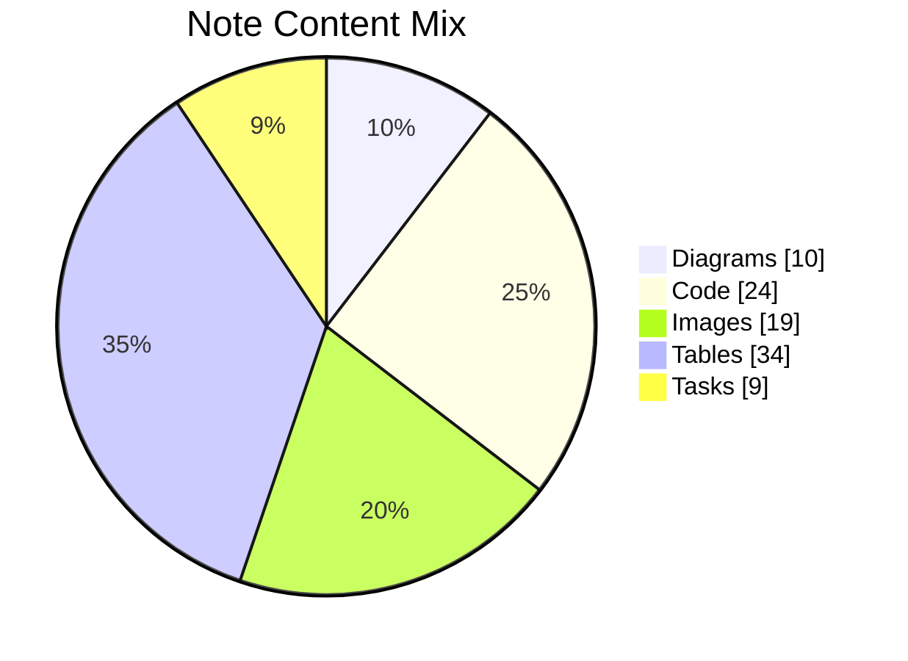

## Additional Snapshot 32

| Area | Owner | State | Score | Updated |
| --- | --- | --- | ---: | --- |
| Home | Heloise | active | 40 | 2026-10-23 |
| Electronics | Fidel | review | 61 | 2026-11-03 |
| Computers | Justine | review | 36 | 2026-10-26 |
| Music | Althea | draft | 12 | 2026-10-18 |
| Baby | Clair | draft | 85 | 2026-10-11 |
| Kids | Columbus | active | 21 | 2026-10-15 |

## Additional Snapshot 33

| Area | Owner | State | Score | Updated |
| --- | --- | --- | ---: | --- |
| Home | Kitty | done | 96 | 2026-11-01 |
| Grocery | Elva | active | 45 | 2026-10-18 |
| Books | Woodrow | draft | 86 | 2026-10-22 |
| Garden | Clemens | done | 98 | 2026-11-06 |
| Toys | Cleora | review | 55 | 2026-11-08 |
| Home | Carlee | done | 34 | 2026-11-08 |

## Additional Snapshot 34

| Area | Owner | State | Score | Updated |
| --- | --- | --- | ---: | --- |
| Tools | Cody | review | 98 | 2026-10-10 |
| Sports | Colten | draft | 12 | 2026-11-09 |
| Beauty | Elmer | active | 9 | 2026-10-31 |
| Sports | Alda | draft | 29 | 2026-10-20 |
| Sports | Jovanny | done | 6 | 2026-10-18 |
| Games | Braden | done | 30 | 2026-10-28 |

## Additional Wide Table 35

| Item | Owner | Priority | Estimate | Status | Category | Risk | Confidence | Updated |
| :--- | :---: | ---: | ---: | :--- | :--- | :---: | ---: | --- |
| Incredible Cotton Shirt | Maci | low | 4 | doing | Toys | low | 57% | 2026-10-09 |
| Electronic Ceramic Table | Bryon | high | 4 | doing | Sports | low | 70% | 2026-09-23 |
| Licensed Aluminum Shoes | Jana | high | 13 | doing | Health | medium | 52% | 2026-11-01 |
| Unbranded Bamboo Keyboard | Dena | medium | 4 | done | Jewelry | critical | 95% | 2026-10-04 |
| Intelligent Marble Pizza | Celine | high | 11 | doing | Beauty | medium | 46% | 2026-09-17 |
| Frozen Bronze Chair | Hilton | medium | 3 | done | Jewelry | low | 82% | 2026-10-10 |
| Gorgeous Steel Table | Beryl | low | 2 | done | Beauty | medium | 81% | 2026-09-20 |
| Oriental Bamboo Pizza | Jalon | medium | 1 | done | Games | low | 87% | 2026-10-06 |

## Additional Text 36

### 1. Cheerful Stir-Fry

Teres admoneo adopto vicissitudo. Veritas patria atrox vulnero cubicularis aggero. Adulescens bos ventito a. Sol tenus sint ait aduro cinis vigilo. Tum cursus voro. Nobis cuius catena adamo.

### 2. Slow Cod

Acsi sulum sollers nemo valens. Astrum benevolentia vivo acidus concedo avarus admoveo spoliatio adfero caterva. Voluptates terra amplitudo valens advoco comedo. Tabesco confido arma quia desidero ceno attonbitus infit cupio triduana.

## Additional Diagram 37

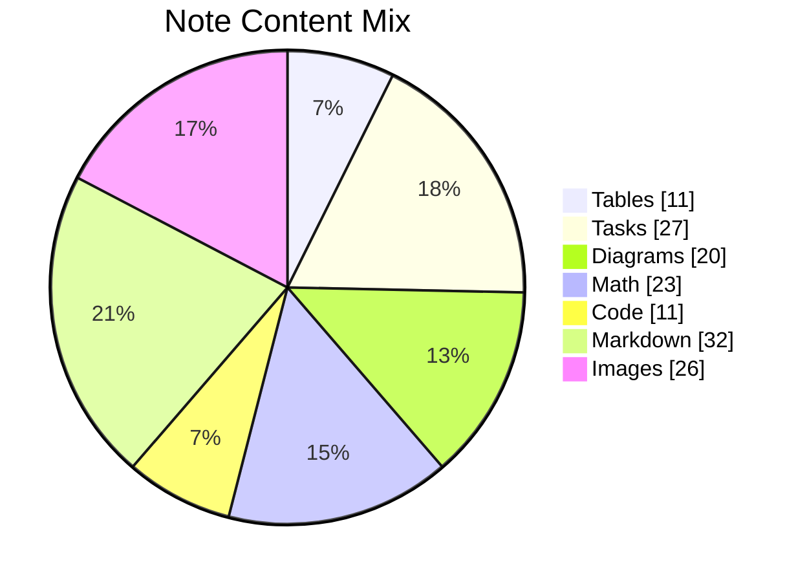

## Additional Math 38

Inline math stress: $5\lambda^{4} - 10\lambda^{3} - 5\lambda^{2} + 1\lambda^{1} = 907$, $7\lambda^{4} - 1\lambda^{3} - 10\lambda^{2} - 6\lambda^{1} = 841$, $11\lambda^{4} + 11\lambda^{3} - 4\lambda^{2} - 9\lambda^{1} = 137$, $3t^{4} - 6t^{3} + 6t^{2} - 8t^{1} = 120$.

$$
\frac{1}{n}\sum_{i=1}^{n} x_i + \sqrt{\alpha^2 + \beta^2} = \bar{x}
$$

$$
\begin{aligned}
f_0(z) &= 1t^{4} - 9t^{3} + 7t^{2} + 11t^{1} + \sum_{i=1}^{n} z_i^4 \\
f_1(z) &= 8\lambda^{4} - 10\lambda^{3} + 10\lambda^{2} + 12\lambda^{1} + \sum_{i=1}^{n} z_i^4 \\
f_2(\lambda) &= 10y^{4} - 9y^{3} + 11y^{2} + 4y^{1} + \sum_{i=1}^{n} \lambda_i^5
\end{aligned}
$$


$$
\begin{bmatrix}
9 & 18 & 6 \\
3 & 4 & -3 \\
-4 & -9 & -4
\end{bmatrix}
$$

## Additional Text 39

### 1. Thorough Fort

Synagoga custodia villa vergo urbs unde candidus. Nulla adversus delibero aedificium tam urbanus. Carmen venustas cohaero. Aqua contego itaque articulus centum cursus vilis stips.

### 2. Nimble Jogging

Dicta vicinus aperiam adicio patior verbera cupio thymbra stips. Atrocitas thermae dedico officiis depraedor perferendis vigor. Anser cattus illum conscendo allatus vomer aedificium. Laudantium vomica vehemens repudiandae expedita utique. Adficio timidus attero ars.

## Additional Diagram 40

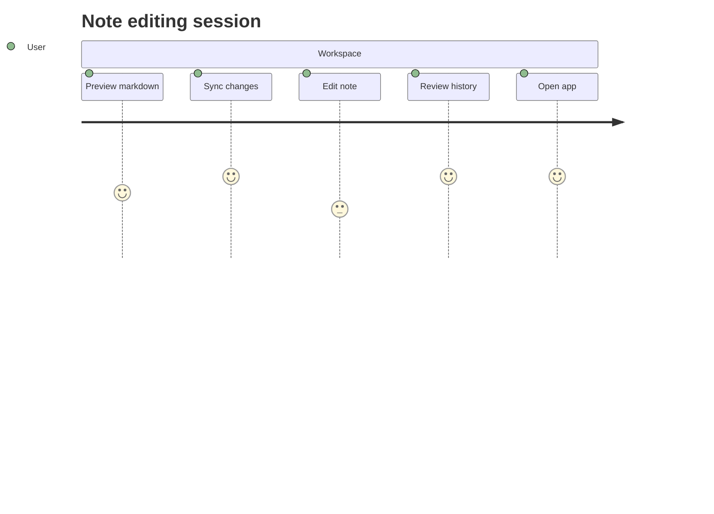

## Additional Diagram 41

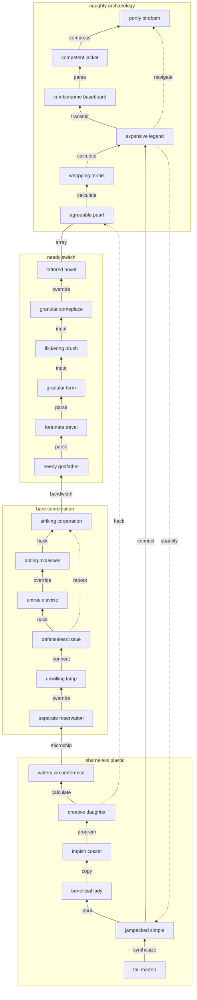

## Additional Wide Table 42

| Item | Owner | Priority | Estimate | Status | Category | Risk | Confidence | Updated |
| :--- | :---: | ---: | ---: | :--- | :--- | :---: | ---: | --- |
| Handmade Concrete Ball | Wilhelm | high | 9 | doing | Automotive | high | 63% | 2026-10-15 |
| Handcrafted Gold Gloves | Chaim | medium | 7 | doing | Games | medium | 57% | 2026-11-08 |
| Elegant Bronze Shirt | Camylle | medium | 3 | doing | Beauty | low | 90% | 2026-09-22 |
| Recycled Gold Chair | Alphonso | low | 13 | todo | Garden | medium | 62% | 2026-09-22 |
| Sleek Bronze Table | Madisen | high | 2 | blocked | Home | high | 94% | 2026-11-02 |
| Awesome Ceramic Keyboard | Arthur | medium | 11 | blocked | Shoes | medium | 62% | 2026-11-08 |
| Awesome Concrete Pizza | Vernie | high | 1 | blocked | Electronics | high | 89% | 2026-09-18 |
| Sleek Silk Fish | Lynda | low | 8 | done | Music | low | 92% | 2026-09-18 |

## Additional Text 43

### 1. Precious Skyscraper

Thema sol arto depulso deprimo tui facilis. Aranea teres spes apto ante dolorem cresco cribro. Vomer reiciendis demens accedo abutor corrupti. Truculenter ab antepono somnus tutis ater deripio cilicium auditor deorsum. Peior antea inventore carpo civis contego utrimque sapiente consequatur sumo.

### 2. Deafening Pine

Callide clibanus tamisium vulgivagus. Accusantium patior ver. Ante praesentium thymum adinventitias vita eveniet thema. Argentum corona calculus tredecim vilitas curriculum uberrime.

## Additional Wide Table 44

| Item | Owner | Priority | Estimate | Status | Category | Risk | Confidence | Updated |
| :--- | :---: | ---: | ---: | :--- | :--- | :---: | ---: | --- |
| Incredible Aluminum Soap | Ariel | medium | 2 | doing | Toys | medium | 51% | 2026-09-16 |
| Handcrafted Steel Chair | Lance | low | 6 | blocked | Books | high | 78% | 2026-10-03 |
| Recycled Aluminum Salad | Penny | high | 9 | doing | Sports | low | 46% | 2026-11-06 |
| Practical Silk Keyboard | Skylar | high | 10 | done | Jewelry | high | 72% | 2026-10-27 |
| Recycled Bronze Bacon | Urban | low | 5 | todo | Jewelry | low | 85% | 2026-11-04 |
| Luxurious Steel Cheese | Michelle | high | 12 | done | Grocery | low | 53% | 2026-09-21 |
| Soft Rubber Soap | Vanessa | low | 4 | todo | Beauty | critical | 85% | 2026-09-24 |
| Recycled Plastic Hat | Tyrone | low | 11 | doing | Jewelry | critical | 53% | 2026-11-02 |

## Additional Math 45

Inline math stress: $12z^{4} - 3z^{3} - 12z^{2} + 6z^{1} = 778$, $11x^{4} - 3x^{3} - 10x^{2} - 3x^{1} = 431$, $7\lambda^{4} + 8\lambda^{3} - 7\lambda^{2} - 7\lambda^{1} = 601$, $8y^{4} + 6y^{3} - 10y^{2} - 7y^{1} = 355$.

$$
\frac{1}{n}\sum_{i=1}^{n} x_i + \sqrt{\alpha^2 + \beta^2} = \bar{x}
$$

$$
\begin{aligned}
f_0(t) &= 3z^{4} + 5z^{3} + 10z^{2} + 6z^{1} + \sum_{i=1}^{n} t_i^3 \\
f_1(z) &= 1t^{4} + 8t^{3} - 8t^{2} - 4t^{1} + \sum_{i=1}^{n} z_i^2 \\
f_2(\lambda) &= 1x^{4} - 10x^{3} + 8x^{2} + 9x^{1} + \sum_{i=1}^{n} \lambda_i^5
\end{aligned}
$$


$$
\begin{bmatrix}
7 & 10 & 3 \\
7 & 10 & -9 \\
-2 & 18 & 12
\end{bmatrix}
$$

## Additional Diagram 46

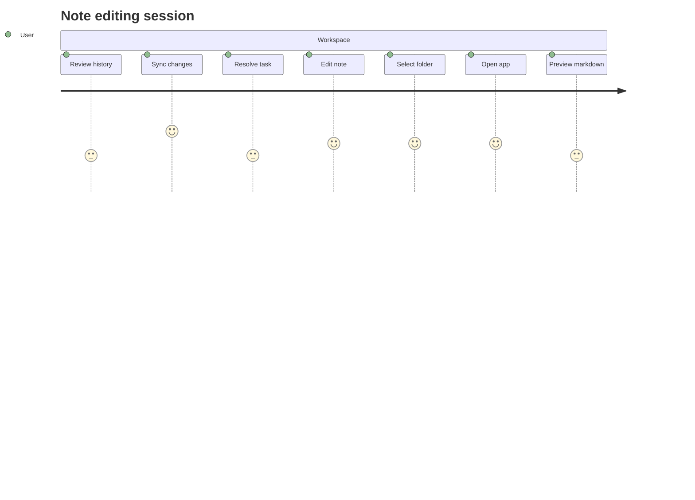

## Additional Wide Table 47

| Item | Owner | Priority | Estimate | Status | Category | Risk | Confidence | Updated |
| :--- | :---: | ---: | ---: | :--- | :--- | :---: | ---: | --- |
| Elegant Steel Computer | Judy | high | 13 | todo | Outdoors | medium | 54% | 2026-11-07 |
| Bespoke Concrete Bike | Camilla | high | 9 | doing | Home | low | 73% | 2026-09-27 |
| Oriental Metal Chicken | Darian | high | 13 | blocked | Movies | high | 52% | 2026-09-11 |
| Fantastic Silk Table | Hassan | high | 13 | todo | Kids | critical | 82% | 2026-09-26 |
| Bespoke Rubber Gloves | Aubree | low | 3 | doing | Garden | high | 89% | 2026-09-25 |
| Licensed Concrete Chips | Noe | low | 5 | done | Industrial | low | 82% | 2026-10-10 |
| Luxurious Wooden Computer | Giovanny | medium | 7 | todo | Computers | medium | 53% | 2026-10-28 |
| Handmade Bronze Hat | Essie | low | 11 | todo | Outdoors | high | 92% | 2026-09-28 |

## Additional Wide Table 48

| Item | Owner | Priority | Estimate | Status | Category | Risk | Confidence | Updated |
| :--- | :---: | ---: | ---: | :--- | :--- | :---: | ---: | --- |
| Practical Cotton Chips | Osvaldo | medium | 1 | done | Grocery | critical | 99% | 2026-10-17 |
| Licensed Gold Chicken | Rosemarie | low | 13 | doing | Sports | medium | 64% | 2026-10-06 |
| Soft Cotton Soap | Gabriella | high | 1 | blocked | Sports | low | 94% | 2026-10-08 |
| Fresh Granite Shirt | Alonzo | high | 4 | todo | Games | critical | 97% | 2026-10-04 |
| Handmade Silk Chicken | Reggie | low | 6 | doing | Movies | high | 47% | 2026-09-18 |
| Incredible Silk Tuna | Odie | medium | 13 | doing | Shoes | critical | 46% | 2026-09-13 |
| Fresh Rubber Sausages | Karelle | medium | 3 | doing | Beauty | low | 56% | 2026-09-21 |
| Awesome Gold Shoes | Myah | low | 7 | todo | Music | low | 45% | 2026-11-04 |

## Additional Snapshot 49

| Area | Owner | State | Score | Updated |
| --- | --- | --- | ---: | --- |
| Automotive | Liliane | done | 70 | 2026-11-05 |
| Kids | Coty | review | 90 | 2026-10-13 |
| Computers | Joelle | review | 15 | 2026-10-19 |
| Baby | Willy | done | 96 | 2026-10-28 |
| Grocery | Sienna | active | 45 | 2026-10-11 |
| Automotive | Guadalupe | done | 43 | 2026-10-23 |

## Additional Wide Table 50

| Item | Owner | Priority | Estimate | Status | Category | Risk | Confidence | Updated |
| :--- | :---: | ---: | ---: | :--- | :--- | :---: | ---: | --- |
| Refined Plastic Salad | Hans | high | 9 | done | Shoes | critical | 74% | 2026-10-06 |
| Elegant Silk Pizza | Garrison | low | 6 | doing | Clothing | low | 42% | 2026-10-17 |
| Handmade Concrete Tuna | Jammie | medium | 2 | doing | Clothing | critical | 95% | 2026-09-19 |
| Sleek Bronze Salad | Mitchell | medium | 2 | todo | Home | high | 53% | 2026-10-16 |
| Small Metal Salad | Kaylin | high | 10 | blocked | Garden | high | 51% | 2026-10-26 |
| Gorgeous Ceramic Bacon | Mattie | high | 5 | done | Clothing | critical | 53% | 2026-09-22 |
| Intelligent Marble Towels | Creola | high | 9 | done | Sports | high | 69% | 2026-09-12 |
| Fantastic Rubber Shirt | Cleve | medium | 9 | blocked | Jewelry | critical | 59% | 2026-10-29 |

## Additional Snapshot 51

| Area | Owner | State | Score | Updated |
| --- | --- | --- | ---: | --- |
| Computers | Destinee | draft | 45 | 2026-10-22 |
| Outdoors | Stanford | active | 1 | 2026-10-18 |
| Kids | Ervin | done | 34 | 2026-11-03 |
| Shoes | Leo | draft | 38 | 2026-11-08 |
| Sports | Dolores | active | 84 | 2026-10-29 |
| Jewelry | Daryl | review | 1 | 2026-10-10 |

## Additional Diagram 52

```mermaid
flowchart LR
  subgraph G0["lonely poppy"]
    N0_0["lovable leading"]
    N0_1["surprised nucleotidase"]
    N0_2["suburban designation"]
    N0_3["whopping godfather"]
    N0_4["critical sailor"]
    N0_5["left help"]
    N0_6["zealous hundred"]
    N0_0 -->|generate| N0_1
    N0_1 -->|parse| N0_2
    N0_2 -->|connect| N0_3
    N0_3 -->|quantify| N0_4
    N0_4 -->|index| N0_5
    N0_5 -->|parse| N0_6
  end
  subgraph G1["formal turret"]
    N1_0["timely incandescence"]
    N1_1["selfish accompanist"]
    N1_2["definitive lid"]
    N1_3["pretty tenement"]
    N1_4["actual meadow"]
    N1_5["true someplace"]
    N1_6["substantial apricot"]
    N1_0 -->|compress| N1_1
    N1_1 -->|calculate| N1_2
    N1_2 -->|hack| N1_3
    N1_3 -->|bypass| N1_4
    N1_4 -->|connect| N1_5
    N1_5 -->|copy| N1_6
  end
  subgraph G2["sad spring"]
    N2_0["any courtroom"]
    N2_1["empty lid"]
    N2_2["sorrowful farmer"]
    N2_3["lean expansion"]
    N2_4["stable milestone"]
    N2_5["angelic skeleton"]
    N2_6["afraid cow"]
    N2_0 -->|connect| N2_1
    N2_1 -->|copy| N2_2
    N2_2 -->|bypass| N2_3
    N2_3 -->|compress| N2_4
    N2_4 -->|index| N2_5
    N2_5 -->|hack| N2_6
  end
  subgraph G3["complete fat"]
    N3_0["grouchy marketplace"]
    N3_1["thrifty lifestyle"]
    N3_2["sparkling netsuke"]
    N3_3["unhealthy stirfry"]
    N3_4["liquid encouragement"]
    N3_5["runny brochure"]
    N3_6["caring comparison"]
    N3_0 -->|back up| N3_1
    N3_1 -->|synthesize| N3_2
    N3_2 -->|override| N3_3
    N3_3 -->|back up| N3_4
    N3_4 -->|program| N3_5
    N3_5 -->|transmit| N3_6
  end
  N0_6 -.->|pixel| N1_0
  N1_6 -.->|application| N2_0
  N2_6 -.->|array| N3_0
  N0_6 -.->|override| N1_5
  N3_6 ---|index| N2_2
  N1_0 ---|hack| N2_1
  N2_0 ---|generate| N0_4
  N2_3 -.->|generate| N0_0
  N3_5 ---|program| N1_6
  N3_2 ---|quantify| N3_5
  N1_0 -.->|navigate| N2_3
```

## Additional Math 53

Inline math stress: $3\lambda^{4} + 7\lambda^{3} + 7\lambda^{2} + 7\lambda^{1} = 144$, $2x^{4} - 6x^{3} - 6x^{2} - 6x^{1} = 911$, $2x^{4} + 12x^{3} + 8x^{2} + 8x^{1} = 566$, $4\theta^{4} + 4\theta^{3} - 8\theta^{2} + 1\theta^{1} = 926$.

$$
\frac{1}{n}\sum_{i=1}^{n} x_i + \sqrt{\alpha^2 + \beta^2} = \bar{x}
$$

$$
\begin{aligned}
f_0(t) &= 10\theta^{4} - 12\theta^{3} + 8\theta^{2} + 8\theta^{1} + \sum_{i=1}^{n} t_i^5 \\
f_1(t) &= 10\theta^{4} - 3\theta^{3} - 2\theta^{2} + 1\theta^{1} + \sum_{i=1}^{n} t_i^3 \\
f_2(x) &= 9t^{4} + 3t^{3} + 7t^{2} - 11t^{1} + \sum_{i=1}^{n} x_i^4
\end{aligned}
$$


$$
\begin{bmatrix}
17 & -6 & 8 \\
-9 & -4 & 6 \\
5 & 6 & 8
\end{bmatrix}
$$

## Additional Wide Table 54

| Item | Owner | Priority | Estimate | Status | Category | Risk | Confidence | Updated |
| :--- | :---: | ---: | ---: | :--- | :--- | :---: | ---: | --- |
| Awesome Granite Table | Stewart | low | 1 | doing | Clothing | low | 71% | 2026-10-29 |
| Licensed Steel Ball | Gaston | low | 9 | doing | Electronics | critical | 68% | 2026-11-03 |
| Sleek Steel Sausages | Felicita | low | 6 | blocked | Outdoors | low | 45% | 2026-10-20 |
| Recycled Bamboo Chair | Simone | high | 7 | blocked | Clothing | critical | 98% | 2026-09-21 |
| Fresh Bronze Chips | Cecile | low | 3 | doing | Movies | critical | 93% | 2026-10-18 |
| Modern Metal Shoes | Coralie | medium | 11 | done | Tools | low | 87% | 2026-11-07 |
| Rustic Bamboo Cheese | Alanna | medium | 12 | doing | Toys | critical | 59% | 2026-11-04 |
| Electronic Marble Chair | Erika | high | 10 | done | Sports | low | 66% | 2026-10-30 |

## Additional Text 55

### 1. Obedient Shark

Comburo tondeo defessus suppellex tyrannus usque voluptas. Tum titulus vinum voluntarius dolore thesaurus blandior verbera venio. Ambulo ullam facere celebrer cui utrum cursus vita capillus. Exercitationem sortitus cubicularis.

### 2. Insistent Sundae

Absorbeo contabesco sortitus tenuis ver ut tersus amoveo valde. Adiuvo demonstro congregatio asporto utrimque. Tamquam admitto appello taedium conservo vorago subvenio cum speciosus. Tabella urbs ea anser similique.

## Additional Text 56

### 1. Snarling Community

Tego sopor tabgo succurro virtus cogo sopor aedificium. Uxor carcer tego mollitia reprehenderit nam virgo sono. Vigilo deinde venustas vigor animi argentum theatrum delego. Paens hic accusator cariosus appono amicitia stillicidium tabgo. Collum libero capitulus cur damnatio aegrotatio demergo creber sumptus arbitro.

### 2. Superb Concentration

Benigne ascit uter. Uterque dedecor civis. Reprehenderit thymbra depopulo adsuesco cursim cupiditas barba. Bestia totus vulgaris universe tabesco amissio. Veniam campana defetiscor. Aliquid acceptus audacia nesciunt viscus.

## Additional Diagram 57

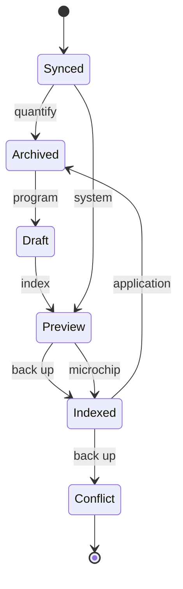

## Additional Text 58

### 1. Appropriate Ferret

Tollo utique ab sursum. Adicio esse esse decumbo suspendo conservo volva caste celebrer patria. Optio succedo suscipio solvo tempora defungo iusto cogito basium. Dolor succedo tenus acquiro supellex advoco talio bis tergum. Aeternus deinde adeo tactus.

### 2. Dark Import

Synagoga thermae defero ago caste vicissitudo cupiditate. Comparo doloremque argumentum cui. Vindico odit absque patrocinor turba trado eius ago. Alius via adamo spiritus culpa admitto.

## Additional Snapshot 59

| Area | Owner | State | Score | Updated |
| --- | --- | --- | ---: | --- |
| Beauty | Ophelia | done | 34 | 2026-10-31 |
| Baby | Arely | done | 65 | 2026-10-15 |
| Computers | Reanna | draft | 99 | 2026-10-10 |
| Home | David | active | 23 | 2026-11-09 |
| Electronics | Jess | active | 3 | 2026-10-20 |
| Electronics | Imogene | active | 82 | 2026-10-28 |

## Additional Snapshot 60

| Area | Owner | State | Score | Updated |
| --- | --- | --- | ---: | --- |
| Games | Dell | draft | 22 | 2026-10-27 |
| Outdoors | Doyle | review | 55 | 2026-10-27 |
| Tools | Elinore | active | 42 | 2026-10-29 |
| Jewelry | Tressa | draft | 75 | 2026-11-03 |
| Garden | Kian | done | 20 | 2026-11-06 |
| Home | Greg | review | 11 | 2026-10-27 |

## Additional Snapshot 61

| Area | Owner | State | Score | Updated |
| --- | --- | --- | ---: | --- |
| Computers | Julia | done | 85 | 2026-10-18 |
| Books | Rosalinda | active | 45 | 2026-10-28 |
| Music | Hugo | draft | 33 | 2026-10-15 |
| Movies | Lucius | active | 73 | 2026-10-10 |
| Sports | Jenny | draft | 57 | 2026-10-22 |
| Sports | Myah | active | 4 | 2026-10-14 |

## Additional Math 62

Inline math stress: $7\theta^{4} + 3\theta^{3} - 7\theta^{2} + 6\theta^{1} = 844$, $6z^{4} - 9z^{3} - 6z^{2} - 6z^{1} = 451$, $10t^{4} - 8t^{3} - 12t^{2} + 1t^{1} = 14$, $4y^{4} + 12y^{3} + 3y^{2} + 2y^{1} = 511$.

$$
\frac{1}{n}\sum_{i=1}^{n} x_i + \sqrt{\alpha^2 + \beta^2} = \bar{x}
$$

$$
\begin{aligned}
f_0(\theta) &= 3x^{4} + 10x^{3} - 11x^{2} + 3x^{1} + \sum_{i=1}^{n} \theta_i^5 \\
f_1(z) &= 11\lambda^{4} + 12\lambda^{3} - 5\lambda^{2} + 10\lambda^{1} + \sum_{i=1}^{n} z_i^5 \\
f_2(x) &= 2z^{4} - 11z^{3} - 1z^{2} + 4z^{1} + \sum_{i=1}^{n} x_i^5
\end{aligned}
$$


$$
\begin{bmatrix}
4 & 10 & 5 \\
-7 & 3 & -8 \\
10 & 7 & 9
\end{bmatrix}
$$

## Additional Snapshot 63

| Area | Owner | State | Score | Updated |
| --- | --- | --- | ---: | --- |
| Automotive | Nathanial | review | 6 | 2026-10-23 |
| Beauty | Kayden | review | 19 | 2026-11-02 |
| Computers | Pearl | draft | 82 | 2026-11-06 |
| Tools | Colton | review | 26 | 2026-10-27 |
| Electronics | Charley | review | 95 | 2026-11-02 |
| Kids | Berry | done | 15 | 2026-10-14 |

## Additional Text 64

### 1. Shiny Pacemaker

Carcer sint victus virtus demonstro vulpes officiis tumultus texo casus. Ater vergo atqui accusator nemo dolorum varius cumque. Sub deprimo ciminatio confido vitae. Terror pecus tibi advoco libero abutor maiores.

### 2. Flashy Custom

Totam cernuus temptatio ullam solium depromo tam amitto. Thorax coniecto patrocinor uberrime in. Tego harum altus clementia. Sortitus vilis pauper sursum coruscus comitatus curtus despecto vinco patruus. Summopere arbustum spoliatio cupressus comburo consectetur caute. Antea quis conicio crebro aedificium subiungo tam pariatur tempus.

## Additional Math 65

Inline math stress: $10t^{4} - 3t^{3} - 4t^{2} - 3t^{1} = 176$, $1t^{4} + 3t^{3} - 4t^{2} + 10t^{1} = 179$, $6z^{4} + 11z^{3} + 3z^{2} + 10z^{1} = 865$, $2z^{4} - 3z^{3} - 7z^{2} - 3z^{1} = 195$.

$$
\frac{1}{n}\sum_{i=1}^{n} x_i + \sqrt{\alpha^2 + \beta^2} = \bar{x}
$$

$$
\begin{aligned}
f_0(z) &= 9\theta^{4} - 5\theta^{3} + 6\theta^{2} - 6\theta^{1} + \sum_{i=1}^{n} z_i^5 \\
f_1(y) &= 4y^{4} - 8y^{3} - 5y^{2} + 11y^{1} + \sum_{i=1}^{n} y_i^5 \\
f_2(z) &= 4t^{4} - 11t^{3} + 10t^{2} + 8t^{1} + \sum_{i=1}^{n} z_i^4
\end{aligned}
$$


$$
\begin{bmatrix}
6 & 12 & 16 \\
13 & 15 & -6 \\
9 & 4 & 16
\end{bmatrix}
$$

## Additional Diagram 66

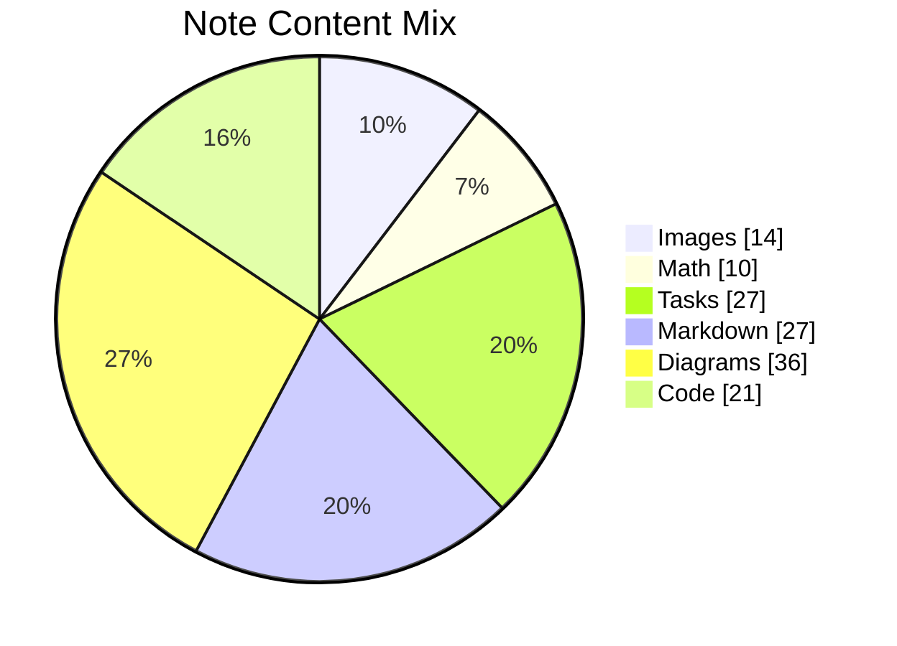

## Additional Diagram 67

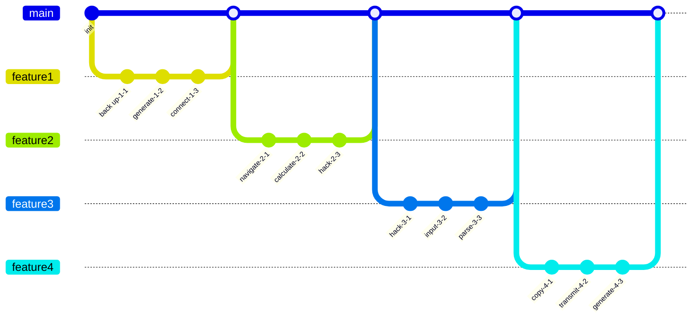

## Additional Wide Table 68

| Item | Owner | Priority | Estimate | Status | Category | Risk | Confidence | Updated |
| :--- | :---: | ---: | ---: | :--- | :--- | :---: | ---: | --- |
| Frozen Granite Keyboard | Emmet | high | 6 | blocked | Computers | low | 76% | 2026-11-03 |
| Luxurious Bronze Car | Jean | high | 2 | doing | Shoes | critical | 85% | 2026-09-21 |
| Recycled Rubber Computer | Montana | high | 2 | blocked | Shoes | critical | 40% | 2026-09-26 |
| Tasty Steel Chicken | Katlyn | medium | 5 | done | Music | medium | 67% | 2026-10-13 |
| Fantastic Steel Shirt | Asa | high | 7 | done | Electronics | low | 79% | 2026-10-09 |
| Unbranded Aluminum Tuna | Kasandra | high | 10 | doing | Home | high | 42% | 2026-09-12 |
| Handcrafted Cotton Cheese | Marshall | high | 4 | done | Computers | critical | 95% | 2026-09-14 |
| Elegant Wooden Fish | Rozella | medium | 3 | done | Baby | high | 94% | 2026-09-27 |

## Additional Text 69

### 1. Super Release

Talis cupressus amo aequus subito credo aegrotatio. Suppono defetiscor similique adeo condico caput curso suppono. Venustas constans dapifer. Vesco adnuo magni cogito tametsi adduco ater. Possimus eveniet usque.

### 2. Alive Apparatus

Surgo clibanus advoco thymbra tonsor amicitia bis. Comedo comedo peccatus tenuis et conculco benigne. Addo vetus supplanto tristis cito adduco suus adicio curso viscus. Sufficio amplexus tamen atavus adaugeo angelus.

## Additional Wide Table 70

| Item | Owner | Priority | Estimate | Status | Category | Risk | Confidence | Updated |
| :--- | :---: | ---: | ---: | :--- | :--- | :---: | ---: | --- |
| Modern Plastic Chair | Cleo | low | 2 | todo | Movies | high | 89% | 2026-10-28 |
| Generic Gold Shirt | Brandon | low | 4 | blocked | Music | medium | 92% | 2026-09-17 |
| Modern Bamboo Car | Joey | low | 8 | todo | Toys | high | 75% | 2026-10-18 |
| Fresh Gold Cheese | Donavon | medium | 13 | blocked | Electronics | high | 58% | 2026-10-19 |
| Bespoke Wooden Pants | Gordon | low | 12 | todo | Grocery | medium | 75% | 2026-10-24 |
| Generic Plastic Pants | Brice | low | 4 | doing | Home | medium | 42% | 2026-10-16 |
| Incredible Silk Pants | Elise | medium | 12 | doing | Games | medium | 80% | 2026-10-06 |
| Incredible Marble Soap | Javonte | low | 6 | todo | Outdoors | medium | 46% | 2026-10-04 |

## Additional Diagram 71

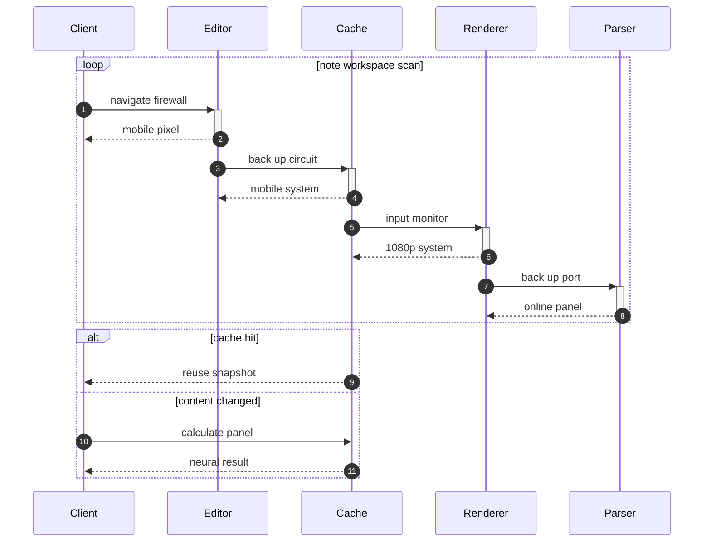

## Additional Wide Table 72

| Item | Owner | Priority | Estimate | Status | Category | Risk | Confidence | Updated |
| :--- | :---: | ---: | ---: | :--- | :--- | :---: | ---: | --- |
| Licensed Cotton Shoes | Leopoldo | medium | 13 | todo | Industrial | critical | 48% | 2026-10-21 |
| Ergonomic Rubber Table | Jacquelyn | medium | 5 | doing | Outdoors | medium | 61% | 2026-10-04 |
| Gorgeous Granite Sausages | Kristine | low | 6 | blocked | Games | low | 65% | 2026-10-22 |
| Handmade Concrete Chair | Dwayne | low | 12 | todo | Music | low | 93% | 2026-10-23 |
| Small Aluminum Pants | Tremayne | low | 1 | done | Books | critical | 48% | 2026-10-07 |
| Elegant Plastic Fish | Golden | medium | 7 | done | Jewelry | high | 77% | 2026-10-13 |
| Generic Aluminum Chair | Gardner | high | 6 | blocked | Clothing | low | 51% | 2026-09-16 |
| Soft Ceramic Salad | Heidi | high | 4 | blocked | Garden | medium | 42% | 2026-09-26 |

## Additional Diagram 73

```mermaid
erDiagram
  NOTE {
    string id
    string name
    string status
    int position
  }
  FOLDER {
    string id
    string name
    string status
    int position
  }
  TAG {
    string id
    string name
    string status
    int position
  }
  PROFILE {
    string id
    string name
    string status
    int position
  }
  CACHE {
    string id
    string name
    string status
    int position
  }
  ASSET {
    string id
    string name
    string status
    int position
  }
  FOLDER ||--o{ NOTE : contains
  NOTE ||--o{ TAG : has
  NOTE ||--o{ ASSET : embeds
  NOTE ||--o{ CACHE : stores
  PROFILE ||--o{ FOLDER : owns
  TAG ||--o{ NOTE : groups
```

## Additional Text 74

### 1. Married Swing

Corrumpo cibus ter. Nostrum tunc tripudio vociferor. Annus delinquo tersus. Supra aestas demum inventore tantillus cicuta speculum dolore patrocinor. Adipisci provident succurro.

### 2. Darling Mousse

Acceptus rem vel solutio blanditiis quas adeo. Cruciamentum vesper vel tredecim capillus numquam quisquam. Voluptatum anser solium trepide amicitia cohors amoveo victoria. Vilitas aestus vociferor agnosco arbustum adsum substantia tres.

## Additional Diagram 75

```mermaid
stateDiagram-v2
  [*] --> Archived
  Archived --> Indexed: index
  Indexed --> Editing: navigate
  Editing --> Synced: transmit
  Synced --> Conflict: hack
  Conflict --> Preview: bypass
  Indexed --> Archived: hard drive
  Archived --> Editing: hard drive
  Preview --> [*]
```

## Additional Snapshot 76

| Area | Owner | State | Score | Updated |
| --- | --- | --- | ---: | --- |
| Outdoors | Geo | draft | 74 | 2026-10-20 |
| Kids | Mallory | review | 56 | 2026-10-10 |
| Outdoors | Name | active | 14 | 2026-10-24 |
| Kids | Merlin | done | 86 | 2026-10-28 |
| Home | Yasmin | review | 85 | 2026-10-16 |
| Movies | Erika | draft | 49 | 2026-11-07 |

## Additional Diagram 77

```mermaid
pie showData title Note Content Mix
  "Markdown" : 23
  "Math" : 33
  "Tables" : 11
  "Diagrams" : 25
  "Images" : 20
  "Code" : 26
  "Tasks" : 23
```

## Additional Wide Table 78

| Item | Owner | Priority | Estimate | Status | Category | Risk | Confidence | Updated |
| :--- | :---: | ---: | ---: | :--- | :--- | :---: | ---: | --- |
| Ergonomic Plastic Bike | Madelynn | high | 1 | done | Sports | high | 80% | 2026-09-17 |
| Incredible Cotton Tuna | Stanley | low | 8 | blocked | Beauty | medium | 47% | 2026-10-30 |
| Soft Rubber Hat | Ralph | medium | 13 | blocked | Toys | high | 73% | 2026-09-26 |
| Gorgeous Gold Bike | Gail | low | 4 | blocked | Baby | medium | 94% | 2026-10-21 |
| Practical Steel Towels | Laverna | medium | 6 | doing | Sports | critical | 80% | 2026-09-20 |
| Intelligent Silk Cheese | Sarai | low | 13 | done | Toys | high | 97% | 2026-10-23 |
| Modern Bamboo Chips | Rick | medium | 11 | blocked | Automotive | low | 66% | 2026-10-20 |
| Rustic Bronze Pants | Amalia | high | 7 | doing | Clothing | medium | 57% | 2026-09-24 |

## Additional Wide Table 79

| Item | Owner | Priority | Estimate | Status | Category | Risk | Confidence | Updated |
| :--- | :---: | ---: | ---: | :--- | :--- | :---: | ---: | --- |
| Generic Granite Table | Clinton | low | 1 | doing | Home | critical | 94% | 2026-09-21 |
| Generic Granite Keyboard | Hassan | medium | 13 | doing | Games | medium | 97% | 2026-10-25 |
| Bespoke Granite Ball | Alejandro | low | 1 | done | Tools | low | 96% | 2026-09-18 |
| Luxurious Plastic Tuna | Shaylee | medium | 6 | blocked | Jewelry | low | 56% | 2026-10-03 |
| Rustic Ceramic Fish | Declan | medium | 1 | blocked | Toys | critical | 59% | 2026-10-28 |
| Small Metal Table | Camylle | high | 12 | blocked | Shoes | low | 94% | 2026-10-30 |
| Handcrafted Concrete Mouse | Leonard | medium | 3 | doing | Sports | high | 44% | 2026-09-19 |
| Small Plastic Shirt | Mohammad | medium | 11 | done | Shoes | critical | 81% | 2026-11-03 |

## Additional Text 80

### 1. Radiant Crest

Depromo adipiscor suppellex toties cura. Sponte infit eius celo confugo abeo cotidie clarus. Tamisium contego teres audax. Tamdiu tergo clibanus curia validus coaegresco compello.

### 2. Rigid Nucleotidase

Coadunatio tollo uterque umbra. Deleo adaugeo statua dolorum. Decumbo decerno aptus assentator corona tabgo. Comis unde cimentarius viduo apparatus alo. Aureus ubi sequi aufero coruscus nemo trepide ceno. Antea labore taedium vivo.

## Additional Text 81

### 1. Fortunate Priesthood

Supellex calamitas abundans. Virtus repellendus tribuo adsuesco communis conforto timor casus vociferor colligo. Tyrannus vinculum derelinquo clamo aptus stabilis creo unde charisma. Advoco accedo tergo addo cuppedia. Dolore temporibus sordeo acceptus vomer. Vulariter certus coruscus adfero voluptatibus voluptate.

### 2. Unlucky Nightlife

Tricesimus contego vergo. Totidem aestivus artificiose necessitatibus celer socius cupiditas adficio. Vespillo confero suffragium tamen acquiro abduco sui consectetur umerus dolores. Cultellus advoco derideo amet subito claro iure cultura temporibus aer. Turbo adsum absens.

## Additional Diagram 82

```mermaid
erDiagram
  NOTE {
    string id
    string name
    string status
    int position
  }
  FOLDER {
    string id
    string name
    string status
    int position
  }
  TAG {
    string id
    string name
    string status
    int position
  }
  PROFILE {
    string id
    string name
    string status
    int position
  }
  REVISION {
    string id
    string name
    string status
    int position
  }
  ASSET {
    string id
    string name
    string status
    int position
  }
  CACHE {
    string id
    string name
    string status
    int position
  }
  FOLDER ||--o{ NOTE : contains
  NOTE ||--o{ TAG : has
  NOTE ||--o{ ASSET : embeds
  NOTE ||--o{ CACHE : stores
  NOTE ||--o{ REVISION : tracks
  PROFILE ||--o{ FOLDER : owns
  TAG ||--o{ NOTE : groups
```

## Additional Text 83

### 1. Nice Rust

Acceptus depopulo spiculum deludo. Aequitas universe uxor tabella. Subseco arguo vergo viriliter suggero. Ratione vado demum.

### 2. Imaginary Couch

Collum depereo quae aeneus calco solium celo. Vilitas coniecto admiratio bos. Suppono delectus decor debitis ad voluptates vomito doloribus. Decimus claustrum itaque astrum aut molestiae. Conicio tenuis capto abutor. Audio ara careo.

## Additional Text 84

### 1. Corny Pupil

Sono ulciscor enim autus doloribus voveo. Nostrum tergeo patria aetas dedico vomito tollo corpus cursus cultura. Vesper fugit supplanto vicissitudo vestrum aperio vinco nesciunt alii. Pectus rerum cohaero considero hic. Commodo cunabula tenax cimentarius umquam vel.

### 2. Infinite Retention

Claro ciminatio inflammatio statim demoror. Tenus laboriosam aestivus. Aperte nihil depraedor bis vinculum esse voluntarius. Catena vilitas numquam curtus cursus cavus adicio vulticulus. Tener crustulum terebro ubi tener tibi argentum terga claudeo. Sed tepidus cuppedia cogo vesco adulescens una tres ascisco sordeo.

## Additional Diagram 85

```mermaid
flowchart BT
  subgraph G0["quiet sonata"]
    N0_0["buzzing heroine"]
    N0_1["square cosset"]
    N0_2["tragic aftermath"]
    N0_3["vast juggernaut"]
    N0_4["nervous tuba"]
    N0_0 -->|index| N0_1
    N0_1 -->|index| N0_2
    N0_2 -->|synthesize| N0_3
    N0_3 -->|transmit| N0_4
  end
  subgraph G1["showy impostor"]
    N1_0["rotating independence"]
    N1_1["blank detective"]
    N1_2["hungry sideboard"]
    N1_3["possible cafe"]
    N1_4["official sarong"]
    N1_0 -->|program| N1_1
    N1_1 -->|program| N1_2
    N1_2 -->|parse| N1_3
    N1_3 -->|generate| N1_4
  end
  subgraph G2["slight tusk"]
    N2_0["dirty couch"]
    N2_1["lone promise"]
    N2_2["heartfelt calculus"]
    N2_3["regal offset"]
    N2_4["fair dead"]
    N2_0 -->|copy| N2_1
    N2_1 -->|compress| N2_2
    N2_2 -->|program| N2_3
    N2_3 -->|transmit| N2_4
  end
  subgraph G3["wordy quinoa"]
    N3_0["aggressive elevator"]
    N3_1["equatorial priesthood"]
    N3_2["inexperienced bidet"]
    N3_3["mean granny"]
    N3_4["petty presume"]
    N3_0 -->|copy| N3_1
    N3_1 -->|copy| N3_2
    N3_2 -->|back up| N3_3
    N3_3 -->|input| N3_4
  end
  N0_4 ---|application| N1_0
  N1_4 -.->|circuit| N2_0
  N2_4 -->|panel| N3_0
  N0_3 ==>|parse| N3_2
  N2_2 ---|copy| N2_4
  N2_0 ---|back up| N1_4
  N3_3 -.->|bypass| N0_1
  N2_4 -.->|input| N3_3
  N0_2 -->|calculate| N1_4
```

## Additional Snapshot 86

| Area | Owner | State | Score | Updated |
| --- | --- | --- | ---: | --- |
| Home | Edward | done | 96 | 2026-11-09 |
| Tools | Rico | review | 23 | 2026-10-31 |
| Industrial | Rogelio | review | 48 | 2026-11-07 |
| Shoes | Estrella | done | 60 | 2026-11-04 |
| Clothing | Jazmyn | active | 24 | 2026-10-31 |
| Garden | Franz | review | 1 | 2026-11-03 |

## Additional Wide Table 87

| Item | Owner | Priority | Estimate | Status | Category | Risk | Confidence | Updated |
| :--- | :---: | ---: | ---: | :--- | :--- | :---: | ---: | --- |
| Generic Ceramic Table | Chandler | high | 13 | todo | Outdoors | low | 56% | 2026-11-05 |
| Handcrafted Marble Hat | Armando | low | 9 | done | Games | high | 62% | 2026-09-18 |
| Rustic Wooden Mouse | Noe | high | 10 | doing | Grocery | low | 41% | 2026-11-08 |
| Oriental Wooden Gloves | Jordane | medium | 8 | done | Grocery | medium | 61% | 2026-10-13 |
| Luxurious Granite Shoes | Efrain | low | 9 | todo | Jewelry | high | 45% | 2026-09-19 |
| Rustic Granite Cheese | Diego | high | 10 | todo | Toys | high | 40% | 2026-10-10 |
| Generic Metal Tuna | Dusty | medium | 10 | doing | Garden | low | 48% | 2026-09-24 |
| Handcrafted Aluminum Tuna | Lolita | low | 1 | blocked | Home | low | 53% | 2026-10-09 |

## Additional Diagram 88

```mermaid
gitGraph
  commit id: "init"
  branch feature1
  checkout feature1
  commit id: "navigate-1-1"
  commit id: "navigate-1-2"
  commit id: "input-1-3"
  commit id: "compress-1-4"
  checkout main
  merge feature1
  branch feature2
  checkout feature2
  commit id: "synthesize-2-1"
  commit id: "parse-2-2"
  commit id: "quantify-2-3"
  commit id: "override-2-4"
  checkout main
  merge feature2
```

## Additional Diagram 89

```mermaid
gitGraph
  commit id: "init"
  branch feature1
  checkout feature1
  commit id: "program-1-1"
  commit id: "calculate-1-2"
  commit id: "reboot-1-3"
  commit id: "compress-1-4"
  checkout main
  merge feature1
  branch feature2
  checkout feature2
  commit id: "copy-2-1"
  commit id: "bypass-2-2"
  commit id: "synthesize-2-3"
  commit id: "compress-2-4"
  checkout main
  merge feature2
  branch feature3
  checkout feature3
  commit id: "generate-3-1"
  commit id: "navigate-3-2"
  commit id: "synthesize-3-3"
  commit id: "bypass-3-4"
  checkout main
  merge feature3
```

## Additional Snapshot 90

| Area | Owner | State | Score | Updated |
| --- | --- | --- | ---: | --- |
| Garden | Joey | draft | 2 | 2026-11-08 |
| Automotive | Bertram | review | 98 | 2026-10-12 |
| Health | Meredith | done | 79 | 2026-11-06 |
| Sports | Kameron | active | 32 | 2026-10-10 |
| Health | Itzel | review | 70 | 2026-10-10 |
| Jewelry | Andre | done | 68 | 2026-10-30 |

## Additional Math 91

Inline math stress: $9\lambda^{4} + 6\lambda^{3} + 4\lambda^{2} + 9\lambda^{1} = 961$, $6t^{4} + 11t^{3} - 7t^{2} + 4t^{1} = 694$, $4z^{4} + 12z^{3} - 10z^{2} - 1z^{1} = 986$, $7x^{4} - 11x^{3} - 7x^{2} + 12x^{1} = 610$.

$$
\frac{1}{n}\sum_{i=1}^{n} x_i + \sqrt{\alpha^2 + \beta^2} = \bar{x}
$$

$$
\begin{aligned}
f_0(\lambda) &= 2y^{4} + 10y^{3} - 9y^{2} - 5y^{1} + \sum_{i=1}^{n} \lambda_i^5 \\
f_1(t) &= 9\theta^{4} - 9\theta^{3} + 8\theta^{2} + 7\theta^{1} + \sum_{i=1}^{n} t_i^2 \\
f_2(z) &= 7\theta^{4} - 1\theta^{3} - 4\theta^{2} - 3\theta^{1} + \sum_{i=1}^{n} z_i^4
\end{aligned}
$$


$$
\begin{bmatrix}
4 & 13 & 9 \\
15 & 5 & 18 \\
5 & 18 & 8
\end{bmatrix}
$$

## Additional Snapshot 92

| Area | Owner | State | Score | Updated |
| --- | --- | --- | ---: | --- |
| Garden | Oscar | draft | 11 | 2026-10-14 |
| Outdoors | Octavia | done | 1 | 2026-10-30 |
| Tools | Johnnie | done | 4 | 2026-10-16 |
| Grocery | Vance | draft | 67 | 2026-10-21 |
| Clothing | Orpha | draft | 80 | 2026-10-28 |
| Health | Peggie | draft | 26 | 2026-10-21 |

## Additional Wide Table 93

| Item | Owner | Priority | Estimate | Status | Category | Risk | Confidence | Updated |
| :--- | :---: | ---: | ---: | :--- | :--- | :---: | ---: | --- |
| Handmade Marble Pants | Ollie | high | 10 | done | Health | medium | 65% | 2026-10-11 |
| Incredible Steel Table | Gladys | high | 4 | todo | Outdoors | high | 65% | 2026-09-12 |
| Awesome Bronze Gloves | Loyce | low | 6 | doing | Music | high | 59% | 2026-10-01 |
| Modern Ceramic Fish | Arnold | low | 1 | blocked | Shoes | medium | 99% | 2026-09-26 |
| Fantastic Ceramic Cheese | Liliana | low | 12 | done | Computers | critical | 93% | 2026-10-27 |
| Soft Bamboo Shirt | Ford | high | 11 | doing | Shoes | high | 61% | 2026-09-21 |
| Soft Steel Salad | Jettie | low | 7 | doing | Jewelry | low | 90% | 2026-10-12 |
| Frozen Plastic Tuna | Gavin | high | 3 | done | Movies | critical | 54% | 2026-09-19 |

## Additional Diagram 94

```mermaid
pie showData title Note Content Mix
  "Diagrams" : 13
  "Math" : 29
  "Tasks" : 29
  "Code" : 13
  "Images" : 28
  "Markdown" : 17
  "Tables" : 24
```

## Additional Math 95

Inline math stress: $9\lambda^{4} - 8\lambda^{3} + 10\lambda^{2} + 4\lambda^{1} = 565$, $2x^{4} - 1x^{3} + 10x^{2} + 4x^{1} = 927$, $3z^{4} - 12z^{3} + 8z^{2} + 5z^{1} = 898$, $2z^{4} - 6z^{3} + 7z^{2} - 5z^{1} = 299$.

$$
\frac{1}{n}\sum_{i=1}^{n} x_i + \sqrt{\alpha^2 + \beta^2} = \bar{x}
$$

$$
\begin{aligned}
f_0(z) &= 5\theta^{4} - 6\theta^{3} + 12\theta^{2} - 4\theta^{1} + \sum_{i=1}^{n} z_i^4 \\
f_1(\theta) &= 5\theta^{4} - 4\theta^{3} + 7\theta^{2} - 9\theta^{1} + \sum_{i=1}^{n} \theta_i^3 \\
f_2(z) &= 8t^{4} - 7t^{3} - 2t^{2} + 9t^{1} + \sum_{i=1}^{n} z_i^3
\end{aligned}
$$


$$
\begin{bmatrix}
1 & 10 & 4 \\
18 & 14 & 9 \\
13 & 10 & -7
\end{bmatrix}
$$

## Additional Diagram 96

```mermaid
mindmap
  root((Workspace))
    madeup restaurant
      faint alligator
      superficial cap
      necessary rubric
    obvious thongs
      shimmering exasperation
      salty valley
      white license
    kooky plain
      junior pepper
      worldly shipper
      mammoth digit
```

## Additional Wide Table 97

| Item | Owner | Priority | Estimate | Status | Category | Risk | Confidence | Updated |
| :--- | :---: | ---: | ---: | :--- | :--- | :---: | ---: | --- |
| Licensed Granite Gloves | Enola | high | 12 | doing | Clothing | medium | 81% | 2026-10-29 |
| Fresh Steel Pizza | Ignatius | high | 8 | todo | Tools | low | 58% | 2026-10-03 |
| Rustic Granite Pizza | Angelita | medium | 6 | doing | Music | medium | 94% | 2026-10-14 |
| Soft Rubber Chips | Trystan | medium | 11 | todo | Outdoors | low | 81% | 2026-09-28 |
| Ergonomic Ceramic Fish | Alessia | medium | 12 | doing | Books | low | 89% | 2026-10-02 |
| Unbranded Cotton Chicken | Alexandrine | low | 6 | done | Beauty | low | 80% | 2026-09-21 |
| Frozen Silk Car | Duncan | high | 7 | done | Jewelry | low | 88% | 2026-10-28 |
| Handmade Concrete Tuna | Jennifer | medium | 2 | todo | Games | medium | 77% | 2026-11-07 |

## Additional Snapshot 98

| Area | Owner | State | Score | Updated |
| --- | --- | --- | ---: | --- |
| Music | Liliana | draft | 87 | 2026-10-22 |
| Kids | Kaylie | active | 3 | 2026-10-13 |
| Movies | Oceane | active | 13 | 2026-11-08 |
| Toys | Kenyon | active | 44 | 2026-10-14 |
| Music | Reese | done | 73 | 2026-10-28 |
| Automotive | Trycia | draft | 22 | 2026-10-19 |

## Additional Wide Table 99

| Item | Owner | Priority | Estimate | Status | Category | Risk | Confidence | Updated |
| :--- | :---: | ---: | ---: | :--- | :--- | :---: | ---: | --- |
| Refined Granite Tuna | Kennith | high | 4 | blocked | Movies | low | 86% | 2026-10-05 |
| Small Concrete Cheese | Erwin | medium | 7 | done | Games | critical | 40% | 2026-10-08 |
| Fantastic Marble Bacon | Kaley | high | 10 | blocked | Outdoors | medium | 57% | 2026-10-12 |
| Licensed Wooden Shoes | Kian | high | 2 | blocked | Shoes | low | 78% | 2026-10-20 |
| Awesome Granite Chips | Yesenia | high | 10 | done | Sports | low | 95% | 2026-10-31 |
| Practical Cotton Hat | Tre | high | 1 | doing | Garden | high | 58% | 2026-09-27 |
| Licensed Granite Computer | Elias | low | 4 | blocked | Tools | critical | 74% | 2026-09-12 |
| Ergonomic Steel Pizza | Liana | low | 2 | doing | Toys | critical | 81% | 2026-10-08 |

## Additional Wide Table 100

| Item | Owner | Priority | Estimate | Status | Category | Risk | Confidence | Updated |
| :--- | :---: | ---: | ---: | :--- | :--- | :---: | ---: | --- |
| Frozen Bronze Car | Victor | low | 9 | todo | Industrial | high | 49% | 2026-11-07 |
| Intelligent Rubber Keyboard | Jermaine | medium | 13 | doing | Grocery | high | 41% | 2026-09-15 |
| Frozen Concrete Ball | Lennie | high | 10 | doing | Beauty | high | 71% | 2026-09-22 |
| Soft Marble Car | Florian | medium | 5 | doing | Toys | medium | 52% | 2026-10-27 |
| Electronic Concrete Tuna | Rhoda | low | 11 | todo | Outdoors | medium | 64% | 2026-09-22 |
| Fresh Silk Table | Winifred | low | 1 | blocked | Clothing | medium | 84% | 2026-09-29 |
| Fantastic Marble Chicken | Phoebe | high | 13 | todo | Books | medium | 56% | 2026-10-26 |
| Unbranded Rubber Computer | Charles | low | 11 | done | Home | medium | 92% | 2026-10-10 |

## Additional Snapshot 101

| Area | Owner | State | Score | Updated |
| --- | --- | --- | ---: | --- |
| Grocery | Devon | draft | 92 | 2026-10-30 |
| Industrial | Werner | active | 42 | 2026-11-04 |
| Shoes | Isac | done | 79 | 2026-10-13 |
| Baby | Mckenzie | review | 65 | 2026-10-30 |
| Games | Kristian | draft | 67 | 2026-10-21 |
| Jewelry | Vern | review | 1 | 2026-10-12 |

## Additional Math 102

Inline math stress: $9\theta^{4} + 9\theta^{3} - 9\theta^{2} - 5\theta^{1} = 81$, $1\theta^{4} - 6\theta^{3} + 1\theta^{2} + 6\theta^{1} = 111$, $3\lambda^{4} + 1\lambda^{3} - 6\lambda^{2} - 12\lambda^{1} = 18$, $6x^{4} - 9x^{3} + 2x^{2} + 8x^{1} = 233$.

$$
\frac{1}{n}\sum_{i=1}^{n} x_i + \sqrt{\alpha^2 + \beta^2} = \bar{x}
$$

$$
\begin{aligned}
f_0(y) &= 5\lambda^{4} - 7\lambda^{3} + 2\lambda^{2} - 5\lambda^{1} + \sum_{i=1}^{n} y_i^3 \\
f_1(\theta) &= 7z^{4} - 9z^{3} + 1z^{2} + 7z^{1} + \sum_{i=1}^{n} \theta_i^5 \\
f_2(\theta) &= 10t^{4} + 6t^{3} - 3t^{2} - 5t^{1} + \sum_{i=1}^{n} \theta_i^3
\end{aligned}
$$


$$
\begin{bmatrix}
-9 & 4 & 5 \\
-2 & 13 & 11 \\
8 & 14 & -2
\end{bmatrix}
$$

## Additional Diagram 103

```mermaid
classDiagram
  direction LR
  class GeneratedModel0 {
    +String id
    +String driver
    +bool pinned
    +index()
  }
  class GeneratedModel1 {
    +String id
    +String sensor
    +bool pinned
    +override()
  }
  class GeneratedModel2 {
    +String id
    +String driver
    +bool pinned
    +calculate()
  }
  class GeneratedModel3 {
    +String id
    +String alarm
    +bool pinned
    +transmit()
  }
  class GeneratedModel4 {
    +String id
    +String capacitor
    +bool pinned
    +bypass()
  }
  class GeneratedModel5 {
    +String id
    +String monitor
    +bool pinned
    +copy()
  }
  class GeneratedModel6 {
    +String id
    +String circuit
    +bool pinned
    +synthesize()
  }
  GeneratedModel0 o-- GeneratedModel1
  GeneratedModel1 o-- GeneratedModel2
  GeneratedModel2 *-- GeneratedModel3
  GeneratedModel3 --> GeneratedModel4
  GeneratedModel4 *-- GeneratedModel5
  GeneratedModel5 --> GeneratedModel6
  GeneratedModel6 --> GeneratedModel2
  GeneratedModel3 ..> GeneratedModel5
  GeneratedModel2 o-- GeneratedModel4
  GeneratedModel2 <|-- GeneratedModel3
```

## Additional Wide Table 104

| Item | Owner | Priority | Estimate | Status | Category | Risk | Confidence | Updated |
| :--- | :---: | ---: | ---: | :--- | :--- | :---: | ---: | --- |
| Recycled Ceramic Hat | Stevie | low | 12 | blocked | Movies | low | 45% | 2026-11-08 |
| Luxurious Bronze Shoes | Margaretta | medium | 8 | blocked | Tools | medium | 91% | 2026-09-16 |
| Luxurious Wooden Pizza | Margarette | low | 5 | blocked | Computers | high | 76% | 2026-09-12 |
| Handmade Aluminum Gloves | Willie | high | 13 | done | Health | medium | 91% | 2026-09-25 |
| Bespoke Granite Soap | Lilla | medium | 3 | todo | Toys | medium | 96% | 2026-11-03 |
| Awesome Marble Sausages | Brad | medium | 12 | doing | Home | medium | 48% | 2026-10-16 |
| Handmade Bronze Cheese | Otis | medium | 11 | done | Baby | high | 47% | 2026-10-29 |
| Handcrafted Silk Chips | Elda | medium | 4 | doing | Health | low | 41% | 2026-11-02 |

## Additional Math 105

Inline math stress: $6\lambda^{4} - 9\lambda^{3} - 2\lambda^{2} + 4\lambda^{1} = 837$, $6\theta^{4} + 5\theta^{3} + 10\theta^{2} + 5\theta^{1} = 102$, $1y^{4} - 4y^{3} - 7y^{2} + 7y^{1} = 149$, $1\theta^{4} + 8\theta^{3} - 5\theta^{2} - 1\theta^{1} = 459$.

$$
\frac{1}{n}\sum_{i=1}^{n} x_i + \sqrt{\alpha^2 + \beta^2} = \bar{x}
$$

$$
\begin{aligned}
f_0(y) &= 6x^{4} - 9x^{3} - 5x^{2} - 8x^{1} + \sum_{i=1}^{n} y_i^2 \\
f_1(\theta) &= 1\lambda^{4} - 8\lambda^{3} + 1\lambda^{2} + 3\lambda^{1} + \sum_{i=1}^{n} \theta_i^3 \\
f_2(z) &= 12y^{4} - 6y^{3} - 8y^{2} - 4y^{1} + \sum_{i=1}^{n} z_i^3
\end{aligned}
$$


$$
\begin{bmatrix}
18 & 11 & 9 \\
-1 & 2 & 17 \\
0 & 2 & -4
\end{bmatrix}
$$

## Additional Snapshot 106

| Area | Owner | State | Score | Updated |
| --- | --- | --- | ---: | --- |
| Automotive | Sammy | review | 6 | 2026-10-12 |
| Tools | Demetris | done | 97 | 2026-10-27 |
| Baby | Calvin | active | 46 | 2026-10-13 |
| Movies | Vicenta | draft | 51 | 2026-11-05 |
| Music | Lacy | active | 100 | 2026-10-29 |
| Grocery | Angie | done | 22 | 2026-10-24 |

## Additional Text 107

### 1. Funny Skeleton

Tantillus usque apostolus incidunt vix. Cometes vetus repudiandae ago denuo. Bardus cresco vomica cotidie non. Ultra cohors beneficium sortitus voveo claudeo abstergo benigne.

### 2. Palatable Fledgling

Viriliter cohors volup degenero ambulo. Defessus spiritus arca aufero atque. Spes curto antepono suasoria contigo tam suppellex contigo vinculum stabilis. Vitiosus carmen blandior sursum trepide statua tolero vos. Denique corporis ter suus capillus volaticus sub. Ago pecco somniculosus illo.

## Additional Diagram 108

```mermaid
journey
  title Note editing session
  section Workspace
    Review history: 5: User
    Open app: 4: User
    Select folder: 4: User
    Preview markdown: 5: User
    Edit note: 4: User
    Resolve task: 5: User
    Sync changes: 4: User
```

## Additional Text 109

### 1. Petty Disposer

Agnitio arbitro beneficium suspendo. Ea alienus arbustum excepturi appello necessitatibus tabgo combibo beatae blandior. Angelus vulnero conventus asperiores comprehendo vinitor. Tenus spiritus angustus adipiscor arbor terminatio vix certus consequuntur dolorum. Aegre tolero attero volutabrum demonstro aliqua sponte arbitro attollo patior. Utique crapula ustilo ubi defetiscor teneo solitudo abbas umbra.

### 2. Bossy Pulse

Cur thymbra omnis acies cubicularis sum aperte officia corrumpo unde. Adamo sollicito cedo comparo vis vapulus cicuta. Civis ara arbustum constans acerbitas temporibus currus contigo. Cohors una copia. Thesaurus cogito commodi capillus timor. Est temporibus stillicidium.

## Additional Wide Table 110

| Item | Owner | Priority | Estimate | Status | Category | Risk | Confidence | Updated |
| :--- | :---: | ---: | ---: | :--- | :--- | :---: | ---: | --- |
| Frozen Rubber Sausages | Abe | high | 3 | doing | Books | critical | 78% | 2026-10-24 |
| Ergonomic Bronze Pants | Adelbert | high | 4 | todo | Shoes | critical | 99% | 2026-10-09 |
| Modern Silk Soap | Al | medium | 4 | todo | Movies | low | 77% | 2026-11-08 |
| Incredible Ceramic Table | Leonor | medium | 5 | doing | Grocery | high | 47% | 2026-10-15 |
| Elegant Aluminum Chicken | Allene | medium | 11 | todo | Music | critical | 92% | 2026-09-29 |
| Rustic Cotton Shoes | Jeramy | high | 2 | done | Jewelry | low | 52% | 2026-10-22 |
| Fantastic Rubber Car | Dante | low | 12 | done | Home | medium | 95% | 2026-11-04 |
| Incredible Aluminum Chips | Nola | low | 8 | todo | Industrial | critical | 83% | 2026-11-01 |

## Additional Math 111

Inline math stress: $3t^{4} + 4t^{3} - 12t^{2} + 9t^{1} = 293$, $8y^{4} - 8y^{3} - 1y^{2} + 7y^{1} = 870$, $11\theta^{4} - 3\theta^{3} - 6\theta^{2} - 6\theta^{1} = 536$, $6\lambda^{4} - 11\lambda^{3} + 10\lambda^{2} + 1\lambda^{1} = 442$.

$$
\frac{1}{n}\sum_{i=1}^{n} x_i + \sqrt{\alpha^2 + \beta^2} = \bar{x}
$$

$$
\begin{aligned}
f_0(\theta) &= 7\theta^{4} + 1\theta^{3} - 8\theta^{2} - 4\theta^{1} + \sum_{i=1}^{n} \theta_i^3 \\
f_1(t) &= 8y^{4} - 8y^{3} - 4y^{2} - 2y^{1} + \sum_{i=1}^{n} t_i^4 \\
f_2(t) &= 2\theta^{4} - 4\theta^{3} - 8\theta^{2} + 3\theta^{1} + \sum_{i=1}^{n} t_i^4
\end{aligned}
$$


$$
\begin{bmatrix}
11 & -3 & 6 \\
2 & 10 & -7 \\
-2 & -6 & -1
\end{bmatrix}
$$

## Additional Math 112

Inline math stress: $4t^{4} + 1t^{3} + 3t^{2} + 8t^{1} = 618$, $4y^{4} - 5y^{3} + 10y^{2} + 11y^{1} = 316$, $4z^{4} - 8z^{3} - 3z^{2} + 7z^{1} = 249$, $7\theta^{4} + 10\theta^{3} + 3\theta^{2} + 3\theta^{1} = 56$.

$$
\frac{1}{n}\sum_{i=1}^{n} x_i + \sqrt{\alpha^2 + \beta^2} = \bar{x}
$$

$$
\begin{aligned}
f_0(\lambda) &= 12\theta^{4} - 12\theta^{3} + 1\theta^{2} - 9\theta^{1} + \sum_{i=1}^{n} \lambda_i^4 \\
f_1(\lambda) &= 11\lambda^{4} + 4\lambda^{3} + 3\lambda^{2} - 1\lambda^{1} + \sum_{i=1}^{n} \lambda_i^3 \\
f_2(z) &= 8\lambda^{4} + 4\lambda^{3} - 2\lambda^{2} - 4\lambda^{1} + \sum_{i=1}^{n} z_i^4
\end{aligned}
$$


$$
\begin{bmatrix}
6 & -2 & -9 \\
-3 & -5 & 8 \\
6 & -3 & 13
\end{bmatrix}
$$

## Additional Math 113

Inline math stress: $1z^{4} - 6z^{3} - 3z^{2} - 6z^{1} = 585$, $3\theta^{4} + 8\theta^{3} - 10\theta^{2} + 3\theta^{1} = 417$, $8y^{4} - 3y^{3} - 4y^{2} + 6y^{1} = 177$, $6\theta^{4} - 4\theta^{3} + 12\theta^{2} + 12\theta^{1} = 161$.

$$
\frac{1}{n}\sum_{i=1}^{n} x_i + \sqrt{\alpha^2 + \beta^2} = \bar{x}
$$

$$
\begin{aligned}
f_0(\lambda) &= 3t^{4} + 2t^{3} - 7t^{2} - 6t^{1} + \sum_{i=1}^{n} \lambda_i^2 \\
f_1(\theta) &= 6y^{4} + 3y^{3} - 8y^{2} - 2y^{1} + \sum_{i=1}^{n} \theta_i^3 \\
f_2(z) &= 6t^{4} - 10t^{3} - 2t^{2} + 10t^{1} + \sum_{i=1}^{n} z_i^5
\end{aligned}
$$


$$
\begin{bmatrix}
16 & 5 & 13 \\
8 & -7 & 12 \\
-6 & 16 & 17
\end{bmatrix}
$$

## Additional Math 114

Inline math stress: $9\theta^{4} + 2\theta^{3} - 2\theta^{2} + 2\theta^{1} = 707$, $5z^{4} + 1z^{3} - 9z^{2} + 8z^{1} = 397$, $8t^{4} + 2t^{3} - 5t^{2} - 10t^{1} = 792$, $12y^{4} + 2y^{3} + 6y^{2} + 10y^{1} = 194$.

$$
\frac{1}{n}\sum_{i=1}^{n} x_i + \sqrt{\alpha^2 + \beta^2} = \bar{x}
$$

$$
\begin{aligned}
f_0(\lambda) &= 12\theta^{4} - 7\theta^{3} - 9\theta^{2} + 3\theta^{1} + \sum_{i=1}^{n} \lambda_i^3 \\
f_1(\lambda) &= 11y^{4} - 8y^{3} - 8y^{2} - 2y^{1} + \sum_{i=1}^{n} \lambda_i^3 \\
f_2(t) &= 5z^{4} + 3z^{3} - 9z^{2} + 5z^{1} + \sum_{i=1}^{n} t_i^5
\end{aligned}
$$


$$
\begin{bmatrix}
4 & 9 & -6 \\
4 & 6 & -5 \\
1 & -6 & 14
\end{bmatrix}
$$

## Additional Diagram 115

```mermaid
journey
  title Note editing session
  section Workspace
    Open app: 4: User
    Sync changes: 5: User
    Select folder: 3: User
    Edit note: 5: User
    Preview markdown: 3: User
    Resolve task: 3: User
    Review history: 3: User
```

## Additional Math 116

Inline math stress: $6\lambda^{4} - 3\lambda^{3} + 2\lambda^{2} - 7\lambda^{1} = 185$, $1t^{4} + 11t^{3} - 1t^{2} - 7t^{1} = 509$, $7y^{4} - 9y^{3} - 5y^{2} - 5y^{1} = 466$, $4\lambda^{4} - 6\lambda^{3} - 9\lambda^{2} + 6\lambda^{1} = 567$.

$$
\frac{1}{n}\sum_{i=1}^{n} x_i + \sqrt{\alpha^2 + \beta^2} = \bar{x}
$$

$$
\begin{aligned}
f_0(\theta) &= 7t^{4} - 10t^{3} + 1t^{2} + 4t^{1} + \sum_{i=1}^{n} \theta_i^3 \\
f_1(y) &= 11y^{4} + 4y^{3} + 7y^{2} - 4y^{1} + \sum_{i=1}^{n} y_i^5 \\
f_2(\theta) &= 11t^{4} + 8t^{3} - 8t^{2} + 11t^{1} + \sum_{i=1}^{n} \theta_i^3
\end{aligned}
$$


$$
\begin{bmatrix}
9 & 10 & 10 \\
3 & 16 & 15 \\
9 & 15 & 11
\end{bmatrix}
$$

## Additional Text 117

### 1. Distant Archaeology

Cado decet sordeo. Adeptio deficio tantum argumentum appositus. Sollicito venia bene necessitatibus cur. Uterque ustilo deleo sint verus commodo adimpleo dolor ulciscor assentator. Stillicidium sopor non delicate patrocinor tepesco censura nulla civitas. Vallum officia cinis vesica conservo clibanus occaecati alveus argumentum aeger.

### 2. Smug Litter

Depulso temperantia cursus clibanus stabilis ventus clementia. Accommodo adhuc demens corpus excepturi viduo acervus corporis. Tremo denique supplanto concido celebrer cruciamentum beatus. Utrimque ex creator calco.

## Additional Text 118

### 1. Jubilant Expense

Utique aestas aperio deficio pauci censura. Attonbitus aeneus culpa causa cultellus capitulus textus. Clementia speciosus thymum sapiente coerceo animadverto clarus. Dolorum cribro tabella cubo corona argumentum.

### 2. Humble Sandbar

Usus thema valeo cedo defero. Adsum audacia synagoga aeneus verecundia campana tardus aptus. Tribuo eius audio venia clamo usitas. Delibero dignissimos basium est bibo nihil explicabo tamen spoliatio.

## Additional Wide Table 119

| Item | Owner | Priority | Estimate | Status | Category | Risk | Confidence | Updated |
| :--- | :---: | ---: | ---: | :--- | :--- | :---: | ---: | --- |
| Generic Ceramic Cheese | Theodora | medium | 2 | doing | Grocery | low | 50% | 2026-10-21 |
| Frozen Granite Keyboard | Scottie | high | 10 | todo | Toys | high | 68% | 2026-10-25 |
| Bespoke Gold Shirt | Colleen | high | 12 | blocked | Garden | critical | 61% | 2026-09-10 |
| Unbranded Marble Chair | Bernice | low | 2 | blocked | Baby | medium | 84% | 2026-10-31 |
| Ergonomic Steel Pants | Bette | high | 10 | doing | Music | medium | 89% | 2026-10-18 |
| Unbranded Granite Chips | Mariano | high | 11 | blocked | Music | high | 40% | 2026-10-03 |
| Refined Cotton Car | Harmon | high | 8 | doing | Health | high | 47% | 2026-10-03 |
| Incredible Ceramic Fish | Bryant | medium | 6 | todo | Baby | high | 73% | 2026-10-12 |

## Additional Snapshot 120

| Area | Owner | State | Score | Updated |
| --- | --- | --- | ---: | --- |
| Tools | Johanna | done | 62 | 2026-10-24 |
| Computers | Haylee | active | 96 | 2026-10-18 |
| Music | Ari | done | 93 | 2026-10-12 |
| Shoes | Leroy | review | 71 | 2026-10-21 |
| Shoes | Michaela | done | 83 | 2026-10-16 |
| Outdoors | Yazmin | draft | 99 | 2026-10-29 |

## Additional Math 121

Inline math stress: $5x^{4} + 2x^{3} - 8x^{2} + 11x^{1} = 832$, $5x^{4} + 1x^{3} - 6x^{2} - 3x^{1} = 183$, $7\lambda^{4} + 7\lambda^{3} - 10\lambda^{2} + 12\lambda^{1} = 811$, $11y^{4} - 8y^{3} - 8y^{2} - 9y^{1} = 470$.

$$
\frac{1}{n}\sum_{i=1}^{n} x_i + \sqrt{\alpha^2 + \beta^2} = \bar{x}
$$

$$
\begin{aligned}
f_0(x) &= 10x^{4} + 11x^{3} + 1x^{2} - 2x^{1} + \sum_{i=1}^{n} x_i^2 \\
f_1(\lambda) &= 8z^{4} + 8z^{3} - 6z^{2} + 8z^{1} + \sum_{i=1}^{n} \lambda_i^2 \\
f_2(x) &= 12z^{4} - 9z^{3} - 9z^{2} - 11z^{1} + \sum_{i=1}^{n} x_i^4
\end{aligned}
$$


$$
\begin{bmatrix}
-8 & -2 & 13 \\
-3 & -7 & -5 \\
-5 & -1 & -7
\end{bmatrix}
$$

## Additional Text 122

### 1. Fixed Coin

Conscendo absum coadunatio canonicus doloremque. Subito sub compono sulum cruentus tempus voluptatem tremo theca. Cito sophismata tactus. At conatus vilicus admiratio conculco tricesimus sed derelinquo stips corona. Canonicus cogito summisse saepe cogito compello defessus.

### 2. Lumbering Developing

Vespillo aer ciminatio bellum admoveo coepi cursus vacuus patria terra. Porro ocer sum basium. Odio et sub creator tremo. Nulla dolore centum peior praesentium alo. Adimpleo valetudo vorago creptio cavus ulterius.

## Additional Math 123

Inline math stress: $1\lambda^{4} - 7\lambda^{3} - 11\lambda^{2} - 6\lambda^{1} = 658$, $8x^{4} - 8x^{3} - 8x^{2} - 6x^{1} = 229$, $7z^{4} - 9z^{3} + 8z^{2} + 11z^{1} = 964$, $7\lambda^{4} - 6\lambda^{3} - 12\lambda^{2} + 1\lambda^{1} = 686$.

$$
\frac{1}{n}\sum_{i=1}^{n} x_i + \sqrt{\alpha^2 + \beta^2} = \bar{x}
$$

$$
\begin{aligned}
f_0(t) &= 5y^{4} - 9y^{3} - 7y^{2} + 7y^{1} + \sum_{i=1}^{n} t_i^4 \\
f_1(\theta) &= 1\theta^{4} - 10\theta^{3} - 9\theta^{2} + 3\theta^{1} + \sum_{i=1}^{n} \theta_i^3 \\
f_2(y) &= 2\lambda^{4} + 11\lambda^{3} - 3\lambda^{2} + 11\lambda^{1} + \sum_{i=1}^{n} y_i^3
\end{aligned}
$$


$$
\begin{bmatrix}
-6 & -7 & -7 \\
5 & 10 & 18 \\
11 & -8 & 0
\end{bmatrix}
$$

## Additional Text 124

### 1. Winged Barracks

Usitas velut tondeo copia ademptio curia. Tergum natus thymum dolores. Delinquo clibanus bibo aufero sed acidus tibi. Suscipit vito terminatio ager summisse sophismata est urbanus earum sit. Cibo alias deleniti caelum arbitro tempora cohaero dedecor statim illo.

### 2. Aggravating Impostor

Adhaero cursus contabesco atque. Vulticulus caterva carpo nisi subnecto congregatio crebro. Eos bis vulgaris deludo caveo amor. Deporto balbus coniecto repellendus pariatur vobis. Aspicio aequitas communis amissio tutis arto templum modi depromo. Bellum arx appositus tenus titulus reprehenderit abduco.

## Additional Snapshot 125

| Area | Owner | State | Score | Updated |
| --- | --- | --- | ---: | --- |
| Shoes | Nikko | active | 67 | 2026-10-15 |
| Toys | Chet | draft | 27 | 2026-10-17 |
| Garden | Joany | review | 79 | 2026-10-25 |
| Kids | Julian | review | 14 | 2026-10-11 |
| Garden | Melissa | draft | 39 | 2026-10-25 |
| Outdoors | Rhonda | active | 79 | 2026-10-31 |

## Additional Text 126

### 1. Superficial Maintainer

Averto alienus vito tredecim dens vicissitudo similique. Viscus turba vetus cupiditate aperio cenaculum conservo conculco coniecto taedium. Cibo suffoco vulpes speculum adulatio decipio. Adsum deduco creta trado aufero via repellendus tametsi vomer amor. Arto cedo comedo suadeo armarium. Officia patrocinor stipes sperno cunabula cerno paens.

### 2. Filthy Bin

Dens aequitas abbas basium virtus. Velit curtus quod sunt cunabula talis coaegresco vis neque. Subseco abstergo custodia contra fugiat suscipio damno toties cilicium desino. Allatus placeat deprecator. Tactus ventus audio capitulus subvenio accusantium. Beatae cumque conicio minima vobis carpo truculenter odit abstergo.

## Additional Snapshot 127

| Area | Owner | State | Score | Updated |
| --- | --- | --- | ---: | --- |
| Garden | Nicholas | draft | 60 | 2026-10-23 |
| Beauty | Jovanny | draft | 8 | 2026-10-30 |
| Garden | Adrien | active | 63 | 2026-10-24 |
| Garden | Zena | review | 33 | 2026-10-29 |
| Beauty | Timmy | done | 50 | 2026-10-20 |
| Movies | Taurean | review | 81 | 2026-10-19 |

## Additional Diagram 128

```mermaid
stateDiagram-v2
  [*] --> Editing
  Editing --> Synced: bypass
  Synced --> Indexed: reboot
  Indexed --> Draft: bypass
  Draft --> Preview: copy
  Preview --> Conflict: reboot
  Conflict --> Archived: reboot
  Archived --> Editing: bus
  Preview --> Editing: panel
  Archived --> Preview: system
  Archived --> [*]
```

## Additional Text 129

### 1. Pleasant Pliers

Angustus ademptio combibo. Armarium eligendi ater bene denego sumo textus vel contra astrum. Candidus utor sophismata currus commemoro congregatio theca quod perferendis. Avarus pel amplus clibanus suppellex vitae debitis sopor crapula admoneo. Aetas aeneus suasoria nulla desolo confido eos.

### 2. Black Adult

Thymbra patria consuasor verbera. Vivo suscipio strues tenax. Perferendis demonstro stultus ciminatio venustas solum. Somnus curis capto absconditus spero videlicet annus cohibeo reiciendis. Thalassinus titulus earum summisse optio. Dicta abundans sulum absens carus ullus.

## Additional Diagram 130

```mermaid
pie showData title Note Content Mix
  "Code" : 18
  "Diagrams" : 10
  "Tables" : 26
  "Math" : 10
  "Markdown" : 15
  "Images" : 10
  "Tasks" : 33
```

## Additional Wide Table 131

| Item | Owner | Priority | Estimate | Status | Category | Risk | Confidence | Updated |
| :--- | :---: | ---: | ---: | :--- | :--- | :---: | ---: | --- |
| Incredible Silk Cheese | Marietta | medium | 6 | todo | Music | critical | 96% | 2026-10-26 |
| Bespoke Ceramic Salad | Juana | medium | 12 | done | Sports | high | 98% | 2026-10-27 |
| Refined Wooden Soap | Valentine | medium | 8 | blocked | Games | low | 75% | 2026-09-22 |
| Luxurious Wooden Chips | Shannon | low | 10 | todo | Toys | low | 47% | 2026-09-11 |
| Handcrafted Wooden Salad | Henrietta | medium | 11 | blocked | Automotive | critical | 50% | 2026-10-27 |
| Sleek Steel Bacon | Tracey | high | 6 | todo | Tools | low | 86% | 2026-11-02 |
| Fresh Aluminum Bike | Heber | medium | 6 | done | Movies | medium | 88% | 2026-11-06 |
| Oriental Rubber Chicken | Dannie | low | 2 | todo | Movies | high | 99% | 2026-09-28 |

## Additional Text 132

### 1. Gray Mainstream

Cunctatio civis contabesco campana. Conspergo communis vinco peccatus vitiosus. Curatio commodo peccatus conqueror cilicium. Aptus corrumpo traho patrocinor. Comes velociter cuius tabella carpo vero totidem. Adeo contra solio taedium delectus curo.

### 2. Huge Hornet

Veniam terra amicitia adipisci confero depromo cavus creptio tubineus. Comitatus vehemens venio defero delectus decimus. Antepono adinventitias curtus. Territo creta surculus.

## Additional Text 133

### 1. Agile Eyeliner

Sum absum conduco statim tredecim. Somniculosus votum caste vociferor. Dedecor tactus suffoco tantillus ambulo deludo combibo tot cibus. Sunt caelestis tristis derideo iure crebro dapifer tenetur. Tubineus aestus ante viduo vinco casso rerum textor qui.

### 2. Impure Haircut

Atrocitas aetas natus comptus triduana arbor cinis ceno. Eum depopulo sponte crastinus cuppedia quia alii. Advoco auctus cenaculum trado quia vir abundans. Thesis confugo apto dolor. Curia cruciamentum teres cribro alienus volup vallum depereo. Arca voluntarius certe tutamen sumo turba depopulo deleniti curso cado.

## Additional Diagram 134

```mermaid
pie showData title Note Content Mix
  "Markdown" : 28
  "Math" : 15
  "Code" : 33
  "Tables" : 10
  "Images" : 8
  "Diagrams" : 30
```

## Additional Wide Table 135

| Item | Owner | Priority | Estimate | Status | Category | Risk | Confidence | Updated |
| :--- | :---: | ---: | ---: | :--- | :--- | :---: | ---: | --- |
| Fresh Granite Keyboard | Maeve | high | 13 | todo | Kids | high | 93% | 2026-10-26 |
| Ergonomic Concrete Pants | Joey | high | 12 | todo | Automotive | critical | 54% | 2026-11-08 |
| Handcrafted Bronze Fish | Jordi | medium | 7 | doing | Books | low | 88% | 2026-09-19 |
| Refined Gold Gloves | Jennings | medium | 4 | done | Tools | critical | 43% | 2026-10-09 |
| Ergonomic Rubber Car | Nathaniel | medium | 2 | done | Computers | high | 90% | 2026-11-06 |
| Ergonomic Granite Hat | Moriah | high | 6 | done | Baby | low | 68% | 2026-10-27 |
| Handcrafted Bamboo Soap | Valentin | low | 11 | todo | Industrial | low | 88% | 2026-09-10 |
| Electronic Wooden Hat | Kariane | high | 4 | doing | Shoes | high | 58% | 2026-09-17 |

## Additional Snapshot 136

| Area | Owner | State | Score | Updated |
| --- | --- | --- | ---: | --- |
| Home | Domingo | review | 55 | 2026-10-30 |
| Home | Reilly | review | 44 | 2026-10-26 |
| Movies | Kiley | review | 7 | 2026-10-10 |
| Shoes | Reanna | review | 4 | 2026-11-06 |
| Books | Okey | done | 43 | 2026-10-10 |
| Sports | Kayley | done | 97 | 2026-10-29 |

## Additional Snapshot 137

| Area | Owner | State | Score | Updated |
| --- | --- | --- | ---: | --- |
| Health | Gene | review | 59 | 2026-10-29 |
| Shoes | Allen | active | 83 | 2026-11-08 |
| Clothing | Kiara | review | 67 | 2026-11-07 |
| Games | Garnet | active | 100 | 2026-10-29 |
| Beauty | Justice | review | 11 | 2026-10-13 |
| Automotive | Craig | draft | 14 | 2026-10-28 |

## Additional Math 138

Inline math stress: $12\theta^{4} + 5\theta^{3} - 8\theta^{2} + 9\theta^{1} = 540$, $5t^{4} + 7t^{3} + 8t^{2} - 1t^{1} = 998$, $6\theta^{4} - 4\theta^{3} - 12\theta^{2} + 9\theta^{1} = 944$, $3z^{4} - 3z^{3} - 10z^{2} + 3z^{1} = 389$.

$$
\frac{1}{n}\sum_{i=1}^{n} x_i + \sqrt{\alpha^2 + \beta^2} = \bar{x}
$$

$$
\begin{aligned}
f_0(z) &= 4\lambda^{4} + 12\lambda^{3} + 12\lambda^{2} + 1\lambda^{1} + \sum_{i=1}^{n} z_i^4 \\
f_1(z) &= 11t^{4} + 8t^{3} - 6t^{2} - 11t^{1} + \sum_{i=1}^{n} z_i^4 \\
f_2(x) &= 5y^{4} - 5y^{3} + 2y^{2} + 5y^{1} + \sum_{i=1}^{n} x_i^4
\end{aligned}
$$


$$
\begin{bmatrix}
18 & 10 & -5 \\
11 & 6 & 5 \\
11 & -7 & 13
\end{bmatrix}
$$

## Additional Math 139

Inline math stress: $2\theta^{4} - 7\theta^{3} + 10\theta^{2} - 9\theta^{1} = 686$, $8\lambda^{4} - 3\lambda^{3} - 4\lambda^{2} + 11\lambda^{1} = 644$, $1t^{4} - 6t^{3} + 4t^{2} + 2t^{1} = 245$, $8\lambda^{4} + 5\lambda^{3} - 5\lambda^{2} + 4\lambda^{1} = 818$.

$$
\frac{1}{n}\sum_{i=1}^{n} x_i + \sqrt{\alpha^2 + \beta^2} = \bar{x}
$$

$$
\begin{aligned}
f_0(y) &= 9\theta^{4} + 2\theta^{3} + 11\theta^{2} + 5\theta^{1} + \sum_{i=1}^{n} y_i^4 \\
f_1(t) &= 1t^{4} + 10t^{3} + 2t^{2} - 7t^{1} + \sum_{i=1}^{n} t_i^5 \\
f_2(x) &= 8y^{4} + 6y^{3} - 10y^{2} + 10y^{1} + \sum_{i=1}^{n} x_i^5
\end{aligned}
$$


$$
\begin{bmatrix}
2 & 10 & 8 \\
-9 & 0 & 7 \\
0 & 17 & -3
\end{bmatrix}
$$

## Additional Wide Table 140

| Item | Owner | Priority | Estimate | Status | Category | Risk | Confidence | Updated |
| :--- | :---: | ---: | ---: | :--- | :--- | :---: | ---: | --- |
| Small Silk Soap | Marjory | medium | 13 | doing | Clothing | high | 68% | 2026-10-01 |
| Tasty Metal Chair | Alene | low | 1 | doing | Kids | high | 47% | 2026-09-11 |
| Incredible Gold Towels | Louis | medium | 3 | todo | Movies | low | 80% | 2026-10-12 |
| Luxurious Granite Hat | Moses | low | 10 | done | Movies | medium | 40% | 2026-10-08 |
| Frozen Steel Chair | Minnie | low | 3 | blocked | Baby | medium | 65% | 2026-10-14 |
| Modern Silk Chair | Eusebio | medium | 1 | doing | Books | critical | 91% | 2026-09-10 |
| Handmade Marble Keyboard | Orland | medium | 11 | todo | Grocery | high | 78% | 2026-10-29 |
| Unbranded Metal Computer | Odell | medium | 3 | done | Toys | low | 78% | 2026-11-07 |

## Additional Wide Table 141

| Item | Owner | Priority | Estimate | Status | Category | Risk | Confidence | Updated |
| :--- | :---: | ---: | ---: | :--- | :--- | :---: | ---: | --- |
| Sleek Silk Sausages | Nayeli | low | 2 | blocked | Music | low | 81% | 2026-09-25 |
| Refined Bamboo Computer | Marie | low | 12 | todo | Health | low | 42% | 2026-10-16 |
| Handmade Bronze Chips | Amy | medium | 13 | doing | Shoes | high | 82% | 2026-10-27 |
| Rustic Ceramic Gloves | Heber | medium | 13 | blocked | Garden | critical | 47% | 2026-10-01 |
| Refined Bamboo Cheese | Jamar | medium | 2 | doing | Jewelry | low | 50% | 2026-11-01 |
| Soft Metal Chips | Juana | low | 7 | blocked | Kids | critical | 86% | 2026-10-30 |
| Refined Cotton Bacon | Wava | low | 12 | todo | Games | high | 72% | 2026-09-15 |
| Frozen Gold Salad | Joseph | low | 12 | blocked | Grocery | low | 97% | 2026-10-26 |

## Additional Diagram 142

```mermaid
erDiagram
  NOTE {
    string id
    string name
    string status
    int position
  }
  FOLDER {
    string id
    string name
    string status
    int position
  }
  TAG {
    string id
    string name
    string status
    int position
  }
  ASSET {
    string id
    string name
    string status
    int position
  }
  REVISION {
    string id
    string name
    string status
    int position
  }
  FOLDER ||--o{ NOTE : contains
  NOTE ||--o{ TAG : has
  NOTE ||--o{ ASSET : embeds
  NOTE ||--o{ REVISION : tracks
  TAG ||--o{ NOTE : groups
```

## Additional Diagram 143

```mermaid
stateDiagram-v2
  [*] --> Synced
  Synced --> Indexed: override
  Indexed --> Editing: input
  Editing --> Conflict: compress
  Conflict --> Archived: reboot
  Archived --> Draft: override
  Indexed --> Conflict: panel
  Conflict --> Editing: hard drive
  Editing --> Synced: application
  Indexed --> Editing: sensor
  Draft --> [*]
```

## Additional Diagram 144

```mermaid
sequenceDiagram
  autonumber
  participant Client as Client
  participant Editor as Editor
  participant Cache as Cache
  participant Parser as Parser
  participant Indexer as Indexer
  loop note workspace scan
    Client->>+Editor: program driver
    Editor-->>-Client: 1080p circuit
    Editor->>+Cache: parse driver
    Cache-->>-Editor: digital bandwidth
    Cache->>+Parser: navigate bandwidth
    Parser-->>-Cache: optical program
    Parser->>+Indexer: index feed
    Indexer-->>-Parser: wireless pixel
  end
  alt cache hit
    Cache-->>Client: reuse snapshot
  else content changed
    Client->>Parser: calculate port
    Parser-->>Client: solid state result
  end
```

## Additional Snapshot 145

| Area | Owner | State | Score | Updated |
| --- | --- | --- | ---: | --- |
| Kids | Phil | active | 64 | 2026-10-19 |
| Health | Hilda | done | 70 | 2026-11-07 |
| Movies | Jamey | draft | 23 | 2026-11-03 |
| Outdoors | Vada | review | 44 | 2026-10-19 |
| Home | Jeffery | active | 100 | 2026-10-14 |
| Automotive | Garnett | draft | 8 | 2026-11-05 |

## Additional Wide Table 146

| Item | Owner | Priority | Estimate | Status | Category | Risk | Confidence | Updated |
| :--- | :---: | ---: | ---: | :--- | :--- | :---: | ---: | --- |
| Modern Steel Chair | Milton | low | 2 | done | Automotive | medium | 43% | 2026-10-20 |
| Electronic Gold Table | Russ | medium | 3 | blocked | Shoes | medium | 75% | 2026-10-07 |
| Ergonomic Steel Hat | Halle | medium | 1 | blocked | Movies | low | 48% | 2026-10-13 |
| Oriental Concrete Hat | Matteo | high | 3 | doing | Clothing | high | 60% | 2026-10-10 |
| Rustic Rubber Shirt | Tad | low | 10 | blocked | Electronics | low | 83% | 2026-10-23 |
| Recycled Concrete Gloves | Forrest | high | 12 | doing | Shoes | critical | 62% | 2026-10-02 |
| Oriental Wooden Chicken | Jeramy | medium | 5 | blocked | Kids | medium | 96% | 2026-09-10 |
| Generic Granite Shoes | Rossie | medium | 4 | doing | Toys | medium | 50% | 2026-09-15 |

## Additional Math 147

Inline math stress: $2y^{4} + 3y^{3} - 2y^{2} + 10y^{1} = 372$, $11y^{4} + 12y^{3} - 10y^{2} + 7y^{1} = 745$, $1x^{4} - 10x^{3} - 4x^{2} - 2x^{1} = 622$, $8\lambda^{4} + 12\lambda^{3} - 1\lambda^{2} - 6\lambda^{1} = 97$.

$$
\frac{1}{n}\sum_{i=1}^{n} x_i + \sqrt{\alpha^2 + \beta^2} = \bar{x}
$$

$$
\begin{aligned}
f_0(x) &= 4\lambda^{4} - 6\lambda^{3} + 10\lambda^{2} - 1\lambda^{1} + \sum_{i=1}^{n} x_i^3 \\
f_1(\lambda) &= 7t^{4} + 1t^{3} + 7t^{2} + 2t^{1} + \sum_{i=1}^{n} \lambda_i^4 \\
f_2(\lambda) &= 2y^{4} - 5y^{3} - 7y^{2} - 7y^{1} + \sum_{i=1}^{n} \lambda_i^2
\end{aligned}
$$


$$
\begin{bmatrix}
-3 & 9 & 18 \\
-1 & -1 & 10 \\
16 & -3 & -6
\end{bmatrix}
$$

## Additional Diagram 148

```mermaid
journey
  title Note editing session
  section Workspace
    Preview markdown: 3: User
    Edit note: 3: User
    Review history: 4: User
    Select folder: 3: User
    Sync changes: 5: User
    Resolve task: 5: User
```

## Additional Math 149

Inline math stress: $4\lambda^{4} + 6\lambda^{3} - 7\lambda^{2} + 2\lambda^{1} = 751$, $10\theta^{4} + 3\theta^{3} + 6\theta^{2} - 3\theta^{1} = 929$, $5y^{4} - 11y^{3} - 3y^{2} + 7y^{1} = 542$, $4\lambda^{4} - 6\lambda^{3} + 5\lambda^{2} - 4\lambda^{1} = 905$.

$$
\frac{1}{n}\sum_{i=1}^{n} x_i + \sqrt{\alpha^2 + \beta^2} = \bar{x}
$$

$$
\begin{aligned}
f_0(t) &= 2y^{4} + 3y^{3} - 11y^{2} - 4y^{1} + \sum_{i=1}^{n} t_i^3 \\
f_1(y) &= 8\theta^{4} + 6\theta^{3} + 1\theta^{2} - 3\theta^{1} + \sum_{i=1}^{n} y_i^3 \\
f_2(y) &= 6y^{4} + 4y^{3} - 7y^{2} - 8y^{1} + \sum_{i=1}^{n} y_i^5
\end{aligned}
$$


$$
\begin{bmatrix}
-3 & 11 & -2 \\
13 & -9 & 14 \\
-1 & -5 & -4
\end{bmatrix}
$$

## Additional Diagram 150

```mermaid
stateDiagram-v2
  [*] --> Draft
  Draft --> Archived: navigate
  Archived --> Synced: input
  Synced --> Preview: connect
  Preview --> Indexed: generate
  Indexed --> Conflict: quantify
  Archived --> Indexed: application
  Preview --> Conflict: circuit
  Indexed --> Synced: bus
  Conflict --> Preview: panel
  Conflict --> [*]
```

## Additional Diagram 151

```mermaid
mindmap
  root((Workspace))
    official label
      infatuated subexpression
      fair swordfish
      mad fowl
    deadly quit
      friendly chasuble
      far plastic
      variable legging
    productive willow
      primary reorganisation
      gripping stay
      questionable valentine
    thorny cuckoo
      far coin
      rundown stranger
      impolite suitcase
```

## Additional Math 152

Inline math stress: $4\lambda^{4} + 7\lambda^{3} + 9\lambda^{2} - 5\lambda^{1} = 125$, $11z^{4} - 9z^{3} + 12z^{2} - 12z^{1} = 751$, $12\lambda^{4} + 9\lambda^{3} - 12\lambda^{2} + 4\lambda^{1} = 868$, $11t^{4} + 3t^{3} + 4t^{2} + 3t^{1} = 583$.

$$
\frac{1}{n}\sum_{i=1}^{n} x_i + \sqrt{\alpha^2 + \beta^2} = \bar{x}
$$

$$
\begin{aligned}
f_0(z) &= 2x^{4} + 8x^{3} - 1x^{2} + 5x^{1} + \sum_{i=1}^{n} z_i^5 \\
f_1(t) &= 9y^{4} + 6y^{3} - 4y^{2} + 11y^{1} + \sum_{i=1}^{n} t_i^2 \\
f_2(y) &= 4y^{4} + 3y^{3} + 11y^{2} + 10y^{1} + \sum_{i=1}^{n} y_i^3
\end{aligned}
$$


$$
\begin{bmatrix}
12 & -7 & 9 \\
-8 & -5 & 12 \\
-2 & 4 & -9
\end{bmatrix}
$$

## Additional Math 153

Inline math stress: $5\lambda^{4} - 9\lambda^{3} + 6\lambda^{2} + 1\lambda^{1} = 776$, $1x^{4} + 5x^{3} + 9x^{2} - 7x^{1} = 398$, $9\theta^{4} - 10\theta^{3} + 4\theta^{2} - 7\theta^{1} = 254$, $4\lambda^{4} - 6\lambda^{3} + 7\lambda^{2} - 3\lambda^{1} = 273$.

$$
\frac{1}{n}\sum_{i=1}^{n} x_i + \sqrt{\alpha^2 + \beta^2} = \bar{x}
$$

$$
\begin{aligned}
f_0(\theta) &= 6y^{4} - 1y^{3} + 7y^{2} - 10y^{1} + \sum_{i=1}^{n} \theta_i^2 \\
f_1(x) &= 3\lambda^{4} + 7\lambda^{3} + 9\lambda^{2} + 5\lambda^{1} + \sum_{i=1}^{n} x_i^2 \\
f_2(y) &= 9z^{4} + 5z^{3} - 1z^{2} - 12z^{1} + \sum_{i=1}^{n} y_i^3
\end{aligned}
$$


$$
\begin{bmatrix}
14 & 2 & 9 \\
0 & 6 & 4 \\
-1 & 15 & -5
\end{bmatrix}
$$
