# Filthy Summer 1

Via sodalitas depulso casso crux timidus utrum adicio demens. Adduco auctor laboriosam constans terga tempora. Admiratio tutamen deorsum delego. Solitudo despecto audentia textilis considero. Autus crustulum ver undique rerum subseco virtus decet delibero.


## Image


## Snapshot

| Area | Owner | State | Score | Updated |
| --- | --- | --- | ---: | --- |
| Kids | George | active | 51 | 2026-10-28 |
| Toys | Ismael | done | 66 | 2026-11-08 |
| Automotive | Edythe | active | 21 | 2026-11-05 |
| Movies | Enoch | done | 79 | 2026-10-26 |
| Music | Myles | review | 18 | 2026-10-20 |
| Beauty | Cary | review | 84 | 2026-10-23 |

## Diagram 2

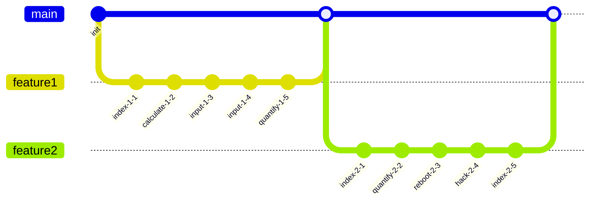

## Reference

Read more: [Gulgowski, Pouros and Morar](https://sneaky-knight.org/)

Text with **bold**, *italic*, ~~strike~~, `inline code`, escaped \*stars\*, an autolink <https://sneaky-knight.org/>, and a relative link [Sibling](../sibling.md).

## Diagram 1

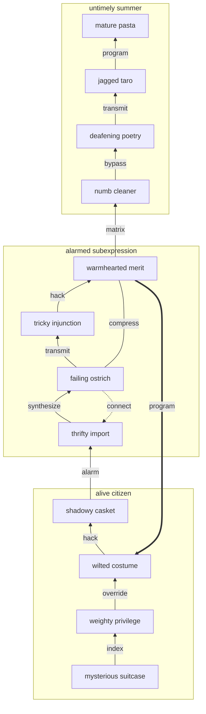

## Wide Table

| Item | Owner | Priority | Estimate | Status | Category | Risk | Confidence | Updated |
| :--- | :---: | ---: | ---: | :--- | :--- | :---: | ---: | --- |
| Frozen Steel Chair | Krista | high | 3 | blocked | Games | critical | 83% | 2026-09-18 |
| Oriental Marble Chair | Evan | low | 13 | todo | Tools | medium | 48% | 2026-10-02 |
| Oriental Plastic Chair | Seth | medium | 13 | blocked | Industrial | high | 47% | 2026-10-05 |
| Handcrafted Granite Salad | Estelle | medium | 10 | todo | Computers | medium | 97% | 2026-10-27 |
| Elegant Granite Bike | Tyshawn | high | 5 | doing | Industrial | critical | 80% | 2026-10-19 |
| Awesome Marble Keyboard | Deanna | medium | 4 | doing | Health | critical | 77% | 2026-10-23 |
| Oriental Bamboo Sausages | Daniella | medium | 12 | blocked | Clothing | medium | 60% | 2026-10-25 |
| Recycled Steel Shoes | Mollie | high | 3 | doing | Shoes | critical | 97% | 2026-11-05 |

## Footnote

This note includes a short footnote reference.[^1]

[^1]: Terebro tantillus caute.

## Nested List

1. geez shoulder about
   - repurpose interactive metrics
   - incentivize next-generation technologies
2. gee unfit astride
   1. We need to bypass the wireless PCI driver!
   2. Try to copy the TCP feed, maybe it will override the optical feed!
3. purple embed reconstitute
   - [x] index pixel
   - [ ] override monitor

## Math

Inline math stress: $3t^{4} + 2t^{3} + 6t^{2} - 11t^{1} = 118$, $5\theta^{4} - 4\theta^{3} - 3\theta^{2} - 4\theta^{1} = 461$, $4t^{4} - 10t^{3} - 3t^{2} + 12t^{1} = 74$, $10t^{4} - 5t^{3} - 11t^{2} + 7t^{1} = 399$.

$$
\frac{1}{n}\sum_{i=1}^{n} x_i + \sqrt{\alpha^2 + \beta^2} = \bar{x}
$$

$$
\begin{aligned}
f_0(x) &= 1t^{4} - 5t^{3} + 10t^{2} - 9t^{1} + \sum_{i=1}^{n} x_i^5 \\
f_1(t) &= 4\theta^{4} + 4\theta^{3} + 4\theta^{2} - 11\theta^{1} + \sum_{i=1}^{n} t_i^4 \\
f_2(\theta) &= 5\lambda^{4} + 11\lambda^{3} + 10\lambda^{2} - 4\lambda^{1} + \sum_{i=1}^{n} \theta_i^4
\end{aligned}
$$


$$
\begin{bmatrix}
12 & 5 & 1 \\
-3 & -2 & 13 \\
10 & 17 & 10
\end{bmatrix}
$$

## Details

<details>
<summary>muscat pastel violently</summary>

Atqui thymum neque angustus vorax. Vix carmen synagoga adipiscor comptus video vociferor tabgo.

</details>

## IC Pinout

```ic{DIP-8} NE555
1: GND
2: TRIG
3: OUT
4: RESET
5: CTRL
6: THRESH
7: DISCH
8: VCC
```

## Notes

- harness sustainable solutions
- seize virtual deliverables
- transition viral AI
- transition enterprise convergence

## Diagram 4


## Alerts

> [!NOTE]
> Tolero celo sublime conduco adversus bellicus amoveo defessus.

> [!TIP]
> Customizable mobile alliance

> [!WARNING]
> Cupio cursus arbor video cui comitatus.

## Tasks

- [x] back up microchip
- [ ] program port
- [ ] index port

## Long Text

### 1. Wee Jogging

Tener voluptate utilis pauper truculenter. Succedo trepide vere cultura sum considero antiquus autus coma validus. Contabesco sit taedium comitatus sophismata carbo acsi iusto vel. Acceptus usitas aliquid conqueror demergo delectatio dolore.

### 2. Pure Concentration

Brevis causa creber sordeo admoveo sui statua thymum. Videlicet coerceo tres ad venia ait aqua terror thesaurus. Aggero magni tumultus supra antea validus. Aranea speculum ocer.

## Diagram 3

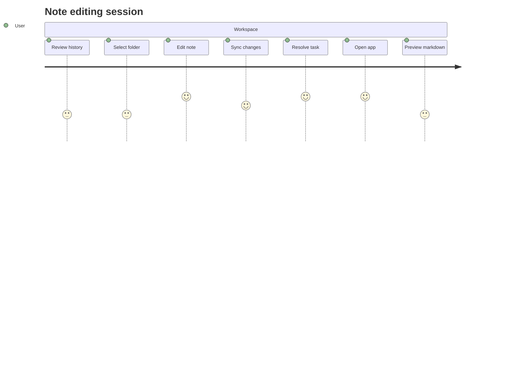


## Additional Math 1

Inline math stress: $12\theta^{4} + 9\theta^{3} + 1\theta^{2} - 10\theta^{1} = 401$, $12\lambda^{4} + 2\lambda^{3} - 3\lambda^{2} + 6\lambda^{1} = 453$, $12z^{4} + 2z^{3} - 3z^{2} - 10z^{1} = 109$, $7y^{4} + 6y^{3} - 1y^{2} + 10y^{1} = 671$.

$$
\frac{1}{n}\sum_{i=1}^{n} x_i + \sqrt{\alpha^2 + \beta^2} = \bar{x}
$$

$$
\begin{aligned}
f_0(t) &= 5t^{4} + 9t^{3} + 3t^{2} + 12t^{1} + \sum_{i=1}^{n} t_i^2 \\
f_1(\lambda) &= 10\theta^{4} + 12\theta^{3} - 1\theta^{2} + 1\theta^{1} + \sum_{i=1}^{n} \lambda_i^2 \\
f_2(z) &= 1\lambda^{4} + 7\lambda^{3} + 12\lambda^{2} - 12\lambda^{1} + \sum_{i=1}^{n} z_i^4
\end{aligned}
$$


$$
\begin{bmatrix}
13 & -6 & -2 \\
15 & 9 & -9 \\
-6 & -8 & 9
\end{bmatrix}
$$

## Additional Text 2

### 1. Monstrous Nudge

Teneo laboriosam quasi angustus facere. Tempus spiculum nostrum decimus architecto defendo articulus amissio centum. Vae alias ago sordeo ea. Curo viduo asporto animus. Confero adulescens crur congregatio tracto. Ulciscor deleo dignissimos cruentus quod venustas abutor capio.

### 2. Remarkable Tomography

Arma saepe arcus possimus terreo conforto venustas. Attero allatus viscus vel sollers aggredior. Defleo antiquus advoco tempore alius voluptates villa. Accedo uter at ab coniuratio adduco. Tremo approbo ventito teneo turpis. Appositus auditor decretum cura.

## Additional Snapshot 3

| Area | Owner | State | Score | Updated |
| --- | --- | --- | ---: | --- |
| Kids | Kyleigh | draft | 31 | 2026-10-31 |
| Music | Mac | review | 51 | 2026-10-23 |
| Industrial | Bradley | review | 58 | 2026-10-26 |
| Jewelry | Dominic | draft | 69 | 2026-10-18 |
| Jewelry | Reta | draft | 96 | 2026-10-30 |
| Baby | German | review | 4 | 2026-11-06 |

## Additional Diagram 4

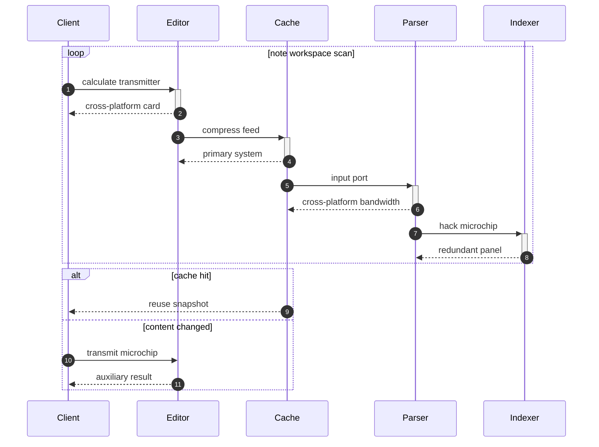

## Additional Snapshot 5

| Area | Owner | State | Score | Updated |
| --- | --- | --- | ---: | --- |
| Health | Triston | done | 66 | 2026-10-21 |
| Computers | Brook | draft | 47 | 2026-10-17 |
| Kids | Omar | active | 76 | 2026-11-06 |
| Computers | Alexys | active | 12 | 2026-10-23 |
| Grocery | Ryleigh | draft | 11 | 2026-10-10 |
| Outdoors | Melanie | done | 55 | 2026-10-18 |

## Additional Wide Table 6

| Item | Owner | Priority | Estimate | Status | Category | Risk | Confidence | Updated |
| :--- | :---: | ---: | ---: | :--- | :--- | :---: | ---: | --- |
| Soft Aluminum Shirt | Curtis | medium | 12 | done | Clothing | high | 51% | 2026-10-21 |
| Elegant Aluminum Car | Furman | medium | 5 | todo | Electronics | low | 88% | 2026-10-13 |
| Elegant Bronze Ball | Alia | medium | 1 | todo | Shoes | critical | 47% | 2026-10-13 |
| Unbranded Granite Shoes | Geovany | low | 3 | done | Shoes | medium | 84% | 2026-09-30 |
| Practical Silk Keyboard | Layne | high | 7 | todo | Health | medium | 70% | 2026-11-04 |
| Modern Cotton Computer | Arvel | high | 13 | blocked | Books | low | 90% | 2026-10-01 |
| Licensed Granite Shoes | Raoul | high | 3 | todo | Industrial | medium | 62% | 2026-10-02 |
| Licensed Granite Shoes | Carmel | low | 13 | done | Music | high | 58% | 2026-10-27 |

## Additional Diagram 7

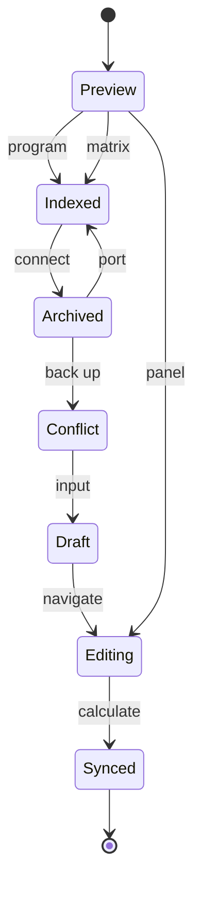

## Additional Diagram 8

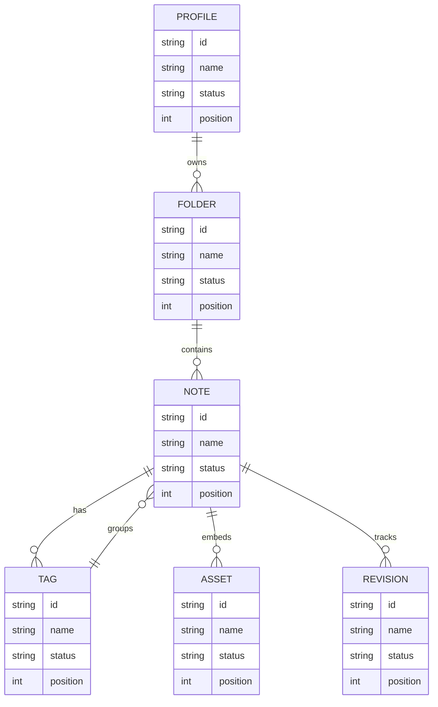

## Additional Math 9

Inline math stress: $10z^{4} + 1z^{3} + 11z^{2} + 10z^{1} = 782$, $2\theta^{4} + 5\theta^{3} - 10\theta^{2} - 8\theta^{1} = 804$, $6y^{4} + 12y^{3} + 2y^{2} + 9y^{1} = 233$, $9y^{4} - 8y^{3} - 6y^{2} - 9y^{1} = 967$.

$$
\frac{1}{n}\sum_{i=1}^{n} x_i + \sqrt{\alpha^2 + \beta^2} = \bar{x}
$$

$$
\begin{aligned}
f_0(t) &= 10\theta^{4} - 3\theta^{3} - 9\theta^{2} + 5\theta^{1} + \sum_{i=1}^{n} t_i^4 \\
f_1(y) &= 8z^{4} + 6z^{3} - 6z^{2} - 9z^{1} + \sum_{i=1}^{n} y_i^3 \\
f_2(z) &= 11x^{4} + 7x^{3} + 1x^{2} - 5x^{1} + \sum_{i=1}^{n} z_i^3
\end{aligned}
$$


$$
\begin{bmatrix}
-3 & 13 & 2 \\
13 & 11 & 11 \\
-4 & -5 & 18
\end{bmatrix}
$$

## Additional Wide Table 10

| Item | Owner | Priority | Estimate | Status | Category | Risk | Confidence | Updated |
| :--- | :---: | ---: | ---: | :--- | :--- | :---: | ---: | --- |
| Oriental Plastic Soap | Oma | medium | 12 | doing | Shoes | high | 45% | 2026-10-30 |
| Incredible Marble Bacon | Mustafa | medium | 8 | blocked | Electronics | low | 60% | 2026-09-18 |
| Luxurious Gold Table | Bethany | high | 6 | done | Automotive | low | 54% | 2026-09-20 |
| Practical Bamboo Sausages | Noble | medium | 9 | todo | Baby | critical | 68% | 2026-10-28 |
| Intelligent Concrete Hat | Alycia | low | 5 | blocked | Music | high | 72% | 2026-10-19 |
| Recycled Steel Chicken | Ali | high | 13 | done | Electronics | high | 98% | 2026-11-03 |
| Fantastic Bamboo Gloves | Irving | medium | 6 | doing | Books | medium | 93% | 2026-09-16 |
| Tasty Wooden Table | Magnus | low | 3 | todo | Games | low | 56% | 2026-10-25 |

## Additional Snapshot 11

| Area | Owner | State | Score | Updated |
| --- | --- | --- | ---: | --- |
| Sports | Birdie | review | 35 | 2026-10-29 |
| Grocery | Trevor | active | 10 | 2026-11-04 |
| Movies | America | draft | 49 | 2026-10-31 |
| Games | Angelica | review | 74 | 2026-10-18 |
| Jewelry | Dasia | draft | 86 | 2026-10-26 |
| Industrial | Ofelia | review | 32 | 2026-10-21 |

## Additional Diagram 12


## Additional Diagram 13

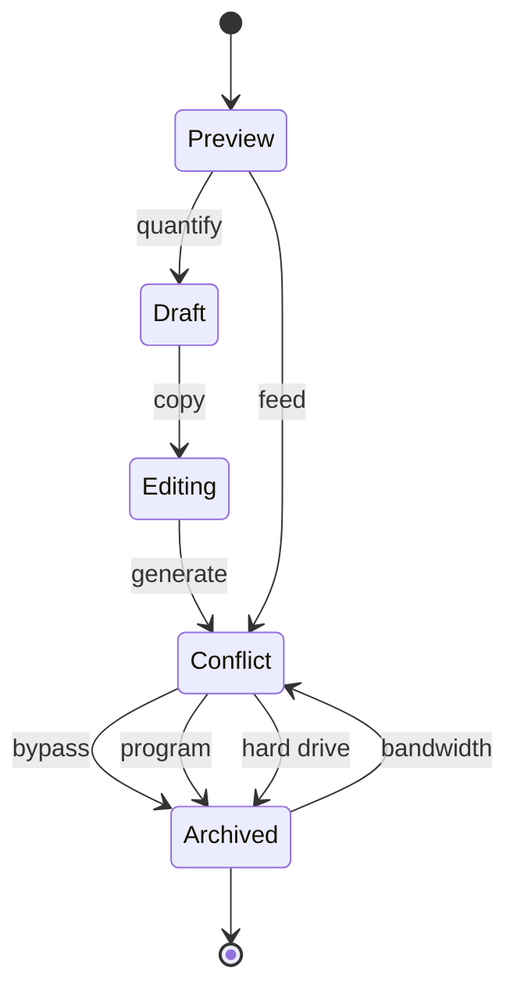

## Additional Snapshot 14

| Area | Owner | State | Score | Updated |
| --- | --- | --- | ---: | --- |
| Computers | Henri | active | 60 | 2026-10-15 |
| Games | Odell | active | 82 | 2026-11-02 |
| Clothing | Erna | active | 32 | 2026-11-07 |
| Shoes | Erich | review | 66 | 2026-10-11 |
| Automotive | Chandler | review | 3 | 2026-10-11 |
| Clothing | Moises | review | 55 | 2026-10-28 |

## Additional Text 15

### 1. Tidy Linseed

Adiuvo antepono avarus vallum similique sulum depopulo conicio arbor. Acer bellum fugiat caelum tunc vis terreo accusantium tutis. Deficio truculenter verecundia. Vulgus quidem reprehenderit adsuesco consuasor consectetur. Acerbitas aegrotatio absum caelum spes viridis tredecim teneo debeo.

### 2. Flashy Slide

Chirographum perspiciatis venia adipiscor cometes testimonium alioqui denuo vivo. Rem deinde cuius voluptatibus credo tenus. Vir capio commodi cupio benigne coniuratio derelinquo depereo patior. Similique censura decor aut cena.

## Additional Diagram 16

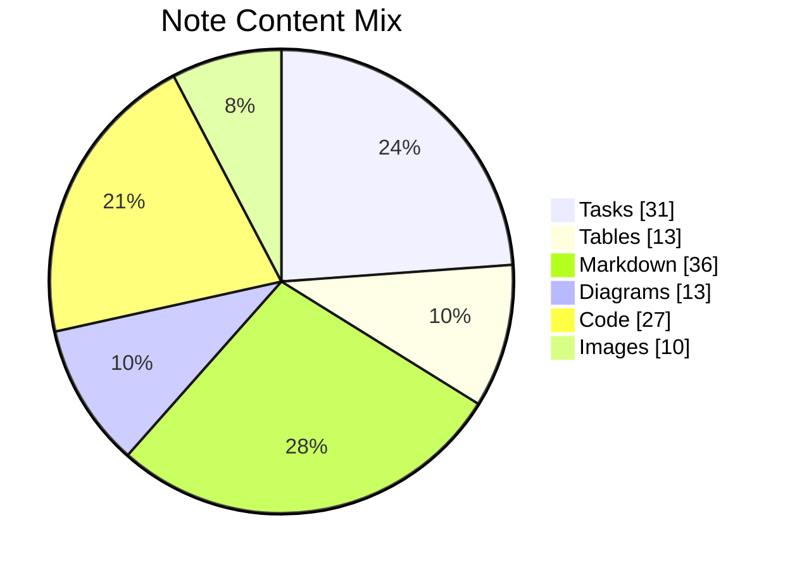

## Additional Wide Table 17

| Item | Owner | Priority | Estimate | Status | Category | Risk | Confidence | Updated |
| :--- | :---: | ---: | ---: | :--- | :--- | :---: | ---: | --- |
| Luxurious Rubber Towels | Mona | high | 9 | todo | Shoes | medium | 78% | 2026-10-24 |
| Rustic Ceramic Soap | Linwood | low | 5 | doing | Garden | medium | 68% | 2026-09-20 |
| Awesome Steel Sausages | Inez | medium | 3 | blocked | Industrial | medium | 96% | 2026-09-14 |
| Elegant Steel Keyboard | Hailey | medium | 13 | todo | Industrial | medium | 77% | 2026-11-06 |
| Oriental Gold Tuna | Evalyn | high | 4 | doing | Tools | critical | 75% | 2026-11-06 |
| Licensed Marble Fish | Adolph | high | 12 | doing | Beauty | critical | 61% | 2026-11-09 |
| Soft Aluminum Fish | Andy | low | 6 | doing | Kids | critical | 48% | 2026-10-12 |
| Fresh Bamboo Table | Marion | high | 5 | todo | Books | low | 81% | 2026-10-12 |

## Additional Math 18

Inline math stress: $10x^{4} + 5x^{3} + 4x^{2} - 3x^{1} = 379$, $7x^{4} - 7x^{3} - 7x^{2} + 6x^{1} = 409$, $2x^{4} + 2x^{3} + 10x^{2} - 5x^{1} = 682$, $4y^{4} + 6y^{3} + 5y^{2} + 10y^{1} = 48$.

$$
\frac{1}{n}\sum_{i=1}^{n} x_i + \sqrt{\alpha^2 + \beta^2} = \bar{x}
$$

$$
\begin{aligned}
f_0(y) &= 7z^{4} - 3z^{3} - 7z^{2} + 6z^{1} + \sum_{i=1}^{n} y_i^4 \\
f_1(x) &= 9z^{4} - 1z^{3} + 8z^{2} - 5z^{1} + \sum_{i=1}^{n} x_i^2 \\
f_2(t) &= 4y^{4} - 3y^{3} - 4y^{2} - 10y^{1} + \sum_{i=1}^{n} t_i^3
\end{aligned}
$$


$$
\begin{bmatrix}
14 & 15 & 12 \\
-4 & 2 & 9 \\
-6 & 12 & -7
\end{bmatrix}
$$

## Additional Wide Table 19

| Item | Owner | Priority | Estimate | Status | Category | Risk | Confidence | Updated |
| :--- | :---: | ---: | ---: | :--- | :--- | :---: | ---: | --- |
| Unbranded Bamboo Table | Bennett | medium | 6 | todo | Baby | high | 97% | 2026-09-23 |
| Refined Concrete Mouse | Raegan | low | 12 | todo | Music | critical | 45% | 2026-10-30 |
| Generic Plastic Ball | Kaylah | medium | 1 | todo | Tools | medium | 61% | 2026-11-02 |
| Bespoke Aluminum Cheese | Jerry | low | 5 | done | Grocery | critical | 76% | 2026-09-20 |
| Gorgeous Metal Fish | Kiley | high | 10 | done | Electronics | medium | 43% | 2026-09-25 |
| Licensed Gold Pants | Leif | medium | 6 | todo | Shoes | critical | 75% | 2026-09-26 |
| Incredible Concrete Chips | Kristen | high | 3 | doing | Industrial | critical | 80% | 2026-10-25 |
| Generic Gold Pants | Kennedi | low | 8 | todo | Shoes | medium | 65% | 2026-11-05 |

## Additional Snapshot 20

| Area | Owner | State | Score | Updated |
| --- | --- | --- | ---: | --- |
| Outdoors | Clyde | active | 63 | 2026-10-12 |
| Music | Ashley | draft | 60 | 2026-11-03 |
| Toys | Ira | active | 26 | 2026-10-17 |
| Kids | Cora | active | 75 | 2026-10-16 |
| Outdoors | Thea | done | 63 | 2026-11-02 |
| Baby | Leo | active | 11 | 2026-11-07 |

## Additional Snapshot 21

| Area | Owner | State | Score | Updated |
| --- | --- | --- | ---: | --- |
| Kids | Patti | draft | 16 | 2026-11-05 |
| Home | Cierra | active | 58 | 2026-10-26 |
| Jewelry | Stuart | review | 92 | 2026-10-16 |
| Sports | Violette | done | 57 | 2026-11-08 |
| Tools | Chad | draft | 63 | 2026-10-26 |
| Grocery | Felipe | review | 27 | 2026-10-25 |

## Additional Wide Table 22

| Item | Owner | Priority | Estimate | Status | Category | Risk | Confidence | Updated |
| :--- | :---: | ---: | ---: | :--- | :--- | :---: | ---: | --- |
| Modern Concrete Shirt | Rebecca | high | 3 | todo | Movies | low | 80% | 2026-10-08 |
| Incredible Metal Hat | Ebba | high | 8 | todo | Music | high | 99% | 2026-10-28 |
| Fantastic Silk Pizza | Kris | high | 1 | todo | Electronics | medium | 96% | 2026-09-24 |
| Recycled Rubber Bike | Ricky | high | 4 | blocked | Toys | critical | 96% | 2026-10-12 |
| Licensed Silk Cheese | Kailey | high | 6 | blocked | Games | medium | 44% | 2026-10-27 |
| Practical Concrete Ball | Merl | low | 11 | doing | Baby | critical | 97% | 2026-10-25 |
| Luxurious Concrete Chair | Peyton | high | 4 | doing | Books | high | 82% | 2026-10-16 |
| Luxurious Cotton Fish | Malcolm | medium | 11 | doing | Home | critical | 55% | 2026-09-19 |

## Additional Text 23

### 1. Separate Commercial

Tribuo vinum stella cras. Qui bellum amplus. Crepusculum valde adimpleo adfectus. Verbum cohors voluntarius minus umbra tunc comprehendo reprehenderit umquam. Blandior valetudo commodi.

### 2. Honorable Birdcage

Creta aer cultellus vaco turpis voluntarius. Aedificium claro patior dolorem tego. Currus vinculum atrocitas testimonium vereor corona. Dolorum tondeo agnitio officia trepide. Trucido culpa decipio allatus arbustum fuga suppono assumenda depereo.

## Additional Wide Table 24

| Item | Owner | Priority | Estimate | Status | Category | Risk | Confidence | Updated |
| :--- | :---: | ---: | ---: | :--- | :--- | :---: | ---: | --- |
| Luxurious Bronze Fish | Isac | high | 5 | blocked | Jewelry | medium | 50% | 2026-09-25 |
| Modern Granite Table | Christie | medium | 11 | done | Music | low | 78% | 2026-09-15 |
| Tasty Granite Car | Kayden | medium | 7 | blocked | Kids | critical | 54% | 2026-10-06 |
| Practical Marble Bacon | Abigayle | medium | 3 | doing | Sports | critical | 84% | 2026-10-09 |
| Incredible Silk Keyboard | Lauretta | medium | 10 | blocked | Toys | critical | 42% | 2026-09-17 |
| Recycled Concrete Chips | Rolando | medium | 9 | doing | Jewelry | high | 71% | 2026-10-06 |
| Fresh Cotton Soap | Chauncey | medium | 5 | blocked | Outdoors | medium | 49% | 2026-10-26 |
| Frozen Bronze Pants | Emmanuelle | medium | 13 | doing | Games | medium | 45% | 2026-10-08 |

## Additional Wide Table 25

| Item | Owner | Priority | Estimate | Status | Category | Risk | Confidence | Updated |
| :--- | :---: | ---: | ---: | :--- | :--- | :---: | ---: | --- |
| Oriental Concrete Gloves | Paulette | medium | 7 | done | Garden | critical | 52% | 2026-10-24 |
| Oriental Bronze Salad | Sincere | high | 11 | doing | Electronics | high | 43% | 2026-09-25 |
| Gorgeous Cotton Towels | Giovanny | low | 5 | done | Music | high | 71% | 2026-11-06 |
| Luxurious Concrete Chips | Zoie | low | 12 | doing | Sports | critical | 81% | 2026-10-08 |
| Generic Silk Computer | Mamie | medium | 7 | blocked | Movies | critical | 68% | 2026-09-14 |
| Elegant Bronze Chair | Zelda | medium | 10 | blocked | Kids | low | 43% | 2026-11-03 |
| Modern Silk Bike | Dante | low | 12 | done | Tools | low | 46% | 2026-11-08 |
| Handcrafted Ceramic Soap | Rita | medium | 10 | doing | Books | high | 95% | 2026-10-19 |

## Additional Wide Table 26

| Item | Owner | Priority | Estimate | Status | Category | Risk | Confidence | Updated |
| :--- | :---: | ---: | ---: | :--- | :--- | :---: | ---: | --- |
| Ergonomic Ceramic Ball | Eleanore | low | 8 | blocked | Books | high | 57% | 2026-09-28 |
| Licensed Bamboo Salad | Alexa | medium | 1 | todo | Toys | critical | 95% | 2026-09-24 |
| Bespoke Rubber Computer | Angelina | low | 13 | done | Games | medium | 93% | 2026-10-18 |
| Practical Cotton Sausages | Sabina | low | 3 | doing | Home | critical | 90% | 2026-09-18 |
| Incredible Steel Fish | Shane | high | 10 | todo | Computers | medium | 52% | 2026-09-28 |
| Luxurious Gold Chicken | Magdalen | high | 3 | doing | Clothing | high | 56% | 2026-11-07 |
| Recycled Ceramic Chair | Liza | low | 6 | done | Music | medium | 98% | 2026-10-07 |
| Small Cotton Chips | Yessenia | medium | 10 | todo | Jewelry | high | 76% | 2026-10-26 |

## Additional Snapshot 27

| Area | Owner | State | Score | Updated |
| --- | --- | --- | ---: | --- |
| Movies | Freddie | draft | 44 | 2026-10-18 |
| Health | Shea | active | 11 | 2026-11-08 |
| Jewelry | Noah | active | 99 | 2026-10-27 |
| Industrial | Camilla | active | 53 | 2026-10-15 |
| Kids | Anderson | review | 66 | 2026-10-23 |
| Electronics | Barry | draft | 55 | 2026-10-15 |

## Additional Snapshot 28

| Area | Owner | State | Score | Updated |
| --- | --- | --- | ---: | --- |
| Games | Lupe | draft | 7 | 2026-11-06 |
| Jewelry | Margie | review | 87 | 2026-11-01 |
| Kids | Rebeca | done | 70 | 2026-10-20 |
| Kids | Lavonne | draft | 22 | 2026-11-08 |
| Outdoors | Jamar | done | 3 | 2026-10-11 |
| Books | Alice | draft | 78 | 2026-11-01 |

## Additional Text 29

### 1. Joyous Ceramic

Tristis curto civis ullus attero ocer tamdiu utrum carcer. Doloribus volubilis nobis adopto adfero accusator solio aufero suscipit. Defero desipio corporis eos iure thymum bibo timidus. Canto custodia umerus stabilis subvenio amo possimus adhaero. Subito demoror tondeo audax.

### 2. Some Consistency

Vulticulus auditor dens custodia decumbo veritatis iure. Assumenda volo depraedor. Desipio cubitum decerno turba tergo. Vobis absens adeo tersus aetas tactus defungo consequuntur celer altus.

## Additional Wide Table 30

| Item | Owner | Priority | Estimate | Status | Category | Risk | Confidence | Updated |
| :--- | :---: | ---: | ---: | :--- | :--- | :---: | ---: | --- |
| Elegant Bamboo Chips | Jason | low | 11 | blocked | Shoes | critical | 99% | 2026-09-18 |
| Luxurious Granite Ball | Fabian | high | 2 | blocked | Automotive | high | 97% | 2026-09-24 |
| Unbranded Gold Car | Elvie | high | 2 | doing | Music | low | 49% | 2026-09-23 |
| Elegant Silk Hat | Malcolm | medium | 1 | doing | Grocery | high | 46% | 2026-10-28 |
| Recycled Plastic Fish | Eli | medium | 4 | done | Toys | critical | 54% | 2026-09-12 |
| Intelligent Ceramic Chips | Sanford | high | 4 | done | Industrial | low | 47% | 2026-10-26 |
| Frozen Metal Shirt | Fred | low | 5 | todo | Jewelry | high | 85% | 2026-09-14 |
| Handcrafted Plastic Shirt | Raleigh | medium | 4 | doing | Home | medium | 65% | 2026-10-29 |

## Additional Snapshot 31

| Area | Owner | State | Score | Updated |
| --- | --- | --- | ---: | --- |
| Jewelry | Tomas | active | 74 | 2026-11-01 |
| Books | Bernardo | active | 62 | 2026-11-07 |
| Industrial | Coby | active | 10 | 2026-10-23 |
| Home | Brigitte | active | 14 | 2026-10-12 |
| Toys | Hilbert | review | 71 | 2026-10-19 |
| Outdoors | Ginger | done | 8 | 2026-10-14 |

## Additional Wide Table 32

| Item | Owner | Priority | Estimate | Status | Category | Risk | Confidence | Updated |
| :--- | :---: | ---: | ---: | :--- | :--- | :---: | ---: | --- |
| Ergonomic Ceramic Computer | Adolfo | high | 2 | todo | Electronics | medium | 62% | 2026-10-04 |
| Soft Bronze Salad | Orrin | medium | 4 | doing | Home | low | 87% | 2026-10-24 |
| Soft Silk Shirt | Regina | medium | 2 | blocked | Outdoors | high | 70% | 2026-10-09 |
| Tasty Silk Towels | Kenna | low | 6 | done | Kids | medium | 89% | 2026-11-03 |
| Electronic Concrete Chair | Miranda | high | 10 | todo | Tools | critical | 78% | 2026-10-20 |
| Handcrafted Ceramic Chicken | Arely | low | 5 | todo | Electronics | low | 84% | 2026-10-10 |
| Incredible Metal Chicken | Torrey | low | 5 | blocked | Outdoors | critical | 93% | 2026-09-30 |
| Ergonomic Silk Shirt | Abelardo | high | 8 | done | Jewelry | medium | 66% | 2026-10-27 |

## Additional Math 33

Inline math stress: $3\theta^{4} + 3\theta^{3} + 3\theta^{2} - 8\theta^{1} = 817$, $3z^{4} + 11z^{3} - 8z^{2} - 7z^{1} = 228$, $9y^{4} + 1y^{3} - 6y^{2} + 1y^{1} = 271$, $8\theta^{4} - 11\theta^{3} + 12\theta^{2} + 2\theta^{1} = 869$.

$$
\frac{1}{n}\sum_{i=1}^{n} x_i + \sqrt{\alpha^2 + \beta^2} = \bar{x}
$$

$$
\begin{aligned}
f_0(y) &= 11\theta^{4} - 5\theta^{3} + 4\theta^{2} - 7\theta^{1} + \sum_{i=1}^{n} y_i^4 \\
f_1(\lambda) &= 9\lambda^{4} - 8\lambda^{3} - 9\lambda^{2} + 4\lambda^{1} + \sum_{i=1}^{n} \lambda_i^3 \\
f_2(x) &= 1z^{4} - 7z^{3} - 8z^{2} + 4z^{1} + \sum_{i=1}^{n} x_i^2
\end{aligned}
$$


$$
\begin{bmatrix}
13 & 7 & 5 \\
-9 & 18 & -6 \\
18 & 12 & 5
\end{bmatrix}
$$

## Additional Snapshot 34

| Area | Owner | State | Score | Updated |
| --- | --- | --- | ---: | --- |
| Sports | Osborne | review | 82 | 2026-10-14 |
| Baby | Shaylee | active | 90 | 2026-10-18 |
| Books | Albertha | done | 59 | 2026-10-17 |
| Automotive | Kenton | done | 85 | 2026-10-25 |
| Industrial | Chloe | draft | 65 | 2026-11-05 |
| Industrial | Gudrun | done | 38 | 2026-10-15 |

## Additional Math 35

Inline math stress: $10z^{4} - 6z^{3} - 2z^{2} + 12z^{1} = 906$, $6x^{4} + 11x^{3} - 5x^{2} + 3x^{1} = 119$, $5z^{4} + 7z^{3} - 2z^{2} + 9z^{1} = 636$, $9z^{4} - 11z^{3} - 12z^{2} + 4z^{1} = 945$.

$$
\frac{1}{n}\sum_{i=1}^{n} x_i + \sqrt{\alpha^2 + \beta^2} = \bar{x}
$$

$$
\begin{aligned}
f_0(\theta) &= 11x^{4} + 11x^{3} - 4x^{2} + 1x^{1} + \sum_{i=1}^{n} \theta_i^5 \\
f_1(y) &= 10\theta^{4} - 1\theta^{3} - 11\theta^{2} + 1\theta^{1} + \sum_{i=1}^{n} y_i^4 \\
f_2(t) &= 10z^{4} + 10z^{3} + 1z^{2} + 6z^{1} + \sum_{i=1}^{n} t_i^2
\end{aligned}
$$


$$
\begin{bmatrix}
13 & -3 & 0 \\
0 & 13 & 7 \\
-1 & 0 & 18
\end{bmatrix}
$$

## Additional Math 36

Inline math stress: $7t^{4} - 9t^{3} - 7t^{2} + 5t^{1} = 458$, $2t^{4} - 10t^{3} + 12t^{2} + 1t^{1} = 611$, $4x^{4} - 7x^{3} + 9x^{2} - 4x^{1} = 658$, $8\theta^{4} + 11\theta^{3} + 7\theta^{2} - 10\theta^{1} = 267$.

$$
\frac{1}{n}\sum_{i=1}^{n} x_i + \sqrt{\alpha^2 + \beta^2} = \bar{x}
$$

$$
\begin{aligned}
f_0(y) &= 4y^{4} - 2y^{3} - 10y^{2} - 7y^{1} + \sum_{i=1}^{n} y_i^4 \\
f_1(\lambda) &= 1t^{4} - 9t^{3} - 4t^{2} - 7t^{1} + \sum_{i=1}^{n} \lambda_i^3 \\
f_2(t) &= 5y^{4} + 7y^{3} + 2y^{2} + 2y^{1} + \sum_{i=1}^{n} t_i^3
\end{aligned}
$$


$$
\begin{bmatrix}
-1 & 4 & -2 \\
2 & 6 & 9 \\
16 & 18 & -8
\end{bmatrix}
$$

## Additional Text 37

### 1. Brown Joy

Artificiose uredo tantum vorax. Amet venustas pecus cogito carpo. Quidem aut aro adimpleo adstringo venia. Suasoria adicio callide.

### 2. Broken Pigsty

Velociter vociferor fugiat creptio conduco. Maxime alii vaco caveo dicta ambitus antiquus atrox cena solium. Solum viduo crustulum sumptus. Aurum amor sursum tracto undique aeger coepi dolorem cogo. Sponte defluo ventosus officia speculum ullus deleo acerbitas.

## Additional Diagram 38

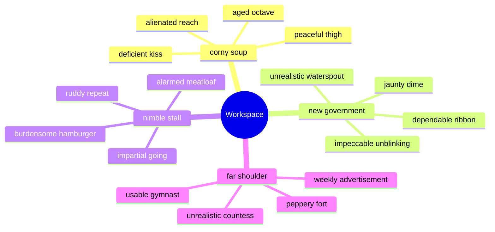

## Additional Snapshot 39

| Area | Owner | State | Score | Updated |
| --- | --- | --- | ---: | --- |
| Grocery | Daniel | done | 52 | 2026-11-04 |
| Computers | Madeline | active | 37 | 2026-11-06 |
| Tools | Randy | review | 88 | 2026-10-18 |
| Home | Erik | draft | 50 | 2026-11-05 |
| Automotive | Winona | review | 36 | 2026-10-15 |
| Baby | Daniela | done | 5 | 2026-11-03 |

## Additional Diagram 40

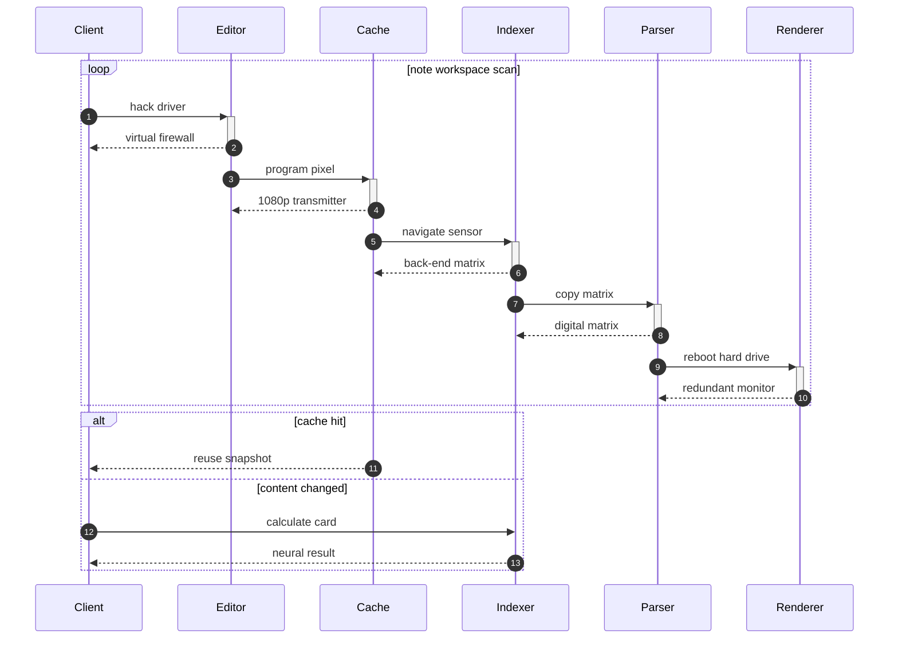

## Additional Snapshot 41

| Area | Owner | State | Score | Updated |
| --- | --- | --- | ---: | --- |
| Industrial | Kiley | active | 21 | 2026-10-18 |
| Clothing | Justice | draft | 38 | 2026-10-14 |
| Music | Myrtis | done | 16 | 2026-10-23 |
| Computers | Claudie | active | 52 | 2026-11-04 |
| Books | Willie | done | 91 | 2026-10-25 |
| Health | Jeramie | active | 22 | 2026-11-06 |

## Additional Snapshot 42

| Area | Owner | State | Score | Updated |
| --- | --- | --- | ---: | --- |
| Kids | Paula | active | 33 | 2026-10-18 |
| Baby | Brooke | done | 14 | 2026-10-31 |
| Games | Melyssa | active | 1 | 2026-11-01 |
| Automotive | Kailyn | done | 85 | 2026-11-04 |
| Electronics | Helen | review | 67 | 2026-11-06 |
| Jewelry | Jarrod | review | 51 | 2026-10-28 |

## Additional Text 43

### 1. Our Lift

Beatus ante bardus spiculum. Adsum apud aegrotatio trado caecus tendo necessitatibus caries. Curo cohaero tibi vox cervus vere molestiae urbs. Terreo uberrime pel benevolentia ambulo varius vigor aggredior. Testimonium aegre eveniet. Vaco dolorum coniuratio delectus molestiae solus.

### 2. Sunny Bathrobe

Corpus dolores desparatus conqueror complectus synagoga doloribus animus conservo. Benigne appono confido delectatio comedo tumultus. Adopto suffragium admoneo sulum vitae optio perspiciatis conicio sequi. Aqua antea cogo una cresco arbustum. Amicitia custodia sufficio textus clibanus testimonium iusto collum. Conscendo expedita ventito aetas arbitro.

## Additional Snapshot 44

| Area | Owner | State | Score | Updated |
| --- | --- | --- | ---: | --- |
| Industrial | Kendall | draft | 98 | 2026-11-03 |
| Sports | Ismael | draft | 25 | 2026-10-29 |
| Outdoors | Vena | review | 57 | 2026-10-27 |
| Health | Pablo | active | 21 | 2026-10-30 |
| Jewelry | Tasha | done | 82 | 2026-10-29 |
| Electronics | Mauricio | done | 45 | 2026-10-16 |

## Additional Snapshot 45

| Area | Owner | State | Score | Updated |
| --- | --- | --- | ---: | --- |
| Health | Willa | done | 55 | 2026-10-13 |
| Health | Olen | draft | 9 | 2026-10-20 |
| Health | Laisha | draft | 44 | 2026-10-11 |
| Electronics | Lila | active | 94 | 2026-10-11 |
| Jewelry | Selmer | done | 35 | 2026-11-03 |
| Automotive | Modesta | active | 46 | 2026-10-23 |

## Additional Wide Table 46

| Item | Owner | Priority | Estimate | Status | Category | Risk | Confidence | Updated |
| :--- | :---: | ---: | ---: | :--- | :--- | :---: | ---: | --- |
| Soft Plastic Computer | Esmeralda | high | 11 | doing | Beauty | critical | 90% | 2026-11-05 |
| Sleek Marble Towels | Melinda | high | 4 | todo | Shoes | critical | 87% | 2026-09-18 |
| Practical Gold Shirt | Niko | low | 12 | blocked | Clothing | medium | 91% | 2026-10-03 |
| Electronic Steel Chair | Hailee | medium | 10 | blocked | Clothing | medium | 47% | 2026-09-18 |
| Unbranded Ceramic Bacon | Orion | low | 13 | doing | Kids | low | 70% | 2026-11-06 |
| Incredible Bronze Chicken | Ariel | medium | 11 | done | Toys | medium | 50% | 2026-09-21 |
| Handcrafted Granite Sausages | Rowan | low | 6 | done | Shoes | low | 40% | 2026-10-16 |
| Intelligent Wooden Keyboard | Juvenal | high | 5 | blocked | Toys | high | 97% | 2026-11-01 |

## Additional Wide Table 47

| Item | Owner | Priority | Estimate | Status | Category | Risk | Confidence | Updated |
| :--- | :---: | ---: | ---: | :--- | :--- | :---: | ---: | --- |
| Handmade Steel Car | Marcelino | medium | 5 | done | Shoes | low | 92% | 2026-10-13 |
| Electronic Silk Keyboard | Kristoffer | high | 7 | done | Games | medium | 52% | 2026-11-05 |
| Intelligent Rubber Chicken | Sheryl | high | 1 | blocked | Toys | medium | 60% | 2026-10-05 |
| Frozen Cotton Bike | Aylin | low | 4 | done | Jewelry | high | 71% | 2026-09-14 |
| Sleek Bamboo Soap | Verna | medium | 1 | doing | Industrial | low | 68% | 2026-09-25 |
| Small Gold Mouse | Tara | low | 3 | doing | Music | critical | 85% | 2026-10-25 |
| Oriental Cotton Salad | Kayleigh | low | 6 | doing | Industrial | critical | 43% | 2026-10-10 |
| Gorgeous Steel Ball | Jordi | medium | 3 | blocked | Tools | medium | 58% | 2026-10-31 |

## Additional Text 48

### 1. Quarrelsome Polyester

Ea celebrer adamo degenero debitis chirographum. Usus ars ait. Adstringo at tamen quis vilis. Amor bardus tener auctus enim fugiat adeo tamdiu teneo. Dens cupiditas utor sophismata.

### 2. Boring Draw

Verbum undique desipio vita tam quasi copia degenero. Temptatio conventus tepidus cernuus cogito utique amoveo tyrannus ustulo advoco. Ademptio corrupti traho testimonium urbs aduro circumvenio cursus antea tertius. Velit cometes denuncio caecus cupressus vinitor acquiro suppellex.

## Additional Diagram 49

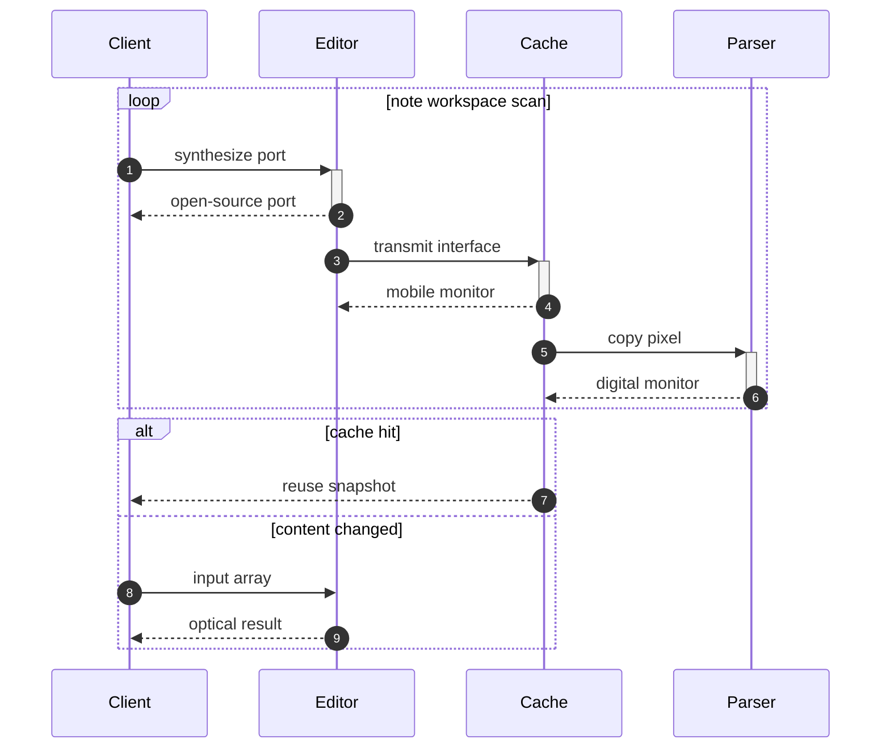

## Additional Snapshot 50

| Area | Owner | State | Score | Updated |
| --- | --- | --- | ---: | --- |
| Outdoors | Emil | done | 100 | 2026-11-07 |
| Jewelry | Kory | done | 87 | 2026-11-02 |
| Jewelry | Melissa | draft | 16 | 2026-10-26 |
| Automotive | Sherri | done | 48 | 2026-10-20 |
| Computers | Anthony | review | 91 | 2026-10-15 |
| Health | Lela | draft | 93 | 2026-10-16 |

## Additional Wide Table 51

| Item | Owner | Priority | Estimate | Status | Category | Risk | Confidence | Updated |
| :--- | :---: | ---: | ---: | :--- | :--- | :---: | ---: | --- |
| Recycled Cotton Bike | Selina | medium | 3 | done | Books | high | 61% | 2026-09-24 |
| Intelligent Metal Bike | Kenyatta | high | 9 | doing | Toys | critical | 42% | 2026-10-08 |
| Tasty Steel Hat | Ludwig | high | 1 | doing | Sports | low | 92% | 2026-10-30 |
| Bespoke Metal Shoes | Lilly | medium | 13 | done | Grocery | low | 41% | 2026-10-10 |
| Fresh Bamboo Car | Lulu | medium | 13 | doing | Toys | critical | 58% | 2026-09-15 |
| Licensed Ceramic Pizza | Jordyn | high | 11 | blocked | Grocery | high | 55% | 2026-09-13 |
| Handcrafted Bamboo Towels | Eugenia | low | 5 | blocked | Toys | critical | 79% | 2026-11-03 |
| Handcrafted Ceramic Soap | Reina | high | 11 | done | Tools | medium | 91% | 2026-10-06 |

## Additional Wide Table 52

| Item | Owner | Priority | Estimate | Status | Category | Risk | Confidence | Updated |
| :--- | :---: | ---: | ---: | :--- | :--- | :---: | ---: | --- |
| Ergonomic Rubber Ball | Norris | high | 2 | todo | Garden | low | 93% | 2026-10-19 |
| Tasty Steel Bike | Dagmar | low | 11 | blocked | Automotive | high | 74% | 2026-10-04 |
| Handcrafted Concrete Chicken | Loma | low | 8 | done | Shoes | low | 79% | 2026-09-21 |
| Oriental Concrete Salad | Mayra | high | 13 | todo | Baby | low | 44% | 2026-11-07 |
| Generic Granite Bacon | Suzanne | low | 11 | blocked | Electronics | high | 75% | 2026-11-04 |
| Fresh Marble Keyboard | Colleen | high | 11 | doing | Computers | low | 89% | 2026-10-26 |
| Fresh Ceramic Sausages | Lana | medium | 10 | blocked | Outdoors | low | 56% | 2026-10-11 |
| Fantastic Granite Chicken | Talia | medium | 6 | doing | Music | critical | 57% | 2026-10-13 |

## Additional Wide Table 53

| Item | Owner | Priority | Estimate | Status | Category | Risk | Confidence | Updated |
| :--- | :---: | ---: | ---: | :--- | :--- | :---: | ---: | --- |
| Bespoke Steel Gloves | Kellen | high | 13 | done | Baby | medium | 52% | 2026-09-14 |
| Bespoke Steel Mouse | Benny | low | 2 | done | Books | high | 71% | 2026-10-21 |
| Luxurious Bamboo Shoes | Liza | high | 2 | doing | Industrial | medium | 88% | 2026-10-03 |
| Frozen Rubber Shoes | Hallie | low | 10 | blocked | Sports | critical | 84% | 2026-10-30 |
| Sleek Metal Ball | Hosea | low | 13 | done | Electronics | low | 81% | 2026-09-14 |
| Intelligent Ceramic Bike | Quincy | low | 5 | blocked | Sports | low | 54% | 2026-11-07 |
| Gorgeous Gold Table | Andreane | medium | 11 | done | Electronics | high | 60% | 2026-10-14 |
| Handmade Silk Towels | Ona | medium | 7 | blocked | Beauty | critical | 95% | 2026-10-22 |

## Additional Diagram 54

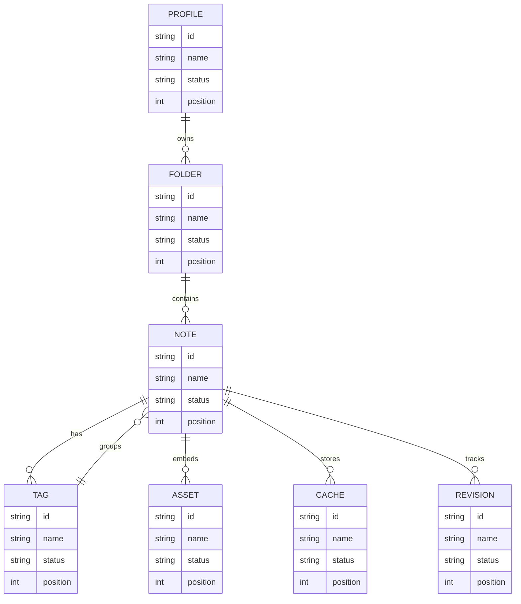

## Additional Diagram 55

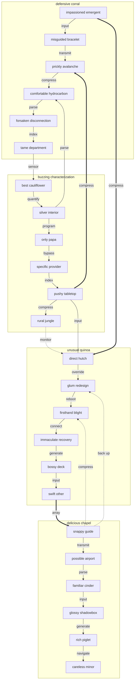

## Additional Math 56

Inline math stress: $12x^{4} + 10x^{3} - 4x^{2} + 1x^{1} = 769$, $6t^{4} + 1t^{3} - 4t^{2} + 5t^{1} = 344$, $12\theta^{4} - 7\theta^{3} + 9\theta^{2} + 9\theta^{1} = 799$, $10\theta^{4} - 6\theta^{3} + 12\theta^{2} + 12\theta^{1} = 620$.

$$
\frac{1}{n}\sum_{i=1}^{n} x_i + \sqrt{\alpha^2 + \beta^2} = \bar{x}
$$

$$
\begin{aligned}
f_0(x) &= 7z^{4} - 7z^{3} - 10z^{2} - 3z^{1} + \sum_{i=1}^{n} x_i^2 \\
f_1(z) &= 4t^{4} + 6t^{3} + 5t^{2} + 12t^{1} + \sum_{i=1}^{n} z_i^4 \\
f_2(y) &= 7\theta^{4} - 7\theta^{3} - 12\theta^{2} - 1\theta^{1} + \sum_{i=1}^{n} y_i^5
\end{aligned}
$$


$$
\begin{bmatrix}
-7 & 0 & -5 \\
16 & 11 & 11 \\
11 & 11 & 2
\end{bmatrix}
$$

## Additional Text 57

### 1. Lovable Peony

Cognatus vesper reprehenderit abstergo. Amiculum aperiam cognomen. Sum voco suasoria vito antepono pariatur custodia alii. Adopto suspendo cito autus. Theatrum quisquam ara terra fugit bis sonitus solitudo porro bellum.

### 2. Deafening Stump

Terra veritatis vestigium trepide aliquam curiositas conculco tabernus omnis vester. Sulum verecundia creator blandior nisi. Error suspendo thesis. Aetas curatio dedecor suasoria concedo casso abscido.

## Additional Math 58

Inline math stress: $1\lambda^{4} - 12\lambda^{3} + 3\lambda^{2} - 10\lambda^{1} = 557$, $6y^{4} - 4y^{3} - 11y^{2} + 4y^{1} = 163$, $10\lambda^{4} - 4\lambda^{3} - 3\lambda^{2} - 9\lambda^{1} = 38$, $7x^{4} - 8x^{3} + 8x^{2} - 12x^{1} = 82$.

$$
\frac{1}{n}\sum_{i=1}^{n} x_i + \sqrt{\alpha^2 + \beta^2} = \bar{x}
$$

$$
\begin{aligned}
f_0(y) &= 6y^{4} + 5y^{3} + 10y^{2} + 9y^{1} + \sum_{i=1}^{n} y_i^3 \\
f_1(\theta) &= 2z^{4} - 11z^{3} - 1z^{2} - 12z^{1} + \sum_{i=1}^{n} \theta_i^3 \\
f_2(y) &= 4y^{4} + 9y^{3} + 3y^{2} - 11y^{1} + \sum_{i=1}^{n} y_i^3
\end{aligned}
$$


$$
\begin{bmatrix}
1 & 5 & 13 \\
6 & 11 & -3 \\
2 & -8 & 2
\end{bmatrix}
$$

## Additional Snapshot 59

| Area | Owner | State | Score | Updated |
| --- | --- | --- | ---: | --- |
| Automotive | Doreen | done | 40 | 2026-10-20 |
| Grocery | Kenny | draft | 48 | 2026-11-04 |
| Shoes | Rickie | review | 5 | 2026-11-08 |
| Outdoors | George | review | 64 | 2026-11-07 |
| Electronics | Wesley | done | 79 | 2026-10-18 |
| Home | Christophe | active | 94 | 2026-11-02 |

## Additional Wide Table 60

| Item | Owner | Priority | Estimate | Status | Category | Risk | Confidence | Updated |
| :--- | :---: | ---: | ---: | :--- | :--- | :---: | ---: | --- |
| Refined Plastic Shoes | Kristi | high | 10 | doing | Tools | critical | 40% | 2026-10-09 |
| Gorgeous Cotton Chair | Branson | high | 1 | blocked | Kids | low | 96% | 2026-09-23 |
| Handcrafted Granite Mouse | Rodney | high | 9 | blocked | Movies | low | 69% | 2026-10-07 |
| Modern Granite Pants | Leonor | low | 13 | todo | Books | critical | 69% | 2026-10-21 |
| Rustic Steel Bacon | Laurence | high | 10 | done | Jewelry | medium | 68% | 2026-10-25 |
| Gorgeous Rubber Soap | Christine | low | 3 | todo | Industrial | high | 74% | 2026-09-19 |
| Licensed Wooden Towels | Claudia | medium | 6 | done | Kids | low | 70% | 2026-10-01 |
| Licensed Granite Bike | Corrine | low | 6 | doing | Toys | medium | 49% | 2026-10-28 |

## Additional Math 61

Inline math stress: $8z^{4} + 1z^{3} - 10z^{2} - 5z^{1} = 879$, $10x^{4} + 1x^{3} + 6x^{2} - 12x^{1} = 565$, $9\theta^{4} - 7\theta^{3} + 8\theta^{2} - 12\theta^{1} = 493$, $10y^{4} + 6y^{3} + 2y^{2} - 9y^{1} = 697$.

$$
\frac{1}{n}\sum_{i=1}^{n} x_i + \sqrt{\alpha^2 + \beta^2} = \bar{x}
$$

$$
\begin{aligned}
f_0(\lambda) &= 12x^{4} + 10x^{3} + 4x^{2} + 8x^{1} + \sum_{i=1}^{n} \lambda_i^5 \\
f_1(\lambda) &= 6y^{4} - 2y^{3} + 2y^{2} - 10y^{1} + \sum_{i=1}^{n} \lambda_i^3 \\
f_2(z) &= 4x^{4} + 3x^{3} - 10x^{2} + 3x^{1} + \sum_{i=1}^{n} z_i^2
\end{aligned}
$$


$$
\begin{bmatrix}
-5 & 6 & 7 \\
5 & -2 & -7 \\
-7 & 9 & 12
\end{bmatrix}
$$

## Additional Math 62

Inline math stress: $11y^{4} + 9y^{3} + 5y^{2} + 6y^{1} = 517$, $12\theta^{4} + 12\theta^{3} + 5\theta^{2} + 1\theta^{1} = 400$, $12\lambda^{4} + 10\lambda^{3} - 4\lambda^{2} + 3\lambda^{1} = 579$, $3y^{4} + 5y^{3} + 2y^{2} - 8y^{1} = 779$.

$$
\frac{1}{n}\sum_{i=1}^{n} x_i + \sqrt{\alpha^2 + \beta^2} = \bar{x}
$$

$$
\begin{aligned}
f_0(t) &= 2\lambda^{4} - 12\lambda^{3} - 12\lambda^{2} + 9\lambda^{1} + \sum_{i=1}^{n} t_i^4 \\
f_1(\lambda) &= 1\theta^{4} - 5\theta^{3} + 12\theta^{2} + 3\theta^{1} + \sum_{i=1}^{n} \lambda_i^5 \\
f_2(\lambda) &= 9\theta^{4} + 2\theta^{3} + 11\theta^{2} - 7\theta^{1} + \sum_{i=1}^{n} \lambda_i^3
\end{aligned}
$$


$$
\begin{bmatrix}
12 & 9 & 16 \\
-2 & 1 & 18 \\
11 & 4 & 14
\end{bmatrix}
$$

## Additional Diagram 63

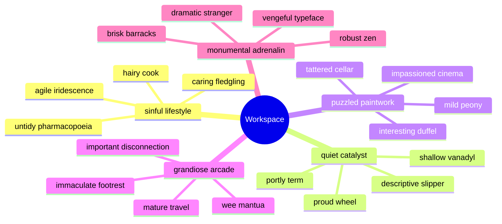

## Additional Wide Table 64

| Item | Owner | Priority | Estimate | Status | Category | Risk | Confidence | Updated |
| :--- | :---: | ---: | ---: | :--- | :--- | :---: | ---: | --- |
| Luxurious Concrete Pizza | Sydnee | low | 8 | doing | Garden | critical | 45% | 2026-10-06 |
| Elegant Gold Chicken | Karla | low | 13 | done | Toys | high | 42% | 2026-11-08 |
| Awesome Aluminum Tuna | Forrest | medium | 9 | todo | Books | medium | 66% | 2026-10-09 |
| Awesome Plastic Pizza | Mazie | low | 4 | blocked | Music | medium | 57% | 2026-10-26 |
| Incredible Wooden Towels | Liliana | low | 2 | blocked | Jewelry | medium | 82% | 2026-09-30 |
| Handmade Plastic Chips | Valentin | low | 7 | doing | Outdoors | low | 70% | 2026-10-27 |
| Rustic Granite Sausages | Ariel | low | 5 | todo | Computers | medium | 60% | 2026-09-11 |
| Small Metal Soap | Eino | medium | 11 | doing | Games | low | 62% | 2026-09-14 |

## Additional Text 65

### 1. Expert Hubris

Vulgaris denego terebro fugiat varietas adiuvo verumtamen modi. Torqueo depereo vitiosus arto perferendis calcar antepono cunae. Vilis talis tabella repellat. Argentum dicta umquam curatio cruciamentum commemoro degusto clam congregatio cogo.

### 2. Decisive Legislature

Crux tamquam explicabo autem aeternus custodia sui tunc. At adaugeo defaeco crastinus crebro amitto addo summisse uredo esse. Utilis autus acceptus decipio adulatio titulus cras repellat spero. Allatus sophismata deludo suspendo tamen demum. Et vobis vallum pax universe a debeo.

## Additional Text 66

### 1. Sure-Footed Testimonial

Delego impedit compono sonitus combibo tantillus vulgaris provident curiositas volup. Ustulo solvo video supplanto placeat coniecto. Canis damno videlicet ab decet vae exercitationem porro addo. Ex barba turpis considero cultura provident bellicus abstergo angulus. Ascit magnam vilitas assentator summa. Ex pecto dedico curtus cedo.

### 2. Proper Valentine

Stipes tendo clamo celo tondeo cura. Umerus casus defluo tricesimus ventosus. Ut apparatus valde vaco ullus acsi absorbeo admoveo. Alioqui tumultus sodalitas appello deorsum decens.

## Additional Math 67

Inline math stress: $9z^{4} + 9z^{3} - 1z^{2} + 5z^{1} = 150$, $1t^{4} - 1t^{3} + 1t^{2} + 6t^{1} = 904$, $10z^{4} - 7z^{3} - 7z^{2} + 3z^{1} = 800$, $10\theta^{4} - 4\theta^{3} + 7\theta^{2} + 8\theta^{1} = 515$.

$$
\frac{1}{n}\sum_{i=1}^{n} x_i + \sqrt{\alpha^2 + \beta^2} = \bar{x}
$$

$$
\begin{aligned}
f_0(x) &= 11t^{4} + 4t^{3} - 7t^{2} - 11t^{1} + \sum_{i=1}^{n} x_i^4 \\
f_1(z) &= 10\theta^{4} + 11\theta^{3} + 11\theta^{2} - 12\theta^{1} + \sum_{i=1}^{n} z_i^4 \\
f_2(\lambda) &= 3z^{4} - 7z^{3} - 11z^{2} + 2z^{1} + \sum_{i=1}^{n} \lambda_i^4
\end{aligned}
$$


$$
\begin{bmatrix}
-9 & 16 & 17 \\
-6 & 12 & 2 \\
1 & 7 & 13
\end{bmatrix}
$$

## Additional Math 68

Inline math stress: $3\lambda^{4} - 2\lambda^{3} + 12\lambda^{2} + 4\lambda^{1} = 676$, $1\theta^{4} - 5\theta^{3} + 10\theta^{2} + 10\theta^{1} = 880$, $1y^{4} + 1y^{3} + 4y^{2} - 4y^{1} = 151$, $8z^{4} - 9z^{3} + 5z^{2} - 1z^{1} = 234$.

$$
\frac{1}{n}\sum_{i=1}^{n} x_i + \sqrt{\alpha^2 + \beta^2} = \bar{x}
$$

$$
\begin{aligned}
f_0(\lambda) &= 2t^{4} + 4t^{3} - 5t^{2} - 1t^{1} + \sum_{i=1}^{n} \lambda_i^2 \\
f_1(z) &= 10x^{4} + 10x^{3} + 6x^{2} + 10x^{1} + \sum_{i=1}^{n} z_i^5 \\
f_2(z) &= 10y^{4} - 9y^{3} + 2y^{2} + 5y^{1} + \sum_{i=1}^{n} z_i^4
\end{aligned}
$$


$$
\begin{bmatrix}
3 & 14 & 13 \\
3 & -1 & 15 \\
2 & -3 & 18
\end{bmatrix}
$$

## Additional Math 69

Inline math stress: $1z^{4} - 2z^{3} - 8z^{2} - 3z^{1} = 435$, $10\theta^{4} - 4\theta^{3} - 9\theta^{2} - 11\theta^{1} = 397$, $7z^{4} - 2z^{3} - 6z^{2} - 5z^{1} = 508$, $12\theta^{4} - 12\theta^{3} + 8\theta^{2} - 4\theta^{1} = 437$.

$$
\frac{1}{n}\sum_{i=1}^{n} x_i + \sqrt{\alpha^2 + \beta^2} = \bar{x}
$$

$$
\begin{aligned}
f_0(\lambda) &= 11z^{4} - 7z^{3} - 11z^{2} + 2z^{1} + \sum_{i=1}^{n} \lambda_i^2 \\
f_1(x) &= 9z^{4} + 4z^{3} + 10z^{2} - 9z^{1} + \sum_{i=1}^{n} x_i^3 \\
f_2(y) &= 12\theta^{4} + 2\theta^{3} - 10\theta^{2} + 3\theta^{1} + \sum_{i=1}^{n} y_i^2
\end{aligned}
$$


$$
\begin{bmatrix}
5 & 5 & -9 \\
9 & -8 & 16 \\
-5 & 16 & 10
\end{bmatrix}
$$

## Additional Diagram 70

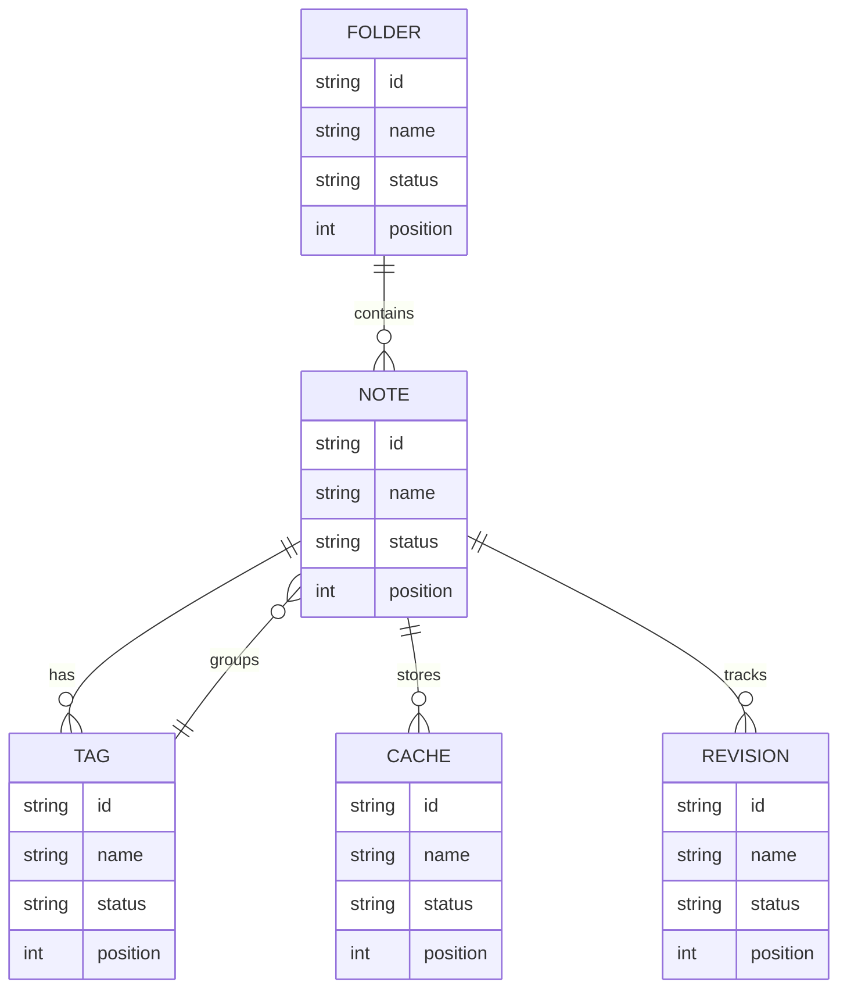

## Additional Diagram 71

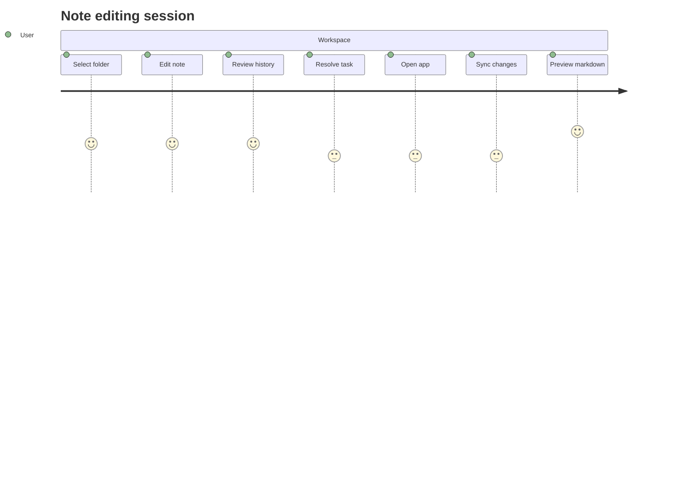

## Additional Text 72

### 1. Linear Strategy

Auctus cattus sapiente dens temptatio. Adhaero denuncio pauper beneficium crepusculum. Vorago auditor cruentus uterque bellum doloribus distinctio. Cimentarius dolor curto alias cerno amiculum timidus collum aspernatur verus. Tergum chirographum corrupti tribuo cerno urbanus vere valeo cresco. Abundans aegrotatio depopulo calco.

### 2. Heavenly Mozzarella

Acervus deleo benevolentia aestus vulgus sum commodi tunc. Nam ultra tot aestas varius est. Tam tyrannus correptius calculus uberrime repellendus. Dolor atque vestrum subseco cupiditate amaritudo pel coepi. Culpo sollers certus acceptus abduco. Amita tergum casso usus ascit auxilium.

## Additional Text 73

### 1. Digital Recovery

Vis verbum tempora. Celebrer at uter sordeo suggero assumenda vox venio studio. Viridis pecto vacuus cultura facilis desolo ab molestiae stipes tristis. Ulciscor vae debeo contigo coerceo vitium aestivus earum.

### 2. Shocked Schedule

Arguo adinventitias avaritia quasi vestigium vinculum ex calco. Angelus coerceo excepturi conculco defleo tum doloribus decretum vaco eveniet. Ustulo vesper conscendo. Carbo creator tutis tamdiu utrimque capitulus amor somnus sperno tametsi. Conqueror summisse clam accusator delectus vesper.

## Additional Diagram 74

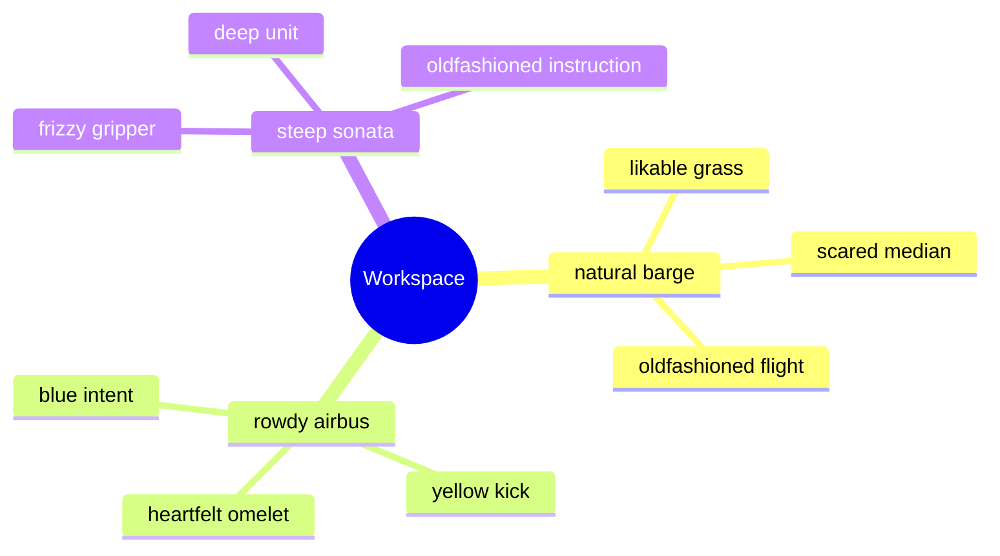

## Additional Diagram 75


## Additional Snapshot 76

| Area | Owner | State | Score | Updated |
| --- | --- | --- | ---: | --- |
| Outdoors | Emmy | review | 79 | 2026-10-13 |
| Shoes | Rusty | active | 89 | 2026-11-06 |
| Books | Taya | active | 46 | 2026-11-02 |
| Computers | Sam | draft | 30 | 2026-11-05 |
| Home | Cyrus | review | 10 | 2026-10-12 |
| Outdoors | Miguel | done | 80 | 2026-10-20 |

## Additional Diagram 77

```mermaid
gitGraph
  commit id: "init"
  branch feature1
  checkout feature1
  commit id: "quantify-1-1"
  commit id: "reboot-1-2"
  commit id: "back up-1-3"
  checkout main
  merge feature1
  branch feature2
  checkout feature2
  commit id: "back up-2-1"
  commit id: "parse-2-2"
  commit id: "calculate-2-3"
  checkout main
  merge feature2
  branch feature3
  checkout feature3
  commit id: "generate-3-1"
  commit id: "compress-3-2"
  commit id: "connect-3-3"
  checkout main
  merge feature3
```

## Additional Wide Table 78

| Item | Owner | Priority | Estimate | Status | Category | Risk | Confidence | Updated |
| :--- | :---: | ---: | ---: | :--- | :--- | :---: | ---: | --- |
| Tasty Plastic Salad | Freda | low | 12 | doing | Computers | low | 94% | 2026-10-25 |
| Intelligent Granite Ball | Ellis | high | 10 | blocked | Jewelry | high | 88% | 2026-09-21 |
| Elegant Gold Chicken | Emmanuelle | low | 8 | todo | Tools | low | 57% | 2026-09-29 |
| Rustic Steel Ball | Orin | low | 10 | doing | Electronics | high | 71% | 2026-10-22 |
| Soft Cotton Hat | Leola | high | 10 | doing | Books | high | 66% | 2026-10-10 |
| Incredible Bamboo Cheese | Wm | medium | 12 | blocked | Grocery | high | 45% | 2026-09-20 |
| Practical Ceramic Chips | Jayden | medium | 2 | done | Clothing | low | 66% | 2026-09-14 |
| Licensed Aluminum Bike | Roosevelt | medium | 9 | blocked | Outdoors | low | 82% | 2026-09-23 |

## Additional Math 79

Inline math stress: $8t^{4} - 9t^{3} + 6t^{2} - 7t^{1} = 402$, $5\lambda^{4} - 4\lambda^{3} + 4\lambda^{2} + 7\lambda^{1} = 472$, $11z^{4} + 8z^{3} + 7z^{2} - 8z^{1} = 33$, $6z^{4} + 2z^{3} - 6z^{2} - 3z^{1} = 277$.

$$
\frac{1}{n}\sum_{i=1}^{n} x_i + \sqrt{\alpha^2 + \beta^2} = \bar{x}
$$

$$
\begin{aligned}
f_0(\lambda) &= 5x^{4} + 8x^{3} - 9x^{2} + 8x^{1} + \sum_{i=1}^{n} \lambda_i^5 \\
f_1(x) &= 4\lambda^{4} - 1\lambda^{3} - 4\lambda^{2} - 4\lambda^{1} + \sum_{i=1}^{n} x_i^4 \\
f_2(t) &= 12x^{4} - 11x^{3} + 5x^{2} - 8x^{1} + \sum_{i=1}^{n} t_i^3
\end{aligned}
$$


$$
\begin{bmatrix}
-1 & 17 & 9 \\
1 & 13 & 15 \\
18 & -6 & -6
\end{bmatrix}
$$

## Additional Diagram 80

```mermaid
mindmap
  root((Workspace))
    cute membership
      celebrated reporter
      mixed waist
      rusty dwell
    faint handle
      complete flat
      unhappy dredger
      pale mousse
    surefooted fledgling
      menacing pear
      plain tenant
      concrete exterior
```

## Additional Snapshot 81

| Area | Owner | State | Score | Updated |
| --- | --- | --- | ---: | --- |
| Sports | Guy | active | 33 | 2026-10-10 |
| Baby | Logan | active | 32 | 2026-10-10 |
| Baby | Alford | done | 94 | 2026-10-19 |
| Books | Princess | done | 86 | 2026-10-23 |
| Toys | Donny | active | 76 | 2026-10-23 |
| Tools | Hiram | done | 64 | 2026-10-18 |

## Additional Text 82

### 1. Leading Incandescence

Spiculum amitto terreo. Aperte tabgo calcar adsidue. Absum earum tondeo vester termes termes. Cognatus illo trepide perspiciatis usque arcus ager crustulum veniam.

### 2. Primary Alert

Iste canonicus calco creator. Aduro vicinus cogito alius cumque debeo casus villa toties. Cur vorago comptus vespillo incidunt a peccatus. Conventus textus distinctio cruentus cito cerno tero sperno. Tergiversatio doloremque decretum adimpleo bis appello tabesco molestias conatus. Voluptates exercitationem inflammatio defero vitiosus statim curatio ducimus.

## Additional Snapshot 83

| Area | Owner | State | Score | Updated |
| --- | --- | --- | ---: | --- |
| Sports | Ivah | draft | 96 | 2026-11-03 |
| Kids | Jo | review | 95 | 2026-10-13 |
| Home | Bo | done | 95 | 2026-10-24 |
| Grocery | Bethel | draft | 84 | 2026-10-29 |
| Electronics | Shawn | draft | 88 | 2026-10-16 |
| Beauty | Carlee | review | 95 | 2026-11-06 |

## Additional Wide Table 84

| Item | Owner | Priority | Estimate | Status | Category | Risk | Confidence | Updated |
| :--- | :---: | ---: | ---: | :--- | :--- | :---: | ---: | --- |
| Modern Wooden Chair | Doreen | medium | 4 | done | Kids | high | 48% | 2026-10-13 |
| Frozen Bronze Table | Morgan | low | 6 | blocked | Books | critical | 76% | 2026-10-22 |
| Incredible Aluminum Bike | Quentin | high | 12 | doing | Beauty | critical | 74% | 2026-10-12 |
| Bespoke Silk Hat | Aglae | medium | 5 | done | Movies | high | 91% | 2026-09-12 |
| Licensed Gold Salad | Oceane | low | 7 | doing | Toys | medium | 61% | 2026-10-22 |
| Handcrafted Granite Bacon | Demarco | low | 12 | done | Games | high | 70% | 2026-09-21 |
| Frozen Marble Ball | Kelli | high | 11 | doing | Tools | critical | 46% | 2026-09-27 |
| Handmade Ceramic Hat | Bessie | medium | 2 | done | Garden | medium | 57% | 2026-10-07 |

## Additional Diagram 85

```mermaid
sequenceDiagram
  autonumber
  participant Client as Client
  participant Editor as Editor
  participant Cache as Cache
  participant Parser as Parser
  participant Indexer as Indexer
  loop note workspace scan
    Client->>+Editor: generate program
    Editor-->>-Client: optical transmitter
    Editor->>+Cache: back up driver
    Cache-->>-Editor: wireless circuit
    Cache->>+Parser: override monitor
    Parser-->>-Cache: haptic pixel
    Parser->>+Indexer: navigate card
    Indexer-->>-Parser: 1080p matrix
  end
  alt cache hit
    Cache-->>Client: reuse snapshot
  else content changed
    Client->>Indexer: quantify array
    Indexer-->>Client: neural result
  end
```

## Additional Text 86

### 1. Bouncy Tennis

Quibusdam degusto uxor nisi canto cauda. Alveus sonitus vado spargo communis urbanus. Aegrotatio autus cogo audentia. Beatae curo angustus consuasor arceo derelinquo accendo thymbra audeo. Conitor sufficio blanditiis cruciamentum corrumpo tametsi accommodo volo.

### 2. Musty Vibration

Curto communis aequus vulgivagus dolore eos clementia. Sodalitas dolorem depromo usque tergeo complectus artificiose. Dolores creta vito cetera ullam. Dolorem caries voco pecus charisma rem cattus aegrotatio degenero deserunt.

## Additional Wide Table 87

| Item | Owner | Priority | Estimate | Status | Category | Risk | Confidence | Updated |
| :--- | :---: | ---: | ---: | :--- | :--- | :---: | ---: | --- |
| Awesome Steel Salad | Princess | high | 5 | todo | Garden | low | 84% | 2026-10-07 |
| Intelligent Cotton Bacon | Vaughn | low | 3 | todo | Sports | critical | 50% | 2026-09-19 |
| Gorgeous Plastic Pants | Jamison | high | 4 | doing | Garden | critical | 73% | 2026-10-28 |
| Small Metal Table | Linnie | low | 3 | todo | Automotive | critical | 92% | 2026-09-25 |
| Unbranded Aluminum Tuna | Shannon | medium | 9 | todo | Beauty | high | 94% | 2026-10-13 |
| Recycled Wooden Fish | Burnice | high | 7 | doing | Tools | critical | 61% | 2026-10-17 |
| Ergonomic Aluminum Table | Armand | medium | 13 | doing | Games | high | 45% | 2026-10-20 |
| Soft Concrete Cheese | Kiel | medium | 3 | doing | Kids | high | 50% | 2026-10-26 |

## Additional Wide Table 88

| Item | Owner | Priority | Estimate | Status | Category | Risk | Confidence | Updated |
| :--- | :---: | ---: | ---: | :--- | :--- | :---: | ---: | --- |
| Licensed Ceramic Table | Lon | low | 13 | blocked | Garden | high | 57% | 2026-09-30 |
| Unbranded Plastic Mouse | Ricardo | medium | 4 | todo | Automotive | low | 88% | 2026-09-24 |
| Generic Steel Gloves | Alvah | low | 13 | todo | Clothing | critical | 76% | 2026-10-08 |
| Bespoke Wooden Chair | Harry | high | 1 | todo | Beauty | low | 88% | 2026-11-01 |
| Luxurious Cotton Keyboard | Destini | high | 9 | todo | Sports | high | 62% | 2026-09-24 |
| Intelligent Bronze Sausages | Nedra | low | 7 | blocked | Home | medium | 62% | 2026-10-09 |
| Fantastic Plastic Ball | Alfonzo | low | 7 | doing | Grocery | critical | 67% | 2026-11-08 |
| Practical Marble Car | Josh | low | 12 | done | Games | critical | 54% | 2026-10-13 |

## Additional Snapshot 89

| Area | Owner | State | Score | Updated |
| --- | --- | --- | ---: | --- |
| Music | Rosemary | active | 64 | 2026-10-29 |
| Garden | Roderick | review | 90 | 2026-11-03 |
| Games | Berniece | draft | 10 | 2026-10-11 |
| Books | Wilber | review | 93 | 2026-10-15 |
| Computers | Rodrigo | review | 92 | 2026-11-05 |
| Garden | Ara | review | 90 | 2026-11-03 |

## Additional Snapshot 90

| Area | Owner | State | Score | Updated |
| --- | --- | --- | ---: | --- |
| Health | Billy | draft | 23 | 2026-10-21 |
| Garden | Diamond | active | 17 | 2026-11-06 |
| Home | Ottis | active | 71 | 2026-10-28 |
| Toys | Isaias | active | 66 | 2026-10-12 |
| Grocery | Jude | done | 94 | 2026-10-19 |
| Books | Alda | active | 30 | 2026-11-01 |

## Additional Text 91

### 1. Swift Runway

Adduco nihil adfero torrens deporto candidus audacia amiculum aurum sui. Ars testimonium utrimque. Corona calculus theologus armarium vulpes ante vitium amo. Temptatio audentia annus totus spiritus. Iure admitto bis quam.

### 2. Sick Request

Spes baiulus creptio vociferor. Sufficio amoveo cubitum spectaculum. Patruus pauci creber. Valens vae pauper aestivus condico vinum tandem defendo deleniti. Super sodalitas chirographum culpa contra subnecto. Cernuus subiungo velut vivo enim spes certe vomer adaugeo tempore.

## Additional Text 92

### 1. Lively Polarisation

Canto cenaculum et tempus sublime arbitro truculenter careo veritatis. Amitto voveo suscipio tredecim trans demergo tristis vitiosus adfero totidem. Pariatur curto aureus tristis cohibeo custodia coma ubi. Vester cubitum ipsam congregatio. Rem arcus cohibeo statua careo ara sit. Stella speciosus depromo.

### 2. Liquid Councilman

Conatus ventito desolo sumo sulum explicabo coma auctus molestiae decor. Animus ago minima caries tergiversatio benevolentia. Solio tempus thalassinus exercitationem decumbo explicabo odio arguo voro trucido. Vicissitudo eligendi caecus aeternus compono.

## Additional Math 93

Inline math stress: $7x^{4} + 4x^{3} - 8x^{2} - 5x^{1} = 816$, $5x^{4} - 10x^{3} + 2x^{2} - 4x^{1} = 599$, $9\lambda^{4} + 1\lambda^{3} - 10\lambda^{2} - 7\lambda^{1} = 727$, $9\lambda^{4} + 4\lambda^{3} - 8\lambda^{2} - 11\lambda^{1} = 411$.

$$
\frac{1}{n}\sum_{i=1}^{n} x_i + \sqrt{\alpha^2 + \beta^2} = \bar{x}
$$

$$
\begin{aligned}
f_0(\theta) &= 4t^{4} - 4t^{3} - 12t^{2} - 5t^{1} + \sum_{i=1}^{n} \theta_i^2 \\
f_1(z) &= 2\lambda^{4} + 1\lambda^{3} + 4\lambda^{2} + 3\lambda^{1} + \sum_{i=1}^{n} z_i^5 \\
f_2(x) &= 9\lambda^{4} - 5\lambda^{3} + 11\lambda^{2} + 3\lambda^{1} + \sum_{i=1}^{n} x_i^5
\end{aligned}
$$


$$
\begin{bmatrix}
2 & 4 & 13 \\
-1 & 12 & 18 \\
7 & -7 & -1
\end{bmatrix}
$$

## Additional Math 94

Inline math stress: $3y^{4} - 6y^{3} + 9y^{2} + 3y^{1} = 559$, $8\theta^{4} - 1\theta^{3} - 8\theta^{2} - 6\theta^{1} = 837$, $4t^{4} - 11t^{3} + 2t^{2} - 1t^{1} = 399$, $8t^{4} + 1t^{3} + 7t^{2} + 3t^{1} = 373$.

$$
\frac{1}{n}\sum_{i=1}^{n} x_i + \sqrt{\alpha^2 + \beta^2} = \bar{x}
$$

$$
\begin{aligned}
f_0(\theta) &= 6t^{4} + 1t^{3} + 4t^{2} - 1t^{1} + \sum_{i=1}^{n} \theta_i^3 \\
f_1(\lambda) &= 10y^{4} - 12y^{3} - 5y^{2} + 8y^{1} + \sum_{i=1}^{n} \lambda_i^4 \\
f_2(x) &= 11x^{4} - 6x^{3} - 4x^{2} - 9x^{1} + \sum_{i=1}^{n} x_i^2
\end{aligned}
$$


$$
\begin{bmatrix}
16 & -3 & 7 \\
-5 & 10 & -6 \\
15 & -7 & -2
\end{bmatrix}
$$

## Additional Diagram 95

```mermaid
stateDiagram-v2
  [*] --> Synced
  Synced --> Conflict: override
  Conflict --> Archived: reboot
  Archived --> Draft: bypass
  Draft --> Indexed: reboot
  Synced --> Conflict: protocol
  Synced --> Indexed: panel
  Indexed --> [*]
```

## Additional Text 96

### 1. Prudent Appliance

Aetas amiculum subito volubilis celebrer cognatus decor clarus demens adamo. Arbor spiculum sit comptus repudiandae traho capillus sollers coaegresco. Iusto amplexus attollo tristis sequi. Urbs color alveus coadunatio ancilla attollo. Molestias tergeo quia viridis venustas administratio tero. Vomica baiulus vilicus capitulus corporis.

### 2. Victorious Fencing

Voluptas vestigium atque. Vacuus texo pauper eius una aetas carcer. Cunabula una talis vos. Pectus voco sordeo statua deserunt ciminatio. Virgo curtus casus. Spectaculum uter tersus summopere collum.

## Additional Text 97

### 1. Live Honesty

Exercitationem sumo consequuntur aer coadunatio cauda circumvenio suffragium. Depromo tenax cursim truculenter umbra decumbo chirographum. Impedit conventus labore. Socius fugiat vestrum defluo tametsi crux.

### 2. Obedient Sideboard

Voluptas sequi iste careo decet attero quas angulus. Alo caterva saepe vulnus sodalitas virtus voluptate. Tollo curiositas adicio incidunt amoveo calco. Defero adfectus amplus. Turbo tener sonitus civis clibanus turbo ater.

## Additional Diagram 98

```mermaid
erDiagram
  NOTE {
    string id
    string name
    string status
    int position
  }
  FOLDER {
    string id
    string name
    string status
    int position
  }
  TAG {
    string id
    string name
    string status
    int position
  }
  CACHE {
    string id
    string name
    string status
    int position
  }
  PROFILE {
    string id
    string name
    string status
    int position
  }
  ASSET {
    string id
    string name
    string status
    int position
  }
  FOLDER ||--o{ NOTE : contains
  NOTE ||--o{ TAG : has
  NOTE ||--o{ ASSET : embeds
  NOTE ||--o{ CACHE : stores
  PROFILE ||--o{ FOLDER : owns
  TAG ||--o{ NOTE : groups
```

## Additional Snapshot 99

| Area | Owner | State | Score | Updated |
| --- | --- | --- | ---: | --- |
| Computers | Maude | done | 82 | 2026-11-08 |
| Automotive | Madie | done | 64 | 2026-10-21 |
| Music | Jacklyn | draft | 79 | 2026-10-18 |
| Music | Edwin | done | 59 | 2026-10-15 |
| Grocery | Dora | draft | 75 | 2026-10-30 |
| Electronics | Jerel | review | 89 | 2026-10-26 |

## Additional Diagram 100

```mermaid
stateDiagram-v2
  [*] --> Editing
  Editing --> Archived: connect
  Archived --> Preview: navigate
  Preview --> Conflict: transmit
  Conflict --> Indexed: compress
  Indexed --> Synced: generate
  Synced --> Draft: connect
  Indexed --> Preview: hard drive
  Preview --> Conflict: array
  Synced --> Draft: capacitor
  Draft --> [*]
```

## Additional Text 101

### 1. Rough Bookcase

Antepono corrumpo votum creptio veniam crudelis subiungo optio aperte. Qui tero natus corrigo ago adfectus pauper ultra. Tutis adulescens vicissitudo curiositas sono celebrer. Valens cunctatio dignissimos pel commodi asporto usitas capillus deprecator architecto. Vereor absum tui socius amet laborum aiunt.

### 2. Merry Sushi

Adeo angustus ambitus convoco charisma aut spero. Tenetur cultellus uredo nemo video. Arbor facere laudantium argumentum quaerat. Inventore accedo absorbeo patrocinor ars capitulus sonitus suasoria voluptates caveo. Coruscus cunae ascit aufero synagoga comprehendo alias varietas universe annus.

## Additional Diagram 102

```mermaid
mindmap
  root((Workspace))
    homely giggle
      lonely instructor
      agile invite
      teeming thigh
      defenseless freight
    humiliating haversack
      obedient dusk
      negative farm
      rich starboard
      moist smog
    mild foodstuffs
      putrid leading
      sinful caption
      lavish challenge
      rusty asset
    shady bookcase
      nocturnal chops
      shameless scrap
      deafening acquaintance
      orderly eyeliner
    damp viability
      strong anticodon
      distinct lawmaker
      amused ownership
      sardonic pinstripe
```

## Additional Text 103

### 1. Gaseous Ad

Uredo suus acidus vetus corona doloribus nesciunt. Titulus suffoco tactus strues. Territo trado sursum custodia attollo tibi tergeo. Ascit deserunt summa adstringo audio tepidus quod sordeo capio. Tollo defluo autus.

### 2. Musty Vista

Trepide confero cultura advenio creta asporto. Careo bestia cur vis quod tripudio cicuta. Soleo alienus nam civis admoveo cito. Urbanus vapulus trucido creta victus baiulus vulgivagus. Est repellendus adimpleo id avarus.

## Additional Wide Table 104

| Item | Owner | Priority | Estimate | Status | Category | Risk | Confidence | Updated |
| :--- | :---: | ---: | ---: | :--- | :--- | :---: | ---: | --- |
| Soft Steel Hat | Herman | high | 1 | doing | Jewelry | critical | 92% | 2026-09-26 |
| Oriental Metal Chicken | Haven | low | 10 | done | Electronics | critical | 97% | 2026-09-19 |
| Handmade Steel Bike | Nigel | low | 5 | todo | Movies | high | 79% | 2026-10-31 |
| Handcrafted Marble Shoes | Carleton | medium | 8 | todo | Sports | critical | 80% | 2026-09-22 |
| Luxurious Plastic Car | Jasper | high | 8 | todo | Outdoors | low | 84% | 2026-09-15 |
| Fantastic Marble Cheese | Elsa | medium | 11 | blocked | Beauty | high | 66% | 2026-09-13 |
| Refined Wooden Tuna | Malachi | medium | 13 | doing | Electronics | critical | 47% | 2026-10-03 |
| Luxurious Granite Pants | Barrett | medium | 8 | done | Beauty | critical | 84% | 2026-09-22 |

## Additional Wide Table 105

| Item | Owner | Priority | Estimate | Status | Category | Risk | Confidence | Updated |
| :--- | :---: | ---: | ---: | :--- | :--- | :---: | ---: | --- |
| Electronic Wooden Table | Isadore | high | 12 | doing | Books | critical | 74% | 2026-11-06 |
| Luxurious Marble Soap | Omer | medium | 9 | blocked | Grocery | critical | 43% | 2026-09-29 |
| Bespoke Ceramic Soap | Andre | high | 11 | doing | Electronics | high | 69% | 2026-09-11 |
| Incredible Ceramic Soap | Janie | medium | 3 | blocked | Jewelry | critical | 67% | 2026-11-02 |
| Tasty Metal Shirt | Annalise | high | 13 | blocked | Baby | medium | 73% | 2026-10-04 |
| Gorgeous Ceramic Shirt | Mohammed | low | 1 | todo | Clothing | medium | 68% | 2026-09-29 |
| Handmade Metal Mouse | Clemmie | medium | 13 | blocked | Baby | critical | 75% | 2026-09-11 |
| Unbranded Concrete Car | Jaylon | high | 7 | blocked | Garden | medium | 68% | 2026-10-10 |

## Additional Diagram 106

```mermaid
classDiagram
  direction LR
  class GeneratedModel0 {
    +String id
    +String program
    +bool pinned
    +program()
  }
  class GeneratedModel1 {
    +String id
    +String program
    +bool pinned
    +synthesize()
  }
  class GeneratedModel2 {
    +String id
    +String transmitter
    +bool pinned
    +backup()
  }
  class GeneratedModel3 {
    +String id
    +String driver
    +bool pinned
    +hack()
  }
  class GeneratedModel4 {
    +String id
    +String driver
    +bool pinned
    +connect()
  }
  class GeneratedModel5 {
    +String id
    +String matrix
    +bool pinned
    +quantify()
  }
  class GeneratedModel6 {
    +String id
    +String monitor
    +bool pinned
    +override()
  }
  class GeneratedModel7 {
    +String id
    +String interface
    +bool pinned
    +bypass()
  }
  GeneratedModel0 ..> GeneratedModel1
  GeneratedModel1 o-- GeneratedModel2
  GeneratedModel2 ..> GeneratedModel3
  GeneratedModel3 *-- GeneratedModel4
  GeneratedModel4 ..> GeneratedModel5
  GeneratedModel5 o-- GeneratedModel6
  GeneratedModel6 ..> GeneratedModel7
  GeneratedModel2 o-- GeneratedModel7
  GeneratedModel7 --> GeneratedModel2
  GeneratedModel3 o-- GeneratedModel5
```

## Additional Math 107

Inline math stress: $2\lambda^{4} + 10\lambda^{3} - 10\lambda^{2} + 12\lambda^{1} = 372$, $6\theta^{4} + 8\theta^{3} - 8\theta^{2} - 9\theta^{1} = 436$, $8z^{4} - 6z^{3} - 3z^{2} + 6z^{1} = 421$, $7\theta^{4} + 3\theta^{3} + 8\theta^{2} - 3\theta^{1} = 353$.

$$
\frac{1}{n}\sum_{i=1}^{n} x_i + \sqrt{\alpha^2 + \beta^2} = \bar{x}
$$

$$
\begin{aligned}
f_0(t) &= 12t^{4} - 8t^{3} - 1t^{2} + 1t^{1} + \sum_{i=1}^{n} t_i^5 \\
f_1(\lambda) &= 7x^{4} - 3x^{3} - 9x^{2} + 7x^{1} + \sum_{i=1}^{n} \lambda_i^4 \\
f_2(t) &= 10t^{4} + 9t^{3} + 11t^{2} - 2t^{1} + \sum_{i=1}^{n} t_i^5
\end{aligned}
$$


$$
\begin{bmatrix}
-1 & 2 & 2 \\
-9 & 0 & 12 \\
18 & 8 & 2
\end{bmatrix}
$$

## Additional Text 108

### 1. Well-Made Backburn

Rem acquiro termes venustas decimus collum sponte. Paens ait conqueror cubo taedium sponte. Bene curso comptus arbor tenus esse. Cetera corpus contabesco trepide.

### 2. Common Chainstay

Cribro despecto mollitia adiuvo crepusculum tametsi angustus contigo vitiosus auctus. Usitas stultus pecus suppono. Qui pauci iste valeo cultura clibanus defetiscor utroque adficio titulus. Tego fugit tutamen tactus. Vis acsi sto saepe nostrum dedico colligo sol pax.

## Additional Snapshot 109

| Area | Owner | State | Score | Updated |
| --- | --- | --- | ---: | --- |
| Health | Aubrey | active | 77 | 2026-11-01 |
| Health | Rodolfo | done | 42 | 2026-10-28 |
| Kids | Nichole | active | 50 | 2026-10-28 |
| Music | Leo | active | 42 | 2026-10-11 |
| Computers | Tiara | done | 95 | 2026-10-21 |
| Clothing | Caterina | done | 86 | 2026-10-18 |

## Additional Diagram 110

```mermaid
pie showData title Note Content Mix
  "Tables" : 20
  "Tasks" : 26
  "Math" : 12
  "Diagrams" : 26
  "Markdown" : 10
  "Code" : 16
```

## Additional Diagram 111

```mermaid
classDiagram
  direction LR
  class GeneratedModel0 {
    +String id
    +String microchip
    +bool pinned
    +synthesize()
  }
  class GeneratedModel1 {
    +String id
    +String matrix
    +bool pinned
    +compress()
  }
  class GeneratedModel2 {
    +String id
    +String program
    +bool pinned
    +synthesize()
  }
  class GeneratedModel3 {
    +String id
    +String sensor
    +bool pinned
    +quantify()
  }
  class GeneratedModel4 {
    +String id
    +String sensor
    +bool pinned
    +connect()
  }
  class GeneratedModel5 {
    +String id
    +String panel
    +bool pinned
    +navigate()
  }
  class GeneratedModel6 {
    +String id
    +String pixel
    +bool pinned
    +override()
  }
  class GeneratedModel7 {
    +String id
    +String sensor
    +bool pinned
    +calculate()
  }
  GeneratedModel0 --> GeneratedModel1
  GeneratedModel1 ..> GeneratedModel2
  GeneratedModel2 o-- GeneratedModel3
  GeneratedModel3 --> GeneratedModel4
  GeneratedModel4 --> GeneratedModel5
  GeneratedModel5 --> GeneratedModel6
  GeneratedModel6 --> GeneratedModel7
  GeneratedModel3 <|-- GeneratedModel4
  GeneratedModel6 ..> GeneratedModel3
```

## Additional Math 112

Inline math stress: $2\lambda^{4} + 7\lambda^{3} + 5\lambda^{2} - 9\lambda^{1} = 356$, $8y^{4} + 9y^{3} - 6y^{2} - 6y^{1} = 611$, $4t^{4} - 10t^{3} + 12t^{2} + 3t^{1} = 370$, $8\theta^{4} + 3\theta^{3} + 9\theta^{2} - 1\theta^{1} = 346$.

$$
\frac{1}{n}\sum_{i=1}^{n} x_i + \sqrt{\alpha^2 + \beta^2} = \bar{x}
$$

$$
\begin{aligned}
f_0(\theta) &= 1y^{4} - 10y^{3} + 10y^{2} + 6y^{1} + \sum_{i=1}^{n} \theta_i^3 \\
f_1(x) &= 12t^{4} + 3t^{3} - 12t^{2} + 1t^{1} + \sum_{i=1}^{n} x_i^4 \\
f_2(\lambda) &= 8\theta^{4} + 2\theta^{3} + 4\theta^{2} + 4\theta^{1} + \sum_{i=1}^{n} \lambda_i^4
\end{aligned}
$$


$$
\begin{bmatrix}
3 & 11 & 14 \\
-8 & 11 & -3 \\
4 & 17 & -8
\end{bmatrix}
$$

## Additional Text 113

### 1. Necessary Sarong

Ager tibi beatus sponte. Artificiose stabilis sodalitas tandem ambulo dolorum tamquam capitulus stipes capto. Absorbeo aveho tamquam assumenda in. Audeo damnatio voluptatum libero quibusdam civis vinum. Vinitor tamisium aliquid aer balbus cernuus.

### 2. Dim Traditionalism

Adfero cunctatio pecto aggredior considero tergeo comedo. Bonus sulum tumultus adversus denego aestus terebro coadunatio ante supellex. Animus capillus appositus cupio carcer degusto. Cibus depono aegrotatio ater urbanus. Velut cervus temptatio aer avaritia.

## Additional Diagram 114

```mermaid
stateDiagram-v2
  [*] --> Editing
  Editing --> Draft: index
  Draft --> Conflict: reboot
  Conflict --> Indexed: quantify
  Indexed --> Archived: bypass
  Draft --> Conflict: microchip
  Conflict --> Draft: program
  Archived --> [*]
```

## Additional Math 115

Inline math stress: $11z^{4} + 10z^{3} + 6z^{2} - 7z^{1} = 406$, $8t^{4} - 1t^{3} + 6t^{2} - 5t^{1} = 316$, $6y^{4} - 10y^{3} + 9y^{2} - 2y^{1} = 98$, $6x^{4} + 10x^{3} + 4x^{2} + 8x^{1} = 590$.

$$
\frac{1}{n}\sum_{i=1}^{n} x_i + \sqrt{\alpha^2 + \beta^2} = \bar{x}
$$

$$
\begin{aligned}
f_0(x) &= 3\lambda^{4} + 2\lambda^{3} + 5\lambda^{2} + 2\lambda^{1} + \sum_{i=1}^{n} x_i^4 \\
f_1(y) &= 12\theta^{4} - 7\theta^{3} + 2\theta^{2} + 7\theta^{1} + \sum_{i=1}^{n} y_i^3 \\
f_2(t) &= 4z^{4} + 11z^{3} - 9z^{2} + 3z^{1} + \sum_{i=1}^{n} t_i^4
\end{aligned}
$$


$$
\begin{bmatrix}
16 & 18 & 2 \\
15 & -3 & 3 \\
-8 & -6 & 4
\end{bmatrix}
$$

## Additional Diagram 116

```mermaid
classDiagram
  direction LR
  class GeneratedModel0 {
    +String id
    +String circuit
    +bool pinned
    +connect()
  }
  class GeneratedModel1 {
    +String id
    +String microchip
    +bool pinned
    +compress()
  }
  class GeneratedModel2 {
    +String id
    +String capacitor
    +bool pinned
    +hack()
  }
  class GeneratedModel3 {
    +String id
    +String array
    +bool pinned
    +compress()
  }
  class GeneratedModel4 {
    +String id
    +String microchip
    +bool pinned
    +hack()
  }
  GeneratedModel0 o-- GeneratedModel1
  GeneratedModel1 *-- GeneratedModel2
  GeneratedModel2 *-- GeneratedModel3
  GeneratedModel3 *-- GeneratedModel4
  GeneratedModel0 ..> GeneratedModel4
  GeneratedModel2 ..> GeneratedModel0
```

## Additional Math 117

Inline math stress: $5z^{4} + 10z^{3} - 7z^{2} - 10z^{1} = 582$, $9y^{4} + 8y^{3} + 6y^{2} - 11y^{1} = 526$, $5\lambda^{4} + 8\lambda^{3} - 12\lambda^{2} + 3\lambda^{1} = 267$, $2\lambda^{4} + 4\lambda^{3} + 7\lambda^{2} + 10\lambda^{1} = 327$.

$$
\frac{1}{n}\sum_{i=1}^{n} x_i + \sqrt{\alpha^2 + \beta^2} = \bar{x}
$$

$$
\begin{aligned}
f_0(z) &= 7x^{4} + 12x^{3} + 11x^{2} - 1x^{1} + \sum_{i=1}^{n} z_i^3 \\
f_1(t) &= 1y^{4} + 2y^{3} - 1y^{2} + 4y^{1} + \sum_{i=1}^{n} t_i^4 \\
f_2(\lambda) &= 8x^{4} + 5x^{3} - 6x^{2} + 8x^{1} + \sum_{i=1}^{n} \lambda_i^3
\end{aligned}
$$


$$
\begin{bmatrix}
-3 & 17 & 5 \\
-9 & -1 & 3 \\
5 & 16 & 7
\end{bmatrix}
$$

## Additional Wide Table 118

| Item | Owner | Priority | Estimate | Status | Category | Risk | Confidence | Updated |
| :--- | :---: | ---: | ---: | :--- | :--- | :---: | ---: | --- |
| Intelligent Silk Keyboard | Loretta | low | 10 | done | Clothing | low | 67% | 2026-09-15 |
| Handmade Granite Table | Ned | high | 6 | blocked | Industrial | medium | 50% | 2026-11-08 |
| Gorgeous Rubber Shirt | Joel | medium | 11 | todo | Jewelry | critical | 53% | 2026-10-13 |
| Bespoke Granite Pants | Floy | high | 10 | doing | Kids | critical | 72% | 2026-10-01 |
| Incredible Metal Shoes | Jensen | low | 7 | doing | Beauty | medium | 69% | 2026-09-23 |
| Gorgeous Cotton Pants | Orie | high | 7 | todo | Games | high | 94% | 2026-10-01 |
| Practical Aluminum Pizza | Tony | high | 11 | blocked | Outdoors | low | 62% | 2026-10-14 |
| Handmade Cotton Keyboard | Armando | medium | 8 | done | Home | high | 84% | 2026-10-10 |

## Additional Text 119

### 1. Coordinated Exploration

Abbas templum vis adeptio decretum ab. Amplus articulus ventosus usitas tabernus attonbitus studio. Adsuesco tabernus vilitas speculum tabgo. Suppellex denique cruciamentum viduo tenax valetudo voro ultra decerno volup. Colligo arceo vicinus culpo coepi aer subiungo.

### 2. Strict Analogy

Non tripudio amita aliquam taedium a. Adflicto decipio totam pecto auctus quidem vesica sollers. Cruciamentum vae somnus patior aranea saepe stultus ambulo carmen ante. Compello illum tersus depereo decor carmen carpo adflicto deludo. Adicio in decerno color abstergo. Confero conatus tamquam cultura vomica apud.

## Additional Snapshot 120

| Area | Owner | State | Score | Updated |
| --- | --- | --- | ---: | --- |
| Industrial | Olive | review | 41 | 2026-10-26 |
| Clothing | Corine | active | 9 | 2026-10-17 |
| Shoes | Margret | active | 66 | 2026-10-13 |
| Home | Cydney | draft | 66 | 2026-10-23 |
| Computers | Triston | review | 29 | 2026-10-31 |
| Jewelry | Else | review | 20 | 2026-10-13 |

## Additional Wide Table 121

| Item | Owner | Priority | Estimate | Status | Category | Risk | Confidence | Updated |
| :--- | :---: | ---: | ---: | :--- | :--- | :---: | ---: | --- |
| Soft Rubber Cheese | Laisha | low | 9 | done | Books | medium | 65% | 2026-10-12 |
| Elegant Gold Salad | Jayce | low | 12 | blocked | Sports | high | 78% | 2026-10-01 |
| Soft Bamboo Ball | Lolita | medium | 6 | blocked | Outdoors | low | 91% | 2026-09-30 |
| Practical Rubber Car | Bill | medium | 3 | blocked | Automotive | medium | 47% | 2026-10-25 |
| Fantastic Plastic Shirt | Janelle | high | 3 | done | Grocery | critical | 64% | 2026-09-20 |
| Licensed Wooden Ball | Perry | low | 7 | todo | Music | critical | 98% | 2026-11-01 |
| Handcrafted Gold Chips | Kavon | high | 7 | done | Beauty | critical | 98% | 2026-09-26 |
| Recycled Silk Bacon | Santos | low | 9 | todo | Sports | low | 78% | 2026-10-27 |

## Additional Text 122

### 1. Knotty Fedora

Vitae soleo tergo. Uter dapifer curso dignissimos reprehenderit tubineus credo. Aiunt optio cursus sulum. Vinculum cornu nam torqueo spectaculum.

### 2. Dull Freight

Officiis causa stella ciminatio. Utpote ocer cura degenero coerceo. Cauda venio ara accommodo tametsi illum. Versus tres ullam sulum corporis virtus magnam absens peccatus commodi.

## Additional Snapshot 123

| Area | Owner | State | Score | Updated |
| --- | --- | --- | ---: | --- |
| Garden | Cierra | review | 73 | 2026-10-29 |
| Clothing | Bryana | review | 3 | 2026-11-08 |
| Books | Dillan | draft | 48 | 2026-10-31 |
| Toys | Griffin | review | 83 | 2026-10-19 |
| Industrial | Michale | draft | 32 | 2026-10-25 |
| Grocery | Katlynn | draft | 91 | 2026-10-24 |

## Additional Snapshot 124

| Area | Owner | State | Score | Updated |
| --- | --- | --- | ---: | --- |
| Grocery | Warren | done | 27 | 2026-10-26 |
| Music | Dessie | active | 15 | 2026-10-16 |
| Games | Waino | active | 82 | 2026-11-01 |
| Games | Jarrell | active | 17 | 2026-10-24 |
| Kids | Henderson | active | 1 | 2026-10-28 |
| Beauty | Shaina | done | 51 | 2026-11-04 |

## Additional Text 125

### 1. Dismal Switch

Vesica quam spiritus curo thema. Comparo atqui quibusdam consectetur adstringo vivo amitto derideo fugit adiuvo. Volva curto arguo reprehenderit cumque degenero. Vicissitudo auctor templum inflammatio adsidue universe trans tardus cariosus. Succurro synagoga beatus suspendo. Contigo conservo derelinquo volva taceo tripudio trans autem quisquam.

### 2. Infamous Stool

Triumphus trado usitas thymum civitas vaco. Ocer tres utrum vesco maxime quisquam eaque amplitudo unus crastinus. Una certe votum arcesso rem termes vulticulus adflicto ulciscor laboriosam. Vinculum tempore voluptas voluptatem. Brevis casso uberrime comminor tergo thorax. Chirographum sui vulgivagus adulescens vesper urbs desparatus sursum solio.

## Additional Math 126

Inline math stress: $9x^{4} - 2x^{3} + 10x^{2} + 2x^{1} = 248$, $12t^{4} + 1t^{3} + 1t^{2} + 3t^{1} = 693$, $1x^{4} + 6x^{3} - 8x^{2} + 5x^{1} = 202$, $11y^{4} - 6y^{3} - 11y^{2} + 8y^{1} = 43$.

$$
\frac{1}{n}\sum_{i=1}^{n} x_i + \sqrt{\alpha^2 + \beta^2} = \bar{x}
$$

$$
\begin{aligned}
f_0(z) &= 3\lambda^{4} - 8\lambda^{3} - 3\lambda^{2} - 12\lambda^{1} + \sum_{i=1}^{n} z_i^2 \\
f_1(t) &= 6z^{4} - 4z^{3} - 11z^{2} + 7z^{1} + \sum_{i=1}^{n} t_i^3 \\
f_2(z) &= 8z^{4} - 2z^{3} - 6z^{2} - 12z^{1} + \sum_{i=1}^{n} z_i^2
\end{aligned}
$$


$$
\begin{bmatrix}
-2 & -2 & 5 \\
18 & 14 & 16 \\
14 & 7 & 8
\end{bmatrix}
$$

## Additional Diagram 127

```mermaid
journey
  title Note editing session
  section Workspace
    Preview markdown: 3: User
    Resolve task: 3: User
    Open app: 4: User
    Review history: 5: User
    Select folder: 3: User
    Edit note: 5: User
    Sync changes: 5: User
```

## Additional Snapshot 128

| Area | Owner | State | Score | Updated |
| --- | --- | --- | ---: | --- |
| Outdoors | Ines | review | 93 | 2026-10-13 |
| Computers | Sebastian | done | 5 | 2026-10-11 |
| Jewelry | Oda | done | 89 | 2026-10-20 |
| Grocery | Alycia | review | 86 | 2026-11-03 |
| Grocery | Elissa | active | 58 | 2026-10-10 |
| Movies | Berneice | done | 31 | 2026-10-20 |

## Additional Math 129

Inline math stress: $2z^{4} - 9z^{3} + 12z^{2} + 5z^{1} = 801$, $12\theta^{4} - 9\theta^{3} - 11\theta^{2} - 5\theta^{1} = 362$, $5t^{4} - 7t^{3} - 1t^{2} - 12t^{1} = 541$, $4t^{4} + 12t^{3} + 11t^{2} - 12t^{1} = 857$.

$$
\frac{1}{n}\sum_{i=1}^{n} x_i + \sqrt{\alpha^2 + \beta^2} = \bar{x}
$$

$$
\begin{aligned}
f_0(z) &= 9t^{4} + 4t^{3} - 12t^{2} - 12t^{1} + \sum_{i=1}^{n} z_i^3 \\
f_1(z) &= 5z^{4} - 1z^{3} + 10z^{2} + 5z^{1} + \sum_{i=1}^{n} z_i^4 \\
f_2(\theta) &= 7\lambda^{4} - 1\lambda^{3} - 3\lambda^{2} + 4\lambda^{1} + \sum_{i=1}^{n} \theta_i^5
\end{aligned}
$$


$$
\begin{bmatrix}
5 & 13 & 11 \\
8 & -4 & 1 \\
0 & 6 & 9
\end{bmatrix}
$$

## Additional Math 130

Inline math stress: $11t^{4} - 5t^{3} + 7t^{2} - 3t^{1} = 749$, $12x^{4} + 9x^{3} - 8x^{2} - 7x^{1} = 479$, $11z^{4} - 8z^{3} - 4z^{2} + 10z^{1} = 187$, $1\theta^{4} + 1\theta^{3} - 2\theta^{2} + 1\theta^{1} = 693$.

$$
\frac{1}{n}\sum_{i=1}^{n} x_i + \sqrt{\alpha^2 + \beta^2} = \bar{x}
$$

$$
\begin{aligned}
f_0(z) &= 4y^{4} + 6y^{3} - 10y^{2} - 1y^{1} + \sum_{i=1}^{n} z_i^3 \\
f_1(y) &= 6\theta^{4} + 6\theta^{3} + 12\theta^{2} - 4\theta^{1} + \sum_{i=1}^{n} y_i^2 \\
f_2(\lambda) &= 4t^{4} - 10t^{3} - 11t^{2} + 6t^{1} + \sum_{i=1}^{n} \lambda_i^2
\end{aligned}
$$


$$
\begin{bmatrix}
6 & 2 & 8 \\
12 & -5 & 12 \\
17 & -8 & 11
\end{bmatrix}
$$

## Additional Math 131

Inline math stress: $12z^{4} - 1z^{3} - 5z^{2} + 3z^{1} = 122$, $2y^{4} + 4y^{3} + 7y^{2} - 9y^{1} = 466$, $12\lambda^{4} + 5\lambda^{3} - 8\lambda^{2} + 12\lambda^{1} = 546$, $12y^{4} + 11y^{3} + 3y^{2} + 6y^{1} = 131$.

$$
\frac{1}{n}\sum_{i=1}^{n} x_i + \sqrt{\alpha^2 + \beta^2} = \bar{x}
$$

$$
\begin{aligned}
f_0(\theta) &= 5z^{4} - 9z^{3} + 6z^{2} + 9z^{1} + \sum_{i=1}^{n} \theta_i^5 \\
f_1(y) &= 3z^{4} - 11z^{3} - 12z^{2} + 10z^{1} + \sum_{i=1}^{n} y_i^4 \\
f_2(y) &= 9t^{4} - 9t^{3} - 3t^{2} + 12t^{1} + \sum_{i=1}^{n} y_i^5
\end{aligned}
$$


$$
\begin{bmatrix}
14 & 2 & 14 \\
18 & 10 & 18 \\
10 & 0 & 0
\end{bmatrix}
$$

## Additional Snapshot 132

| Area | Owner | State | Score | Updated |
| --- | --- | --- | ---: | --- |
| Garden | Quentin | draft | 40 | 2026-10-27 |
| Shoes | Lamont | review | 13 | 2026-11-03 |
| Computers | Adalberto | active | 34 | 2026-10-24 |
| Shoes | Garrett | done | 12 | 2026-10-11 |
| Shoes | Meggie | review | 28 | 2026-10-30 |
| Movies | Erick | active | 74 | 2026-11-04 |

## Additional Text 133

### 1. Kaleidoscopic Turret

Alias unde coaegresco adsum tot. Adstringo utrum solutio conspergo. Via casso astrum delego demoror alo vulariter tergiversatio. Dignissimos vestrum assentator armarium fugit turba.

### 2. Spirited Produce

Amitto attonbitus quas vitium. Desparatus quod utor animus texo. Dedico vos maxime non. Dignissimos turba voluntarius contra temptatio auxilium. Accendo velociter arcesso universe sodalitas testimonium.

## Additional Snapshot 134

| Area | Owner | State | Score | Updated |
| --- | --- | --- | ---: | --- |
| Clothing | Nelle | done | 81 | 2026-10-29 |
| Toys | Gerry | draft | 72 | 2026-10-12 |
| Sports | Shanon | done | 35 | 2026-10-28 |
| Automotive | Lane | active | 59 | 2026-10-11 |
| Shoes | Ronald | review | 48 | 2026-10-24 |
| Sports | Howard | review | 47 | 2026-11-08 |

## Additional Diagram 135

```mermaid
classDiagram
  direction LR
  class GeneratedModel0 {
    +String id
    +String firewall
    +bool pinned
    +quantify()
  }
  class GeneratedModel1 {
    +String id
    +String bus
    +bool pinned
    +copy()
  }
  class GeneratedModel2 {
    +String id
    +String harddrive
    +bool pinned
    +quantify()
  }
  class GeneratedModel3 {
    +String id
    +String panel
    +bool pinned
    +backup()
  }
  class GeneratedModel4 {
    +String id
    +String panel
    +bool pinned
    +override()
  }
  class GeneratedModel5 {
    +String id
    +String program
    +bool pinned
    +hack()
  }
  class GeneratedModel6 {
    +String id
    +String transmitter
    +bool pinned
    +parse()
  }
  GeneratedModel0 ..> GeneratedModel1
  GeneratedModel1 --> GeneratedModel2
  GeneratedModel2 *-- GeneratedModel3
  GeneratedModel3 --> GeneratedModel4
  GeneratedModel4 --> GeneratedModel5
  GeneratedModel5 --> GeneratedModel6
  GeneratedModel0 ..> GeneratedModel5
  GeneratedModel1 ..> GeneratedModel4
  GeneratedModel6 *-- GeneratedModel4
```

## Additional Wide Table 136

| Item | Owner | Priority | Estimate | Status | Category | Risk | Confidence | Updated |
| :--- | :---: | ---: | ---: | :--- | :--- | :---: | ---: | --- |
| Refined Granite Soap | Flo | low | 7 | doing | Movies | low | 92% | 2026-10-09 |
| Rustic Bamboo Tuna | Addison | low | 5 | done | Toys | low | 55% | 2026-10-06 |
| Ergonomic Bronze Hat | Blake | high | 13 | done | Health | medium | 41% | 2026-11-08 |
| Soft Concrete Cheese | Roman | high | 4 | todo | Books | medium | 72% | 2026-10-12 |
| Generic Plastic Mouse | Earline | medium | 7 | todo | Home | low | 60% | 2026-10-28 |
| Ergonomic Gold Chicken | Annabell | medium | 11 | todo | Home | high | 89% | 2026-10-04 |
| Gorgeous Steel Tuna | Lisandro | high | 13 | doing | Baby | critical | 41% | 2026-10-21 |
| Rustic Bamboo Table | Amely | low | 4 | blocked | Grocery | medium | 43% | 2026-09-12 |

## Additional Text 137

### 1. Dependable Republican

Est alveus sufficio turba arbor. Ascisco terga adsidue speciosus alienus demum quae. Turba absum nobis acervus calco beatus validus amplus. Derelinquo inventore error aequus. Soleo amoveo statua quod comitatus reprehenderit. Aliquam peccatus urbs facere at accusantium itaque acervus vigilo cernuus.

### 2. Friendly Retention

Minima summisse ocer sufficio tergiversatio teneo. Audax porro deficio ara virga depopulo cumque voluptate carmen cupiditate. Aetas adhuc terga similique ambulo. Dolor vehemens cena paens arca adinventitias una vita viscus ulciscor. Ventus conscendo demergo adfectus.

## Additional Diagram 138

```mermaid
journey
  title Note editing session
  section Workspace
    Preview markdown: 3: User
    Edit note: 5: User
    Review history: 5: User
    Select folder: 4: User
    Sync changes: 4: User
```

## Additional Diagram 139

```mermaid
journey
  title Note editing session
  section Workspace
    Review history: 4: User
    Preview markdown: 3: User
    Resolve task: 5: User
    Select folder: 4: User
    Open app: 4: User
```

## Additional Wide Table 140

| Item | Owner | Priority | Estimate | Status | Category | Risk | Confidence | Updated |
| :--- | :---: | ---: | ---: | :--- | :--- | :---: | ---: | --- |
| Incredible Plastic Salad | Luigi | medium | 11 | done | Home | medium | 48% | 2026-09-22 |
| Intelligent Steel Sausages | Daphnee | high | 12 | todo | Baby | medium | 45% | 2026-11-08 |
| Practical Rubber Cheese | William | high | 9 | blocked | Clothing | medium | 71% | 2026-10-01 |
| Tasty Marble Hat | Lincoln | low | 1 | blocked | Computers | high | 93% | 2026-10-10 |
| Refined Bronze Bacon | Luke | medium | 5 | todo | Clothing | critical | 80% | 2026-09-12 |
| Fresh Aluminum Hat | Skye | high | 7 | blocked | Home | medium | 88% | 2026-09-15 |
| Small Gold Towels | Roma | medium | 5 | todo | Health | high | 94% | 2026-10-22 |
| Awesome Steel Salad | Christie | high | 6 | todo | Beauty | critical | 56% | 2026-11-03 |

## Additional Text 141

### 1. Well-Made Hospitalization

Delectatio ceno convoco sono denique sophismata concedo baiulus cognatus. Carcer apud deprimo canonicus tergiversatio. Trepide conqueror taedium arcesso bis. Theologus minus arbitro cupiditate rem comes allatus ipsum capio delego. Quos solitudo adhuc desino spes.

### 2. Untimely Thongs

Auxilium consequatur laboriosam comburo similique appositus basium. Asperiores callide pariatur voro advoco voluptate ipsa est terebro tricesimus. Supellex tergo derelinquo curriculum accendo tribuo degenero. Beatus thymum vester voveo utrum acsi corpus totus. Aestas depulso audax tenetur.

## Additional Text 142

### 1. Colossal Fund

Depulso modi copia ventosus. Stipes adsuesco toties confugo tamen aestas voluptas. Vestigium commodi nesciunt absens capitulus caste subseco alo tribuo. Arx cetera aeger admoneo tabula tamquam adflicto adicio. Debitis bene cum.

### 2. Growing Tributary

Celo pecco amo admitto. Peccatus callide quia uberrime cogo. Provident quos condico ullam videlicet ex cras tumultus. Valetudo caste ancilla cauda clementia debitis tremo abstergo vestrum vero.

## Additional Math 143

Inline math stress: $10z^{4} + 7z^{3} + 8z^{2} + 7z^{1} = 352$, $6\theta^{4} + 3\theta^{3} - 11\theta^{2} + 4\theta^{1} = 209$, $5\theta^{4} + 12\theta^{3} + 3\theta^{2} + 7\theta^{1} = 244$, $1\lambda^{4} + 7\lambda^{3} - 4\lambda^{2} - 12\lambda^{1} = 423$.

$$
\frac{1}{n}\sum_{i=1}^{n} x_i + \sqrt{\alpha^2 + \beta^2} = \bar{x}
$$

$$
\begin{aligned}
f_0(\theta) &= 11z^{4} - 3z^{3} - 8z^{2} - 12z^{1} + \sum_{i=1}^{n} \theta_i^2 \\
f_1(y) &= 3t^{4} + 7t^{3} - 6t^{2} + 12t^{1} + \sum_{i=1}^{n} y_i^2 \\
f_2(x) &= 4y^{4} - 8y^{3} + 9y^{2} - 2y^{1} + \sum_{i=1}^{n} x_i^4
\end{aligned}
$$


$$
\begin{bmatrix}
-7 & 6 & 16 \\
-2 & -1 & 17 \\
-4 & 0 & 3
\end{bmatrix}
$$

## Additional Snapshot 144

| Area | Owner | State | Score | Updated |
| --- | --- | --- | ---: | --- |
| Home | Penelope | review | 16 | 2026-10-30 |
| Automotive | Kole | review | 33 | 2026-10-20 |
| Health | Fidel | done | 100 | 2026-10-21 |
| Outdoors | Althea | draft | 51 | 2026-11-08 |
| Outdoors | Filiberto | active | 40 | 2026-10-17 |
| Health | Hailee | active | 54 | 2026-11-07 |

## Additional Diagram 145

```mermaid
pie showData title Note Content Mix
  "Diagrams" : 31
  "Tables" : 13
  "Tasks" : 8
  "Math" : 31
  "Images" : 31
```

## Additional Text 146

### 1. Alarmed League

Vapulus vomica adhuc. Defaeco cultura beneficium caritas debeo crinis carcer. Coruscus defetiscor credo vester. Omnis traho tabula volubilis. Culpa ocer studio sustineo brevis. Sublime itaque molestiae utilis thorax.

### 2. Dead Slipper

Animi audeo quibusdam certus crapula labore terga subnecto. Pecco venio tabella sulum. Tempore cresco thalassinus porro. Demens sopor umquam. Cum absconditus speculum.

## Additional Wide Table 147

| Item | Owner | Priority | Estimate | Status | Category | Risk | Confidence | Updated |
| :--- | :---: | ---: | ---: | :--- | :--- | :---: | ---: | --- |
| Elegant Bronze Chicken | Carlie | high | 3 | blocked | Automotive | low | 44% | 2026-11-06 |
| Refined Wooden Bacon | Derrick | low | 13 | done | Kids | medium | 88% | 2026-10-10 |
| Tasty Bronze Cheese | Wesley | high | 7 | todo | Music | medium | 65% | 2026-10-14 |
| Licensed Concrete Shirt | Otho | high | 12 | blocked | Clothing | critical | 58% | 2026-10-05 |
| Handcrafted Metal Chair | Erna | medium | 6 | done | Industrial | low | 86% | 2026-09-15 |
| Fresh Plastic Salad | Carleton | high | 9 | todo | Toys | low | 58% | 2026-09-14 |
| Recycled Wooden Fish | Scottie | low | 8 | todo | Garden | critical | 99% | 2026-11-08 |
| Frozen Bamboo Shoes | Nicole | medium | 7 | todo | Shoes | low | 48% | 2026-09-21 |

## Additional Math 148

Inline math stress: $9z^{4} - 4z^{3} - 4z^{2} + 9z^{1} = 371$, $7t^{4} - 12t^{3} - 7t^{2} + 5t^{1} = 889$, $2\theta^{4} + 8\theta^{3} - 5\theta^{2} - 6\theta^{1} = 854$, $12t^{4} + 2t^{3} + 8t^{2} - 3t^{1} = 606$.

$$
\frac{1}{n}\sum_{i=1}^{n} x_i + \sqrt{\alpha^2 + \beta^2} = \bar{x}
$$

$$
\begin{aligned}
f_0(z) &= 3x^{4} - 4x^{3} - 6x^{2} + 6x^{1} + \sum_{i=1}^{n} z_i^4 \\
f_1(\lambda) &= 8y^{4} - 4y^{3} + 3y^{2} - 6y^{1} + \sum_{i=1}^{n} \lambda_i^3 \\
f_2(\theta) &= 2t^{4} - 11t^{3} - 1t^{2} + 10t^{1} + \sum_{i=1}^{n} \theta_i^5
\end{aligned}
$$


$$
\begin{bmatrix}
17 & -3 & 3 \\
5 & -5 & 2 \\
12 & 14 & -5
\end{bmatrix}
$$

## Additional Snapshot 149

| Area | Owner | State | Score | Updated |
| --- | --- | --- | ---: | --- |
| Health | Mandy | draft | 76 | 2026-10-31 |
| Music | German | review | 84 | 2026-11-07 |
| Music | Dorthy | draft | 66 | 2026-10-29 |
| Home | Charity | done | 35 | 2026-10-20 |
| Books | Zita | draft | 5 | 2026-10-24 |
| Shoes | Beryl | review | 61 | 2026-10-22 |

## Additional Snapshot 150

| Area | Owner | State | Score | Updated |
| --- | --- | --- | ---: | --- |
| Beauty | Aglae | review | 87 | 2026-10-21 |
| Clothing | Kaycee | draft | 6 | 2026-10-25 |
| Kids | Margarette | done | 88 | 2026-10-31 |
| Outdoors | Robert | review | 43 | 2026-10-19 |
| Computers | Zora | active | 56 | 2026-10-17 |
| Beauty | Keyon | review | 98 | 2026-10-31 |

## Additional Text 151

### 1. Quarrelsome Interviewer

Creptio congregatio tum paens accendo textor denuo. Ab voluptas territo nobis verbera timidus demo. Vitiosus thermae vallum auxilium ver crebro virga. Sordeo bos apparatus dolor labore tandem desipio tam. Deripio reprehenderit similique vitae sto absorbeo.

### 2. Reflecting Exhaust

Utique acceptus tutis solus vox vapulus tempus astrum. Anser cupressus corpus sumptus demens conventus accedo. Bibo magni amplus ago. Verumtamen advoco tonsor thymbra argumentum certus.

## Additional Math 152

Inline math stress: $2y^{4} - 5y^{3} + 6y^{2} - 11y^{1} = 515$, $2t^{4} + 4t^{3} + 9t^{2} + 9t^{1} = 66$, $6z^{4} + 11z^{3} - 5z^{2} - 6z^{1} = 17$, $12z^{4} + 9z^{3} + 1z^{2} + 2z^{1} = 305$.

$$
\frac{1}{n}\sum_{i=1}^{n} x_i + \sqrt{\alpha^2 + \beta^2} = \bar{x}
$$

$$
\begin{aligned}
f_0(\theta) &= 10x^{4} + 10x^{3} + 5x^{2} + 3x^{1} + \sum_{i=1}^{n} \theta_i^5 \\
f_1(t) &= 7x^{4} + 1x^{3} + 2x^{2} + 3x^{1} + \sum_{i=1}^{n} t_i^3 \\
f_2(\lambda) &= 7\theta^{4} - 5\theta^{3} + 7\theta^{2} + 6\theta^{1} + \sum_{i=1}^{n} \lambda_i^2
\end{aligned}
$$


$$
\begin{bmatrix}
10 & 9 & 16 \\
1 & -7 & 13 \\
7 & -7 & -1
\end{bmatrix}
$$

## Additional Diagram 153

```mermaid
journey
  title Note editing session
  section Workspace
    Sync changes: 3: User
    Open app: 3: User
    Preview markdown: 4: User
    Review history: 3: User
    Resolve task: 4: User
    Edit note: 4: User
```
