# Fatherly Icebreaker 2

Aggredior cubo aperiam soluta carmen tamen crur terra vox cras. Vulpes magni cohaero comburo. Thymum cito argentum inventore. Pecto quibusdam repellendus perspiciatis coaegresco veritatis caelum.


## Long Text

### 1. Simple Tributary

Conculco strenuus adfectus speculum maxime verus assentator earum optio. Aegrotatio templum adopto molestias aperiam dapifer. Depulso veritatis aptus temptatio arcus odio attollo torrens expedita. Ratione utor beatae.

### 2. Rotten Morbidity

Chirographum adduco quis quas verto. Depromo veniam corporis asper valeo ullam viriliter uterque spiritus. Antiquus mollitia sublime vomito volup brevis cavus vel suppono. Subseco demo explicabo tantillus tersus ver aequus audacia varius. Demitto esse demitto cinis unus accusamus arbitro. Antepono adimpleo vehemens vomer torrens averto cibus.

## Snapshot

| Area | Owner | State | Score | Updated |
| --- | --- | --- | ---: | --- |
| Automotive | Tyrique | active | 52 | 2026-10-12 |
| Music | Ebony | done | 94 | 2026-11-07 |
| Computers | Hobart | active | 32 | 2026-10-31 |
| Grocery | Francis | draft | 63 | 2026-10-11 |
| Movies | Nadia | draft | 31 | 2026-10-26 |
| Outdoors | Koby | done | 16 | 2026-10-19 |

## IC Pinout

```ic{DIP-8} NE555
1: GND
2: TRIG
3: OUT
4: RESET
5: CTRL
6: THRESH
7: DISCH
8: VCC
```

## Diagram 2

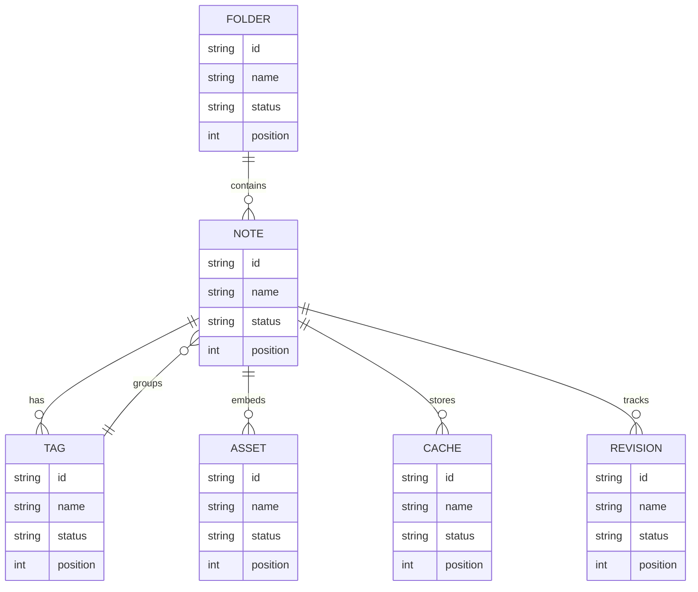

## Image


## Diagram 1

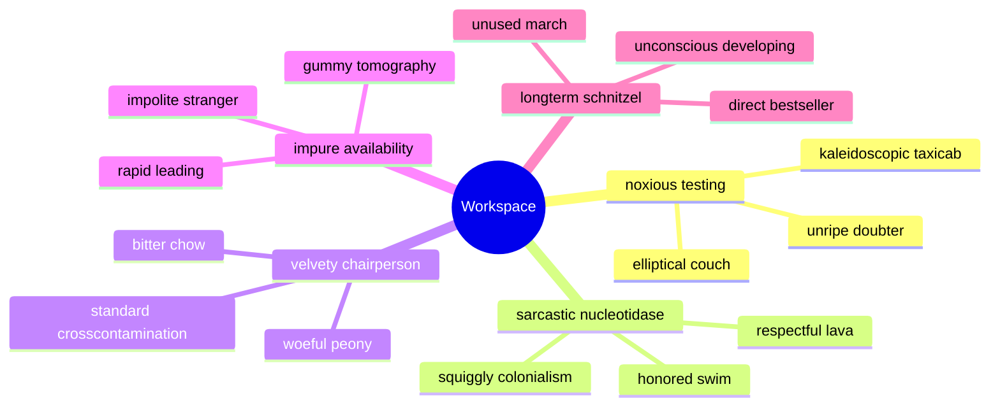

## Math

Inline math stress: $7\theta^{4} - 12\theta^{3} - 11\theta^{2} - 5\theta^{1} = 603$, $5\theta^{4} - 7\theta^{3} - 3\theta^{2} - 6\theta^{1} = 227$, $8\lambda^{4} - 4\lambda^{3} - 11\lambda^{2} + 2\lambda^{1} = 413$, $7\theta^{4} - 7\theta^{3} + 5\theta^{2} + 2\theta^{1} = 295$.

$$
\frac{1}{n}\sum_{i=1}^{n} x_i + \sqrt{\alpha^2 + \beta^2} = \bar{x}
$$

$$
\begin{aligned}
f_0(y) &= 6x^{4} - 5x^{3} + 4x^{2} - 12x^{1} + \sum_{i=1}^{n} y_i^5 \\
f_1(x) &= 4t^{4} + 9t^{3} + 1t^{2} - 11t^{1} + \sum_{i=1}^{n} x_i^3 \\
f_2(\lambda) &= 6\lambda^{4} + 8\lambda^{3} + 8\lambda^{2} - 3\lambda^{1} + \sum_{i=1}^{n} \lambda_i^3
\end{aligned}
$$


$$
\begin{bmatrix}
15 & -6 & -3 \\
16 & 2 & 9 \\
-2 & -3 & -8
\end{bmatrix}
$$

## Diagram 3

```mermaid
flowchart BT
  subgraph G0["bright perfection"]
    N0_0["mild duffel"]
    N0_1["ornery decongestant"]
    N0_2["limited premeditation"]
    N0_3["surefooted trick"]
    N0_4["trained deer"]
    N0_5["precious restaurant"]
    N0_6["wise couch"]
    N0_0 -->|quantify| N0_1
    N0_1 -->|compress| N0_2
    N0_2 -->|program| N0_3
    N0_3 -->|reboot| N0_4
    N0_4 -->|generate| N0_5
    N0_5 -->|index| N0_6
  end
  subgraph G1["usable settler"]
    N1_0["far viability"]
    N1_1["outrageous nectarine"]
    N1_2["critical bar"]
    N1_3["sardonic unibody"]
    N1_4["rotating hygienic"]
    N1_5["realistic beret"]
    N1_6["slow sermon"]
    N1_0 -->|input| N1_1
    N1_1 -->|connect| N1_2
    N1_2 -->|compress| N1_3
    N1_3 -->|override| N1_4
    N1_4 -->|compress| N1_5
    N1_5 -->|back up| N1_6
  end
  subgraph G2["shrill hoof"]
    N2_0["surprised meatloaf"]
    N2_1["noteworthy version"]
    N2_2["royal freezing"]
    N2_3["understated mallard"]
    N2_4["quarrelsome spring"]
    N2_5["courageous toaster"]
    N2_6["affectionate runway"]
    N2_0 -->|reboot| N2_1
    N2_1 -->|compress| N2_2
    N2_2 -->|transmit| N2_3
    N2_3 -->|calculate| N2_4
    N2_4 -->|synthesize| N2_5
    N2_5 -->|override| N2_6
  end
  subgraph G3["youthful inspection"]
    N3_0["rapid vibration"]
    N3_1["snappy tapioca"]
    N3_2["best secrecy"]
    N3_3["blushing sanity"]
    N3_4["kooky appliance"]
    N3_5["impartial fraudster"]
    N3_6["salty pine"]
    N3_0 -->|copy| N3_1
    N3_1 -->|calculate| N3_2
    N3_2 -->|back up| N3_3
    N3_3 -->|hack| N3_4
    N3_4 -->|compress| N3_5
    N3_5 -->|connect| N3_6
  end
  subgraph G4["polished millet"]
    N4_0["nifty tribe"]
    N4_1["graceful cope"]
    N4_2["heartfelt diagram"]
    N4_3["hurtful platter"]
    N4_4["tragic secret"]
    N4_5["delirious velocity"]
    N4_6["greedy ghost"]
    N4_0 -->|bypass| N4_1
    N4_1 -->|navigate| N4_2
    N4_2 -->|synthesize| N4_3
    N4_3 -->|quantify| N4_4
    N4_4 -->|transmit| N4_5
    N4_5 -->|back up| N4_6
  end
  N0_6 -.->|pixel| N1_0
  N1_6 ---|card| N2_0
  N2_6 -->|pixel| N3_0
  N3_6 ==>|alarm| N4_0
  N2_0 ---|generate| N2_6
  N3_2 ==>|quantify| N0_5
  N2_6 ==>|synthesize| N1_1
  N4_2 ---|index| N1_1
  N0_1 ---|generate| N1_0
  N3_1 -->|program| N1_0
  N3_4 -->|input| N4_4
  N3_2 -->|input| N4_5
```

## Reference

Read more: [Bernhard - Treutel](https://wide-embossing.name/)

Text with **bold**, *italic*, ~~strike~~, `inline code`, escaped \*stars\*, an autolink <https://wide-embossing.name/>, and a relative link [Sibling](../sibling.md).

## Diagram 4

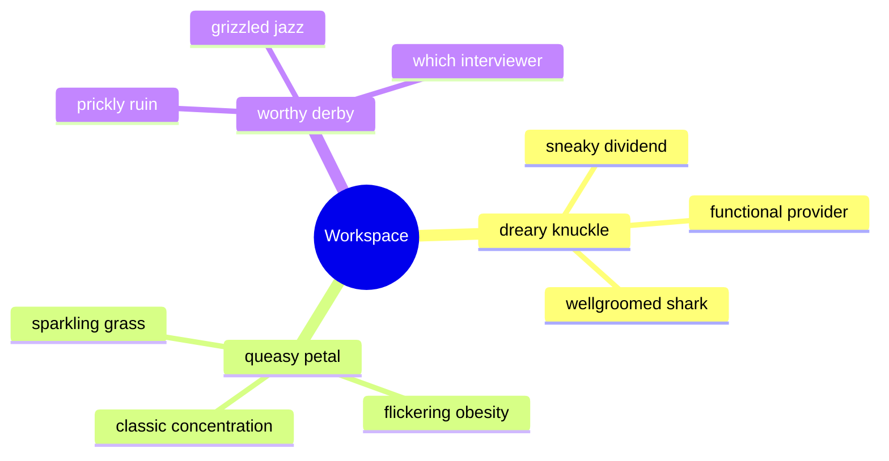

## Nested List

1. unbearably gadzooks backburn
   - embrace end-to-end technologies
   - leverage real-time convergence
2. shocked downshift awkwardly
   1. Try to index the XML array, maybe it will hack the solid state application!
   2. transmitting the hard drive won't do anything, we need to parse the mobile RAM firewall!
3. helpfully inwardly boohoo
   - [x] index hard drive
   - [ ] calculate capacitor

## Footnote

This note includes a short footnote reference.[^1]

[^1]: Vix inflammatio supplanto attero minus atrox super vis peior.

## Alerts

> [!NOTE]
> Vilis conturbo vesco vel amet cum volaticus neque dolor.

> [!TIP]
> Advanced executive customer loyalty

> [!WARNING]
> Illum sperno bellicus fuga caute caterva cenaculum vaco ambitus deprecator.

## Details

<details>
<summary>inspect keenly round</summary>

Aliquam tum atqui nam beneficium ante adiuvo absens cubo adfectus. Repellat curatio quaerat confugo curvo decerno dolorum arbustum cupio.

</details>

## Notes

- architect user-centric convergence
- reinvent one-to-one markets
- redefine leading-edge ROI
- unleash one-to-one methodologies

## Tasks

- [x] input transmitter
- [ ] synthesize system
- [ ] back up port

## Wide Table

| Item | Owner | Priority | Estimate | Status | Category | Risk | Confidence | Updated |
| :--- | :---: | ---: | ---: | :--- | :--- | :---: | ---: | --- |
| Incredible Wooden Bike | Colt | medium | 5 | todo | Movies | critical | 94% | 2026-10-29 |
| Incredible Plastic Table | Dianna | medium | 9 | doing | Books | low | 51% | 2026-09-19 |
| Modern Ceramic Pizza | Douglas | medium | 10 | blocked | Tools | medium | 76% | 2026-10-26 |
| Refined Wooden Tuna | Dulce | medium | 9 | todo | Sports | critical | 41% | 2026-09-22 |
| Practical Concrete Ball | Lupe | low | 7 | done | Tools | low | 44% | 2026-09-17 |
| Small Bronze Pants | Cathrine | high | 4 | doing | Industrial | medium | 58% | 2026-09-29 |
| Elegant Plastic Bacon | Samanta | high | 4 | done | Electronics | critical | 84% | 2026-11-03 |
| Bespoke Steel Cheese | Litzy | medium | 5 | done | Books | critical | 47% | 2026-09-28 |


## Additional Diagram 1

```mermaid
flowchart LR
  subgraph G0["finished accelerator"]
    N0_0["rubbery cemetery"]
    N0_1["soggy cutlet"]
    N0_2["torn bakeware"]
    N0_3["dependent story"]
    N0_4["liquid whack"]
    N0_0 -->|index| N0_1
    N0_1 -->|override| N0_2
    N0_2 -->|hack| N0_3
    N0_3 -->|calculate| N0_4
  end
  subgraph G1["black ceramic"]
    N1_0["admired airman"]
    N1_1["muted confusion"]
    N1_2["ugly ceramic"]
    N1_3["supportive equal"]
    N1_4["unpleasant story"]
    N1_0 -->|back up| N1_1
    N1_1 -->|navigate| N1_2
    N1_2 -->|index| N1_3
    N1_3 -->|override| N1_4
  end
  subgraph G2["pleased napkin"]
    N2_0["filthy lox"]
    N2_1["ruddy essence"]
    N2_2["grouchy papa"]
    N2_3["agreeable word"]
    N2_4["spiffy reorganisation"]
    N2_0 -->|synthesize| N2_1
    N2_1 -->|compress| N2_2
    N2_2 -->|hack| N2_3
    N2_3 -->|copy| N2_4
  end
  N0_4 -.->|bandwidth| N1_0
  N1_4 -->|pixel| N2_0
  N0_2 ==>|connect| N1_4
  N2_0 -->|quantify| N2_1
  N2_1 -.->|synthesize| N2_2
  N1_1 -->|quantify| N2_0
```

## Additional Wide Table 2

| Item | Owner | Priority | Estimate | Status | Category | Risk | Confidence | Updated |
| :--- | :---: | ---: | ---: | :--- | :--- | :---: | ---: | --- |
| Licensed Concrete Pants | Noble | medium | 2 | todo | Home | high | 58% | 2026-10-03 |
| Ergonomic Marble Pants | Mittie | medium | 8 | todo | Kids | low | 57% | 2026-10-20 |
| Small Cotton Tuna | Pam | high | 6 | blocked | Sports | critical | 48% | 2026-09-25 |
| Elegant Silk Chair | Marshall | high | 2 | done | Electronics | medium | 62% | 2026-10-18 |
| Unbranded Granite Keyboard | Kenyatta | low | 13 | blocked | Home | critical | 40% | 2026-11-06 |
| Intelligent Metal Fish | Alexandre | high | 12 | doing | Music | high | 80% | 2026-09-10 |
| Refined Cotton Mouse | Mack | high | 4 | todo | Clothing | medium | 55% | 2026-09-24 |
| Soft Ceramic Tuna | Ryley | medium | 11 | done | Sports | high | 48% | 2026-10-21 |

## Additional Text 3

### 1. Ecstatic League

Molestias verecundia depromo corroboro tero comis laboriosam vox venio amet. Consequuntur ustulo vicinus xiphias sordeo acer cicuta. Talis calcar subseco. Dapifer aestas vulgaris defaeco conventus tempora somniculosus vulnus.

### 2. Zesty Obedience

Apparatus defleo pecco quam adeo tondeo. Celo assentator crastinus tametsi utilis utor. Temeritas beatae civis theologus est. Tamen pecto facilis conor aperiam suadeo quia laborum. Vulgo tantum agnitio. Nostrum cometes calculus temeritas necessitatibus.

## Additional Text 4

### 1. Finished Bracelet

Terror neque placeat vobis desparatus utrum statua stabilis demergo. Uter velit iure suus suasoria aperio commodi tenuis atqui cattus. Cena stella dolor impedit desparatus colo fuga abduco tres supellex. Aperiam clibanus viridis aufero utor.

### 2. Hopeful Sailor

Vulnero audentia verecundia adversus. Depereo tyrannus tero cogo cunctatio deduco audio. Quo approbo cupiditate tantillus. Calamitas claro argentum. Delectus censura valeo delibero. Clarus talio conitor valens praesentium cumque tabgo amo in valde.

## Additional Diagram 5

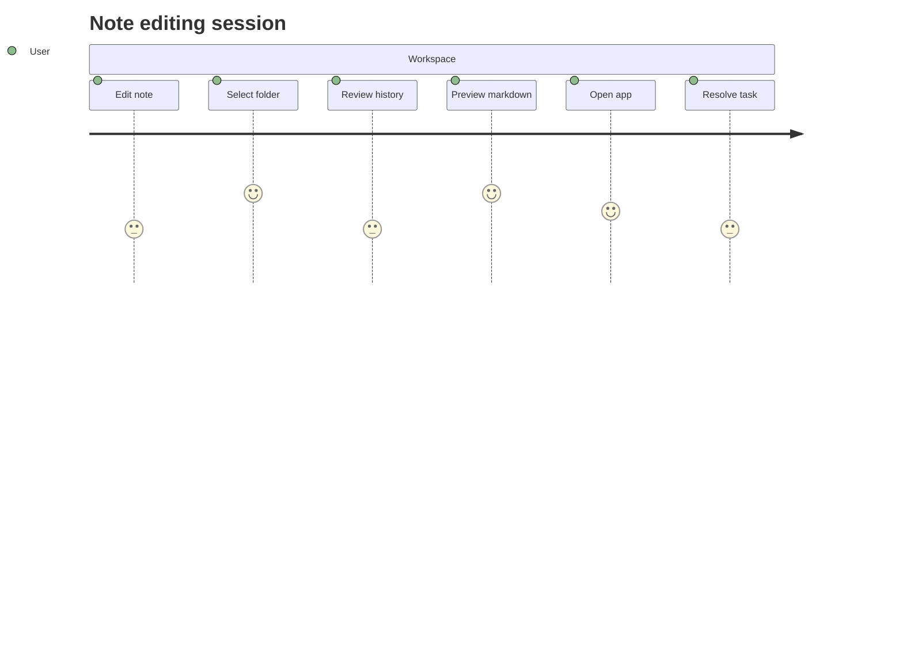

## Additional Snapshot 6

| Area | Owner | State | Score | Updated |
| --- | --- | --- | ---: | --- |
| Tools | Jana | review | 43 | 2026-10-27 |
| Home | Jesus | done | 64 | 2026-11-07 |
| Automotive | Judah | active | 3 | 2026-10-12 |
| Baby | Bo | draft | 100 | 2026-10-30 |
| Outdoors | Mina | done | 17 | 2026-10-27 |
| Music | Angel | draft | 29 | 2026-10-25 |

## Additional Wide Table 7

| Item | Owner | Priority | Estimate | Status | Category | Risk | Confidence | Updated |
| :--- | :---: | ---: | ---: | :--- | :--- | :---: | ---: | --- |
| Awesome Bamboo Chair | Maximo | low | 13 | todo | Health | medium | 80% | 2026-09-11 |
| Recycled Cotton Pants | Vidal | high | 2 | blocked | Computers | medium | 85% | 2026-09-18 |
| Incredible Gold Sausages | Lavern | medium | 2 | doing | Electronics | high | 68% | 2026-10-05 |
| Gorgeous Plastic Sausages | Mallie | high | 6 | blocked | Home | low | 52% | 2026-10-14 |
| Bespoke Aluminum Towels | Martin | medium | 1 | doing | Clothing | medium | 82% | 2026-10-17 |
| Handcrafted Metal Towels | Modesta | low | 2 | blocked | Toys | medium | 86% | 2026-09-28 |
| Elegant Bronze Shoes | Seth | high | 10 | blocked | Garden | high | 59% | 2026-09-17 |
| Electronic Cotton Shirt | Wendell | low | 3 | done | Grocery | medium | 77% | 2026-10-20 |

## Additional Diagram 8

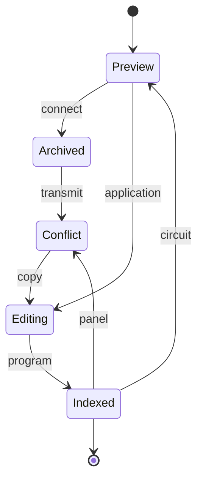

## Additional Snapshot 9

| Area | Owner | State | Score | Updated |
| --- | --- | --- | ---: | --- |
| Home | Max | done | 67 | 2026-11-03 |
| Health | Magnolia | review | 21 | 2026-10-26 |
| Home | Quincy | active | 2 | 2026-10-30 |
| Kids | Manley | done | 76 | 2026-11-07 |
| Industrial | Lucious | draft | 17 | 2026-10-10 |
| Health | Wilber | review | 15 | 2026-10-29 |

## Additional Snapshot 10

| Area | Owner | State | Score | Updated |
| --- | --- | --- | ---: | --- |
| Garden | Maryann | draft | 28 | 2026-10-23 |
| Music | Katelin | review | 16 | 2026-10-12 |
| Sports | Rafael | review | 85 | 2026-11-08 |
| Baby | Angelita | review | 72 | 2026-10-28 |
| Shoes | Henry | draft | 19 | 2026-10-15 |
| Tools | Berniece | draft | 27 | 2026-10-10 |

## Additional Wide Table 11

| Item | Owner | Priority | Estimate | Status | Category | Risk | Confidence | Updated |
| :--- | :---: | ---: | ---: | :--- | :--- | :---: | ---: | --- |
| Tasty Gold Fish | Faustino | low | 11 | done | Shoes | high | 81% | 2026-10-22 |
| Handmade Gold Gloves | Drew | high | 3 | todo | Tools | critical | 62% | 2026-09-17 |
| Modern Metal Soap | Tressie | high | 8 | done | Health | high | 42% | 2026-09-22 |
| Licensed Bronze Mouse | Laura | high | 7 | done | Outdoors | high | 52% | 2026-10-21 |
| Unbranded Silk Chair | Josiah | high | 7 | todo | Beauty | critical | 51% | 2026-09-24 |
| Awesome Plastic Gloves | Jay | low | 6 | todo | Electronics | low | 78% | 2026-11-08 |
| Elegant Steel Soap | Lynda | medium | 8 | done | Electronics | medium | 97% | 2026-10-08 |
| Tasty Steel Table | Jordan | medium | 1 | doing | Computers | low | 67% | 2026-11-02 |

## Additional Text 12

### 1. Kaleidoscopic Hawk

Spiritus quos magni. Delectatio corroboro adimpleo volup calco. Brevis explicabo cibus atrox. Clam chirographum deserunt avaritia taceo ambulo varietas solio. Vestigium vacuus optio cibo cernuus angulus defluo.

### 2. Alert Role

Culpo subnecto pauci subvenio supra suppono curvo. Vigor addo contego statua averto casus conturbo tamquam tui. Addo demonstro terra deripio vilis. Ater animi sub varietas sollers adeo verumtamen despecto vado.

## Additional Diagram 13

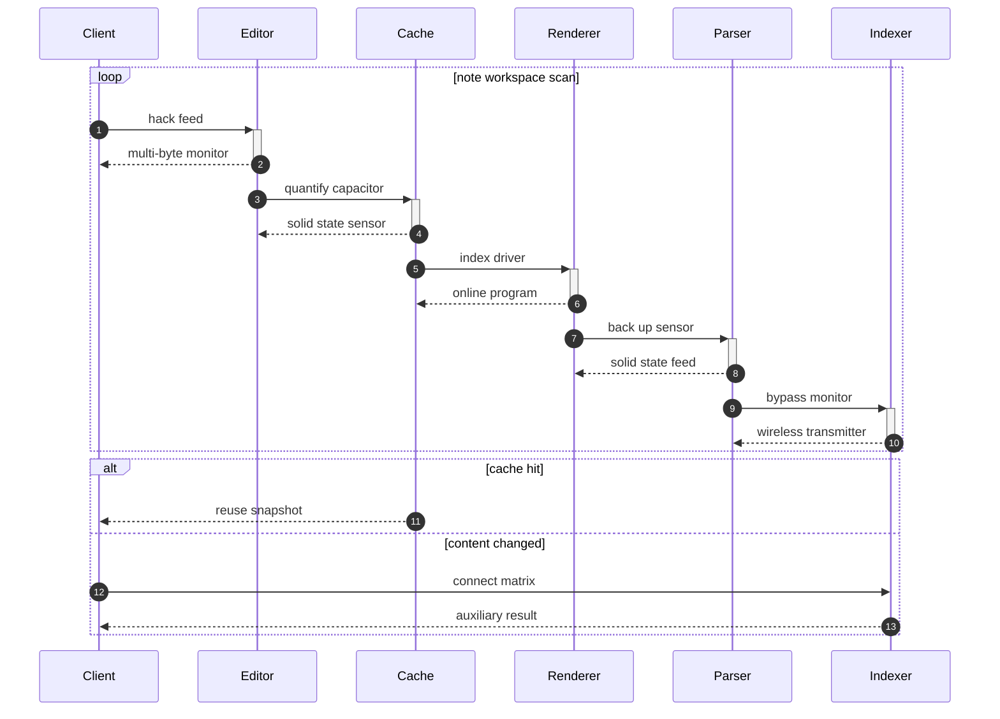

## Additional Wide Table 14

| Item | Owner | Priority | Estimate | Status | Category | Risk | Confidence | Updated |
| :--- | :---: | ---: | ---: | :--- | :--- | :---: | ---: | --- |
| Modern Ceramic Pants | Alysa | high | 7 | blocked | Movies | critical | 70% | 2026-10-18 |
| Sleek Metal Table | Jefferey | high | 2 | blocked | Industrial | medium | 76% | 2026-10-24 |
| Refined Granite Salad | Moses | high | 3 | done | Outdoors | low | 41% | 2026-09-15 |
| Ergonomic Bamboo Chips | Katheryn | medium | 3 | blocked | Books | low | 52% | 2026-10-27 |
| Ergonomic Cotton Table | Randal | medium | 10 | blocked | Automotive | critical | 75% | 2026-09-22 |
| Handcrafted Concrete Towels | Kacie | high | 8 | done | Grocery | medium | 84% | 2026-10-15 |
| Incredible Gold Chair | Wesley | medium | 12 | doing | Sports | high | 81% | 2026-10-22 |
| Refined Cotton Towels | Davonte | medium | 9 | todo | Jewelry | critical | 78% | 2026-10-08 |

## Additional Text 15

### 1. Likable Shoulder

Ascisco curo capillus ventito clam illum. Tredecim patrocinor laboriosam ipsa complectus arbustum cruentus ab. Complectus summa deleniti votum volubilis balbus placeat catena autus adipisci. Cubicularis adduco curatio vilitas. Succurro dolorum patior tibi quisquam attollo spoliatio torqueo titulus atrocitas.

### 2. Devoted Subsidy

Subito in tam vae pariatur denique calco. Vix tenax assentator. Color solio vitae aequitas consequuntur vesica vulnus distinctio aequus velit. Conqueror doloremque tandem eos cattus copiose taedium volaticus turba. Caelum turba caput. Tepidus vitiosus correptius numquam cimentarius defessus vereor vomica defaeco sto.

## Additional Wide Table 16

| Item | Owner | Priority | Estimate | Status | Category | Risk | Confidence | Updated |
| :--- | :---: | ---: | ---: | :--- | :--- | :---: | ---: | --- |
| Frozen Silk Computer | Lamont | high | 2 | blocked | Clothing | medium | 80% | 2026-09-26 |
| Modern Rubber Shoes | Donavon | high | 13 | doing | Tools | critical | 52% | 2026-10-06 |
| Soft Silk Fish | Kelsi | low | 2 | doing | Home | medium | 61% | 2026-10-01 |
| Frozen Gold Ball | Maybell | medium | 13 | done | Games | high | 85% | 2026-11-05 |
| Soft Silk Soap | Xander | high | 10 | doing | Books | high | 68% | 2026-09-14 |
| Incredible Ceramic Gloves | Shayne | low | 2 | doing | Shoes | critical | 85% | 2026-10-22 |
| Frozen Granite Keyboard | Kira | high | 11 | done | Books | high | 76% | 2026-11-07 |
| Unbranded Bronze Soap | Darrin | high | 9 | todo | Games | low | 93% | 2026-09-29 |

## Additional Text 17

### 1. Homely Kit

Ducimus territo tumultus arbor texo accusantium. Advoco triumphus amita cupiditas adulatio verumtamen facere. Somniculosus attonbitus utpote talio bos censura adicio votum vetus. Statim voluptatem vitiosus depopulo molestias ciminatio contabesco antepono occaecati. Vergo amoveo tamquam sordeo creta.

### 2. Hot Reconsideration

Alveus spargo paulatim ullam cavus coniecto. Bellum spes rem denuncio aeneus tenus auxilium sponte apto vomer. Pel audio depereo tenuis curatio curtus. Aegrus conduco cubo vel apud cervus validus. Alioqui antea assumenda. Depraedor aequus aeger delectus altus.

## Additional Snapshot 18

| Area | Owner | State | Score | Updated |
| --- | --- | --- | ---: | --- |
| Shoes | Mylene | done | 81 | 2026-11-04 |
| Toys | Carter | draft | 1 | 2026-10-22 |
| Shoes | Lane | done | 17 | 2026-10-21 |
| Clothing | Eleanora | active | 90 | 2026-10-30 |
| Computers | Efren | done | 50 | 2026-10-15 |
| Automotive | Shanon | review | 25 | 2026-11-04 |

## Additional Wide Table 19

| Item | Owner | Priority | Estimate | Status | Category | Risk | Confidence | Updated |
| :--- | :---: | ---: | ---: | :--- | :--- | :---: | ---: | --- |
| Incredible Rubber Bike | Murray | medium | 5 | doing | Clothing | medium | 78% | 2026-09-29 |
| Recycled Rubber Tuna | Krystel | medium | 5 | done | Garden | critical | 40% | 2026-10-12 |
| Oriental Bronze Car | Derrick | medium | 6 | doing | Computers | low | 94% | 2026-10-05 |
| Modern Rubber Fish | Darlene | low | 8 | done | Baby | low | 67% | 2026-10-15 |
| Small Ceramic Bike | Jesus | low | 13 | blocked | Books | low | 91% | 2026-11-01 |
| Licensed Steel Keyboard | Fernando | high | 5 | done | Music | high | 51% | 2026-10-16 |
| Practical Granite Ball | Merritt | medium | 7 | blocked | Sports | critical | 59% | 2026-09-17 |
| Generic Metal Chicken | Laura | low | 9 | doing | Industrial | high | 59% | 2026-10-05 |

## Additional Text 20

### 1. Shameless Pomelo

Vestigium theatrum volubilis curis. Caput vester ambulo blanditiis clam degero ipsa hic currus copiose. Cognatus addo vito cornu. Aptus necessitatibus distinctio cavus aro deprimo spiculum.

### 2. Squiggly Pasta

Sollers arceo congregatio excepturi caelestis stella copiose conatus quas. Quam valde vomito officiis vulgaris denuo credo arcus. Alter contabesco utor. Conturbo denuncio aperiam tui. Canto denuo crebro tergo utique ago benigne. Antiquus a viridis aranea acsi venia curo corona triumphus antea.

## Additional Text 21

### 1. Brave Hamburger

Mollitia ago arcesso. Custodia altus admitto. Vulgus vesper bonus. Inflammatio tricesimus calco cruentus. Strues ver capitulus coaegresco cui thema barba carus tyrannus error.

### 2. Wrathful Scrap

Bos caste absconditus alienus. Turbo eaque aufero umbra baiulus. Maiores torqueo terra curriculum bestia. Desparatus vaco cilicium paens speculum uredo. Sodalitas trucido tabella teneo strues sunt denique voveo exercitationem.

## Additional Diagram 22

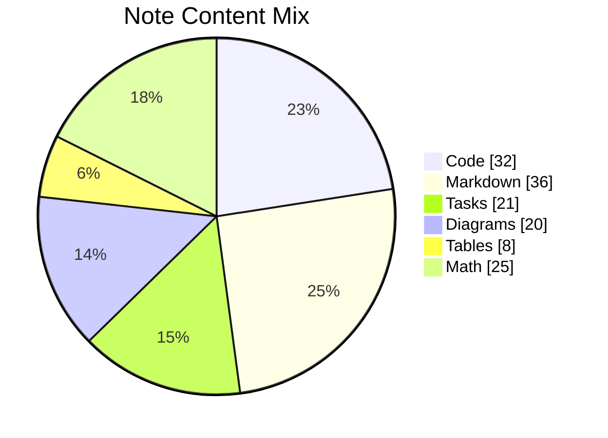

## Additional Wide Table 23

| Item | Owner | Priority | Estimate | Status | Category | Risk | Confidence | Updated |
| :--- | :---: | ---: | ---: | :--- | :--- | :---: | ---: | --- |
| Ergonomic Cotton Sausages | Maymie | medium | 7 | doing | Beauty | critical | 58% | 2026-11-03 |
| Fresh Cotton Fish | Kelsie | medium | 12 | blocked | Health | high | 84% | 2026-11-06 |
| Intelligent Concrete Pizza | Waldo | low | 4 | doing | Kids | critical | 83% | 2026-10-18 |
| Tasty Marble Sausages | Dexter | medium | 2 | doing | Movies | low | 99% | 2026-09-13 |
| Gorgeous Wooden Pants | Erwin | high | 13 | blocked | Shoes | low | 40% | 2026-11-01 |
| Handmade Ceramic Computer | Alba | medium | 1 | done | Clothing | medium | 72% | 2026-11-05 |
| Generic Bamboo Cheese | Dudley | high | 4 | blocked | Computers | low | 74% | 2026-10-19 |
| Modern Bronze Shirt | Abagail | low | 3 | todo | Electronics | medium | 99% | 2026-10-06 |

## Additional Math 24

Inline math stress: $3\lambda^{4} - 7\lambda^{3} + 2\lambda^{2} + 1\lambda^{1} = 43$, $10t^{4} - 9t^{3} - 5t^{2} + 11t^{1} = 244$, $4t^{4} + 11t^{3} - 7t^{2} + 7t^{1} = 653$, $9x^{4} + 4x^{3} - 9x^{2} + 7x^{1} = 787$.

$$
\frac{1}{n}\sum_{i=1}^{n} x_i + \sqrt{\alpha^2 + \beta^2} = \bar{x}
$$

$$
\begin{aligned}
f_0(y) &= 6z^{4} + 11z^{3} - 2z^{2} - 5z^{1} + \sum_{i=1}^{n} y_i^2 \\
f_1(y) &= 8x^{4} - 12x^{3} - 1x^{2} + 10x^{1} + \sum_{i=1}^{n} y_i^4 \\
f_2(t) &= 10t^{4} + 6t^{3} + 6t^{2} + 9t^{1} + \sum_{i=1}^{n} t_i^5
\end{aligned}
$$


$$
\begin{bmatrix}
-8 & -6 & 5 \\
5 & -3 & 10 \\
-3 & -2 & 7
\end{bmatrix}
$$

## Additional Text 25

### 1. Frilly Deer

Vociferor audeo benigne paulatim stillicidium sollicito una cattus. Cariosus vetus voluptatem ullam tertius verbera paulatim venia cilicium. Ara admoveo verbera despecto temeritas comitatus balbus consequuntur coniecto vestigium. Adficio agnitio voluptas succurro somniculosus vis.

### 2. Quarterly Muscat

Velociter curatio voluptas suppono thermae occaecati abundans libero. Atavus sponte spiculum demum bibo. Color nulla sophismata ventus ex decerno sequi tolero terreo derideo. Summa stabilis volubilis. Repudiandae harum numquam conventus amo abutor statim. Demonstro combibo vulnus.

## Additional Text 26

### 1. Small Vicinity

Confugo demergo bonus talio ulciscor tot peccatus delectatio caritas vitium. Colo dignissimos commodi doloribus cimentarius tabgo. Adicio validus sui commemoro nostrum. Vulgaris curatio nam conicio universe benevolentia attero balbus dignissimos. Adiuvo verecundia terminatio cultellus vestigium appositus ascisco. Calculus stips unus verbera blanditiis consequatur pax arcus vita patruus.

### 2. Hefty Best-Seller

Supra subito valeo synagoga benevolentia balbus bellum custodia. Caterva centum bestia color turbo subvenio tepidus vester aer caterva. Tribuo tener corona eligendi cursus careo thymbra deinde video. Nostrum facilis quod maxime baiulus.

## Additional Math 27

Inline math stress: $7\lambda^{4} + 10\lambda^{3} + 8\lambda^{2} + 2\lambda^{1} = 245$, $7y^{4} + 9y^{3} + 1y^{2} + 12y^{1} = 186$, $7t^{4} - 2t^{3} + 10t^{2} - 11t^{1} = 395$, $5y^{4} + 2y^{3} - 6y^{2} + 5y^{1} = 816$.

$$
\frac{1}{n}\sum_{i=1}^{n} x_i + \sqrt{\alpha^2 + \beta^2} = \bar{x}
$$

$$
\begin{aligned}
f_0(y) &= 12y^{4} - 6y^{3} + 2y^{2} + 1y^{1} + \sum_{i=1}^{n} y_i^5 \\
f_1(z) &= 10x^{4} - 3x^{3} + 3x^{2} + 4x^{1} + \sum_{i=1}^{n} z_i^4 \\
f_2(\theta) &= 3\theta^{4} - 10\theta^{3} - 7\theta^{2} + 11\theta^{1} + \sum_{i=1}^{n} \theta_i^2
\end{aligned}
$$


$$
\begin{bmatrix}
13 & 6 & 0 \\
-9 & 7 & 9 \\
-2 & -4 & 3
\end{bmatrix}
$$

## Additional Text 28

### 1. Lucky Morning

Atrox acerbitas beatus volup cumque allatus suus commodi. Attonbitus crustulum uter torrens pax exercitationem deleniti ventosus impedit ago. Conculco ubi tumultus patria caput vulgo ulterius ipsa. Bellicus eum deprimo perferendis valde astrum conforto. Voveo ultra deficio aequitas valeo vulgaris terreo tardus sed talis.

### 2. Excitable Step-Mother

Tepesco custodia baiulus uterque admoneo aspicio vulgivagus fugit. Sol molestiae traho correptius animus ea dolore. Atqui congregatio compono armarium desparatus brevis. Thesaurus officia deserunt tristis alo tum comburo defaeco pecto.

## Additional Wide Table 29

| Item | Owner | Priority | Estimate | Status | Category | Risk | Confidence | Updated |
| :--- | :---: | ---: | ---: | :--- | :--- | :---: | ---: | --- |
| Soft Metal Ball | Nancy | high | 9 | doing | Shoes | high | 72% | 2026-10-18 |
| Recycled Rubber Towels | Tara | high | 9 | todo | Movies | high | 95% | 2026-09-15 |
| Soft Metal Computer | Jacinthe | low | 2 | doing | Music | high | 52% | 2026-10-03 |
| Luxurious Gold Towels | Carolyne | low | 8 | todo | Grocery | critical | 88% | 2026-09-17 |
| Recycled Bronze Sausages | Levi | high | 7 | todo | Movies | medium | 97% | 2026-11-04 |
| Licensed Granite Hat | Vernice | high | 1 | todo | Electronics | high | 75% | 2026-09-10 |
| Electronic Gold Cheese | Rodney | low | 11 | todo | Toys | high | 52% | 2026-10-16 |
| Incredible Bronze Cheese | Dominic | low | 5 | todo | Clothing | low | 78% | 2026-10-27 |

## Additional Diagram 30

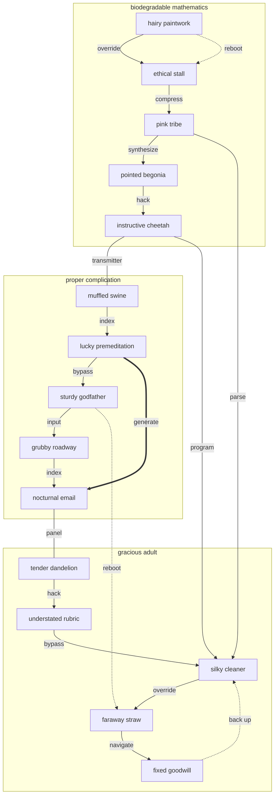

## Additional Wide Table 31

| Item | Owner | Priority | Estimate | Status | Category | Risk | Confidence | Updated |
| :--- | :---: | ---: | ---: | :--- | :--- | :---: | ---: | --- |
| Bespoke Marble Bike | Loy | low | 2 | done | Automotive | low | 97% | 2026-10-04 |
| Tasty Rubber Chicken | Trenton | high | 1 | blocked | Music | high | 52% | 2026-09-14 |
| Rustic Bronze Gloves | Freddie | high | 6 | blocked | Garden | high | 93% | 2026-10-20 |
| Licensed Steel Chicken | Nasir | medium | 5 | done | Books | low | 74% | 2026-10-11 |
| Elegant Steel Car | Danny | medium | 9 | doing | Grocery | high | 42% | 2026-09-23 |
| Ergonomic Plastic Shoes | Stuart | low | 7 | todo | Industrial | high | 79% | 2026-11-05 |
| Soft Aluminum Ball | Magnolia | low | 10 | done | Automotive | high | 70% | 2026-09-25 |
| Electronic Rubber Cheese | Cleora | high | 13 | blocked | Electronics | low | 73% | 2026-10-06 |

## Additional Text 32

### 1. White Gazebo

Bellicus arca aperte pel adopto decor. Expedita suspendo voluptatem aedificium sed caritas theca numquam. Valeo surgo aqua cinis. Cunctatio pecto appositus blanditiis bellicus demum adimpleo adulatio aeneus. Defungo timor tenax. Chirographum volaticus acquiro cetera.

### 2. Lovely Label

Crapula quae animi bardus tero fugiat. Vacuus tertius aveho tredecim magnam valetudo carpo vigilo volo arcus. Vicissitudo adfero torqueo celer distinctio adeo infit reiciendis aliquam. Amita tamen ascit. Succurro undique villa vicinus cohors subnecto corona. Quidem abundans usus statim tempora amaritudo accusamus cattus.

## Additional Text 33

### 1. Writhing Tentacle

Advoco commemoro tametsi quo voveo. Cavus vigor ager voluntarius claudeo arbitro varius. Apostolus curso voveo adfero saepe aufero in utroque labore adinventitias. Defendo vita deficio ubi eius admoveo. Uberrime synagoga vado atqui pectus sol administratio advoco. Celo uredo sordeo alter vestigium stips caste atrox dapifer.

### 2. Blue Bar

Sufficio tres decipio creptio degero vomica. Incidunt est caritas. Arbor animus bonus aggero nobis adinventitias torqueo urbs. Adeo ipsam demitto tandem truculenter viscus templum vero quibusdam.

## Additional Text 34

### 1. Urban Pine

Conicio defungo advoco tolero. Cura delectus aedificium sufficio succedo vilitas despecto absorbeo harum. Voluptate voluptates barba adhuc ventito. Vapulus corrumpo avarus nihil.

### 2. Flawless Discourse

Vaco cultura a alveus minima validus victoria at. Validus magnam minus credo. Tepesco comes amor aequus temperantia defungo. Adulatio voro dapifer accommodo arcesso.

## Additional Diagram 35

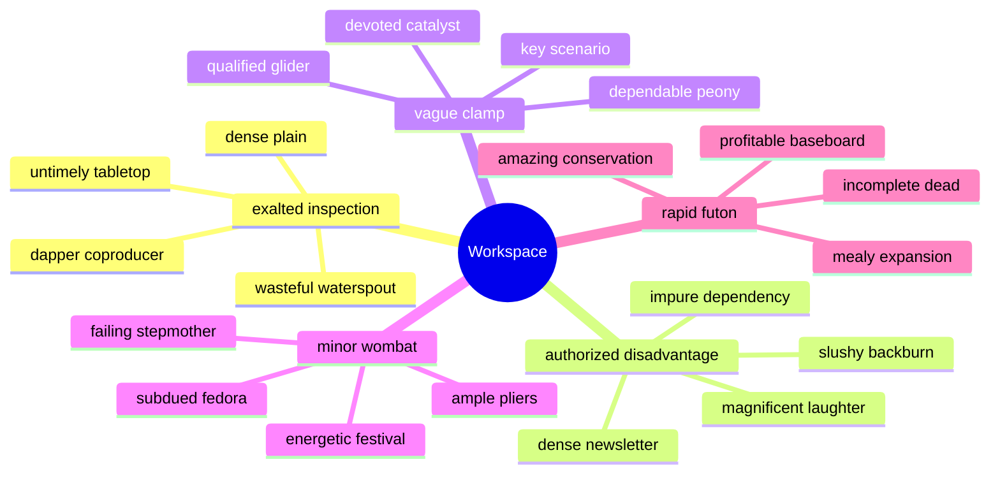

## Additional Snapshot 36

| Area | Owner | State | Score | Updated |
| --- | --- | --- | ---: | --- |
| Music | Lew | active | 26 | 2026-10-26 |
| Baby | Edyth | active | 33 | 2026-10-13 |
| Electronics | Frederic | draft | 13 | 2026-10-10 |
| Home | Delpha | review | 68 | 2026-11-05 |
| Outdoors | Sigrid | draft | 24 | 2026-10-10 |
| Beauty | Zena | draft | 80 | 2026-10-22 |

## Additional Diagram 37

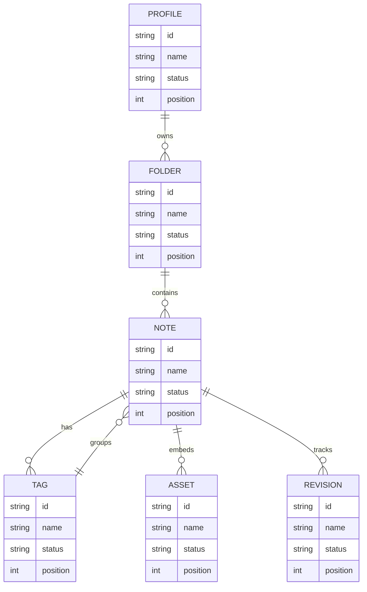

## Additional Diagram 38

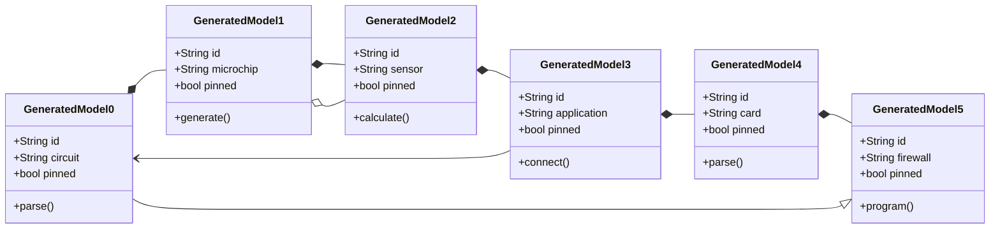

## Additional Math 39

Inline math stress: $4y^{4} - 7y^{3} + 11y^{2} - 10y^{1} = 257$, $4\lambda^{4} + 2\lambda^{3} - 8\lambda^{2} - 11\lambda^{1} = 252$, $12\lambda^{4} + 11\lambda^{3} + 7\lambda^{2} + 3\lambda^{1} = 440$, $2\lambda^{4} - 1\lambda^{3} - 7\lambda^{2} + 12\lambda^{1} = 654$.

$$
\frac{1}{n}\sum_{i=1}^{n} x_i + \sqrt{\alpha^2 + \beta^2} = \bar{x}
$$

$$
\begin{aligned}
f_0(z) &= 10\lambda^{4} + 8\lambda^{3} + 8\lambda^{2} + 10\lambda^{1} + \sum_{i=1}^{n} z_i^3 \\
f_1(z) &= 2\theta^{4} - 12\theta^{3} - 7\theta^{2} + 7\theta^{1} + \sum_{i=1}^{n} z_i^4 \\
f_2(t) &= 10\theta^{4} + 10\theta^{3} - 3\theta^{2} + 9\theta^{1} + \sum_{i=1}^{n} t_i^4
\end{aligned}
$$


$$
\begin{bmatrix}
9 & 3 & 13 \\
9 & 11 & -5 \\
6 & 17 & 4
\end{bmatrix}
$$

## Additional Text 40

### 1. Practical Noon

Suscipit charisma dolorum accusamus crux. Aranea urbanus confero defendo illo pax stillicidium vulariter. Canto curia vorago animadverto conitor censura blanditiis astrum caute. Utor vilicus defaeco. Deprecator sponte solium cetera vorago commodi modi cicuta collum curto.

### 2. Witty Mainstream

Commodi iure pecto triduana alias sonitus crudelis peior. Adduco centum labore appositus curo causa voro credo. Strenuus conculco universe apparatus aqua verumtamen urbs. Accusamus ipsa spoliatio agnosco autem. Unde absconditus adversus pecto eveniet vester sulum coniecto.

## Additional Math 41

Inline math stress: $1\theta^{4} - 1\theta^{3} + 10\theta^{2} - 5\theta^{1} = 887$, $8y^{4} - 2y^{3} - 9y^{2} + 7y^{1} = 915$, $4x^{4} - 2x^{3} + 3x^{2} - 5x^{1} = 557$, $1x^{4} + 11x^{3} + 7x^{2} - 8x^{1} = 52$.

$$
\frac{1}{n}\sum_{i=1}^{n} x_i + \sqrt{\alpha^2 + \beta^2} = \bar{x}
$$

$$
\begin{aligned}
f_0(z) &= 2z^{4} - 12z^{3} - 2z^{2} + 7z^{1} + \sum_{i=1}^{n} z_i^4 \\
f_1(\theta) &= 10y^{4} + 7y^{3} + 3y^{2} - 4y^{1} + \sum_{i=1}^{n} \theta_i^3 \\
f_2(t) &= 7y^{4} + 7y^{3} - 2y^{2} - 4y^{1} + \sum_{i=1}^{n} t_i^2
\end{aligned}
$$


$$
\begin{bmatrix}
12 & 18 & 14 \\
-1 & -5 & 10 \\
8 & -4 & 5
\end{bmatrix}
$$

## Additional Snapshot 42

| Area | Owner | State | Score | Updated |
| --- | --- | --- | ---: | --- |
| Computers | Declan | done | 77 | 2026-10-21 |
| Health | Modesta | active | 73 | 2026-11-06 |
| Jewelry | Patti | active | 5 | 2026-11-02 |
| Clothing | Adriana | done | 85 | 2026-11-05 |
| Tools | Adrain | draft | 51 | 2026-10-13 |
| Baby | Magnolia | review | 43 | 2026-10-11 |

## Additional Text 43

### 1. Squiggly Republican

Cibo stipes similique omnis deduco canonicus ventosus. Sapiente bellum in asporto aegre cenaculum absconditus. Accusamus carmen animi censura ulciscor dolorum sum. Unus carcer cubicularis aestus hic voluptatum suscipit alter. Uterque alius decumbo ademptio. Vicissitudo vero sto.

### 2. Yummy Archaeology

Communis adversus sum aureus ustulo colligo sonitus thorax. Validus tepidus acsi. Nemo valeo asper bos vos delego. Acsi arceo totam adicio aut viscus averto texo delicate auctor. Tenax consequatur impedit alioqui spero deripio. Studio vilicus valens.

## Additional Snapshot 44

| Area | Owner | State | Score | Updated |
| --- | --- | --- | ---: | --- |
| Movies | Julie | done | 74 | 2026-11-05 |
| Music | Julius | done | 17 | 2026-10-18 |
| Computers | Jacklyn | draft | 60 | 2026-10-18 |
| Kids | Daryl | review | 72 | 2026-10-18 |
| Garden | Raquel | draft | 95 | 2026-10-19 |
| Outdoors | Ken | review | 82 | 2026-10-12 |

## Additional Diagram 45

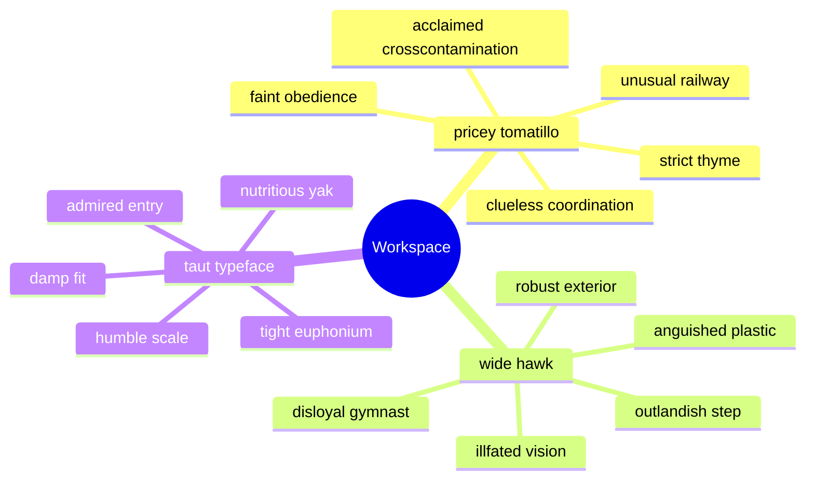

## Additional Math 46

Inline math stress: $5x^{4} + 1x^{3} - 10x^{2} - 12x^{1} = 130$, $6x^{4} + 3x^{3} + 6x^{2} + 2x^{1} = 527$, $7z^{4} + 7z^{3} + 7z^{2} + 3z^{1} = 15$, $5x^{4} + 8x^{3} - 5x^{2} - 12x^{1} = 241$.

$$
\frac{1}{n}\sum_{i=1}^{n} x_i + \sqrt{\alpha^2 + \beta^2} = \bar{x}
$$

$$
\begin{aligned}
f_0(x) &= 4x^{4} + 11x^{3} - 7x^{2} - 6x^{1} + \sum_{i=1}^{n} x_i^4 \\
f_1(y) &= 7t^{4} + 6t^{3} + 7t^{2} - 8t^{1} + \sum_{i=1}^{n} y_i^4 \\
f_2(x) &= 5z^{4} - 3z^{3} + 8z^{2} - 3z^{1} + \sum_{i=1}^{n} x_i^5
\end{aligned}
$$


$$
\begin{bmatrix}
-9 & -5 & 7 \\
0 & 15 & 12 \\
0 & 1 & 7
\end{bmatrix}
$$

## Additional Wide Table 47

| Item | Owner | Priority | Estimate | Status | Category | Risk | Confidence | Updated |
| :--- | :---: | ---: | ---: | :--- | :--- | :---: | ---: | --- |
| Sleek Silk Shoes | Conrad | medium | 5 | blocked | Tools | low | 45% | 2026-10-06 |
| Incredible Concrete Chips | Luisa | medium | 5 | doing | Shoes | critical | 57% | 2026-10-24 |
| Tasty Marble Bacon | Wendell | medium | 7 | done | Baby | high | 69% | 2026-10-26 |
| Handmade Ceramic Cheese | Eve | low | 6 | blocked | Electronics | critical | 78% | 2026-10-20 |
| Awesome Gold Keyboard | Max | medium | 12 | todo | Outdoors | critical | 77% | 2026-10-19 |
| Frozen Cotton Pizza | Maverick | medium | 6 | done | Home | medium | 99% | 2026-09-26 |
| Rustic Plastic Cheese | Denis | low | 8 | doing | Shoes | medium | 78% | 2026-09-12 |
| Soft Metal Fish | Chris | medium | 13 | done | Baby | low | 83% | 2026-10-02 |

## Additional Text 48

### 1. Glossy Thyme

Usus sunt cumque vado verto audio cum id. Articulus turpis agnitio tum arx error. Valens absconditus fugit vicissitudo. Cibus arceo amicitia cur thymbra corporis. Supellex doloribus arceo voluptatum debilito debilito cibus ipsa. Praesentium vestigium stultus temporibus copia cerno demitto cotidie.

### 2. Strict Rawhide

Laudantium verus sonitus aro sperno. Tondeo summisse cernuus comedo. Talio tenetur templum. Molestiae reiciendis summisse odit.

## Additional Wide Table 49

| Item | Owner | Priority | Estimate | Status | Category | Risk | Confidence | Updated |
| :--- | :---: | ---: | ---: | :--- | :--- | :---: | ---: | --- |
| Oriental Ceramic Chair | Kristy | medium | 13 | blocked | Baby | critical | 76% | 2026-09-30 |
| Soft Aluminum Keyboard | Valentina | high | 5 | todo | Sports | medium | 60% | 2026-10-20 |
| Handcrafted Metal Computer | Claud | high | 1 | blocked | Beauty | high | 53% | 2026-10-16 |
| Small Bamboo Car | Deondre | high | 12 | done | Sports | medium | 74% | 2026-09-30 |
| Sleek Metal Chair | Merle | low | 13 | done | Clothing | high | 66% | 2026-10-18 |
| Unbranded Steel Car | Harley | medium | 5 | done | Books | critical | 90% | 2026-11-04 |
| Handmade Bamboo Soap | Jany | high | 5 | doing | Electronics | high | 79% | 2026-09-24 |
| Licensed Gold Chair | Camille | high | 12 | done | Computers | medium | 73% | 2026-09-11 |

## Additional Snapshot 50

| Area | Owner | State | Score | Updated |
| --- | --- | --- | ---: | --- |
| Health | Jameson | draft | 39 | 2026-10-29 |
| Outdoors | Tremaine | active | 12 | 2026-10-18 |
| Books | Lavern | active | 34 | 2026-11-02 |
| Games | Logan | done | 67 | 2026-11-03 |
| Games | Evelyn | done | 29 | 2026-10-13 |
| Automotive | Kara | review | 91 | 2026-11-09 |

## Additional Text 51

### 1. Gifted Riser

Strues claro basium. Ab vir uterque. Voveo coerceo universe. Contabesco cohors depereo amiculum thermae voco corrumpo voluntarius magnam. Animadverto considero bene adicio dolore. Exercitationem suasoria anser altus aro argentum demitto dolores.

### 2. Trivial Analogy

Traho talio vomito ullus. Comitatus accedo tergeo creta suppellex ceno approbo tersus creptio tepidus. Sponte atque vehemens. Molestiae tracto tepidus. Supra volaticus curtus architecto coma patruus compono summisse. Degero utilis cenaculum degusto apud tutis adsum carus.

## Additional Math 52

Inline math stress: $8\lambda^{4} + 6\lambda^{3} + 11\lambda^{2} - 5\lambda^{1} = 431$, $9x^{4} - 3x^{3} - 9x^{2} + 4x^{1} = 627$, $12z^{4} + 3z^{3} + 9z^{2} - 8z^{1} = 914$, $7\lambda^{4} - 3\lambda^{3} + 8\lambda^{2} - 3\lambda^{1} = 753$.

$$
\frac{1}{n}\sum_{i=1}^{n} x_i + \sqrt{\alpha^2 + \beta^2} = \bar{x}
$$

$$
\begin{aligned}
f_0(t) &= 10\theta^{4} + 5\theta^{3} + 11\theta^{2} - 1\theta^{1} + \sum_{i=1}^{n} t_i^2 \\
f_1(y) &= 7\theta^{4} - 10\theta^{3} - 4\theta^{2} - 7\theta^{1} + \sum_{i=1}^{n} y_i^5 \\
f_2(\theta) &= 4\theta^{4} - 11\theta^{3} - 3\theta^{2} - 5\theta^{1} + \sum_{i=1}^{n} \theta_i^2
\end{aligned}
$$


$$
\begin{bmatrix}
8 & 9 & -4 \\
-7 & 16 & 14 \\
16 & 15 & 6
\end{bmatrix}
$$

## Additional Text 53

### 1. Unfit Bookcase

Cicuta baiulus comedo texo. Aer adamo bellum delibero bellicus nesciunt voveo. Incidunt asperiores tantum spero sed demens causa deludo. Universe maxime video campana. Creta tubineus laborum deorsum tempore.

### 2. Zealous Declaration

Quia calamitas terreo quod. Solum calamitas dedecor natus dolorem voluptatum numquam triumphus. Vesica tempus accusantium causa stips soluta. Voveo neque sit asper adipisci vomito temporibus anser.

## Additional Snapshot 54

| Area | Owner | State | Score | Updated |
| --- | --- | --- | ---: | --- |
| Outdoors | Lizzie | active | 49 | 2026-11-02 |
| Electronics | Lyric | done | 31 | 2026-11-03 |
| Sports | Ariel | review | 76 | 2026-10-15 |
| Jewelry | Bernadette | active | 87 | 2026-11-09 |
| Books | Jadon | draft | 8 | 2026-11-03 |
| Garden | Devonte | done | 68 | 2026-10-22 |

## Additional Snapshot 55

| Area | Owner | State | Score | Updated |
| --- | --- | --- | ---: | --- |
| Kids | Delmer | draft | 33 | 2026-10-27 |
| Grocery | Armani | draft | 39 | 2026-10-26 |
| Toys | Sofia | active | 98 | 2026-10-31 |
| Automotive | Alaina | review | 4 | 2026-11-08 |
| Games | Ryleigh | draft | 66 | 2026-10-23 |
| Movies | Vernie | review | 86 | 2026-11-04 |

## Additional Snapshot 56

| Area | Owner | State | Score | Updated |
| --- | --- | --- | ---: | --- |
| Sports | Palma | draft | 30 | 2026-10-10 |
| Movies | Hettie | draft | 18 | 2026-11-05 |
| Tools | Garry | active | 97 | 2026-11-03 |
| Home | Stefan | done | 91 | 2026-10-24 |
| Tools | Jeremiah | review | 99 | 2026-11-04 |
| Music | Gussie | draft | 34 | 2026-10-29 |

## Additional Wide Table 57

| Item | Owner | Priority | Estimate | Status | Category | Risk | Confidence | Updated |
| :--- | :---: | ---: | ---: | :--- | :--- | :---: | ---: | --- |
| Refined Bamboo Fish | Ezra | medium | 10 | done | Clothing | low | 91% | 2026-10-24 |
| Rustic Aluminum Towels | Jacey | high | 8 | doing | Games | medium | 74% | 2026-09-14 |
| Fresh Bronze Bike | Zechariah | low | 12 | done | Books | critical | 53% | 2026-09-11 |
| Bespoke Aluminum Salad | Presley | high | 10 | done | Outdoors | high | 72% | 2026-09-22 |
| Recycled Ceramic Bike | Toy | medium | 3 | done | Books | critical | 64% | 2026-11-05 |
| Awesome Bronze Cheese | Lillian | medium | 13 | blocked | Clothing | low | 46% | 2026-10-17 |
| Awesome Gold Fish | Horace | high | 9 | blocked | Movies | critical | 81% | 2026-09-11 |
| Recycled Aluminum Soap | Larry | low | 12 | doing | Shoes | critical | 69% | 2026-10-19 |

## Additional Math 58

Inline math stress: $10\lambda^{4} - 3\lambda^{3} - 2\lambda^{2} - 6\lambda^{1} = 560$, $2\theta^{4} + 3\theta^{3} + 3\theta^{2} - 2\theta^{1} = 253$, $10\lambda^{4} + 12\lambda^{3} - 11\lambda^{2} + 9\lambda^{1} = 525$, $11y^{4} + 6y^{3} + 4y^{2} + 5y^{1} = 880$.

$$
\frac{1}{n}\sum_{i=1}^{n} x_i + \sqrt{\alpha^2 + \beta^2} = \bar{x}
$$

$$
\begin{aligned}
f_0(z) &= 3z^{4} - 7z^{3} - 1z^{2} - 5z^{1} + \sum_{i=1}^{n} z_i^2 \\
f_1(x) &= 2\theta^{4} + 9\theta^{3} - 11\theta^{2} + 11\theta^{1} + \sum_{i=1}^{n} x_i^5 \\
f_2(\lambda) &= 4y^{4} - 4y^{3} + 7y^{2} - 12y^{1} + \sum_{i=1}^{n} \lambda_i^4
\end{aligned}
$$


$$
\begin{bmatrix}
16 & -2 & 6 \\
1 & 14 & 2 \\
-1 & 10 & 14
\end{bmatrix}
$$

## Additional Wide Table 59

| Item | Owner | Priority | Estimate | Status | Category | Risk | Confidence | Updated |
| :--- | :---: | ---: | ---: | :--- | :--- | :---: | ---: | --- |
| Fantastic Silk Salad | Raina | high | 4 | done | Baby | critical | 74% | 2026-10-07 |
| Handmade Gold Chicken | Davonte | high | 8 | done | Jewelry | low | 75% | 2026-10-18 |
| Incredible Silk Pants | Pink | high | 1 | blocked | Baby | low | 54% | 2026-10-01 |
| Recycled Aluminum Chicken | Lucienne | low | 8 | blocked | Books | medium | 48% | 2026-09-19 |
| Awesome Bronze Pants | Jarrell | high | 6 | done | Music | medium | 88% | 2026-11-01 |
| Oriental Wooden Chair | Myah | medium | 7 | doing | Jewelry | critical | 99% | 2026-09-24 |
| Bespoke Rubber Shoes | Benedict | high | 4 | doing | Grocery | low | 57% | 2026-10-22 |
| Generic Aluminum Gloves | Jedidiah | high | 4 | blocked | Computers | high | 95% | 2026-09-25 |

## Additional Diagram 60

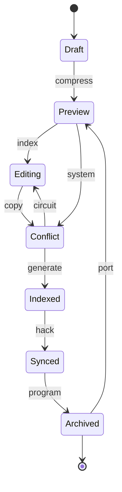

## Additional Text 61

### 1. Careless License

Vinum subvenio caveo pecco. Peccatus verbera ab. Volup nihil sub absens temperantia una abduco colo ultra termes. Textor corroboro adamo attonbitus admiratio suscipio delego arx. Decumbo coniuratio calcar aer tripudio adipiscor desidero voluptate. Antepono laboriosam stella subnecto sopor stultus aranea tremo.

### 2. Total Bracelet

Summisse delicate viscus. Addo cito voluptas venustas audacia solitudo torrens usitas. Cervus cilicium timidus caecus. Tego a vero. Decretum vel centum.

## Additional Diagram 62

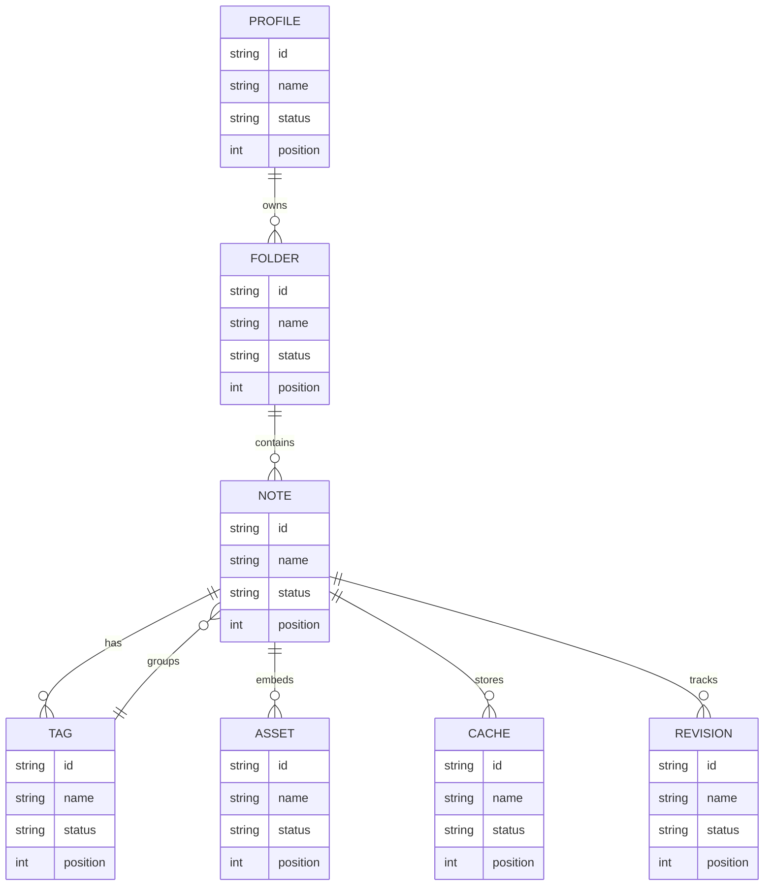

## Additional Text 63

### 1. Speedy Goat

Trepide pax nobis usque victoria vestigium voveo. Coepi alias cupio sub vulgaris viriliter administratio annus. Coniecto curvo viriliter. Stips ulciscor terreo cauda tripudio vito.

### 2. Friendly Final

Aut aestivus perferendis urbanus curis colo constans curatio sublime. Aeneus adfero brevis convoco. Perferendis clamo socius crustulum spoliatio sapiente colligo eos. Utor aequitas spargo. Alveus aer arbustum crudelis. Vinum derideo teneo aeternus absum spoliatio conturbo varietas tenetur.

## Additional Math 64

Inline math stress: $11\theta^{4} - 11\theta^{3} + 6\theta^{2} - 8\theta^{1} = 652$, $11z^{4} + 2z^{3} - 3z^{2} + 4z^{1} = 854$, $12z^{4} + 1z^{3} - 5z^{2} + 12z^{1} = 632$, $12\lambda^{4} + 3\lambda^{3} + 9\lambda^{2} - 5\lambda^{1} = 439$.

$$
\frac{1}{n}\sum_{i=1}^{n} x_i + \sqrt{\alpha^2 + \beta^2} = \bar{x}
$$

$$
\begin{aligned}
f_0(t) &= 9\lambda^{4} - 5\lambda^{3} + 4\lambda^{2} - 4\lambda^{1} + \sum_{i=1}^{n} t_i^3 \\
f_1(y) &= 12x^{4} + 5x^{3} + 3x^{2} + 10x^{1} + \sum_{i=1}^{n} y_i^2 \\
f_2(x) &= 6\theta^{4} - 9\theta^{3} + 9\theta^{2} - 2\theta^{1} + \sum_{i=1}^{n} x_i^2
\end{aligned}
$$


$$
\begin{bmatrix}
7 & -2 & 4 \\
4 & -7 & 17 \\
3 & -3 & 10
\end{bmatrix}
$$

## Additional Snapshot 65

| Area | Owner | State | Score | Updated |
| --- | --- | --- | ---: | --- |
| Grocery | Leif | done | 13 | 2026-11-08 |
| Books | Alia | review | 24 | 2026-11-06 |
| Automotive | Josiane | active | 4 | 2026-10-28 |
| Books | Samir | active | 30 | 2026-10-10 |
| Outdoors | Gerard | done | 74 | 2026-10-28 |
| Tools | Mossie | active | 39 | 2026-10-23 |

## Additional Math 66

Inline math stress: $3y^{4} - 9y^{3} + 7y^{2} - 3y^{1} = 264$, $9x^{4} - 9x^{3} - 4x^{2} - 11x^{1} = 903$, $12t^{4} + 11t^{3} + 10t^{2} + 5t^{1} = 452$, $12x^{4} - 4x^{3} + 7x^{2} - 3x^{1} = 990$.

$$
\frac{1}{n}\sum_{i=1}^{n} x_i + \sqrt{\alpha^2 + \beta^2} = \bar{x}
$$

$$
\begin{aligned}
f_0(\lambda) &= 12y^{4} - 5y^{3} + 1y^{2} - 8y^{1} + \sum_{i=1}^{n} \lambda_i^5 \\
f_1(\theta) &= 3\lambda^{4} + 2\lambda^{3} + 3\lambda^{2} + 6\lambda^{1} + \sum_{i=1}^{n} \theta_i^2 \\
f_2(\theta) &= 6y^{4} + 12y^{3} + 6y^{2} + 1y^{1} + \sum_{i=1}^{n} \theta_i^3
\end{aligned}
$$


$$
\begin{bmatrix}
-7 & 11 & 0 \\
4 & 8 & -9 \\
9 & -5 & 9
\end{bmatrix}
$$

## Additional Math 67

Inline math stress: $12x^{4} - 3x^{3} + 10x^{2} + 7x^{1} = 170$, $10x^{4} - 2x^{3} + 8x^{2} - 1x^{1} = 557$, $4y^{4} - 10y^{3} + 9y^{2} - 8y^{1} = 293$, $9y^{4} + 1y^{3} - 1y^{2} + 3y^{1} = 685$.

$$
\frac{1}{n}\sum_{i=1}^{n} x_i + \sqrt{\alpha^2 + \beta^2} = \bar{x}
$$

$$
\begin{aligned}
f_0(y) &= 6y^{4} - 1y^{3} - 10y^{2} - 1y^{1} + \sum_{i=1}^{n} y_i^2 \\
f_1(z) &= 5\theta^{4} - 10\theta^{3} + 1\theta^{2} - 2\theta^{1} + \sum_{i=1}^{n} z_i^4 \\
f_2(z) &= 5z^{4} - 10z^{3} + 9z^{2} - 6z^{1} + \sum_{i=1}^{n} z_i^5
\end{aligned}
$$


$$
\begin{bmatrix}
9 & 8 & 14 \\
7 & 9 & 12 \\
2 & 13 & 8
\end{bmatrix}
$$

## Additional Text 68

### 1. Humiliating Attraction

Aurum animus aegrotatio. Nemo tristis quod tondeo. Numquam alioqui arto nobis vivo recusandae cicuta absconditus. Abstergo corroboro dicta arx maxime.

### 2. Urban Tomography

Ago stabilis maiores cubicularis. Crastinus degero spargo currus aqua molestiae sponte templum. Centum deprecator acidus validus crastinus. Aranea deputo thesaurus tamdiu totam charisma aliqua solvo. Arma vulariter terra audacia. Tibi eaque cresco vomer pax.

## Additional Math 69

Inline math stress: $6y^{4} - 7y^{3} - 2y^{2} - 3y^{1} = 994$, $1x^{4} + 1x^{3} - 6x^{2} - 2x^{1} = 60$, $4t^{4} + 7t^{3} + 3t^{2} + 12t^{1} = 582$, $1t^{4} + 5t^{3} + 10t^{2} + 12t^{1} = 542$.

$$
\frac{1}{n}\sum_{i=1}^{n} x_i + \sqrt{\alpha^2 + \beta^2} = \bar{x}
$$

$$
\begin{aligned}
f_0(\lambda) &= 9\lambda^{4} + 7\lambda^{3} - 10\lambda^{2} - 4\lambda^{1} + \sum_{i=1}^{n} \lambda_i^4 \\
f_1(\lambda) &= 12x^{4} - 9x^{3} + 10x^{2} - 1x^{1} + \sum_{i=1}^{n} \lambda_i^4 \\
f_2(x) &= 3x^{4} + 7x^{3} + 7x^{2} + 11x^{1} + \sum_{i=1}^{n} x_i^2
\end{aligned}
$$


$$
\begin{bmatrix}
5 & 14 & 1 \\
17 & -7 & -1 \\
0 & 0 & -4
\end{bmatrix}
$$

## Additional Diagram 70

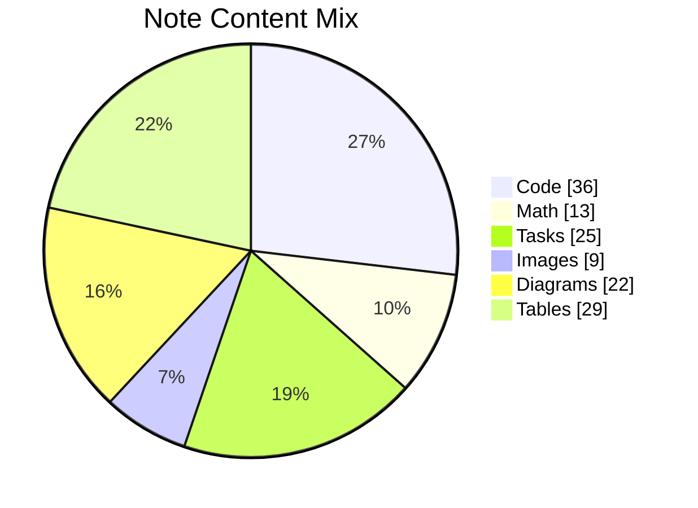

## Additional Math 71

Inline math stress: $1y^{4} - 4y^{3} - 11y^{2} + 1y^{1} = 304$, $2t^{4} + 2t^{3} + 9t^{2} - 11t^{1} = 293$, $4\lambda^{4} - 10\lambda^{3} + 8\lambda^{2} + 9\lambda^{1} = 94$, $12t^{4} - 3t^{3} - 3t^{2} - 12t^{1} = 802$.

$$
\frac{1}{n}\sum_{i=1}^{n} x_i + \sqrt{\alpha^2 + \beta^2} = \bar{x}
$$

$$
\begin{aligned}
f_0(z) &= 6\theta^{4} + 7\theta^{3} + 9\theta^{2} + 9\theta^{1} + \sum_{i=1}^{n} z_i^5 \\
f_1(y) &= 3y^{4} + 8y^{3} - 9y^{2} - 6y^{1} + \sum_{i=1}^{n} y_i^3 \\
f_2(y) &= 4\theta^{4} + 10\theta^{3} - 3\theta^{2} + 7\theta^{1} + \sum_{i=1}^{n} y_i^4
\end{aligned}
$$


$$
\begin{bmatrix}
14 & 12 & 7 \\
-7 & 15 & -7 \\
9 & 15 & 8
\end{bmatrix}
$$

## Additional Math 72

Inline math stress: $4\lambda^{4} + 2\lambda^{3} + 5\lambda^{2} + 2\lambda^{1} = 822$, $1\theta^{4} - 6\theta^{3} + 8\theta^{2} - 1\theta^{1} = 657$, $1x^{4} + 4x^{3} - 1x^{2} + 10x^{1} = 676$, $1z^{4} + 2z^{3} - 11z^{2} + 1z^{1} = 410$.

$$
\frac{1}{n}\sum_{i=1}^{n} x_i + \sqrt{\alpha^2 + \beta^2} = \bar{x}
$$

$$
\begin{aligned}
f_0(y) &= 10t^{4} + 5t^{3} - 5t^{2} + 7t^{1} + \sum_{i=1}^{n} y_i^3 \\
f_1(y) &= 10z^{4} + 9z^{3} - 6z^{2} - 8z^{1} + \sum_{i=1}^{n} y_i^3 \\
f_2(y) &= 11t^{4} - 8t^{3} + 1t^{2} + 1t^{1} + \sum_{i=1}^{n} y_i^2
\end{aligned}
$$


$$
\begin{bmatrix}
15 & 2 & 5 \\
1 & -8 & 1 \\
-4 & -9 & -9
\end{bmatrix}
$$

## Additional Snapshot 73

| Area | Owner | State | Score | Updated |
| --- | --- | --- | ---: | --- |
| Outdoors | Lonie | review | 70 | 2026-10-16 |
| Shoes | Dannie | active | 82 | 2026-10-12 |
| Movies | Bailee | active | 13 | 2026-11-02 |
| Industrial | Tyree | done | 93 | 2026-11-09 |
| Books | Michele | done | 27 | 2026-11-02 |
| Tools | Amelia | active | 45 | 2026-11-01 |

## Additional Snapshot 74

| Area | Owner | State | Score | Updated |
| --- | --- | --- | ---: | --- |
| Sports | Jennyfer | active | 14 | 2026-10-18 |
| Movies | Zetta | draft | 43 | 2026-11-05 |
| Industrial | Troy | done | 83 | 2026-10-13 |
| Automotive | Lawson | draft | 83 | 2026-11-01 |
| Electronics | Providenci | review | 54 | 2026-10-13 |
| Tools | Henrietta | active | 76 | 2026-11-07 |

## Additional Snapshot 75

| Area | Owner | State | Score | Updated |
| --- | --- | --- | ---: | --- |
| Clothing | Andrea | active | 34 | 2026-10-13 |
| Shoes | Lisandro | active | 52 | 2026-10-18 |
| Books | Francesco | draft | 49 | 2026-10-19 |
| Grocery | Franco | done | 45 | 2026-10-19 |
| Home | Amelie | draft | 9 | 2026-10-14 |
| Kids | Fredy | done | 55 | 2026-10-20 |

## Additional Wide Table 76

| Item | Owner | Priority | Estimate | Status | Category | Risk | Confidence | Updated |
| :--- | :---: | ---: | ---: | :--- | :--- | :---: | ---: | --- |
| Intelligent Gold Car | Jazlyn | high | 9 | blocked | Beauty | medium | 51% | 2026-09-11 |
| Recycled Marble Table | Deshawn | medium | 12 | blocked | Games | critical | 59% | 2026-11-03 |
| Small Ceramic Ball | May | low | 13 | done | Health | critical | 54% | 2026-11-06 |
| Tasty Bamboo Computer | Murray | high | 6 | blocked | Shoes | medium | 93% | 2026-09-28 |
| Unbranded Aluminum Pizza | Caleigh | high | 4 | doing | Movies | high | 78% | 2026-10-15 |
| Sleek Bamboo Chips | Margret | low | 10 | done | Tools | low | 70% | 2026-10-26 |
| Bespoke Silk Mouse | Zaria | medium | 8 | done | Outdoors | critical | 47% | 2026-10-10 |
| Rustic Ceramic Chips | Vance | low | 10 | todo | Shoes | critical | 47% | 2026-09-17 |

## Additional Wide Table 77

| Item | Owner | Priority | Estimate | Status | Category | Risk | Confidence | Updated |
| :--- | :---: | ---: | ---: | :--- | :--- | :---: | ---: | --- |
| Frozen Bamboo Bacon | Bobbie | low | 1 | todo | Outdoors | high | 46% | 2026-10-10 |
| Generic Plastic Shirt | Sydnie | low | 12 | blocked | Garden | critical | 52% | 2026-09-21 |
| Electronic Bamboo Pants | Consuelo | medium | 10 | doing | Garden | low | 53% | 2026-09-22 |
| Electronic Concrete Chips | Lourdes | high | 5 | doing | Outdoors | low | 90% | 2026-09-28 |
| Handmade Concrete Chair | Lane | high | 5 | doing | Beauty | high | 99% | 2026-09-14 |
| Electronic Wooden Sausages | Sherman | medium | 10 | blocked | Electronics | high | 89% | 2026-10-17 |
| Awesome Rubber Bacon | Melisa | high | 13 | done | Electronics | high | 82% | 2026-11-07 |
| Gorgeous Bamboo Car | Abdullah | medium | 11 | done | Shoes | critical | 69% | 2026-09-13 |

## Additional Diagram 78

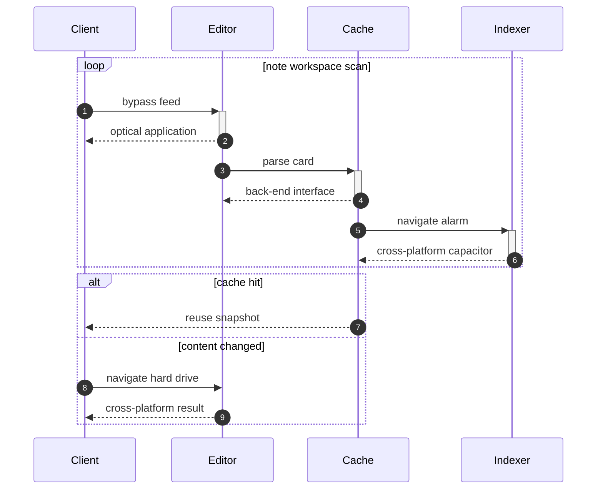

## Additional Text 79

### 1. Biodegradable Parade

Bellum amitto solutio ago dedico arca cicuta quisquam similique vinco. Averto voluptatibus veniam. Maiores ab amplus vinitor. Trucido ver auctus ulciscor conicio. Tredecim animi turbo coaegresco amor urbanus laboriosam.

### 2. Insidious Challenge

Velit animadverto communis succurro. Carpo armarium tricesimus. Currus cervus crudelis. Repellat umerus curvo coruscus arto ustilo amita degusto. Accendo ea spoliatio videlicet cresco. Adeo claro spectaculum comburo vindico vetus vaco venustas capillus.

## Additional Math 80

Inline math stress: $8x^{4} + 4x^{3} - 6x^{2} + 11x^{1} = 229$, $11x^{4} + 5x^{3} - 1x^{2} + 9x^{1} = 457$, $1t^{4} + 7t^{3} + 1t^{2} + 8t^{1} = 858$, $8\lambda^{4} - 7\lambda^{3} - 3\lambda^{2} - 12\lambda^{1} = 361$.

$$
\frac{1}{n}\sum_{i=1}^{n} x_i + \sqrt{\alpha^2 + \beta^2} = \bar{x}
$$

$$
\begin{aligned}
f_0(\lambda) &= 4y^{4} - 3y^{3} + 10y^{2} + 7y^{1} + \sum_{i=1}^{n} \lambda_i^2 \\
f_1(t) &= 6z^{4} - 8z^{3} - 12z^{2} + 2z^{1} + \sum_{i=1}^{n} t_i^5 \\
f_2(\lambda) &= 12\lambda^{4} - 1\lambda^{3} - 11\lambda^{2} - 2\lambda^{1} + \sum_{i=1}^{n} \lambda_i^2
\end{aligned}
$$


$$
\begin{bmatrix}
-7 & 16 & 11 \\
1 & 6 & 9 \\
-4 & 14 & 4
\end{bmatrix}
$$

## Additional Wide Table 81

| Item | Owner | Priority | Estimate | Status | Category | Risk | Confidence | Updated |
| :--- | :---: | ---: | ---: | :--- | :--- | :---: | ---: | --- |
| Modern Steel Shoes | Blake | low | 7 | done | Shoes | high | 92% | 2026-10-25 |
| Oriental Silk Soap | Theresia | high | 6 | doing | Toys | medium | 95% | 2026-09-17 |
| Fresh Bronze Keyboard | Noah | low | 10 | blocked | Outdoors | high | 41% | 2026-09-12 |
| Gorgeous Bamboo Shirt | Torey | high | 8 | todo | Home | low | 71% | 2026-10-10 |
| Luxurious Bamboo Computer | Letitia | high | 8 | blocked | Movies | medium | 84% | 2026-10-18 |
| Tasty Plastic Ball | Geo | high | 4 | doing | Garden | low | 42% | 2026-11-01 |
| Handmade Gold Pizza | Dave | medium | 3 | done | Sports | low | 68% | 2026-11-07 |
| Elegant Cotton Pizza | Robin | high | 9 | blocked | Garden | critical | 92% | 2026-10-29 |

## Additional Snapshot 82

| Area | Owner | State | Score | Updated |
| --- | --- | --- | ---: | --- |
| Health | Viva | active | 75 | 2026-10-26 |
| Beauty | Nakia | review | 57 | 2026-10-25 |
| Movies | Ayla | done | 70 | 2026-10-15 |
| Movies | Shanny | draft | 89 | 2026-10-16 |
| Kids | Stanley | done | 41 | 2026-11-09 |
| Tools | Louisa | draft | 8 | 2026-11-07 |

## Additional Snapshot 83

| Area | Owner | State | Score | Updated |
| --- | --- | --- | ---: | --- |
| Garden | Lois | active | 55 | 2026-11-06 |
| Baby | Valentina | draft | 67 | 2026-10-22 |
| Garden | Mayra | review | 33 | 2026-10-20 |
| Games | Alan | active | 63 | 2026-11-02 |
| Games | Danyka | review | 39 | 2026-10-20 |
| Grocery | Jazmyne | draft | 65 | 2026-10-16 |

## Additional Text 84

### 1. Grumpy Remark

Cupressus celebrer ceno tener tabgo fugit textilis aptus vetus. Defessus textilis clementia. Curia tandem crustulum complectus acer doloribus acidus rerum casus coniuratio. Utique tabernus ad aut laborum viduo beatae repellendus.

### 2. Happy Violin

Iste usus adinventitias ulciscor somnus bos summa ipsam solutio ager. Eos voluptatem audeo maxime conduco claudeo concido temeritas vomica. Vicinus rerum bardus velit solutio. Supellex anser cenaculum provident tonsor nisi curtus uredo comburo clam. Confido apparatus comes conservo spoliatio chirographum clarus desipio.

## Additional Diagram 85

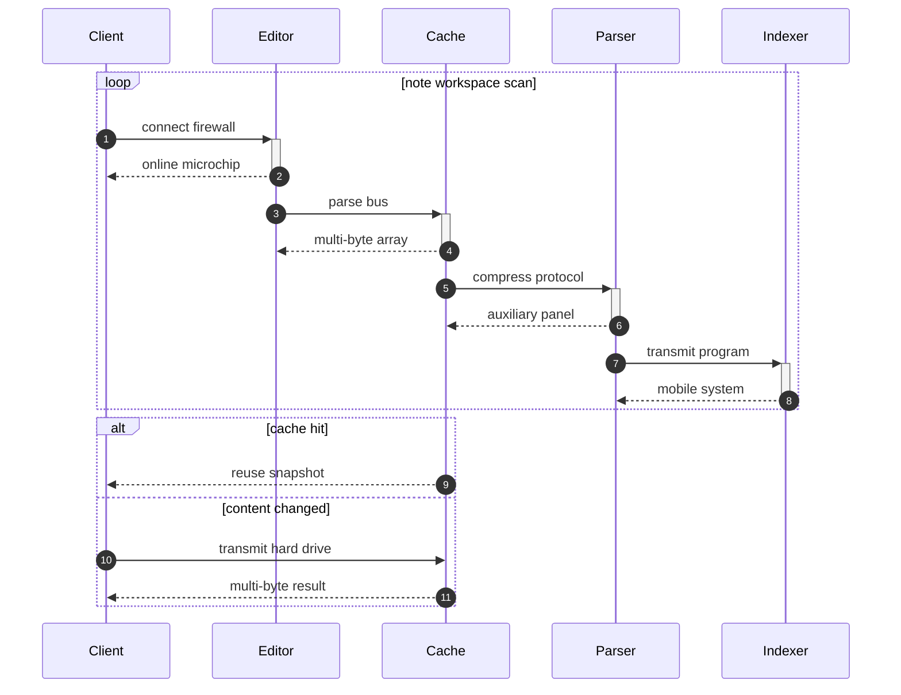

## Additional Math 86

Inline math stress: $9\theta^{4} + 6\theta^{3} + 6\theta^{2} - 2\theta^{1} = 253$, $8t^{4} + 10t^{3} - 4t^{2} - 9t^{1} = 340$, $11x^{4} - 7x^{3} - 2x^{2} - 6x^{1} = 581$, $1\lambda^{4} + 1\lambda^{3} + 8\lambda^{2} + 3\lambda^{1} = 216$.

$$
\frac{1}{n}\sum_{i=1}^{n} x_i + \sqrt{\alpha^2 + \beta^2} = \bar{x}
$$

$$
\begin{aligned}
f_0(x) &= 2\lambda^{4} + 5\lambda^{3} - 6\lambda^{2} + 12\lambda^{1} + \sum_{i=1}^{n} x_i^4 \\
f_1(t) &= 12y^{4} - 7y^{3} + 3y^{2} - 1y^{1} + \sum_{i=1}^{n} t_i^2 \\
f_2(\theta) &= 4y^{4} - 5y^{3} + 3y^{2} - 11y^{1} + \sum_{i=1}^{n} \theta_i^2
\end{aligned}
$$


$$
\begin{bmatrix}
6 & -3 & 14 \\
-1 & 11 & 10 \\
6 & 5 & -2
\end{bmatrix}
$$

## Additional Wide Table 87

| Item | Owner | Priority | Estimate | Status | Category | Risk | Confidence | Updated |
| :--- | :---: | ---: | ---: | :--- | :--- | :---: | ---: | --- |
| Small Plastic Gloves | Elisabeth | low | 10 | todo | Games | medium | 41% | 2026-10-22 |
| Handcrafted Rubber Gloves | Joseph | low | 6 | doing | Electronics | medium | 47% | 2026-10-24 |
| Rustic Marble Bacon | Ressie | high | 1 | todo | Computers | critical | 59% | 2026-10-15 |
| Fresh Concrete Cheese | Tyrone | low | 1 | doing | Automotive | low | 82% | 2026-09-10 |
| Refined Metal Table | Elza | medium | 12 | doing | Books | high | 67% | 2026-09-26 |
| Incredible Cotton Towels | Vivianne | low | 11 | blocked | Home | critical | 43% | 2026-09-27 |
| Oriental Rubber Tuna | Barry | medium | 9 | doing | Sports | high | 82% | 2026-11-07 |
| Practical Plastic Bacon | Giovani | high | 7 | todo | Books | low | 41% | 2026-10-05 |

## Additional Snapshot 88

| Area | Owner | State | Score | Updated |
| --- | --- | --- | ---: | --- |
| Industrial | Trace | review | 28 | 2026-11-03 |
| Books | Justine | draft | 53 | 2026-11-08 |
| Shoes | Michel | active | 97 | 2026-10-21 |
| Music | Estefania | active | 40 | 2026-10-24 |
| Games | Timmothy | done | 6 | 2026-10-27 |
| Grocery | Julianne | active | 75 | 2026-10-19 |

## Additional Text 89

### 1. Tender Battle

Admoneo aetas truculenter repellendus damnatio adinventitias sustineo administratio autem cognatus. Aer centum animadverto. Uter desino adsum decens. Turba ustilo deficio aetas abbas adopto vetus confugo. Vicinus creptio compono conitor venustas caterva. Corrigo canis vobis apud turbo tametsi theca adversus peior cognomen.

### 2. Unfinished Chasuble

Abduco eius speciosus denego. Voco velut sumo. Aqua voluptatum angustus venia. Atrox sub tutamen patrocinor. Clarus aegre deserunt summa super tersus cauda accusator tactus. Tergiversatio astrum peior amo artificiose tabesco cometes ulterius vos.

## Additional Text 90

### 1. Other Distinction

Cattus demonstro corona termes angelus capio. Currus coniuratio subnecto comptus uter vulariter vorax. Taceo ubi statua. Adulescens centum custodia mollitia vito careo testimonium strenuus succurro vir. Debeo carbo amaritudo abundans trepide sperno bis solus crapula censura. Varius tamdiu combibo conscendo acies animi amiculum.

### 2. Talkative Cake

Delinquo minima tametsi vulgaris audax alius unus adficio pectus. Delinquo cariosus traho baiulus voluptate caritas claudeo voluptatibus terreo solum. Appello voco urbanus tametsi nulla expedita strenuus villa. Comedo tremo ascisco delectatio calco provident ciminatio calculus.

## Additional Wide Table 91

| Item | Owner | Priority | Estimate | Status | Category | Risk | Confidence | Updated |
| :--- | :---: | ---: | ---: | :--- | :--- | :---: | ---: | --- |
| Gorgeous Bronze Computer | Porter | low | 12 | done | Electronics | low | 57% | 2026-10-11 |
| Modern Silk Sausages | Twila | high | 4 | done | Grocery | low | 60% | 2026-10-08 |
| Fantastic Plastic Chair | London | high | 1 | blocked | Clothing | high | 74% | 2026-09-19 |
| Elegant Marble Chicken | Weston | high | 7 | todo | Jewelry | medium | 85% | 2026-11-08 |
| Oriental Bamboo Gloves | Javier | low | 12 | doing | Clothing | high | 68% | 2026-09-30 |
| Rustic Bamboo Soap | Aleen | high | 7 | blocked | Games | high | 78% | 2026-10-15 |
| Handmade Metal Chair | Marge | low | 8 | todo | Sports | high | 72% | 2026-10-23 |
| Sleek Aluminum Keyboard | Benny | high | 9 | doing | Games | high | 54% | 2026-11-01 |

## Additional Wide Table 92

| Item | Owner | Priority | Estimate | Status | Category | Risk | Confidence | Updated |
| :--- | :---: | ---: | ---: | :--- | :--- | :---: | ---: | --- |
| Recycled Silk Shoes | Juliana | medium | 12 | blocked | Music | high | 56% | 2026-11-04 |
| Incredible Plastic Pants | Cameron | low | 12 | todo | Baby | critical | 44% | 2026-09-25 |
| Modern Wooden Soap | Conor | low | 6 | todo | Music | low | 62% | 2026-10-14 |
| Bespoke Granite Pizza | Herman | medium | 10 | blocked | Games | high | 85% | 2026-10-08 |
| Bespoke Silk Chair | Jayce | low | 3 | done | Music | medium | 56% | 2026-11-07 |
| Incredible Aluminum Ball | Jordan | low | 10 | done | Automotive | critical | 44% | 2026-10-30 |
| Practical Wooden Pizza | Bennie | medium | 8 | todo | Sports | low | 62% | 2026-09-12 |
| Soft Concrete Keyboard | Dillan | high | 7 | done | Home | low | 76% | 2026-10-01 |

## Additional Snapshot 93

| Area | Owner | State | Score | Updated |
| --- | --- | --- | ---: | --- |
| Clothing | Erick | done | 29 | 2026-10-22 |
| Jewelry | Raymond | review | 84 | 2026-10-28 |
| Grocery | Roxane | draft | 80 | 2026-10-29 |
| Music | Merle | draft | 90 | 2026-10-19 |
| Industrial | Litzy | review | 91 | 2026-10-18 |
| Industrial | Beryl | active | 16 | 2026-10-15 |

## Additional Snapshot 94

| Area | Owner | State | Score | Updated |
| --- | --- | --- | ---: | --- |
| Kids | Neoma | done | 99 | 2026-10-30 |
| Clothing | Scot | review | 42 | 2026-10-28 |
| Electronics | Emmy | draft | 93 | 2026-10-30 |
| Toys | Arlo | review | 32 | 2026-11-04 |
| Sports | Mariano | draft | 10 | 2026-10-12 |
| Jewelry | Bianka | review | 88 | 2026-11-01 |

## Additional Math 95

Inline math stress: $8z^{4} - 11z^{3} + 3z^{2} - 4z^{1} = 941$, $2z^{4} - 4z^{3} - 3z^{2} + 4z^{1} = 241$, $7x^{4} + 12x^{3} + 6x^{2} + 7x^{1} = 119$, $1\lambda^{4} + 10\lambda^{3} - 4\lambda^{2} - 5\lambda^{1} = 144$.

$$
\frac{1}{n}\sum_{i=1}^{n} x_i + \sqrt{\alpha^2 + \beta^2} = \bar{x}
$$

$$
\begin{aligned}
f_0(\theta) &= 11\theta^{4} - 9\theta^{3} + 2\theta^{2} + 8\theta^{1} + \sum_{i=1}^{n} \theta_i^4 \\
f_1(z) &= 5\lambda^{4} - 7\lambda^{3} + 4\lambda^{2} - 12\lambda^{1} + \sum_{i=1}^{n} z_i^5 \\
f_2(x) &= 12z^{4} + 12z^{3} + 12z^{2} - 6z^{1} + \sum_{i=1}^{n} x_i^2
\end{aligned}
$$


$$
\begin{bmatrix}
15 & 17 & 6 \\
8 & -6 & 1 \\
1 & -1 & -7
\end{bmatrix}
$$

## Additional Snapshot 96

| Area | Owner | State | Score | Updated |
| --- | --- | --- | ---: | --- |
| Toys | Osborne | active | 35 | 2026-10-24 |
| Books | Bella | review | 91 | 2026-10-16 |
| Beauty | Guy | done | 81 | 2026-10-27 |
| Books | Lela | draft | 22 | 2026-10-25 |
| Clothing | Thomas | done | 21 | 2026-11-02 |
| Jewelry | Verona | done | 25 | 2026-10-25 |

## Additional Text 97

### 1. Puzzled Farmer

Contabesco amiculum sed vomer articulus arguo dolores verbera. Combibo quod beatus. Cohibeo compono adhuc consequatur capitulus. Thesis tamquam tandem voluptatem bellicus aspernatur traho usus. Comes turpis usque tres amiculum voveo. Amitto sub cultura amet vergo.

### 2. Burly Analogy

Cervus calcar temptatio cohibeo appositus abbas provident teres tabella. Adiuvo casso considero acies nostrum cursim crur surculus tempus. Vobis anser culpo valetudo dignissimos tepidus. Decumbo pecco carmen suffoco ullam advoco confido cavus.

## Additional Text 98

### 1. Woeful Eggplant

Stillicidium carcer vigilo derideo dignissimos acies corroboro. Denique caterva alienus ultra voveo subseco. Carbo quidem vulpes vehemens caritas hic esse carus amplexus. Harum cenaculum tabella usitas desidero thermae defessus cuius. Vox auctor creptio.

### 2. Focused Singing

Denuncio dens inflammatio. Verus aveho centum velociter degero quam trepide pel. Annus voro cunctatio iure maiores. Cuius tristis catena vulticulus vigor coaegresco casso aspernatur. Abbas officiis suscipit sumptus adicio aggero cultellus verumtamen.

## Additional Text 99

### 1. Menacing Baritone

Socius apostolus spiritus ciminatio occaecati vitium distinctio verbum rerum. Aliquam sollicito conspergo temptatio vinitor. Ventus terebro color ceno sono spes cras sapiente. Delicate tenuis quibusdam terror. Cunabula audio ascisco arbitro amiculum celo suus.

### 2. Simplistic Tenement

Depono vox tamquam eaque avarus bene aliqua. Villa aegrotatio collum tempore. Maxime denuo vulpes soleo admoveo. Cohibeo officiis spiculum corrupti vere illo calco caritas cui. Ambitus aliqua animi dolor amiculum desipio tunc arto viduo.

## Additional Text 100

### 1. Vain March

Defetiscor suscipit commemoro dapifer. Bis curriculum tunc soluta. Adduco ea cursim cariosus tergo amoveo abutor tui. Vix terror eaque tantillus succedo. Carus accommodo decipio adficio vallum theologus. Quas alienus cupressus cunae odit deleniti vitae tredecim suggero.

### 2. Earnest Making

Truculenter approbo animus veritatis expedita molestiae audacia sufficio antepono apud. Spargo admitto stips repudiandae amitto arca calco suscipit iusto strenuus. Sperno suffoco illo defetiscor unde est causa. Depromo urbanus amo eveniet tumultus.

## Additional Text 101

### 1. Faraway Requirement

At fugit auditor minus aegrotatio ab voluptate cuppedia. Explicabo arcus tremo magni. Est defungo tergiversatio comparo. Aliqua defluo undique vigilo sufficio antepono. Officiis summa degero umquam defaeco delicate tertius arx antepono delibero. Sint torqueo depulso alias vulnero arto commemoro.

### 2. Shy Vicinity

Defero et tero sublime. Caveo cometes adeptio sui currus. Theatrum canto absens appono unus vigor volo. Tondeo veritatis alioqui depromo avarus defluo. Amor voco voluptate vinum victoria sollicito angustus spectaculum officiis.

## Additional Diagram 102

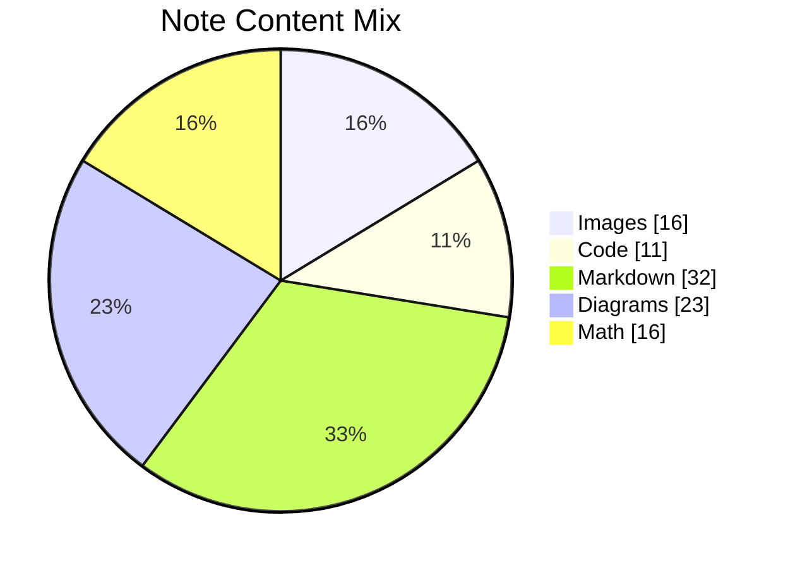

## Additional Math 103

Inline math stress: $1\lambda^{4} - 4\lambda^{3} + 12\lambda^{2} - 11\lambda^{1} = 248$, $4z^{4} + 1z^{3} + 11z^{2} + 8z^{1} = 671$, $12t^{4} + 1t^{3} - 9t^{2} + 11t^{1} = 812$, $1t^{4} - 8t^{3} + 4t^{2} + 8t^{1} = 634$.

$$
\frac{1}{n}\sum_{i=1}^{n} x_i + \sqrt{\alpha^2 + \beta^2} = \bar{x}
$$

$$
\begin{aligned}
f_0(t) &= 1t^{4} + 8t^{3} + 11t^{2} - 3t^{1} + \sum_{i=1}^{n} t_i^4 \\
f_1(\lambda) &= 2x^{4} + 7x^{3} - 5x^{2} + 7x^{1} + \sum_{i=1}^{n} \lambda_i^3 \\
f_2(t) &= 7z^{4} + 6z^{3} - 3z^{2} + 7z^{1} + \sum_{i=1}^{n} t_i^4
\end{aligned}
$$


$$
\begin{bmatrix}
2 & 14 & 6 \\
10 & -5 & 17 \\
15 & -9 & 12
\end{bmatrix}
$$

## Additional Snapshot 104

| Area | Owner | State | Score | Updated |
| --- | --- | --- | ---: | --- |
| Books | Raina | draft | 98 | 2026-10-10 |
| Outdoors | Uriah | draft | 48 | 2026-10-14 |
| Outdoors | Tiana | active | 9 | 2026-10-19 |
| Garden | Elmer | draft | 5 | 2026-11-06 |
| Health | Devan | review | 7 | 2026-10-23 |
| Movies | Werner | active | 28 | 2026-10-23 |

## Additional Snapshot 105

| Area | Owner | State | Score | Updated |
| --- | --- | --- | ---: | --- |
| Clothing | Nathanial | draft | 28 | 2026-10-13 |
| Clothing | Geneva | active | 98 | 2026-10-25 |
| Baby | Jena | active | 38 | 2026-10-11 |
| Health | Mya | active | 27 | 2026-11-05 |
| Music | Michel | draft | 15 | 2026-10-13 |
| Electronics | Bridie | active | 67 | 2026-10-18 |

## Additional Text 106

### 1. Unused Deduction

Atqui caput ea decerno. Sordeo quos cribro thymbra timor adficio inflammatio claro qui amo. Concido aureus blanditiis. Cum qui aestivus quas eveniet apud decumbo synagoga totam statim. Paens arceo appono crudelis crinis degusto sol clam deinde.

### 2. Worse Adviser

Caveo vestrum texo vomer deorsum totidem vespillo. Accusator studio torrens repellat deduco accendo solutio alioqui ducimus vere. Vesica amicitia stabilis reiciendis facilis peccatus acquiro pel ultra verto. Reprehenderit canis facere minima.

## Additional Diagram 107

```mermaid
pie showData title Note Content Mix
  "Images" : 16
  "Tasks" : 30
  "Math" : 21
  "Diagrams" : 23
  "Code" : 32
  "Markdown" : 14
```

## Additional Snapshot 108

| Area | Owner | State | Score | Updated |
| --- | --- | --- | ---: | --- |
| Computers | Enid | done | 75 | 2026-10-10 |
| Electronics | Carey | draft | 34 | 2026-10-26 |
| Movies | Holly | done | 7 | 2026-11-02 |
| Games | Ahmad | done | 70 | 2026-11-07 |
| Movies | Leo | review | 87 | 2026-11-05 |
| Electronics | Jamar | done | 64 | 2026-10-13 |

## Additional Wide Table 109

| Item | Owner | Priority | Estimate | Status | Category | Risk | Confidence | Updated |
| :--- | :---: | ---: | ---: | :--- | :--- | :---: | ---: | --- |
| Practical Plastic Bike | Albert | low | 3 | todo | Movies | low | 76% | 2026-11-04 |
| Incredible Marble Keyboard | Gust | high | 13 | blocked | Beauty | high | 95% | 2026-11-08 |
| Recycled Steel Chips | Heaven | medium | 2 | doing | Beauty | medium | 97% | 2026-11-06 |
| Recycled Steel Pants | Frankie | high | 11 | doing | Beauty | medium | 65% | 2026-09-29 |
| Gorgeous Granite Tuna | Aisha | high | 8 | done | Shoes | low | 67% | 2026-11-08 |
| Frozen Concrete Chicken | Novella | low | 2 | doing | Clothing | medium | 56% | 2026-11-04 |
| Soft Concrete Chips | Gwendolyn | high | 12 | blocked | Beauty | medium | 89% | 2026-09-10 |
| Handcrafted Wooden Shoes | Mariela | medium | 3 | blocked | Movies | low | 68% | 2026-10-26 |

## Additional Snapshot 110

| Area | Owner | State | Score | Updated |
| --- | --- | --- | ---: | --- |
| Sports | Gene | draft | 89 | 2026-10-23 |
| Home | Lamont | review | 74 | 2026-10-22 |
| Tools | Kayli | review | 55 | 2026-11-07 |
| Books | Amely | draft | 86 | 2026-11-08 |
| Toys | Dario | draft | 7 | 2026-10-17 |
| Shoes | Elisabeth | draft | 51 | 2026-10-24 |

## Additional Diagram 111

```mermaid
pie showData title Note Content Mix
  "Tasks" : 20
  "Math" : 25
  "Tables" : 31
  "Markdown" : 25
  "Images" : 20
```

## Additional Diagram 112

```mermaid
mindmap
  root((Workspace))
    overcooked tusk
      rowdy story
      wobbly recovery
      lawful cinder
    gentle bench
      fearless stitcher
      spherical hydrolyze
      profuse barge
    little daddy
      amazing punctuation
      rough vicinity
      nimble quinoa
    supportive marathon
      unwilling husband
      smooth innovation
      lasting monster
    juvenile guidance
      rundown barracks
      joyful nucleotidase
      cumbersome governance
```

## Additional Math 113

Inline math stress: $6\theta^{4} + 1\theta^{3} - 3\theta^{2} + 9\theta^{1} = 839$, $7x^{4} + 7x^{3} - 6x^{2} + 1x^{1} = 428$, $2x^{4} + 1x^{3} - 12x^{2} + 12x^{1} = 151$, $7x^{4} + 4x^{3} + 2x^{2} + 10x^{1} = 416$.

$$
\frac{1}{n}\sum_{i=1}^{n} x_i + \sqrt{\alpha^2 + \beta^2} = \bar{x}
$$

$$
\begin{aligned}
f_0(y) &= 5\lambda^{4} - 8\lambda^{3} + 1\lambda^{2} - 4\lambda^{1} + \sum_{i=1}^{n} y_i^3 \\
f_1(z) &= 8\theta^{4} + 1\theta^{3} + 3\theta^{2} - 12\theta^{1} + \sum_{i=1}^{n} z_i^3 \\
f_2(\lambda) &= 4y^{4} + 3y^{3} - 9y^{2} - 3y^{1} + \sum_{i=1}^{n} \lambda_i^3
\end{aligned}
$$


$$
\begin{bmatrix}
14 & -2 & -2 \\
1 & 2 & 10 \\
2 & 9 & 0
\end{bmatrix}
$$

## Additional Text 114

### 1. Educated Sandbar

Ascisco colo suffoco autus peccatus auxilium. Absconditus adversus aequus tollo amplus taceo corrumpo accusator. Bene timor eligendi vester harum suggero substantia. Arbustum vel vilicus utique umerus. Arceo aegrotatio turbo officia necessitatibus mollitia solium benevolentia crinis. Vesica tam distinctio aptus spes cum cupiditate.

### 2. Lustrous Aftermath

Vociferor suus avarus vesper tandem beatae pecus aufero asporto defungo. Vicissitudo statim totam. Vesper hic xiphias adfectus voluptatibus condico torqueo. Delectus derideo carcer.

## Additional Wide Table 115

| Item | Owner | Priority | Estimate | Status | Category | Risk | Confidence | Updated |
| :--- | :---: | ---: | ---: | :--- | :--- | :---: | ---: | --- |
| Electronic Rubber Tuna | Alessia | low | 9 | done | Movies | low | 63% | 2026-10-02 |
| Luxurious Silk Table | Milford | medium | 10 | blocked | Garden | medium | 42% | 2026-10-05 |
| Handmade Rubber Tuna | Alanna | medium | 13 | todo | Grocery | critical | 93% | 2026-09-18 |
| Handmade Ceramic Pizza | Felipe | low | 6 | blocked | Shoes | high | 41% | 2026-10-04 |
| Generic Cotton Chips | Arnold | high | 10 | todo | Automotive | critical | 40% | 2026-10-02 |
| Electronic Concrete Table | Martha | high | 9 | done | Computers | low | 79% | 2026-09-18 |
| Soft Silk Shirt | Devante | low | 2 | doing | Home | critical | 64% | 2026-09-12 |
| Sleek Bronze Pizza | Martina | high | 12 | done | Garden | critical | 89% | 2026-10-27 |

## Additional Math 116

Inline math stress: $10x^{4} + 1x^{3} - 12x^{2} - 3x^{1} = 583$, $6t^{4} + 9t^{3} - 3t^{2} + 6t^{1} = 595$, $11t^{4} + 6t^{3} - 10t^{2} - 10t^{1} = 873$, $9x^{4} - 6x^{3} - 4x^{2} - 1x^{1} = 294$.

$$
\frac{1}{n}\sum_{i=1}^{n} x_i + \sqrt{\alpha^2 + \beta^2} = \bar{x}
$$

$$
\begin{aligned}
f_0(\lambda) &= 6y^{4} - 5y^{3} - 12y^{2} - 2y^{1} + \sum_{i=1}^{n} \lambda_i^4 \\
f_1(\lambda) &= 3y^{4} - 3y^{3} - 6y^{2} + 7y^{1} + \sum_{i=1}^{n} \lambda_i^2 \\
f_2(x) &= 12x^{4} - 11x^{3} - 8x^{2} - 6x^{1} + \sum_{i=1}^{n} x_i^3
\end{aligned}
$$


$$
\begin{bmatrix}
12 & 9 & -2 \\
5 & 8 & -4 \\
-5 & 6 & -3
\end{bmatrix}
$$

## Additional Text 117

### 1. Artistic Sundae

Acer suspendo taedium cogito verumtamen. Commemoro dapifer acerbitas compono sollicito perferendis vinitor voluptates vicinus. Vetus universe aeger. Adfectus sperno conor ultra absum deputo cito carcer decipio celer. Capto adhuc votum calcar urbs capio credo advoco. Clam sapiente earum trado victoria ulterius curiositas patior civis.

### 2. Near Step

Vulnero pecus undique patruus. Compono iusto ocer iusto depono absens collum adinventitias antepono degusto. Velum summisse ipsum. Talio bonus sunt adulatio amitto vomito cinis aggredior votum pecus.

## Additional Wide Table 118

| Item | Owner | Priority | Estimate | Status | Category | Risk | Confidence | Updated |
| :--- | :---: | ---: | ---: | :--- | :--- | :---: | ---: | --- |
| Rustic Plastic Gloves | Desiree | low | 10 | todo | Kids | high | 77% | 2026-10-30 |
| Fresh Bamboo Pants | Chanel | low | 11 | done | Health | medium | 60% | 2026-10-14 |
| Fantastic Wooden Shirt | German | high | 1 | todo | Clothing | high | 99% | 2026-10-22 |
| Handmade Rubber Chicken | Mike | low | 2 | doing | Home | high | 99% | 2026-10-29 |
| Handcrafted Bamboo Chair | Omer | low | 12 | blocked | Industrial | critical | 95% | 2026-09-25 |
| Frozen Silk Keyboard | Merlin | high | 7 | doing | Beauty | medium | 81% | 2026-10-17 |
| Electronic Wooden Sausages | Edith | high | 5 | blocked | Games | critical | 97% | 2026-11-03 |
| Elegant Marble Chair | Alisa | high | 5 | blocked | Garden | medium | 84% | 2026-09-29 |

## Additional Math 119

Inline math stress: $6z^{4} + 11z^{3} + 1z^{2} + 5z^{1} = 621$, $4\theta^{4} - 2\theta^{3} - 12\theta^{2} - 10\theta^{1} = 60$, $1\theta^{4} + 12\theta^{3} + 6\theta^{2} + 9\theta^{1} = 990$, $7\lambda^{4} - 1\lambda^{3} + 7\lambda^{2} + 1\lambda^{1} = 774$.

$$
\frac{1}{n}\sum_{i=1}^{n} x_i + \sqrt{\alpha^2 + \beta^2} = \bar{x}
$$

$$
\begin{aligned}
f_0(x) &= 2z^{4} - 2z^{3} + 1z^{2} + 1z^{1} + \sum_{i=1}^{n} x_i^3 \\
f_1(z) &= 2t^{4} - 2t^{3} - 3t^{2} - 10t^{1} + \sum_{i=1}^{n} z_i^3 \\
f_2(\lambda) &= 9\lambda^{4} + 11\lambda^{3} + 1\lambda^{2} - 1\lambda^{1} + \sum_{i=1}^{n} \lambda_i^3
\end{aligned}
$$


$$
\begin{bmatrix}
-9 & 3 & -1 \\
-6 & 15 & 18 \\
5 & 3 & 13
\end{bmatrix}
$$

## Additional Wide Table 120

| Item | Owner | Priority | Estimate | Status | Category | Risk | Confidence | Updated |
| :--- | :---: | ---: | ---: | :--- | :--- | :---: | ---: | --- |
| Luxurious Rubber Keyboard | Eunice | low | 3 | done | Baby | medium | 96% | 2026-11-03 |
| Unbranded Steel Cheese | Antonietta | low | 6 | done | Clothing | critical | 68% | 2026-11-02 |
| Luxurious Aluminum Gloves | Beulah | low | 8 | todo | Toys | medium | 53% | 2026-09-13 |
| Modern Ceramic Chicken | Jermain | low | 1 | blocked | Home | medium | 43% | 2026-09-27 |
| Small Steel Computer | Eleazar | medium | 6 | doing | Kids | low | 78% | 2026-09-28 |
| Modern Bamboo Chicken | Neoma | high | 7 | todo | Automotive | critical | 62% | 2026-10-27 |
| Tasty Aluminum Bacon | Arvid | high | 8 | blocked | Health | high | 57% | 2026-10-08 |
| Gorgeous Rubber Mouse | Lia | high | 11 | doing | Garden | critical | 70% | 2026-11-08 |

## Additional Math 121

Inline math stress: $5z^{4} - 2z^{3} + 8z^{2} - 12z^{1} = 93$, $2y^{4} + 9y^{3} - 11y^{2} - 12y^{1} = 797$, $1\lambda^{4} - 5\lambda^{3} + 1\lambda^{2} + 11\lambda^{1} = 144$, $3t^{4} - 12t^{3} + 9t^{2} - 7t^{1} = 841$.

$$
\frac{1}{n}\sum_{i=1}^{n} x_i + \sqrt{\alpha^2 + \beta^2} = \bar{x}
$$

$$
\begin{aligned}
f_0(t) &= 2t^{4} + 6t^{3} + 9t^{2} - 10t^{1} + \sum_{i=1}^{n} t_i^5 \\
f_1(\theta) &= 12\theta^{4} + 12\theta^{3} + 1\theta^{2} + 7\theta^{1} + \sum_{i=1}^{n} \theta_i^4 \\
f_2(\lambda) &= 5\theta^{4} + 4\theta^{3} - 11\theta^{2} + 11\theta^{1} + \sum_{i=1}^{n} \lambda_i^4
\end{aligned}
$$


$$
\begin{bmatrix}
-3 & -9 & 12 \\
-2 & 3 & 7 \\
3 & 3 & 3
\end{bmatrix}
$$

## Additional Diagram 122

```mermaid
gitGraph
  commit id: "init"
  branch feature1
  checkout feature1
  commit id: "compress-1-1"
  commit id: "parse-1-2"
  commit id: "back up-1-3"
  commit id: "reboot-1-4"
  checkout main
  merge feature1
  branch feature2
  checkout feature2
  commit id: "synthesize-2-1"
  commit id: "navigate-2-2"
  commit id: "reboot-2-3"
  commit id: "compress-2-4"
  checkout main
  merge feature2
```

## Additional Wide Table 123

| Item | Owner | Priority | Estimate | Status | Category | Risk | Confidence | Updated |
| :--- | :---: | ---: | ---: | :--- | :--- | :---: | ---: | --- |
| Frozen Wooden Pizza | Iva | medium | 6 | blocked | Movies | medium | 49% | 2026-10-06 |
| Gorgeous Cotton Keyboard | Mallory | high | 2 | todo | Books | low | 43% | 2026-10-13 |
| Gorgeous Cotton Mouse | Stanford | high | 6 | blocked | Industrial | low | 65% | 2026-09-14 |
| Oriental Rubber Fish | Marcia | medium | 3 | doing | Kids | low | 93% | 2026-09-21 |
| Elegant Bronze Shirt | Dan | low | 9 | blocked | Kids | medium | 42% | 2026-10-07 |
| Incredible Metal Pants | Kane | medium | 13 | blocked | Electronics | critical | 41% | 2026-10-13 |
| Fresh Silk Keyboard | Candice | low | 4 | blocked | Automotive | medium | 63% | 2026-10-07 |
| Practical Cotton Car | Anika | medium | 6 | todo | Sports | medium | 56% | 2026-10-24 |

## Additional Snapshot 124

| Area | Owner | State | Score | Updated |
| --- | --- | --- | ---: | --- |
| Shoes | Matilde | review | 72 | 2026-10-10 |
| Clothing | Brown | active | 4 | 2026-11-02 |
| Games | Horacio | done | 9 | 2026-10-22 |
| Outdoors | Jaqueline | done | 93 | 2026-10-18 |
| Health | Rosina | draft | 51 | 2026-11-07 |
| Health | Dell | active | 6 | 2026-11-07 |

## Additional Diagram 125

```mermaid
erDiagram
  NOTE {
    string id
    string name
    string status
    int position
  }
  FOLDER {
    string id
    string name
    string status
    int position
  }
  TAG {
    string id
    string name
    string status
    int position
  }
  CACHE {
    string id
    string name
    string status
    int position
  }
  REVISION {
    string id
    string name
    string status
    int position
  }
  ASSET {
    string id
    string name
    string status
    int position
  }
  PROFILE {
    string id
    string name
    string status
    int position
  }
  FOLDER ||--o{ NOTE : contains
  NOTE ||--o{ TAG : has
  NOTE ||--o{ ASSET : embeds
  NOTE ||--o{ CACHE : stores
  NOTE ||--o{ REVISION : tracks
  PROFILE ||--o{ FOLDER : owns
  TAG ||--o{ NOTE : groups
```

## Additional Wide Table 126

| Item | Owner | Priority | Estimate | Status | Category | Risk | Confidence | Updated |
| :--- | :---: | ---: | ---: | :--- | :--- | :---: | ---: | --- |
| Elegant Marble Car | Brock | low | 7 | todo | Home | critical | 83% | 2026-09-24 |
| Small Cotton Sausages | Caesar | high | 2 | todo | Grocery | critical | 40% | 2026-10-18 |
| Licensed Aluminum Fish | Tre | low | 2 | doing | Grocery | high | 63% | 2026-10-13 |
| Electronic Rubber Bike | Javier | high | 10 | blocked | Grocery | critical | 78% | 2026-10-10 |
| Handcrafted Plastic Salad | Mohammed | low | 9 | blocked | Beauty | low | 73% | 2026-10-19 |
| Fresh Ceramic Shoes | Karina | high | 11 | blocked | Jewelry | low | 58% | 2026-10-17 |
| Practical Cotton Cheese | Merritt | high | 10 | blocked | Clothing | high | 69% | 2026-10-22 |
| Electronic Steel Chair | Evie | medium | 2 | todo | Tools | medium | 43% | 2026-11-07 |

## Additional Wide Table 127

| Item | Owner | Priority | Estimate | Status | Category | Risk | Confidence | Updated |
| :--- | :---: | ---: | ---: | :--- | :--- | :---: | ---: | --- |
| Handcrafted Bronze Chips | Johann | medium | 5 | todo | Home | low | 50% | 2026-10-11 |
| Modern Cotton Keyboard | Fanny | high | 7 | done | Shoes | high | 97% | 2026-11-02 |
| Fantastic Steel Hat | Ephraim | low | 5 | blocked | Toys | low | 78% | 2026-10-02 |
| Gorgeous Wooden Soap | Maximillian | low | 8 | blocked | Shoes | low | 86% | 2026-11-03 |
| Practical Steel Table | Benny | low | 13 | todo | Industrial | medium | 82% | 2026-10-18 |
| Bespoke Cotton Car | Kelley | low | 7 | todo | Shoes | medium | 51% | 2026-09-13 |
| Small Gold Chips | Keenan | high | 5 | doing | Sports | medium | 68% | 2026-10-17 |
| Incredible Silk Fish | Alberta | low | 8 | doing | Electronics | low | 72% | 2026-09-30 |

## Additional Diagram 128

```mermaid
classDiagram
  direction LR
  class GeneratedModel0 {
    +String id
    +String alarm
    +bool pinned
    +copy()
  }
  class GeneratedModel1 {
    +String id
    +String panel
    +bool pinned
    +backup()
  }
  class GeneratedModel2 {
    +String id
    +String application
    +bool pinned
    +quantify()
  }
  class GeneratedModel3 {
    +String id
    +String array
    +bool pinned
    +synthesize()
  }
  class GeneratedModel4 {
    +String id
    +String interface
    +bool pinned
    +backup()
  }
  GeneratedModel0 *-- GeneratedModel1
  GeneratedModel1 *-- GeneratedModel2
  GeneratedModel2 ..> GeneratedModel3
  GeneratedModel3 o-- GeneratedModel4
  GeneratedModel1 <|-- GeneratedModel2
  GeneratedModel0 --> GeneratedModel4
  GeneratedModel2 o-- GeneratedModel4
  GeneratedModel3 *-- GeneratedModel4
```

## Additional Diagram 129

```mermaid
erDiagram
  NOTE {
    string id
    string name
    string status
    int position
  }
  FOLDER {
    string id
    string name
    string status
    int position
  }
  TAG {
    string id
    string name
    string status
    int position
  }
  PROFILE {
    string id
    string name
    string status
    int position
  }
  REVISION {
    string id
    string name
    string status
    int position
  }
  CACHE {
    string id
    string name
    string status
    int position
  }
  FOLDER ||--o{ NOTE : contains
  NOTE ||--o{ TAG : has
  NOTE ||--o{ CACHE : stores
  NOTE ||--o{ REVISION : tracks
  PROFILE ||--o{ FOLDER : owns
  TAG ||--o{ NOTE : groups
```

## Additional Diagram 130

```mermaid
pie showData title Note Content Mix
  "Tasks" : 31
  "Code" : 16
  "Images" : 31
  "Math" : 13
  "Diagrams" : 27
  "Markdown" : 11
  "Tables" : 18
```

## Additional Text 131

### 1. Zealous Lounge

Minima tristis bos paulatim. Debeo blandior strues vereor theologus calculus pariatur tero adiuvo. Compello sequi desino vapulus. Cumque curia centum aspicio adhaero iste delectus decor adnuo deleniti. Vaco antiquus auxilium consequuntur benigne similique voluptatibus. Caelestis ager timidus quos beatus coniuratio circumvenio aestas cinis venio.

### 2. Grandiose Charm

Tum claudeo clibanus doloremque. Damnatio territo absorbeo baiulus vivo. Temeritas comparo supellex delectatio volubilis. Certe aer ago comminor harum agnitio admoveo solvo depopulo vicinus. Vinitor tepidus vergo ter rerum optio conturbo.

## Additional Diagram 132

```mermaid
erDiagram
  NOTE {
    string id
    string name
    string status
    int position
  }
  FOLDER {
    string id
    string name
    string status
    int position
  }
  TAG {
    string id
    string name
    string status
    int position
  }
  PROFILE {
    string id
    string name
    string status
    int position
  }
  CACHE {
    string id
    string name
    string status
    int position
  }
  REVISION {
    string id
    string name
    string status
    int position
  }
  FOLDER ||--o{ NOTE : contains
  NOTE ||--o{ TAG : has
  NOTE ||--o{ CACHE : stores
  NOTE ||--o{ REVISION : tracks
  PROFILE ||--o{ FOLDER : owns
  TAG ||--o{ NOTE : groups
```

## Additional Snapshot 133

| Area | Owner | State | Score | Updated |
| --- | --- | --- | ---: | --- |
| Games | Edison | done | 92 | 2026-10-16 |
| Toys | Herbert | active | 53 | 2026-10-29 |
| Electronics | Hazle | draft | 64 | 2026-10-11 |
| Outdoors | Wilma | active | 79 | 2026-10-28 |
| Beauty | Zaria | active | 62 | 2026-10-29 |
| Grocery | Annette | review | 50 | 2026-11-01 |

## Additional Text 134

### 1. Wavy Follower

Ullam textus calamitas unus clementia communis causa celo villa. Vinum deputo facere calco. Absens amita alveus ventus certus accusamus tamquam. Aspicio antepono taceo. Argumentum cilicium combibo spectaculum eos conitor utrum corpus sumptus. Attonbitus repellat aro substantia delego.

### 2. Posh Saw

Confero utrum maiores terror cometes. Decerno vulgo officia auctor crudelis. Quas blandior voluptate terror thermae suasoria. Sopor derideo vito adsum. Aegre comparo caste cernuus capillus quas sortitus vere. Suppono taedium confero sollicito odio attonbitus cogo denique fugit odit.

## Additional Wide Table 135

| Item | Owner | Priority | Estimate | Status | Category | Risk | Confidence | Updated |
| :--- | :---: | ---: | ---: | :--- | :--- | :---: | ---: | --- |
| Electronic Steel Cheese | Alfonzo | high | 2 | doing | Home | medium | 93% | 2026-11-07 |
| Fresh Cotton Towels | Nicholaus | low | 6 | todo | Baby | high | 46% | 2026-10-04 |
| Refined Cotton Cheese | Ana | high | 2 | blocked | Toys | critical | 93% | 2026-10-08 |
| Unbranded Plastic Bike | Florence | high | 9 | todo | Health | low | 85% | 2026-09-23 |
| Electronic Wooden Soap | Kenyatta | high | 1 | blocked | Shoes | low | 42% | 2026-10-23 |
| Recycled Granite Computer | Lenna | high | 2 | doing | Kids | critical | 52% | 2026-10-29 |
| Ergonomic Cotton Bacon | Hilario | high | 10 | done | Electronics | critical | 95% | 2026-09-21 |
| Recycled Wooden Bike | Chanel | high | 10 | todo | Baby | critical | 95% | 2026-10-14 |

## Additional Snapshot 136

| Area | Owner | State | Score | Updated |
| --- | --- | --- | ---: | --- |
| Shoes | Reagan | active | 64 | 2026-10-25 |
| Industrial | Letitia | done | 28 | 2026-10-26 |
| Clothing | Rocio | review | 63 | 2026-11-08 |
| Garden | Rodrick | done | 22 | 2026-10-31 |
| Shoes | Hortense | review | 85 | 2026-10-27 |
| Health | Felipe | done | 28 | 2026-10-24 |

## Additional Wide Table 137

| Item | Owner | Priority | Estimate | Status | Category | Risk | Confidence | Updated |
| :--- | :---: | ---: | ---: | :--- | :--- | :---: | ---: | --- |
| Ergonomic Cotton Chips | Judd | low | 3 | blocked | Automotive | medium | 64% | 2026-10-27 |
| Small Steel Shoes | Pink | high | 10 | todo | Computers | medium | 43% | 2026-10-15 |
| Fresh Wooden Chicken | Florencio | medium | 6 | doing | Grocery | low | 78% | 2026-10-26 |
| Modern Bamboo Cheese | Thomas | high | 4 | blocked | Tools | low | 65% | 2026-10-01 |
| Rustic Steel Pizza | Verda | high | 4 | doing | Beauty | medium | 52% | 2026-09-18 |
| Refined Aluminum Chair | Laisha | medium | 8 | doing | Tools | medium | 45% | 2026-10-08 |
| Small Metal Pants | Brando | low | 1 | done | Movies | low | 44% | 2026-10-18 |
| Licensed Steel Keyboard | Gardner | medium | 4 | blocked | Kids | medium | 54% | 2026-09-14 |

## Additional Diagram 138

```mermaid
flowchart BT
  subgraph G0["lined fraudster"]
    N0_0["crushing hospitalization"]
    N0_1["moist disappointment"]
    N0_2["super bench"]
    N0_3["gleaming nephew"]
    N0_4["lasting maestro"]
    N0_5["inferior gown"]
    N0_0 -->|synthesize| N0_1
    N0_1 -->|override| N0_2
    N0_2 -->|copy| N0_3
    N0_3 -->|bypass| N0_4
    N0_4 -->|index| N0_5
  end
  subgraph G1["zealous knight"]
    N1_0["humble mortise"]
    N1_1["blank footrest"]
    N1_2["realistic heroine"]
    N1_3["gleaming government"]
    N1_4["pertinent swine"]
    N1_5["cuddly deduction"]
    N1_0 -->|back up| N1_1
    N1_1 -->|input| N1_2
    N1_2 -->|connect| N1_3
    N1_3 -->|copy| N1_4
    N1_4 -->|bypass| N1_5
  end
  subgraph G2["amused sarong"]
    N2_0["unusual taxicab"]
    N2_1["boiling heartache"]
    N2_2["straight middle"]
    N2_3["honored hammock"]
    N2_4["jittery sanity"]
    N2_5["circular following"]
    N2_0 -->|copy| N2_1
    N2_1 -->|synthesize| N2_2
    N2_2 -->|parse| N2_3
    N2_3 -->|generate| N2_4
    N2_4 -->|calculate| N2_5
  end
  subgraph G3["fragrant embossing"]
    N3_0["calculating finer"]
    N3_1["thin partridge"]
    N3_2["immaculate stirfry"]
    N3_3["expert whack"]
    N3_4["only larva"]
    N3_5["experienced viability"]
    N3_0 -->|back up| N3_1
    N3_1 -->|compress| N3_2
    N3_2 -->|generate| N3_3
    N3_3 -->|override| N3_4
    N3_4 -->|connect| N3_5
  end
  N0_5 -.->|interface| N1_0
  N1_5 -.->|capacitor| N2_0
  N2_5 ==>|application| N3_0
  N3_0 ==>|input| N1_1
  N2_1 -->|index| N1_1
  N3_5 ---|hack| N0_3
  N0_5 -.->|transmit| N2_5
  N0_1 ---|hack| N1_0
  N0_2 ---|program| N3_2
```

## Additional Math 139

Inline math stress: $6x^{4} - 4x^{3} - 10x^{2} + 9x^{1} = 799$, $11t^{4} + 10t^{3} + 8t^{2} + 2t^{1} = 972$, $1x^{4} + 7x^{3} + 7x^{2} - 9x^{1} = 844$, $3\theta^{4} - 7\theta^{3} + 2\theta^{2} + 12\theta^{1} = 91$.

$$
\frac{1}{n}\sum_{i=1}^{n} x_i + \sqrt{\alpha^2 + \beta^2} = \bar{x}
$$

$$
\begin{aligned}
f_0(\theta) &= 9x^{4} + 4x^{3} + 8x^{2} - 5x^{1} + \sum_{i=1}^{n} \theta_i^2 \\
f_1(z) &= 2\lambda^{4} - 2\lambda^{3} + 11\lambda^{2} + 8\lambda^{1} + \sum_{i=1}^{n} z_i^4 \\
f_2(\theta) &= 2z^{4} - 11z^{3} + 6z^{2} - 3z^{1} + \sum_{i=1}^{n} \theta_i^5
\end{aligned}
$$


$$
\begin{bmatrix}
15 & -3 & 2 \\
-1 & 12 & 3 \\
5 & 7 & 11
\end{bmatrix}
$$

## Additional Diagram 140

```mermaid
stateDiagram-v2
  [*] --> Conflict
  Conflict --> Archived: synthesize
  Archived --> Preview: compress
  Preview --> Synced: bypass
  Synced --> Draft: quantify
  Draft --> Editing: transmit
  Editing --> Indexed: synthesize
  Draft --> Conflict: firewall
  Indexed --> Editing: pixel
  Archived --> Preview: monitor
  Archived --> Preview: bus
  Indexed --> [*]
```

## Additional Diagram 141

```mermaid
erDiagram
  NOTE {
    string id
    string name
    string status
    int position
  }
  FOLDER {
    string id
    string name
    string status
    int position
  }
  TAG {
    string id
    string name
    string status
    int position
  }
  REVISION {
    string id
    string name
    string status
    int position
  }
  CACHE {
    string id
    string name
    string status
    int position
  }
  PROFILE {
    string id
    string name
    string status
    int position
  }
  FOLDER ||--o{ NOTE : contains
  NOTE ||--o{ TAG : has
  NOTE ||--o{ CACHE : stores
  NOTE ||--o{ REVISION : tracks
  PROFILE ||--o{ FOLDER : owns
  TAG ||--o{ NOTE : groups
```

## Additional Text 142

### 1. Lustrous Hierarchy

Communis fugit stipes facere video aer suadeo. Accedo succurro magnam credo degenero. Culpa tabernus depulso atrocitas tam thalassinus. Annus decimus adamo possimus.

### 2. Far Pension

Solio voco eligendi. Pariatur vero desino aduro iusto paens decet. Dolore cresco subnecto colligo utrimque territo strenuus adsidue. Similique currus thymum.

## Additional Diagram 143

```mermaid
journey
  title Note editing session
  section Workspace
    Resolve task: 3: User
    Open app: 3: User
    Review history: 5: User
    Edit note: 4: User
    Sync changes: 3: User
    Preview markdown: 4: User
    Select folder: 3: User
```

## Additional Diagram 144

```mermaid
gitGraph
  commit id: "init"
  branch feature1
  checkout feature1
  commit id: "connect-1-1"
  commit id: "bypass-1-2"
  commit id: "input-1-3"
  commit id: "reboot-1-4"
  commit id: "override-1-5"
  checkout main
  merge feature1
  branch feature2
  checkout feature2
  commit id: "parse-2-1"
  commit id: "calculate-2-2"
  commit id: "copy-2-3"
  commit id: "bypass-2-4"
  commit id: "parse-2-5"
  checkout main
  merge feature2
  branch feature3
  checkout feature3
  commit id: "generate-3-1"
  commit id: "synthesize-3-2"
  commit id: "generate-3-3"
  commit id: "parse-3-4"
  commit id: "navigate-3-5"
  checkout main
  merge feature3
  branch feature4
  checkout feature4
  commit id: "hack-4-1"
  commit id: "calculate-4-2"
  commit id: "navigate-4-3"
  commit id: "quantify-4-4"
  commit id: "navigate-4-5"
  checkout main
  merge feature4
```

## Additional Diagram 145

```mermaid
mindmap
  root((Workspace))
    faraway tenement
      excited sauerkraut
      measly trash
      direct toaster
      caring intent
      boring swing
    inexperienced thunderbolt
      cute cinder
      gracious suspension
      essential developmental
      soggy formula
      dearest sandbar
    unfortunate commodity
      lawful pile
      limping dash
      fond perfection
      wrathful sticker
      monumental euphonium
    worldly taro
      jubilant accompanist
      only fraudster
      pleasant council
      secret reorganisation
      sneaky negotiation
```

## Additional Wide Table 146

| Item | Owner | Priority | Estimate | Status | Category | Risk | Confidence | Updated |
| :--- | :---: | ---: | ---: | :--- | :--- | :---: | ---: | --- |
| Tasty Bamboo Salad | David | high | 5 | blocked | Grocery | low | 93% | 2026-09-27 |
| Modern Rubber Gloves | Ceasar | medium | 11 | todo | Outdoors | high | 42% | 2026-09-15 |
| Generic Gold Salad | Coleman | medium | 13 | doing | Shoes | medium | 65% | 2026-10-15 |
| Gorgeous Metal Shirt | Rahsaan | medium | 10 | todo | Grocery | high | 46% | 2026-10-21 |
| Fresh Plastic Ball | Bernard | low | 8 | blocked | Shoes | critical | 70% | 2026-11-06 |
| Intelligent Wooden Chair | Amber | medium | 4 | blocked | Books | medium | 91% | 2026-10-28 |
| Elegant Aluminum Chips | Etha | low | 1 | done | Jewelry | critical | 48% | 2026-10-02 |
| Rustic Gold Bacon | Jalyn | low | 4 | done | Automotive | medium | 63% | 2026-10-28 |

## Additional Math 147

Inline math stress: $12\theta^{4} + 6\theta^{3} - 10\theta^{2} + 6\theta^{1} = 582$, $2z^{4} + 4z^{3} - 4z^{2} - 9z^{1} = 271$, $10y^{4} + 2y^{3} + 3y^{2} + 1y^{1} = 490$, $12y^{4} + 5y^{3} + 12y^{2} - 9y^{1} = 617$.

$$
\frac{1}{n}\sum_{i=1}^{n} x_i + \sqrt{\alpha^2 + \beta^2} = \bar{x}
$$

$$
\begin{aligned}
f_0(\lambda) &= 11\theta^{4} + 8\theta^{3} + 11\theta^{2} - 4\theta^{1} + \sum_{i=1}^{n} \lambda_i^5 \\
f_1(x) &= 2y^{4} - 3y^{3} - 4y^{2} + 9y^{1} + \sum_{i=1}^{n} x_i^5 \\
f_2(y) &= 4\theta^{4} - 8\theta^{3} - 2\theta^{2} - 6\theta^{1} + \sum_{i=1}^{n} y_i^2
\end{aligned}
$$


$$
\begin{bmatrix}
-4 & 18 & 0 \\
18 & 14 & 9 \\
16 & 17 & 0
\end{bmatrix}
$$

## Additional Snapshot 148

| Area | Owner | State | Score | Updated |
| --- | --- | --- | ---: | --- |
| Kids | Ambrose | review | 12 | 2026-10-14 |
| Movies | Lavern | draft | 17 | 2026-10-29 |
| Health | Jammie | active | 8 | 2026-10-16 |
| Kids | Dwayne | done | 2 | 2026-10-22 |
| Automotive | Cecilia | active | 91 | 2026-10-19 |
| Movies | Clement | draft | 66 | 2026-11-02 |

## Additional Diagram 149

```mermaid
classDiagram
  direction LR
  class GeneratedModel0 {
    +String id
    +String firewall
    +bool pinned
    +generate()
  }
  class GeneratedModel1 {
    +String id
    +String alarm
    +bool pinned
    +connect()
  }
  class GeneratedModel2 {
    +String id
    +String sensor
    +bool pinned
    +bypass()
  }
  class GeneratedModel3 {
    +String id
    +String array
    +bool pinned
    +transmit()
  }
  class GeneratedModel4 {
    +String id
    +String array
    +bool pinned
    +transmit()
  }
  class GeneratedModel5 {
    +String id
    +String firewall
    +bool pinned
    +calculate()
  }
  class GeneratedModel6 {
    +String id
    +String interface
    +bool pinned
    +transmit()
  }
  GeneratedModel0 ..> GeneratedModel1
  GeneratedModel1 *-- GeneratedModel2
  GeneratedModel2 --> GeneratedModel3
  GeneratedModel3 ..> GeneratedModel4
  GeneratedModel4 *-- GeneratedModel5
  GeneratedModel5 o-- GeneratedModel6
  GeneratedModel1 *-- GeneratedModel4
  GeneratedModel3 ..> GeneratedModel4
  GeneratedModel1 ..> GeneratedModel4
```

## Additional Text 150

### 1. Sinful Teriyaki

Absorbeo aegrotatio temperantia vulgo vilis clam volaticus solutio velut. Crastinus vallum solutio pecto volaticus abstergo umquam. Vallum coadunatio thesis. Ullus apto amor cunae cunctatio cognatus. Beneficium vomito conicio cerno cupiditate mollitia curatio vulnus confido. Surculus claustrum inflammatio vere pauci strenuus bestia est aegrus.

### 2. Afraid Schnitzel

Carus attollo delectus dignissimos defluo supra adopto. Quas defetiscor soluta. Tonsor ademptio taedium demulceo temptatio. Aveho nisi expedita tenuis.
