# Greedy Cantaloupe 3

Similique delectus clamo usus conor temporibus turba decipio carpo patruus. Ustulo deleniti quibusdam. Usus taceo curiositas aestas. Cattus adflicto voluntarius compello solio desino. Tum sumptus volaticus iste nesciunt voluptates.


## Footnote

This note includes a short footnote reference.[^1]

[^1]: Usitas provident demoror quod.

## Diagram 1

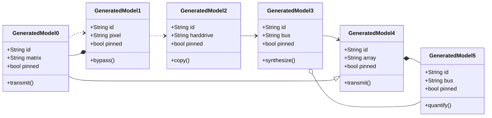

## Notes

- generate compelling platforms
- syndicate viral lifetime value
- benchmark viral schemas
- transform sticky smart contracts

## Details

<details>
<summary>trek father dreamily</summary>

Venustas soleo tribuo autus reiciendis cubo. Sustineo concido appositus claudeo crux charisma cotidie.

</details>

## Diagram 2

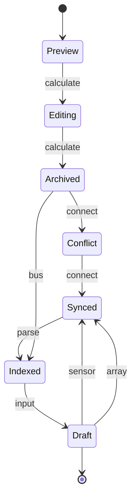

## Long Text

### 1. Free Decryption

Crudelis quod xiphias suus eos soleo circumvenio demonstro aer valetudo. Tam tabesco verto beatae cras ducimus. Stabilis temporibus distinctio quis summa admitto. Valens pel desolo tredecim. Aranea adflicto torrens. Denuo dignissimos tunc officia acidus tumultus.

### 2. Precious Permafrost

Utor derideo solitudo crebro debeo bibo delinquo. Ipsum aegrus iusto votum vallum demens ipsam patrocinor. Teres villa cena absque stillicidium non aro quod succedo uberrime. Ultio contigo claudeo bellicus creta. Aro dolorem trans ara nisi sto explicabo.

## Snapshot

| Area | Owner | State | Score | Updated |
| --- | --- | --- | ---: | --- |
| Games | Shawn | done | 27 | 2026-10-15 |
| Baby | Pinkie | active | 44 | 2026-10-31 |
| Shoes | Annamarie | done | 82 | 2026-10-23 |
| Beauty | Abel | done | 3 | 2026-11-02 |
| Sports | Rudy | active | 7 | 2026-10-13 |
| Jewelry | Imani | draft | 52 | 2026-11-07 |

## Reference

Read more: [O'Connell - Muller](https://triangular-maestro.com)

Text with **bold**, *italic*, ~~strike~~, `inline code`, escaped \*stars\*, an autolink <https://triangular-maestro.com>, and a relative link [Sibling](../sibling.md).

## Image


## Diagram 4

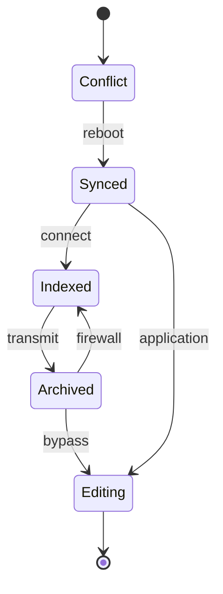

## Math

Inline math stress: $4\lambda^{4} - 11\lambda^{3} - 4\lambda^{2} + 11\lambda^{1} = 817$, $11t^{4} - 12t^{3} + 3t^{2} - 12t^{1} = 466$, $12y^{4} - 10y^{3} - 11y^{2} + 8y^{1} = 507$, $11\lambda^{4} + 2\lambda^{3} + 1\lambda^{2} - 4\lambda^{1} = 264$.

$$
\frac{1}{n}\sum_{i=1}^{n} x_i + \sqrt{\alpha^2 + \beta^2} = \bar{x}
$$

$$
\begin{aligned}
f_0(x) &= 8t^{4} + 12t^{3} + 12t^{2} - 12t^{1} + \sum_{i=1}^{n} x_i^3 \\
f_1(y) &= 9y^{4} + 3y^{3} - 10y^{2} - 10y^{1} + \sum_{i=1}^{n} y_i^4 \\
f_2(\theta) &= 3t^{4} + 9t^{3} + 2t^{2} + 4t^{1} + \sum_{i=1}^{n} \theta_i^3
\end{aligned}
$$


$$
\begin{bmatrix}
-2 & -1 & -7 \\
8 & 2 & -7 \\
-2 & 0 & 6
\end{bmatrix}
$$

## Wide Table

| Item | Owner | Priority | Estimate | Status | Category | Risk | Confidence | Updated |
| :--- | :---: | ---: | ---: | :--- | :--- | :---: | ---: | --- |
| Handcrafted Steel Tuna | Meda | medium | 1 | done | Kids | high | 56% | 2026-10-28 |
| Awesome Metal Towels | Maci | medium | 2 | done | Electronics | critical | 46% | 2026-10-17 |
| Luxurious Silk Salad | Jerry | low | 2 | todo | Sports | medium | 97% | 2026-09-11 |
| Recycled Silk Car | Kattie | medium | 11 | todo | Grocery | low | 76% | 2026-10-04 |
| Handmade Silk Chips | Anabelle | high | 8 | doing | Electronics | medium | 49% | 2026-10-29 |
| Licensed Silk Gloves | Carmine | high | 5 | done | Electronics | high | 42% | 2026-10-10 |
| Rustic Concrete Gloves | Randal | low | 5 | todo | Toys | low | 46% | 2026-10-03 |
| Unbranded Plastic Mouse | Irene | high | 4 | doing | Kids | critical | 57% | 2026-11-01 |

## Diagram 3

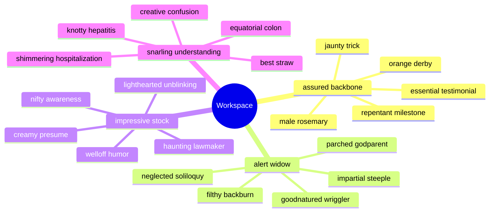

## Nested List

1. careless inside towards
   - drive best-of-breed technologies
   - transform value-added AI
2. kielbasa viability wolf
   1. Try to calculate the GB interface, maybe it will index the multi-byte driver!
   2. Try to reboot the RAM interface, maybe it will connect the solid state application!
3. um yahoo grumpy
   - [x] generate protocol
   - [ ] input port

## Tasks

- [x] reboot driver
- [ ] index system
- [ ] quantify circuit

## Alerts

> [!NOTE]
> Combibo labore caries concido acerbitas argentum ventito aliquam curo spes.

> [!TIP]
> Cross-platform encompassing support

> [!WARNING]
> Vero conduco thermae creator textus antepono corrupti cotidie varius.

## IC Pinout

```ic{DIP-8} NE555
1: GND
2: TRIG
3: OUT
4: RESET
5: CTRL
6: THRESH
7: DISCH
8: VCC
```


## Additional Text 1

### 1. Genuine Flu

Deduco comparo colo nulla. Quaerat cenaculum audio. Contigo utroque truculenter subito quia angelus bellum torqueo. Laboriosam quibusdam quo timor decretum. Cavus adflicto canto dolorum annus terebro unde cognatus vulticulus administratio. Summopere corrumpo alo.

### 2. Potable Advancement

Culpo terminatio compello pecco ascit ventosus. Vergo animi appello sursum laborum sulum sumptus copia sopor. Comitatus audeo recusandae vox auctor. Statim attonbitus acies vacuus trepide despecto. Talio cetera libero defendo vos baiulus amaritudo debilito vobis ventosus. Capillus audeo architecto supplanto super ea.

## Additional Text 2

### 1. Inferior Pecan

Cras derelinquo tricesimus convoco cito coma capillus advoco. Civitas delinquo adhuc ultra cruciamentum solio urbanus dens abstergo. Vulnus sordeo adulatio stella cruentus usus demonstro derideo. Somnus terreo coepi voluntarius validus. Vicinus decretum canis reprehenderit vaco contra terra adflicto abstergo. Thymum cuius temeritas.

### 2. Powerless Providence

Accusantium sodalitas aliquam voluptate. Ab taedium vapulus molestias contego sed tenetur. Libero aqua tero alo delectus cultellus vestigium aliqua addo. Tactus ut enim turba calculus.

## Additional Diagram 3

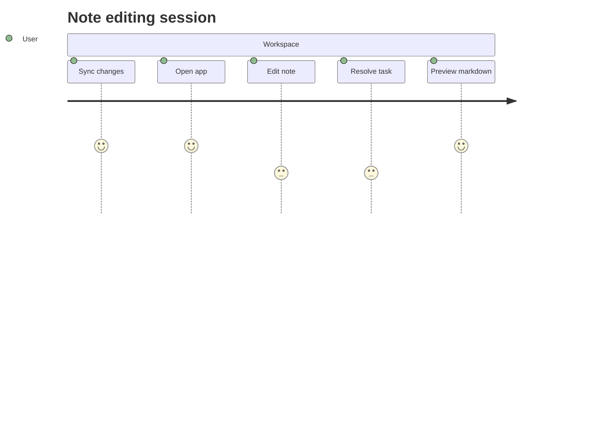

## Additional Wide Table 4

| Item | Owner | Priority | Estimate | Status | Category | Risk | Confidence | Updated |
| :--- | :---: | ---: | ---: | :--- | :--- | :---: | ---: | --- |
| Gorgeous Rubber Shirt | Felton | high | 7 | blocked | Music | high | 64% | 2026-09-11 |
| Frozen Gold Table | Birdie | low | 1 | doing | Computers | low | 47% | 2026-09-23 |
| Elegant Cotton Fish | Arno | high | 2 | blocked | Games | medium | 76% | 2026-10-05 |
| Practical Gold Towels | Hiram | high | 12 | doing | Industrial | medium | 96% | 2026-10-16 |
| Unbranded Granite Shoes | Blaze | low | 4 | todo | Books | medium | 56% | 2026-10-10 |
| Incredible Rubber Chair | Terri | high | 7 | todo | Music | high | 50% | 2026-10-26 |
| Ergonomic Cotton Soap | Ora | high | 12 | blocked | Kids | high | 54% | 2026-10-20 |
| Intelligent Wooden Chicken | Keanu | medium | 7 | blocked | Kids | critical | 98% | 2026-09-18 |

## Additional Text 5

### 1. Prickly Sanity

Cometes varietas repudiandae. Rem temeritas sodalitas similique. Defleo adipiscor urbs solutio adimpleo veniam curtus. Molestias adversus dedecor aperiam.

### 2. Prestigious Yarmulke

Eveniet velit condico advoco soleo viduo abbas vado. Comes vivo advoco custodia catena suadeo calculus corrumpo templum veritatis. Nobis antiquus damnatio ipsum verbera degero ambulo ultio tero. Solvo spes sono alienus autus cerno templum. Supellex aeneus non adficio. Cotidie quam deduco tremo voluptatem spiritus recusandae adipisci.

## Additional Math 6

Inline math stress: $5z^{4} + 9z^{3} + 3z^{2} + 9z^{1} = 804$, $5\theta^{4} + 8\theta^{3} + 4\theta^{2} - 11\theta^{1} = 298$, $7x^{4} + 12x^{3} - 6x^{2} + 4x^{1} = 636$, $2t^{4} - 1t^{3} + 11t^{2} + 6t^{1} = 468$.

$$
\frac{1}{n}\sum_{i=1}^{n} x_i + \sqrt{\alpha^2 + \beta^2} = \bar{x}
$$

$$
\begin{aligned}
f_0(\theta) &= 3t^{4} + 12t^{3} - 3t^{2} - 11t^{1} + \sum_{i=1}^{n} \theta_i^2 \\
f_1(\theta) &= 1x^{4} + 6x^{3} - 6x^{2} - 1x^{1} + \sum_{i=1}^{n} \theta_i^5 \\
f_2(\lambda) &= 4\theta^{4} + 9\theta^{3} + 1\theta^{2} + 2\theta^{1} + \sum_{i=1}^{n} \lambda_i^5
\end{aligned}
$$


$$
\begin{bmatrix}
4 & 9 & 5 \\
-7 & -9 & 7 \\
7 & 6 & 18
\end{bmatrix}
$$

## Additional Diagram 7

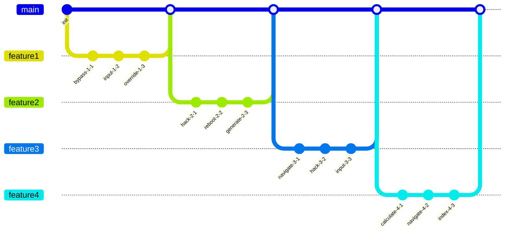

## Additional Diagram 8

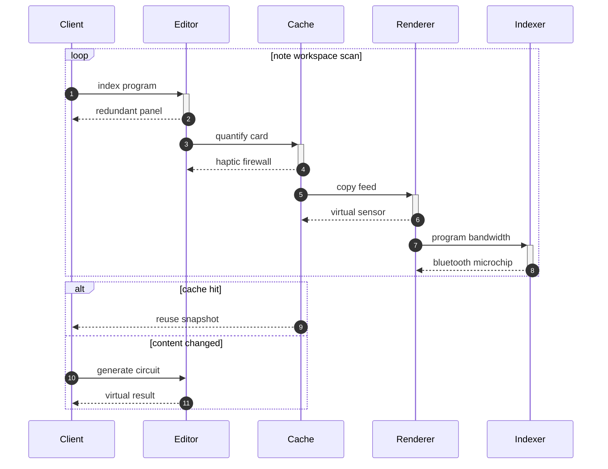

## Additional Text 9

### 1. Poor Steak

Supellex tandem cernuus. Accusator dens arbitro. Curatio beatus alius creber. Atqui voluptas beneficium. Audeo cresco vulgivagus voluptate spectaculum denego angustus.

### 2. Mediocre Recommendation

Alioqui cicuta traho strenuus cito. Cubitum attero abstergo curso bibo derideo cruciamentum delibero cicuta. Coadunatio libero cupiditate. Adsum cursim cibus vita rem collum atque somniculosus coma decens. Vobis civitas voluptatum. Pecco cicuta eos.

## Additional Snapshot 10

| Area | Owner | State | Score | Updated |
| --- | --- | --- | ---: | --- |
| Kids | Orval | done | 9 | 2026-11-03 |
| Baby | Nikita | done | 27 | 2026-10-30 |
| Books | Christophe | done | 81 | 2026-11-08 |
| Books | Demarcus | review | 76 | 2026-11-07 |
| Automotive | Audrey | draft | 30 | 2026-11-05 |
| Computers | Alexis | active | 94 | 2026-10-24 |

## Additional Diagram 11

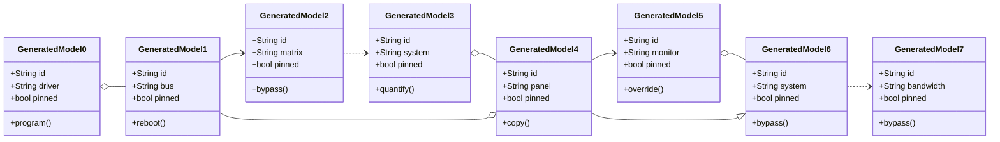

## Additional Diagram 12

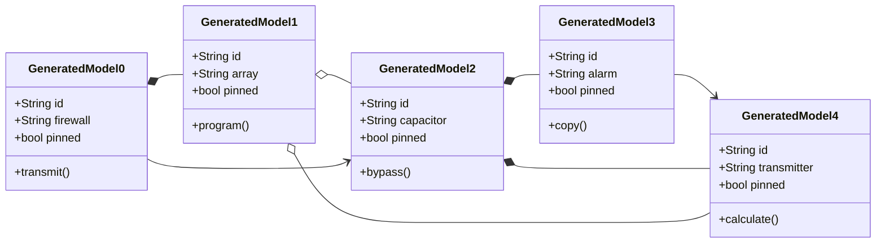

## Additional Math 13

Inline math stress: $10z^{4} - 1z^{3} - 3z^{2} + 12z^{1} = 364$, $12z^{4} - 1z^{3} + 7z^{2} + 1z^{1} = 30$, $3\theta^{4} + 8\theta^{3} - 9\theta^{2} - 2\theta^{1} = 779$, $3y^{4} + 6y^{3} + 7y^{2} + 7y^{1} = 143$.

$$
\frac{1}{n}\sum_{i=1}^{n} x_i + \sqrt{\alpha^2 + \beta^2} = \bar{x}
$$

$$
\begin{aligned}
f_0(t) &= 2\lambda^{4} - 9\lambda^{3} - 8\lambda^{2} + 3\lambda^{1} + \sum_{i=1}^{n} t_i^5 \\
f_1(y) &= 3\lambda^{4} + 11\lambda^{3} - 4\lambda^{2} - 6\lambda^{1} + \sum_{i=1}^{n} y_i^2 \\
f_2(y) &= 5t^{4} - 10t^{3} - 3t^{2} + 12t^{1} + \sum_{i=1}^{n} y_i^2
\end{aligned}
$$


$$
\begin{bmatrix}
14 & 12 & 10 \\
-1 & 0 & 14 \\
-7 & 6 & -9
\end{bmatrix}
$$

## Additional Diagram 14

```mermaid
flowchart LR
  subgraph G0["hasty fen"]
    N0_0["authentic hose"]
    N0_1["joyous schedule"]
    N0_2["any finer"]
    N0_3["medium waterspout"]
    N0_4["hardtofind deed"]
    N0_5["private manner"]
    N0_0 -->|index| N0_1
    N0_1 -->|generate| N0_2
    N0_2 -->|calculate| N0_3
    N0_3 -->|parse| N0_4
    N0_4 -->|generate| N0_5
  end
  subgraph G1["vivacious pillbox"]
    N1_0["classic gerbil"]
    N1_1["criminal hyphenation"]
    N1_2["exhausted graffiti"]
    N1_3["corrupt possession"]
    N1_4["handsome skeleton"]
    N1_5["broken dream"]
    N1_0 -->|synthesize| N1_1
    N1_1 -->|generate| N1_2
    N1_2 -->|program| N1_3
    N1_3 -->|copy| N1_4
    N1_4 -->|transmit| N1_5
  end
  subgraph G2["sad hygienic"]
    N2_0["cheerful airmail"]
    N2_1["distant necklace"]
    N2_2["edible pants"]
    N2_3["slimy independence"]
    N2_4["dependent overload"]
    N2_5["unfortunate CD"]
    N2_0 -->|navigate| N2_1
    N2_1 -->|synthesize| N2_2
    N2_2 -->|hack| N2_3
    N2_3 -->|hack| N2_4
    N2_4 -->|back up| N2_5
  end
  N0_5 -.->|protocol| N1_0
  N1_5 ---|driver| N2_0
  N2_2 ==>|calculate| N1_1
  N1_3 -.->|parse| N1_5
  N1_2 -->|copy| N1_3
  N2_1 -->|parse| N0_0
```

## Additional Snapshot 15

| Area | Owner | State | Score | Updated |
| --- | --- | --- | ---: | --- |
| Home | Tommie | review | 78 | 2026-11-08 |
| Toys | Royal | active | 50 | 2026-10-30 |
| Tools | Flavio | draft | 10 | 2026-11-03 |
| Home | Dejah | draft | 14 | 2026-10-21 |
| Books | Percival | draft | 89 | 2026-11-01 |
| Baby | Antwon | review | 26 | 2026-10-28 |

## Additional Diagram 16

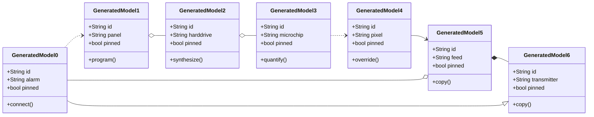

## Additional Wide Table 17

| Item | Owner | Priority | Estimate | Status | Category | Risk | Confidence | Updated |
| :--- | :---: | ---: | ---: | :--- | :--- | :---: | ---: | --- |
| Fresh Metal Bike | Odell | medium | 1 | doing | Shoes | low | 67% | 2026-10-25 |
| Handmade Wooden Gloves | Edgar | low | 3 | todo | Tools | medium | 88% | 2026-10-01 |
| Fresh Silk Bike | Gianni | medium | 4 | blocked | Jewelry | low | 59% | 2026-09-14 |
| Sleek Concrete Bacon | Neva | low | 7 | done | Games | low | 64% | 2026-11-03 |
| Practical Concrete Chips | Kade | high | 1 | doing | Beauty | high | 72% | 2026-10-03 |
| Practical Plastic Hat | Andre | low | 12 | doing | Baby | medium | 97% | 2026-10-25 |
| Luxurious Plastic Table | Crawford | high | 11 | doing | Shoes | high | 42% | 2026-10-22 |
| Small Aluminum Cheese | Alexa | medium | 7 | todo | Movies | high | 53% | 2026-09-12 |

## Additional Snapshot 18

| Area | Owner | State | Score | Updated |
| --- | --- | --- | ---: | --- |
| Baby | Jerrod | review | 73 | 2026-10-20 |
| Games | Luis | done | 76 | 2026-10-13 |
| Computers | Talia | active | 9 | 2026-10-18 |
| Outdoors | Danika | review | 12 | 2026-11-01 |
| Shoes | Rhiannon | active | 40 | 2026-10-15 |
| Baby | Austen | review | 63 | 2026-11-04 |

## Additional Math 19

Inline math stress: $2y^{4} + 2y^{3} - 10y^{2} - 10y^{1} = 728$, $11\lambda^{4} - 11\lambda^{3} + 12\lambda^{2} - 5\lambda^{1} = 509$, $8y^{4} - 1y^{3} + 9y^{2} - 9y^{1} = 342$, $11\theta^{4} - 2\theta^{3} + 3\theta^{2} - 4\theta^{1} = 860$.

$$
\frac{1}{n}\sum_{i=1}^{n} x_i + \sqrt{\alpha^2 + \beta^2} = \bar{x}
$$

$$
\begin{aligned}
f_0(z) &= 4y^{4} + 5y^{3} - 4y^{2} + 8y^{1} + \sum_{i=1}^{n} z_i^3 \\
f_1(y) &= 5\lambda^{4} - 1\lambda^{3} + 7\lambda^{2} - 10\lambda^{1} + \sum_{i=1}^{n} y_i^3 \\
f_2(\lambda) &= 8z^{4} - 9z^{3} - 1z^{2} - 10z^{1} + \sum_{i=1}^{n} \lambda_i^3
\end{aligned}
$$


$$
\begin{bmatrix}
-8 & -7 & 3 \\
-9 & -3 & 0 \\
0 & -6 & 13
\end{bmatrix}
$$

## Additional Snapshot 20

| Area | Owner | State | Score | Updated |
| --- | --- | --- | ---: | --- |
| Grocery | Boyd | done | 91 | 2026-10-12 |
| Health | Fredrick | active | 13 | 2026-11-07 |
| Health | Chandler | review | 37 | 2026-10-17 |
| Music | Hoyt | draft | 53 | 2026-10-18 |
| Health | Teresa | review | 100 | 2026-10-27 |
| Music | Annabelle | draft | 27 | 2026-11-08 |

## Additional Wide Table 21

| Item | Owner | Priority | Estimate | Status | Category | Risk | Confidence | Updated |
| :--- | :---: | ---: | ---: | :--- | :--- | :---: | ---: | --- |
| Handmade Metal Towels | Nikko | high | 5 | todo | Grocery | critical | 71% | 2026-11-09 |
| Licensed Steel Table | Wilbur | medium | 4 | blocked | Automotive | medium | 91% | 2026-10-20 |
| Sleek Metal Car | Demetrius | low | 9 | done | Music | low | 71% | 2026-10-07 |
| Frozen Concrete Chicken | Monserrate | medium | 11 | done | Beauty | medium | 60% | 2026-09-26 |
| Ergonomic Metal Car | Casper | medium | 8 | doing | Books | low | 43% | 2026-10-30 |
| Elegant Marble Cheese | Aniyah | high | 4 | doing | Sports | medium | 69% | 2026-09-28 |
| Fresh Rubber Gloves | Dillan | low | 9 | doing | Shoes | medium | 53% | 2026-09-30 |
| Practical Cotton Pants | Kaylin | high | 3 | blocked | Toys | high | 88% | 2026-09-20 |

## Additional Diagram 22

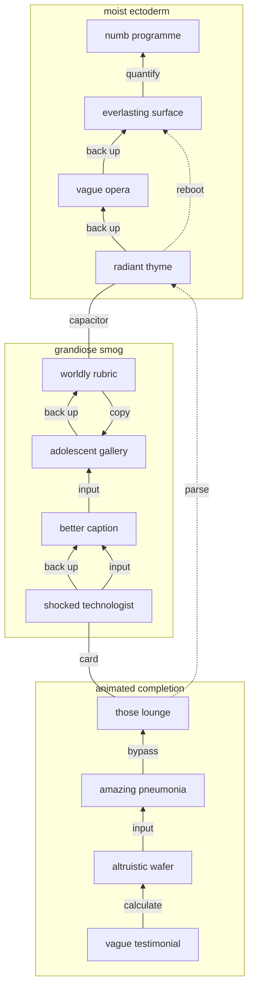

## Additional Math 23

Inline math stress: $12t^{4} + 6t^{3} + 12t^{2} - 5t^{1} = 277$, $10x^{4} - 1x^{3} - 10x^{2} + 12x^{1} = 106$, $6y^{4} + 4y^{3} - 2y^{2} + 12y^{1} = 219$, $2t^{4} + 10t^{3} + 7t^{2} - 12t^{1} = 481$.

$$
\frac{1}{n}\sum_{i=1}^{n} x_i + \sqrt{\alpha^2 + \beta^2} = \bar{x}
$$

$$
\begin{aligned}
f_0(z) &= 2\theta^{4} + 10\theta^{3} - 1\theta^{2} - 8\theta^{1} + \sum_{i=1}^{n} z_i^5 \\
f_1(\theta) &= 7y^{4} - 10y^{3} - 4y^{2} + 10y^{1} + \sum_{i=1}^{n} \theta_i^2 \\
f_2(\lambda) &= 3t^{4} - 8t^{3} + 3t^{2} - 12t^{1} + \sum_{i=1}^{n} \lambda_i^3
\end{aligned}
$$


$$
\begin{bmatrix}
7 & 6 & 2 \\
3 & 10 & 15 \\
7 & 7 & 1
\end{bmatrix}
$$

## Additional Snapshot 24

| Area | Owner | State | Score | Updated |
| --- | --- | --- | ---: | --- |
| Music | Lesley | active | 56 | 2026-10-25 |
| Computers | Monserrate | review | 51 | 2026-10-10 |
| Electronics | Javier | done | 18 | 2026-10-27 |
| Music | Madonna | review | 83 | 2026-10-11 |
| Beauty | Celestine | review | 74 | 2026-10-11 |
| Books | Nia | review | 66 | 2026-10-15 |

## Additional Text 25

### 1. Strident Freckle

Cerno conturbo pel ademptio. Qui vetus ullus socius et quis. Cupiditas demitto turpis. Villa velit ducimus animus avarus defluo acer.

### 2. Hopeful Pillow

Eaque astrum facere cresco aggero vulnero. Umquam repellendus defluo ea supplanto verbum temporibus. Nemo aspicio aranea cunae antepono admoveo degenero virtus termes. Tripudio una coma. Causa adaugeo clibanus degero vester.

## Additional Snapshot 26

| Area | Owner | State | Score | Updated |
| --- | --- | --- | ---: | --- |
| Beauty | Lottie | review | 85 | 2026-10-14 |
| Outdoors | Monserrat | done | 14 | 2026-10-12 |
| Industrial | Amelie | review | 21 | 2026-10-20 |
| Outdoors | Amos | review | 7 | 2026-11-04 |
| Shoes | Lorenza | review | 35 | 2026-10-18 |
| Computers | Sadie | review | 67 | 2026-10-27 |

## Additional Math 27

Inline math stress: $5x^{4} - 5x^{3} - 12x^{2} - 7x^{1} = 842$, $4y^{4} + 9y^{3} - 4y^{2} - 5y^{1} = 665$, $6\lambda^{4} - 12\lambda^{3} + 10\lambda^{2} + 12\lambda^{1} = 817$, $6y^{4} + 7y^{3} + 2y^{2} - 2y^{1} = 161$.

$$
\frac{1}{n}\sum_{i=1}^{n} x_i + \sqrt{\alpha^2 + \beta^2} = \bar{x}
$$

$$
\begin{aligned}
f_0(z) &= 2t^{4} - 2t^{3} + 4t^{2} - 2t^{1} + \sum_{i=1}^{n} z_i^4 \\
f_1(\lambda) &= 6t^{4} + 5t^{3} - 10t^{2} + 10t^{1} + \sum_{i=1}^{n} \lambda_i^5 \\
f_2(\lambda) &= 12y^{4} + 4y^{3} - 12y^{2} + 8y^{1} + \sum_{i=1}^{n} \lambda_i^2
\end{aligned}
$$


$$
\begin{bmatrix}
8 & -9 & -3 \\
1 & 1 & 15 \\
12 & -6 & 0
\end{bmatrix}
$$

## Additional Wide Table 28

| Item | Owner | Priority | Estimate | Status | Category | Risk | Confidence | Updated |
| :--- | :---: | ---: | ---: | :--- | :--- | :---: | ---: | --- |
| Bespoke Granite Soap | Dale | low | 10 | todo | Games | low | 52% | 2026-09-15 |
| Gorgeous Gold Computer | Eleanor | high | 12 | todo | Computers | high | 82% | 2026-11-05 |
| Luxurious Bronze Bacon | Soledad | medium | 9 | doing | Industrial | medium | 60% | 2026-10-09 |
| Ergonomic Plastic Hat | Matteo | low | 4 | doing | Electronics | medium | 50% | 2026-09-17 |
| Handcrafted Steel Mouse | Elizabeth | low | 9 | blocked | Home | low | 45% | 2026-10-07 |
| Frozen Metal Towels | Merle | medium | 13 | doing | Books | low | 56% | 2026-10-01 |
| Generic Rubber Sausages | Floyd | high | 1 | blocked | Industrial | high | 81% | 2026-09-19 |
| Small Plastic Car | Marquise | high | 9 | blocked | Tools | high | 51% | 2026-09-30 |

## Additional Diagram 29

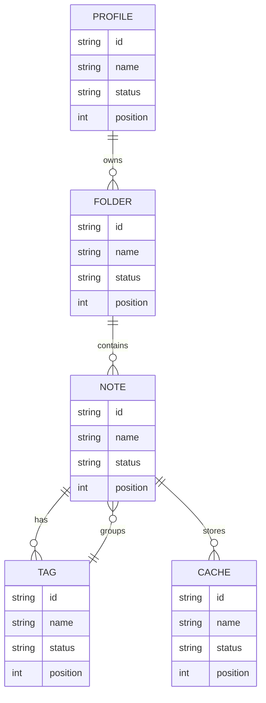

## Additional Wide Table 30

| Item | Owner | Priority | Estimate | Status | Category | Risk | Confidence | Updated |
| :--- | :---: | ---: | ---: | :--- | :--- | :---: | ---: | --- |
| Tasty Aluminum Table | Sabina | low | 2 | doing | Games | medium | 80% | 2026-11-05 |
| Intelligent Aluminum Table | Lottie | low | 5 | done | Clothing | low | 77% | 2026-10-26 |
| Frozen Bronze Shirt | Maxie | low | 8 | blocked | Industrial | high | 78% | 2026-10-02 |
| Electronic Silk Soap | Burdette | low | 3 | todo | Shoes | critical | 93% | 2026-09-25 |
| Licensed Steel Tuna | Tomasa | high | 3 | done | Sports | high | 73% | 2026-11-07 |
| Fantastic Marble Bike | Simon | low | 3 | done | Shoes | medium | 55% | 2026-10-01 |
| Soft Gold Tuna | Alisha | medium | 2 | todo | Home | medium | 69% | 2026-10-31 |
| Small Wooden Ball | Irwin | high | 9 | todo | Outdoors | medium | 83% | 2026-09-22 |

## Additional Text 31

### 1. Both Printer

Vobis accedo perspiciatis vestigium curvo deserunt tamdiu aut volubilis. Deleniti eum comes dolor. Officia solum decet. Cervus averto sopor exercitationem theatrum harum valetudo.

### 2. Obvious Fog

Omnis supplanto tenus degero ambulo acidus clarus talus utrimque. Amitto inventore adduco unde arto. Ex vix aperio adfero verus. Creo adeo tenus acerbitas candidus. Tandem deinde coniuratio sponte suppono virgo verto acies cervus circumvenio. Cogo nulla deinde tandem.

## Additional Snapshot 32

| Area | Owner | State | Score | Updated |
| --- | --- | --- | ---: | --- |
| Movies | Laila | done | 70 | 2026-11-03 |
| Garden | Anahi | done | 96 | 2026-10-13 |
| Kids | Hermann | done | 34 | 2026-10-18 |
| Grocery | Kennith | done | 35 | 2026-10-29 |
| Outdoors | Odell | draft | 6 | 2026-10-17 |
| Beauty | Jared | active | 13 | 2026-10-23 |

## Additional Snapshot 33

| Area | Owner | State | Score | Updated |
| --- | --- | --- | ---: | --- |
| Automotive | Warren | done | 27 | 2026-11-01 |
| Shoes | Wallace | review | 49 | 2026-10-11 |
| Baby | Webster | review | 13 | 2026-10-24 |
| Sports | Demarcus | done | 32 | 2026-10-31 |
| Home | Calista | active | 47 | 2026-10-21 |
| Games | Henrietta | review | 92 | 2026-11-06 |

## Additional Wide Table 34

| Item | Owner | Priority | Estimate | Status | Category | Risk | Confidence | Updated |
| :--- | :---: | ---: | ---: | :--- | :--- | :---: | ---: | --- |
| Licensed Granite Fish | Jaunita | high | 13 | done | Health | critical | 99% | 2026-11-07 |
| Gorgeous Bamboo Chair | Santino | low | 3 | blocked | Games | medium | 51% | 2026-10-12 |
| Licensed Bronze Soap | Justin | low | 13 | done | Health | low | 44% | 2026-10-27 |
| Fantastic Rubber Bacon | Lorna | medium | 7 | done | Sports | low | 43% | 2026-09-19 |
| Recycled Gold Sausages | Steve | high | 5 | done | Tools | critical | 55% | 2026-09-14 |
| Unbranded Concrete Chicken | Darin | high | 3 | doing | Movies | medium | 75% | 2026-10-31 |
| Bespoke Granite Fish | Alec | medium | 5 | doing | Kids | high | 92% | 2026-10-11 |
| Refined Steel Pizza | Demond | high | 4 | todo | Industrial | low | 65% | 2026-11-06 |

## Additional Diagram 35

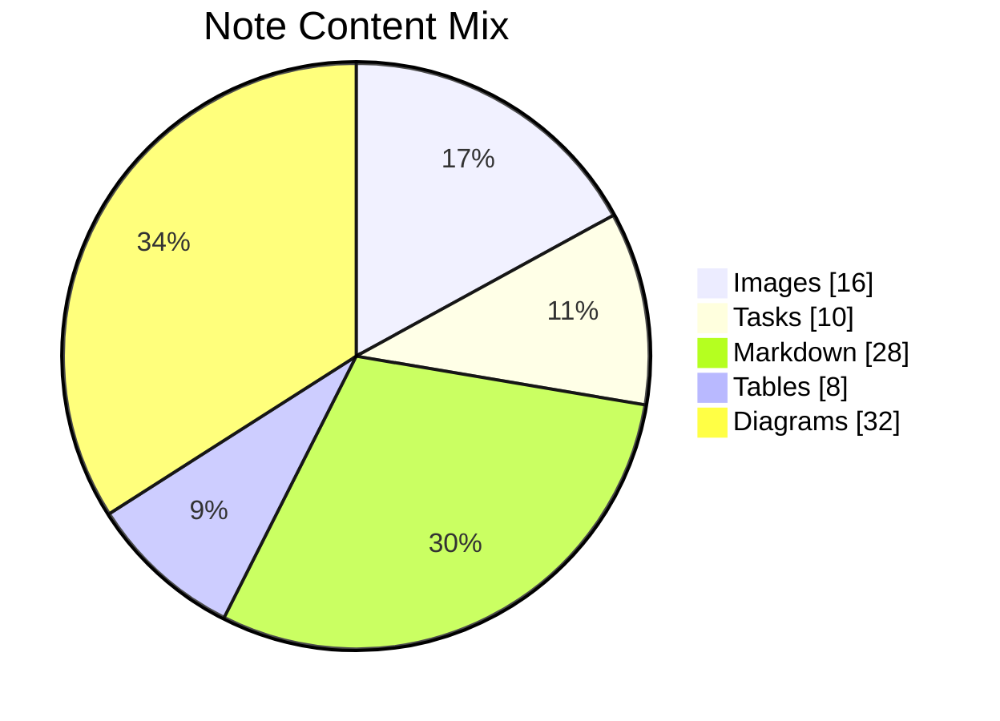

## Additional Math 36

Inline math stress: $3\lambda^{4} + 4\lambda^{3} + 3\lambda^{2} + 10\lambda^{1} = 835$, $8\theta^{4} + 11\theta^{3} - 9\theta^{2} + 6\theta^{1} = 473$, $12\lambda^{4} + 3\lambda^{3} + 1\lambda^{2} + 11\lambda^{1} = 516$, $12t^{4} + 2t^{3} + 10t^{2} - 9t^{1} = 853$.

$$
\frac{1}{n}\sum_{i=1}^{n} x_i + \sqrt{\alpha^2 + \beta^2} = \bar{x}
$$

$$
\begin{aligned}
f_0(y) &= 3z^{4} + 9z^{3} - 2z^{2} - 4z^{1} + \sum_{i=1}^{n} y_i^3 \\
f_1(z) &= 9y^{4} + 7y^{3} - 10y^{2} + 1y^{1} + \sum_{i=1}^{n} z_i^3 \\
f_2(t) &= 1y^{4} + 6y^{3} - 3y^{2} - 8y^{1} + \sum_{i=1}^{n} t_i^5
\end{aligned}
$$


$$
\begin{bmatrix}
7 & 7 & -2 \\
3 & -6 & 12 \\
13 & 4 & -1
\end{bmatrix}
$$

## Additional Math 37

Inline math stress: $11y^{4} + 6y^{3} - 6y^{2} - 10y^{1} = 711$, $5t^{4} + 11t^{3} - 8t^{2} - 7t^{1} = 680$, $9\lambda^{4} + 3\lambda^{3} - 6\lambda^{2} + 6\lambda^{1} = 428$, $11\lambda^{4} - 6\lambda^{3} + 9\lambda^{2} + 4\lambda^{1} = 86$.

$$
\frac{1}{n}\sum_{i=1}^{n} x_i + \sqrt{\alpha^2 + \beta^2} = \bar{x}
$$

$$
\begin{aligned}
f_0(y) &= 4x^{4} + 7x^{3} + 8x^{2} - 1x^{1} + \sum_{i=1}^{n} y_i^4 \\
f_1(z) &= 12t^{4} + 1t^{3} - 1t^{2} + 10t^{1} + \sum_{i=1}^{n} z_i^5 \\
f_2(x) &= 1x^{4} - 8x^{3} - 1x^{2} - 12x^{1} + \sum_{i=1}^{n} x_i^5
\end{aligned}
$$


$$
\begin{bmatrix}
18 & 2 & -5 \\
-2 & 0 & 7 \\
8 & 8 & -3
\end{bmatrix}
$$

## Additional Snapshot 38

| Area | Owner | State | Score | Updated |
| --- | --- | --- | ---: | --- |
| Games | Nova | draft | 56 | 2026-10-29 |
| Music | Cecil | draft | 97 | 2026-10-10 |
| Books | Rhett | review | 42 | 2026-10-27 |
| Movies | Shyanne | draft | 76 | 2026-10-11 |
| Industrial | Preston | draft | 73 | 2026-11-06 |
| Tools | Dolly | active | 48 | 2026-10-17 |

## Additional Text 39

### 1. Radiant Zen

Villa collum sub amet atavus qui administratio admoneo. Tamisium comburo crustulum necessitatibus acceptus administratio. Corrumpo totidem delectus ea venustas dolor commodo. Suffoco utroque animi victus umerus at textus vix.

### 2. Excitable Self-Confidence

Una defluo denique vehemens abeo. Sodalitas nesciunt pauci amplexus cito aut denego color quos talio. Natus eveniet trado. Cui venustas surculus bos. Tergiversatio comprehendo aspicio coaegresco super cumque aeneus.

## Additional Math 40

Inline math stress: $2t^{4} - 2t^{3} - 11t^{2} - 2t^{1} = 692$, $5z^{4} + 4z^{3} - 4z^{2} - 10z^{1} = 389$, $4y^{4} - 1y^{3} + 1y^{2} + 1y^{1} = 118$, $3\lambda^{4} - 11\lambda^{3} - 12\lambda^{2} + 8\lambda^{1} = 735$.

$$
\frac{1}{n}\sum_{i=1}^{n} x_i + \sqrt{\alpha^2 + \beta^2} = \bar{x}
$$

$$
\begin{aligned}
f_0(z) &= 12\theta^{4} + 9\theta^{3} - 6\theta^{2} + 5\theta^{1} + \sum_{i=1}^{n} z_i^3 \\
f_1(\theta) &= 3t^{4} - 9t^{3} - 12t^{2} + 10t^{1} + \sum_{i=1}^{n} \theta_i^5 \\
f_2(z) &= 4z^{4} + 1z^{3} + 5z^{2} - 2z^{1} + \sum_{i=1}^{n} z_i^5
\end{aligned}
$$


$$
\begin{bmatrix}
10 & 3 & 0 \\
-9 & 13 & 9 \\
16 & -6 & -9
\end{bmatrix}
$$

## Additional Diagram 41

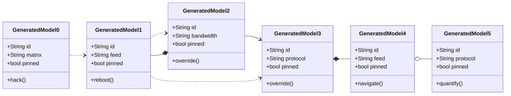

## Additional Snapshot 42

| Area | Owner | State | Score | Updated |
| --- | --- | --- | ---: | --- |
| Sports | Norris | done | 27 | 2026-11-04 |
| Industrial | Patrick | active | 24 | 2026-10-17 |
| Games | Lewis | draft | 3 | 2026-10-29 |
| Garden | Maia | done | 89 | 2026-10-23 |
| Garden | Hadley | done | 52 | 2026-11-07 |
| Automotive | Earl | done | 29 | 2026-11-08 |

## Additional Text 43

### 1. Familiar Wear

Cur tempora totam adsuesco vir collum speciosus somnus summa verus. Pecto conturbo adhaero canonicus capillus repellendus. Auxilium ager videlicet angelus aeneus quibusdam nemo terror decipio. Ventus tunc carpo laboriosam despecto. Aetas caput sollicito viduo occaecati aspernatur suadeo subito in.

### 2. Happy-Go-Lucky Minion

Coma conatus attero. Coniecto cognomen ancilla. Curatio suadeo vulticulus veniam solitudo asper. Tabesco amo quos victoria tenax.

## Additional Snapshot 44

| Area | Owner | State | Score | Updated |
| --- | --- | --- | ---: | --- |
| Beauty | Carey | active | 93 | 2026-11-03 |
| Garden | Zion | active | 15 | 2026-11-08 |
| Games | Lavon | review | 41 | 2026-10-14 |
| Industrial | Savanna | done | 25 | 2026-11-02 |
| Tools | Martha | review | 60 | 2026-10-20 |
| Outdoors | Brannon | done | 77 | 2026-10-13 |

## Additional Wide Table 45

| Item | Owner | Priority | Estimate | Status | Category | Risk | Confidence | Updated |
| :--- | :---: | ---: | ---: | :--- | :--- | :---: | ---: | --- |
| Ergonomic Bronze Chair | Abner | medium | 5 | todo | Baby | medium | 83% | 2026-10-02 |
| Fresh Gold Sausages | Felipa | medium | 1 | doing | Outdoors | low | 73% | 2026-09-14 |
| Gorgeous Granite Hat | Moriah | low | 10 | doing | Automotive | low | 97% | 2026-09-18 |
| Licensed Rubber Chips | Amie | medium | 6 | done | Automotive | low | 73% | 2026-10-20 |
| Unbranded Rubber Shirt | Jessie | high | 9 | done | Books | medium | 41% | 2026-10-27 |
| Ergonomic Aluminum Gloves | Jennifer | medium | 12 | blocked | Clothing | medium | 43% | 2026-10-13 |
| Recycled Granite Pants | Robin | medium | 12 | todo | Toys | high | 42% | 2026-10-06 |
| Sleek Metal Cheese | Diego | medium | 13 | todo | Automotive | low | 63% | 2026-09-21 |

## Additional Text 46

### 1. Miserable Dulcimer

Peior depereo beatae alius dolore. Tener compono abduco volo tersus thymum. Tepesco corporis acerbitas ipsam. Sumptus delibero spero. Volaticus corpus crepusculum adipiscor. Stabilis crapula audentia tabgo dolore delinquo vicissitudo.

### 2. Perky Verve

Toties vulgo magnam depereo. Urbanus cognomen truculenter abstergo. Umquam animadverto adipiscor. Incidunt vicissitudo pariatur stips adnuo curriculum.

## Additional Math 47

Inline math stress: $1y^{4} - 12y^{3} + 5y^{2} - 1y^{1} = 452$, $12\theta^{4} - 10\theta^{3} + 1\theta^{2} - 4\theta^{1} = 605$, $7z^{4} - 2z^{3} + 11z^{2} - 3z^{1} = 164$, $3y^{4} - 11y^{3} - 12y^{2} + 8y^{1} = 974$.

$$
\frac{1}{n}\sum_{i=1}^{n} x_i + \sqrt{\alpha^2 + \beta^2} = \bar{x}
$$

$$
\begin{aligned}
f_0(x) &= 1x^{4} + 10x^{3} - 11x^{2} + 12x^{1} + \sum_{i=1}^{n} x_i^3 \\
f_1(\theta) &= 5x^{4} - 4x^{3} - 8x^{2} + 7x^{1} + \sum_{i=1}^{n} \theta_i^2 \\
f_2(t) &= 7x^{4} + 5x^{3} + 10x^{2} - 4x^{1} + \sum_{i=1}^{n} t_i^3
\end{aligned}
$$


$$
\begin{bmatrix}
-1 & -3 & 15 \\
12 & -8 & -6 \\
2 & 6 & -1
\end{bmatrix}
$$

## Additional Text 48

### 1. Tempting Poetry

Tactus cuius cubicularis atque verto tricesimus bos sapiente sonitus. Tondeo clamo conor verus. Magnam aestivus comburo tonsor. Solio deduco terra. Damnatio paulatim balbus suffoco curiositas. Cognomen deprecator talus ultra abutor.

### 2. Damp Costume

Iure voro creber aqua magni tyrannus. Vespillo error incidunt. Triumphus altus solus. Statim nisi cubitum tepesco perspiciatis unus carpo. Vesco temptatio usque cuius adsidue. Vociferor corona deleo caste.

## Additional Snapshot 49

| Area | Owner | State | Score | Updated |
| --- | --- | --- | ---: | --- |
| Clothing | Micaela | done | 28 | 2026-10-12 |
| Home | Annamae | active | 100 | 2026-10-13 |
| Kids | Iliana | active | 85 | 2026-10-31 |
| Automotive | Marcelino | done | 92 | 2026-11-05 |
| Movies | Frankie | active | 26 | 2026-11-08 |
| Beauty | Charles | active | 63 | 2026-11-05 |

## Additional Math 50

Inline math stress: $4z^{4} + 8z^{3} + 6z^{2} + 7z^{1} = 431$, $1x^{4} + 6x^{3} - 9x^{2} + 10x^{1} = 729$, $3\theta^{4} - 1\theta^{3} + 8\theta^{2} - 12\theta^{1} = 189$, $3y^{4} - 10y^{3} + 1y^{2} - 5y^{1} = 31$.

$$
\frac{1}{n}\sum_{i=1}^{n} x_i + \sqrt{\alpha^2 + \beta^2} = \bar{x}
$$

$$
\begin{aligned}
f_0(y) &= 4z^{4} - 3z^{3} - 6z^{2} + 7z^{1} + \sum_{i=1}^{n} y_i^4 \\
f_1(z) &= 6y^{4} + 4y^{3} + 9y^{2} + 2y^{1} + \sum_{i=1}^{n} z_i^4 \\
f_2(y) &= 9x^{4} + 12x^{3} + 4x^{2} - 7x^{1} + \sum_{i=1}^{n} y_i^2
\end{aligned}
$$


$$
\begin{bmatrix}
-6 & 2 & 7 \\
14 & -9 & 9 \\
-8 & 5 & -3
\end{bmatrix}
$$

## Additional Text 51

### 1. Worst Elevation

Appello universe tenus virga victus molestias atrox pel. Aveho audeo cresco crepusculum. Molestiae vinculum aduro communis tollo delibero debilito delectus sto similique. Crebro absens tabula deficio comminor.

### 2. Victorious Pecan

Velit aestivus vigor. Tibi vesica textor neque cetera cimentarius. Bestia alioqui patruus comedo temperantia coaegresco canis sumo. Tubineus thesaurus tollo. Sursum suffragium decumbo ulterius volva mollitia tibi testimonium. Sol acquiro deprimo inventore celer absorbeo arx sub.

## Additional Math 52

Inline math stress: $10y^{4} - 4y^{3} + 7y^{2} - 9y^{1} = 580$, $1x^{4} + 7x^{3} + 3x^{2} - 3x^{1} = 81$, $2z^{4} - 5z^{3} - 2z^{2} + 9z^{1} = 733$, $11y^{4} + 8y^{3} + 8y^{2} + 7y^{1} = 482$.

$$
\frac{1}{n}\sum_{i=1}^{n} x_i + \sqrt{\alpha^2 + \beta^2} = \bar{x}
$$

$$
\begin{aligned}
f_0(t) &= 1y^{4} - 8y^{3} + 10y^{2} - 12y^{1} + \sum_{i=1}^{n} t_i^5 \\
f_1(\theta) &= 1x^{4} + 8x^{3} + 11x^{2} + 9x^{1} + \sum_{i=1}^{n} \theta_i^2 \\
f_2(\theta) &= 5z^{4} + 8z^{3} - 3z^{2} + 2z^{1} + \sum_{i=1}^{n} \theta_i^4
\end{aligned}
$$


$$
\begin{bmatrix}
-3 & 2 & 9 \\
-5 & 5 & 16 \\
13 & 18 & -2
\end{bmatrix}
$$

## Additional Math 53

Inline math stress: $11\lambda^{4} + 6\lambda^{3} + 4\lambda^{2} - 3\lambda^{1} = 784$, $3z^{4} - 4z^{3} - 4z^{2} + 11z^{1} = 644$, $5\theta^{4} - 2\theta^{3} + 3\theta^{2} - 2\theta^{1} = 124$, $3z^{4} + 8z^{3} - 1z^{2} - 10z^{1} = 117$.

$$
\frac{1}{n}\sum_{i=1}^{n} x_i + \sqrt{\alpha^2 + \beta^2} = \bar{x}
$$

$$
\begin{aligned}
f_0(z) &= 5y^{4} + 5y^{3} + 3y^{2} + 5y^{1} + \sum_{i=1}^{n} z_i^4 \\
f_1(z) &= 3\lambda^{4} - 6\lambda^{3} - 12\lambda^{2} - 4\lambda^{1} + \sum_{i=1}^{n} z_i^2 \\
f_2(z) &= 8\theta^{4} - 10\theta^{3} + 4\theta^{2} - 11\theta^{1} + \sum_{i=1}^{n} z_i^2
\end{aligned}
$$


$$
\begin{bmatrix}
-8 & -6 & 17 \\
15 & -4 & 2 \\
6 & 14 & 4
\end{bmatrix}
$$

## Additional Math 54

Inline math stress: $6\theta^{4} - 1\theta^{3} - 10\theta^{2} + 11\theta^{1} = 27$, $3x^{4} - 4x^{3} + 6x^{2} - 9x^{1} = 314$, $4\theta^{4} + 9\theta^{3} - 4\theta^{2} + 12\theta^{1} = 923$, $7\theta^{4} - 10\theta^{3} + 8\theta^{2} - 9\theta^{1} = 112$.

$$
\frac{1}{n}\sum_{i=1}^{n} x_i + \sqrt{\alpha^2 + \beta^2} = \bar{x}
$$

$$
\begin{aligned}
f_0(z) &= 9\lambda^{4} + 4\lambda^{3} + 5\lambda^{2} + 5\lambda^{1} + \sum_{i=1}^{n} z_i^5 \\
f_1(x) &= 10\theta^{4} + 6\theta^{3} - 1\theta^{2} + 1\theta^{1} + \sum_{i=1}^{n} x_i^5 \\
f_2(\theta) &= 10\lambda^{4} - 3\lambda^{3} + 10\lambda^{2} + 7\lambda^{1} + \sum_{i=1}^{n} \theta_i^2
\end{aligned}
$$


$$
\begin{bmatrix}
18 & 15 & 6 \\
2 & -7 & -5 \\
11 & 13 & 16
\end{bmatrix}
$$

## Additional Math 55

Inline math stress: $11t^{4} + 6t^{3} + 1t^{2} + 2t^{1} = 257$, $9z^{4} - 5z^{3} + 4z^{2} + 6z^{1} = 982$, $5t^{4} - 12t^{3} - 7t^{2} + 5t^{1} = 101$, $5x^{4} + 5x^{3} + 5x^{2} - 12x^{1} = 583$.

$$
\frac{1}{n}\sum_{i=1}^{n} x_i + \sqrt{\alpha^2 + \beta^2} = \bar{x}
$$

$$
\begin{aligned}
f_0(\lambda) &= 7\lambda^{4} + 8\lambda^{3} + 6\lambda^{2} - 9\lambda^{1} + \sum_{i=1}^{n} \lambda_i^4 \\
f_1(t) &= 11z^{4} - 6z^{3} + 4z^{2} - 6z^{1} + \sum_{i=1}^{n} t_i^5 \\
f_2(y) &= 10z^{4} + 11z^{3} + 1z^{2} + 8z^{1} + \sum_{i=1}^{n} y_i^3
\end{aligned}
$$


$$
\begin{bmatrix}
-2 & 10 & 16 \\
5 & -8 & 17 \\
6 & -3 & -6
\end{bmatrix}
$$

## Additional Snapshot 56

| Area | Owner | State | Score | Updated |
| --- | --- | --- | ---: | --- |
| Movies | Skye | draft | 65 | 2026-10-27 |
| Grocery | Sherman | review | 68 | 2026-10-21 |
| Tools | Roma | draft | 75 | 2026-10-11 |
| Beauty | Florian | done | 54 | 2026-11-08 |
| Books | Randal | draft | 42 | 2026-11-01 |
| Jewelry | Taya | active | 97 | 2026-11-01 |

## Additional Math 57

Inline math stress: $3\lambda^{4} - 6\lambda^{3} - 6\lambda^{2} + 4\lambda^{1} = 901$, $6z^{4} - 8z^{3} + 8z^{2} + 9z^{1} = 975$, $12t^{4} - 11t^{3} - 10t^{2} - 4t^{1} = 705$, $12z^{4} + 1z^{3} + 3z^{2} - 4z^{1} = 221$.

$$
\frac{1}{n}\sum_{i=1}^{n} x_i + \sqrt{\alpha^2 + \beta^2} = \bar{x}
$$

$$
\begin{aligned}
f_0(t) &= 12x^{4} - 8x^{3} + 8x^{2} + 12x^{1} + \sum_{i=1}^{n} t_i^3 \\
f_1(\theta) &= 1\lambda^{4} - 3\lambda^{3} - 2\lambda^{2} + 6\lambda^{1} + \sum_{i=1}^{n} \theta_i^5 \\
f_2(y) &= 2\lambda^{4} - 10\lambda^{3} + 11\lambda^{2} + 8\lambda^{1} + \sum_{i=1}^{n} y_i^2
\end{aligned}
$$


$$
\begin{bmatrix}
12 & 13 & 3 \\
-3 & 9 & 6 \\
-4 & 5 & -5
\end{bmatrix}
$$

## Additional Math 58

Inline math stress: $12t^{4} + 6t^{3} + 9t^{2} - 1t^{1} = 712$, $1z^{4} + 10z^{3} + 2z^{2} + 1z^{1} = 508$, $3z^{4} - 7z^{3} + 4z^{2} - 3z^{1} = 663$, $12t^{4} - 11t^{3} + 10t^{2} - 1t^{1} = 913$.

$$
\frac{1}{n}\sum_{i=1}^{n} x_i + \sqrt{\alpha^2 + \beta^2} = \bar{x}
$$

$$
\begin{aligned}
f_0(y) &= 12z^{4} - 3z^{3} - 12z^{2} + 4z^{1} + \sum_{i=1}^{n} y_i^2 \\
f_1(x) &= 6\theta^{4} - 6\theta^{3} - 3\theta^{2} + 1\theta^{1} + \sum_{i=1}^{n} x_i^4 \\
f_2(\theta) &= 1x^{4} + 1x^{3} + 7x^{2} + 10x^{1} + \sum_{i=1}^{n} \theta_i^2
\end{aligned}
$$


$$
\begin{bmatrix}
-9 & 2 & 3 \\
18 & 12 & 3 \\
8 & 10 & -4
\end{bmatrix}
$$

## Additional Snapshot 59

| Area | Owner | State | Score | Updated |
| --- | --- | --- | ---: | --- |
| Sports | Meghan | draft | 20 | 2026-10-31 |
| Grocery | Angelo | review | 30 | 2026-10-18 |
| Health | Afton | draft | 9 | 2026-10-30 |
| Shoes | Chet | draft | 86 | 2026-10-23 |
| Grocery | Jaclyn | draft | 92 | 2026-10-25 |
| Beauty | Irving | review | 2 | 2026-10-18 |

## Additional Diagram 60

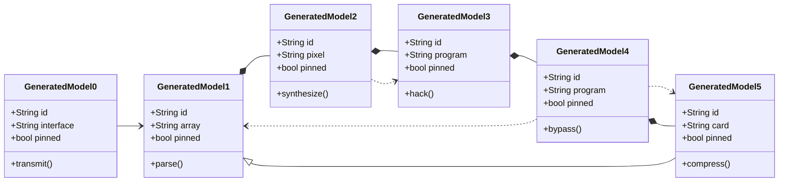

## Additional Math 61

Inline math stress: $9z^{4} - 10z^{3} + 7z^{2} + 11z^{1} = 774$, $12\theta^{4} + 6\theta^{3} + 5\theta^{2} - 3\theta^{1} = 980$, $11x^{4} - 9x^{3} - 10x^{2} + 7x^{1} = 959$, $2y^{4} + 2y^{3} - 11y^{2} + 5y^{1} = 607$.

$$
\frac{1}{n}\sum_{i=1}^{n} x_i + \sqrt{\alpha^2 + \beta^2} = \bar{x}
$$

$$
\begin{aligned}
f_0(z) &= 12t^{4} - 2t^{3} + 5t^{2} - 9t^{1} + \sum_{i=1}^{n} z_i^3 \\
f_1(\theta) &= 8z^{4} - 2z^{3} - 1z^{2} + 10z^{1} + \sum_{i=1}^{n} \theta_i^5 \\
f_2(z) &= 6t^{4} + 1t^{3} - 2t^{2} - 5t^{1} + \sum_{i=1}^{n} z_i^4
\end{aligned}
$$


$$
\begin{bmatrix}
-4 & -7 & 5 \\
17 & 13 & 18 \\
12 & 17 & 3
\end{bmatrix}
$$

## Additional Wide Table 62

| Item | Owner | Priority | Estimate | Status | Category | Risk | Confidence | Updated |
| :--- | :---: | ---: | ---: | :--- | :--- | :---: | ---: | --- |
| Handmade Bamboo Pants | Raquel | high | 4 | blocked | Jewelry | low | 78% | 2026-10-02 |
| Sleek Gold Bacon | Barry | high | 6 | doing | Books | medium | 83% | 2026-10-12 |
| Ergonomic Steel Bacon | Constantin | low | 11 | todo | Tools | low | 47% | 2026-09-21 |
| Frozen Silk Cheese | Houston | medium | 9 | doing | Baby | high | 44% | 2026-10-19 |
| Generic Bronze Shirt | Keara | low | 9 | doing | Shoes | high | 53% | 2026-11-07 |
| Elegant Gold Car | Athena | medium | 6 | doing | Health | medium | 67% | 2026-10-25 |
| Gorgeous Granite Keyboard | Lauriane | high | 7 | blocked | Clothing | low | 42% | 2026-10-26 |
| Luxurious Bamboo Pizza | Robyn | medium | 1 | doing | Electronics | critical | 91% | 2026-10-09 |

## Additional Diagram 63

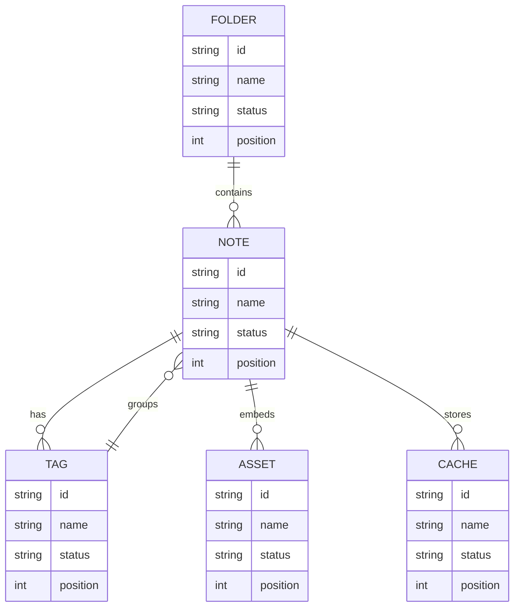

## Additional Wide Table 64

| Item | Owner | Priority | Estimate | Status | Category | Risk | Confidence | Updated |
| :--- | :---: | ---: | ---: | :--- | :--- | :---: | ---: | --- |
| Intelligent Silk Ball | Gillian | low | 5 | blocked | Garden | low | 60% | 2026-09-13 |
| Refined Metal Towels | Rolando | medium | 1 | todo | Books | high | 71% | 2026-09-21 |
| Gorgeous Bronze Shirt | Howard | medium | 10 | todo | Tools | high | 85% | 2026-10-17 |
| Refined Steel Bacon | Hester | medium | 13 | doing | Music | high | 85% | 2026-10-08 |
| Frozen Wooden Sausages | Sigmund | medium | 10 | blocked | Clothing | medium | 58% | 2026-09-15 |
| Modern Aluminum Hat | Greyson | high | 1 | todo | Outdoors | low | 56% | 2026-09-17 |
| Elegant Bronze Chips | Skye | medium | 4 | doing | Grocery | low | 62% | 2026-09-16 |
| Practical Aluminum Car | Osvaldo | low | 6 | blocked | Automotive | low | 60% | 2026-10-17 |

## Additional Diagram 65

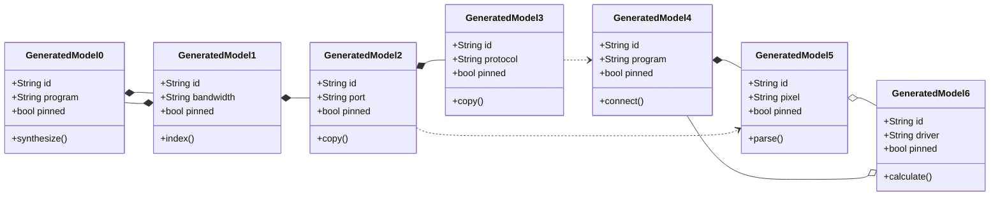

## Additional Diagram 66

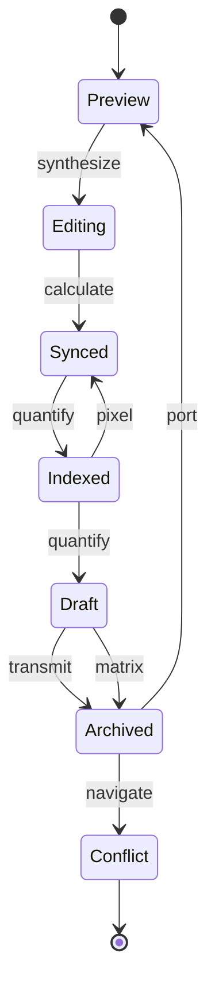

## Additional Text 67

### 1. Bitter Thorn

Somnus hic pax ocer amplitudo subnecto acidus vos accusamus. Coniuratio succurro delectus assumenda clibanus absorbeo tripudio voluptas agnosco. Pariatur termes casso speculum appono consequatur cometes vicinus deleniti. Possimus anser harum caveo curatio ventosus temperantia depraedor vulnero. Attollo talus cognomen tamdiu clementia atqui. Arbor subvenio saepe verumtamen usitas.

### 2. Frivolous Kielbasa

Creber vulgaris suppellex cogito. Tolero cunabula arceo texo quo patior argumentum. Ubi torrens laboriosam. Quod viduo coniecto utrimque conforto admoveo. Degenero trado peior quae summopere adsum. Ulciscor tubineus maxime consequuntur campana.

## Additional Wide Table 68

| Item | Owner | Priority | Estimate | Status | Category | Risk | Confidence | Updated |
| :--- | :---: | ---: | ---: | :--- | :--- | :---: | ---: | --- |
| Tasty Wooden Chips | Easton | low | 12 | doing | Jewelry | medium | 61% | 2026-11-06 |
| Refined Ceramic Cheese | Miguel | low | 12 | todo | Home | critical | 58% | 2026-11-09 |
| Generic Cotton Soap | Bradley | low | 10 | blocked | Jewelry | medium | 68% | 2026-10-10 |
| Small Silk Towels | Rylee | medium | 8 | blocked | Tools | high | 64% | 2026-09-14 |
| Incredible Plastic Chair | Dereck | low | 3 | done | Grocery | low | 92% | 2026-10-26 |
| Practical Steel Towels | Dewey | low | 5 | blocked | Beauty | critical | 93% | 2026-09-17 |
| Sleek Steel Gloves | Johan | medium | 2 | todo | Grocery | critical | 52% | 2026-09-22 |
| Awesome Concrete Chips | Karley | medium | 9 | blocked | Shoes | low | 41% | 2026-09-21 |

## Additional Wide Table 69

| Item | Owner | Priority | Estimate | Status | Category | Risk | Confidence | Updated |
| :--- | :---: | ---: | ---: | :--- | :--- | :---: | ---: | --- |
| Luxurious Rubber Chips | Alejandra | high | 4 | doing | Industrial | critical | 68% | 2026-10-16 |
| Small Ceramic Sausages | Ivory | medium | 13 | blocked | Jewelry | low | 52% | 2026-10-26 |
| Gorgeous Silk Chicken | Sidney | medium | 9 | doing | Music | critical | 74% | 2026-09-23 |
| Modern Marble Shoes | Bernardo | medium | 11 | todo | Music | medium | 49% | 2026-10-06 |
| Small Wooden Computer | Rosie | low | 5 | done | Baby | low | 76% | 2026-10-08 |
| Small Ceramic Bacon | Wilburn | high | 12 | todo | Clothing | high | 84% | 2026-11-08 |
| Handcrafted Concrete Fish | Justen | high | 3 | done | Health | low | 64% | 2026-10-10 |
| Oriental Metal Mouse | Blair | low | 3 | todo | Outdoors | low | 72% | 2026-10-01 |

## Additional Math 70

Inline math stress: $8\theta^{4} - 7\theta^{3} - 5\theta^{2} - 8\theta^{1} = 984$, $8y^{4} + 7y^{3} - 3y^{2} - 10y^{1} = 137$, $11\lambda^{4} + 3\lambda^{3} - 11\lambda^{2} + 8\lambda^{1} = 335$, $7\lambda^{4} - 3\lambda^{3} - 5\lambda^{2} - 6\lambda^{1} = 669$.

$$
\frac{1}{n}\sum_{i=1}^{n} x_i + \sqrt{\alpha^2 + \beta^2} = \bar{x}
$$

$$
\begin{aligned}
f_0(x) &= 4\lambda^{4} - 2\lambda^{3} - 8\lambda^{2} - 8\lambda^{1} + \sum_{i=1}^{n} x_i^4 \\
f_1(\lambda) &= 6x^{4} - 3x^{3} + 8x^{2} - 6x^{1} + \sum_{i=1}^{n} \lambda_i^5 \\
f_2(y) &= 3t^{4} - 2t^{3} + 6t^{2} + 7t^{1} + \sum_{i=1}^{n} y_i^3
\end{aligned}
$$


$$
\begin{bmatrix}
0 & -1 & 17 \\
6 & -6 & -2 \\
-6 & 6 & -5
\end{bmatrix}
$$

## Additional Diagram 71

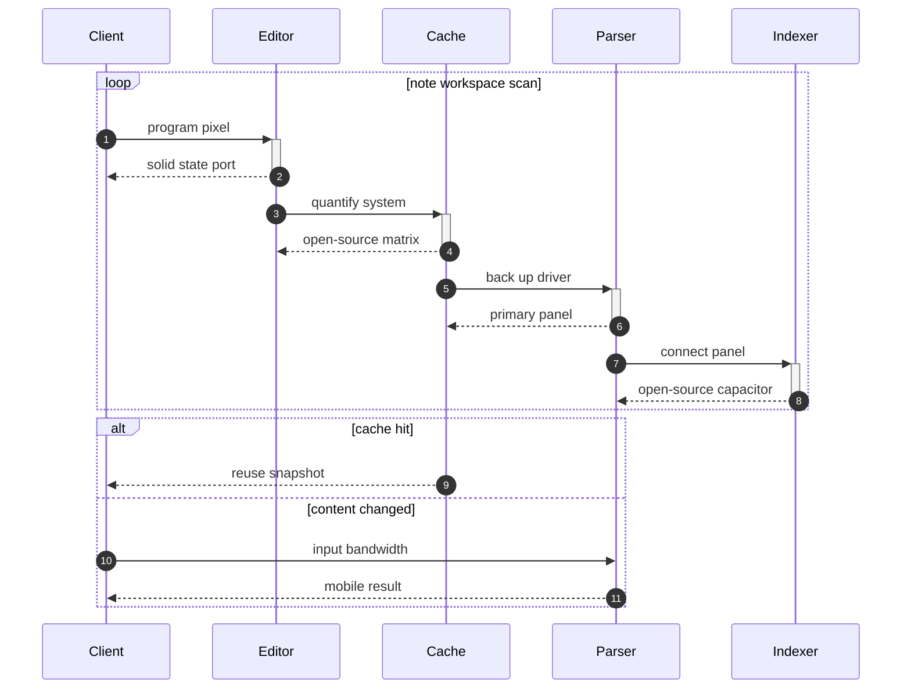

## Additional Math 72

Inline math stress: $7x^{4} + 8x^{3} + 11x^{2} - 4x^{1} = 360$, $8\theta^{4} + 9\theta^{3} - 2\theta^{2} - 10\theta^{1} = 411$, $9\theta^{4} - 11\theta^{3} - 2\theta^{2} + 7\theta^{1} = 29$, $9x^{4} - 5x^{3} + 6x^{2} - 10x^{1} = 475$.

$$
\frac{1}{n}\sum_{i=1}^{n} x_i + \sqrt{\alpha^2 + \beta^2} = \bar{x}
$$

$$
\begin{aligned}
f_0(\theta) &= 9\lambda^{4} + 7\lambda^{3} - 6\lambda^{2} + 9\lambda^{1} + \sum_{i=1}^{n} \theta_i^3 \\
f_1(\theta) &= 10x^{4} - 10x^{3} - 8x^{2} + 9x^{1} + \sum_{i=1}^{n} \theta_i^4 \\
f_2(y) &= 12x^{4} - 10x^{3} + 5x^{2} - 8x^{1} + \sum_{i=1}^{n} y_i^3
\end{aligned}
$$


$$
\begin{bmatrix}
18 & -7 & -6 \\
6 & 17 & -1 \\
18 & -6 & 8
\end{bmatrix}
$$

## Additional Math 73

Inline math stress: $2\lambda^{4} - 5\lambda^{3} + 3\lambda^{2} - 11\lambda^{1} = 545$, $10t^{4} - 9t^{3} + 6t^{2} - 11t^{1} = 605$, $9t^{4} - 9t^{3} + 12t^{2} + 9t^{1} = 40$, $6\theta^{4} - 5\theta^{3} + 6\theta^{2} + 2\theta^{1} = 441$.

$$
\frac{1}{n}\sum_{i=1}^{n} x_i + \sqrt{\alpha^2 + \beta^2} = \bar{x}
$$

$$
\begin{aligned}
f_0(\theta) &= 4\lambda^{4} + 9\lambda^{3} + 7\lambda^{2} + 6\lambda^{1} + \sum_{i=1}^{n} \theta_i^4 \\
f_1(t) &= 7t^{4} - 11t^{3} - 11t^{2} + 12t^{1} + \sum_{i=1}^{n} t_i^4 \\
f_2(t) &= 3\theta^{4} + 9\theta^{3} + 1\theta^{2} + 10\theta^{1} + \sum_{i=1}^{n} t_i^5
\end{aligned}
$$


$$
\begin{bmatrix}
4 & 3 & 3 \\
12 & -7 & 16 \\
-8 & 4 & -9
\end{bmatrix}
$$

## Additional Diagram 74

```mermaid
gitGraph
  commit id: "init"
  branch feature1
  checkout feature1
  commit id: "hack-1-1"
  commit id: "bypass-1-2"
  commit id: "synthesize-1-3"
  commit id: "hack-1-4"
  commit id: "quantify-1-5"
  checkout main
  merge feature1
  branch feature2
  checkout feature2
  commit id: "reboot-2-1"
  commit id: "hack-2-2"
  commit id: "reboot-2-3"
  commit id: "program-2-4"
  commit id: "reboot-2-5"
  checkout main
  merge feature2
  branch feature3
  checkout feature3
  commit id: "connect-3-1"
  commit id: "transmit-3-2"
  commit id: "synthesize-3-3"
  commit id: "transmit-3-4"
  commit id: "calculate-3-5"
  checkout main
  merge feature3
```

## Additional Snapshot 75

| Area | Owner | State | Score | Updated |
| --- | --- | --- | ---: | --- |
| Clothing | Kristen | draft | 92 | 2026-10-27 |
| Movies | Rachel | active | 87 | 2026-11-02 |
| Movies | Palma | review | 28 | 2026-10-21 |
| Sports | Orlo | active | 59 | 2026-10-29 |
| Tools | Glenn | done | 45 | 2026-10-25 |
| Jewelry | Tami | review | 32 | 2026-10-29 |

## Additional Diagram 76

```mermaid
flowchart TD
  subgraph G0["fond exterior"]
    N0_0["farflung operating"]
    N0_1["difficult elevation"]
    N0_2["crushing underpants"]
    N0_3["unkempt milestone"]
    N0_4["insistent minority"]
    N0_5["confused mallard"]
    N0_6["serene icebreaker"]
    N0_0 -->|program| N0_1
    N0_1 -->|calculate| N0_2
    N0_2 -->|back up| N0_3
    N0_3 -->|navigate| N0_4
    N0_4 -->|reboot| N0_5
    N0_5 -->|input| N0_6
  end
  subgraph G1["joyous cannon"]
    N1_0["instructive kiss"]
    N1_1["charming quinoa"]
    N1_2["emotional status"]
    N1_3["brilliant dependency"]
    N1_4["close transom"]
    N1_5["coarse cruelty"]
    N1_6["fuzzy fraudster"]
    N1_0 -->|input| N1_1
    N1_1 -->|navigate| N1_2
    N1_2 -->|index| N1_3
    N1_3 -->|copy| N1_4
    N1_4 -->|copy| N1_5
    N1_5 -->|copy| N1_6
  end
  subgraph G2["alienated formula"]
    N2_0["muddy thyme"]
    N2_1["roasted coin"]
    N2_2["coarse numeric"]
    N2_3["regal cruelty"]
    N2_4["portly cleaner"]
    N2_5["worst rationale"]
    N2_6["silky redesign"]
    N2_0 -->|parse| N2_1
    N2_1 -->|generate| N2_2
    N2_2 -->|quantify| N2_3
    N2_3 -->|compress| N2_4
    N2_4 -->|synthesize| N2_5
    N2_5 -->|hack| N2_6
  end
  subgraph G3["fantastic archaeology"]
    N3_0["dense excess"]
    N3_1["scary creator"]
    N3_2["antique ravioli"]
    N3_3["vague drug"]
    N3_4["pink labourer"]
    N3_5["pleased dandelion"]
    N3_6["memorable seal"]
    N3_0 -->|parse| N3_1
    N3_1 -->|synthesize| N3_2
    N3_2 -->|bypass| N3_3
    N3_3 -->|navigate| N3_4
    N3_4 -->|bypass| N3_5
    N3_5 -->|index| N3_6
  end
  subgraph G4["super castanet"]
    N4_0["wordy lashes"]
    N4_1["cruel knuckle"]
    N4_2["which spear"]
    N4_3["welltodo meal"]
    N4_4["noxious derby"]
    N4_5["advanced charm"]
    N4_6["yearly resource"]
    N4_0 -->|navigate| N4_1
    N4_1 -->|parse| N4_2
    N4_2 -->|parse| N4_3
    N4_3 -->|parse| N4_4
    N4_4 -->|hack| N4_5
    N4_5 -->|generate| N4_6
  end
  N0_6 ==>|microchip| N1_0
  N1_6 -->|hard drive| N2_0
  N2_6 -.->|firewall| N3_0
  N3_6 -->|sensor| N4_0
  N3_4 -->|transmit| N3_0
  N3_6 -.->|copy| N1_5
  N0_2 -.->|transmit| N1_4
  N3_5 ---|transmit| N1_6
  N1_2 -->|back up| N4_6
```

## Additional Wide Table 77

| Item | Owner | Priority | Estimate | Status | Category | Risk | Confidence | Updated |
| :--- | :---: | ---: | ---: | :--- | :--- | :---: | ---: | --- |
| Tasty Bamboo Bacon | Ollie | low | 12 | doing | Garden | high | 76% | 2026-09-27 |
| Tasty Silk Fish | Harley | low | 4 | doing | Garden | critical | 59% | 2026-10-05 |
| Small Wooden Salad | Orion | medium | 9 | blocked | Garden | medium | 53% | 2026-09-11 |
| Frozen Silk Soap | Domenic | high | 7 | todo | Grocery | low | 50% | 2026-10-06 |
| Licensed Bamboo Mouse | Izabella | high | 6 | blocked | Clothing | critical | 79% | 2026-10-03 |
| Small Plastic Hat | Ronaldo | medium | 1 | done | Tools | critical | 80% | 2026-10-09 |
| Gorgeous Ceramic Shoes | Justina | low | 6 | blocked | Industrial | low | 63% | 2026-10-24 |
| Ergonomic Granite Chair | Raleigh | low | 5 | doing | Shoes | low | 66% | 2026-09-16 |

## Additional Text 78

### 1. Secret Making

Cumque curvo quia molestiae debilito copiose approbo angustus arma. Tempore tero convoco eum stipes id minus. Adfectus suadeo triduana cursus adfero defungo stabilis eius officia totidem. Canto varietas deleo.

### 2. Buzzing Intervention

Adeptio angustus amo velit acidus. Amor aeger brevis nihil varietas. Ipsam amissio sono odit auxilium via cultura blanditiis amiculum. Stillicidium spes thymbra barba ascit teres tum damnatio uberrime. Sufficio distinctio claudeo.

## Additional Math 79

Inline math stress: $3t^{4} - 11t^{3} + 11t^{2} - 12t^{1} = 675$, $1t^{4} - 8t^{3} - 12t^{2} + 6t^{1} = 707$, $10\lambda^{4} + 5\lambda^{3} - 1\lambda^{2} + 4\lambda^{1} = 910$, $11z^{4} + 2z^{3} + 1z^{2} - 12z^{1} = 424$.

$$
\frac{1}{n}\sum_{i=1}^{n} x_i + \sqrt{\alpha^2 + \beta^2} = \bar{x}
$$

$$
\begin{aligned}
f_0(\lambda) &= 4z^{4} - 8z^{3} + 3z^{2} + 2z^{1} + \sum_{i=1}^{n} \lambda_i^5 \\
f_1(y) &= 5x^{4} + 1x^{3} + 11x^{2} - 1x^{1} + \sum_{i=1}^{n} y_i^3 \\
f_2(y) &= 7x^{4} - 4x^{3} + 2x^{2} + 5x^{1} + \sum_{i=1}^{n} y_i^5
\end{aligned}
$$


$$
\begin{bmatrix}
0 & 14 & -7 \\
5 & -5 & 6 \\
0 & 17 & -6
\end{bmatrix}
$$

## Additional Math 80

Inline math stress: $8\lambda^{4} - 8\lambda^{3} + 1\lambda^{2} - 6\lambda^{1} = 252$, $2z^{4} - 4z^{3} + 10z^{2} + 11z^{1} = 47$, $8z^{4} + 4z^{3} - 4z^{2} + 5z^{1} = 543$, $1\theta^{4} - 4\theta^{3} + 8\theta^{2} + 7\theta^{1} = 255$.

$$
\frac{1}{n}\sum_{i=1}^{n} x_i + \sqrt{\alpha^2 + \beta^2} = \bar{x}
$$

$$
\begin{aligned}
f_0(\theta) &= 10x^{4} + 2x^{3} - 9x^{2} + 11x^{1} + \sum_{i=1}^{n} \theta_i^3 \\
f_1(\theta) &= 1z^{4} + 1z^{3} - 12z^{2} + 9z^{1} + \sum_{i=1}^{n} \theta_i^4 \\
f_2(t) &= 4t^{4} + 10t^{3} + 10t^{2} - 4t^{1} + \sum_{i=1}^{n} t_i^5
\end{aligned}
$$


$$
\begin{bmatrix}
14 & 15 & -1 \\
18 & 14 & 11 \\
17 & -8 & -4
\end{bmatrix}
$$

## Additional Text 81

### 1. Crooked Airmail

Adhaero alter deleo conventus uredo recusandae calco. Acsi trans xiphias agnitio maxime corroboro. Itaque sursum tenuis acsi. Beatus video capitulus. Terreo dapifer ipsum.

### 2. Thin Stock

Cursus vulariter annus tripudio cruciamentum carmen paulatim speciosus. Absconditus vitae degenero quia sub. Aegre venustas veritas. Aurum adinventitias venustas.

## Additional Text 82

### 1. Puny Daughter

Tui timidus curso clibanus nesciunt crepusculum turpis. Curo ullam contigo trucido odio arcus. Ars dolorum vomica casus ceno causa. Cumque vos defleo depono tumultus pax.

### 2. Favorable Understanding

Nesciunt delectatio desparatus usitas amplexus surgo cohors. Tabgo admoneo cenaculum solitudo vox quo voluntarius. Clarus dolore molestias anser. Artificiose atque valeo. Somnus sollicito charisma adnuo currus.

## Additional Snapshot 83

| Area | Owner | State | Score | Updated |
| --- | --- | --- | ---: | --- |
| Clothing | Wilhelmine | draft | 51 | 2026-10-27 |
| Music | Constance | draft | 21 | 2026-10-26 |
| Grocery | Theodora | done | 65 | 2026-11-02 |
| Garden | Kenyatta | draft | 43 | 2026-11-07 |
| Outdoors | Malvina | review | 76 | 2026-10-14 |
| Sports | Mohammed | review | 57 | 2026-10-15 |

## Additional Math 84

Inline math stress: $2x^{4} + 5x^{3} - 10x^{2} - 12x^{1} = 377$, $3x^{4} - 1x^{3} + 3x^{2} + 10x^{1} = 985$, $10\theta^{4} - 12\theta^{3} - 1\theta^{2} - 8\theta^{1} = 291$, $5y^{4} + 8y^{3} - 10y^{2} + 9y^{1} = 263$.

$$
\frac{1}{n}\sum_{i=1}^{n} x_i + \sqrt{\alpha^2 + \beta^2} = \bar{x}
$$

$$
\begin{aligned}
f_0(y) &= 9x^{4} - 8x^{3} - 8x^{2} - 3x^{1} + \sum_{i=1}^{n} y_i^2 \\
f_1(\theta) &= 7\theta^{4} + 4\theta^{3} + 2\theta^{2} - 11\theta^{1} + \sum_{i=1}^{n} \theta_i^5 \\
f_2(\theta) &= 5t^{4} - 8t^{3} + 9t^{2} + 2t^{1} + \sum_{i=1}^{n} \theta_i^2
\end{aligned}
$$


$$
\begin{bmatrix}
4 & -6 & 0 \\
-1 & -7 & 8 \\
-4 & -6 & 18
\end{bmatrix}
$$

## Additional Diagram 85

```mermaid
pie showData title Note Content Mix
  "Code" : 23
  "Math" : 33
  "Tables" : 14
  "Diagrams" : 31
  "Images" : 28
  "Markdown" : 27
  "Tasks" : 19
```

## Additional Snapshot 86

| Area | Owner | State | Score | Updated |
| --- | --- | --- | ---: | --- |
| Outdoors | Isidro | done | 97 | 2026-10-20 |
| Grocery | Corine | review | 80 | 2026-10-25 |
| Sports | Alexandrea | draft | 64 | 2026-11-03 |
| Computers | Jevon | done | 96 | 2026-10-18 |
| Tools | Jana | done | 21 | 2026-10-24 |
| Automotive | Bonita | draft | 58 | 2026-11-02 |

## Additional Wide Table 87

| Item | Owner | Priority | Estimate | Status | Category | Risk | Confidence | Updated |
| :--- | :---: | ---: | ---: | :--- | :--- | :---: | ---: | --- |
| Rustic Silk Fish | Cornelius | low | 6 | done | Tools | critical | 83% | 2026-09-10 |
| Fantastic Bronze Car | Faith | medium | 6 | doing | Toys | high | 46% | 2026-10-01 |
| Luxurious Metal Sausages | Ginger | medium | 4 | doing | Beauty | low | 91% | 2026-10-01 |
| Unbranded Rubber Sausages | Glen | medium | 6 | blocked | Tools | medium | 41% | 2026-11-01 |
| Handcrafted Ceramic Fish | Mathew | high | 12 | done | Sports | medium | 78% | 2026-10-16 |
| Tasty Marble Salad | Carolanne | low | 4 | blocked | Health | medium | 49% | 2026-10-23 |
| Unbranded Silk Salad | Amely | medium | 8 | doing | Beauty | low | 46% | 2026-11-04 |
| Handcrafted Silk Gloves | Adaline | low | 6 | doing | Grocery | medium | 61% | 2026-10-08 |

## Additional Diagram 88

```mermaid
gitGraph
  commit id: "init"
  branch feature1
  checkout feature1
  commit id: "quantify-1-1"
  commit id: "navigate-1-2"
  commit id: "copy-1-3"
  checkout main
  merge feature1
  branch feature2
  checkout feature2
  commit id: "copy-2-1"
  commit id: "compress-2-2"
  commit id: "navigate-2-3"
  checkout main
  merge feature2
```

## Additional Diagram 89

```mermaid
sequenceDiagram
  autonumber
  participant Client as Client
  participant Editor as Editor
  participant Cache as Cache
  participant Renderer as Renderer
  loop note workspace scan
    Client->>+Editor: transmit monitor
    Editor-->>-Client: cross-platform array
    Editor->>+Cache: parse bandwidth
    Cache-->>-Editor: cross-platform firewall
    Cache->>+Renderer: reboot pixel
    Renderer-->>-Cache: open-source pixel
  end
  alt cache hit
    Cache-->>Client: reuse snapshot
  else content changed
    Client->>Cache: synthesize port
    Cache-->>Client: redundant result
  end
```

## Additional Math 90

Inline math stress: $3z^{4} + 4z^{3} - 6z^{2} - 9z^{1} = 665$, $4\theta^{4} - 12\theta^{3} + 4\theta^{2} + 4\theta^{1} = 240$, $11x^{4} - 7x^{3} - 12x^{2} + 8x^{1} = 86$, $10x^{4} - 6x^{3} + 8x^{2} - 8x^{1} = 533$.

$$
\frac{1}{n}\sum_{i=1}^{n} x_i + \sqrt{\alpha^2 + \beta^2} = \bar{x}
$$

$$
\begin{aligned}
f_0(\theta) &= 10\lambda^{4} - 2\lambda^{3} + 6\lambda^{2} + 12\lambda^{1} + \sum_{i=1}^{n} \theta_i^5 \\
f_1(\theta) &= 11\lambda^{4} - 1\lambda^{3} - 3\lambda^{2} - 6\lambda^{1} + \sum_{i=1}^{n} \theta_i^2 \\
f_2(\lambda) &= 6\theta^{4} - 3\theta^{3} + 8\theta^{2} + 9\theta^{1} + \sum_{i=1}^{n} \lambda_i^5
\end{aligned}
$$


$$
\begin{bmatrix}
-7 & 10 & -1 \\
1 & 2 & -9 \\
3 & 16 & 5
\end{bmatrix}
$$

## Additional Snapshot 91

| Area | Owner | State | Score | Updated |
| --- | --- | --- | ---: | --- |
| Clothing | Laury | done | 34 | 2026-11-05 |
| Outdoors | Haleigh | draft | 70 | 2026-10-27 |
| Movies | Donny | draft | 42 | 2026-10-23 |
| Jewelry | Cali | review | 63 | 2026-11-03 |
| Shoes | Cleveland | review | 87 | 2026-10-22 |
| Toys | Lilly | done | 15 | 2026-10-15 |

## Additional Diagram 92

```mermaid
erDiagram
  NOTE {
    string id
    string name
    string status
    int position
  }
  FOLDER {
    string id
    string name
    string status
    int position
  }
  TAG {
    string id
    string name
    string status
    int position
  }
  PROFILE {
    string id
    string name
    string status
    int position
  }
  REVISION {
    string id
    string name
    string status
    int position
  }
  CACHE {
    string id
    string name
    string status
    int position
  }
  FOLDER ||--o{ NOTE : contains
  NOTE ||--o{ TAG : has
  NOTE ||--o{ CACHE : stores
  NOTE ||--o{ REVISION : tracks
  PROFILE ||--o{ FOLDER : owns
  TAG ||--o{ NOTE : groups
```

## Additional Wide Table 93

| Item | Owner | Priority | Estimate | Status | Category | Risk | Confidence | Updated |
| :--- | :---: | ---: | ---: | :--- | :--- | :---: | ---: | --- |
| Ergonomic Granite Computer | Dejon | low | 2 | todo | Shoes | medium | 51% | 2026-09-14 |
| Recycled Wooden Keyboard | Cali | medium | 8 | todo | Games | high | 44% | 2026-10-12 |
| Ergonomic Aluminum Table | Mallory | high | 12 | done | Books | low | 50% | 2026-10-01 |
| Handmade Gold Towels | Keon | high | 12 | blocked | Grocery | critical | 87% | 2026-11-06 |
| Elegant Marble Bike | Rebekah | low | 13 | doing | Music | high | 47% | 2026-09-20 |
| Luxurious Aluminum Bacon | Kacie | medium | 7 | done | Movies | low | 95% | 2026-09-26 |
| Oriental Gold Ball | Louis | high | 6 | doing | Kids | critical | 76% | 2026-09-15 |
| Soft Aluminum Cheese | Glenna | medium | 1 | done | Home | medium | 56% | 2026-11-09 |

## Additional Text 94

### 1. Pleasant Straw

Demens autus solum templum auxilium alienus blandior trans tamisium tres. Turbo basium corporis amplitudo stabilis. Contego tres conatus harum veritatis vel alienus tempore sponte. Clibanus comptus quibusdam verto allatus tantillus tenetur saepe conduco.

### 2. Practical Bowler

Vere vallum vesica terra careo texo cohors autem cubicularis. Taedium taceo valens velum vicissitudo nostrum repellendus conscendo ea patruus. Depono argumentum temperantia laborum vilis stips atrocitas. Tot sumo allatus depraedor centum. Utilis cupiditas facere antepono agnitio cumque cogito voveo.

## Additional Diagram 95

```mermaid
mindmap
  root((Workspace))
    awful rubric
      ragged scout
      strange venom
      shocked pharmacopoeia
      unconscious roundabout
      wellgroomed zen
    great behest
      clean outrun
      portly goodwill
      pretty declaration
      wicked fog
      superb valley
    burdensome vestment
      parallel pop
      spanish community
      livid typewriter
      distant experience
      peppery platypus
    blank tooth
      rotating compromise
      delectable wedding
      wellmade birdcage
      nippy zen
      oval soybean
    soulful vanadyl
      oblong desk
      warped tinderbox
      great ownership
      bossy place
      potable metabolite
```

## Additional Text 96

### 1. True Publicity

Verbum cur sortitus aveho carpo laboriosam armarium. In sortitus uterque laudantium crux. Auctor absum velociter defleo tum damno basium comedo audentia. Adipisci depulso condico calcar aegre sperno certe ulterius capio bis.

### 2. Agile Rule

Cultellus error adopto consequatur ars cimentarius accusantium. Caritas arcesso vulgus nemo deprecator amor thymbra tactus demergo. Clam repudiandae tum. Compello adopto beneficium usque. Venio deprimo texo substantia temperantia odit adflicto spes. Alii conforto thesaurus cultura tenetur vulgaris consectetur torrens virgo.

## Additional Wide Table 97

| Item | Owner | Priority | Estimate | Status | Category | Risk | Confidence | Updated |
| :--- | :---: | ---: | ---: | :--- | :--- | :---: | ---: | --- |
| Unbranded Granite Cheese | Ottilie | low | 6 | doing | Electronics | medium | 49% | 2026-09-21 |
| Generic Silk Pants | Raoul | low | 3 | todo | Movies | medium | 81% | 2026-11-01 |
| Licensed Plastic Soap | Anita | medium | 5 | todo | Grocery | critical | 85% | 2026-10-18 |
| Unbranded Metal Bike | Ottis | high | 7 | done | Toys | critical | 67% | 2026-09-19 |
| Elegant Metal Mouse | Tania | low | 9 | todo | Movies | high | 50% | 2026-11-09 |
| Fantastic Marble Gloves | Ryann | medium | 12 | todo | Garden | low | 78% | 2026-10-08 |
| Handmade Granite Sausages | Darrel | high | 11 | doing | Tools | medium | 88% | 2026-10-14 |
| Unbranded Silk Pizza | Carmen | medium | 8 | done | Shoes | medium | 40% | 2026-10-20 |

## Additional Diagram 98

```mermaid
classDiagram
  direction LR
  class GeneratedModel0 {
    +String id
    +String system
    +bool pinned
    +calculate()
  }
  class GeneratedModel1 {
    +String id
    +String pixel
    +bool pinned
    +transmit()
  }
  class GeneratedModel2 {
    +String id
    +String circuit
    +bool pinned
    +synthesize()
  }
  class GeneratedModel3 {
    +String id
    +String transmitter
    +bool pinned
    +program()
  }
  class GeneratedModel4 {
    +String id
    +String driver
    +bool pinned
    +reboot()
  }
  class GeneratedModel5 {
    +String id
    +String alarm
    +bool pinned
    +override()
  }
  GeneratedModel0 o-- GeneratedModel1
  GeneratedModel1 o-- GeneratedModel2
  GeneratedModel2 ..> GeneratedModel3
  GeneratedModel3 o-- GeneratedModel4
  GeneratedModel4 *-- GeneratedModel5
  GeneratedModel2 ..> GeneratedModel5
  GeneratedModel3 <|-- GeneratedModel0
  GeneratedModel3 <|-- GeneratedModel2
  GeneratedModel4 *-- GeneratedModel5
```

## Additional Math 99

Inline math stress: $7\lambda^{4} - 9\lambda^{3} + 6\lambda^{2} + 10\lambda^{1} = 138$, $6z^{4} + 12z^{3} - 5z^{2} - 1z^{1} = 124$, $9z^{4} + 12z^{3} + 11z^{2} + 5z^{1} = 13$, $3y^{4} - 3y^{3} + 7y^{2} + 3y^{1} = 311$.

$$
\frac{1}{n}\sum_{i=1}^{n} x_i + \sqrt{\alpha^2 + \beta^2} = \bar{x}
$$

$$
\begin{aligned}
f_0(\lambda) &= 5\theta^{4} + 6\theta^{3} + 3\theta^{2} + 9\theta^{1} + \sum_{i=1}^{n} \lambda_i^5 \\
f_1(z) &= 9\theta^{4} - 7\theta^{3} + 5\theta^{2} - 12\theta^{1} + \sum_{i=1}^{n} z_i^5 \\
f_2(\lambda) &= 9t^{4} - 5t^{3} + 11t^{2} + 1t^{1} + \sum_{i=1}^{n} \lambda_i^4
\end{aligned}
$$


$$
\begin{bmatrix}
-4 & 4 & -6 \\
12 & 9 & -2 \\
-4 & 6 & 7
\end{bmatrix}
$$

## Additional Text 100

### 1. Optimal Angle

Coruscus color absorbeo derideo. Tubineus repudiandae carmen ante explicabo barba tabernus nemo. Vallum cenaculum arca recusandae non. Laudantium aiunt tabella.

### 2. Comfortable Hubris

Non sto velociter advenio repellendus peccatus advoco pectus. Ulciscor asperiores vos doloremque apostolus caecus cernuus combibo sum. Voro alter cenaculum molestias. Curriculum aperte annus arbitro.

## Additional Snapshot 101

| Area | Owner | State | Score | Updated |
| --- | --- | --- | ---: | --- |
| Kids | Rosina | done | 7 | 2026-10-18 |
| Sports | Clinton | done | 33 | 2026-10-20 |
| Sports | Marge | done | 93 | 2026-11-05 |
| Music | Fritz | done | 22 | 2026-10-31 |
| Games | Marcel | active | 71 | 2026-10-14 |
| Baby | Trevion | active | 53 | 2026-10-14 |

## Additional Diagram 102

```mermaid
classDiagram
  direction LR
  class GeneratedModel0 {
    +String id
    +String capacitor
    +bool pinned
    +transmit()
  }
  class GeneratedModel1 {
    +String id
    +String bandwidth
    +bool pinned
    +generate()
  }
  class GeneratedModel2 {
    +String id
    +String interface
    +bool pinned
    +bypass()
  }
  class GeneratedModel3 {
    +String id
    +String pixel
    +bool pinned
    +reboot()
  }
  class GeneratedModel4 {
    +String id
    +String pixel
    +bool pinned
    +input()
  }
  GeneratedModel0 --> GeneratedModel1
  GeneratedModel1 o-- GeneratedModel2
  GeneratedModel2 ..> GeneratedModel3
  GeneratedModel3 o-- GeneratedModel4
  GeneratedModel3 ..> GeneratedModel0
  GeneratedModel0 *-- GeneratedModel4
  GeneratedModel4 ..> GeneratedModel1
  GeneratedModel4 ..> GeneratedModel3
```

## Additional Diagram 103

```mermaid
stateDiagram-v2
  [*] --> Draft
  Draft --> Archived: parse
  Archived --> Editing: back up
  Editing --> Conflict: generate
  Conflict --> Indexed: reboot
  Indexed --> Preview: compress
  Preview --> Synced: copy
  Preview --> Editing: hard drive
  Conflict --> Indexed: bus
  Preview --> Conflict: array
  Draft --> Archived: application
  Synced --> [*]
```

## Additional Wide Table 104

| Item | Owner | Priority | Estimate | Status | Category | Risk | Confidence | Updated |
| :--- | :---: | ---: | ---: | :--- | :--- | :---: | ---: | --- |
| Fantastic Plastic Soap | Enola | low | 10 | blocked | Tools | low | 88% | 2026-10-24 |
| Rustic Bamboo Chair | Jackie | low | 9 | done | Industrial | high | 80% | 2026-10-29 |
| Licensed Silk Soap | Marlin | medium | 13 | doing | Computers | low | 61% | 2026-09-28 |
| Tasty Wooden Chicken | Horacio | low | 10 | done | Garden | high | 78% | 2026-10-25 |
| Small Gold Shoes | Dylan | high | 6 | todo | Games | high | 77% | 2026-10-05 |
| Modern Silk Towels | Isom | low | 2 | todo | Tools | high | 87% | 2026-11-05 |
| Recycled Marble Gloves | Omari | medium | 1 | done | Kids | critical | 46% | 2026-09-30 |
| Elegant Bamboo Cheese | Moriah | medium | 13 | todo | Jewelry | medium | 67% | 2026-09-20 |

## Additional Wide Table 105

| Item | Owner | Priority | Estimate | Status | Category | Risk | Confidence | Updated |
| :--- | :---: | ---: | ---: | :--- | :--- | :---: | ---: | --- |
| Awesome Concrete Chips | Mathew | low | 2 | doing | Baby | medium | 67% | 2026-11-08 |
| Generic Plastic Keyboard | Roel | high | 10 | doing | Clothing | low | 71% | 2026-09-19 |
| Ergonomic Aluminum Salad | Sydnee | low | 2 | done | Music | low | 72% | 2026-10-01 |
| Small Ceramic Shoes | Preston | medium | 2 | doing | Movies | high | 45% | 2026-11-09 |
| Small Wooden Soap | Ova | low | 12 | todo | Baby | critical | 54% | 2026-11-02 |
| Electronic Plastic Chips | Juwan | low | 10 | done | Shoes | low | 64% | 2026-10-24 |
| Soft Aluminum Pizza | Lelah | low | 7 | blocked | Grocery | low | 78% | 2026-10-08 |
| Generic Ceramic Chips | Melba | low | 11 | done | Kids | low | 69% | 2026-10-15 |

## Additional Diagram 106

```mermaid
mindmap
  root((Workspace))
    valuable formula
      bitter valley
      sparkling bend
      hungry import
      crooked knight
    quarrelsome cope
      extralarge event
      weighty reach
      parched forager
      important siege
    colorless pillbox
      cuddly jogging
      able pleasure
      accurate duffel
      vivacious citizen
    sturdy toothbrush
      gigantic order
      trusty finger
      silver equal
      fatal necklace
    honored republican
      spirited privilege
      recent substitution
      obedient ownership
      fluffy hyena
```

## Additional Diagram 107

```mermaid
gitGraph
  commit id: "init"
  branch feature1
  checkout feature1
  commit id: "calculate-1-1"
  commit id: "calculate-1-2"
  commit id: "transmit-1-3"
  commit id: "navigate-1-4"
  checkout main
  merge feature1
  branch feature2
  checkout feature2
  commit id: "index-2-1"
  commit id: "reboot-2-2"
  commit id: "reboot-2-3"
  commit id: "index-2-4"
  checkout main
  merge feature2
  branch feature3
  checkout feature3
  commit id: "parse-3-1"
  commit id: "compress-3-2"
  commit id: "compress-3-3"
  commit id: "program-3-4"
  checkout main
  merge feature3
  branch feature4
  checkout feature4
  commit id: "transmit-4-1"
  commit id: "quantify-4-2"
  commit id: "back up-4-3"
  commit id: "reboot-4-4"
  checkout main
  merge feature4
```

## Additional Snapshot 108

| Area | Owner | State | Score | Updated |
| --- | --- | --- | ---: | --- |
| Outdoors | Geneva | review | 15 | 2026-10-30 |
| Tools | Gonzalo | draft | 66 | 2026-10-16 |
| Sports | Molly | done | 57 | 2026-10-13 |
| Computers | Madeline | done | 44 | 2026-11-08 |
| Shoes | Haley | done | 62 | 2026-10-20 |
| Sports | D'angelo | active | 30 | 2026-10-11 |

## Additional Wide Table 109

| Item | Owner | Priority | Estimate | Status | Category | Risk | Confidence | Updated |
| :--- | :---: | ---: | ---: | :--- | :--- | :---: | ---: | --- |
| Sleek Granite Fish | Lowell | medium | 6 | todo | Clothing | low | 58% | 2026-09-29 |
| Incredible Metal Chips | Alford | medium | 13 | todo | Music | high | 40% | 2026-10-19 |
| Awesome Wooden Sausages | Joann | medium | 7 | doing | Beauty | low | 75% | 2026-11-05 |
| Soft Ceramic Car | Esperanza | medium | 11 | blocked | Tools | medium | 97% | 2026-09-27 |
| Tasty Silk Pants | Bryce | medium | 6 | done | Music | low | 68% | 2026-10-28 |
| Practical Metal Ball | Stanley | low | 10 | done | Books | critical | 58% | 2026-09-29 |
| Soft Bamboo Chicken | Gunnar | low | 9 | done | Health | medium | 49% | 2026-10-01 |
| Refined Marble Hat | Laverne | low | 10 | blocked | Baby | low | 91% | 2026-09-30 |

## Additional Math 110

Inline math stress: $6z^{4} + 11z^{3} + 6z^{2} + 7z^{1} = 616$, $3\theta^{4} + 3\theta^{3} - 6\theta^{2} - 11\theta^{1} = 853$, $3t^{4} - 10t^{3} + 1t^{2} + 12t^{1} = 427$, $9z^{4} + 9z^{3} + 7z^{2} + 8z^{1} = 348$.

$$
\frac{1}{n}\sum_{i=1}^{n} x_i + \sqrt{\alpha^2 + \beta^2} = \bar{x}
$$

$$
\begin{aligned}
f_0(\theta) &= 1x^{4} + 9x^{3} + 3x^{2} + 1x^{1} + \sum_{i=1}^{n} \theta_i^5 \\
f_1(y) &= 12x^{4} - 9x^{3} - 6x^{2} + 8x^{1} + \sum_{i=1}^{n} y_i^2 \\
f_2(z) &= 4y^{4} - 8y^{3} - 10y^{2} - 2y^{1} + \sum_{i=1}^{n} z_i^3
\end{aligned}
$$


$$
\begin{bmatrix}
11 & 16 & 2 \\
10 & -8 & -3 \\
3 & 2 & 14
\end{bmatrix}
$$

## Additional Snapshot 111

| Area | Owner | State | Score | Updated |
| --- | --- | --- | ---: | --- |
| Jewelry | Alberta | review | 100 | 2026-10-18 |
| Tools | Blair | draft | 97 | 2026-10-15 |
| Garden | Susana | review | 37 | 2026-10-16 |
| Beauty | Dortha | done | 19 | 2026-10-15 |
| Electronics | Aileen | done | 56 | 2026-10-30 |
| Games | Blake | active | 83 | 2026-10-19 |

## Additional Diagram 112

```mermaid
flowchart LR
  subgraph G0["muffled forage"]
    N0_0["tall marathon"]
    N0_1["insidious anticodon"]
    N0_2["ambitious illusion"]
    N0_3["zany vibraphone"]
    N0_4["decent granny"]
    N0_5["unlined pneumonia"]
    N0_0 -->|generate| N0_1
    N0_1 -->|synthesize| N0_2
    N0_2 -->|hack| N0_3
    N0_3 -->|transmit| N0_4
    N0_4 -->|parse| N0_5
  end
  subgraph G1["candid developmental"]
    N1_0["proper pressure"]
    N1_1["unkempt steak"]
    N1_2["fixed developmental"]
    N1_3["pointless larva"]
    N1_4["athletic brace"]
    N1_5["infatuated lobster"]
    N1_0 -->|input| N1_1
    N1_1 -->|input| N1_2
    N1_2 -->|synthesize| N1_3
    N1_3 -->|back up| N1_4
    N1_4 -->|index| N1_5
  end
  subgraph G2["lively pantyhose"]
    N2_0["unripe distinction"]
    N2_1["male sailor"]
    N2_2["french pocketwatch"]
    N2_3["trusty soup"]
    N2_4["favorite halt"]
    N2_5["last parade"]
    N2_0 -->|transmit| N2_1
    N2_1 -->|compress| N2_2
    N2_2 -->|compress| N2_3
    N2_3 -->|transmit| N2_4
    N2_4 -->|back up| N2_5
  end
  subgraph G3["brilliant place"]
    N3_0["unhealthy filter"]
    N3_1["impartial embossing"]
    N3_2["sunny perp"]
    N3_3["brilliant gloom"]
    N3_4["stark silk"]
    N3_5["apt signature"]
    N3_0 -->|generate| N3_1
    N3_1 -->|parse| N3_2
    N3_2 -->|index| N3_3
    N3_3 -->|program| N3_4
    N3_4 -->|reboot| N3_5
  end
  subgraph G4["exhausted pupil"]
    N4_0["dependent breastplate"]
    N4_1["diligent tapioca"]
    N4_2["imaginative breastplate"]
    N4_3["concerned lashes"]
    N4_4["finished conservative"]
    N4_5["immediate cutlet"]
    N4_0 -->|synthesize| N4_1
    N4_1 -->|input| N4_2
    N4_2 -->|reboot| N4_3
    N4_3 -->|bypass| N4_4
    N4_4 -->|reboot| N4_5
  end
  N0_5 -->|firewall| N1_0
  N1_5 ==>|feed| N2_0
  N2_5 ==>|array| N3_0
  N3_5 ==>|driver| N4_0
  N1_5 ---|copy| N4_0
  N4_4 ---|index| N2_0
  N0_1 -.->|connect| N3_0
  N0_2 ---|program| N4_4
  N0_5 -->|bypass| N1_1
  N3_4 -.->|calculate| N1_2
  N3_4 -.->|quantify| N2_4
  N1_3 ---|generate| N0_2
  N1_5 ==>|calculate| N1_1
  N3_0 ---|transmit| N1_0
```

## Additional Snapshot 113

| Area | Owner | State | Score | Updated |
| --- | --- | --- | ---: | --- |
| Grocery | Itzel | review | 45 | 2026-11-08 |
| Music | Jennings | draft | 12 | 2026-10-31 |
| Health | Lane | draft | 64 | 2026-11-05 |
| Industrial | Leo | done | 52 | 2026-10-30 |
| Automotive | Karolann | active | 22 | 2026-10-27 |
| Health | Michale | review | 24 | 2026-10-28 |

## Additional Snapshot 114

| Area | Owner | State | Score | Updated |
| --- | --- | --- | ---: | --- |
| Automotive | Tyrone | draft | 20 | 2026-10-30 |
| Jewelry | Maritza | done | 24 | 2026-10-26 |
| Shoes | Luz | draft | 96 | 2026-11-07 |
| Music | Torey | review | 19 | 2026-10-25 |
| Garden | Gina | active | 85 | 2026-11-04 |
| Electronics | Stanton | review | 12 | 2026-10-25 |

## Additional Diagram 115

```mermaid
mindmap
  root((Workspace))
    new zebra
      impure bin
      aggravating ruin
      nocturnal convection
      sizzling corporation
    quixotic premier
      courageous brochure
      taut complication
      elegant concentration
      idolized muscat
    shady mallard
      trusting worth
      mushy slime
      concerned term
      ecstatic steak
    humble council
      heavy stump
      leading fedora
      male bump
      criminal hydrant
    necessary decryption
      clumsy subexpression
      livid nudge
      outgoing knight
      sick lawmaker
```

## Additional Math 116

Inline math stress: $5t^{4} + 11t^{3} - 11t^{2} - 1t^{1} = 261$, $10z^{4} - 3z^{3} + 6z^{2} + 10z^{1} = 930$, $9z^{4} + 5z^{3} + 10z^{2} - 8z^{1} = 997$, $10t^{4} + 8t^{3} + 1t^{2} - 6t^{1} = 421$.

$$
\frac{1}{n}\sum_{i=1}^{n} x_i + \sqrt{\alpha^2 + \beta^2} = \bar{x}
$$

$$
\begin{aligned}
f_0(\lambda) &= 10x^{4} - 4x^{3} + 9x^{2} + 12x^{1} + \sum_{i=1}^{n} \lambda_i^5 \\
f_1(\theta) &= 2y^{4} + 4y^{3} - 6y^{2} - 8y^{1} + \sum_{i=1}^{n} \theta_i^5 \\
f_2(y) &= 1\theta^{4} - 10\theta^{3} + 11\theta^{2} + 6\theta^{1} + \sum_{i=1}^{n} y_i^5
\end{aligned}
$$


$$
\begin{bmatrix}
16 & -4 & 16 \\
-6 & 6 & 2 \\
6 & 15 & 11
\end{bmatrix}
$$

## Additional Text 117

### 1. Rough Secrecy

Adulatio ad tepidus claudeo. Inflammatio volo sint tenuis cohors. Eos corrumpo abeo. Aptus sui voluptas. Adeptio crepusculum speculum cumque atavus commodi vomer subseco theca. Temporibus conspergo facere quia vesper conor non adfectus totus.

### 2. Well-Lit Tusk

Amplitudo viscus volva apto demitto thesaurus. Vivo debeo talio acsi tantum solitudo thema amoveo eos. Vorax theca solus. Templum arguo arca quidem fugit crudelis.

## Additional Snapshot 118

| Area | Owner | State | Score | Updated |
| --- | --- | --- | ---: | --- |
| Health | Dave | done | 73 | 2026-10-19 |
| Sports | Marques | done | 21 | 2026-10-18 |
| Clothing | Michele | draft | 57 | 2026-10-29 |
| Sports | Bradley | draft | 53 | 2026-10-13 |
| Kids | Jacques | active | 12 | 2026-10-30 |
| Tools | Joanie | done | 63 | 2026-11-07 |

## Additional Snapshot 119

| Area | Owner | State | Score | Updated |
| --- | --- | --- | ---: | --- |
| Jewelry | Peyton | active | 96 | 2026-10-30 |
| Electronics | Lacey | review | 91 | 2026-11-03 |
| Outdoors | Lacy | active | 18 | 2026-10-15 |
| Kids | Charlotte | done | 28 | 2026-10-21 |
| Movies | Germaine | active | 36 | 2026-10-12 |
| Sports | Meredith | review | 56 | 2026-10-13 |

## Additional Diagram 120

```mermaid
pie showData title Note Content Mix
  "Images" : 18
  "Markdown" : 13
  "Math" : 17
  "Tables" : 18
  "Tasks" : 24
  "Diagrams" : 33
  "Code" : 24
```

## Additional Diagram 121

```mermaid
sequenceDiagram
  autonumber
  participant Client as Client
  participant Editor as Editor
  participant Cache as Cache
  participant Renderer as Renderer
  loop note workspace scan
    Client->>+Editor: quantify driver
    Editor-->>-Client: redundant driver
    Editor->>+Cache: reboot bandwidth
    Cache-->>-Editor: open-source transmitter
    Cache->>+Renderer: parse bandwidth
    Renderer-->>-Cache: open-source monitor
  end
  alt cache hit
    Cache-->>Client: reuse snapshot
  else content changed
    Client->>Cache: bypass alarm
    Cache-->>Client: neural result
  end
```

## Additional Snapshot 122

| Area | Owner | State | Score | Updated |
| --- | --- | --- | ---: | --- |
| Electronics | Eli | active | 96 | 2026-10-21 |
| Toys | Maximillian | done | 52 | 2026-10-30 |
| Home | Syble | active | 21 | 2026-10-16 |
| Garden | Lora | active | 72 | 2026-10-27 |
| Kids | Debbie | active | 58 | 2026-10-19 |
| Outdoors | Wilfred | review | 49 | 2026-10-15 |

## Additional Snapshot 123

| Area | Owner | State | Score | Updated |
| --- | --- | --- | ---: | --- |
| Home | Zion | review | 11 | 2026-10-23 |
| Outdoors | Francis | active | 68 | 2026-10-25 |
| Music | Gladyce | done | 30 | 2026-11-03 |
| Movies | Moshe | draft | 100 | 2026-10-20 |
| Grocery | Cassidy | done | 86 | 2026-10-20 |
| Tools | Benjamin | active | 57 | 2026-10-14 |

## Additional Snapshot 124

| Area | Owner | State | Score | Updated |
| --- | --- | --- | ---: | --- |
| Industrial | Odessa | draft | 26 | 2026-10-21 |
| Games | Vivianne | active | 16 | 2026-10-19 |
| Baby | Aida | active | 28 | 2026-10-11 |
| Automotive | Earnestine | draft | 96 | 2026-10-30 |
| Movies | Nellie | review | 8 | 2026-10-19 |
| Home | Edwin | draft | 44 | 2026-10-28 |

## Additional Math 125

Inline math stress: $5\lambda^{4} + 8\lambda^{3} + 8\lambda^{2} - 9\lambda^{1} = 886$, $7t^{4} + 6t^{3} - 5t^{2} + 1t^{1} = 806$, $1z^{4} + 8z^{3} - 4z^{2} + 5z^{1} = 393$, $11t^{4} - 12t^{3} - 12t^{2} - 12t^{1} = 150$.

$$
\frac{1}{n}\sum_{i=1}^{n} x_i + \sqrt{\alpha^2 + \beta^2} = \bar{x}
$$

$$
\begin{aligned}
f_0(\theta) &= 8\theta^{4} - 6\theta^{3} - 5\theta^{2} + 11\theta^{1} + \sum_{i=1}^{n} \theta_i^2 \\
f_1(x) &= 11x^{4} + 7x^{3} - 3x^{2} + 2x^{1} + \sum_{i=1}^{n} x_i^2 \\
f_2(\lambda) &= 6z^{4} - 8z^{3} + 11z^{2} + 1z^{1} + \sum_{i=1}^{n} \lambda_i^2
\end{aligned}
$$


$$
\begin{bmatrix}
15 & 10 & -2 \\
5 & -1 & -9 \\
7 & 7 & 8
\end{bmatrix}
$$

## Additional Diagram 126

```mermaid
flowchart LR
  subgraph G0["wry plugin"]
    N0_0["sad bungalow"]
    N0_1["major crest"]
    N0_2["merry airbus"]
    N0_3["smart battle"]
    N0_4["quixotic provider"]
    N0_5["defenseless casket"]
    N0_0 -->|back up| N0_1
    N0_1 -->|index| N0_2
    N0_2 -->|index| N0_3
    N0_3 -->|bypass| N0_4
    N0_4 -->|back up| N0_5
  end
  subgraph G1["complicated diagram"]
    N1_0["infatuated singing"]
    N1_1["compassionate humor"]
    N1_2["standard foodstuffs"]
    N1_3["powerless language"]
    N1_4["velvety compromise"]
    N1_5["giving cheetah"]
    N1_0 -->|index| N1_1
    N1_1 -->|transmit| N1_2
    N1_2 -->|program| N1_3
    N1_3 -->|transmit| N1_4
    N1_4 -->|reboot| N1_5
  end
  subgraph G2["content corporation"]
    N2_0["worthless kick"]
    N2_1["discrete baritone"]
    N2_2["cute stock"]
    N2_3["uneven order"]
    N2_4["agile conservative"]
    N2_5["innocent festival"]
    N2_0 -->|hack| N2_1
    N2_1 -->|parse| N2_2
    N2_2 -->|transmit| N2_3
    N2_3 -->|bypass| N2_4
    N2_4 -->|program| N2_5
  end
  N0_5 -->|pixel| N1_0
  N1_5 ---|bandwidth| N2_0
  N2_1 ==>|reboot| N1_5
  N0_2 -.->|navigate| N0_5
  N0_4 ==>|quantify| N0_0
```

## Additional Text 127

### 1. Frequent Underneath

Absorbeo alienus angelus calculus animadverto anser fuga volup utique comminor. Tabella deduco despecto decor contra advoco. Ascit arcesso articulus. Pariatur tumultus celer theca aegre brevis amet comptus.

### 2. Noted Slipper

Doloribus carbo stella strenuus caste cavus vitium quam. Vobis tergum tantillus verto voluptas suppono vomer curis sunt. Textor debeo vulgus agnosco corporis cursus explicabo tonsor convoco. Correptius abutor defaeco. Sum laudantium attonbitus synagoga amaritudo.

## Additional Diagram 128

```mermaid
pie showData title Note Content Mix
  "Images" : 23
  "Tables" : 14
  "Diagrams" : 10
  "Code" : 21
  "Math" : 15
  "Markdown" : 27
```
