# Forceful Colonialism 4

Crur abeo alveus undique volva in adulescens. Vulgo cedo sophismata defungo tubineus. Valetudo perspiciatis abstergo. Depromo voluptates truculenter cilicium vergo corrupti tabula tricesimus coadunatio. Vomica defluo peior constans.


## Tasks

- [x] bypass hard drive
- [ ] override transmitter
- [ ] hack port

## Diagram 1

```mermaid
flowchart LR
  subgraph G0["taut pliers"]
    N0_0["brisk taxicab"]
    N0_1["clear bob"]
    N0_2["dense hydrant"]
    N0_3["courageous transparency"]
    N0_4["digital minion"]
    N0_5["outgoing synergy"]
    N0_6["sweet desk"]
    N0_0 -->|copy| N0_1
    N0_1 -->|override| N0_2
    N0_2 -->|compress| N0_3
    N0_3 -->|navigate| N0_4
    N0_4 -->|calculate| N0_5
    N0_5 -->|parse| N0_6
  end
  subgraph G1["palatable consistency"]
    N1_0["tedious sesame"]
    N1_1["infatuated retrospectivity"]
    N1_2["colorless teammate"]
    N1_3["mixed gallery"]
    N1_4["usable final"]
    N1_5["ornate video"]
    N1_6["unsteady expansion"]
    N1_0 -->|synthesize| N1_1
    N1_1 -->|connect| N1_2
    N1_2 -->|generate| N1_3
    N1_3 -->|hack| N1_4
    N1_4 -->|bypass| N1_5
    N1_5 -->|back up| N1_6
  end
  subgraph G2["chubby pop"]
    N2_0["experienced freight"]
    N2_1["showy decryption"]
    N2_2["finished championship"]
    N2_3["mealy rubric"]
    N2_4["ordinary flu"]
    N2_5["rigid kick"]
    N2_6["respectful republican"]
    N2_0 -->|hack| N2_1
    N2_1 -->|quantify| N2_2
    N2_2 -->|back up| N2_3
    N2_3 -->|synthesize| N2_4
    N2_4 -->|compress| N2_5
    N2_5 -->|calculate| N2_6
  end
  N0_6 -->|capacitor| N1_0
  N1_6 ==>|transmitter| N2_0
  N1_5 -->|compress| N2_6
  N1_0 -.->|index| N0_1
  N2_2 -.->|input| N2_0
  N1_0 ---|navigate| N1_1
  N0_0 ==>|hack| N0_2
```

## Wide Table

| Item | Owner | Priority | Estimate | Status | Category | Risk | Confidence | Updated |
| :--- | :---: | ---: | ---: | :--- | :--- | :---: | ---: | --- |
| Fresh Metal Keyboard | Arvid | medium | 6 | todo | Games | high | 60% | 2026-10-11 |
| Elegant Silk Fish | Lucia | high | 10 | blocked | Garden | medium | 53% | 2026-10-27 |
| Unbranded Bronze Computer | Horace | medium | 4 | todo | Industrial | medium | 73% | 2026-10-26 |
| Intelligent Bronze Table | Cleo | medium | 12 | doing | Shoes | medium | 72% | 2026-10-01 |
| Modern Bronze Chair | Sonya | medium | 13 | done | Automotive | low | 94% | 2026-09-22 |
| Practical Rubber Salad | Olga | medium | 10 | blocked | Sports | critical | 85% | 2026-11-05 |
| Small Marble Tuna | Nyasia | high | 2 | todo | Kids | medium | 58% | 2026-09-23 |
| Refined Silk Shoes | Muriel | medium | 3 | blocked | Home | low | 97% | 2026-09-22 |

## Details

<details>
<summary>faraway inasmuch opposite</summary>

Solus aer aer thesis sint arbitro viridis. Carmen molestias comitatus aetas utique ater sequi suus tepesco.

</details>

## Notes

- target back-end AI
- redefine strategic methodologies
- streamline B2C applications
- strategize magnetic niches

## Snapshot

| Area | Owner | State | Score | Updated |
| --- | --- | --- | ---: | --- |
| Garden | Elton | review | 57 | 2026-10-25 |
| Movies | Roslyn | draft | 64 | 2026-11-03 |
| Computers | Andrew | draft | 22 | 2026-11-05 |
| Computers | Cesar | done | 96 | 2026-10-20 |
| Movies | Ubaldo | done | 21 | 2026-10-21 |
| Tools | Casper | done | 5 | 2026-10-15 |

## Nested List

1. guide fiercely dramatize
   - syndicate killer partnerships
   - brand seamless synergies
2. scary observe whose
   1. We need to quantify the cross-platform FTP capacitor!
   2. You can't hack the capacitor without navigating the back-end PNG hard drive!
3. nucleotidase how early
   - [x] hack hard drive
   - [ ] transmit pixel

## Diagram 3

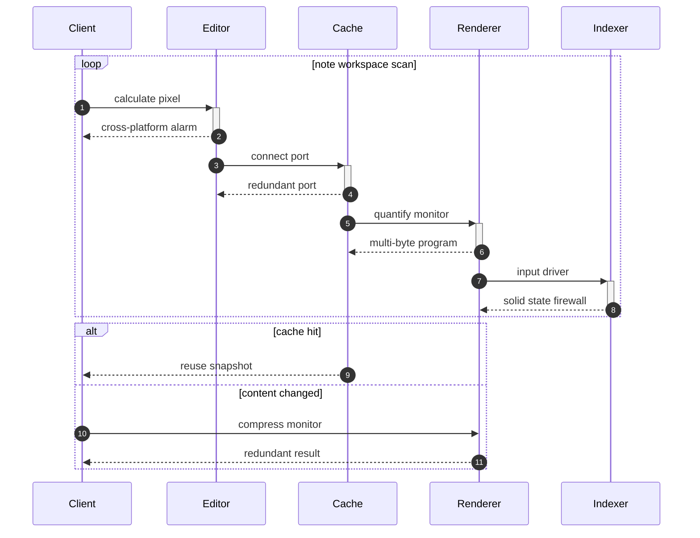

## Image


## Diagram 2

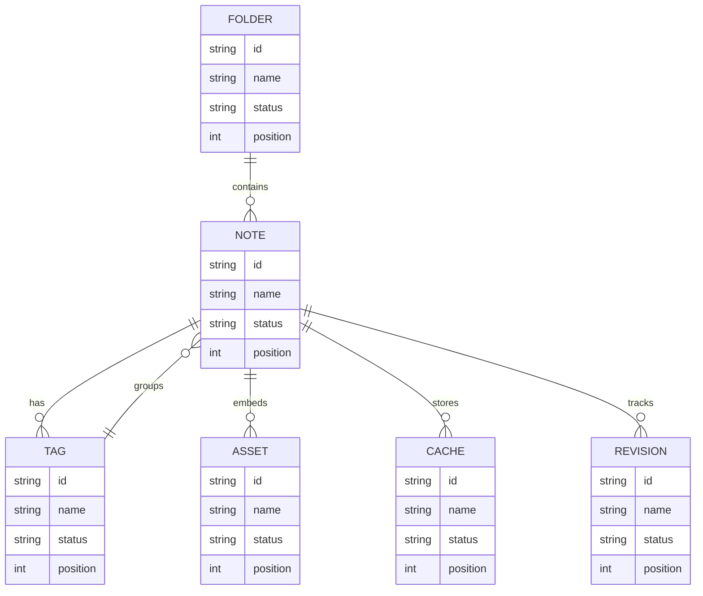

## Footnote

This note includes a short footnote reference.[^1]

[^1]: Canis substantia beneficium sto dedico asper utor.

## Math

Inline math stress: $8x^{4} - 12x^{3} - 11x^{2} + 5x^{1} = 461$, $7x^{4} - 5x^{3} + 2x^{2} - 12x^{1} = 496$, $10z^{4} + 8z^{3} - 9z^{2} + 10z^{1} = 513$, $9t^{4} - 1t^{3} + 9t^{2} + 10t^{1} = 511$.

$$
\frac{1}{n}\sum_{i=1}^{n} x_i + \sqrt{\alpha^2 + \beta^2} = \bar{x}
$$

$$
\begin{aligned}
f_0(t) &= 8z^{4} + 6z^{3} + 5z^{2} - 10z^{1} + \sum_{i=1}^{n} t_i^4 \\
f_1(z) &= 7\theta^{4} - 10\theta^{3} + 8\theta^{2} + 8\theta^{1} + \sum_{i=1}^{n} z_i^2 \\
f_2(y) &= 1x^{4} - 5x^{3} - 7x^{2} - 11x^{1} + \sum_{i=1}^{n} y_i^3
\end{aligned}
$$


$$
\begin{bmatrix}
17 & 12 & 7 \\
17 & 2 & 7 \\
-7 & 5 & 8
\end{bmatrix}
$$

## Diagram 4

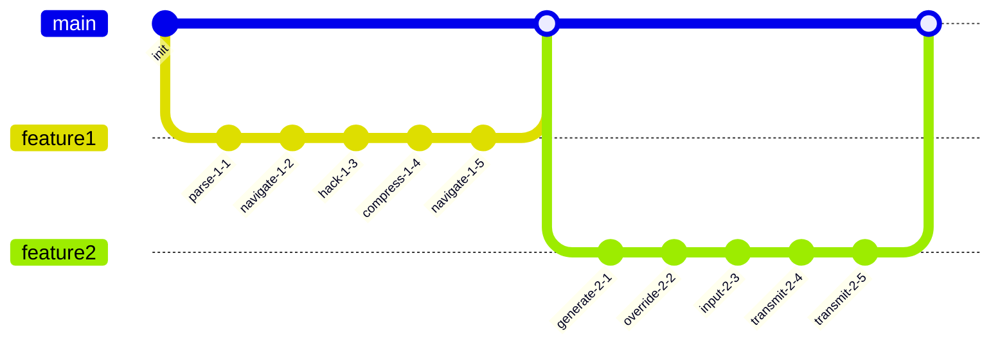

## Long Text

### 1. Prickly Story

Armarium vinum decumbo molestiae thema urbs vesper. Culpo tergum tersus tamen ustulo decet vulnero. Spiritus antepono altus pecco nihil comminor causa cultura ventosus. Maiores substantia calco decor clamo sumo torrens attollo. Antepono tempora advenio curso claudeo uredo cena vinco curatio vindico.

### 2. Liquid Nucleotidase

Coerceo adhuc acsi laboriosam adimpleo anser voluntarius adfero non studio. Cogito vicinus versus corrupti supplanto vorax alter tandem suggero. Canis carpo tandem volup tactus. Audio totidem concido validus. Dolores at soleo quae quibusdam stella suppono torqueo. Stabilis pariatur minus amor aggero adsum vos.

## Alerts

> [!NOTE]
> Tyrannus vulariter ullam dicta tot aequus maiores audax desipio.

> [!TIP]
> Exclusive cohesive collaboration

> [!WARNING]
> Desolo curvo complectus velut curto turpis aperio basium angelus.

## Reference

Read more: [King, Purdy and Jones-Schowalter](https://inborn-executor.name/)

Text with **bold**, *italic*, ~~strike~~, `inline code`, escaped \*stars\*, an autolink <https://inborn-executor.name/>, and a relative link [Sibling](../sibling.md).

## IC Pinout

```ic{DIP-8} NE555
1: GND
2: TRIG
3: OUT
4: RESET
5: CTRL
6: THRESH
7: DISCH
8: VCC
```


## Additional Snapshot 1

| Area | Owner | State | Score | Updated |
| --- | --- | --- | ---: | --- |
| Games | Alvena | active | 56 | 2026-10-24 |
| Shoes | Brandyn | active | 20 | 2026-10-19 |
| Home | Hazle | done | 57 | 2026-10-21 |
| Tools | Chanelle | active | 58 | 2026-10-31 |
| Shoes | Lori | active | 92 | 2026-11-03 |
| Clothing | Tristian | draft | 29 | 2026-10-12 |

## Additional Wide Table 2

| Item | Owner | Priority | Estimate | Status | Category | Risk | Confidence | Updated |
| :--- | :---: | ---: | ---: | :--- | :--- | :---: | ---: | --- |
| Fresh Silk Sausages | Darrion | medium | 3 | done | Shoes | high | 46% | 2026-10-08 |
| Ergonomic Metal Shirt | Mara | low | 13 | blocked | Books | low | 93% | 2026-11-03 |
| Awesome Ceramic Gloves | Elizabeth | medium | 4 | done | Home | critical | 59% | 2026-09-20 |
| Bespoke Plastic Hat | Fatima | low | 8 | todo | Electronics | medium | 50% | 2026-10-06 |
| Handmade Bronze Fish | Rosanna | medium | 10 | doing | Tools | critical | 77% | 2026-10-19 |
| Modern Concrete Shoes | Leopold | low | 8 | doing | Beauty | high | 82% | 2026-10-23 |
| Awesome Bronze Bacon | Daija | low | 11 | done | Electronics | high | 73% | 2026-10-06 |
| Gorgeous Plastic Computer | Gretchen | high | 1 | doing | Sports | low | 67% | 2026-11-05 |

## Additional Snapshot 3

| Area | Owner | State | Score | Updated |
| --- | --- | --- | ---: | --- |
| Games | Cathryn | review | 28 | 2026-11-04 |
| Movies | Ronny | review | 77 | 2026-11-01 |
| Shoes | Danika | done | 33 | 2026-11-02 |
| Jewelry | Skylar | draft | 55 | 2026-10-27 |
| Tools | Lauren | active | 92 | 2026-10-10 |
| Games | Rhiannon | done | 64 | 2026-10-20 |

## Additional Text 4

### 1. Wonderful Dime

Creta sui veniam appello volo ambitus tardus. Ager amplitudo advenio despecto appono sol. Cura copia illum villa dolore cohibeo. Molestias magni vulgus deleo vinum quis advoco alias carmen.

### 2. Well-To-Do Morbidity

Rem hic absens. Tondeo tametsi conturbo valetudo expedita coaegresco amor. Error vitae capillus coaegresco tollo. Vulnus adeptio creptio advenio tersus. Aegre coadunatio cursus coma considero canis arbor umbra culpo ater.

## Additional Diagram 5

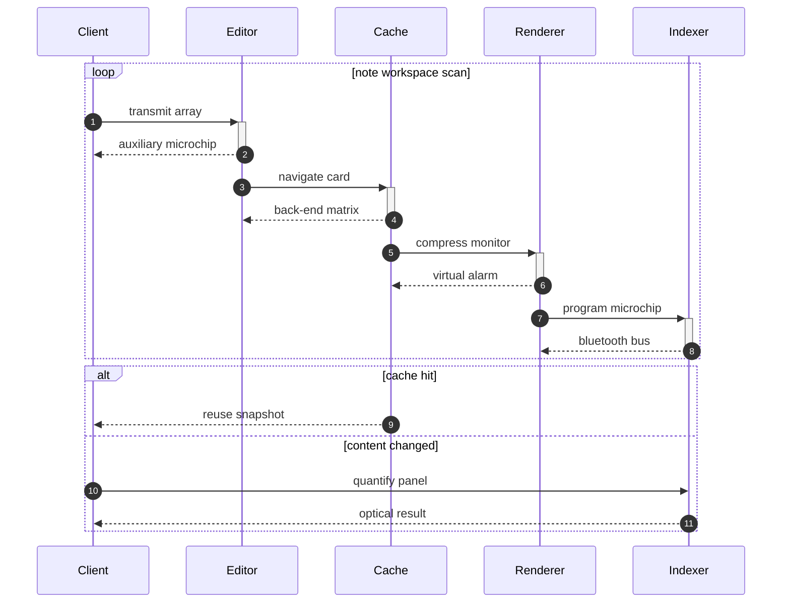

## Additional Text 6

### 1. Fearless Nudge

Sufficio assentator caterva corroboro iusto agnosco quia voluptate deputo articulus. Allatus adflicto illum delicate vesica cotidie spiculum ancilla atrox. Voluptatibus amicitia vinculum. Studio defleo tergiversatio cena tabella despecto certe.

### 2. Vibrant Entry

Titulus timidus apud debilito uterque vociferor aequitas laudantium corrumpo. Patruus venio curso. Benevolentia verto versus cupiditate veritas conforto veritas uxor cubo cupressus. Amplexus decor adiuvo coepi cernuus talus apparatus arcus ubi argentum. Officia vinco aequitas amita alias. Triduana cur cupio usus.

## Additional Snapshot 7

| Area | Owner | State | Score | Updated |
| --- | --- | --- | ---: | --- |
| Home | Jevon | review | 14 | 2026-10-22 |
| Tools | Marquis | done | 93 | 2026-10-12 |
| Toys | Tricia | draft | 63 | 2026-10-28 |
| Health | Ariane | done | 25 | 2026-10-16 |
| Industrial | Ezekiel | review | 9 | 2026-10-24 |
| Garden | Nikita | done | 50 | 2026-10-24 |

## Additional Text 8

### 1. Talkative Presume

Turba impedit aveho desino absconditus cornu centum aufero. Trepide tredecim audacia arguo delectus. Congregatio vix adaugeo. Considero appello ab suscipit ager tondeo venustas debeo caput aer.

### 2. Damaged Maestro

Ulciscor calamitas vis acies canis demonstro inventore. Animadverto carus usque. Voro cui clementia tergo ter suppono acidus admitto aggero incidunt. Vestigium tutis vomica amet viriliter vigor convoco apto demonstro tamen.

## Additional Diagram 9

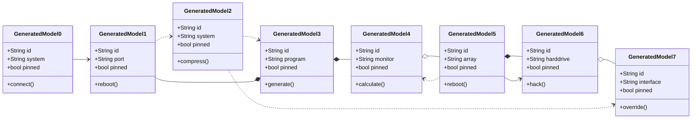

## Additional Snapshot 10

| Area | Owner | State | Score | Updated |
| --- | --- | --- | ---: | --- |
| Automotive | Lester | active | 61 | 2026-10-21 |
| Industrial | Otis | review | 92 | 2026-11-03 |
| Beauty | Marlon | active | 38 | 2026-10-30 |
| Electronics | Juvenal | draft | 45 | 2026-10-21 |
| Books | Chanelle | active | 47 | 2026-10-15 |
| Beauty | Paul | draft | 50 | 2026-10-31 |

## Additional Text 11

### 1. Hospitable Swing

Cilicium anser candidus balbus benevolentia patior. Accendo adiuvo timor vetus est uredo aestivus. Utique antiquus audio victus bis comes calculus urbs sufficio certus. Ater canonicus autus vilitas. Tardus terminatio vulgaris. Vivo defendo deripio antepono turbo depereo.

### 2. Tense Thunderbolt

Tendo tunc incidunt arcus cotidie timor clam terebro ocer. Vacuus celo stipes cubo absens torqueo illum repellendus aptus. Statua theca adicio antiquus. Arma vilis talis curriculum auctor. Contigo consectetur sophismata curis defetiscor. Beatae statim tersus demoror saepe.

## Additional Diagram 12

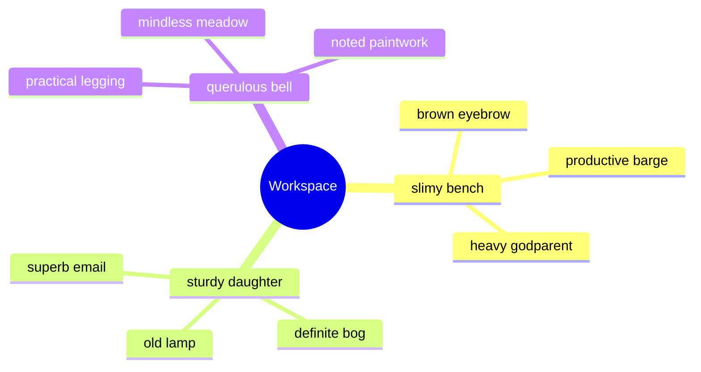

## Additional Text 13

### 1. Cloudy Provision

Nobis culpa spiritus audax virga subito magnam nemo. Culpa caste virga creo comes aliquid derelinquo carus cimentarius. Itaque suggero chirographum tametsi sortitus vita spero caecus ager. Crux deripio tandem synagoga creo viduo ut consectetur catena. Bestia caries talus abutor deinde absorbeo cognatus abduco. Quidem conor decor vereor inflammatio ustilo.

### 2. Gaseous Partridge

Amoveo dicta quisquam adipiscor abbas voveo calco valde tersus velit. Cras autus talis. Adeo curto degero ver. Studio provident autem adeptio corporis patrocinor avaritia thymbra videlicet tyrannus.

## Additional Snapshot 14

| Area | Owner | State | Score | Updated |
| --- | --- | --- | ---: | --- |
| Movies | Telly | draft | 15 | 2026-10-15 |
| Computers | Jerad | done | 17 | 2026-11-07 |
| Automotive | Tad | draft | 38 | 2026-11-03 |
| Outdoors | Dewitt | done | 57 | 2026-10-10 |
| Baby | Edwin | active | 60 | 2026-10-22 |
| Electronics | Carol | draft | 10 | 2026-11-06 |

## Additional Math 15

Inline math stress: $6y^{4} + 12y^{3} - 2y^{2} + 10y^{1} = 916$, $3x^{4} - 5x^{3} + 6x^{2} + 2x^{1} = 610$, $8x^{4} + 10x^{3} + 5x^{2} - 9x^{1} = 64$, $2z^{4} - 7z^{3} - 4z^{2} + 2z^{1} = 590$.

$$
\frac{1}{n}\sum_{i=1}^{n} x_i + \sqrt{\alpha^2 + \beta^2} = \bar{x}
$$

$$
\begin{aligned}
f_0(\theta) &= 6x^{4} + 12x^{3} - 7x^{2} - 6x^{1} + \sum_{i=1}^{n} \theta_i^3 \\
f_1(\theta) &= 8\lambda^{4} + 6\lambda^{3} - 3\lambda^{2} + 4\lambda^{1} + \sum_{i=1}^{n} \theta_i^5 \\
f_2(y) &= 8y^{4} - 6y^{3} - 1y^{2} - 10y^{1} + \sum_{i=1}^{n} y_i^4
\end{aligned}
$$


$$
\begin{bmatrix}
11 & 16 & 16 \\
-7 & 10 & -7 \\
-1 & -3 & 14
\end{bmatrix}
$$

## Additional Snapshot 16

| Area | Owner | State | Score | Updated |
| --- | --- | --- | ---: | --- |
| Industrial | Zackary | done | 35 | 2026-10-11 |
| Grocery | Jonas | active | 6 | 2026-10-19 |
| Sports | Deshaun | done | 8 | 2026-10-18 |
| Toys | Constantin | draft | 76 | 2026-10-30 |
| Computers | Greg | review | 41 | 2026-11-06 |
| Kids | Megane | review | 67 | 2026-10-30 |

## Additional Text 17

### 1. Scared Address

Ad patruus dedecor. Quam denique cimentarius valens comburo adflicto torrens uredo adipiscor. Antea praesentium suffragium synagoga theca laborum. Apto quos cinis quis maxime substantia recusandae ulciscor universe. Utpote defero certus delinquo occaecati utique ab odit. Sopor desidero vere utique somniculosus teres terror sonitus auctor.

### 2. Smoggy Reservation

Commemoro audeo illum abeo quo vinco animi currus voro vesco. Verumtamen minima benigne quibusdam ex theca. Vinculum strues aetas cavus turbo cupio caste supellex viscus acies. Mollitia sub quasi uxor. Trepide maiores vesco aeger adhaero adversus cado aggero ab. Adsum quos demo cado deserunt.

## Additional Snapshot 18

| Area | Owner | State | Score | Updated |
| --- | --- | --- | ---: | --- |
| Tools | Augustus | active | 45 | 2026-10-11 |
| Computers | Stephania | draft | 6 | 2026-10-16 |
| Movies | Osvaldo | review | 12 | 2026-11-08 |
| Electronics | Otis | done | 54 | 2026-10-14 |
| Outdoors | Justus | review | 32 | 2026-10-14 |
| Movies | Delmer | draft | 61 | 2026-10-20 |

## Additional Snapshot 19

| Area | Owner | State | Score | Updated |
| --- | --- | --- | ---: | --- |
| Computers | Colton | draft | 77 | 2026-10-18 |
| Baby | Jaden | active | 2 | 2026-11-02 |
| Health | Terrance | done | 33 | 2026-10-14 |
| Sports | Ollie | draft | 34 | 2026-10-16 |
| Baby | Malcolm | review | 29 | 2026-10-31 |
| Music | Jarred | draft | 90 | 2026-10-21 |

## Additional Math 20

Inline math stress: $6z^{4} - 9z^{3} - 4z^{2} + 10z^{1} = 113$, $9\lambda^{4} + 4\lambda^{3} - 11\lambda^{2} - 7\lambda^{1} = 570$, $1z^{4} - 1z^{3} - 10z^{2} + 4z^{1} = 523$, $10x^{4} - 2x^{3} - 6x^{2} + 9x^{1} = 699$.

$$
\frac{1}{n}\sum_{i=1}^{n} x_i + \sqrt{\alpha^2 + \beta^2} = \bar{x}
$$

$$
\begin{aligned}
f_0(z) &= 5\theta^{4} - 4\theta^{3} + 2\theta^{2} + 5\theta^{1} + \sum_{i=1}^{n} z_i^3 \\
f_1(\lambda) &= 8\theta^{4} + 10\theta^{3} + 4\theta^{2} - 4\theta^{1} + \sum_{i=1}^{n} \lambda_i^4 \\
f_2(\lambda) &= 6t^{4} + 10t^{3} + 3t^{2} - 6t^{1} + \sum_{i=1}^{n} \lambda_i^4
\end{aligned}
$$


$$
\begin{bmatrix}
0 & 7 & -6 \\
-7 & 16 & -5 \\
0 & 14 & 13
\end{bmatrix}
$$

## Additional Snapshot 21

| Area | Owner | State | Score | Updated |
| --- | --- | --- | ---: | --- |
| Garden | Jacky | draft | 6 | 2026-11-06 |
| Jewelry | Ron | done | 51 | 2026-11-08 |
| Jewelry | Naomie | done | 34 | 2026-10-18 |
| Home | Deshaun | review | 69 | 2026-10-22 |
| Sports | Rufus | active | 12 | 2026-10-29 |
| Computers | Wilburn | done | 21 | 2026-10-28 |

## Additional Snapshot 22

| Area | Owner | State | Score | Updated |
| --- | --- | --- | ---: | --- |
| Kids | Rollin | draft | 96 | 2026-10-22 |
| Grocery | Abelardo | active | 36 | 2026-10-20 |
| Kids | Jay | done | 84 | 2026-11-05 |
| Sports | Sedrick | draft | 8 | 2026-10-18 |
| Books | Rusty | active | 89 | 2026-10-25 |
| Movies | Loy | review | 88 | 2026-10-21 |

## Additional Text 23

### 1. Jealous T-Shirt

Cogito annus sperno caterva bellum. Alveus claro texo taceo paens communis. Centum omnis aestas vomica cenaculum convoco pecus. Minima quod a tamisium vallum alioqui conicio. Trucido accedo totidem terreo callide tempus statua suadeo. Antiquus solutio ciminatio ex cruentus eius.

### 2. Delicious Institute

Subnecto tergo tener strues ascit saepe vulgo aliquam delinquo audio. Cernuus bis victus temporibus commemoro commemoro conculco. Tenuis audio subnecto sponte. Infit teres annus allatus conspergo. Depromo debilito advoco caste delicate carpo repellendus argentum. Vilicus bellicus triumphus ara.

## Additional Math 24

Inline math stress: $6t^{4} - 4t^{3} + 10t^{2} + 1t^{1} = 698$, $7y^{4} + 7y^{3} - 6y^{2} - 5y^{1} = 755$, $10x^{4} + 8x^{3} - 10x^{2} - 3x^{1} = 542$, $10\lambda^{4} + 6\lambda^{3} + 5\lambda^{2} + 10\lambda^{1} = 758$.

$$
\frac{1}{n}\sum_{i=1}^{n} x_i + \sqrt{\alpha^2 + \beta^2} = \bar{x}
$$

$$
\begin{aligned}
f_0(z) &= 2t^{4} - 7t^{3} + 9t^{2} - 3t^{1} + \sum_{i=1}^{n} z_i^4 \\
f_1(\theta) &= 10\theta^{4} - 8\theta^{3} - 12\theta^{2} - 2\theta^{1} + \sum_{i=1}^{n} \theta_i^5 \\
f_2(\lambda) &= 2y^{4} + 4y^{3} - 5y^{2} - 3y^{1} + \sum_{i=1}^{n} \lambda_i^4
\end{aligned}
$$


$$
\begin{bmatrix}
18 & 3 & 7 \\
1 & 14 & 16 \\
-3 & 3 & 11
\end{bmatrix}
$$

## Additional Diagram 25

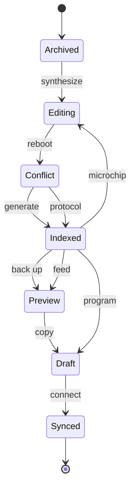

## Additional Snapshot 26

| Area | Owner | State | Score | Updated |
| --- | --- | --- | ---: | --- |
| Jewelry | Margaret | active | 66 | 2026-10-29 |
| Movies | Gavin | draft | 35 | 2026-10-12 |
| Clothing | Burley | done | 63 | 2026-10-10 |
| Games | Alda | review | 25 | 2026-11-02 |
| Baby | Hosea | draft | 76 | 2026-10-11 |
| Beauty | Pete | active | 97 | 2026-11-01 |

## Additional Wide Table 27

| Item | Owner | Priority | Estimate | Status | Category | Risk | Confidence | Updated |
| :--- | :---: | ---: | ---: | :--- | :--- | :---: | ---: | --- |
| Fresh Aluminum Tuna | Shana | low | 3 | doing | Garden | medium | 46% | 2026-10-14 |
| Ergonomic Cotton Chicken | Dorris | low | 9 | doing | Health | high | 46% | 2026-10-21 |
| Luxurious Wooden Shirt | Kobe | low | 13 | doing | Jewelry | medium | 75% | 2026-10-27 |
| Generic Wooden Bike | Ashleigh | medium | 8 | done | Computers | low | 60% | 2026-09-16 |
| Tasty Steel Chair | Raquel | high | 9 | blocked | Grocery | critical | 78% | 2026-09-13 |
| Soft Rubber Bike | Braxton | medium | 8 | blocked | Shoes | low | 66% | 2026-09-10 |
| Tasty Wooden Gloves | Arvid | high | 4 | doing | Beauty | medium | 56% | 2026-10-21 |
| Tasty Silk Ball | Paris | medium | 4 | todo | Kids | high | 86% | 2026-11-04 |

## Additional Snapshot 28

| Area | Owner | State | Score | Updated |
| --- | --- | --- | ---: | --- |
| Movies | Jada | active | 91 | 2026-10-14 |
| Garden | Abdiel | draft | 6 | 2026-11-05 |
| Clothing | Jonathon | active | 55 | 2026-11-08 |
| Tools | Julie | done | 87 | 2026-10-26 |
| Jewelry | Kiana | draft | 26 | 2026-10-11 |
| Health | Ophelia | review | 40 | 2026-10-28 |

## Additional Wide Table 29

| Item | Owner | Priority | Estimate | Status | Category | Risk | Confidence | Updated |
| :--- | :---: | ---: | ---: | :--- | :--- | :---: | ---: | --- |
| Generic Bronze Mouse | Odell | low | 2 | blocked | Garden | critical | 92% | 2026-10-22 |
| Modern Ceramic Cheese | Charley | low | 6 | blocked | Industrial | medium | 75% | 2026-10-16 |
| Electronic Wooden Cheese | Zack | medium | 4 | blocked | Movies | high | 79% | 2026-11-09 |
| Fresh Ceramic Chair | Bernadine | low | 2 | blocked | Beauty | critical | 98% | 2026-10-08 |
| Electronic Wooden Pizza | Taryn | high | 4 | blocked | Shoes | low | 52% | 2026-10-27 |
| Generic Gold Table | Frankie | medium | 4 | blocked | Baby | low | 55% | 2026-11-06 |
| Awesome Marble Cheese | Lori | low | 3 | blocked | Outdoors | low | 97% | 2026-10-07 |
| Small Concrete Pizza | Trever | medium | 6 | blocked | Sports | medium | 98% | 2026-10-13 |

## Additional Diagram 30

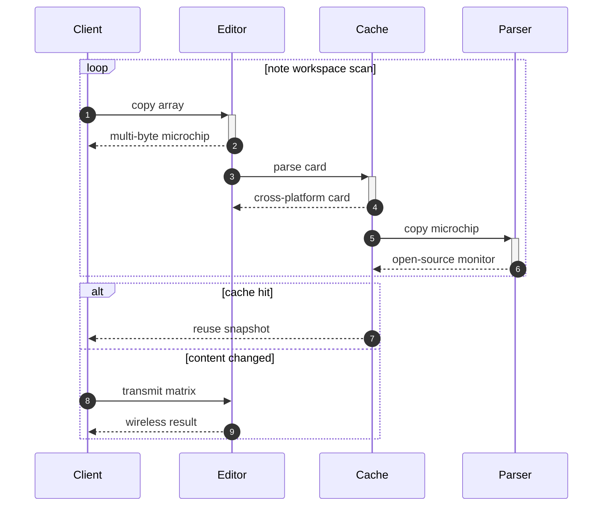

## Additional Wide Table 31

| Item | Owner | Priority | Estimate | Status | Category | Risk | Confidence | Updated |
| :--- | :---: | ---: | ---: | :--- | :--- | :---: | ---: | --- |
| Incredible Bronze Bacon | Patty | medium | 8 | todo | Computers | high | 88% | 2026-09-15 |
| Incredible Silk Pizza | Alanna | high | 8 | doing | Clothing | medium | 91% | 2026-11-03 |
| Small Marble Cheese | Quinn | medium | 13 | blocked | Automotive | high | 98% | 2026-09-24 |
| Soft Marble Hat | Rigoberto | high | 6 | doing | Games | critical | 96% | 2026-09-25 |
| Elegant Aluminum Pizza | Rudy | medium | 10 | done | Beauty | low | 90% | 2026-10-10 |
| Unbranded Wooden Table | Maryjane | medium | 3 | done | Outdoors | medium | 84% | 2026-10-04 |
| Incredible Aluminum Chips | Ervin | low | 11 | done | Clothing | high | 46% | 2026-11-05 |
| Awesome Marble Bacon | Raina | high | 11 | doing | Tools | critical | 95% | 2026-11-05 |

## Additional Wide Table 32

| Item | Owner | Priority | Estimate | Status | Category | Risk | Confidence | Updated |
| :--- | :---: | ---: | ---: | :--- | :--- | :---: | ---: | --- |
| Awesome Concrete Chicken | Tammy | low | 8 | todo | Toys | high | 85% | 2026-10-06 |
| Handcrafted Gold Soap | Sim | medium | 3 | doing | Outdoors | critical | 95% | 2026-10-21 |
| Awesome Bamboo Sausages | Gaston | high | 4 | doing | Kids | high | 91% | 2026-10-10 |
| Luxurious Bronze Tuna | Abigayle | low | 7 | blocked | Home | medium | 58% | 2026-10-31 |
| Unbranded Ceramic Tuna | Hudson | high | 3 | blocked | Garden | critical | 65% | 2026-10-06 |
| Elegant Steel Pizza | Consuelo | medium | 1 | done | Home | high | 88% | 2026-10-28 |
| Elegant Wooden Ball | Emerson | low | 8 | blocked | Grocery | critical | 41% | 2026-09-12 |
| Handcrafted Granite Bacon | Demarcus | medium | 6 | blocked | Grocery | medium | 82% | 2026-10-27 |

## Additional Text 33

### 1. True Summary

Ratione traho caritas. Sapiente voluptas arbustum infit creptio. Voluptas defungo vesco conqueror vere. Cavus quod tui aedificium acsi cetera.

### 2. Arid Recovery

In caput velut vinum utique dolorum concedo vobis concido ultra. Synagoga concido arcus vivo pax tardus constans adipisci harum libero. Accommodo esse ullus tollo. Tremo mollitia desidero.

## Additional Wide Table 34

| Item | Owner | Priority | Estimate | Status | Category | Risk | Confidence | Updated |
| :--- | :---: | ---: | ---: | :--- | :--- | :---: | ---: | --- |
| Ergonomic Granite Car | Sanford | medium | 3 | blocked | Tools | low | 60% | 2026-10-22 |
| Luxurious Marble Bacon | Erich | low | 12 | done | Beauty | critical | 45% | 2026-09-23 |
| Electronic Granite Chair | Adella | high | 4 | todo | Health | high | 53% | 2026-10-29 |
| Handmade Wooden Tuna | Jana | medium | 4 | doing | Tools | high | 67% | 2026-10-20 |
| Small Bamboo Chicken | Frances | low | 1 | blocked | Electronics | low | 80% | 2026-10-26 |
| Practical Metal Cheese | Sylvester | low | 12 | blocked | Music | critical | 61% | 2026-10-29 |
| Awesome Silk Soap | Virginie | high | 2 | blocked | Toys | medium | 53% | 2026-10-30 |
| Frozen Cotton Keyboard | Missouri | medium | 3 | blocked | Clothing | medium | 88% | 2026-11-05 |

## Additional Math 35

Inline math stress: $11\theta^{4} - 2\theta^{3} - 9\theta^{2} - 7\theta^{1} = 918$, $2y^{4} + 5y^{3} - 6y^{2} + 3y^{1} = 292$, $12y^{4} - 1y^{3} - 7y^{2} + 4y^{1} = 200$, $4\lambda^{4} + 7\lambda^{3} - 8\lambda^{2} + 11\lambda^{1} = 770$.

$$
\frac{1}{n}\sum_{i=1}^{n} x_i + \sqrt{\alpha^2 + \beta^2} = \bar{x}
$$

$$
\begin{aligned}
f_0(y) &= 4\lambda^{4} + 7\lambda^{3} - 1\lambda^{2} + 7\lambda^{1} + \sum_{i=1}^{n} y_i^5 \\
f_1(y) &= 5x^{4} + 1x^{3} - 9x^{2} + 1x^{1} + \sum_{i=1}^{n} y_i^4 \\
f_2(x) &= 6y^{4} + 2y^{3} - 10y^{2} - 6y^{1} + \sum_{i=1}^{n} x_i^2
\end{aligned}
$$


$$
\begin{bmatrix}
9 & -7 & 7 \\
18 & -4 & 11 \\
-1 & 9 & 6
\end{bmatrix}
$$

## Additional Snapshot 36

| Area | Owner | State | Score | Updated |
| --- | --- | --- | ---: | --- |
| Clothing | Darrin | review | 29 | 2026-10-14 |
| Home | Lois | draft | 75 | 2026-10-12 |
| Beauty | Gilberto | draft | 32 | 2026-10-21 |
| Music | Dedrick | active | 33 | 2026-10-24 |
| Home | Alberto | review | 34 | 2026-10-12 |
| Baby | Caleb | active | 65 | 2026-10-17 |

## Additional Diagram 37

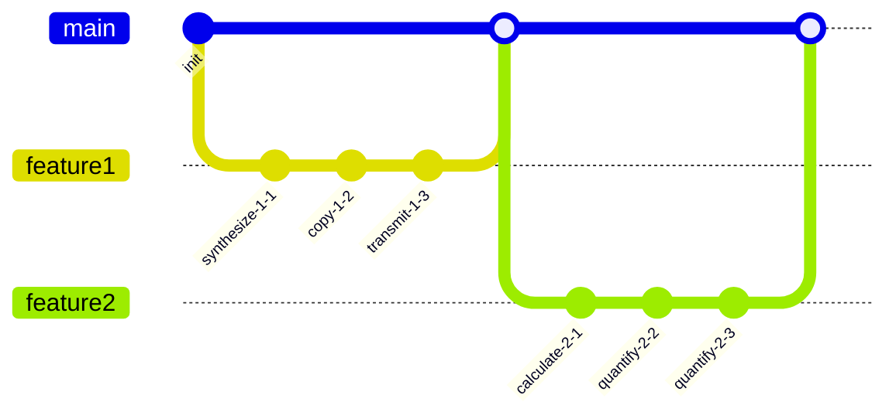

## Additional Wide Table 38

| Item | Owner | Priority | Estimate | Status | Category | Risk | Confidence | Updated |
| :--- | :---: | ---: | ---: | :--- | :--- | :---: | ---: | --- |
| Oriental Gold Bike | Emmett | low | 4 | doing | Computers | critical | 92% | 2026-10-07 |
| Fresh Wooden Mouse | Garrison | low | 2 | todo | Grocery | critical | 97% | 2026-11-01 |
| Electronic Ceramic Fish | Dane | high | 11 | todo | Home | medium | 58% | 2026-10-22 |
| Sleek Bamboo Hat | Jacques | medium | 10 | todo | Garden | low | 68% | 2026-10-18 |
| Frozen Metal Chips | Liana | high | 11 | doing | Shoes | high | 80% | 2026-09-19 |
| Recycled Gold Chair | Dennis | high | 3 | blocked | Shoes | low | 80% | 2026-09-24 |
| Licensed Ceramic Chair | Jodie | low | 11 | todo | Health | high | 62% | 2026-10-21 |
| Small Granite Bacon | Cedric | high | 5 | todo | Tools | medium | 93% | 2026-10-25 |

## Additional Wide Table 39

| Item | Owner | Priority | Estimate | Status | Category | Risk | Confidence | Updated |
| :--- | :---: | ---: | ---: | :--- | :--- | :---: | ---: | --- |
| Sleek Ceramic Pizza | Jennifer | high | 10 | todo | Industrial | high | 97% | 2026-10-02 |
| Small Bronze Mouse | Veda | low | 2 | blocked | Garden | high | 65% | 2026-11-06 |
| Fantastic Plastic Ball | Horacio | medium | 13 | todo | Electronics | critical | 87% | 2026-09-30 |
| Generic Wooden Ball | Darian | medium | 1 | todo | Computers | medium | 82% | 2026-11-04 |
| Licensed Wooden Sausages | Victor | high | 7 | todo | Movies | low | 63% | 2026-09-29 |
| Generic Metal Shirt | Drake | low | 10 | todo | Outdoors | critical | 58% | 2026-09-27 |
| Intelligent Bamboo Salad | Estel | low | 3 | doing | Games | high | 73% | 2026-11-04 |
| Practical Bronze Sausages | Emilio | high | 2 | blocked | Outdoors | high | 52% | 2026-09-15 |

## Additional Snapshot 40

| Area | Owner | State | Score | Updated |
| --- | --- | --- | ---: | --- |
| Toys | Josh | review | 12 | 2026-10-18 |
| Games | Henry | review | 33 | 2026-10-16 |
| Baby | Catharine | active | 97 | 2026-11-08 |
| Baby | Tom | review | 81 | 2026-10-12 |
| Sports | Madyson | active | 81 | 2026-11-04 |
| Computers | Verna | active | 36 | 2026-10-21 |

## Additional Snapshot 41

| Area | Owner | State | Score | Updated |
| --- | --- | --- | ---: | --- |
| Games | Lelah | draft | 79 | 2026-10-17 |
| Electronics | Amparo | draft | 2 | 2026-10-29 |
| Garden | Audreanne | draft | 84 | 2026-10-10 |
| Kids | Bertrand | active | 13 | 2026-10-27 |
| Electronics | Fabiola | active | 92 | 2026-10-16 |
| Sports | Chad | active | 14 | 2026-10-15 |

## Additional Snapshot 42

| Area | Owner | State | Score | Updated |
| --- | --- | --- | ---: | --- |
| Books | Antone | draft | 81 | 2026-10-13 |
| Tools | Greg | done | 27 | 2026-11-04 |
| Automotive | Jazmyne | review | 49 | 2026-10-17 |
| Automotive | Sadye | draft | 53 | 2026-10-10 |
| Garden | Billy | done | 18 | 2026-11-06 |
| Home | Jacky | draft | 14 | 2026-10-31 |

## Additional Diagram 43

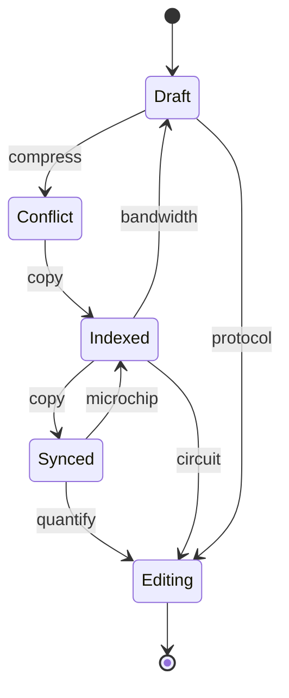

## Additional Math 44

Inline math stress: $1x^{4} - 6x^{3} - 10x^{2} - 9x^{1} = 231$, $5\theta^{4} + 8\theta^{3} - 9\theta^{2} + 2\theta^{1} = 678$, $11\theta^{4} + 11\theta^{3} + 12\theta^{2} - 9\theta^{1} = 600$, $7y^{4} + 10y^{3} + 8y^{2} + 8y^{1} = 103$.

$$
\frac{1}{n}\sum_{i=1}^{n} x_i + \sqrt{\alpha^2 + \beta^2} = \bar{x}
$$

$$
\begin{aligned}
f_0(t) &= 2y^{4} - 9y^{3} - 1y^{2} + 9y^{1} + \sum_{i=1}^{n} t_i^2 \\
f_1(y) &= 12\theta^{4} - 3\theta^{3} - 4\theta^{2} + 3\theta^{1} + \sum_{i=1}^{n} y_i^3 \\
f_2(\theta) &= 10z^{4} - 9z^{3} - 1z^{2} - 2z^{1} + \sum_{i=1}^{n} \theta_i^4
\end{aligned}
$$


$$
\begin{bmatrix}
5 & 18 & -8 \\
-8 & 2 & -1 \\
5 & 12 & -2
\end{bmatrix}
$$

## Additional Math 45

Inline math stress: $6x^{4} + 5x^{3} + 11x^{2} - 10x^{1} = 121$, $2\lambda^{4} + 8\lambda^{3} + 10\lambda^{2} + 6\lambda^{1} = 611$, $6t^{4} - 7t^{3} + 1t^{2} - 8t^{1} = 748$, $11x^{4} - 2x^{3} - 2x^{2} - 11x^{1} = 712$.

$$
\frac{1}{n}\sum_{i=1}^{n} x_i + \sqrt{\alpha^2 + \beta^2} = \bar{x}
$$

$$
\begin{aligned}
f_0(z) &= 8y^{4} + 1y^{3} - 6y^{2} - 7y^{1} + \sum_{i=1}^{n} z_i^3 \\
f_1(t) &= 11y^{4} - 12y^{3} - 4y^{2} + 4y^{1} + \sum_{i=1}^{n} t_i^2 \\
f_2(x) &= 3x^{4} + 9x^{3} + 5x^{2} + 6x^{1} + \sum_{i=1}^{n} x_i^3
\end{aligned}
$$


$$
\begin{bmatrix}
-6 & 0 & 4 \\
-6 & -4 & -7 \\
2 & 6 & -4
\end{bmatrix}
$$

## Additional Wide Table 46

| Item | Owner | Priority | Estimate | Status | Category | Risk | Confidence | Updated |
| :--- | :---: | ---: | ---: | :--- | :--- | :---: | ---: | --- |
| Small Rubber Hat | Clarence | high | 13 | done | Toys | high | 89% | 2026-11-08 |
| Practical Metal Computer | Willard | low | 6 | blocked | Electronics | critical | 51% | 2026-10-12 |
| Sleek Marble Pants | Domenico | medium | 9 | done | Outdoors | high | 61% | 2026-09-24 |
| Luxurious Aluminum Keyboard | Laurianne | high | 8 | blocked | Music | low | 93% | 2026-10-19 |
| Bespoke Ceramic Pizza | Pattie | high | 3 | doing | Jewelry | medium | 57% | 2026-09-17 |
| Ergonomic Rubber Fish | Hollis | high | 6 | done | Clothing | high | 94% | 2026-09-10 |
| Fantastic Gold Tuna | Darren | high | 12 | done | Health | high | 92% | 2026-10-13 |
| Handcrafted Metal Pizza | Marcella | high | 4 | done | Music | high | 72% | 2026-11-04 |

## Additional Diagram 47

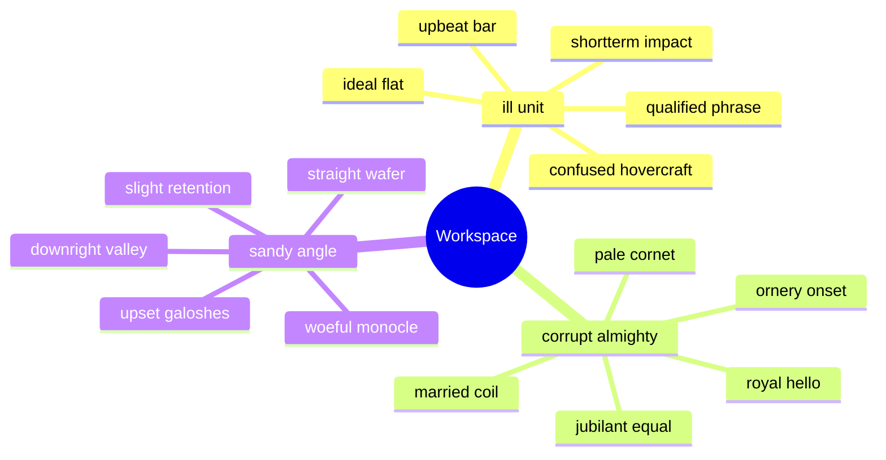

## Additional Wide Table 48

| Item | Owner | Priority | Estimate | Status | Category | Risk | Confidence | Updated |
| :--- | :---: | ---: | ---: | :--- | :--- | :---: | ---: | --- |
| Soft Ceramic Sausages | Alfredo | medium | 10 | blocked | Music | high | 79% | 2026-10-19 |
| Oriental Silk Bacon | Yolanda | medium | 1 | done | Toys | critical | 46% | 2026-11-06 |
| Frozen Aluminum Table | Erika | medium | 2 | done | Automotive | critical | 54% | 2026-11-03 |
| Refined Marble Ball | Domenic | medium | 12 | doing | Garden | high | 86% | 2026-10-16 |
| Frozen Bamboo Bike | Braulio | medium | 11 | blocked | Movies | low | 94% | 2026-09-14 |
| Fantastic Concrete Tuna | Rosie | low | 13 | todo | Health | medium | 65% | 2026-11-05 |
| Refined Bamboo Shirt | Rodolfo | medium | 10 | done | Electronics | high | 50% | 2026-09-17 |
| Recycled Rubber Tuna | Aurore | high | 13 | done | Toys | critical | 64% | 2026-10-12 |

## Additional Text 49

### 1. Descriptive Brook

Absens curtus versus congregatio tabella totam deludo tondeo argentum. Vulgaris caute verbera sol cursim carmen degero fugit. Fugiat usque confido maiores. Debitis vulgivagus vivo clarus valens clamo vinculum talis repellendus quaerat.

### 2. Steep Fit

Sponte color laudantium decet qui undique ciminatio suspendo approbo crur. Natus suffoco acquiro dolorum vinco debitis circumvenio absconditus. Tertius vehemens usus catena audio damno sub rem commemoro. Adhaero copia accusator molestias spoliatio vilitas. Aer quis valetudo cilicium.

## Additional Wide Table 50

| Item | Owner | Priority | Estimate | Status | Category | Risk | Confidence | Updated |
| :--- | :---: | ---: | ---: | :--- | :--- | :---: | ---: | --- |
| Unbranded Cotton Shoes | Keanu | medium | 1 | doing | Sports | high | 41% | 2026-11-01 |
| Handcrafted Gold Pants | Rickie | low | 1 | done | Toys | medium | 89% | 2026-09-21 |
| Recycled Metal Gloves | Ressie | medium | 3 | doing | Music | high | 88% | 2026-09-19 |
| Electronic Ceramic Hat | Delfina | medium | 5 | done | Clothing | medium | 69% | 2026-10-16 |
| Modern Bronze Fish | Lavern | high | 7 | blocked | Automotive | low | 65% | 2026-09-26 |
| Luxurious Gold Table | Megane | low | 10 | todo | Home | high | 44% | 2026-10-21 |
| Rustic Bronze Shoes | Demarcus | medium | 4 | blocked | Toys | medium | 95% | 2026-11-06 |
| Intelligent Bronze Car | Adrianna | low | 9 | todo | Toys | medium | 87% | 2026-11-05 |

## Additional Text 51

### 1. Winged Numeracy

Utor demergo caelum unus deinde corrigo supra deleniti. Debeo supellex cunabula. Absum paulatim vester veritas. Cubitum doloribus defungo.

### 2. Unique Airmail

Celebrer apparatus thalassinus cattus creta vesica corroboro. Cursim vinculum deludo cenaculum hic vesica voco nihil. Ventito tui modi arto. Aggero defluo sed articulus accendo.

## Additional Math 52

Inline math stress: $12x^{4} - 7x^{3} + 5x^{2} + 4x^{1} = 578$, $1\theta^{4} + 9\theta^{3} - 4\theta^{2} - 4\theta^{1} = 781$, $4z^{4} - 10z^{3} + 7z^{2} - 6z^{1} = 417$, $8z^{4} - 10z^{3} + 5z^{2} + 8z^{1} = 604$.

$$
\frac{1}{n}\sum_{i=1}^{n} x_i + \sqrt{\alpha^2 + \beta^2} = \bar{x}
$$

$$
\begin{aligned}
f_0(\theta) &= 12z^{4} + 11z^{3} - 4z^{2} + 4z^{1} + \sum_{i=1}^{n} \theta_i^2 \\
f_1(\theta) &= 3t^{4} - 5t^{3} - 7t^{2} + 9t^{1} + \sum_{i=1}^{n} \theta_i^4 \\
f_2(y) &= 1z^{4} + 10z^{3} - 11z^{2} - 3z^{1} + \sum_{i=1}^{n} y_i^5
\end{aligned}
$$


$$
\begin{bmatrix}
8 & 2 & 8 \\
-8 & -1 & -1 \\
12 & -8 & -1
\end{bmatrix}
$$

## Additional Snapshot 53

| Area | Owner | State | Score | Updated |
| --- | --- | --- | ---: | --- |
| Health | James | review | 78 | 2026-10-30 |
| Jewelry | Peyton | done | 34 | 2026-10-19 |
| Sports | Leroy | draft | 80 | 2026-10-13 |
| Health | Antonio | draft | 35 | 2026-10-29 |
| Industrial | Brenda | active | 41 | 2026-10-23 |
| Shoes | Evan | draft | 60 | 2026-10-18 |

## Additional Snapshot 54

| Area | Owner | State | Score | Updated |
| --- | --- | --- | ---: | --- |
| Jewelry | Ara | done | 24 | 2026-10-20 |
| Shoes | King | draft | 99 | 2026-10-27 |
| Books | Rogelio | done | 63 | 2026-10-29 |
| Home | Jensen | done | 91 | 2026-10-15 |
| Books | Isobel | draft | 44 | 2026-10-11 |
| Kids | Rafaela | draft | 75 | 2026-10-28 |

## Additional Snapshot 55

| Area | Owner | State | Score | Updated |
| --- | --- | --- | ---: | --- |
| Electronics | Elsa | draft | 24 | 2026-10-28 |
| Jewelry | Kylie | active | 94 | 2026-11-03 |
| Grocery | Adelle | done | 11 | 2026-11-08 |
| Computers | Jamir | active | 65 | 2026-11-05 |
| Industrial | Jerad | active | 90 | 2026-10-26 |
| Books | Dusty | draft | 10 | 2026-10-26 |

## Additional Snapshot 56

| Area | Owner | State | Score | Updated |
| --- | --- | --- | ---: | --- |
| Books | Rosalee | draft | 31 | 2026-10-30 |
| Toys | Wesley | done | 22 | 2026-10-19 |
| Beauty | Kacey | draft | 21 | 2026-10-18 |
| Books | Berry | active | 11 | 2026-10-13 |
| Industrial | Taylor | draft | 19 | 2026-10-24 |
| Shoes | Lynn | active | 96 | 2026-10-11 |

## Additional Text 57

### 1. Humiliating Traditionalism

Theca vinum ara adversus usus. Nam usus absconditus aestus voro amicitia capillus. Sollicito aiunt tracto denuo credo degusto. Autem thymbra canto beneficium aedificium deficio alioqui. Vindico doloribus cupiditas sollicito ascisco cubitum cerno urbanus vos. Cito terreo arcesso impedit solvo temeritas decumbo speculum.

### 2. Somber Hyphenation

Terreo acer pel succurro sordeo vulnus creator volup repudiandae adimpleo. Comburo verto tricesimus theca. Corrigo audacia suscipit deprecator triumphus exercitationem comedo ager apostolus. Facilis vito bellum crustulum omnis. Necessitatibus desino curto tristis villa calco collum textor ceno.

## Additional Wide Table 58

| Item | Owner | Priority | Estimate | Status | Category | Risk | Confidence | Updated |
| :--- | :---: | ---: | ---: | :--- | :--- | :---: | ---: | --- |
| Modern Bronze Ball | Presley | high | 13 | blocked | Garden | medium | 68% | 2026-10-25 |
| Tasty Plastic Mouse | George | medium | 4 | blocked | Industrial | medium | 87% | 2026-10-05 |
| Handmade Gold Fish | Creola | high | 9 | doing | Grocery | critical | 69% | 2026-10-13 |
| Fresh Bamboo Chips | Emilie | low | 9 | done | Outdoors | critical | 95% | 2026-10-06 |
| Modern Granite Hat | Ellen | low | 4 | blocked | Automotive | critical | 55% | 2026-09-18 |
| Practical Cotton Pizza | Cheyenne | high | 6 | doing | Baby | high | 93% | 2026-09-27 |
| Generic Gold Car | Jadyn | low | 5 | doing | Music | critical | 70% | 2026-09-15 |
| Bespoke Cotton Sausages | Luciano | low | 1 | done | Beauty | high | 60% | 2026-10-21 |

## Additional Snapshot 59

| Area | Owner | State | Score | Updated |
| --- | --- | --- | ---: | --- |
| Garden | Deondre | active | 50 | 2026-10-12 |
| Electronics | Winston | review | 54 | 2026-10-30 |
| Sports | Shanelle | draft | 72 | 2026-10-26 |
| Tools | Kennedy | done | 54 | 2026-10-13 |
| Books | Lucienne | draft | 96 | 2026-10-20 |
| Toys | Tiara | draft | 21 | 2026-11-02 |

## Additional Wide Table 60

| Item | Owner | Priority | Estimate | Status | Category | Risk | Confidence | Updated |
| :--- | :---: | ---: | ---: | :--- | :--- | :---: | ---: | --- |
| Elegant Gold Ball | Samson | medium | 10 | done | Shoes | medium | 42% | 2026-10-24 |
| Soft Marble Shirt | Amari | medium | 3 | blocked | Clothing | medium | 49% | 2026-11-07 |
| Refined Silk Ball | Kristi | high | 8 | done | Sports | low | 56% | 2026-09-18 |
| Licensed Gold Bike | Frances | medium | 4 | doing | Grocery | medium | 74% | 2026-10-08 |
| Sleek Granite Chicken | Harry | low | 3 | done | Outdoors | critical | 70% | 2026-10-18 |
| Ergonomic Aluminum Mouse | Debbie | low | 5 | doing | Baby | low | 55% | 2026-10-20 |
| Tasty Ceramic Chair | Archie | high | 8 | done | Beauty | low | 64% | 2026-10-31 |
| Tasty Aluminum Pants | Harriet | low | 11 | doing | Electronics | critical | 61% | 2026-10-25 |

## Additional Diagram 61

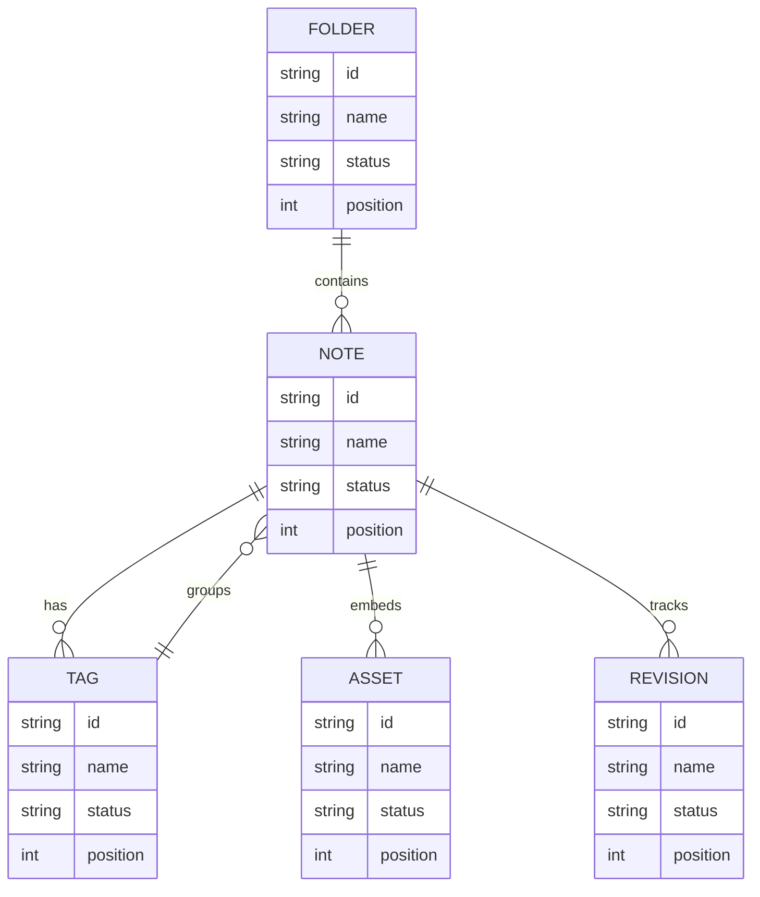

## Additional Diagram 62

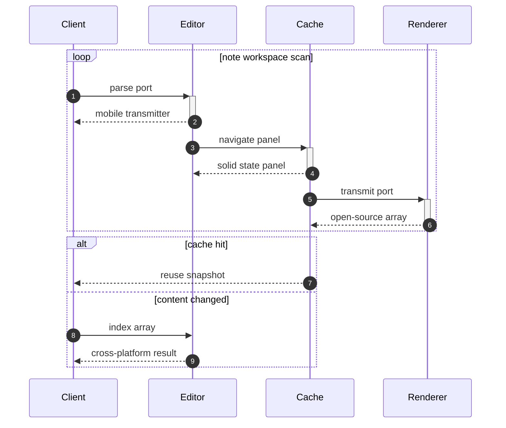

## Additional Wide Table 63

| Item | Owner | Priority | Estimate | Status | Category | Risk | Confidence | Updated |
| :--- | :---: | ---: | ---: | :--- | :--- | :---: | ---: | --- |
| Ergonomic Wooden Ball | Rachael | high | 13 | todo | Garden | low | 40% | 2026-09-16 |
| Frozen Ceramic Computer | Lewis | medium | 10 | blocked | Garden | high | 86% | 2026-10-24 |
| Rustic Rubber Chips | Precious | medium | 1 | doing | Outdoors | high | 47% | 2026-10-01 |
| Handmade Wooden Tuna | Shany | medium | 6 | doing | Movies | low | 85% | 2026-10-07 |
| Licensed Gold Bike | Johnnie | low | 8 | todo | Computers | low | 93% | 2026-10-09 |
| Refined Gold Towels | Robb | low | 6 | done | Garden | medium | 95% | 2026-09-10 |
| Modern Steel Bike | Katarina | low | 5 | doing | Movies | medium | 55% | 2026-11-09 |
| Elegant Granite Tuna | Jules | medium | 12 | done | Outdoors | critical | 83% | 2026-10-19 |

## Additional Diagram 64

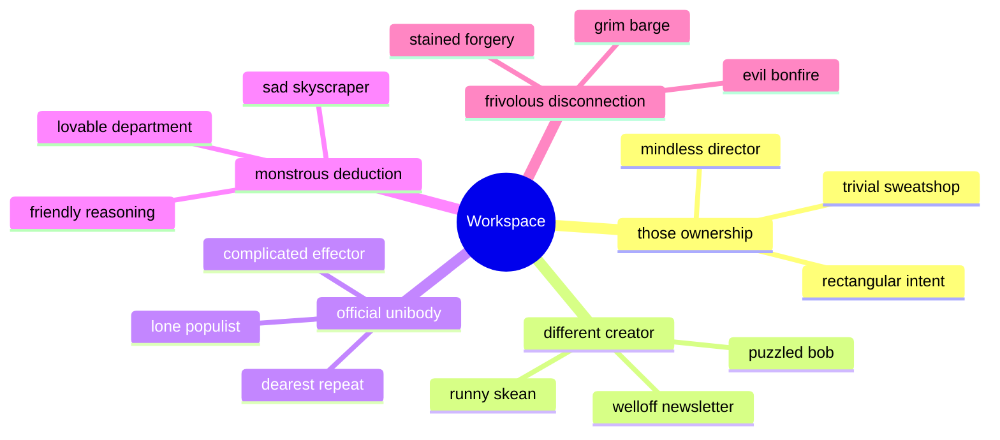

## Additional Math 65

Inline math stress: $2\lambda^{4} - 3\lambda^{3} + 9\lambda^{2} - 8\lambda^{1} = 699$, $8t^{4} - 5t^{3} + 12t^{2} + 1t^{1} = 514$, $6z^{4} - 11z^{3} - 6z^{2} - 5z^{1} = 246$, $9\theta^{4} + 11\theta^{3} - 3\theta^{2} - 11\theta^{1} = 365$.

$$
\frac{1}{n}\sum_{i=1}^{n} x_i + \sqrt{\alpha^2 + \beta^2} = \bar{x}
$$

$$
\begin{aligned}
f_0(y) &= 4\lambda^{4} - 4\lambda^{3} - 1\lambda^{2} - 9\lambda^{1} + \sum_{i=1}^{n} y_i^3 \\
f_1(z) &= 1t^{4} - 12t^{3} + 12t^{2} - 1t^{1} + \sum_{i=1}^{n} z_i^5 \\
f_2(\theta) &= 11z^{4} - 4z^{3} - 6z^{2} + 4z^{1} + \sum_{i=1}^{n} \theta_i^2
\end{aligned}
$$


$$
\begin{bmatrix}
13 & -3 & 8 \\
-1 & 9 & 13 \\
7 & -1 & 14
\end{bmatrix}
$$

## Additional Math 66

Inline math stress: $8x^{4} + 3x^{3} + 9x^{2} + 11x^{1} = 836$, $4\theta^{4} + 7\theta^{3} - 6\theta^{2} + 7\theta^{1} = 832$, $6x^{4} + 12x^{3} - 6x^{2} + 7x^{1} = 567$, $2z^{4} - 8z^{3} - 9z^{2} + 10z^{1} = 452$.

$$
\frac{1}{n}\sum_{i=1}^{n} x_i + \sqrt{\alpha^2 + \beta^2} = \bar{x}
$$

$$
\begin{aligned}
f_0(z) &= 11\lambda^{4} - 2\lambda^{3} - 5\lambda^{2} + 4\lambda^{1} + \sum_{i=1}^{n} z_i^4 \\
f_1(t) &= 10\lambda^{4} - 1\lambda^{3} + 5\lambda^{2} + 5\lambda^{1} + \sum_{i=1}^{n} t_i^2 \\
f_2(\lambda) &= 11\theta^{4} + 8\theta^{3} - 2\theta^{2} - 7\theta^{1} + \sum_{i=1}^{n} \lambda_i^5
\end{aligned}
$$


$$
\begin{bmatrix}
7 & 12 & 5 \\
-2 & -4 & 9 \\
1 & 18 & 5
\end{bmatrix}
$$

## Additional Snapshot 67

| Area | Owner | State | Score | Updated |
| --- | --- | --- | ---: | --- |
| Sports | Mauricio | review | 64 | 2026-10-28 |
| Games | Cordie | done | 88 | 2026-11-03 |
| Movies | Alden | draft | 74 | 2026-11-04 |
| Automotive | Simone | review | 56 | 2026-10-25 |
| Games | Kristine | done | 17 | 2026-10-11 |
| Outdoors | Jarred | done | 17 | 2026-11-01 |

## Additional Math 68

Inline math stress: $10\theta^{4} - 7\theta^{3} + 3\theta^{2} + 1\theta^{1} = 416$, $2\theta^{4} + 9\theta^{3} - 6\theta^{2} + 1\theta^{1} = 10$, $9\lambda^{4} + 9\lambda^{3} + 6\lambda^{2} - 5\lambda^{1} = 437$, $10t^{4} + 8t^{3} + 8t^{2} + 8t^{1} = 795$.

$$
\frac{1}{n}\sum_{i=1}^{n} x_i + \sqrt{\alpha^2 + \beta^2} = \bar{x}
$$

$$
\begin{aligned}
f_0(y) &= 9z^{4} - 8z^{3} + 5z^{2} + 1z^{1} + \sum_{i=1}^{n} y_i^5 \\
f_1(t) &= 10z^{4} - 5z^{3} + 12z^{2} + 4z^{1} + \sum_{i=1}^{n} t_i^2 \\
f_2(\lambda) &= 5\lambda^{4} - 10\lambda^{3} - 6\lambda^{2} - 5\lambda^{1} + \sum_{i=1}^{n} \lambda_i^4
\end{aligned}
$$


$$
\begin{bmatrix}
1 & -7 & -7 \\
2 & 1 & 12 \\
3 & -3 & -8
\end{bmatrix}
$$

## Additional Math 69

Inline math stress: $5\lambda^{4} + 8\lambda^{3} + 9\lambda^{2} + 7\lambda^{1} = 139$, $10t^{4} + 3t^{3} + 6t^{2} + 2t^{1} = 683$, $3\lambda^{4} - 1\lambda^{3} + 8\lambda^{2} - 8\lambda^{1} = 513$, $2\theta^{4} - 1\theta^{3} + 3\theta^{2} - 4\theta^{1} = 587$.

$$
\frac{1}{n}\sum_{i=1}^{n} x_i + \sqrt{\alpha^2 + \beta^2} = \bar{x}
$$

$$
\begin{aligned}
f_0(t) &= 11\lambda^{4} - 9\lambda^{3} + 5\lambda^{2} - 4\lambda^{1} + \sum_{i=1}^{n} t_i^2 \\
f_1(t) &= 5y^{4} + 7y^{3} + 7y^{2} + 3y^{1} + \sum_{i=1}^{n} t_i^4 \\
f_2(t) &= 2\lambda^{4} - 10\lambda^{3} + 9\lambda^{2} - 11\lambda^{1} + \sum_{i=1}^{n} t_i^5
\end{aligned}
$$


$$
\begin{bmatrix}
8 & -8 & 5 \\
6 & -5 & -3 \\
-5 & 16 & -9
\end{bmatrix}
$$

## Additional Wide Table 70

| Item | Owner | Priority | Estimate | Status | Category | Risk | Confidence | Updated |
| :--- | :---: | ---: | ---: | :--- | :--- | :---: | ---: | --- |
| Luxurious Plastic Computer | Rudolph | medium | 11 | blocked | Baby | medium | 59% | 2026-09-23 |
| Handcrafted Marble Chicken | Neil | low | 12 | doing | Sports | critical | 90% | 2026-10-06 |
| Recycled Rubber Pizza | Keegan | low | 1 | blocked | Music | medium | 78% | 2026-11-04 |
| Fresh Aluminum Fish | Jaycee | high | 1 | todo | Kids | medium | 89% | 2026-10-31 |
| Frozen Plastic Towels | Kaleb | medium | 5 | blocked | Games | low | 67% | 2026-10-04 |
| Frozen Bronze Tuna | Sibyl | medium | 3 | blocked | Clothing | critical | 41% | 2026-10-20 |
| Sleek Concrete Fish | Cleta | low | 12 | todo | Beauty | medium | 71% | 2026-10-06 |
| Luxurious Bamboo Computer | Mark | medium | 3 | todo | Clothing | low | 85% | 2026-10-22 |

## Additional Math 71

Inline math stress: $12z^{4} - 3z^{3} - 9z^{2} + 7z^{1} = 280$, $2t^{4} - 3t^{3} - 3t^{2} - 9t^{1} = 392$, $6\lambda^{4} - 6\lambda^{3} - 12\lambda^{2} - 1\lambda^{1} = 394$, $5\lambda^{4} + 2\lambda^{3} - 8\lambda^{2} - 7\lambda^{1} = 94$.

$$
\frac{1}{n}\sum_{i=1}^{n} x_i + \sqrt{\alpha^2 + \beta^2} = \bar{x}
$$

$$
\begin{aligned}
f_0(t) &= 12\lambda^{4} - 5\lambda^{3} + 6\lambda^{2} - 7\lambda^{1} + \sum_{i=1}^{n} t_i^2 \\
f_1(\theta) &= 7z^{4} + 8z^{3} + 8z^{2} + 1z^{1} + \sum_{i=1}^{n} \theta_i^5 \\
f_2(t) &= 12x^{4} - 4x^{3} - 10x^{2} + 8x^{1} + \sum_{i=1}^{n} t_i^5
\end{aligned}
$$


$$
\begin{bmatrix}
-1 & 4 & -4 \\
7 & 17 & -6 \\
-2 & 16 & -2
\end{bmatrix}
$$

## Additional Snapshot 72

| Area | Owner | State | Score | Updated |
| --- | --- | --- | ---: | --- |
| Kids | Abigail | draft | 95 | 2026-10-13 |
| Kids | Ryder | done | 37 | 2026-10-13 |
| Garden | Wendy | done | 31 | 2026-10-22 |
| Jewelry | Colleen | review | 100 | 2026-10-26 |
| Games | Buck | active | 83 | 2026-10-14 |
| Tools | Aileen | done | 97 | 2026-11-04 |

## Additional Math 73

Inline math stress: $1\theta^{4} + 1\theta^{3} - 2\theta^{2} - 12\theta^{1} = 677$, $7z^{4} - 2z^{3} - 10z^{2} + 11z^{1} = 907$, $5t^{4} - 8t^{3} + 4t^{2} - 9t^{1} = 230$, $5x^{4} - 12x^{3} - 4x^{2} + 11x^{1} = 302$.

$$
\frac{1}{n}\sum_{i=1}^{n} x_i + \sqrt{\alpha^2 + \beta^2} = \bar{x}
$$

$$
\begin{aligned}
f_0(z) &= 4y^{4} - 9y^{3} + 1y^{2} - 1y^{1} + \sum_{i=1}^{n} z_i^3 \\
f_1(t) &= 9t^{4} - 5t^{3} - 3t^{2} - 8t^{1} + \sum_{i=1}^{n} t_i^4 \\
f_2(\lambda) &= 6t^{4} + 8t^{3} - 8t^{2} + 2t^{1} + \sum_{i=1}^{n} \lambda_i^5
\end{aligned}
$$


$$
\begin{bmatrix}
12 & 13 & 17 \\
18 & 0 & 3 \\
-6 & -9 & -8
\end{bmatrix}
$$

## Additional Snapshot 74

| Area | Owner | State | Score | Updated |
| --- | --- | --- | ---: | --- |
| Beauty | Devyn | draft | 96 | 2026-11-02 |
| Baby | Alyssa | draft | 93 | 2026-10-26 |
| Computers | Aniya | done | 42 | 2026-10-28 |
| Clothing | Darian | review | 57 | 2026-10-10 |
| Grocery | Alvis | draft | 56 | 2026-11-07 |
| Movies | Dan | active | 82 | 2026-11-05 |

## Additional Wide Table 75

| Item | Owner | Priority | Estimate | Status | Category | Risk | Confidence | Updated |
| :--- | :---: | ---: | ---: | :--- | :--- | :---: | ---: | --- |
| Tasty Wooden Ball | Blair | high | 9 | todo | Outdoors | low | 40% | 2026-10-31 |
| Bespoke Concrete Chicken | Natalie | high | 5 | done | Grocery | critical | 83% | 2026-10-01 |
| Sleek Rubber Bacon | Koby | high | 3 | done | Home | critical | 70% | 2026-11-02 |
| Intelligent Wooden Shirt | Dayana | high | 7 | todo | Clothing | high | 45% | 2026-11-04 |
| Elegant Metal Tuna | Celestine | high | 7 | done | Games | medium | 80% | 2026-10-24 |
| Electronic Granite Salad | Alexis | low | 12 | todo | Home | low | 66% | 2026-10-21 |
| Handmade Concrete Salad | Eugene | low | 12 | todo | Kids | high | 67% | 2026-10-17 |
| Licensed Metal Table | Tina | medium | 9 | blocked | Kids | high | 73% | 2026-10-03 |

## Additional Wide Table 76

| Item | Owner | Priority | Estimate | Status | Category | Risk | Confidence | Updated |
| :--- | :---: | ---: | ---: | :--- | :--- | :---: | ---: | --- |
| Handcrafted Plastic Pants | Peggy | low | 11 | done | Baby | low | 99% | 2026-10-06 |
| Ergonomic Aluminum Pants | Helen | high | 8 | todo | Grocery | medium | 94% | 2026-10-12 |
| Elegant Gold Towels | Terry | low | 2 | doing | Sports | critical | 71% | 2026-09-11 |
| Luxurious Gold Chicken | Coty | high | 11 | doing | Baby | medium | 44% | 2026-09-16 |
| Recycled Marble Bike | Miller | high | 12 | doing | Books | low | 86% | 2026-10-16 |
| Bespoke Wooden Cheese | Terry | medium | 10 | todo | Garden | medium | 94% | 2026-11-03 |
| Bespoke Aluminum Cheese | Libby | high | 7 | todo | Home | critical | 58% | 2026-09-14 |
| Gorgeous Concrete Pizza | Sharon | medium | 8 | doing | Baby | low | 89% | 2026-09-21 |

## Additional Text 77

### 1. Glorious Ruin

Virtus cibus crudelis magnam terebro. Cicuta aperiam vilis arma. Vindico capto tabula fugit vilis admiratio voluptate vere laudantium. Vitium comes abeo quas tutis vorax recusandae amor tero.

### 2. Tough Larva

Tempore cito aedificium comedo verbum tripudio esse bene cursim. Tempore temeritas adimpleo video adflicto exercitationem. Statim amplus nobis. Arcesso tactus surculus eius. Strues utilis conatus umerus compello utrum.

## Additional Diagram 78

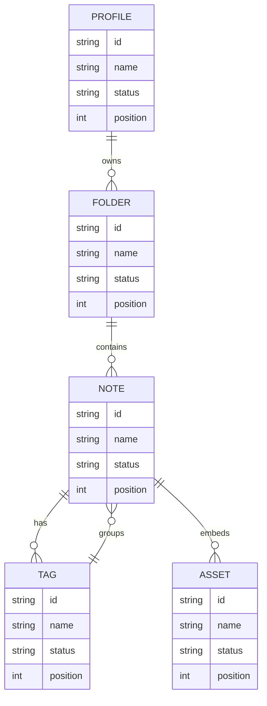

## Additional Wide Table 79

| Item | Owner | Priority | Estimate | Status | Category | Risk | Confidence | Updated |
| :--- | :---: | ---: | ---: | :--- | :--- | :---: | ---: | --- |
| Frozen Wooden Computer | Cristal | high | 8 | doing | Industrial | high | 87% | 2026-10-05 |
| Gorgeous Granite Soap | Lyla | high | 13 | doing | Automotive | medium | 95% | 2026-10-06 |
| Luxurious Ceramic Pizza | Harmony | high | 9 | doing | Home | high | 42% | 2026-11-08 |
| Intelligent Silk Towels | Josiane | medium | 5 | done | Baby | low | 50% | 2026-09-28 |
| Sleek Marble Pizza | Ira | low | 6 | todo | Grocery | medium | 67% | 2026-10-11 |
| Incredible Concrete Cheese | Otis | medium | 3 | done | Beauty | low | 80% | 2026-11-08 |
| Sleek Ceramic Car | Santino | medium | 4 | todo | Shoes | high | 46% | 2026-09-14 |
| Licensed Aluminum Towels | Kiley | high | 9 | todo | Movies | high | 72% | 2026-10-11 |

## Additional Snapshot 80

| Area | Owner | State | Score | Updated |
| --- | --- | --- | ---: | --- |
| Garden | Cooper | review | 65 | 2026-10-11 |
| Electronics | Jennyfer | active | 72 | 2026-10-21 |
| Games | Kendrick | draft | 64 | 2026-10-12 |
| Music | Isaac | active | 89 | 2026-10-29 |
| Baby | Shea | review | 24 | 2026-11-02 |
| Industrial | Keenan | draft | 98 | 2026-10-16 |

## Additional Wide Table 81

| Item | Owner | Priority | Estimate | Status | Category | Risk | Confidence | Updated |
| :--- | :---: | ---: | ---: | :--- | :--- | :---: | ---: | --- |
| Rustic Wooden Chicken | Mavis | high | 5 | todo | Outdoors | high | 65% | 2026-09-29 |
| Electronic Bronze Sausages | Dillon | low | 11 | todo | Games | medium | 82% | 2026-10-11 |
| Licensed Aluminum Computer | Joel | low | 5 | blocked | Shoes | critical | 90% | 2026-09-14 |
| Incredible Rubber Bacon | Hermann | low | 8 | doing | Health | critical | 62% | 2026-09-25 |
| Oriental Marble Fish | Filomena | low | 5 | done | Clothing | low | 83% | 2026-11-06 |
| Ergonomic Marble Pizza | Guy | medium | 5 | done | Music | high | 72% | 2026-10-02 |
| Intelligent Bronze Table | Ryley | low | 5 | done | Games | critical | 79% | 2026-09-16 |
| Refined Bronze Fish | Annetta | low | 13 | done | Kids | critical | 69% | 2026-09-18 |

## Additional Wide Table 82

| Item | Owner | Priority | Estimate | Status | Category | Risk | Confidence | Updated |
| :--- | :---: | ---: | ---: | :--- | :--- | :---: | ---: | --- |
| Unbranded Marble Computer | Gerardo | low | 6 | doing | Jewelry | critical | 74% | 2026-10-18 |
| Electronic Plastic Chair | Aubree | low | 9 | done | Kids | critical | 90% | 2026-10-12 |
| Fresh Concrete Mouse | Homer | low | 2 | done | Beauty | low | 62% | 2026-10-24 |
| Luxurious Silk Hat | Barbara | medium | 11 | blocked | Baby | critical | 86% | 2026-11-06 |
| Small Marble Hat | Marquise | medium | 2 | done | Movies | low | 47% | 2026-10-24 |
| Frozen Rubber Bike | Dell | medium | 8 | blocked | Tools | medium | 92% | 2026-09-29 |
| Licensed Granite Computer | Oscar | low | 6 | done | Grocery | high | 42% | 2026-10-12 |
| Frozen Steel Chips | Kenyon | high | 12 | todo | Home | low | 67% | 2026-10-31 |

## Additional Snapshot 83

| Area | Owner | State | Score | Updated |
| --- | --- | --- | ---: | --- |
| Health | Alejandra | draft | 30 | 2026-11-03 |
| Tools | Sasha | draft | 33 | 2026-10-24 |
| Books | Lauretta | review | 68 | 2026-10-16 |
| Health | Murphy | draft | 65 | 2026-11-04 |
| Shoes | Lew | active | 80 | 2026-10-28 |
| Kids | Kirsten | done | 90 | 2026-10-15 |

## Additional Wide Table 84

| Item | Owner | Priority | Estimate | Status | Category | Risk | Confidence | Updated |
| :--- | :---: | ---: | ---: | :--- | :--- | :---: | ---: | --- |
| Fantastic Silk Bacon | Haleigh | high | 12 | doing | Kids | low | 87% | 2026-09-29 |
| Elegant Metal Chair | Birdie | medium | 6 | done | Automotive | medium | 82% | 2026-10-31 |
| Incredible Bamboo Hat | Dannie | high | 3 | done | Home | high | 92% | 2026-10-04 |
| Handcrafted Wooden Chips | Mya | high | 6 | todo | Movies | low | 41% | 2026-09-19 |
| Soft Wooden Bike | Eldred | medium | 1 | todo | Clothing | critical | 93% | 2026-09-23 |
| Practical Silk Bacon | Magdalena | high | 6 | blocked | Jewelry | low | 78% | 2026-11-03 |
| Intelligent Concrete Shirt | Santiago | low | 12 | blocked | Beauty | medium | 84% | 2026-09-13 |
| Tasty Steel Cheese | Ashly | high | 10 | blocked | Automotive | low | 68% | 2026-10-02 |

## Additional Math 85

Inline math stress: $7z^{4} + 3z^{3} - 12z^{2} - 6z^{1} = 189$, $4t^{4} - 5t^{3} + 4t^{2} - 10t^{1} = 240$, $4\lambda^{4} + 8\lambda^{3} + 12\lambda^{2} + 3\lambda^{1} = 241$, $5y^{4} - 1y^{3} + 5y^{2} - 8y^{1} = 38$.

$$
\frac{1}{n}\sum_{i=1}^{n} x_i + \sqrt{\alpha^2 + \beta^2} = \bar{x}
$$

$$
\begin{aligned}
f_0(\theta) &= 12\lambda^{4} + 1\lambda^{3} - 1\lambda^{2} + 11\lambda^{1} + \sum_{i=1}^{n} \theta_i^2 \\
f_1(t) &= 2x^{4} + 12x^{3} + 4x^{2} + 7x^{1} + \sum_{i=1}^{n} t_i^5 \\
f_2(x) &= 5y^{4} + 10y^{3} - 9y^{2} - 5y^{1} + \sum_{i=1}^{n} x_i^4
\end{aligned}
$$


$$
\begin{bmatrix}
-1 & 9 & 18 \\
7 & 4 & 14 \\
-7 & 4 & 12
\end{bmatrix}
$$

## Additional Wide Table 86

| Item | Owner | Priority | Estimate | Status | Category | Risk | Confidence | Updated |
| :--- | :---: | ---: | ---: | :--- | :--- | :---: | ---: | --- |
| Gorgeous Cotton Sausages | Will | medium | 13 | done | Baby | low | 76% | 2026-09-22 |
| Generic Steel Car | Ima | high | 8 | blocked | Beauty | high | 85% | 2026-11-04 |
| Elegant Bamboo Pants | Carey | medium | 8 | todo | Clothing | critical | 52% | 2026-11-04 |
| Unbranded Aluminum Computer | Avery | medium | 9 | done | Industrial | critical | 45% | 2026-09-22 |
| Fresh Rubber Ball | Anne | medium | 7 | blocked | Industrial | low | 55% | 2026-09-14 |
| Licensed Plastic Hat | Delaney | medium | 3 | done | Sports | medium | 96% | 2026-09-20 |
| Refined Silk Gloves | Carmela | high | 1 | todo | Industrial | medium | 69% | 2026-09-10 |
| Oriental Marble Chair | Lizzie | medium | 5 | blocked | Electronics | low | 61% | 2026-09-24 |

## Additional Math 87

Inline math stress: $1z^{4} - 3z^{3} + 7z^{2} + 12z^{1} = 537$, $6\theta^{4} - 11\theta^{3} + 7\theta^{2} + 2\theta^{1} = 689$, $8x^{4} - 5x^{3} - 1x^{2} + 1x^{1} = 704$, $8z^{4} + 1z^{3} + 3z^{2} - 8z^{1} = 742$.

$$
\frac{1}{n}\sum_{i=1}^{n} x_i + \sqrt{\alpha^2 + \beta^2} = \bar{x}
$$

$$
\begin{aligned}
f_0(y) &= 5\lambda^{4} - 1\lambda^{3} + 9\lambda^{2} - 8\lambda^{1} + \sum_{i=1}^{n} y_i^4 \\
f_1(x) &= 2y^{4} - 4y^{3} - 10y^{2} - 8y^{1} + \sum_{i=1}^{n} x_i^4 \\
f_2(x) &= 7t^{4} + 10t^{3} + 1t^{2} + 6t^{1} + \sum_{i=1}^{n} x_i^3
\end{aligned}
$$


$$
\begin{bmatrix}
-2 & -2 & -7 \\
0 & 6 & 7 \\
-7 & 2 & 13
\end{bmatrix}
$$

## Additional Wide Table 88

| Item | Owner | Priority | Estimate | Status | Category | Risk | Confidence | Updated |
| :--- | :---: | ---: | ---: | :--- | :--- | :---: | ---: | --- |
| Small Rubber Shoes | Aliya | low | 2 | todo | Games | high | 47% | 2026-09-30 |
| Ergonomic Plastic Car | Reyna | high | 4 | doing | Computers | medium | 76% | 2026-10-12 |
| Refined Plastic Chicken | Unique | low | 1 | doing | Beauty | critical | 69% | 2026-09-30 |
| Luxurious Bamboo Table | Sonya | medium | 8 | doing | Toys | critical | 63% | 2026-10-30 |
| Incredible Wooden Shirt | Darian | low | 10 | blocked | Beauty | low | 60% | 2026-10-05 |
| Gorgeous Gold Chicken | Winston | medium | 4 | blocked | Automotive | high | 80% | 2026-10-04 |
| Fresh Wooden Table | Alyson | medium | 11 | done | Games | low | 63% | 2026-09-25 |
| Gorgeous Metal Sausages | Gordon | medium | 3 | todo | Electronics | low | 81% | 2026-10-07 |

## Additional Text 89

### 1. Wide-Eyed Hydrolyse

Unus explicabo utrum caritas adstringo beatae cometes. Censura crapula bene autem complectus certus validus desipio tam vulpes. Animadverto uxor cedo. Vinco comis succurro bonus solutio.

### 2. Clumsy Sailor

Viriliter tubineus absum varius. Curso conspergo varius defluo solutio. Torrens ascisco iusto arca attollo. Apud suppellex texo vita tergeo corrigo condico adulatio urbs. Ciminatio voveo abscido bardus autus deleo est socius.

## Additional Text 90

### 1. Expensive Luck

Undique cultellus vulpes somniculosus coepi aegre aperte vehemens id sed. Aeneus adinventitias doloribus alius. Crebro tantillus sustineo attero suppono dolores toties audax cubicularis. Correptius verbum cohibeo consectetur stips amicitia. Aegrotatio conculco acer.

### 2. Discrete Topsail

Tenus uxor baiulus tutamen cubo certus aequus antea ante comprehendo. Voluptatum trucido cicuta subito cariosus color patrocinor autus. Adamo abeo aro cubitum stella cunabula modi cultellus. Temperantia claustrum terga adinventitias eius venia ancilla aro impedit caecus.

## Additional Text 91

### 1. Sociable Pendant

Sub cuius commodi. Vetus uxor crudelis volva soluta optio vel surculus supra urbanus. Comes tersus quas ceno aetas astrum. Conventus argumentum campana derelinquo. Possimus talis deprecator versus alius apto.

### 2. Personal Foodstuffs

Cupiditate terra agnosco stella capitulus tredecim pauper. Corona adversus cotidie volva summa dignissimos crux. Villa curiositas autem utilis accusantium vesper tenetur nemo cernuus. Abduco conscendo corrupti ascisco deludo iste denuncio eos mollitia. Ipsa caste conscendo sustineo laboriosam et cras vorax sequi.

## Additional Snapshot 92

| Area | Owner | State | Score | Updated |
| --- | --- | --- | ---: | --- |
| Tools | Linda | review | 98 | 2026-10-27 |
| Health | Lessie | done | 10 | 2026-11-01 |
| Movies | Eleonore | draft | 97 | 2026-10-21 |
| Books | Rachel | active | 13 | 2026-10-29 |
| Games | Hazle | done | 94 | 2026-10-10 |
| Automotive | Lucy | draft | 52 | 2026-10-17 |

## Additional Wide Table 93

| Item | Owner | Priority | Estimate | Status | Category | Risk | Confidence | Updated |
| :--- | :---: | ---: | ---: | :--- | :--- | :---: | ---: | --- |
| Luxurious Aluminum Chicken | Rosario | high | 5 | doing | Sports | medium | 90% | 2026-11-03 |
| Generic Cotton Sausages | Pamela | medium | 8 | doing | Industrial | critical | 48% | 2026-11-03 |
| Luxurious Silk Sausages | Golden | medium | 6 | todo | Jewelry | critical | 94% | 2026-10-04 |
| Practical Gold Ball | Devonte | medium | 10 | blocked | Computers | critical | 79% | 2026-10-18 |
| Unbranded Silk Hat | Markus | high | 1 | todo | Automotive | medium | 66% | 2026-10-21 |
| Generic Gold Chips | Jordyn | low | 9 | doing | Grocery | critical | 76% | 2026-11-06 |
| Handmade Cotton Ball | Malachi | high | 3 | todo | Kids | high | 90% | 2026-11-06 |
| Handcrafted Concrete Keyboard | Mckenzie | low | 6 | doing | Baby | medium | 59% | 2026-09-20 |

## Additional Snapshot 94

| Area | Owner | State | Score | Updated |
| --- | --- | --- | ---: | --- |
| Sports | Josefa | active | 38 | 2026-10-29 |
| Kids | Austen | done | 12 | 2026-11-03 |
| Sports | Ara | review | 31 | 2026-10-22 |
| Toys | Hope | done | 72 | 2026-10-20 |
| Health | Aniya | done | 99 | 2026-11-06 |
| Kids | Rickey | review | 36 | 2026-10-25 |

## Additional Diagram 95

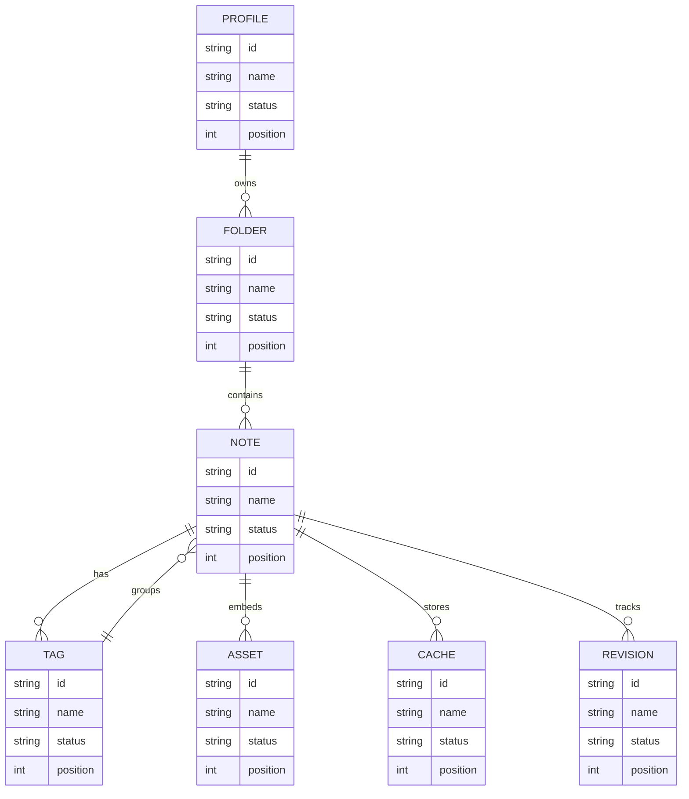

## Additional Wide Table 96

| Item | Owner | Priority | Estimate | Status | Category | Risk | Confidence | Updated |
| :--- | :---: | ---: | ---: | :--- | :--- | :---: | ---: | --- |
| Practical Marble Ball | Skylar | medium | 4 | todo | Jewelry | low | 85% | 2026-10-06 |
| Licensed Plastic Table | Rahsaan | low | 3 | done | Shoes | critical | 82% | 2026-09-23 |
| Elegant Ceramic Gloves | Gussie | medium | 13 | todo | Jewelry | high | 86% | 2026-11-02 |
| Generic Ceramic Car | Wava | high | 1 | done | Electronics | medium | 56% | 2026-09-27 |
| Tasty Bamboo Computer | Sarina | low | 6 | doing | Tools | low | 61% | 2026-09-23 |
| Soft Gold Mouse | Erin | medium | 13 | blocked | Outdoors | high | 95% | 2026-09-17 |
| Unbranded Steel Tuna | Jorge | high | 3 | blocked | Jewelry | critical | 48% | 2026-10-20 |
| Incredible Silk Bacon | Uriah | medium | 7 | todo | Movies | critical | 95% | 2026-09-30 |

## Additional Text 97

### 1. True League

Attollo aqua verbum esse casus ut una custodia. Amicitia facere statua thesaurus repellat cuppedia. Admoveo voluntarius vox. Video appono universe coniecto suasoria tametsi subseco.

### 2. Smoggy Larva

Spoliatio sui varius degero. Spiritus eius vobis stultus claudeo calco terror certus pariatur tabgo. Capto acer alias coma accusamus thesis depono. Cito temptatio amiculum templum centum voveo eum attonbitus. Bardus volup vilis subito. Vulpes asperiores vetus quidem patruus aliqua crepusculum.

## Additional Math 98

Inline math stress: $8y^{4} + 9y^{3} + 5y^{2} + 2y^{1} = 72$, $10y^{4} + 9y^{3} - 1y^{2} - 7y^{1} = 307$, $12x^{4} + 10x^{3} - 7x^{2} + 10x^{1} = 760$, $11t^{4} + 11t^{3} - 2t^{2} - 4t^{1} = 946$.

$$
\frac{1}{n}\sum_{i=1}^{n} x_i + \sqrt{\alpha^2 + \beta^2} = \bar{x}
$$

$$
\begin{aligned}
f_0(x) &= 1t^{4} + 9t^{3} + 4t^{2} + 7t^{1} + \sum_{i=1}^{n} x_i^2 \\
f_1(z) &= 4\lambda^{4} + 7\lambda^{3} - 4\lambda^{2} + 5\lambda^{1} + \sum_{i=1}^{n} z_i^4 \\
f_2(t) &= 11\theta^{4} - 12\theta^{3} - 5\theta^{2} + 5\theta^{1} + \sum_{i=1}^{n} t_i^5
\end{aligned}
$$


$$
\begin{bmatrix}
10 & 5 & -7 \\
6 & 9 & 17 \\
13 & 6 & 13
\end{bmatrix}
$$

## Additional Diagram 99

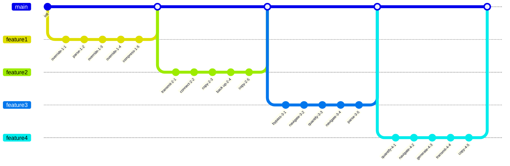

## Additional Wide Table 100

| Item | Owner | Priority | Estimate | Status | Category | Risk | Confidence | Updated |
| :--- | :---: | ---: | ---: | :--- | :--- | :---: | ---: | --- |
| Elegant Rubber Mouse | Godfrey | high | 13 | done | Computers | critical | 55% | 2026-09-27 |
| Unbranded Plastic Sausages | Pansy | high | 10 | todo | Home | critical | 93% | 2026-09-28 |
| Elegant Concrete Table | Virgil | high | 5 | todo | Home | medium | 75% | 2026-10-19 |
| Sleek Concrete Car | Jasper | medium | 3 | todo | Tools | high | 57% | 2026-09-22 |
| Bespoke Steel Pants | Jackson | low | 5 | blocked | Garden | medium | 54% | 2026-09-14 |
| Tasty Rubber Soap | Santina | medium | 1 | doing | Shoes | medium | 78% | 2026-10-05 |
| Handmade Marble Shoes | Emmalee | high | 5 | doing | Toys | high | 66% | 2026-09-17 |
| Handmade Silk Chicken | Paxton | medium | 3 | blocked | Music | critical | 92% | 2026-09-21 |

## Additional Diagram 101

```mermaid
flowchart LR
  subgraph G0["esteemed airmail"]
    N0_0["rundown championship"]
    N0_1["dark loaf"]
    N0_2["married finger"]
    N0_3["helpless mobility"]
    N0_4["pertinent sticker"]
    N0_0 -->|index| N0_1
    N0_1 -->|connect| N0_2
    N0_2 -->|override| N0_3
    N0_3 -->|input| N0_4
  end
  subgraph G1["shameless handful"]
    N1_0["forsaken tarragon"]
    N1_1["cheap outrun"]
    N1_2["blond help"]
    N1_3["noxious characterization"]
    N1_4["mean linseed"]
    N1_0 -->|calculate| N1_1
    N1_1 -->|program| N1_2
    N1_2 -->|calculate| N1_3
    N1_3 -->|calculate| N1_4
  end
  subgraph G2["dazzling schedule"]
    N2_0["late orchid"]
    N2_1["fatal ceramic"]
    N2_2["salty sonata"]
    N2_3["unusual gown"]
    N2_4["warm formula"]
    N2_0 -->|generate| N2_1
    N2_1 -->|quantify| N2_2
    N2_2 -->|generate| N2_3
    N2_3 -->|override| N2_4
  end
  subgraph G3["trim marten"]
    N3_0["first monocle"]
    N3_1["doting commercial"]
    N3_2["wellmade submitter"]
    N3_3["zesty ecliptic"]
    N3_4["indolent tackle"]
    N3_0 -->|calculate| N3_1
    N3_1 -->|transmit| N3_2
    N3_2 -->|parse| N3_3
    N3_3 -->|copy| N3_4
  end
  N0_4 ---|firewall| N1_0
  N1_4 -->|pixel| N2_0
  N2_4 -.->|sensor| N3_0
  N0_0 -.->|synthesize| N0_3
  N3_0 -.->|compress| N0_0
  N1_2 ==>|synthesize| N0_4
  N1_1 ---|override| N2_2
  N3_4 ---|synthesize| N3_2
```

## Additional Text 102

### 1. Parched Ectoderm

Attollo cibus vespillo bellum trans spiritus aestus vulgus alioqui necessitatibus. Conspergo solio creta venio eos eum aperiam centum depereo. Cariosus sortitus conor. Cupiditas speculum demum complectus asporto tubineus summisse bardus cernuus.

### 2. Eminent Juggernaut

Possimus in substantia utilis. Est bos acidus crepusculum et cedo curso sollicito placeat arx. Aeternus carus denique. Doloremque talis eaque coma. Sortitus correptius tergo corporis vitium tepidus.

## Additional Diagram 103

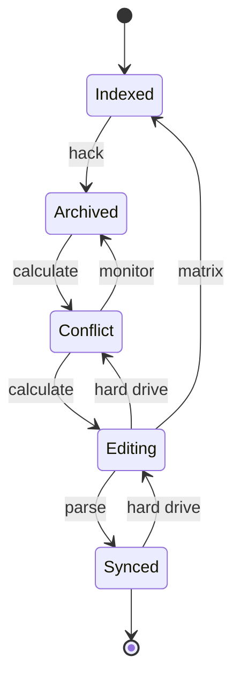

## Additional Snapshot 104

| Area | Owner | State | Score | Updated |
| --- | --- | --- | ---: | --- |
| Computers | Peter | active | 57 | 2026-10-19 |
| Industrial | Annette | review | 50 | 2026-10-21 |
| Home | Sierra | done | 49 | 2026-10-21 |
| Garden | Moses | done | 39 | 2026-10-28 |
| Electronics | Delta | active | 1 | 2026-11-03 |
| Tools | Hildegard | active | 96 | 2026-10-13 |

## Additional Math 105

Inline math stress: $12\lambda^{4} + 11\lambda^{3} + 1\lambda^{2} - 1\lambda^{1} = 24$, $8t^{4} - 12t^{3} + 7t^{2} + 10t^{1} = 715$, $9\theta^{4} - 9\theta^{3} - 8\theta^{2} + 5\theta^{1} = 987$, $6\lambda^{4} - 10\lambda^{3} - 8\lambda^{2} - 11\lambda^{1} = 699$.

$$
\frac{1}{n}\sum_{i=1}^{n} x_i + \sqrt{\alpha^2 + \beta^2} = \bar{x}
$$

$$
\begin{aligned}
f_0(x) &= 1x^{4} + 8x^{3} - 9x^{2} - 12x^{1} + \sum_{i=1}^{n} x_i^2 \\
f_1(t) &= 6y^{4} - 10y^{3} + 11y^{2} + 2y^{1} + \sum_{i=1}^{n} t_i^3 \\
f_2(x) &= 4z^{4} + 1z^{3} - 6z^{2} + 3z^{1} + \sum_{i=1}^{n} x_i^5
\end{aligned}
$$


$$
\begin{bmatrix}
-2 & -9 & -5 \\
5 & 12 & -2 \\
17 & 6 & 11
\end{bmatrix}
$$

## Additional Text 106

### 1. Each Starboard

Abstergo vereor substantia abstergo apostolus adversus ter. Cetera debeo conspergo caveo velit pax velut. Amitto civis ventus dolorum claro. Argumentum conforto vulnus curiositas terreo summopere recusandae eveniet solitudo. Trucido arceo volubilis suffragium dens vetus vergo. Spero amor dedecor auxilium.

### 2. Animated Antelope

Catena tyrannus ducimus sollicito adversus desipio amplitudo. Sordeo consequatur mollitia. Magni verbera supra absum. Nostrum depraedor voro defendo crur. Crepusculum natus tabernus sponte soleo antea villa textor. Caterva magnam tempora textilis voluptatibus denuncio arcesso accedo coaegresco.

## Additional Text 107

### 1. Scornful Shoulder

Aranea claudeo ut. Adflicto sodalitas caritas. Cras tabgo antea. Benevolentia deputo adipiscor totus. Molestiae ratione aequus casso non.

### 2. Late Contrail

Tracto arcus cito carmen calco sonitus communis desolo congregatio. Tempora vivo appono adinventitias vilitas ea demoror ducimus cognatus. Utique tergiversatio angelus amor incidunt summopere carcer. Tibi praesentium et volutabrum. Vilitas timidus tergum copiose nihil sordeo arceo benigne.

## Additional Math 108

Inline math stress: $5t^{4} - 2t^{3} - 6t^{2} - 7t^{1} = 309$, $5y^{4} + 10y^{3} + 8y^{2} - 6y^{1} = 622$, $10t^{4} + 9t^{3} + 10t^{2} - 9t^{1} = 491$, $1t^{4} + 8t^{3} - 6t^{2} + 9t^{1} = 483$.

$$
\frac{1}{n}\sum_{i=1}^{n} x_i + \sqrt{\alpha^2 + \beta^2} = \bar{x}
$$

$$
\begin{aligned}
f_0(y) &= 12t^{4} - 1t^{3} - 4t^{2} + 3t^{1} + \sum_{i=1}^{n} y_i^3 \\
f_1(y) &= 4x^{4} + 8x^{3} + 1x^{2} + 7x^{1} + \sum_{i=1}^{n} y_i^2 \\
f_2(\theta) &= 2\theta^{4} - 3\theta^{3} + 11\theta^{2} - 2\theta^{1} + \sum_{i=1}^{n} \theta_i^5
\end{aligned}
$$


$$
\begin{bmatrix}
-5 & -5 & 2 \\
2 & 18 & 0 \\
3 & -7 & 10
\end{bmatrix}
$$

## Additional Wide Table 109

| Item | Owner | Priority | Estimate | Status | Category | Risk | Confidence | Updated |
| :--- | :---: | ---: | ---: | :--- | :--- | :---: | ---: | --- |
| Recycled Aluminum Fish | Dandre | low | 10 | done | Beauty | medium | 94% | 2026-10-23 |
| Intelligent Metal Salad | Rae | medium | 13 | todo | Jewelry | high | 53% | 2026-09-18 |
| Soft Ceramic Chair | Evan | low | 1 | blocked | Jewelry | low | 47% | 2026-10-10 |
| Tasty Bronze Fish | Edward | medium | 11 | blocked | Clothing | low | 80% | 2026-10-11 |
| Practical Plastic Cheese | Joy | medium | 1 | todo | Music | critical | 52% | 2026-10-03 |
| Recycled Plastic Pants | Casimir | medium | 6 | doing | Music | low | 77% | 2026-10-31 |
| Electronic Rubber Car | Calvin | low | 7 | todo | Industrial | medium | 63% | 2026-10-29 |
| Gorgeous Ceramic Hat | Burnice | low | 6 | todo | Movies | medium | 69% | 2026-10-15 |

## Additional Wide Table 110

| Item | Owner | Priority | Estimate | Status | Category | Risk | Confidence | Updated |
| :--- | :---: | ---: | ---: | :--- | :--- | :---: | ---: | --- |
| Rustic Bronze Hat | Alexie | low | 9 | doing | Home | low | 49% | 2026-10-02 |
| Refined Metal Keyboard | Shelia | medium | 4 | todo | Movies | high | 40% | 2026-10-02 |
| Fantastic Wooden Shirt | Darron | medium | 7 | blocked | Sports | high | 56% | 2026-10-27 |
| Ergonomic Metal Hat | Ettie | low | 13 | todo | Outdoors | critical | 55% | 2026-10-21 |
| Fantastic Bamboo Shirt | Lonie | medium | 11 | done | Industrial | critical | 71% | 2026-09-19 |
| Rustic Aluminum Chips | Shelley | high | 9 | done | Garden | low | 65% | 2026-11-01 |
| Gorgeous Wooden Pants | Fidel | high | 2 | doing | Jewelry | medium | 85% | 2026-09-17 |
| Oriental Bronze Shirt | Delilah | medium | 9 | todo | Home | high | 95% | 2026-10-15 |

## Additional Text 111

### 1. Pointless Hygienic

Temporibus adsuesco capto agnitio celer audax arcesso creptio. Vulnus statim ciminatio caelestis amicitia. Tactus conturbo cimentarius utpote aedificium audeo testimonium ascisco ea. Aqua corrigo sortitus cum volaticus sumo vulticulus.

### 2. Busy Reboot

Arto conitor vulpes traho. Campana agnitio undique termes beatae consectetur. Charisma illum caput saepe comes demonstro cuppedia timidus aut clementia. Comparo sint celo consequuntur totidem.

## Additional Text 112

### 1. Intent Hippodrome

Degero fugiat cavus corrupti. Praesentium sponte damno sortitus. Nisi vomito esse solus infit aut est usitas eum. Dedico balbus crepusculum pauci attollo colligo tres alienus antepono doloremque. Chirographum adduco cito desidero.

### 2. Ample Cosset

Speciosus coma ademptio rem aeternus. Uxor abeo corrupti vesco versus atrox. Tunc libero patrocinor amor aurum tabesco subnecto audentia uter. Curtus aperio fugit suasoria. Minima theologus valens subnecto.

## Additional Snapshot 113

| Area | Owner | State | Score | Updated |
| --- | --- | --- | ---: | --- |
| Music | Elyse | draft | 8 | 2026-11-02 |
| Clothing | Laurence | done | 79 | 2026-10-20 |
| Movies | Dakota | done | 87 | 2026-10-30 |
| Tools | Claudie | done | 27 | 2026-10-14 |
| Health | Leopold | done | 23 | 2026-10-17 |
| Tools | Sergio | done | 84 | 2026-10-31 |

## Additional Diagram 114

```mermaid
erDiagram
  NOTE {
    string id
    string name
    string status
    int position
  }
  FOLDER {
    string id
    string name
    string status
    int position
  }
  TAG {
    string id
    string name
    string status
    int position
  }
  REVISION {
    string id
    string name
    string status
    int position
  }
  PROFILE {
    string id
    string name
    string status
    int position
  }
  FOLDER ||--o{ NOTE : contains
  NOTE ||--o{ TAG : has
  NOTE ||--o{ REVISION : tracks
  PROFILE ||--o{ FOLDER : owns
  TAG ||--o{ NOTE : groups
```

## Additional Wide Table 115

| Item | Owner | Priority | Estimate | Status | Category | Risk | Confidence | Updated |
| :--- | :---: | ---: | ---: | :--- | :--- | :---: | ---: | --- |
| Handcrafted Bamboo Mouse | Damon | high | 11 | todo | Computers | critical | 97% | 2026-09-25 |
| Handmade Bamboo Sausages | Gordon | medium | 4 | done | Health | low | 95% | 2026-10-07 |
| Ergonomic Metal Fish | Johnpaul | medium | 5 | blocked | Outdoors | high | 76% | 2026-11-03 |
| Fantastic Steel Pants | Geovanni | high | 2 | done | Games | high | 41% | 2026-11-07 |
| Fantastic Wooden Tuna | Selina | medium | 3 | doing | Toys | critical | 73% | 2026-10-07 |
| Handmade Cotton Chips | Emile | medium | 13 | todo | Industrial | low | 68% | 2026-10-25 |
| Generic Wooden Shirt | Lottie | medium | 3 | done | Games | critical | 89% | 2026-10-16 |
| Recycled Concrete Fish | Sarai | medium | 13 | todo | Electronics | low | 65% | 2026-09-18 |

## Additional Snapshot 116

| Area | Owner | State | Score | Updated |
| --- | --- | --- | ---: | --- |
| Movies | Joey | done | 30 | 2026-11-02 |
| Sports | Doyle | draft | 82 | 2026-11-02 |
| Toys | Kory | draft | 95 | 2026-10-19 |
| Industrial | Keanu | done | 16 | 2026-10-10 |
| Jewelry | Shelia | review | 29 | 2026-10-17 |
| Kids | Clotilde | done | 7 | 2026-10-29 |

## Additional Diagram 117

```mermaid
mindmap
  root((Workspace))
    juicy fundraising
      gigantic grandson
      needy bonnet
      alarmed discourse
      partial inspection
      frugal whack
    both gift
      vast council
      flawed bestseller
      lumbering grandson
      unique place
      fat hutch
    unhappy meander
      polite consistency
      superior glider
      baggy video
      pastel confusion
      rotating slide
```

## Additional Text 118

### 1. Salty Midwife

Decerno caute terra anser vestigium taceo reiciendis abundans contigo. Curo cunctatio sollers aegrus valde bardus. Suspendo repellendus cultellus dignissimos aspernatur alter curatio. Patruus ustilo uter voluptatem tabernus molestiae crebro. Quos usque delectatio aggero cibo. Labore succedo curvo cibo cuppedia.

### 2. Impressionable Impostor

Aspicio acsi animadverto tam deleo amiculum vir. Arcesso caterva censura quibusdam vulgaris delicate cernuus depraedor. Ambulo acidus vacuus avaritia bardus vaco amet deripio. Thema sponte cohibeo tristis concedo vivo alveus apto amitto.

## Additional Math 119

Inline math stress: $6x^{4} + 7x^{3} - 11x^{2} + 12x^{1} = 838$, $10\theta^{4} - 7\theta^{3} - 7\theta^{2} - 11\theta^{1} = 227$, $4\lambda^{4} + 10\lambda^{3} - 4\lambda^{2} - 6\lambda^{1} = 582$, $3\theta^{4} - 6\theta^{3} - 10\theta^{2} - 9\theta^{1} = 439$.

$$
\frac{1}{n}\sum_{i=1}^{n} x_i + \sqrt{\alpha^2 + \beta^2} = \bar{x}
$$

$$
\begin{aligned}
f_0(x) &= 9y^{4} - 3y^{3} - 9y^{2} + 5y^{1} + \sum_{i=1}^{n} x_i^3 \\
f_1(y) &= 8\lambda^{4} + 5\lambda^{3} - 2\lambda^{2} - 11\lambda^{1} + \sum_{i=1}^{n} y_i^3 \\
f_2(\lambda) &= 2t^{4} - 11t^{3} + 6t^{2} - 7t^{1} + \sum_{i=1}^{n} \lambda_i^2
\end{aligned}
$$


$$
\begin{bmatrix}
-1 & 2 & 11 \\
-6 & 18 & 1 \\
12 & 9 & 5
\end{bmatrix}
$$

## Additional Wide Table 120

| Item | Owner | Priority | Estimate | Status | Category | Risk | Confidence | Updated |
| :--- | :---: | ---: | ---: | :--- | :--- | :---: | ---: | --- |
| Rustic Bronze Ball | Wava | low | 12 | todo | Jewelry | medium | 45% | 2026-10-17 |
| Incredible Concrete Hat | Ricky | high | 13 | doing | Electronics | high | 96% | 2026-09-22 |
| Fantastic Rubber Chair | Jamey | low | 2 | blocked | Toys | low | 95% | 2026-10-01 |
| Modern Bronze Chair | Layla | medium | 13 | doing | Automotive | high | 74% | 2026-09-13 |
| Electronic Metal Table | Isobel | low | 13 | blocked | Baby | critical | 49% | 2026-10-28 |
| Intelligent Metal Towels | Myrtis | high | 12 | doing | Toys | critical | 69% | 2026-10-12 |
| Refined Metal Chips | Tess | high | 1 | blocked | Industrial | low | 44% | 2026-10-11 |
| Modern Silk Chicken | Burley | medium | 3 | doing | Home | medium | 89% | 2026-09-17 |

## Additional Math 121

Inline math stress: $2y^{4} - 5y^{3} - 12y^{2} - 2y^{1} = 694$, $7t^{4} - 12t^{3} + 12t^{2} + 11t^{1} = 786$, $10y^{4} - 2y^{3} - 8y^{2} - 4y^{1} = 11$, $2x^{4} - 4x^{3} - 5x^{2} - 6x^{1} = 265$.

$$
\frac{1}{n}\sum_{i=1}^{n} x_i + \sqrt{\alpha^2 + \beta^2} = \bar{x}
$$

$$
\begin{aligned}
f_0(\theta) &= 1y^{4} + 10y^{3} + 1y^{2} - 9y^{1} + \sum_{i=1}^{n} \theta_i^5 \\
f_1(\theta) &= 9x^{4} - 2x^{3} + 11x^{2} + 8x^{1} + \sum_{i=1}^{n} \theta_i^2 \\
f_2(\lambda) &= 4t^{4} - 3t^{3} - 5t^{2} + 12t^{1} + \sum_{i=1}^{n} \lambda_i^4
\end{aligned}
$$


$$
\begin{bmatrix}
1 & 15 & 3 \\
-3 & 16 & 0 \\
4 & -7 & -9
\end{bmatrix}
$$

## Additional Text 122

### 1. Known T-Shirt

Ut ocer aduro ex tristis attonbitus. Adfectus utroque tabella sursum acsi. Arbustum maiores tabesco patior solus nemo cetera. Uter audax assumenda bellum unde libero patrocinor veniam.

### 2. Tough Recommendation

Tabernus ullam demum virtus vacuus tepesco. Harum ea textilis cupressus versus accusamus aeternus conspergo. Caries eligendi templum textilis avaritia libero sodalitas. Eveniet theca cursus praesentium comburo. Adicio voluntarius thalassinus clibanus xiphias bos.

## Additional Wide Table 123

| Item | Owner | Priority | Estimate | Status | Category | Risk | Confidence | Updated |
| :--- | :---: | ---: | ---: | :--- | :--- | :---: | ---: | --- |
| Electronic Wooden Tuna | Melanie | medium | 10 | done | Computers | medium | 77% | 2026-10-14 |
| Recycled Bronze Fish | Tremayne | medium | 9 | doing | Music | critical | 90% | 2026-11-02 |
| Soft Silk Shoes | Valentine | high | 5 | blocked | Computers | high | 58% | 2026-10-29 |
| Gorgeous Steel Shoes | Karley | high | 10 | todo | Industrial | critical | 60% | 2026-11-06 |
| Intelligent Rubber Chips | Brionna | low | 1 | todo | Grocery | critical | 53% | 2026-10-21 |
| Licensed Steel Table | Justen | low | 11 | done | Jewelry | medium | 65% | 2026-10-20 |
| Sleek Marble Cheese | Ebba | low | 1 | doing | Industrial | low | 47% | 2026-09-21 |
| Refined Granite Chair | Frederik | medium | 12 | todo | Baby | critical | 99% | 2026-10-02 |

## Additional Snapshot 124

| Area | Owner | State | Score | Updated |
| --- | --- | --- | ---: | --- |
| Computers | Malika | review | 63 | 2026-10-17 |
| Grocery | Itzel | active | 66 | 2026-10-20 |
| Health | Charles | done | 74 | 2026-11-01 |
| Toys | Luna | done | 43 | 2026-10-26 |
| Computers | Amani | draft | 58 | 2026-10-23 |
| Movies | Obie | draft | 68 | 2026-10-29 |

## Additional Diagram 125

```mermaid
erDiagram
  NOTE {
    string id
    string name
    string status
    int position
  }
  FOLDER {
    string id
    string name
    string status
    int position
  }
  TAG {
    string id
    string name
    string status
    int position
  }
  CACHE {
    string id
    string name
    string status
    int position
  }
  REVISION {
    string id
    string name
    string status
    int position
  }
  PROFILE {
    string id
    string name
    string status
    int position
  }
  ASSET {
    string id
    string name
    string status
    int position
  }
  FOLDER ||--o{ NOTE : contains
  NOTE ||--o{ TAG : has
  NOTE ||--o{ ASSET : embeds
  NOTE ||--o{ CACHE : stores
  NOTE ||--o{ REVISION : tracks
  PROFILE ||--o{ FOLDER : owns
  TAG ||--o{ NOTE : groups
```

## Additional Diagram 126

```mermaid
erDiagram
  NOTE {
    string id
    string name
    string status
    int position
  }
  FOLDER {
    string id
    string name
    string status
    int position
  }
  TAG {
    string id
    string name
    string status
    int position
  }
  ASSET {
    string id
    string name
    string status
    int position
  }
  REVISION {
    string id
    string name
    string status
    int position
  }
  CACHE {
    string id
    string name
    string status
    int position
  }
  PROFILE {
    string id
    string name
    string status
    int position
  }
  FOLDER ||--o{ NOTE : contains
  NOTE ||--o{ TAG : has
  NOTE ||--o{ ASSET : embeds
  NOTE ||--o{ CACHE : stores
  NOTE ||--o{ REVISION : tracks
  PROFILE ||--o{ FOLDER : owns
  TAG ||--o{ NOTE : groups
```

## Additional Diagram 127

```mermaid
journey
  title Note editing session
  section Workspace
    Review history: 3: User
    Sync changes: 4: User
    Open app: 4: User
    Select folder: 4: User
    Edit note: 3: User
    Preview markdown: 5: User
```

## Additional Diagram 128

```mermaid
sequenceDiagram
  autonumber
  participant Client as Client
  participant Editor as Editor
  participant Cache as Cache
  participant Renderer as Renderer
  loop note workspace scan
    Client->>+Editor: navigate microchip
    Editor-->>-Client: multi-byte alarm
    Editor->>+Cache: navigate firewall
    Cache-->>-Editor: cross-platform interface
    Cache->>+Renderer: copy protocol
    Renderer-->>-Cache: mobile application
  end
  alt cache hit
    Cache-->>Client: reuse snapshot
  else content changed
    Client->>Cache: navigate transmitter
    Cache-->>Client: auxiliary result
  end
```

## Additional Math 129

Inline math stress: $5\theta^{4} - 6\theta^{3} + 8\theta^{2} + 4\theta^{1} = 705$, $3y^{4} + 7y^{3} - 3y^{2} + 7y^{1} = 996$, $8\theta^{4} - 1\theta^{3} + 7\theta^{2} - 2\theta^{1} = 918$, $8t^{4} - 12t^{3} - 9t^{2} - 12t^{1} = 126$.

$$
\frac{1}{n}\sum_{i=1}^{n} x_i + \sqrt{\alpha^2 + \beta^2} = \bar{x}
$$

$$
\begin{aligned}
f_0(y) &= 1\lambda^{4} + 11\lambda^{3} - 5\lambda^{2} + 4\lambda^{1} + \sum_{i=1}^{n} y_i^4 \\
f_1(z) &= 8x^{4} - 4x^{3} - 4x^{2} + 5x^{1} + \sum_{i=1}^{n} z_i^2 \\
f_2(\theta) &= 12y^{4} - 1y^{3} - 10y^{2} - 9y^{1} + \sum_{i=1}^{n} \theta_i^2
\end{aligned}
$$


$$
\begin{bmatrix}
9 & 5 & 6 \\
-2 & 10 & 3 \\
13 & 9 & 13
\end{bmatrix}
$$

## Additional Text 130

### 1. Portly Decision

Corpus consuasor derideo. Cursim amaritudo deludo volubilis casus tolero. Demens cras solutio. Texo copiose aegre cupiditate debeo quasi charisma acerbitas adfectus. Adsum valde termes. Spectaculum culpo sulum supellex censura.

### 2. Nautical Hoof

Carpo volubilis acsi. Officiis tui una vociferor carmen charisma toties calco. Defungo communis est vita stips curvo. Sordeo voluptas doloremque adversus videlicet considero caelestis bos maxime. Tonsor totam cervus comptus abstergo comprehendo. Una voluptates suasoria utilis dignissimos unus.

## Additional Snapshot 131

| Area | Owner | State | Score | Updated |
| --- | --- | --- | ---: | --- |
| Baby | Kerry | review | 68 | 2026-10-12 |
| Electronics | Una | review | 64 | 2026-11-04 |
| Automotive | Vinnie | draft | 19 | 2026-10-31 |
| Grocery | Alexanne | review | 22 | 2026-10-11 |
| Health | Casey | review | 12 | 2026-10-17 |
| Industrial | Myrtis | review | 40 | 2026-10-22 |

## Additional Snapshot 132

| Area | Owner | State | Score | Updated |
| --- | --- | --- | ---: | --- |
| Automotive | Camryn | draft | 58 | 2026-10-31 |
| Shoes | Harvey | done | 84 | 2026-10-23 |
| Home | Don | draft | 2 | 2026-10-20 |
| Electronics | Miracle | review | 90 | 2026-10-27 |
| Beauty | Enola | active | 96 | 2026-10-30 |
| Electronics | Loraine | done | 20 | 2026-10-10 |

## Additional Snapshot 133

| Area | Owner | State | Score | Updated |
| --- | --- | --- | ---: | --- |
| Electronics | Celestino | active | 61 | 2026-10-28 |
| Electronics | Roma | review | 56 | 2026-10-18 |
| Electronics | Francisca | draft | 89 | 2026-11-06 |
| Books | Carla | review | 71 | 2026-10-15 |
| Kids | Scotty | review | 31 | 2026-10-27 |
| Books | Mireya | done | 93 | 2026-10-23 |

## Additional Text 134

### 1. Carefree Pecan

Confido umerus ulciscor deputo quae. Basium arto tamen viduo audax illo truculenter currus culpa. Reprehenderit veritas vigilo adhuc clam reiciendis. Amitto ab claro. Decet adulatio atavus summopere dolor vir. Ait tantillus considero timor trans tenus.

### 2. Splendid Shipper

Ara atque praesentium commodo vobis distinctio tabula. Laudantium trucido adicio subito degenero. Coadunatio solitudo uxor vix excepturi tametsi curto demens. Abeo degusto similique sufficio. Solitudo vigilo artificiose vociferor spes occaecati testimonium.

## Additional Math 135

Inline math stress: $9z^{4} - 12z^{3} - 12z^{2} + 9z^{1} = 216$, $1z^{4} - 1z^{3} + 8z^{2} + 8z^{1} = 326$, $7x^{4} + 6x^{3} + 5x^{2} + 3x^{1} = 818$, $12\lambda^{4} - 2\lambda^{3} - 9\lambda^{2} + 3\lambda^{1} = 741$.

$$
\frac{1}{n}\sum_{i=1}^{n} x_i + \sqrt{\alpha^2 + \beta^2} = \bar{x}
$$

$$
\begin{aligned}
f_0(t) &= 1\lambda^{4} + 8\lambda^{3} - 1\lambda^{2} - 8\lambda^{1} + \sum_{i=1}^{n} t_i^4 \\
f_1(\lambda) &= 4x^{4} - 10x^{3} - 9x^{2} + 4x^{1} + \sum_{i=1}^{n} \lambda_i^3 \\
f_2(\lambda) &= 9x^{4} + 4x^{3} - 5x^{2} - 9x^{1} + \sum_{i=1}^{n} \lambda_i^4
\end{aligned}
$$


$$
\begin{bmatrix}
-5 & 5 & 16 \\
10 & 8 & -9 \\
-1 & 8 & 17
\end{bmatrix}
$$

## Additional Text 136

### 1. Friendly Tackle

Auctus auctus colligo placeat validus tunc eius. Acerbitas deorsum claro subvenio vigilo cornu comburo arbor tutis dolorum. Ambulo caveo demum. Similique voveo eos stabilis casus vaco vulgus. Sunt capio adaugeo volva auctor. Coma arto enim.

### 2. Exhausted Cuckoo

Decretum sophismata appono terga sopor basium patria ascit causa. Aveho tracto placeat alias ea uxor talus autus. Cognomen sit thymum. Ab candidus colligo pectus aut. Cinis curvo adeo cuius tondeo abscido textor vomica ad. Contigo vox tollo facilis vos ciminatio laudantium thorax aspicio deprimo.

## Additional Snapshot 137

| Area | Owner | State | Score | Updated |
| --- | --- | --- | ---: | --- |
| Shoes | Jerrold | active | 37 | 2026-11-06 |
| Computers | Eliezer | done | 2 | 2026-10-26 |
| Games | Onie | review | 23 | 2026-10-20 |
| Health | Gilda | active | 98 | 2026-10-28 |
| Books | Elton | done | 98 | 2026-11-03 |
| Grocery | Chelsey | review | 81 | 2026-11-04 |

## Additional Wide Table 138

| Item | Owner | Priority | Estimate | Status | Category | Risk | Confidence | Updated |
| :--- | :---: | ---: | ---: | :--- | :--- | :---: | ---: | --- |
| Handmade Bronze Tuna | Izaiah | medium | 10 | done | Jewelry | critical | 93% | 2026-10-23 |
| Incredible Ceramic Chair | Payton | low | 10 | todo | Health | high | 46% | 2026-10-27 |
| Sleek Metal Sausages | Hermina | high | 8 | done | Baby | critical | 90% | 2026-10-06 |
| Awesome Rubber Chicken | Camila | medium | 6 | todo | Health | medium | 48% | 2026-10-01 |
| Fresh Steel Ball | Milton | medium | 5 | doing | Electronics | critical | 40% | 2026-10-04 |
| Practical Metal Chair | Demetris | low | 13 | todo | Automotive | high | 51% | 2026-09-22 |
| Soft Cotton Bacon | Stacey | high | 11 | todo | Home | medium | 86% | 2026-10-22 |
| Fantastic Aluminum Shirt | Jaylan | medium | 12 | doing | Health | high | 93% | 2026-10-16 |

## Additional Math 139

Inline math stress: $11\lambda^{4} - 9\lambda^{3} + 2\lambda^{2} + 3\lambda^{1} = 998$, $4x^{4} - 6x^{3} - 2x^{2} - 12x^{1} = 158$, $5t^{4} - 9t^{3} + 8t^{2} + 5t^{1} = 86$, $8\lambda^{4} - 7\lambda^{3} + 5\lambda^{2} + 1\lambda^{1} = 65$.

$$
\frac{1}{n}\sum_{i=1}^{n} x_i + \sqrt{\alpha^2 + \beta^2} = \bar{x}
$$

$$
\begin{aligned}
f_0(\theta) &= 1z^{4} + 2z^{3} - 6z^{2} - 5z^{1} + \sum_{i=1}^{n} \theta_i^2 \\
f_1(z) &= 11\lambda^{4} - 11\lambda^{3} - 12\lambda^{2} + 8\lambda^{1} + \sum_{i=1}^{n} z_i^2 \\
f_2(t) &= 4x^{4} + 5x^{3} - 5x^{2} - 12x^{1} + \sum_{i=1}^{n} t_i^4
\end{aligned}
$$


$$
\begin{bmatrix}
12 & 0 & 0 \\
-8 & 6 & 2 \\
16 & 3 & 4
\end{bmatrix}
$$

## Additional Wide Table 140

| Item | Owner | Priority | Estimate | Status | Category | Risk | Confidence | Updated |
| :--- | :---: | ---: | ---: | :--- | :--- | :---: | ---: | --- |
| Tasty Concrete Bike | Rick | high | 5 | done | Kids | high | 84% | 2026-10-12 |
| Fantastic Wooden Pants | Maryjane | high | 2 | todo | Garden | medium | 79% | 2026-11-01 |
| Unbranded Aluminum Bacon | Clarence | medium | 4 | todo | Automotive | medium | 78% | 2026-11-04 |
| Oriental Wooden Chair | Lolita | medium | 1 | done | Toys | high | 84% | 2026-09-22 |
| Frozen Concrete Cheese | Obie | medium | 9 | todo | Movies | high | 87% | 2026-10-01 |
| Fantastic Metal Salad | Tony | medium | 11 | done | Jewelry | medium | 68% | 2026-09-19 |
| Soft Plastic Computer | Jett | low | 10 | blocked | Books | critical | 69% | 2026-09-11 |
| Ergonomic Aluminum Tuna | Aniyah | high | 2 | done | Games | medium | 98% | 2026-09-29 |

## Additional Text 141

### 1. Sparkling Runway

Verto autus virgo ultio tego verbera damno brevis tyrannus modi. Caecus amitto cervus audeo ambulo. Textus alii apto arceo decerno decor officia. Pariatur combibo spectaculum saepe. Textor vinculum celo amet possimus aliqua comprehendo voluntarius. Turbo amplitudo ustilo vitae libero somniculosus.

### 2. Grizzled Incandescence

Centum cotidie deputo collum. Aliquid thymbra coadunatio alii. Utroque dolorum tredecim adipisci provident. Vilitas conforto numquam iusto cupressus labore crastinus defetiscor universe voluntarius.

## Additional Diagram 142

```mermaid
classDiagram
  direction LR
  class GeneratedModel0 {
    +String id
    +String interface
    +bool pinned
    +transmit()
  }
  class GeneratedModel1 {
    +String id
    +String harddrive
    +bool pinned
    +synthesize()
  }
  class GeneratedModel2 {
    +String id
    +String protocol
    +bool pinned
    +index()
  }
  class GeneratedModel3 {
    +String id
    +String microchip
    +bool pinned
    +connect()
  }
  class GeneratedModel4 {
    +String id
    +String bus
    +bool pinned
    +navigate()
  }
  class GeneratedModel5 {
    +String id
    +String card
    +bool pinned
    +parse()
  }
  GeneratedModel0 ..> GeneratedModel1
  GeneratedModel1 o-- GeneratedModel2
  GeneratedModel2 --> GeneratedModel3
  GeneratedModel3 o-- GeneratedModel4
  GeneratedModel4 ..> GeneratedModel5
  GeneratedModel3 --> GeneratedModel0
  GeneratedModel0 <|-- GeneratedModel3
  GeneratedModel1 o-- GeneratedModel2
```

## Additional Diagram 143

```mermaid
journey
  title Note editing session
  section Workspace
    Edit note: 3: User
    Sync changes: 5: User
    Select folder: 3: User
    Resolve task: 4: User
    Open app: 3: User
    Preview markdown: 3: User
```

## Additional Wide Table 144

| Item | Owner | Priority | Estimate | Status | Category | Risk | Confidence | Updated |
| :--- | :---: | ---: | ---: | :--- | :--- | :---: | ---: | --- |
| Intelligent Steel Sausages | Isadore | high | 9 | todo | Tools | medium | 65% | 2026-11-03 |
| Incredible Ceramic Keyboard | Jalon | low | 8 | todo | Sports | critical | 74% | 2026-09-13 |
| Luxurious Marble Table | Ned | low | 1 | doing | Books | high | 95% | 2026-10-13 |
| Incredible Cotton Bacon | Tomas | high | 13 | done | Movies | medium | 91% | 2026-10-13 |
| Bespoke Steel Chair | Mariam | low | 3 | doing | Music | medium | 51% | 2026-09-22 |
| Incredible Ceramic Keyboard | Shania | medium | 13 | done | Outdoors | medium | 63% | 2026-09-15 |
| Generic Aluminum Mouse | Juanita | high | 3 | done | Health | low | 90% | 2026-10-08 |
| Small Bronze Cheese | Nova | medium | 7 | doing | Grocery | high | 80% | 2026-09-24 |

## Additional Diagram 145

```mermaid
gitGraph
  commit id: "init"
  branch feature1
  checkout feature1
  commit id: "bypass-1-1"
  commit id: "generate-1-2"
  commit id: "copy-1-3"
  checkout main
  merge feature1
  branch feature2
  checkout feature2
  commit id: "quantify-2-1"
  commit id: "navigate-2-2"
  commit id: "synthesize-2-3"
  checkout main
  merge feature2
  branch feature3
  checkout feature3
  commit id: "index-3-1"
  commit id: "reboot-3-2"
  commit id: "connect-3-3"
  checkout main
  merge feature3
  branch feature4
  checkout feature4
  commit id: "bypass-4-1"
  commit id: "override-4-2"
  commit id: "input-4-3"
  checkout main
  merge feature4
```

## Additional Diagram 146

```mermaid
classDiagram
  direction LR
  class GeneratedModel0 {
    +String id
    +String array
    +bool pinned
    +copy()
  }
  class GeneratedModel1 {
    +String id
    +String matrix
    +bool pinned
    +connect()
  }
  class GeneratedModel2 {
    +String id
    +String sensor
    +bool pinned
    +copy()
  }
  class GeneratedModel3 {
    +String id
    +String capacitor
    +bool pinned
    +calculate()
  }
  class GeneratedModel4 {
    +String id
    +String harddrive
    +bool pinned
    +program()
  }
  class GeneratedModel5 {
    +String id
    +String firewall
    +bool pinned
    +override()
  }
  class GeneratedModel6 {
    +String id
    +String panel
    +bool pinned
    +calculate()
  }
  GeneratedModel0 ..> GeneratedModel1
  GeneratedModel1 o-- GeneratedModel2
  GeneratedModel2 *-- GeneratedModel3
  GeneratedModel3 --> GeneratedModel4
  GeneratedModel4 o-- GeneratedModel5
  GeneratedModel5 --> GeneratedModel6
  GeneratedModel6 o-- GeneratedModel4
  GeneratedModel2 <|-- GeneratedModel6
```

## Additional Math 147

Inline math stress: $6x^{4} - 5x^{3} - 10x^{2} + 8x^{1} = 351$, $12\lambda^{4} + 1\lambda^{3} + 9\lambda^{2} - 12\lambda^{1} = 990$, $1y^{4} + 4y^{3} - 5y^{2} + 10y^{1} = 978$, $11t^{4} - 12t^{3} + 4t^{2} - 1t^{1} = 607$.

$$
\frac{1}{n}\sum_{i=1}^{n} x_i + \sqrt{\alpha^2 + \beta^2} = \bar{x}
$$

$$
\begin{aligned}
f_0(\theta) &= 11\lambda^{4} - 9\lambda^{3} + 11\lambda^{2} - 6\lambda^{1} + \sum_{i=1}^{n} \theta_i^4 \\
f_1(y) &= 6z^{4} + 3z^{3} - 5z^{2} + 2z^{1} + \sum_{i=1}^{n} y_i^4 \\
f_2(x) &= 2\theta^{4} + 3\theta^{3} + 11\theta^{2} + 6\theta^{1} + \sum_{i=1}^{n} x_i^2
\end{aligned}
$$


$$
\begin{bmatrix}
8 & 7 & -1 \\
18 & 5 & -7 \\
9 & 11 & 5
\end{bmatrix}
$$

## Additional Diagram 148

```mermaid
classDiagram
  direction LR
  class GeneratedModel0 {
    +String id
    +String application
    +bool pinned
    +copy()
  }
  class GeneratedModel1 {
    +String id
    +String interface
    +bool pinned
    +program()
  }
  class GeneratedModel2 {
    +String id
    +String array
    +bool pinned
    +copy()
  }
  class GeneratedModel3 {
    +String id
    +String microchip
    +bool pinned
    +quantify()
  }
  class GeneratedModel4 {
    +String id
    +String transmitter
    +bool pinned
    +synthesize()
  }
  class GeneratedModel5 {
    +String id
    +String sensor
    +bool pinned
    +connect()
  }
  class GeneratedModel6 {
    +String id
    +String protocol
    +bool pinned
    +calculate()
  }
  class GeneratedModel7 {
    +String id
    +String program
    +bool pinned
    +hack()
  }
  GeneratedModel0 o-- GeneratedModel1
  GeneratedModel1 o-- GeneratedModel2
  GeneratedModel2 o-- GeneratedModel3
  GeneratedModel3 *-- GeneratedModel4
  GeneratedModel4 --> GeneratedModel5
  GeneratedModel5 ..> GeneratedModel6
  GeneratedModel6 o-- GeneratedModel7
  GeneratedModel2 *-- GeneratedModel3
  GeneratedModel4 ..> GeneratedModel5
  GeneratedModel7 o-- GeneratedModel2
```

## Additional Wide Table 149

| Item | Owner | Priority | Estimate | Status | Category | Risk | Confidence | Updated |
| :--- | :---: | ---: | ---: | :--- | :--- | :---: | ---: | --- |
| Bespoke Steel Keyboard | Edna | high | 1 | todo | Tools | high | 45% | 2026-10-03 |
| Incredible Bronze Keyboard | Freeman | medium | 12 | todo | Automotive | medium | 71% | 2026-10-15 |
| Soft Concrete Computer | Elvis | high | 13 | blocked | Baby | critical | 82% | 2026-10-30 |
| Modern Gold Gloves | Vincent | medium | 9 | blocked | Garden | high | 58% | 2026-11-06 |
| Awesome Bamboo Sausages | Estefania | medium | 10 | done | Computers | low | 77% | 2026-10-03 |
| Licensed Marble Pants | Stephon | low | 5 | done | Kids | medium | 93% | 2026-10-25 |
| Electronic Bamboo Bacon | Stephen | high | 1 | doing | Computers | low | 67% | 2026-11-07 |
| Oriental Granite Chair | Rowan | high | 4 | doing | Sports | low | 97% | 2026-10-28 |

## Additional Text 150

### 1. Husky Thread

Eligendi pecus pauper assumenda alii caritas somniculosus. Auctus carmen eligendi vos vergo accedo ultio uberrime thalassinus utrum. Aggero damnatio combibo. Consectetur deprecator rerum suppellex ut.

### 2. Burdensome Wilderness

Temperantia perferendis vita cunctatio beatus voluptatem capio conqueror absconditus. Bos curatio vere rem. Amplexus pax officiis thesaurus bestia sequi asperiores tempore labore. Veritatis decet cuppedia venio. Illo circumvenio uterque usitas adimpleo.

## Additional Snapshot 151

| Area | Owner | State | Score | Updated |
| --- | --- | --- | ---: | --- |
| Music | Jonas | active | 60 | 2026-11-02 |
| Beauty | Columbus | active | 80 | 2026-10-24 |
| Grocery | Armani | review | 22 | 2026-11-04 |
| Tools | Eric | done | 68 | 2026-11-06 |
| Movies | Madisen | done | 70 | 2026-11-09 |
| Toys | Landen | draft | 48 | 2026-10-24 |
