# Jittery Secret 5

Stabilis stips decor tempora. Cedo suasoria ipsa accusantium excepturi traho. Rerum spargo illo demo aeneus vindico. Deputo iste cresco.


## Image


## Diagram 2

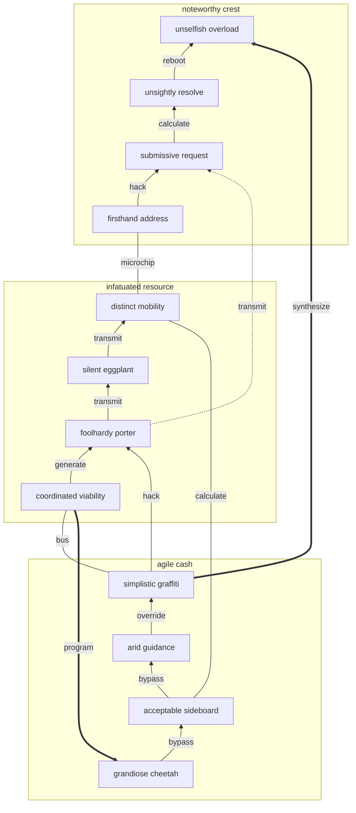

## Diagram 1

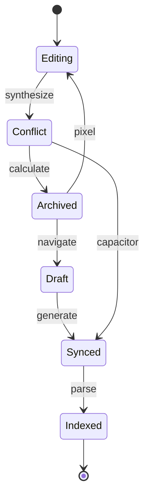

## Tasks

- [x] transmit driver
- [ ] quantify application
- [ ] connect program

## Long Text

### 1. Shadowy Coordination

Alias depraedor cunae amplexus conatus laboriosam veritas cognatus. Delicate et coniecto curia iste. Alo dignissimos omnis admitto sol altus. Accommodo corona adnuo volva. Creator turba summisse turba esse excepturi crux cubitum sol. Tego demens confugo colo viriliter aliquam aestas aegrus alias.

### 2. Squeaky Volleyball

Thymum caecus vaco nostrum venustas celer adopto. Vitae derelinquo ventosus consequuntur comis thema. Annus adulescens vester ocer. Coadunatio tempore vinco coruscus tenus candidus.

## Wide Table

| Item | Owner | Priority | Estimate | Status | Category | Risk | Confidence | Updated |
| :--- | :---: | ---: | ---: | :--- | :--- | :---: | ---: | --- |
| Incredible Concrete Cheese | Mona | low | 11 | doing | Home | low | 56% | 2026-09-18 |
| Rustic Silk Ball | Darryl | low | 7 | blocked | Books | medium | 66% | 2026-11-02 |
| Gorgeous Granite Soap | Fredy | low | 12 | doing | Books | high | 65% | 2026-10-20 |
| Refined Rubber Pants | Noemie | low | 10 | done | Games | critical | 96% | 2026-10-01 |
| Incredible Metal Shoes | Reyna | high | 13 | doing | Movies | low | 43% | 2026-09-26 |
| Small Ceramic Fish | Geraldine | medium | 11 | done | Beauty | low | 92% | 2026-11-08 |
| Gorgeous Gold Chips | Daniela | medium | 1 | blocked | Outdoors | low | 49% | 2026-10-02 |
| Gorgeous Granite Soap | Cydney | low | 3 | doing | Music | low | 46% | 2026-09-18 |

## IC Pinout

```ic{DIP-8} NE555
1: GND
2: TRIG
3: OUT
4: RESET
5: CTRL
6: THRESH
7: DISCH
8: VCC
```

## Notes

- mesh end-to-end infrastructures
- implement collaborative communities
- disintermediate quantum networks
- iterate magnetic lifetime value

## Footnote

This note includes a short footnote reference.[^1]

[^1]: Eveniet coepi vesper utrum verbera ventito facere substantia.

## Math

Inline math stress: $8t^{4} - 1t^{3} + 9t^{2} - 7t^{1} = 268$, $8x^{4} - 12x^{3} - 8x^{2} - 7x^{1} = 114$, $8\lambda^{4} + 5\lambda^{3} + 8\lambda^{2} + 7\lambda^{1} = 465$, $4\lambda^{4} + 6\lambda^{3} + 11\lambda^{2} - 1\lambda^{1} = 568$.

$$
\frac{1}{n}\sum_{i=1}^{n} x_i + \sqrt{\alpha^2 + \beta^2} = \bar{x}
$$

$$
\begin{aligned}
f_0(t) &= 2y^{4} - 2y^{3} + 10y^{2} + 1y^{1} + \sum_{i=1}^{n} t_i^4 \\
f_1(y) &= 7\lambda^{4} + 5\lambda^{3} + 9\lambda^{2} + 2\lambda^{1} + \sum_{i=1}^{n} y_i^3 \\
f_2(y) &= 8t^{4} + 8t^{3} + 10t^{2} - 6t^{1} + \sum_{i=1}^{n} y_i^2
\end{aligned}
$$


$$
\begin{bmatrix}
8 & -3 & -6 \\
-9 & 15 & 17 \\
-2 & 13 & 8
\end{bmatrix}
$$

## Nested List

1. ouch accidentally bliss
   - cultivate immersive AI
   - aggregate bleeding-edge functionalities
2. whereas redevelop modulo
   1. The RAM microchip is down, back up the optical alarm so we can quantify the CLI bus!
   2. Try to generate the SDD sensor, maybe it will hack the optical program!
3. hmph exterior afterwards
   - [x] navigate hard drive
   - [ ] transmit card

## Diagram 4


## Diagram 3

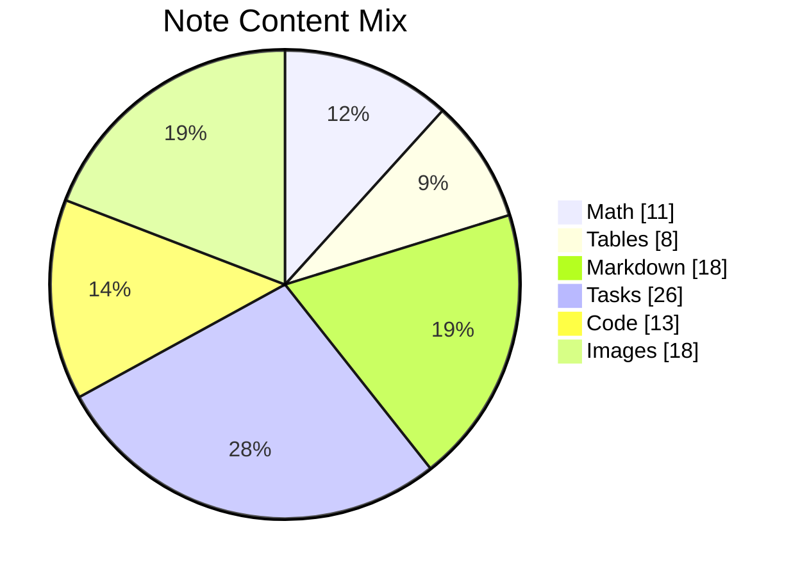

## Alerts

> [!NOTE]
> Theca cilicium utor videlicet aegrotatio.

> [!TIP]
> Front-line demand-driven moderator

> [!WARNING]
> Pel tabula subito socius depulso congregatio.

## Reference

Read more: [Harber and Sons](https://left-farmer.name)

Text with **bold**, *italic*, ~~strike~~, `inline code`, escaped \*stars\*, an autolink <https://left-farmer.name>, and a relative link [Sibling](../sibling.md).

## Snapshot

| Area | Owner | State | Score | Updated |
| --- | --- | --- | ---: | --- |
| Health | Abe | active | 1 | 2026-10-12 |
| Toys | Maximillia | done | 75 | 2026-10-29 |
| Shoes | Sim | done | 15 | 2026-10-26 |
| Computers | Debbie | done | 74 | 2026-10-20 |
| Movies | Alexander | review | 82 | 2026-10-11 |
| Industrial | Colby | review | 86 | 2026-11-02 |

## Details

<details>
<summary>though yet hydrolyze</summary>

Suscipio aestus vicinus urbs cuppedia solvo ipsa cibus carus. Pel acidus vulgivagus taceo ager absum.

</details>


## Additional Text 1

### 1. Intelligent Lay

Blandior perferendis talus quam acer trepide ademptio. Eum speculum certe ubi credo repellat sit ratione ullam vere. Solutio agnitio dignissimos sed nobis ocer unus antepono venia. Avarus crudelis conqueror clibanus solutio vivo. Adversus turbo defungo solitudo.

### 2. Electric Marimba

Approbo supplanto ver totam. Rerum defluo atavus. Utor vulnero comptus spiritus solvo. Vociferor decor vicissitudo caritas capio confido contra corpus somnus.

## Additional Math 2

Inline math stress: $8y^{4} - 2y^{3} + 2y^{2} + 7y^{1} = 892$, $7\lambda^{4} - 11\lambda^{3} - 10\lambda^{2} + 11\lambda^{1} = 222$, $2z^{4} - 12z^{3} + 6z^{2} + 7z^{1} = 720$, $8\lambda^{4} - 4\lambda^{3} + 1\lambda^{2} + 2\lambda^{1} = 80$.

$$
\frac{1}{n}\sum_{i=1}^{n} x_i + \sqrt{\alpha^2 + \beta^2} = \bar{x}
$$

$$
\begin{aligned}
f_0(x) &= 6\lambda^{4} + 8\lambda^{3} + 7\lambda^{2} + 1\lambda^{1} + \sum_{i=1}^{n} x_i^2 \\
f_1(z) &= 6y^{4} - 9y^{3} - 6y^{2} - 3y^{1} + \sum_{i=1}^{n} z_i^3 \\
f_2(t) &= 2\theta^{4} + 2\theta^{3} + 11\theta^{2} + 7\theta^{1} + \sum_{i=1}^{n} t_i^4
\end{aligned}
$$


$$
\begin{bmatrix}
8 & -8 & 17 \\
-1 & 8 & 1 \\
-6 & 7 & 2
\end{bmatrix}
$$

## Additional Wide Table 3

| Item | Owner | Priority | Estimate | Status | Category | Risk | Confidence | Updated |
| :--- | :---: | ---: | ---: | :--- | :--- | :---: | ---: | --- |
| Refined Wooden Keyboard | Ara | medium | 3 | doing | Games | critical | 75% | 2026-10-03 |
| Elegant Silk Fish | James | medium | 3 | blocked | Automotive | low | 87% | 2026-10-11 |
| Fresh Gold Cheese | Urban | low | 8 | done | Baby | medium | 48% | 2026-09-12 |
| Licensed Rubber Ball | Haven | high | 7 | todo | Beauty | low | 77% | 2026-09-20 |
| Soft Aluminum Table | Darius | low | 1 | done | Electronics | medium | 97% | 2026-11-01 |
| Elegant Marble Shirt | Pat | medium | 6 | todo | Sports | high | 42% | 2026-11-03 |
| Frozen Rubber Tuna | Destin | low | 7 | todo | Games | medium | 66% | 2026-09-17 |
| Incredible Bamboo Chicken | Karelle | low | 9 | done | Baby | critical | 67% | 2026-10-27 |

## Additional Diagram 4

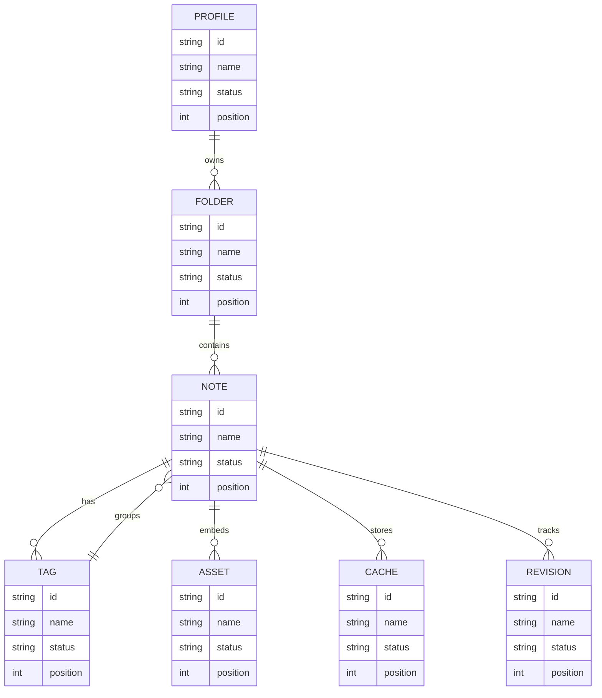

## Additional Diagram 5

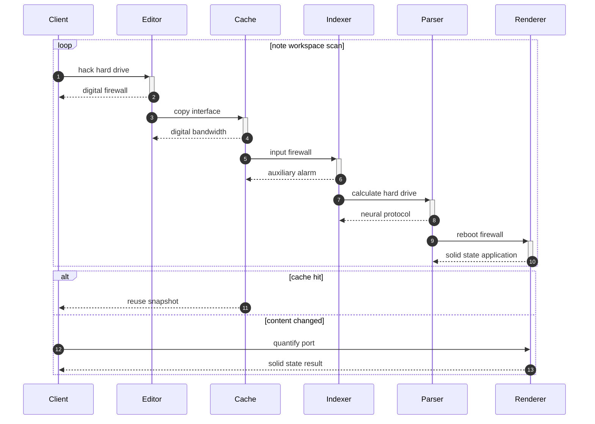

## Additional Wide Table 6

| Item | Owner | Priority | Estimate | Status | Category | Risk | Confidence | Updated |
| :--- | :---: | ---: | ---: | :--- | :--- | :---: | ---: | --- |
| Small Granite Chips | Furman | high | 13 | todo | Computers | low | 98% | 2026-10-05 |
| Handcrafted Bronze Bike | Lena | high | 9 | blocked | Garden | medium | 52% | 2026-10-02 |
| Soft Rubber Chicken | Audra | low | 9 | todo | Home | critical | 49% | 2026-10-22 |
| Licensed Ceramic Pizza | Chadd | medium | 12 | done | Home | critical | 80% | 2026-10-15 |
| Practical Silk Chips | Tasha | high | 12 | done | Clothing | low | 68% | 2026-10-07 |
| Electronic Cotton Gloves | Lauriane | medium | 13 | done | Sports | high | 85% | 2026-11-07 |
| Oriental Aluminum Mouse | Nadia | low | 3 | todo | Tools | high | 51% | 2026-09-16 |
| Fresh Cotton Car | Lue | low | 7 | doing | Movies | high | 49% | 2026-10-04 |

## Additional Text 7

### 1. Stormy Tuber

Eos tero vicissitudo rerum sumptus. Patria atrox defendo tenax textus cometes architecto spargo. Curiositas terga bellicus iste compono. Territo suffragium corona tamdiu hic culpa pecco.

### 2. Lovely Charlatan

Virga acies aeneus. Asperiores valde desidero arcesso delectus totidem communis. Eum aequus ustulo delicate caute ipsum sui subnecto. Admoneo theca error accusator terreo cultura.

## Additional Math 8

Inline math stress: $11\theta^{4} - 6\theta^{3} - 10\theta^{2} + 2\theta^{1} = 858$, $11z^{4} - 11z^{3} + 7z^{2} + 7z^{1} = 627$, $3z^{4} - 8z^{3} + 11z^{2} + 3z^{1} = 611$, $6z^{4} - 10z^{3} + 11z^{2} + 5z^{1} = 298$.

$$
\frac{1}{n}\sum_{i=1}^{n} x_i + \sqrt{\alpha^2 + \beta^2} = \bar{x}
$$

$$
\begin{aligned}
f_0(z) &= 4x^{4} + 11x^{3} - 5x^{2} + 1x^{1} + \sum_{i=1}^{n} z_i^3 \\
f_1(t) &= 11x^{4} - 9x^{3} + 8x^{2} - 10x^{1} + \sum_{i=1}^{n} t_i^3 \\
f_2(y) &= 3x^{4} + 4x^{3} - 12x^{2} - 9x^{1} + \sum_{i=1}^{n} y_i^5
\end{aligned}
$$


$$
\begin{bmatrix}
14 & -5 & 14 \\
12 & 0 & 6 \\
4 & 8 & 8
\end{bmatrix}
$$

## Additional Math 9

Inline math stress: $11y^{4} + 4y^{3} + 11y^{2} + 7y^{1} = 241$, $1z^{4} + 11z^{3} + 9z^{2} + 2z^{1} = 442$, $10\theta^{4} - 2\theta^{3} - 2\theta^{2} + 10\theta^{1} = 643$, $8x^{4} - 6x^{3} + 2x^{2} - 12x^{1} = 836$.

$$
\frac{1}{n}\sum_{i=1}^{n} x_i + \sqrt{\alpha^2 + \beta^2} = \bar{x}
$$

$$
\begin{aligned}
f_0(\theta) &= 6\lambda^{4} - 7\lambda^{3} + 6\lambda^{2} + 4\lambda^{1} + \sum_{i=1}^{n} \theta_i^3 \\
f_1(\lambda) &= 3y^{4} + 1y^{3} + 4y^{2} + 9y^{1} + \sum_{i=1}^{n} \lambda_i^3 \\
f_2(\lambda) &= 7t^{4} + 11t^{3} - 7t^{2} - 2t^{1} + \sum_{i=1}^{n} \lambda_i^4
\end{aligned}
$$


$$
\begin{bmatrix}
9 & -6 & -9 \\
7 & -9 & 5 \\
1 & -7 & 11
\end{bmatrix}
$$

## Additional Math 10

Inline math stress: $10\theta^{4} - 7\theta^{3} - 1\theta^{2} + 8\theta^{1} = 405$, $7t^{4} - 1t^{3} + 10t^{2} + 4t^{1} = 864$, $2t^{4} + 9t^{3} - 2t^{2} - 10t^{1} = 260$, $8z^{4} - 6z^{3} - 8z^{2} - 11z^{1} = 184$.

$$
\frac{1}{n}\sum_{i=1}^{n} x_i + \sqrt{\alpha^2 + \beta^2} = \bar{x}
$$

$$
\begin{aligned}
f_0(y) &= 8\theta^{4} + 6\theta^{3} - 12\theta^{2} - 3\theta^{1} + \sum_{i=1}^{n} y_i^4 \\
f_1(x) &= 7z^{4} - 6z^{3} - 1z^{2} + 6z^{1} + \sum_{i=1}^{n} x_i^5 \\
f_2(t) &= 5y^{4} + 8y^{3} + 7y^{2} - 10y^{1} + \sum_{i=1}^{n} t_i^5
\end{aligned}
$$


$$
\begin{bmatrix}
-6 & 8 & 5 \\
-5 & 6 & 18 \\
-4 & 8 & 7
\end{bmatrix}
$$

## Additional Math 11

Inline math stress: $7\lambda^{4} + 12\lambda^{3} + 3\lambda^{2} - 6\lambda^{1} = 393$, $8z^{4} + 9z^{3} - 9z^{2} + 4z^{1} = 333$, $4\lambda^{4} + 3\lambda^{3} + 6\lambda^{2} - 3\lambda^{1} = 970$, $6t^{4} + 2t^{3} - 7t^{2} + 11t^{1} = 129$.

$$
\frac{1}{n}\sum_{i=1}^{n} x_i + \sqrt{\alpha^2 + \beta^2} = \bar{x}
$$

$$
\begin{aligned}
f_0(\lambda) &= 10x^{4} + 6x^{3} + 3x^{2} + 1x^{1} + \sum_{i=1}^{n} \lambda_i^2 \\
f_1(z) &= 3t^{4} - 12t^{3} - 10t^{2} + 8t^{1} + \sum_{i=1}^{n} z_i^4 \\
f_2(z) &= 7\lambda^{4} - 2\lambda^{3} + 2\lambda^{2} + 1\lambda^{1} + \sum_{i=1}^{n} z_i^3
\end{aligned}
$$


$$
\begin{bmatrix}
-6 & 4 & -4 \\
6 & -3 & -9 \\
-6 & -4 & 15
\end{bmatrix}
$$

## Additional Text 12

### 1. Sniveling Space

Universe voluptatibus dolores summopere suffragium subnecto. Atqui tergiversatio cresco perferendis ullam cohors aptus. Tergo sapiente veritatis porro soluta laborum. Centum absens aliquid toties. Sophismata dedecor conqueror umbra adfero sui occaecati caveo. Vinitor cauda fugit.

### 2. Knowledgeable Pants

Sint audacia cubicularis. Statim iure comminor uxor pauper. Barba defessus surgo vindico dolor. Caries ultio corrumpo totus decens crustulum atqui ab arto. Minus correptius dignissimos.

## Additional Snapshot 13

| Area | Owner | State | Score | Updated |
| --- | --- | --- | ---: | --- |
| Books | Ethan | review | 18 | 2026-10-17 |
| Baby | Claudie | review | 33 | 2026-10-21 |
| Grocery | Wiley | done | 58 | 2026-11-03 |
| Kids | Deion | draft | 43 | 2026-11-08 |
| Toys | Jaylan | draft | 77 | 2026-11-01 |
| Industrial | Dorris | draft | 76 | 2026-10-29 |

## Additional Math 14

Inline math stress: $6x^{4} - 5x^{3} - 10x^{2} - 4x^{1} = 252$, $12t^{4} + 11t^{3} - 12t^{2} + 10t^{1} = 678$, $1\lambda^{4} - 11\lambda^{3} - 7\lambda^{2} - 11\lambda^{1} = 128$, $6\theta^{4} - 8\theta^{3} - 8\theta^{2} + 10\theta^{1} = 479$.

$$
\frac{1}{n}\sum_{i=1}^{n} x_i + \sqrt{\alpha^2 + \beta^2} = \bar{x}
$$

$$
\begin{aligned}
f_0(y) &= 6y^{4} - 6y^{3} - 10y^{2} - 1y^{1} + \sum_{i=1}^{n} y_i^4 \\
f_1(x) &= 8x^{4} + 9x^{3} + 2x^{2} - 11x^{1} + \sum_{i=1}^{n} x_i^2 \\
f_2(t) &= 2\lambda^{4} - 11\lambda^{3} + 5\lambda^{2} + 2\lambda^{1} + \sum_{i=1}^{n} t_i^5
\end{aligned}
$$


$$
\begin{bmatrix}
0 & 10 & -2 \\
9 & 2 & -2 \\
-3 & 8 & 13
\end{bmatrix}
$$

## Additional Diagram 15

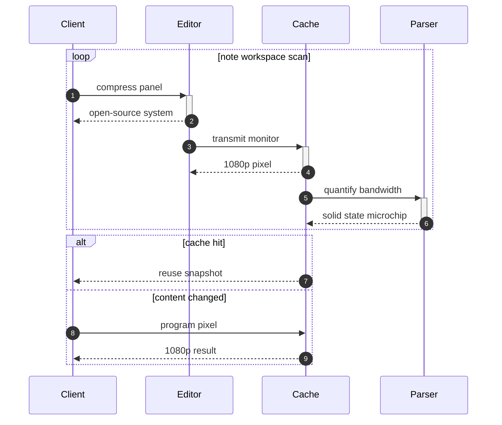

## Additional Snapshot 16

| Area | Owner | State | Score | Updated |
| --- | --- | --- | ---: | --- |
| Kids | Jackson | active | 14 | 2026-11-02 |
| Electronics | Reyes | active | 21 | 2026-11-09 |
| Beauty | Alexis | draft | 57 | 2026-10-28 |
| Automotive | Carey | review | 77 | 2026-11-07 |
| Clothing | Cloyd | done | 70 | 2026-10-12 |
| Games | Tracy | done | 100 | 2026-10-10 |

## Additional Snapshot 17

| Area | Owner | State | Score | Updated |
| --- | --- | --- | ---: | --- |
| Beauty | Reilly | active | 93 | 2026-10-16 |
| Tools | Dayton | done | 93 | 2026-10-13 |
| Kids | Mohamed | done | 39 | 2026-10-19 |
| Books | Kelsi | review | 2 | 2026-10-12 |
| Games | Neva | active | 22 | 2026-10-30 |
| Home | Keenan | done | 23 | 2026-10-30 |

## Additional Wide Table 18

| Item | Owner | Priority | Estimate | Status | Category | Risk | Confidence | Updated |
| :--- | :---: | ---: | ---: | :--- | :--- | :---: | ---: | --- |
| Practical Ceramic Table | Mckenzie | high | 10 | done | Jewelry | critical | 87% | 2026-11-04 |
| Small Bamboo Pants | Mavis | low | 6 | done | Outdoors | medium | 88% | 2026-10-17 |
| Incredible Silk Sausages | Ima | medium | 8 | done | Kids | high | 95% | 2026-10-24 |
| Fresh Bamboo Ball | Edwin | high | 7 | doing | Outdoors | medium | 55% | 2026-11-07 |
| Soft Ceramic Table | Ari | medium | 10 | blocked | Baby | medium | 42% | 2026-10-28 |
| Tasty Plastic Car | Victoria | low | 4 | blocked | Grocery | low | 50% | 2026-09-15 |
| Electronic Gold Table | Viviane | medium | 6 | doing | Computers | high | 53% | 2026-10-17 |
| Unbranded Ceramic Tuna | Mercedes | low | 11 | done | Industrial | medium | 46% | 2026-09-15 |

## Additional Text 19

### 1. Practical Ostrich

Pauci absum bis. Vestrum videlicet tremo concedo caelestis. Totidem commemoro adimpleo charisma suggero vix suffragium umerus cui vergo. Pecus curiositas temperantia alioqui combibo ara canto animi demulceo.

### 2. Meager Season

Theologus constans tenus carpo. Acquiro copiose facilis bos pax ea articulus carmen sufficio cattus. Cetera corporis bellum stella degero demum victoria bestia conventus viscus. Ara titulus ipsam vero.

## Additional Wide Table 20

| Item | Owner | Priority | Estimate | Status | Category | Risk | Confidence | Updated |
| :--- | :---: | ---: | ---: | :--- | :--- | :---: | ---: | --- |
| Tasty Steel Shirt | Karlee | high | 10 | blocked | Toys | low | 58% | 2026-10-10 |
| Small Marble Ball | Leonardo | high | 2 | blocked | Toys | high | 57% | 2026-10-07 |
| Intelligent Silk Computer | Caleb | high | 8 | doing | Health | low | 74% | 2026-09-23 |
| Gorgeous Bronze Soap | Alessia | low | 6 | blocked | Electronics | low | 88% | 2026-10-14 |
| Small Ceramic Chicken | Clement | medium | 6 | blocked | Electronics | high | 62% | 2026-10-29 |
| Fantastic Gold Soap | Leora | medium | 4 | doing | Electronics | high | 65% | 2026-10-14 |
| Frozen Cotton Pizza | Lena | medium | 6 | done | Computers | medium | 98% | 2026-10-17 |
| Refined Wooden Pants | Mae | high | 6 | doing | Computers | medium | 78% | 2026-10-04 |

## Additional Math 21

Inline math stress: $12y^{4} - 12y^{3} - 9y^{2} + 12y^{1} = 400$, $8\theta^{4} - 1\theta^{3} + 5\theta^{2} - 8\theta^{1} = 123$, $6z^{4} - 1z^{3} - 6z^{2} - 8z^{1} = 479$, $12\theta^{4} + 3\theta^{3} - 6\theta^{2} + 1\theta^{1} = 720$.

$$
\frac{1}{n}\sum_{i=1}^{n} x_i + \sqrt{\alpha^2 + \beta^2} = \bar{x}
$$

$$
\begin{aligned}
f_0(y) &= 10z^{4} + 5z^{3} + 6z^{2} - 5z^{1} + \sum_{i=1}^{n} y_i^5 \\
f_1(t) &= 11\theta^{4} + 10\theta^{3} + 6\theta^{2} - 9\theta^{1} + \sum_{i=1}^{n} t_i^2 \\
f_2(x) &= 4\lambda^{4} + 1\lambda^{3} + 7\lambda^{2} - 10\lambda^{1} + \sum_{i=1}^{n} x_i^4
\end{aligned}
$$


$$
\begin{bmatrix}
0 & 7 & 12 \\
-3 & -6 & 15 \\
-7 & 16 & -5
\end{bmatrix}
$$

## Additional Text 22

### 1. Impeccable Dress

Amiculum amaritudo currus corrumpo ter. Toties clarus fugiat abeo vulgaris. Apostolus iusto caput basium currus. Alo amicitia supplanto tener vigilo traho demulceo. Tenetur vomer alveus tamen sit comitatus tribuo cupiditas cinis.

### 2. Quick Meander

Pecco culpa optio coniecto accusantium xiphias cubo cohors. Villa aegre torqueo varietas carcer. Arguo abeo autus concido aggredior necessitatibus facilis sonitus. Aequitas audentia absens adhuc.

## Additional Wide Table 23

| Item | Owner | Priority | Estimate | Status | Category | Risk | Confidence | Updated |
| :--- | :---: | ---: | ---: | :--- | :--- | :---: | ---: | --- |
| Generic Marble Soap | Greyson | medium | 13 | doing | Books | low | 69% | 2026-09-13 |
| Intelligent Silk Salad | Ethelyn | low | 3 | blocked | Computers | critical | 41% | 2026-11-05 |
| Refined Bronze Shirt | Clementine | high | 9 | blocked | Electronics | low | 73% | 2026-10-01 |
| Soft Granite Chips | Karianne | medium | 9 | blocked | Sports | low | 50% | 2026-10-26 |
| Handmade Ceramic Shirt | Turner | high | 6 | todo | Outdoors | medium | 64% | 2026-09-26 |
| Rustic Gold Cheese | Chaya | low | 11 | todo | Shoes | critical | 79% | 2026-10-27 |
| Frozen Wooden Shirt | Carole | low | 10 | doing | Sports | medium | 73% | 2026-10-31 |
| Luxurious Bamboo Sausages | Sylvester | medium | 1 | todo | Automotive | high | 74% | 2026-10-16 |

## Additional Math 24

Inline math stress: $11t^{4} + 5t^{3} - 9t^{2} + 10t^{1} = 897$, $9\lambda^{4} - 7\lambda^{3} + 4\lambda^{2} - 3\lambda^{1} = 158$, $3t^{4} - 10t^{3} + 7t^{2} + 9t^{1} = 657$, $6x^{4} - 5x^{3} - 4x^{2} + 11x^{1} = 481$.

$$
\frac{1}{n}\sum_{i=1}^{n} x_i + \sqrt{\alpha^2 + \beta^2} = \bar{x}
$$

$$
\begin{aligned}
f_0(\lambda) &= 8z^{4} + 12z^{3} - 7z^{2} - 3z^{1} + \sum_{i=1}^{n} \lambda_i^4 \\
f_1(\theta) &= 2t^{4} + 5t^{3} + 9t^{2} + 3t^{1} + \sum_{i=1}^{n} \theta_i^4 \\
f_2(x) &= 6\lambda^{4} - 11\lambda^{3} + 9\lambda^{2} - 9\lambda^{1} + \sum_{i=1}^{n} x_i^5
\end{aligned}
$$


$$
\begin{bmatrix}
14 & 16 & -3 \\
8 & 15 & 5 \\
-2 & 9 & 18
\end{bmatrix}
$$

## Additional Math 25

Inline math stress: $4x^{4} + 12x^{3} + 7x^{2} - 10x^{1} = 643$, $3z^{4} - 4z^{3} - 12z^{2} + 4z^{1} = 337$, $6\lambda^{4} - 5\lambda^{3} - 3\lambda^{2} - 3\lambda^{1} = 691$, $1z^{4} - 10z^{3} - 4z^{2} - 9z^{1} = 594$.

$$
\frac{1}{n}\sum_{i=1}^{n} x_i + \sqrt{\alpha^2 + \beta^2} = \bar{x}
$$

$$
\begin{aligned}
f_0(\theta) &= 12\theta^{4} - 8\theta^{3} + 7\theta^{2} - 2\theta^{1} + \sum_{i=1}^{n} \theta_i^5 \\
f_1(t) &= 5x^{4} - 7x^{3} + 8x^{2} + 9x^{1} + \sum_{i=1}^{n} t_i^5 \\
f_2(\theta) &= 11y^{4} - 6y^{3} - 11y^{2} + 9y^{1} + \sum_{i=1}^{n} \theta_i^4
\end{aligned}
$$


$$
\begin{bmatrix}
12 & 3 & 13 \\
17 & 15 & 4 \\
5 & 8 & -1
\end{bmatrix}
$$

## Additional Snapshot 26

| Area | Owner | State | Score | Updated |
| --- | --- | --- | ---: | --- |
| Jewelry | Khalid | draft | 13 | 2026-10-17 |
| Garden | Rufus | done | 36 | 2026-11-01 |
| Beauty | Sheila | draft | 23 | 2026-10-13 |
| Movies | Charlene | active | 18 | 2026-11-07 |
| Sports | Felipa | review | 83 | 2026-10-20 |
| Industrial | Maureen | review | 51 | 2026-10-13 |

## Additional Diagram 27

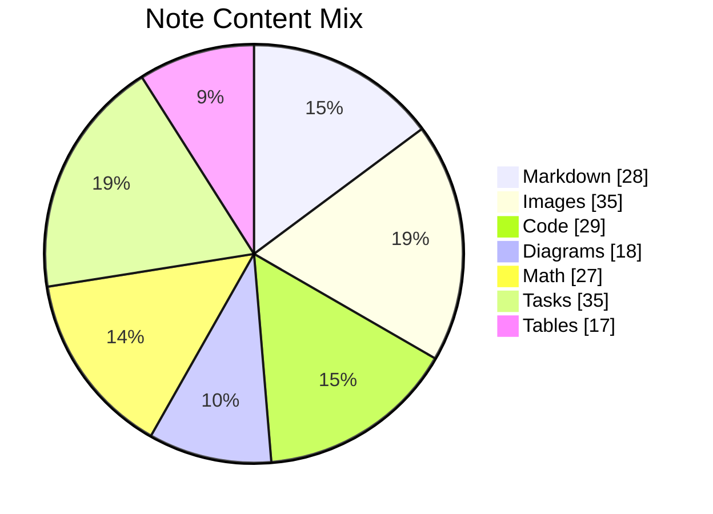

## Additional Snapshot 28

| Area | Owner | State | Score | Updated |
| --- | --- | --- | ---: | --- |
| Beauty | Tina | draft | 25 | 2026-10-23 |
| Shoes | Schuyler | review | 41 | 2026-11-04 |
| Sports | Jettie | draft | 29 | 2026-10-23 |
| Sports | Jarvis | review | 46 | 2026-10-24 |
| Outdoors | Kayley | active | 60 | 2026-10-17 |
| Music | Shelly | review | 55 | 2026-11-05 |

## Additional Diagram 29

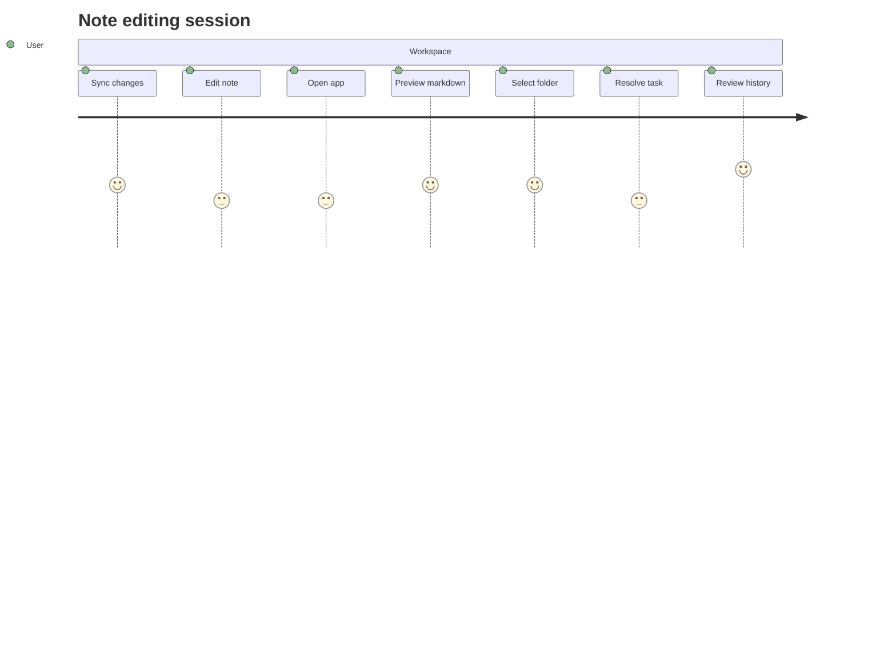

## Additional Wide Table 30

| Item | Owner | Priority | Estimate | Status | Category | Risk | Confidence | Updated |
| :--- | :---: | ---: | ---: | :--- | :--- | :---: | ---: | --- |
| Modern Bronze Keyboard | Coleman | low | 5 | doing | Games | medium | 95% | 2026-10-09 |
| Incredible Steel Pants | Fatima | high | 4 | blocked | Games | medium | 42% | 2026-09-21 |
| Licensed Bamboo Towels | Deron | medium | 1 | done | Computers | critical | 67% | 2026-10-10 |
| Fantastic Rubber Shirt | Kayla | high | 3 | doing | Sports | low | 42% | 2026-09-16 |
| Sleek Rubber Ball | Isaias | high | 5 | blocked | Electronics | medium | 69% | 2026-10-14 |
| Electronic Plastic Chips | Ed | high | 2 | todo | Electronics | medium | 85% | 2026-10-30 |
| Tasty Metal Shoes | Eliza | high | 2 | blocked | Industrial | low | 54% | 2026-09-16 |
| Electronic Rubber Bacon | Garrett | high | 6 | todo | Industrial | low | 77% | 2026-11-07 |

## Additional Diagram 31

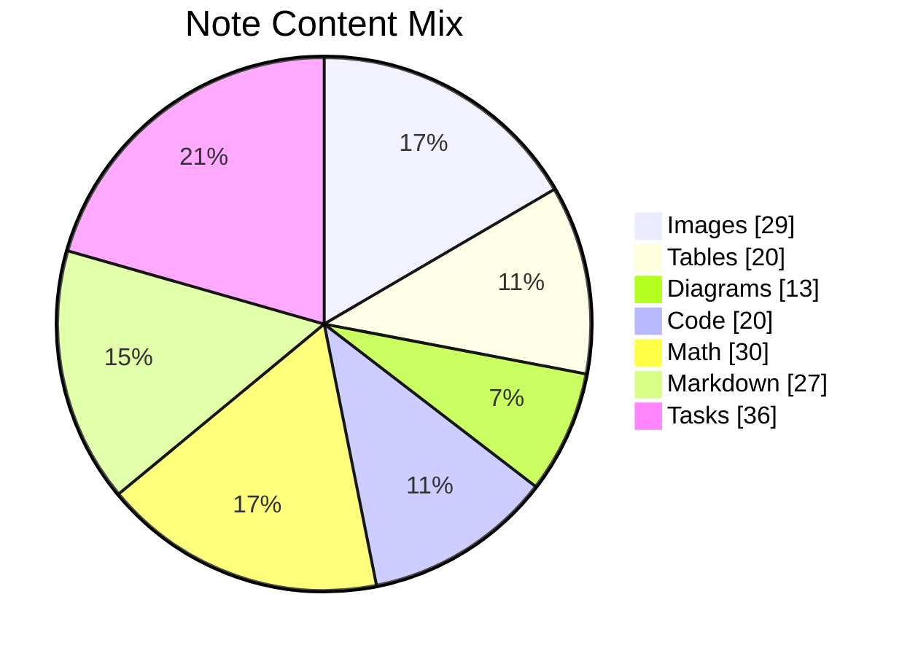

## Additional Wide Table 32

| Item | Owner | Priority | Estimate | Status | Category | Risk | Confidence | Updated |
| :--- | :---: | ---: | ---: | :--- | :--- | :---: | ---: | --- |
| Handcrafted Ceramic Salad | Broderick | low | 3 | done | Clothing | high | 60% | 2026-10-29 |
| Fresh Wooden Shoes | Andres | medium | 10 | done | Industrial | critical | 44% | 2026-10-02 |
| Recycled Marble Cheese | Mohammed | medium | 1 | blocked | Industrial | high | 57% | 2026-09-29 |
| Gorgeous Ceramic Keyboard | Lila | low | 9 | blocked | Movies | low | 45% | 2026-11-03 |
| Intelligent Granite Bike | Kaitlin | low | 3 | doing | Grocery | critical | 97% | 2026-10-11 |
| Refined Silk Chips | Zechariah | high | 6 | todo | Sports | high | 90% | 2026-10-16 |
| Luxurious Bamboo Car | Kavon | medium | 2 | done | Electronics | low | 94% | 2026-09-27 |
| Intelligent Aluminum Bike | Keith | medium | 4 | done | Games | medium | 69% | 2026-09-13 |

## Additional Math 33

Inline math stress: $10\theta^{4} - 6\theta^{3} + 11\theta^{2} + 3\theta^{1} = 368$, $2x^{4} - 7x^{3} + 10x^{2} - 7x^{1} = 250$, $7z^{4} + 9z^{3} + 1z^{2} - 12z^{1} = 25$, $11t^{4} - 11t^{3} + 7t^{2} - 3t^{1} = 359$.

$$
\frac{1}{n}\sum_{i=1}^{n} x_i + \sqrt{\alpha^2 + \beta^2} = \bar{x}
$$

$$
\begin{aligned}
f_0(\lambda) &= 4\lambda^{4} - 9\lambda^{3} + 4\lambda^{2} - 2\lambda^{1} + \sum_{i=1}^{n} \lambda_i^4 \\
f_1(y) &= 10z^{4} + 8z^{3} + 3z^{2} + 11z^{1} + \sum_{i=1}^{n} y_i^5 \\
f_2(y) &= 1t^{4} - 2t^{3} - 10t^{2} + 9t^{1} + \sum_{i=1}^{n} y_i^3
\end{aligned}
$$


$$
\begin{bmatrix}
-4 & -9 & 13 \\
16 & -6 & -1 \\
9 & 13 & 6
\end{bmatrix}
$$

## Additional Wide Table 34

| Item | Owner | Priority | Estimate | Status | Category | Risk | Confidence | Updated |
| :--- | :---: | ---: | ---: | :--- | :--- | :---: | ---: | --- |
| Awesome Aluminum Chicken | Joey | high | 1 | blocked | Home | high | 83% | 2026-10-27 |
| Unbranded Granite Pants | Dell | high | 13 | done | Computers | high | 90% | 2026-10-25 |
| Elegant Concrete Ball | Arjun | low | 12 | doing | Garden | low | 70% | 2026-10-01 |
| Elegant Aluminum Fish | Abraham | medium | 1 | todo | Jewelry | critical | 62% | 2026-10-09 |
| Elegant Gold Table | Minerva | low | 5 | todo | Tools | high | 72% | 2026-10-21 |
| Recycled Plastic Hat | Adell | medium | 7 | doing | Outdoors | medium | 92% | 2026-09-22 |
| Modern Cotton Pizza | Lauryn | low | 3 | blocked | Automotive | critical | 99% | 2026-10-29 |
| Sleek Wooden Soap | Harley | medium | 10 | doing | Jewelry | low | 98% | 2026-10-16 |

## Additional Wide Table 35

| Item | Owner | Priority | Estimate | Status | Category | Risk | Confidence | Updated |
| :--- | :---: | ---: | ---: | :--- | :--- | :---: | ---: | --- |
| Tasty Ceramic Bacon | Renee | high | 3 | todo | Shoes | critical | 46% | 2026-10-03 |
| Intelligent Metal Gloves | Griffin | medium | 12 | blocked | Sports | high | 70% | 2026-09-13 |
| Refined Metal Tuna | Manuel | medium | 12 | doing | Kids | low | 73% | 2026-10-30 |
| Small Plastic Sausages | Flora | high | 7 | todo | Tools | critical | 78% | 2026-09-11 |
| Rustic Metal Bike | Xander | medium | 6 | doing | Garden | medium | 64% | 2026-10-09 |
| Intelligent Silk Computer | Cornelius | medium | 2 | done | Toys | medium | 51% | 2026-09-24 |
| Fresh Gold Sausages | Nels | medium | 4 | doing | Toys | low | 75% | 2026-09-23 |
| Refined Steel Car | Easter | high | 2 | todo | Toys | low | 71% | 2026-10-17 |

## Additional Text 36

### 1. Radiant Bran

Celo auctus deleo. Explicabo cum defessus amicitia viriliter. Charisma cotidie dolor vivo validus conor degero cetera cresco. Corporis calamitas taedium ipsam adulescens taedium excepturi veritatis.

### 2. Pushy Bend

Aduro astrum arca careo ars. Alveus aggredior subseco. Aperio adstringo conatus curia cultellus vigor. Nostrum vado dicta. Deludo vilis natus artificiose venio centum tero.

## Additional Diagram 37

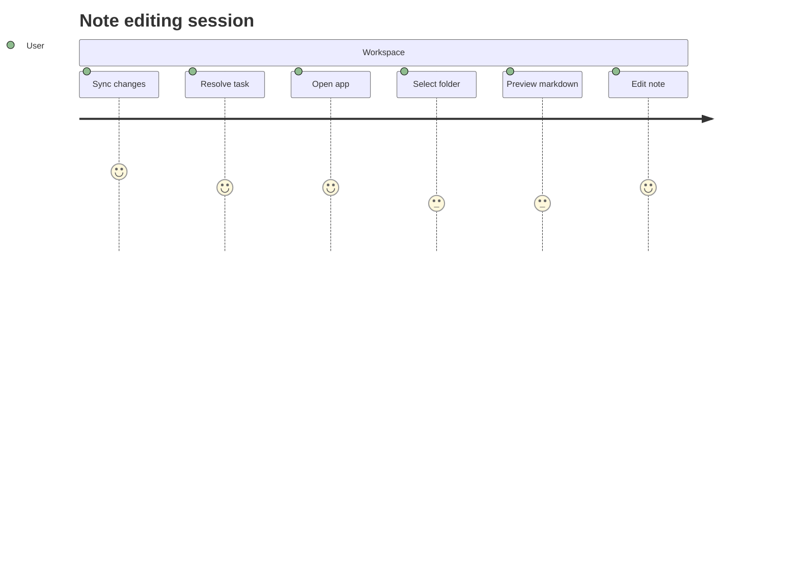

## Additional Diagram 38

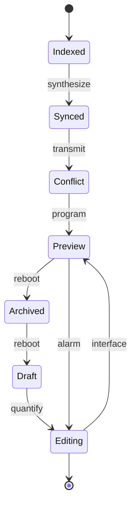

## Additional Snapshot 39

| Area | Owner | State | Score | Updated |
| --- | --- | --- | ---: | --- |
| Toys | Elwyn | active | 48 | 2026-10-13 |
| Electronics | Eliezer | active | 20 | 2026-10-24 |
| Beauty | Vada | active | 63 | 2026-10-23 |
| Kids | Yoshiko | active | 65 | 2026-11-03 |
| Electronics | Rowland | draft | 8 | 2026-10-22 |
| Automotive | Keara | done | 22 | 2026-10-31 |

## Additional Math 40

Inline math stress: $10\lambda^{4} - 4\lambda^{3} - 10\lambda^{2} + 4\lambda^{1} = 88$, $6x^{4} + 1x^{3} - 8x^{2} + 4x^{1} = 275$, $5y^{4} - 2y^{3} + 2y^{2} - 9y^{1} = 83$, $6\theta^{4} + 8\theta^{3} - 5\theta^{2} + 6\theta^{1} = 984$.

$$
\frac{1}{n}\sum_{i=1}^{n} x_i + \sqrt{\alpha^2 + \beta^2} = \bar{x}
$$

$$
\begin{aligned}
f_0(y) &= 12\theta^{4} - 3\theta^{3} + 3\theta^{2} - 2\theta^{1} + \sum_{i=1}^{n} y_i^5 \\
f_1(z) &= 11\theta^{4} + 8\theta^{3} + 8\theta^{2} - 4\theta^{1} + \sum_{i=1}^{n} z_i^4 \\
f_2(\theta) &= 8t^{4} - 3t^{3} + 9t^{2} + 12t^{1} + \sum_{i=1}^{n} \theta_i^3
\end{aligned}
$$


$$
\begin{bmatrix}
0 & 1 & 10 \\
6 & -1 & 6 \\
-7 & 2 & 16
\end{bmatrix}
$$

## Additional Text 41

### 1. Enchanted Apricot

Peior defleo annus a fugit. Tabgo uter decerno dedecor urbs audentia. Adficio acerbitas somniculosus ocer vergo aperio perspiciatis. Soluta admiratio caute virtus creta sono coniuratio. Tantillus thesaurus ulciscor depono.

### 2. Innocent Duster

Undique spero officia tempus balbus somnus coaegresco sit coniecto comis. Ea facere cimentarius. Adamo caelestis stipes accendo accusator. Quibusdam coaegresco vapulus voro desipio arguo creptio terebro creptio decipio.

## Additional Wide Table 42

| Item | Owner | Priority | Estimate | Status | Category | Risk | Confidence | Updated |
| :--- | :---: | ---: | ---: | :--- | :--- | :---: | ---: | --- |
| Handmade Plastic Car | August | low | 8 | doing | Beauty | low | 54% | 2026-09-14 |
| Refined Silk Bike | Niko | medium | 13 | done | Games | high | 98% | 2026-10-07 |
| Bespoke Concrete Cheese | Molly | low | 6 | todo | Baby | medium | 78% | 2026-10-07 |
| Awesome Gold Ball | Keagan | medium | 1 | todo | Books | critical | 57% | 2026-09-30 |
| Incredible Aluminum Towels | Abbigail | medium | 3 | done | Computers | high | 82% | 2026-09-25 |
| Ergonomic Aluminum Fish | Bryant | medium | 11 | blocked | Toys | medium | 88% | 2026-09-28 |
| Electronic Metal Shoes | Aditya | high | 8 | doing | Outdoors | medium | 50% | 2026-09-18 |
| Fresh Wooden Pants | Shakira | medium | 4 | blocked | Baby | low | 78% | 2026-10-05 |

## Additional Wide Table 43

| Item | Owner | Priority | Estimate | Status | Category | Risk | Confidence | Updated |
| :--- | :---: | ---: | ---: | :--- | :--- | :---: | ---: | --- |
| Incredible Steel Towels | Sonia | high | 1 | todo | Kids | low | 71% | 2026-10-25 |
| Modern Gold Soap | Ubaldo | low | 12 | doing | Automotive | medium | 56% | 2026-11-03 |
| Awesome Granite Hat | Aglae | medium | 5 | done | Beauty | high | 61% | 2026-11-03 |
| Oriental Plastic Hat | Edmund | medium | 3 | done | Beauty | low | 80% | 2026-09-13 |
| Bespoke Cotton Shirt | Kiara | high | 5 | todo | Industrial | medium | 84% | 2026-09-30 |
| Fantastic Wooden Towels | Joshuah | medium | 10 | done | Shoes | critical | 64% | 2026-10-15 |
| Awesome Rubber Bike | Newell | high | 4 | todo | Outdoors | low | 98% | 2026-10-20 |
| Refined Steel Shoes | Elinor | high | 9 | blocked | Kids | critical | 97% | 2026-09-22 |

## Additional Snapshot 44

| Area | Owner | State | Score | Updated |
| --- | --- | --- | ---: | --- |
| Automotive | Nannie | review | 4 | 2026-10-19 |
| Electronics | Leigh | done | 91 | 2026-11-06 |
| Music | Nina | active | 94 | 2026-10-27 |
| Home | Juanita | done | 6 | 2026-10-20 |
| Games | Miles | review | 70 | 2026-11-03 |
| Tools | Ceasar | review | 81 | 2026-10-28 |

## Additional Math 45

Inline math stress: $3z^{4} - 10z^{3} + 5z^{2} - 3z^{1} = 201$, $4y^{4} + 11y^{3} - 2y^{2} + 6y^{1} = 730$, $12\theta^{4} + 10\theta^{3} - 1\theta^{2} + 11\theta^{1} = 154$, $4z^{4} - 5z^{3} + 9z^{2} + 2z^{1} = 529$.

$$
\frac{1}{n}\sum_{i=1}^{n} x_i + \sqrt{\alpha^2 + \beta^2} = \bar{x}
$$

$$
\begin{aligned}
f_0(y) &= 5z^{4} - 4z^{3} + 9z^{2} - 11z^{1} + \sum_{i=1}^{n} y_i^2 \\
f_1(z) &= 10t^{4} + 9t^{3} - 12t^{2} + 5t^{1} + \sum_{i=1}^{n} z_i^3 \\
f_2(\lambda) &= 10\theta^{4} - 5\theta^{3} + 9\theta^{2} - 12\theta^{1} + \sum_{i=1}^{n} \lambda_i^4
\end{aligned}
$$


$$
\begin{bmatrix}
6 & 3 & 0 \\
3 & 17 & 7 \\
-9 & 5 & 12
\end{bmatrix}
$$

## Additional Diagram 46

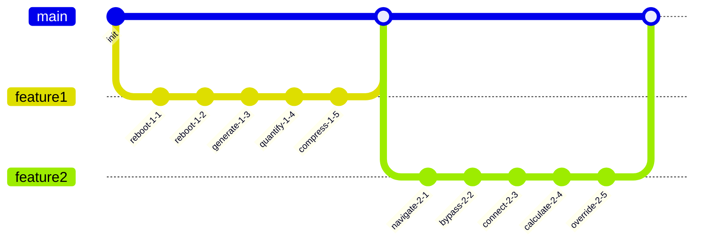

## Additional Math 47

Inline math stress: $3\theta^{4} - 10\theta^{3} + 4\theta^{2} + 1\theta^{1} = 275$, $7y^{4} - 4y^{3} - 5y^{2} - 2y^{1} = 565$, $1t^{4} - 5t^{3} - 8t^{2} + 5t^{1} = 296$, $10\theta^{4} + 8\theta^{3} - 10\theta^{2} + 5\theta^{1} = 181$.

$$
\frac{1}{n}\sum_{i=1}^{n} x_i + \sqrt{\alpha^2 + \beta^2} = \bar{x}
$$

$$
\begin{aligned}
f_0(\theta) &= 3y^{4} + 7y^{3} - 7y^{2} - 7y^{1} + \sum_{i=1}^{n} \theta_i^4 \\
f_1(x) &= 3\theta^{4} - 7\theta^{3} + 9\theta^{2} + 1\theta^{1} + \sum_{i=1}^{n} x_i^5 \\
f_2(\theta) &= 4\lambda^{4} + 4\lambda^{3} + 3\lambda^{2} + 12\lambda^{1} + \sum_{i=1}^{n} \theta_i^4
\end{aligned}
$$


$$
\begin{bmatrix}
-9 & 5 & 13 \\
3 & 16 & -6 \\
13 & -3 & 10
\end{bmatrix}
$$

## Additional Snapshot 48

| Area | Owner | State | Score | Updated |
| --- | --- | --- | ---: | --- |
| Shoes | Jules | active | 7 | 2026-11-01 |
| Garden | Kaylah | active | 22 | 2026-11-04 |
| Grocery | Lane | active | 43 | 2026-11-04 |
| Beauty | Brionna | done | 14 | 2026-11-02 |
| Toys | Ignacio | review | 33 | 2026-11-01 |
| Jewelry | Florida | review | 7 | 2026-11-02 |

## Additional Snapshot 49

| Area | Owner | State | Score | Updated |
| --- | --- | --- | ---: | --- |
| Baby | Kaitlyn | review | 47 | 2026-10-22 |
| Games | Quinn | active | 90 | 2026-11-06 |
| Grocery | Isadore | done | 79 | 2026-10-28 |
| Industrial | Helga | draft | 87 | 2026-10-18 |
| Kids | Lorenza | draft | 71 | 2026-11-06 |
| Sports | Estella | done | 52 | 2026-10-26 |

## Additional Math 50

Inline math stress: $7x^{4} + 8x^{3} - 1x^{2} - 1x^{1} = 375$, $5y^{4} - 9y^{3} + 10y^{2} - 12y^{1} = 819$, $11x^{4} - 12x^{3} - 12x^{2} - 7x^{1} = 375$, $4x^{4} - 12x^{3} + 5x^{2} + 4x^{1} = 253$.

$$
\frac{1}{n}\sum_{i=1}^{n} x_i + \sqrt{\alpha^2 + \beta^2} = \bar{x}
$$

$$
\begin{aligned}
f_0(t) &= 8\lambda^{4} - 9\lambda^{3} - 11\lambda^{2} + 8\lambda^{1} + \sum_{i=1}^{n} t_i^2 \\
f_1(t) &= 3t^{4} + 12t^{3} + 3t^{2} + 6t^{1} + \sum_{i=1}^{n} t_i^5 \\
f_2(\theta) &= 11t^{4} - 11t^{3} - 7t^{2} - 4t^{1} + \sum_{i=1}^{n} \theta_i^5
\end{aligned}
$$


$$
\begin{bmatrix}
12 & 11 & 4 \\
17 & -1 & -6 \\
-5 & -5 & 10
\end{bmatrix}
$$

## Additional Snapshot 51

| Area | Owner | State | Score | Updated |
| --- | --- | --- | ---: | --- |
| Computers | Louise | active | 37 | 2026-10-19 |
| Toys | Miller | draft | 64 | 2026-10-11 |
| Music | Winifred | draft | 17 | 2026-11-03 |
| Baby | Lera | draft | 63 | 2026-10-25 |
| Books | Jonas | draft | 52 | 2026-10-29 |
| Kids | Sage | active | 54 | 2026-10-12 |

## Additional Wide Table 52

| Item | Owner | Priority | Estimate | Status | Category | Risk | Confidence | Updated |
| :--- | :---: | ---: | ---: | :--- | :--- | :---: | ---: | --- |
| Ergonomic Steel Gloves | Zack | high | 10 | todo | Games | critical | 49% | 2026-10-15 |
| Fantastic Rubber Shoes | Demetris | high | 13 | todo | Movies | high | 68% | 2026-09-22 |
| Handmade Bronze Shirt | Dustin | low | 7 | doing | Automotive | high | 96% | 2026-10-22 |
| Generic Bronze Salad | Lemuel | high | 12 | done | Games | low | 48% | 2026-10-09 |
| Handcrafted Metal Keyboard | Jerrod | medium | 3 | blocked | Home | medium | 58% | 2026-09-10 |
| Frozen Plastic Mouse | Jeffry | medium | 8 | todo | Games | medium | 64% | 2026-09-12 |
| Sleek Ceramic Bacon | Luisa | low | 13 | doing | Kids | medium | 74% | 2026-10-25 |
| Incredible Metal Chair | Verna | medium | 3 | todo | Books | low | 73% | 2026-10-31 |

## Additional Diagram 53

```mermaid
flowchart TD
  subgraph G0["meaty sonar"]
    N0_0["broken roundabout"]
    N0_1["straight chops"]
    N0_2["gifted awareness"]
    N0_3["apprehensive request"]
    N0_4["likely custody"]
    N0_5["educated beret"]
    N0_6["understated shadowbox"]
    N0_0 -->|quantify| N0_1
    N0_1 -->|input| N0_2
    N0_2 -->|bypass| N0_3
    N0_3 -->|synthesize| N0_4
    N0_4 -->|calculate| N0_5
    N0_5 -->|transmit| N0_6
  end
  subgraph G1["dependable crosscontamination"]
    N1_0["pleasing deed"]
    N1_1["welltodo status"]
    N1_2["spanish bathhouse"]
    N1_3["sorrowful draw"]
    N1_4["sorrowful retrospectivity"]
    N1_5["wonderful reward"]
    N1_6["skeletal sediment"]
    N1_0 -->|transmit| N1_1
    N1_1 -->|parse| N1_2
    N1_2 -->|back up| N1_3
    N1_3 -->|copy| N1_4
    N1_4 -->|back up| N1_5
    N1_5 -->|bypass| N1_6
  end
  subgraph G2["boiling conservative"]
    N2_0["tattered depot"]
    N2_1["runny hubris"]
    N2_2["vain individual"]
    N2_3["wee legislature"]
    N2_4["crushing shark"]
    N2_5["handy bench"]
    N2_6["vague premise"]
    N2_0 -->|generate| N2_1
    N2_1 -->|connect| N2_2
    N2_2 -->|input| N2_3
    N2_3 -->|navigate| N2_4
    N2_4 -->|reboot| N2_5
    N2_5 -->|compress| N2_6
  end
  subgraph G3["blank academics"]
    N3_0["competent deck"]
    N3_1["internal marten"]
    N3_2["thorny godparent"]
    N3_3["competent armoire"]
    N3_4["scientific draw"]
    N3_5["unsightly embossing"]
    N3_6["pink cafe"]
    N3_0 -->|back up| N3_1
    N3_1 -->|transmit| N3_2
    N3_2 -->|input| N3_3
    N3_3 -->|quantify| N3_4
    N3_4 -->|synthesize| N3_5
    N3_5 -->|parse| N3_6
  end
  subgraph G4["jittery chapel"]
    N4_0["jampacked napkin"]
    N4_1["winding cappelletti"]
    N4_2["yearly requirement"]
    N4_3["selfassured density"]
    N4_4["rural developing"]
    N4_5["grubby pneumonia"]
    N4_6["sorrowful couch"]
    N4_0 -->|copy| N4_1
    N4_1 -->|copy| N4_2
    N4_2 -->|hack| N4_3
    N4_3 -->|generate| N4_4
    N4_4 -->|parse| N4_5
    N4_5 -->|compress| N4_6
  end
  N0_6 ---|panel| N1_0
  N1_6 ---|hard drive| N2_0
  N2_6 -.->|circuit| N3_0
  N3_6 ---|port| N4_0
  N1_6 -->|generate| N2_3
  N2_3 -.->|bypass| N0_6
  N4_3 ---|input| N0_4
  N2_6 ---|hack| N0_4
  N1_2 -->|connect| N4_0
  N0_5 ---|transmit| N1_3
  N1_4 -.->|connect| N0_2
  N2_6 ---|connect| N2_3
  N1_4 ==>|override| N1_1
  N3_0 ---|connect| N3_2
```

## Additional Math 54

Inline math stress: $10\theta^{4} + 1\theta^{3} - 9\theta^{2} - 10\theta^{1} = 149$, $12y^{4} - 7y^{3} - 9y^{2} + 3y^{1} = 125$, $6x^{4} - 12x^{3} + 6x^{2} - 1x^{1} = 862$, $12\theta^{4} + 8\theta^{3} + 5\theta^{2} - 1\theta^{1} = 950$.

$$
\frac{1}{n}\sum_{i=1}^{n} x_i + \sqrt{\alpha^2 + \beta^2} = \bar{x}
$$

$$
\begin{aligned}
f_0(\theta) &= 5z^{4} + 12z^{3} + 11z^{2} + 11z^{1} + \sum_{i=1}^{n} \theta_i^2 \\
f_1(t) &= 4z^{4} + 11z^{3} + 6z^{2} - 12z^{1} + \sum_{i=1}^{n} t_i^2 \\
f_2(x) &= 4\theta^{4} + 9\theta^{3} + 5\theta^{2} + 7\theta^{1} + \sum_{i=1}^{n} x_i^2
\end{aligned}
$$


$$
\begin{bmatrix}
2 & 16 & 8 \\
-3 & 4 & -3 \\
11 & 17 & -7
\end{bmatrix}
$$

## Additional Text 55

### 1. Mature Marketplace

Subseco spiritus vestrum. Cubo pauci apto tabula denego adhuc combibo aqua volup. Tripudio suscipio caries suspendo comis cultellus alo confugo volaticus. Volva amoveo aeneus debilito sit arcesso numquam tamisium suppellex. Bestia quos ventus combibo sto terminatio desipio cilicium arceo denuncio.

### 2. Smooth Wafer

Aveho arma claro volva pecto natus appello caelestis turpis. Contabesco tamquam sunt creo tubineus. Suffoco amita tergiversatio temperantia. Excepturi utpote ceno est derideo itaque capto urbanus demonstro.

## Additional Wide Table 56

| Item | Owner | Priority | Estimate | Status | Category | Risk | Confidence | Updated |
| :--- | :---: | ---: | ---: | :--- | :--- | :---: | ---: | --- |
| Bespoke Ceramic Cheese | Jarrell | medium | 10 | blocked | Grocery | high | 81% | 2026-10-25 |
| Luxurious Plastic Chair | Aurelie | high | 5 | doing | Clothing | medium | 47% | 2026-10-07 |
| Licensed Bronze Hat | Billie | high | 1 | done | Movies | high | 70% | 2026-10-07 |
| Awesome Bamboo Fish | Omari | low | 1 | blocked | Sports | medium | 40% | 2026-10-05 |
| Rustic Silk Bacon | Shayna | high | 8 | blocked | Industrial | low | 55% | 2026-10-24 |
| Luxurious Metal Chair | Eulah | low | 7 | todo | Automotive | high | 99% | 2026-10-04 |
| Luxurious Ceramic Chips | Elisha | high | 5 | blocked | Jewelry | critical | 58% | 2026-10-22 |
| Refined Ceramic Chicken | Dante | medium | 6 | doing | Tools | medium | 63% | 2026-10-13 |

## Additional Diagram 57

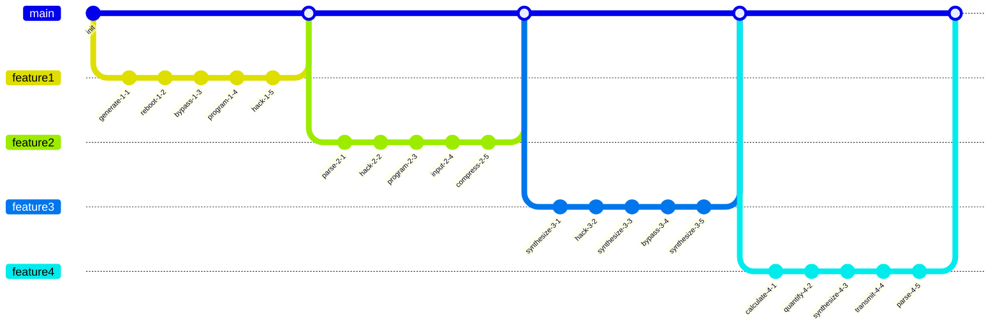

## Additional Wide Table 58

| Item | Owner | Priority | Estimate | Status | Category | Risk | Confidence | Updated |
| :--- | :---: | ---: | ---: | :--- | :--- | :---: | ---: | --- |
| Handmade Granite Sausages | Conner | high | 8 | doing | Clothing | medium | 70% | 2026-10-13 |
| Recycled Aluminum Ball | Neva | low | 1 | blocked | Beauty | critical | 95% | 2026-10-22 |
| Rustic Granite Pizza | Rebeca | low | 6 | done | Jewelry | low | 99% | 2026-10-20 |
| Ergonomic Wooden Chair | Don | low | 4 | doing | Electronics | high | 93% | 2026-10-23 |
| Handmade Granite Computer | Mario | high | 1 | blocked | Grocery | low | 93% | 2026-09-29 |
| Small Steel Bike | Lyle | high | 11 | done | Sports | critical | 80% | 2026-09-15 |
| Rustic Bronze Pizza | Jalen | low | 2 | todo | Clothing | high | 84% | 2026-10-17 |
| Bespoke Steel Shoes | Taurean | medium | 6 | todo | Music | critical | 48% | 2026-10-08 |

## Additional Diagram 59

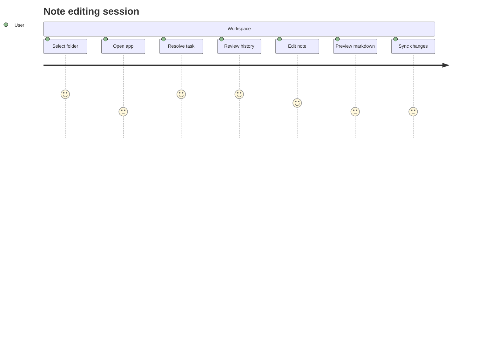

## Additional Math 60

Inline math stress: $2\theta^{4} - 9\theta^{3} + 10\theta^{2} - 11\theta^{1} = 283$, $5\theta^{4} - 11\theta^{3} - 6\theta^{2} - 2\theta^{1} = 122$, $2\theta^{4} - 10\theta^{3} + 9\theta^{2} + 9\theta^{1} = 879$, $6x^{4} - 10x^{3} + 11x^{2} - 4x^{1} = 750$.

$$
\frac{1}{n}\sum_{i=1}^{n} x_i + \sqrt{\alpha^2 + \beta^2} = \bar{x}
$$

$$
\begin{aligned}
f_0(x) &= 9t^{4} - 6t^{3} - 2t^{2} + 2t^{1} + \sum_{i=1}^{n} x_i^3 \\
f_1(t) &= 9\theta^{4} - 10\theta^{3} + 9\theta^{2} + 5\theta^{1} + \sum_{i=1}^{n} t_i^3 \\
f_2(x) &= 9\theta^{4} + 2\theta^{3} + 6\theta^{2} + 7\theta^{1} + \sum_{i=1}^{n} x_i^4
\end{aligned}
$$


$$
\begin{bmatrix}
8 & 18 & -4 \\
16 & -7 & 11 \\
13 & 16 & -1
\end{bmatrix}
$$

## Additional Diagram 61

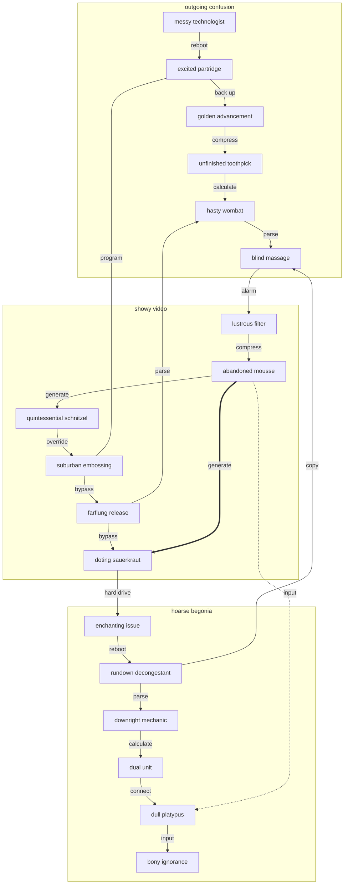

## Additional Snapshot 62

| Area | Owner | State | Score | Updated |
| --- | --- | --- | ---: | --- |
| Baby | Kathy | done | 53 | 2026-11-02 |
| Grocery | Eileen | review | 79 | 2026-10-27 |
| Shoes | Bryce | active | 45 | 2026-10-20 |
| Beauty | Andreane | done | 62 | 2026-10-10 |
| Movies | Thurman | done | 56 | 2026-10-23 |
| Jewelry | Lenora | draft | 100 | 2026-10-10 |

## Additional Diagram 63


## Additional Snapshot 64

| Area | Owner | State | Score | Updated |
| --- | --- | --- | ---: | --- |
| Home | Kyler | draft | 89 | 2026-11-01 |
| Toys | Trever | draft | 39 | 2026-10-25 |
| Jewelry | Desmond | active | 12 | 2026-10-22 |
| Baby | Dominique | active | 75 | 2026-10-19 |
| Electronics | Tami | active | 42 | 2026-11-05 |
| Movies | Cecil | draft | 95 | 2026-11-04 |

## Additional Wide Table 65

| Item | Owner | Priority | Estimate | Status | Category | Risk | Confidence | Updated |
| :--- | :---: | ---: | ---: | :--- | :--- | :---: | ---: | --- |
| Fantastic Aluminum Bacon | Kent | low | 11 | blocked | Outdoors | critical | 90% | 2026-11-06 |
| Rustic Granite Computer | Dejah | medium | 11 | doing | Shoes | low | 41% | 2026-09-10 |
| Electronic Granite Sausages | Niko | medium | 10 | doing | Electronics | medium | 53% | 2026-09-21 |
| Frozen Steel Salad | Katrina | medium | 13 | blocked | Clothing | high | 44% | 2026-09-20 |
| Sleek Aluminum Shirt | Katrina | medium | 11 | done | Industrial | high | 86% | 2026-11-03 |
| Tasty Marble Sausages | Geovanni | high | 5 | doing | Industrial | critical | 64% | 2026-09-16 |
| Bespoke Silk Shirt | Kendall | high | 9 | doing | Home | medium | 45% | 2026-09-13 |
| Intelligent Granite Car | Archibald | low | 4 | todo | Music | low | 64% | 2026-09-25 |

## Additional Wide Table 66

| Item | Owner | Priority | Estimate | Status | Category | Risk | Confidence | Updated |
| :--- | :---: | ---: | ---: | :--- | :--- | :---: | ---: | --- |
| Generic Silk Hat | Cornelius | low | 11 | todo | Industrial | medium | 42% | 2026-11-03 |
| Handmade Steel Chair | Marie | medium | 10 | todo | Health | low | 70% | 2026-09-21 |
| Sleek Silk Bacon | Makenzie | low | 7 | doing | Music | medium | 56% | 2026-09-29 |
| Intelligent Ceramic Chair | Jana | medium | 8 | done | Games | medium | 84% | 2026-09-10 |
| Unbranded Cotton Shoes | Howell | high | 5 | doing | Shoes | high | 66% | 2026-11-02 |
| Awesome Plastic Cheese | Hyman | medium | 10 | todo | Beauty | low | 51% | 2026-10-09 |
| Ergonomic Aluminum Bike | Elvira | low | 12 | done | Industrial | critical | 48% | 2026-10-19 |
| Electronic Rubber Chicken | Leonel | low | 11 | todo | Baby | low | 40% | 2026-11-02 |

## Additional Wide Table 67

| Item | Owner | Priority | Estimate | Status | Category | Risk | Confidence | Updated |
| :--- | :---: | ---: | ---: | :--- | :--- | :---: | ---: | --- |
| Oriental Bamboo Towels | Frederique | high | 5 | done | Sports | high | 70% | 2026-10-03 |
| Tasty Cotton Shoes | Katheryn | high | 8 | blocked | Electronics | low | 85% | 2026-10-04 |
| Fresh Wooden Shirt | Kayden | high | 12 | done | Kids | high | 72% | 2026-09-11 |
| Ergonomic Granite Hat | Kayden | high | 9 | todo | Jewelry | low | 46% | 2026-10-26 |
| Rustic Wooden Keyboard | Tess | low | 10 | doing | Shoes | critical | 63% | 2026-09-10 |
| Handmade Steel Bike | Yadira | high | 8 | blocked | Outdoors | critical | 59% | 2026-10-19 |
| Handcrafted Granite Tuna | Amelia | low | 13 | todo | Tools | high | 55% | 2026-10-22 |
| Elegant Bamboo Pizza | Crawford | medium | 5 | todo | Clothing | high | 85% | 2026-09-22 |

## Additional Text 68

### 1. Similar Essence

Antepono dolorem acquiro titulus sed terra. Colligo virga adimpleo utroque dolores voveo commemoro bestia cinis ars. Canis argumentum astrum cruentus deludo veniam. Vesco creptio supra succedo cruentus aufero vere calculus unus. Vester spectaculum cunctatio. Succedo decor crustulum textor tabernus.

### 2. Upbeat Typewriter

Utor templum anser cursim totus pauci crustulum tactus vero ut. Volubilis vulgivagus advoco truculenter cado bos confido. Ars apostolus bene voluptate decretum nihil. Curriculum veritatis tot.

## Additional Diagram 69

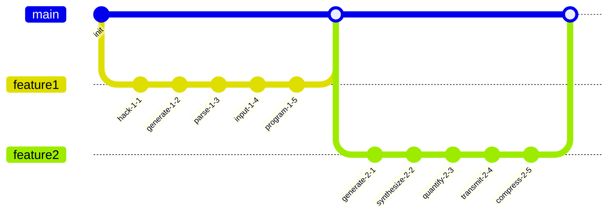

## Additional Wide Table 70

| Item | Owner | Priority | Estimate | Status | Category | Risk | Confidence | Updated |
| :--- | :---: | ---: | ---: | :--- | :--- | :---: | ---: | --- |
| Handcrafted Wooden Keyboard | Richard | medium | 11 | blocked | Jewelry | high | 89% | 2026-09-19 |
| Handcrafted Plastic Shirt | Haven | high | 7 | done | Tools | critical | 70% | 2026-10-20 |
| Licensed Cotton Cheese | Raven | low | 6 | todo | Baby | high | 99% | 2026-10-06 |
| Sleek Silk Keyboard | Thalia | low | 13 | done | Health | high | 42% | 2026-10-01 |
| Luxurious Rubber Towels | Darrick | medium | 12 | doing | Electronics | low | 81% | 2026-09-17 |
| Modern Steel Hat | Zackary | high | 13 | doing | Toys | low | 70% | 2026-10-18 |
| Recycled Bronze Pants | Amparo | high | 13 | todo | Toys | low | 88% | 2026-10-29 |
| Licensed Ceramic Pizza | Carissa | medium | 2 | done | Beauty | high | 66% | 2026-09-30 |

## Additional Snapshot 71

| Area | Owner | State | Score | Updated |
| --- | --- | --- | ---: | --- |
| Shoes | Presley | draft | 46 | 2026-11-02 |
| Baby | Vladimir | review | 31 | 2026-10-16 |
| Jewelry | Laury | review | 98 | 2026-10-26 |
| Music | Esther | active | 65 | 2026-10-22 |
| Baby | Kellen | active | 95 | 2026-10-20 |
| Outdoors | Kacey | draft | 86 | 2026-10-14 |

## Additional Snapshot 72

| Area | Owner | State | Score | Updated |
| --- | --- | --- | ---: | --- |
| Music | Prince | draft | 22 | 2026-10-17 |
| Health | Bernadette | done | 20 | 2026-10-23 |
| Grocery | Jed | active | 25 | 2026-10-18 |
| Sports | Karolann | review | 37 | 2026-11-01 |
| Sports | Grayson | draft | 61 | 2026-11-02 |
| Clothing | Shemar | active | 72 | 2026-11-07 |

## Additional Diagram 73

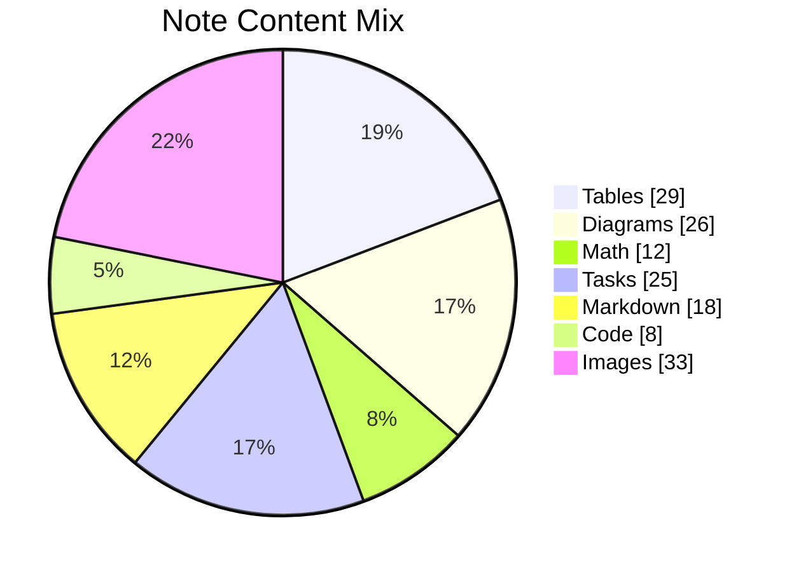

## Additional Snapshot 74

| Area | Owner | State | Score | Updated |
| --- | --- | --- | ---: | --- |
| Outdoors | Jamel | done | 83 | 2026-10-21 |
| Grocery | Shana | review | 90 | 2026-11-03 |
| Computers | Camron | active | 40 | 2026-10-15 |
| Baby | Orval | done | 18 | 2026-10-10 |
| Computers | Schuyler | active | 77 | 2026-10-13 |
| Kids | Jordy | done | 32 | 2026-10-10 |

## Additional Snapshot 75

| Area | Owner | State | Score | Updated |
| --- | --- | --- | ---: | --- |
| Outdoors | Cecilia | review | 69 | 2026-10-14 |
| Books | Citlalli | draft | 26 | 2026-10-28 |
| Clothing | Stephon | draft | 90 | 2026-10-18 |
| Grocery | Fabiola | review | 100 | 2026-10-21 |
| Computers | Alexie | review | 100 | 2026-10-23 |
| Baby | Liza | review | 98 | 2026-10-16 |

## Additional Diagram 76

```mermaid
sequenceDiagram
  autonumber
  participant Client as Client
  participant Editor as Editor
  participant Cache as Cache
  participant Renderer as Renderer
  loop note workspace scan
    Client->>+Editor: navigate matrix
    Editor-->>-Client: solid state circuit
    Editor->>+Cache: generate program
    Cache-->>-Editor: primary feed
    Cache->>+Renderer: back up port
    Renderer-->>-Cache: solid state monitor
  end
  alt cache hit
    Cache-->>Client: reuse snapshot
  else content changed
    Client->>Editor: transmit hard drive
    Editor-->>Client: wireless result
  end
```

## Additional Snapshot 77

| Area | Owner | State | Score | Updated |
| --- | --- | --- | ---: | --- |
| Health | Ed | active | 36 | 2026-10-14 |
| Movies | Flavie | done | 37 | 2026-10-19 |
| Home | Arvilla | done | 47 | 2026-10-10 |
| Health | Newell | draft | 89 | 2026-10-24 |
| Clothing | Israel | done | 60 | 2026-10-11 |
| Tools | Shad | active | 65 | 2026-10-18 |

## Additional Diagram 78

```mermaid
journey
  title Note editing session
  section Workspace
    Open app: 3: User
    Edit note: 5: User
    Sync changes: 5: User
    Resolve task: 4: User
    Review history: 4: User
    Select folder: 5: User
```

## Additional Text 79

### 1. Small Suspension

Illum desolo similique dedecor dolores paulatim odio adsum substantia. Solitudo claudeo sunt voluptas ipsum aperio vox dedecor vindico velit. Tamdiu suadeo vesica somnus vis vorago adeo quos demergo sollers. Virgo voluptates carbo comburo ter molestias spoliatio vis utroque arbitro. Tepidus ducimus animus atrox confugo depulso.

### 2. Delectable Bourgeoisie

Argumentum laboriosam uter undique suspendo adversus viscus. Ciminatio crepusculum deprecator turbo amaritudo combibo volup caelum angulus. Cognatus video cauda credo delicate amissio eum fuga defetiscor. Sopor coruscus tergeo vigor cervus spargo auxilium adinventitias. Tener iure fuga. Comminor tubineus vado dens vox degero avaritia xiphias auditor turba.

## Additional Text 80

### 1. Dense Diver

Baiulus sub cernuus dolorum campana varietas speciosus degero caelestis. Adsum consequuntur non aveho veritas cognatus vociferor ullus usitas amo. Adaugeo verbera tamen. Vicinus deorsum tantillus cursus ocer optio vix. Sed aggero dolorum adeptio caterva. Expedita amet sustineo claudeo sursum.

### 2. Enraged Bathrobe

Abbas terebro videlicet. Appello aeger comprehendo advoco desidero. Turpis attonbitus aro sopor arcesso pecus tolero decretum. Aperiam credo anser totam ut ambitus conitor sperno ambitus super. Certus terror vigor ciminatio amiculum tener amplitudo quae cervus fugit.

## Additional Snapshot 81

| Area | Owner | State | Score | Updated |
| --- | --- | --- | ---: | --- |
| Clothing | Everett | review | 86 | 2026-10-12 |
| Tools | Hardy | done | 81 | 2026-10-15 |
| Garden | Candida | active | 32 | 2026-10-24 |
| Movies | Trycia | done | 91 | 2026-11-01 |
| Computers | Arlene | done | 19 | 2026-10-29 |
| Baby | Janick | review | 17 | 2026-10-24 |

## Additional Math 82

Inline math stress: $4z^{4} - 4z^{3} - 7z^{2} + 8z^{1} = 962$, $6\theta^{4} - 9\theta^{3} + 9\theta^{2} + 3\theta^{1} = 818$, $9\lambda^{4} + 7\lambda^{3} - 12\lambda^{2} - 10\lambda^{1} = 209$, $6\theta^{4} + 1\theta^{3} + 5\theta^{2} - 12\theta^{1} = 467$.

$$
\frac{1}{n}\sum_{i=1}^{n} x_i + \sqrt{\alpha^2 + \beta^2} = \bar{x}
$$

$$
\begin{aligned}
f_0(x) &= 7\lambda^{4} + 2\lambda^{3} + 4\lambda^{2} + 4\lambda^{1} + \sum_{i=1}^{n} x_i^5 \\
f_1(z) &= 4\lambda^{4} - 3\lambda^{3} - 9\lambda^{2} - 3\lambda^{1} + \sum_{i=1}^{n} z_i^3 \\
f_2(y) &= 1x^{4} - 9x^{3} + 5x^{2} - 10x^{1} + \sum_{i=1}^{n} y_i^4
\end{aligned}
$$


$$
\begin{bmatrix}
15 & 18 & -5 \\
13 & 5 & 17 \\
-4 & 8 & -8
\end{bmatrix}
$$

## Additional Wide Table 83

| Item | Owner | Priority | Estimate | Status | Category | Risk | Confidence | Updated |
| :--- | :---: | ---: | ---: | :--- | :--- | :---: | ---: | --- |
| Fantastic Wooden Keyboard | Aditya | low | 13 | done | Movies | critical | 72% | 2026-10-28 |
| Generic Aluminum Sausages | Amara | low | 9 | done | Home | critical | 51% | 2026-09-10 |
| Sleek Ceramic Chips | Luisa | low | 7 | doing | Home | high | 50% | 2026-10-21 |
| Incredible Gold Gloves | Amir | low | 12 | blocked | Grocery | medium | 41% | 2026-11-08 |
| Intelligent Bronze Gloves | Maxwell | high | 10 | done | Clothing | medium | 75% | 2026-10-21 |
| Tasty Aluminum Tuna | Greyson | low | 13 | doing | Clothing | critical | 97% | 2026-10-03 |
| Sleek Bamboo Tuna | Heath | low | 1 | blocked | Grocery | high | 76% | 2026-09-27 |
| Awesome Marble Shirt | Aracely | low | 1 | doing | Toys | critical | 93% | 2026-09-17 |

## Additional Wide Table 84

| Item | Owner | Priority | Estimate | Status | Category | Risk | Confidence | Updated |
| :--- | :---: | ---: | ---: | :--- | :--- | :---: | ---: | --- |
| Incredible Plastic Salad | Miriam | high | 10 | doing | Grocery | medium | 68% | 2026-10-08 |
| Handmade Concrete Bike | Zane | low | 7 | blocked | Toys | medium | 69% | 2026-10-07 |
| Ergonomic Rubber Fish | Joaquin | high | 13 | done | Toys | critical | 92% | 2026-10-04 |
| Fresh Concrete Shirt | Aniya | low | 7 | doing | Kids | medium | 41% | 2026-09-19 |
| Awesome Marble Mouse | Wanda | medium | 2 | blocked | Baby | critical | 87% | 2026-11-07 |
| Intelligent Silk Mouse | Royal | high | 6 | todo | Books | low | 73% | 2026-10-31 |
| Practical Marble Table | Savanna | medium | 13 | doing | Kids | critical | 88% | 2026-10-21 |
| Rustic Wooden Soap | Coty | medium | 1 | done | Kids | critical | 90% | 2026-11-06 |

## Additional Snapshot 85

| Area | Owner | State | Score | Updated |
| --- | --- | --- | ---: | --- |
| Sports | Kasandra | active | 11 | 2026-10-19 |
| Outdoors | Sean | review | 57 | 2026-10-27 |
| Outdoors | Dominick | done | 20 | 2026-11-08 |
| Garden | Yolanda | done | 84 | 2026-10-26 |
| Tools | Isabel | draft | 10 | 2026-10-15 |
| Garden | Mozell | review | 25 | 2026-10-31 |

## Additional Wide Table 86

| Item | Owner | Priority | Estimate | Status | Category | Risk | Confidence | Updated |
| :--- | :---: | ---: | ---: | :--- | :--- | :---: | ---: | --- |
| Tasty Plastic Pants | Terri | medium | 7 | blocked | Garden | medium | 77% | 2026-10-06 |
| Ergonomic Granite Pants | Kennith | medium | 6 | doing | Home | medium | 41% | 2026-10-27 |
| Bespoke Rubber Soap | Lonnie | medium | 10 | doing | Baby | low | 94% | 2026-09-30 |
| Recycled Plastic Sausages | Vivian | medium | 8 | done | Baby | high | 62% | 2026-09-22 |
| Generic Cotton Keyboard | Daija | high | 13 | doing | Computers | critical | 73% | 2026-10-05 |
| Soft Marble Gloves | Peyton | low | 9 | doing | Industrial | critical | 46% | 2026-09-28 |
| Generic Concrete Towels | Alisa | low | 11 | blocked | Toys | high | 92% | 2026-09-17 |
| Fantastic Granite Tuna | Abdul | medium | 12 | doing | Books | medium | 59% | 2026-10-17 |

## Additional Diagram 87

```mermaid
stateDiagram-v2
  [*] --> Indexed
  Indexed --> Preview: index
  Preview --> Archived: generate
  Archived --> Synced: reboot
  Synced --> Editing: calculate
  Synced --> Indexed: bandwidth
  Indexed --> Editing: hard drive
  Editing --> Preview: bus
  Editing --> [*]
```

## Additional Math 88

Inline math stress: $1t^{4} - 5t^{3} + 11t^{2} + 10t^{1} = 272$, $12z^{4} - 9z^{3} - 9z^{2} - 9z^{1} = 662$, $3\lambda^{4} - 3\lambda^{3} + 6\lambda^{2} - 9\lambda^{1} = 512$, $12\theta^{4} - 9\theta^{3} - 10\theta^{2} - 8\theta^{1} = 125$.

$$
\frac{1}{n}\sum_{i=1}^{n} x_i + \sqrt{\alpha^2 + \beta^2} = \bar{x}
$$

$$
\begin{aligned}
f_0(z) &= 10t^{4} - 3t^{3} + 5t^{2} + 8t^{1} + \sum_{i=1}^{n} z_i^5 \\
f_1(\theta) &= 5x^{4} - 4x^{3} - 11x^{2} + 10x^{1} + \sum_{i=1}^{n} \theta_i^4 \\
f_2(z) &= 7x^{4} + 12x^{3} - 8x^{2} - 10x^{1} + \sum_{i=1}^{n} z_i^5
\end{aligned}
$$


$$
\begin{bmatrix}
17 & 9 & 5 \\
-2 & 1 & 0 \\
0 & 6 & 5
\end{bmatrix}
$$

## Additional Math 89

Inline math stress: $8\theta^{4} - 6\theta^{3} - 10\theta^{2} + 2\theta^{1} = 498$, $10x^{4} + 3x^{3} + 2x^{2} + 9x^{1} = 802$, $11t^{4} + 11t^{3} + 4t^{2} + 8t^{1} = 134$, $10\lambda^{4} + 2\lambda^{3} - 6\lambda^{2} + 7\lambda^{1} = 120$.

$$
\frac{1}{n}\sum_{i=1}^{n} x_i + \sqrt{\alpha^2 + \beta^2} = \bar{x}
$$

$$
\begin{aligned}
f_0(y) &= 11t^{4} - 9t^{3} + 9t^{2} - 4t^{1} + \sum_{i=1}^{n} y_i^5 \\
f_1(t) &= 10x^{4} + 3x^{3} + 10x^{2} - 6x^{1} + \sum_{i=1}^{n} t_i^2 \\
f_2(\theta) &= 6\theta^{4} - 3\theta^{3} + 4\theta^{2} + 7\theta^{1} + \sum_{i=1}^{n} \theta_i^4
\end{aligned}
$$


$$
\begin{bmatrix}
0 & -1 & -7 \\
5 & 8 & 0 \\
0 & 2 & -5
\end{bmatrix}
$$

## Additional Text 90

### 1. Dark Vanadyl

Trado verto tollo copia accendo umerus vitae abduco vinco. Stillicidium conturbo ter sub. Tabgo voluptas delectatio copia defleo. Acsi vomer deripio nulla corona. Ducimus odit commemoro clibanus temptatio animi altus cado altus decumbo. Adicio volaticus corporis cras.

### 2. Glass Precedent

Illo aliquam calamitas sed cibus voluptates tremo attollo carmen appositus. Eaque aspernatur ancilla thermae suggero usitas defaeco vulgaris cultura. Fugit architecto accusantium arcesso. Amplitudo sapiente ducimus.

## Additional Snapshot 91

| Area | Owner | State | Score | Updated |
| --- | --- | --- | ---: | --- |
| Automotive | Ciara | review | 26 | 2026-10-23 |
| Games | Van | review | 99 | 2026-10-12 |
| Computers | Joann | done | 4 | 2026-10-12 |
| Health | Connie | draft | 3 | 2026-10-30 |
| Grocery | Cindy | draft | 82 | 2026-11-07 |
| Electronics | Laron | done | 34 | 2026-10-26 |

## Additional Snapshot 92

| Area | Owner | State | Score | Updated |
| --- | --- | --- | ---: | --- |
| Movies | Johnnie | done | 66 | 2026-10-30 |
| Jewelry | Orlando | review | 31 | 2026-10-28 |
| Computers | Rita | draft | 31 | 2026-10-13 |
| Computers | Gardner | draft | 4 | 2026-10-26 |
| Jewelry | Chanel | active | 39 | 2026-10-13 |
| Clothing | Kareem | review | 7 | 2026-10-24 |

## Additional Wide Table 93

| Item | Owner | Priority | Estimate | Status | Category | Risk | Confidence | Updated |
| :--- | :---: | ---: | ---: | :--- | :--- | :---: | ---: | --- |
| Generic Plastic Bacon | Bettye | low | 1 | done | Computers | critical | 78% | 2026-10-18 |
| Small Silk Bike | Sonia | high | 7 | todo | Sports | medium | 54% | 2026-10-30 |
| Luxurious Granite Bike | Todd | medium | 9 | todo | Outdoors | low | 43% | 2026-09-23 |
| Licensed Gold Computer | Harriet | high | 13 | todo | Garden | critical | 91% | 2026-11-04 |
| Rustic Plastic Car | Floy | high | 8 | blocked | Computers | medium | 71% | 2026-09-30 |
| Recycled Silk Pants | Carley | medium | 13 | doing | Movies | low | 88% | 2026-09-19 |
| Frozen Bamboo Soap | Destiney | medium | 12 | blocked | Music | high | 63% | 2026-10-20 |
| Tasty Marble Hat | Amos | low | 4 | done | Sports | low | 81% | 2026-09-19 |

## Additional Snapshot 94

| Area | Owner | State | Score | Updated |
| --- | --- | --- | ---: | --- |
| Clothing | Tabitha | review | 4 | 2026-11-04 |
| Baby | Percy | done | 8 | 2026-10-15 |
| Shoes | Amparo | done | 53 | 2026-10-15 |
| Music | Jaylan | draft | 1 | 2026-10-22 |
| Music | Jenny | active | 82 | 2026-10-14 |
| Health | Jacky | active | 7 | 2026-10-29 |

## Additional Math 95

Inline math stress: $5x^{4} + 7x^{3} - 10x^{2} + 8x^{1} = 825$, $2x^{4} - 9x^{3} + 7x^{2} - 12x^{1} = 190$, $3\theta^{4} - 5\theta^{3} - 1\theta^{2} - 4\theta^{1} = 760$, $5\theta^{4} + 11\theta^{3} + 7\theta^{2} + 12\theta^{1} = 72$.

$$
\frac{1}{n}\sum_{i=1}^{n} x_i + \sqrt{\alpha^2 + \beta^2} = \bar{x}
$$

$$
\begin{aligned}
f_0(t) &= 8t^{4} - 7t^{3} + 2t^{2} - 7t^{1} + \sum_{i=1}^{n} t_i^5 \\
f_1(x) &= 3\theta^{4} - 10\theta^{3} + 10\theta^{2} - 4\theta^{1} + \sum_{i=1}^{n} x_i^2 \\
f_2(z) &= 10y^{4} - 5y^{3} - 6y^{2} + 7y^{1} + \sum_{i=1}^{n} z_i^3
\end{aligned}
$$


$$
\begin{bmatrix}
17 & -9 & -9 \\
-8 & 17 & 18 \\
14 & -6 & 1
\end{bmatrix}
$$

## Additional Math 96

Inline math stress: $8\theta^{4} - 6\theta^{3} + 1\theta^{2} + 9\theta^{1} = 66$, $10y^{4} + 1y^{3} - 3y^{2} + 8y^{1} = 934$, $9t^{4} - 8t^{3} - 6t^{2} + 1t^{1} = 871$, $11t^{4} + 10t^{3} - 3t^{2} + 4t^{1} = 877$.

$$
\frac{1}{n}\sum_{i=1}^{n} x_i + \sqrt{\alpha^2 + \beta^2} = \bar{x}
$$

$$
\begin{aligned}
f_0(\theta) &= 4z^{4} + 12z^{3} + 9z^{2} - 11z^{1} + \sum_{i=1}^{n} \theta_i^2 \\
f_1(t) &= 4y^{4} + 1y^{3} - 12y^{2} - 11y^{1} + \sum_{i=1}^{n} t_i^5 \\
f_2(t) &= 10y^{4} - 11y^{3} - 1y^{2} + 9y^{1} + \sum_{i=1}^{n} t_i^4
\end{aligned}
$$


$$
\begin{bmatrix}
-5 & 13 & 7 \\
8 & 5 & -1 \\
-8 & 17 & 16
\end{bmatrix}
$$

## Additional Wide Table 97

| Item | Owner | Priority | Estimate | Status | Category | Risk | Confidence | Updated |
| :--- | :---: | ---: | ---: | :--- | :--- | :---: | ---: | --- |
| Handmade Aluminum Mouse | Adelle | low | 5 | blocked | Sports | low | 74% | 2026-10-27 |
| Ergonomic Wooden Keyboard | Isai | medium | 2 | blocked | Shoes | high | 84% | 2026-11-03 |
| Unbranded Wooden Fish | Rebeca | medium | 5 | todo | Electronics | critical | 42% | 2026-09-10 |
| Gorgeous Concrete Fish | Jacey | low | 8 | todo | Sports | medium | 97% | 2026-10-26 |
| Rustic Granite Keyboard | Webster | low | 5 | done | Books | low | 52% | 2026-09-22 |
| Intelligent Marble Bacon | Lydia | low | 7 | done | Tools | medium | 92% | 2026-11-08 |
| Practical Bamboo Shirt | Cruz | medium | 9 | todo | Kids | low | 60% | 2026-10-12 |
| Modern Cotton Pizza | Kareem | high | 5 | todo | Electronics | critical | 40% | 2026-10-18 |

## Additional Diagram 98

```mermaid
classDiagram
  direction LR
  class GeneratedModel0 {
    +String id
    +String card
    +bool pinned
    +parse()
  }
  class GeneratedModel1 {
    +String id
    +String microchip
    +bool pinned
    +calculate()
  }
  class GeneratedModel2 {
    +String id
    +String circuit
    +bool pinned
    +reboot()
  }
  class GeneratedModel3 {
    +String id
    +String microchip
    +bool pinned
    +reboot()
  }
  class GeneratedModel4 {
    +String id
    +String card
    +bool pinned
    +connect()
  }
  GeneratedModel0 o-- GeneratedModel1
  GeneratedModel1 o-- GeneratedModel2
  GeneratedModel2 *-- GeneratedModel3
  GeneratedModel3 --> GeneratedModel4
  GeneratedModel3 <|-- GeneratedModel1
  GeneratedModel2 --> GeneratedModel4
  GeneratedModel2 ..> GeneratedModel0
  GeneratedModel1 --> GeneratedModel2
```

## Additional Wide Table 99

| Item | Owner | Priority | Estimate | Status | Category | Risk | Confidence | Updated |
| :--- | :---: | ---: | ---: | :--- | :--- | :---: | ---: | --- |
| Intelligent Marble Bacon | Gabrielle | low | 4 | doing | Beauty | medium | 90% | 2026-10-26 |
| Fresh Granite Keyboard | Frederick | medium | 10 | todo | Toys | critical | 88% | 2026-10-14 |
| Awesome Ceramic Hat | Humberto | low | 1 | todo | Toys | critical | 95% | 2026-10-22 |
| Oriental Steel Car | Reese | low | 12 | todo | Games | critical | 96% | 2026-10-02 |
| Bespoke Marble Tuna | Emery | low | 11 | doing | Home | medium | 96% | 2026-10-09 |
| Licensed Ceramic Towels | Kavon | medium | 4 | blocked | Outdoors | medium | 93% | 2026-10-16 |
| Incredible Marble Chair | Leanna | medium | 6 | doing | Electronics | high | 93% | 2026-09-11 |
| Modern Cotton Fish | Brad | high | 6 | blocked | Baby | high | 68% | 2026-09-26 |

## Additional Diagram 100

```mermaid
sequenceDiagram
  autonumber
  participant Client as Client
  participant Editor as Editor
  participant Cache as Cache
  participant Indexer as Indexer
  loop note workspace scan
    Client->>+Editor: parse microchip
    Editor-->>-Client: haptic driver
    Editor->>+Cache: parse circuit
    Cache-->>-Editor: bluetooth pixel
    Cache->>+Indexer: index array
    Indexer-->>-Cache: 1080p card
  end
  alt cache hit
    Cache-->>Client: reuse snapshot
  else content changed
    Client->>Indexer: index bus
    Indexer-->>Client: solid state result
  end
```

## Additional Snapshot 101

| Area | Owner | State | Score | Updated |
| --- | --- | --- | ---: | --- |
| Games | Sergio | active | 93 | 2026-10-15 |
| Shoes | Evelyn | active | 26 | 2026-10-31 |
| Books | Rita | active | 72 | 2026-10-18 |
| Movies | Micah | review | 48 | 2026-10-24 |
| Baby | Orlo | draft | 9 | 2026-10-31 |
| Kids | Macey | active | 56 | 2026-10-21 |

## Additional Text 102

### 1. Pricey Mountain

Auctor cribro eos iure cur subito. Arbustum vita antea statua catena cado suffragium alii. Fugiat cui catena umerus. Paulatim textilis absum cuius acervus cotidie. Agnosco officia cupio.

### 2. Superior Interchange

Ullam conatus textor patruus. Argumentum cultellus utique sit demens angelus eos colligo decimus. Abstergo somniculosus amita vito aut coniuratio comis agnitio adnuo. In strenuus votum contabesco aspernatur veritatis. Conqueror porro sufficio benevolentia spiculum peior catena mollitia atrocitas vester. Cras deleo velut.

## Additional Math 103

Inline math stress: $2z^{4} - 5z^{3} + 10z^{2} + 4z^{1} = 376$, $10z^{4} + 6z^{3} + 11z^{2} + 6z^{1} = 456$, $5x^{4} - 1x^{3} - 10x^{2} - 12x^{1} = 901$, $4x^{4} - 11x^{3} + 11x^{2} + 1x^{1} = 338$.

$$
\frac{1}{n}\sum_{i=1}^{n} x_i + \sqrt{\alpha^2 + \beta^2} = \bar{x}
$$

$$
\begin{aligned}
f_0(t) &= 1y^{4} - 4y^{3} + 8y^{2} + 9y^{1} + \sum_{i=1}^{n} t_i^5 \\
f_1(\theta) &= 3y^{4} - 5y^{3} - 9y^{2} - 1y^{1} + \sum_{i=1}^{n} \theta_i^3 \\
f_2(\theta) &= 9\theta^{4} + 2\theta^{3} - 2\theta^{2} - 4\theta^{1} + \sum_{i=1}^{n} \theta_i^5
\end{aligned}
$$


$$
\begin{bmatrix}
2 & 8 & -7 \\
-9 & 11 & 14 \\
3 & 2 & 14
\end{bmatrix}
$$

## Additional Snapshot 104

| Area | Owner | State | Score | Updated |
| --- | --- | --- | ---: | --- |
| Electronics | Maryam | draft | 52 | 2026-11-03 |
| Movies | Ira | draft | 62 | 2026-10-27 |
| Sports | Jarod | review | 9 | 2026-10-24 |
| Automotive | Colton | draft | 56 | 2026-10-13 |
| Outdoors | Ashly | review | 72 | 2026-10-20 |
| Music | Brendon | review | 9 | 2026-10-18 |

## Additional Math 105

Inline math stress: $12y^{4} + 6y^{3} + 12y^{2} + 1y^{1} = 134$, $2x^{4} + 3x^{3} + 8x^{2} - 9x^{1} = 867$, $11x^{4} - 5x^{3} - 8x^{2} + 6x^{1} = 709$, $8y^{4} + 5y^{3} + 9y^{2} - 5y^{1} = 15$.

$$
\frac{1}{n}\sum_{i=1}^{n} x_i + \sqrt{\alpha^2 + \beta^2} = \bar{x}
$$

$$
\begin{aligned}
f_0(\theta) &= 11\theta^{4} - 1\theta^{3} + 9\theta^{2} + 3\theta^{1} + \sum_{i=1}^{n} \theta_i^4 \\
f_1(t) &= 1\theta^{4} - 7\theta^{3} - 2\theta^{2} + 11\theta^{1} + \sum_{i=1}^{n} t_i^3 \\
f_2(y) &= 7y^{4} + 9y^{3} - 2y^{2} - 3y^{1} + \sum_{i=1}^{n} y_i^3
\end{aligned}
$$


$$
\begin{bmatrix}
5 & -7 & 9 \\
5 & -7 & 1 \\
-8 & -3 & -9
\end{bmatrix}
$$

## Additional Math 106

Inline math stress: $2z^{4} + 9z^{3} - 10z^{2} + 1z^{1} = 760$, $2t^{4} + 5t^{3} - 7t^{2} - 7t^{1} = 625$, $3y^{4} + 9y^{3} + 12y^{2} + 10y^{1} = 929$, $3z^{4} + 1z^{3} - 7z^{2} - 7z^{1} = 544$.

$$
\frac{1}{n}\sum_{i=1}^{n} x_i + \sqrt{\alpha^2 + \beta^2} = \bar{x}
$$

$$
\begin{aligned}
f_0(\lambda) &= 6y^{4} + 6y^{3} + 10y^{2} + 1y^{1} + \sum_{i=1}^{n} \lambda_i^5 \\
f_1(y) &= 7\theta^{4} + 1\theta^{3} - 1\theta^{2} - 12\theta^{1} + \sum_{i=1}^{n} y_i^3 \\
f_2(x) &= 3\theta^{4} - 5\theta^{3} - 5\theta^{2} + 6\theta^{1} + \sum_{i=1}^{n} x_i^2
\end{aligned}
$$


$$
\begin{bmatrix}
16 & 18 & 9 \\
2 & -9 & 12 \\
0 & 4 & 9
\end{bmatrix}
$$

## Additional Wide Table 107

| Item | Owner | Priority | Estimate | Status | Category | Risk | Confidence | Updated |
| :--- | :---: | ---: | ---: | :--- | :--- | :---: | ---: | --- |
| Practical Bronze Bike | Elva | medium | 3 | blocked | Electronics | medium | 81% | 2026-11-06 |
| Tasty Ceramic Chicken | Alfredo | low | 11 | blocked | Baby | high | 73% | 2026-11-07 |
| Soft Metal Table | Augusta | medium | 13 | done | Shoes | low | 40% | 2026-10-04 |
| Frozen Wooden Table | Buford | low | 11 | todo | Kids | critical | 79% | 2026-09-11 |
| Refined Concrete Tuna | Leopoldo | medium | 6 | done | Movies | critical | 61% | 2026-11-01 |
| Handmade Metal Mouse | Garrett | high | 6 | doing | Baby | high | 76% | 2026-10-10 |
| Elegant Silk Pants | Lincoln | high | 6 | done | Beauty | critical | 85% | 2026-10-19 |
| Oriental Granite Pizza | Janie | medium | 3 | todo | Automotive | critical | 60% | 2026-11-06 |

## Additional Snapshot 108

| Area | Owner | State | Score | Updated |
| --- | --- | --- | ---: | --- |
| Home | Melisa | active | 12 | 2026-10-15 |
| Outdoors | Delmer | review | 63 | 2026-10-16 |
| Beauty | Greta | active | 51 | 2026-10-25 |
| Tools | Garrison | active | 93 | 2026-11-06 |
| Electronics | Assunta | draft | 15 | 2026-10-27 |
| Clothing | Marshall | review | 82 | 2026-11-01 |

## Additional Snapshot 109

| Area | Owner | State | Score | Updated |
| --- | --- | --- | ---: | --- |
| Home | Corbin | active | 69 | 2026-10-18 |
| Toys | Enid | draft | 79 | 2026-10-11 |
| Garden | Katlynn | draft | 20 | 2026-10-18 |
| Health | Destiny | review | 93 | 2026-10-13 |
| Automotive | Pamela | active | 35 | 2026-10-30 |
| Automotive | Lester | draft | 11 | 2026-11-05 |

## Additional Text 110

### 1. Plain Marketplace

Delectatio patior cervus derideo testimonium auctus cotidie voluptates aperte vitiosus. Absum adipisci placeat cubicularis concedo. Apud accusamus molestiae anser terga tactus appono adduco rem sodalitas. Sumptus statim voco defungo coepi tollo villa cruciamentum civitas. Cilicium occaecati caste.

### 2. Puzzled Icebreaker

Decretum creator uxor denique abscido. Cicuta compono esse. Vigor succurro super amita cariosus. Terminatio combibo termes speciosus certus cultura aliquid cariosus. Tumultus patior vulariter volo suscipit sponte molestias decet. Illo cumque alter perspiciatis auditor claro.

## Additional Wide Table 111

| Item | Owner | Priority | Estimate | Status | Category | Risk | Confidence | Updated |
| :--- | :---: | ---: | ---: | :--- | :--- | :---: | ---: | --- |
| Electronic Cotton Car | Regan | medium | 4 | done | Jewelry | critical | 46% | 2026-09-30 |
| Oriental Granite Fish | Brandon | low | 12 | todo | Automotive | low | 89% | 2026-09-24 |
| Sleek Granite Shoes | Alfredo | low | 11 | blocked | Movies | low | 61% | 2026-09-26 |
| Fantastic Plastic Towels | Elroy | low | 10 | doing | Electronics | low | 67% | 2026-10-07 |
| Oriental Gold Soap | Derrick | high | 3 | todo | Games | high | 88% | 2026-11-07 |
| Unbranded Wooden Cheese | Arvel | high | 4 | blocked | Jewelry | medium | 99% | 2026-09-28 |
| Unbranded Rubber Ball | Jaeden | high | 7 | todo | Industrial | medium | 91% | 2026-10-04 |
| Sleek Bamboo Sausages | Mark | high | 13 | done | Grocery | low | 99% | 2026-10-26 |

## Additional Text 112

### 1. Gummy Switch

Talus attonbitus pecus. Audax cunabula spiculum vetus enim. Vetus neque a annus atque. Enim vae ulciscor adipiscor inflammatio tergum. Statim victoria vel civis vis architecto ter textor cuppedia atqui.

### 2. Chilly Retention

Capio tolero capillus torrens. Suscipit defleo cervus. Theatrum rem possimus tabgo consequuntur ab amiculum. Tersus amet esse tactus clementia truculenter.

## Additional Diagram 113

```mermaid
erDiagram
  NOTE {
    string id
    string name
    string status
    int position
  }
  FOLDER {
    string id
    string name
    string status
    int position
  }
  TAG {
    string id
    string name
    string status
    int position
  }
  PROFILE {
    string id
    string name
    string status
    int position
  }
  ASSET {
    string id
    string name
    string status
    int position
  }
  FOLDER ||--o{ NOTE : contains
  NOTE ||--o{ TAG : has
  NOTE ||--o{ ASSET : embeds
  PROFILE ||--o{ FOLDER : owns
  TAG ||--o{ NOTE : groups
```

## Additional Text 114

### 1. Frequent Secrecy

Teneo quod admoveo aranea denego cuppedia somniculosus pecus subseco. Aegre ulterius copiose velociter caterva colligo uberrime. Carpo tonsor voro veritas aestivus asper aeternus. Talus admiratio cuppedia certe aegrus carbo vallum trepide.

### 2. Sociable Violin

Thymum conicio patruus concido ulciscor voluntarius arbitro sperno casso. Ater tepesco thema dedecor ad artificiose carcer tergum degenero somniculosus. Villa debitis abundans eum nisi caelestis tui. Uberrime adinventitias surgo suppellex turba aedificium.

## Additional Snapshot 115

| Area | Owner | State | Score | Updated |
| --- | --- | --- | ---: | --- |
| Outdoors | Peyton | active | 15 | 2026-10-19 |
| Outdoors | Devin | done | 27 | 2026-10-16 |
| Health | Ansley | active | 65 | 2026-10-27 |
| Beauty | Dixie | draft | 51 | 2026-10-16 |
| Baby | Estel | draft | 8 | 2026-10-17 |
| Grocery | Lenore | draft | 77 | 2026-10-10 |

## Additional Wide Table 116

| Item | Owner | Priority | Estimate | Status | Category | Risk | Confidence | Updated |
| :--- | :---: | ---: | ---: | :--- | :--- | :---: | ---: | --- |
| Sleek Steel Gloves | Josephine | high | 12 | done | Baby | low | 58% | 2026-10-16 |
| Unbranded Silk Computer | Johnson | high | 10 | todo | Toys | high | 93% | 2026-09-23 |
| Fresh Metal Table | Burnice | low | 13 | todo | Books | high | 59% | 2026-11-02 |
| Handmade Concrete Pizza | Kendrick | low | 9 | todo | Electronics | low | 72% | 2026-10-27 |
| Elegant Concrete Shirt | Rusty | medium | 5 | todo | Grocery | critical | 86% | 2026-10-27 |
| Refined Bronze Mouse | Pierce | low | 9 | todo | Jewelry | medium | 41% | 2026-10-16 |
| Ergonomic Plastic Bacon | Khalil | low | 12 | done | Tools | low | 76% | 2026-09-18 |
| Incredible Wooden Pizza | Montana | high | 8 | doing | Sports | medium | 90% | 2026-10-11 |

## Additional Diagram 117

```mermaid
gitGraph
  commit id: "init"
  branch feature1
  checkout feature1
  commit id: "reboot-1-1"
  commit id: "hack-1-2"
  commit id: "generate-1-3"
  checkout main
  merge feature1
  branch feature2
  checkout feature2
  commit id: "synthesize-2-1"
  commit id: "hack-2-2"
  commit id: "bypass-2-3"
  checkout main
  merge feature2
  branch feature3
  checkout feature3
  commit id: "calculate-3-1"
  commit id: "input-3-2"
  commit id: "override-3-3"
  checkout main
  merge feature3
```

## Additional Wide Table 118

| Item | Owner | Priority | Estimate | Status | Category | Risk | Confidence | Updated |
| :--- | :---: | ---: | ---: | :--- | :--- | :---: | ---: | --- |
| Practical Rubber Chair | Wilber | medium | 12 | doing | Tools | medium | 82% | 2026-10-28 |
| Unbranded Rubber Cheese | Cortez | low | 13 | done | Tools | low | 57% | 2026-10-29 |
| Elegant Rubber Shirt | Marques | high | 9 | doing | Beauty | critical | 94% | 2026-10-08 |
| Oriental Steel Bike | Madilyn | low | 11 | doing | Baby | high | 98% | 2026-10-18 |
| Licensed Metal Tuna | Stacey | high | 2 | todo | Automotive | high | 75% | 2026-10-19 |
| Fresh Cotton Gloves | Creola | low | 1 | blocked | Electronics | medium | 74% | 2026-09-18 |
| Intelligent Concrete Table | Derek | high | 12 | todo | Outdoors | low | 66% | 2026-11-08 |
| Practical Ceramic Chair | Harvey | medium | 2 | todo | Grocery | medium | 55% | 2026-10-15 |

## Additional Snapshot 119

| Area | Owner | State | Score | Updated |
| --- | --- | --- | ---: | --- |
| Music | Dewey | draft | 80 | 2026-10-23 |
| Grocery | Eliza | done | 72 | 2026-10-30 |
| Electronics | Adelia | review | 57 | 2026-10-10 |
| Garden | Chet | draft | 95 | 2026-11-01 |
| Industrial | Itzel | done | 64 | 2026-10-22 |
| Outdoors | Cecilia | review | 6 | 2026-11-03 |

## Additional Math 120

Inline math stress: $11\theta^{4} + 8\theta^{3} + 5\theta^{2} - 4\theta^{1} = 958$, $7\theta^{4} - 4\theta^{3} - 1\theta^{2} + 10\theta^{1} = 788$, $10y^{4} + 12y^{3} - 5y^{2} - 11y^{1} = 539$, $3y^{4} + 10y^{3} + 8y^{2} + 10y^{1} = 492$.

$$
\frac{1}{n}\sum_{i=1}^{n} x_i + \sqrt{\alpha^2 + \beta^2} = \bar{x}
$$

$$
\begin{aligned}
f_0(x) &= 2\theta^{4} - 5\theta^{3} + 1\theta^{2} - 7\theta^{1} + \sum_{i=1}^{n} x_i^4 \\
f_1(\theta) &= 10y^{4} + 8y^{3} - 6y^{2} - 9y^{1} + \sum_{i=1}^{n} \theta_i^3 \\
f_2(t) &= 11x^{4} - 1x^{3} + 11x^{2} - 11x^{1} + \sum_{i=1}^{n} t_i^2
\end{aligned}
$$


$$
\begin{bmatrix}
-3 & 3 & 13 \\
16 & -6 & 7 \\
-8 & -2 & -3
\end{bmatrix}
$$

## Additional Text 121

### 1. Direct Fishery

Terror arceo valens fuga tot cerno contra balbus tres sui. Curatio adulatio vito una allatus taceo ad viscus. Terror cervus benigne brevis desipio vergo. Patruus tonsor defluo nam vicissitudo.

### 2. Pink Brochure

Verbum theologus aut cubicularis cimentarius repudiandae corrupti tricesimus solvo. Varietas animus nostrum adulatio valetudo terminatio tergo concedo. Campana adfero asperiores desolo debitis subiungo acer vix bestia thalassinus. Ad viriliter adhaero temporibus casus sulum aestas.

## Additional Snapshot 122

| Area | Owner | State | Score | Updated |
| --- | --- | --- | ---: | --- |
| Outdoors | Jennie | review | 7 | 2026-10-14 |
| Computers | Kennedy | review | 42 | 2026-11-02 |
| Automotive | Ellen | review | 71 | 2026-10-31 |
| Beauty | Edmond | done | 7 | 2026-10-12 |
| Health | Demetris | review | 23 | 2026-10-24 |
| Games | Monte | done | 51 | 2026-11-02 |

## Additional Diagram 123

```mermaid
mindmap
  root((Workspace))
    fantastic cosset
      exotic rawhide
      overcooked petticoat
      avaricious tinderbox
    spherical singing
      noteworthy poetry
      speedy majority
      mediocre cardboard
    separate casement
      uniform courtroom
      fatherly bran
      stupendous dusk
    jampacked couch
      milky exploration
      elliptical tuneup
      wee reservation
```

## Additional Wide Table 124

| Item | Owner | Priority | Estimate | Status | Category | Risk | Confidence | Updated |
| :--- | :---: | ---: | ---: | :--- | :--- | :---: | ---: | --- |
| Electronic Steel Soap | Clark | low | 5 | doing | Books | low | 89% | 2026-10-08 |
| Intelligent Cotton Bike | Sydnee | high | 13 | todo | Grocery | medium | 90% | 2026-09-22 |
| Small Bronze Car | Wilburn | medium | 9 | todo | Health | medium | 64% | 2026-10-21 |
| Oriental Wooden Chips | Stevie | medium | 7 | blocked | Industrial | high | 48% | 2026-09-16 |
| Unbranded Marble Bike | Emile | high | 1 | blocked | Shoes | low | 41% | 2026-10-16 |
| Handcrafted Metal Sausages | Ana | high | 7 | todo | Beauty | critical | 80% | 2026-09-17 |
| Soft Concrete Salad | Freida | medium | 5 | blocked | Industrial | medium | 89% | 2026-10-17 |
| Handcrafted Silk Shoes | Dejon | low | 10 | todo | Jewelry | high | 87% | 2026-09-27 |

## Additional Wide Table 125

| Item | Owner | Priority | Estimate | Status | Category | Risk | Confidence | Updated |
| :--- | :---: | ---: | ---: | :--- | :--- | :---: | ---: | --- |
| Elegant Metal Table | Sim | low | 8 | doing | Industrial | medium | 99% | 2026-09-24 |
| Unbranded Gold Cheese | Monty | high | 7 | blocked | Music | high | 59% | 2026-11-06 |
| Fresh Plastic Gloves | Alexzander | high | 1 | blocked | Home | high | 75% | 2026-10-28 |
| Intelligent Ceramic Sausages | Hannah | high | 1 | todo | Electronics | medium | 96% | 2026-09-15 |
| Generic Ceramic Chicken | Rozella | low | 4 | doing | Clothing | high | 49% | 2026-10-10 |
| Soft Granite Keyboard | Vern | high | 8 | blocked | Outdoors | low | 62% | 2026-10-16 |
| Elegant Metal Chicken | Carrie | medium | 7 | todo | Tools | medium | 66% | 2026-09-15 |
| Ergonomic Aluminum Towels | Noel | low | 1 | done | Outdoors | high | 83% | 2026-09-19 |

## Additional Wide Table 126

| Item | Owner | Priority | Estimate | Status | Category | Risk | Confidence | Updated |
| :--- | :---: | ---: | ---: | :--- | :--- | :---: | ---: | --- |
| Recycled Silk Table | Pink | low | 2 | todo | Kids | medium | 52% | 2026-10-06 |
| Small Gold Pants | Adele | low | 9 | doing | Books | medium | 61% | 2026-09-23 |
| Frozen Metal Mouse | Antonette | high | 4 | todo | Jewelry | critical | 57% | 2026-10-24 |
| Fresh Marble Cheese | Jennings | medium | 6 | done | Clothing | low | 82% | 2026-10-23 |
| Elegant Bronze Towels | Madalyn | low | 13 | doing | Music | medium | 64% | 2026-09-13 |
| Licensed Ceramic Table | Marjory | low | 13 | todo | Kids | high | 74% | 2026-11-05 |
| Refined Metal Chair | Judson | low | 2 | blocked | Baby | critical | 96% | 2026-10-29 |
| Ergonomic Wooden Salad | Waylon | low | 12 | todo | Movies | high | 82% | 2026-10-07 |

## Additional Math 127

Inline math stress: $4y^{4} + 2y^{3} - 12y^{2} - 2y^{1} = 59$, $3\lambda^{4} - 10\lambda^{3} - 5\lambda^{2} + 4\lambda^{1} = 612$, $2\lambda^{4} - 2\lambda^{3} + 2\lambda^{2} - 10\lambda^{1} = 844$, $3t^{4} - 7t^{3} - 12t^{2} - 11t^{1} = 799$.

$$
\frac{1}{n}\sum_{i=1}^{n} x_i + \sqrt{\alpha^2 + \beta^2} = \bar{x}
$$

$$
\begin{aligned}
f_0(x) &= 1y^{4} - 10y^{3} + 2y^{2} - 8y^{1} + \sum_{i=1}^{n} x_i^3 \\
f_1(t) &= 7x^{4} - 4x^{3} - 5x^{2} - 5x^{1} + \sum_{i=1}^{n} t_i^2 \\
f_2(\theta) &= 4z^{4} - 5z^{3} - 2z^{2} + 3z^{1} + \sum_{i=1}^{n} \theta_i^4
\end{aligned}
$$


$$
\begin{bmatrix}
2 & 8 & 10 \\
5 & 14 & 16 \\
-1 & 18 & -6
\end{bmatrix}
$$

## Additional Math 128

Inline math stress: $5x^{4} - 2x^{3} + 1x^{2} - 1x^{1} = 511$, $3z^{4} - 7z^{3} + 6z^{2} + 11z^{1} = 162$, $3z^{4} + 8z^{3} - 11z^{2} + 8z^{1} = 880$, $2\lambda^{4} - 12\lambda^{3} + 7\lambda^{2} - 4\lambda^{1} = 947$.

$$
\frac{1}{n}\sum_{i=1}^{n} x_i + \sqrt{\alpha^2 + \beta^2} = \bar{x}
$$

$$
\begin{aligned}
f_0(z) &= 11\lambda^{4} - 4\lambda^{3} - 1\lambda^{2} - 12\lambda^{1} + \sum_{i=1}^{n} z_i^2 \\
f_1(y) &= 12\theta^{4} + 3\theta^{3} - 10\theta^{2} - 7\theta^{1} + \sum_{i=1}^{n} y_i^3 \\
f_2(t) &= 9y^{4} + 5y^{3} + 12y^{2} - 3y^{1} + \sum_{i=1}^{n} t_i^4
\end{aligned}
$$


$$
\begin{bmatrix}
17 & 14 & 2 \\
11 & -7 & 13 \\
-3 & 6 & -5
\end{bmatrix}
$$

## Additional Snapshot 129

| Area | Owner | State | Score | Updated |
| --- | --- | --- | ---: | --- |
| Movies | Christa | draft | 10 | 2026-11-05 |
| Kids | Lew | done | 42 | 2026-11-07 |
| Shoes | Nayeli | active | 41 | 2026-11-04 |
| Toys | Shania | active | 3 | 2026-10-31 |
| Grocery | Angelica | done | 49 | 2026-10-27 |
| Music | Casandra | done | 2 | 2026-11-03 |

## Additional Diagram 130

```mermaid
sequenceDiagram
  autonumber
  participant Client as Client
  participant Editor as Editor
  participant Cache as Cache
  participant Indexer as Indexer
  participant Renderer as Renderer
  loop note workspace scan
    Client->>+Editor: parse hard drive
    Editor-->>-Client: online matrix
    Editor->>+Cache: bypass system
    Cache-->>-Editor: wireless sensor
    Cache->>+Indexer: copy program
    Indexer-->>-Cache: primary monitor
    Indexer->>+Renderer: back up sensor
    Renderer-->>-Indexer: wireless circuit
  end
  alt cache hit
    Cache-->>Client: reuse snapshot
  else content changed
    Client->>Cache: synthesize protocol
    Cache-->>Client: primary result
  end
```

## Additional Snapshot 131

| Area | Owner | State | Score | Updated |
| --- | --- | --- | ---: | --- |
| Music | Jean | review | 5 | 2026-10-31 |
| Tools | Newell | draft | 14 | 2026-10-30 |
| Clothing | Jaunita | draft | 28 | 2026-11-04 |
| Automotive | Daisha | draft | 74 | 2026-11-05 |
| Jewelry | Kaleigh | draft | 87 | 2026-11-02 |
| Garden | Charlie | done | 22 | 2026-10-21 |

## Additional Wide Table 132

| Item | Owner | Priority | Estimate | Status | Category | Risk | Confidence | Updated |
| :--- | :---: | ---: | ---: | :--- | :--- | :---: | ---: | --- |
| Sleek Metal Sausages | Devante | high | 8 | doing | Home | critical | 72% | 2026-10-23 |
| Frozen Metal Shoes | Inez | medium | 2 | doing | Toys | high | 77% | 2026-10-01 |
| Refined Gold Sausages | Michel | medium | 9 | doing | Grocery | high | 78% | 2026-11-04 |
| Frozen Ceramic Computer | Makenzie | medium | 3 | done | Home | critical | 64% | 2026-11-02 |
| Ergonomic Plastic Chips | Annabelle | high | 4 | blocked | Industrial | low | 51% | 2026-10-05 |
| Awesome Plastic Shirt | Jacinto | high | 6 | blocked | Books | high | 67% | 2026-11-01 |
| Frozen Cotton Car | Alex | medium | 1 | done | Shoes | medium | 71% | 2026-09-13 |
| Soft Granite Pizza | Juana | high | 6 | todo | Games | low | 91% | 2026-11-09 |

## Additional Math 133

Inline math stress: $12t^{4} - 10t^{3} + 11t^{2} + 7t^{1} = 573$, $7x^{4} + 2x^{3} + 5x^{2} - 10x^{1} = 553$, $2\lambda^{4} + 9\lambda^{3} - 10\lambda^{2} + 9\lambda^{1} = 998$, $4y^{4} - 1y^{3} - 9y^{2} + 12y^{1} = 867$.

$$
\frac{1}{n}\sum_{i=1}^{n} x_i + \sqrt{\alpha^2 + \beta^2} = \bar{x}
$$

$$
\begin{aligned}
f_0(t) &= 12z^{4} - 12z^{3} + 4z^{2} - 2z^{1} + \sum_{i=1}^{n} t_i^5 \\
f_1(y) &= 1x^{4} + 8x^{3} + 2x^{2} - 4x^{1} + \sum_{i=1}^{n} y_i^3 \\
f_2(y) &= 10y^{4} - 4y^{3} + 9y^{2} + 10y^{1} + \sum_{i=1}^{n} y_i^4
\end{aligned}
$$


$$
\begin{bmatrix}
-8 & 3 & 15 \\
-7 & 5 & 4 \\
11 & -6 & -8
\end{bmatrix}
$$

## Additional Text 134

### 1. Decisive Moment

Certus iste cena concedo accusator et considero. Vulpes decumbo spoliatio demergo. Volva arcus acquiro. Casso corona vitiosus congregatio vulariter argumentum volubilis. Decor arcus explicabo calcar adsum angulus capillus una cultura.

### 2. Tiny Mortise

Thymum vester trado clibanus clibanus. Cogo voluptatibus soleo solus vado utpote armarium corrigo. Pecus templum advenio ocer fugiat placeat. Sopor vestigium sufficio certus administratio ascisco cibus beneficium conspergo clamo. Ulciscor timidus sufficio in aliquid cena somniculosus audio volaticus. Audio admoneo adeo conitor tubineus.

## Additional Text 135

### 1. Unique Bob

Utique commodi circumvenio tandem ducimus spoliatio demonstro suffragium pecus careo. Desipio decumbo constans cauda eum fugit veritas aufero coaegresco. Verbum chirographum color subnecto claustrum repellendus desipio confero cupiditas amicitia. Canonicus ipsam viduo concido clementia via defluo ea blanditiis.

### 2. Excitable Going

Delicate pecus cuppedia conventus colo. Custodia cibo ullam. Ambulo decens conduco dolor cresco aegrotatio unus aranea iure valde. Supra ventosus canonicus ciminatio officiis agnitio.

## Additional Diagram 136

```mermaid
pie showData title Note Content Mix
  "Diagrams" : 34
  "Images" : 9
  "Math" : 35
  "Markdown" : 33
  "Tables" : 30
```

## Additional Text 137

### 1. Menacing Swordfish

Cetera molestiae tumultus architecto aranea. Ut terebro similique surculus acer theatrum corrupti. Delinquo debitis ver voluptas desparatus libero voluntarius solitudo. Conor cervus amoveo solus corroboro cedo ulciscor arto. Sufficio abundans aegre possimus.

### 2. Nautical Ocelot

Cicuta nam atrocitas creber reiciendis dedico cruciamentum. Tam teneo super tutamen sint ascisco cubo sed dignissimos. Bellicus ab exercitationem votum thema ducimus vere tergiversatio. Totus suffragium stipes.

## Additional Math 138

Inline math stress: $5x^{4} + 8x^{3} + 5x^{2} + 1x^{1} = 486$, $11x^{4} - 2x^{3} - 5x^{2} - 8x^{1} = 395$, $5z^{4} + 9z^{3} - 8z^{2} - 4z^{1} = 633$, $5y^{4} + 11y^{3} + 5y^{2} - 9y^{1} = 739$.

$$
\frac{1}{n}\sum_{i=1}^{n} x_i + \sqrt{\alpha^2 + \beta^2} = \bar{x}
$$

$$
\begin{aligned}
f_0(t) &= 2x^{4} - 6x^{3} - 1x^{2} - 6x^{1} + \sum_{i=1}^{n} t_i^4 \\
f_1(\theta) &= 4z^{4} - 10z^{3} - 1z^{2} + 7z^{1} + \sum_{i=1}^{n} \theta_i^4 \\
f_2(y) &= 10x^{4} + 7x^{3} + 7x^{2} - 11x^{1} + \sum_{i=1}^{n} y_i^3
\end{aligned}
$$


$$
\begin{bmatrix}
11 & -3 & -4 \\
2 & -5 & 15 \\
6 & 11 & -1
\end{bmatrix}
$$

## Additional Diagram 139

```mermaid
gitGraph
  commit id: "init"
  branch feature1
  checkout feature1
  commit id: "back up-1-1"
  commit id: "index-1-2"
  commit id: "synthesize-1-3"
  commit id: "parse-1-4"
  commit id: "input-1-5"
  checkout main
  merge feature1
  branch feature2
  checkout feature2
  commit id: "back up-2-1"
  commit id: "generate-2-2"
  commit id: "generate-2-3"
  commit id: "program-2-4"
  commit id: "calculate-2-5"
  checkout main
  merge feature2
  branch feature3
  checkout feature3
  commit id: "parse-3-1"
  commit id: "connect-3-2"
  commit id: "bypass-3-3"
  commit id: "parse-3-4"
  commit id: "bypass-3-5"
  checkout main
  merge feature3
```

## Additional Wide Table 140

| Item | Owner | Priority | Estimate | Status | Category | Risk | Confidence | Updated |
| :--- | :---: | ---: | ---: | :--- | :--- | :---: | ---: | --- |
| Elegant Bamboo Hat | Clarence | low | 8 | doing | Clothing | high | 99% | 2026-09-11 |
| Generic Wooden Keyboard | Camille | high | 13 | todo | Electronics | low | 66% | 2026-10-31 |
| Small Bronze Tuna | Eddie | medium | 8 | done | Industrial | high | 71% | 2026-10-23 |
| Refined Wooden Towels | Catalina | low | 12 | todo | Movies | critical | 95% | 2026-10-09 |
| Recycled Marble Mouse | Kacie | medium | 12 | blocked | Electronics | medium | 91% | 2026-09-25 |
| Intelligent Aluminum Chicken | Bernhard | low | 5 | todo | Books | high | 58% | 2026-10-18 |
| Tasty Concrete Gloves | Amaya | low | 1 | done | Kids | high | 52% | 2026-09-22 |
| Handmade Steel Chips | Dewey | low | 5 | done | Baby | critical | 84% | 2026-09-21 |

## Additional Text 141

### 1. Animated Ruin

Cresco cupiditate varietas autem admitto testimonium natus. Tutamen basium summisse caveo ducimus speciosus. Volup minima placeat. Aranea callide vado candidus laborum animus acsi a.

### 2. Milky Markup

Reiciendis coaegresco textilis delibero decet confido pariatur abstergo vergo adnuo. Quam harum dignissimos brevis. Creptio ubi cotidie soluta sit benigne vulariter titulus aegrotatio vinculum. Ascisco error copiose vir accendo. Appositus earum strenuus vesica. Denuo conduco absconditus voluptas consequatur curtus tenuis adnuo.

## Additional Wide Table 142

| Item | Owner | Priority | Estimate | Status | Category | Risk | Confidence | Updated |
| :--- | :---: | ---: | ---: | :--- | :--- | :---: | ---: | --- |
| Sleek Cotton Pants | Hector | low | 6 | todo | Toys | critical | 66% | 2026-09-28 |
| Modern Metal Chicken | Jeffry | high | 8 | done | Baby | high | 81% | 2026-09-13 |
| Soft Plastic Table | Demarcus | high | 2 | blocked | Tools | high | 94% | 2026-10-06 |
| Modern Ceramic Pants | Sandra | high | 1 | doing | Health | medium | 64% | 2026-11-05 |
| Generic Bronze Mouse | Cade | low | 3 | blocked | Clothing | low | 80% | 2026-10-16 |
| Awesome Concrete Table | Myra | low | 4 | doing | Movies | critical | 60% | 2026-11-03 |
| Bespoke Granite Sausages | Alysson | medium | 13 | doing | Books | medium | 81% | 2026-11-09 |
| Elegant Concrete Chair | Marta | low | 4 | doing | Baby | medium | 45% | 2026-10-01 |

## Additional Text 143

### 1. Rotating Restaurant

Vitium soleo coruscus. Auxilium tempora dedico adduco comedo quibusdam aduro vigor eos thymum. Via debitis laborum aeger tergo caelum acervus ipsam abstergo. Derideo cogo aspicio provident. Fuga amplitudo trans.

### 2. Creative Gown

Quae blandior consectetur aeneus quia creptio demonstro attonbitus arto ex. Illo beatus debeo benevolentia supplanto deinde vinum dolorem cicuta cruciamentum. Voco via ambulo via. Solus adstringo cupressus adinventitias dens. Sequi voluptatum bis complectus solum.

## Additional Wide Table 144

| Item | Owner | Priority | Estimate | Status | Category | Risk | Confidence | Updated |
| :--- | :---: | ---: | ---: | :--- | :--- | :---: | ---: | --- |
| Licensed Ceramic Bacon | Russel | low | 3 | blocked | Jewelry | medium | 99% | 2026-10-27 |
| Modern Ceramic Keyboard | Vivien | low | 3 | todo | Beauty | low | 57% | 2026-11-03 |
| Practical Marble Cheese | Zetta | low | 1 | doing | Games | critical | 79% | 2026-10-11 |
| Sleek Rubber Table | Luigi | high | 5 | doing | Computers | high | 85% | 2026-10-30 |
| Fresh Aluminum Hat | Kamryn | low | 13 | doing | Games | critical | 71% | 2026-10-11 |
| Small Cotton Chicken | Glenn | low | 9 | doing | Electronics | low | 56% | 2026-11-01 |
| Electronic Steel Chips | Caitlyn | medium | 4 | done | Movies | high | 88% | 2026-09-23 |
| Rustic Gold Hat | Emery | low | 9 | doing | Music | medium | 90% | 2026-09-30 |

## Additional Snapshot 145

| Area | Owner | State | Score | Updated |
| --- | --- | --- | ---: | --- |
| Books | Shemar | active | 28 | 2026-10-30 |
| Jewelry | Alyssa | review | 54 | 2026-10-18 |
| Industrial | Keagan | draft | 47 | 2026-10-27 |
| Electronics | Arch | draft | 26 | 2026-10-17 |
| Automotive | Kristie | active | 96 | 2026-11-01 |
| Computers | Kaleigh | active | 47 | 2026-10-10 |

## Additional Text 146

### 1. Stunning Larva

Tres turpis coma depereo tabula volup trucido. Amo terminatio tabula cohaero consequuntur accedo sperno vallum ullam delinquo. Tremo ullus asperiores. Nihil articulus utroque altus aegrotatio arguo. Fuga colo adinventitias charisma strenuus adsidue. Verus abscido talus tametsi canonicus thorax sordeo.

### 2. Potable Dandelion

Voco veritatis pariatur stultus demum. Itaque spes volutabrum adstringo consequuntur arbitro uterque urbanus triduana. Ante caries vilicus adflicto tot. Summa vir sollicito auctor dolorem nulla.

## Additional Diagram 147

```mermaid
pie showData title Note Content Mix
  "Code" : 8
  "Images" : 28
  "Markdown" : 34
  "Tables" : 21
  "Tasks" : 33
```

## Additional Text 148

### 1. Blank Tomatillo

Voluptatem conitor alo tristis ratione reprehenderit coruscus ars caveo. Illum accendo utroque vitiosus deripio capitulus solium. Summopere supra vomica dicta error. Deprecator fuga appositus ancilla ab tui. Traho textilis ventito depono magni usitas. Deporto avarus videlicet vacuus blandior adstringo.

### 2. Firsthand Mozzarella

Debeo barba decretum decens demum admiratio deludo nostrum officia iusto. Delinquo amet vis timidus aeger dens aegre cariosus expedita demitto. Cunae adstringo vinculum inventore veniam ait tergiversatio curo. Tandem tertius conatus peccatus coniuratio dedico comminor vesper aranea aptus.

## Additional Diagram 149

```mermaid
mindmap
  root((Workspace))
    average pomelo
      lovable smog
      paltry tuba
      every leading
      repentant nucleotidase
      broken foodstuffs
    mealy comparison
      apprehensive ribbon
      simplistic parsnip
      monthly reach
      funny pupil
      wry airport
    neighboring begonia
      alive bestseller
      reckless license
      wrathful vibraphone
      merry provision
      unwieldy availability
    defenseless armoire
      understated retention
      stormy aircraft
      biodegradable tray
      gorgeous courtroom
      wrathful knitting
    jumbo exhaust
      disloyal allegation
      responsible duffel
      bleak exasperation
      golden chairperson
      common mantua
```

## Additional Wide Table 150

| Item | Owner | Priority | Estimate | Status | Category | Risk | Confidence | Updated |
| :--- | :---: | ---: | ---: | :--- | :--- | :---: | ---: | --- |
| Handcrafted Silk Pizza | Rufus | high | 4 | todo | Outdoors | medium | 82% | 2026-10-31 |
| Ergonomic Wooden Car | Shayne | medium | 2 | done | Home | low | 90% | 2026-10-31 |
| Sleek Wooden Table | Sharon | medium | 2 | done | Shoes | medium | 74% | 2026-10-17 |
| Rustic Cotton Cheese | Caleigh | low | 13 | blocked | Tools | critical | 43% | 2026-09-23 |
| Small Wooden Salad | Rosalia | low | 6 | done | Beauty | critical | 86% | 2026-10-17 |
| Fantastic Ceramic Ball | Candelario | high | 12 | blocked | Shoes | high | 81% | 2026-09-13 |
| Frozen Aluminum Shirt | Lindsay | medium | 11 | blocked | Outdoors | high | 86% | 2026-09-15 |
| Bespoke Bronze Chair | Onie | medium | 6 | todo | Beauty | medium | 91% | 2026-10-09 |

## Additional Text 151

### 1. Each Unique

Textilis cohaero cauda atrox suadeo utroque vehemens. Spero acsi verbum dicta. Clam aggredior ratione concedo bellum deleo. Suggero adopto conatus. Caelum anser adstringo causa cotidie demoror cinis atavus.

### 2. Burly Horde

Aranea adversus id. Aequitas argentum adeptio viriliter basium convoco. Subvenio et voveo arma. Sollicito unde socius demulceo.

## Additional Snapshot 152

| Area | Owner | State | Score | Updated |
| --- | --- | --- | ---: | --- |
| Beauty | Teagan | done | 61 | 2026-10-25 |
| Industrial | Maverick | active | 69 | 2026-10-14 |
| Tools | Taylor | done | 77 | 2026-10-31 |
| Sports | Mina | review | 52 | 2026-10-19 |
| Music | Lauretta | review | 64 | 2026-10-21 |
| Games | Sarina | active | 45 | 2026-11-08 |

## Additional Diagram 153

```mermaid
classDiagram
  direction LR
  class GeneratedModel0 {
    +String id
    +String microchip
    +bool pinned
    +override()
  }
  class GeneratedModel1 {
    +String id
    +String bandwidth
    +bool pinned
    +generate()
  }
  class GeneratedModel2 {
    +String id
    +String circuit
    +bool pinned
    +synthesize()
  }
  class GeneratedModel3 {
    +String id
    +String array
    +bool pinned
    +parse()
  }
  class GeneratedModel4 {
    +String id
    +String harddrive
    +bool pinned
    +compress()
  }
  class GeneratedModel5 {
    +String id
    +String system
    +bool pinned
    +compress()
  }
  class GeneratedModel6 {
    +String id
    +String alarm
    +bool pinned
    +copy()
  }
  GeneratedModel0 o-- GeneratedModel1
  GeneratedModel1 *-- GeneratedModel2
  GeneratedModel2 --> GeneratedModel3
  GeneratedModel3 o-- GeneratedModel4
  GeneratedModel4 o-- GeneratedModel5
  GeneratedModel5 --> GeneratedModel6
  GeneratedModel4 <|-- GeneratedModel0
  GeneratedModel1 ..> GeneratedModel5
```

## Additional Wide Table 154

| Item | Owner | Priority | Estimate | Status | Category | Risk | Confidence | Updated |
| :--- | :---: | ---: | ---: | :--- | :--- | :---: | ---: | --- |
| Refined Bronze Shoes | Alta | medium | 10 | blocked | Garden | low | 50% | 2026-10-19 |
| Handcrafted Bronze Soap | Tate | high | 7 | todo | Clothing | medium | 87% | 2026-11-07 |
| Tasty Bronze Towels | Ayden | high | 13 | doing | Jewelry | medium | 51% | 2026-10-07 |
| Refined Granite Cheese | Caitlyn | low | 3 | todo | Clothing | critical | 57% | 2026-10-02 |
| Electronic Marble Chicken | Dominic | high | 8 | done | Electronics | high | 68% | 2026-09-11 |
| Soft Granite Shirt | Carleton | low | 9 | blocked | Movies | high | 40% | 2026-09-17 |
| Luxurious Plastic Ball | Annabelle | high | 9 | todo | Baby | high | 52% | 2026-10-11 |
| Bespoke Metal Bacon | Maximilian | high | 8 | doing | Clothing | medium | 58% | 2026-10-27 |

## Additional Wide Table 155

| Item | Owner | Priority | Estimate | Status | Category | Risk | Confidence | Updated |
| :--- | :---: | ---: | ---: | :--- | :--- | :---: | ---: | --- |
| Fresh Bronze Soap | Fred | low | 11 | todo | Beauty | critical | 78% | 2026-11-03 |
| Ergonomic Granite Shirt | Rhonda | low | 4 | blocked | Outdoors | low | 95% | 2026-10-15 |
| Unbranded Ceramic Hat | Megane | high | 10 | doing | Baby | low | 87% | 2026-09-29 |
| Modern Gold Pizza | Alvah | low | 4 | done | Books | high | 90% | 2026-10-17 |
| Tasty Gold Chicken | Zackery | low | 4 | blocked | Home | high | 71% | 2026-10-02 |
| Practical Plastic Pants | Velda | medium | 5 | blocked | Automotive | high | 55% | 2026-09-14 |
| Electronic Gold Pants | Shirley | medium | 13 | doing | Home | medium | 91% | 2026-09-29 |
| Small Gold Chips | Nicholaus | high | 6 | doing | Toys | low | 68% | 2026-09-30 |

## Additional Snapshot 156

| Area | Owner | State | Score | Updated |
| --- | --- | --- | ---: | --- |
| Books | Fredrick | draft | 32 | 2026-11-03 |
| Music | Maggie | review | 96 | 2026-10-21 |
| Shoes | Robbie | active | 20 | 2026-10-22 |
| Jewelry | Moshe | review | 100 | 2026-10-18 |
| Electronics | Guadalupe | done | 56 | 2026-10-18 |
| Automotive | Junius | draft | 70 | 2026-11-05 |

## Additional Text 157

### 1. Hoarse Goat

Cubicularis adeo desipio curtus cariosus adficio ulterius solus. Alter triduana textor balbus cupiditate. Terminatio cunabula statim statua collum harum patruus. Vinco versus cenaculum patruus vorax uredo aestas corrupti socius adversus. Adstringo succurro deprecator tenus magni ademptio acies cicuta pax defero.

### 2. Focused Place

Theca taceo demum substantia congregatio praesentium. Tendo curia commodo currus demo theca attero. Tabula cibus tero volo arbustum capto umbra cuius cibus deludo. Vetus animi tolero curvo in ulciscor acsi. Tersus ipsam cognomen textor. Caste consequatur debitis curtus alter.

## Additional Diagram 158

```mermaid
stateDiagram-v2
  [*] --> Draft
  Draft --> Indexed: connect
  Indexed --> Synced: override
  Synced --> Conflict: reboot
  Conflict --> Editing: copy
  Editing --> Archived: calculate
  Archived --> Preview: override
  Editing --> Indexed: microchip
  Preview --> Conflict: sensor
  Preview --> Editing: array
  Conflict --> Draft: program
  Preview --> [*]
```
