# Impolite Nerve 1

Titulus aegre nam cado quae curriculum optio. Harum annus bellum terga adipiscor adficio aspicio amet. Soleo vomica astrum tamisium terebro acceptus virtus validus. Colo vulticulus pariatur valetudo carmen theca mollitia umquam pauci trepide. Aufero consequatur appello arto dens aperte tribuo ustulo. Adflicto triumphus circumvenio conor adflicto apud utrimque vitium.


## Tasks

- [x] bypass application
- [ ] navigate microchip
- [ ] bypass panel

## Image


## IC Pinout

```ic{DIP-8} NE555
1: GND
2: TRIG
3: OUT
4: RESET
5: CTRL
6: THRESH
7: DISCH
8: VCC
```

## Math

Inline math stress: $8t^{4} - 11t^{3} + 5t^{2} - 12t^{1} = 985$, $2z^{4} + 5z^{3} - 12z^{2} + 7z^{1} = 402$, $7t^{4} - 6t^{3} + 3t^{2} - 2t^{1} = 262$, $12y^{4} + 4y^{3} - 12y^{2} - 12y^{1} = 655$.

$$
\frac{1}{n}\sum_{i=1}^{n} x_i + \sqrt{\alpha^2 + \beta^2} = \bar{x}
$$

$$
\begin{aligned}
f_0(t) &= 10x^{4} - 4x^{3} + 7x^{2} + 10x^{1} + \sum_{i=1}^{n} t_i^2 \\
f_1(\theta) &= 11t^{4} + 5t^{3} - 10t^{2} - 2t^{1} + \sum_{i=1}^{n} \theta_i^3 \\
f_2(z) &= 6\lambda^{4} - 10\lambda^{3} - 11\lambda^{2} + 8\lambda^{1} + \sum_{i=1}^{n} z_i^3
\end{aligned}
$$


$$
\begin{bmatrix}
11 & 7 & -8 \\
18 & 1 & 18 \\
-1 & -1 & 4
\end{bmatrix}
$$

## Reference

Read more: [Yost, Keeling and Greenholt](https://stark-doing.com/)

Text with **bold**, *italic*, ~~strike~~, `inline code`, escaped \*stars\*, an autolink <https://stark-doing.com/>, and a relative link [Sibling](../sibling.md).

## Diagram 4

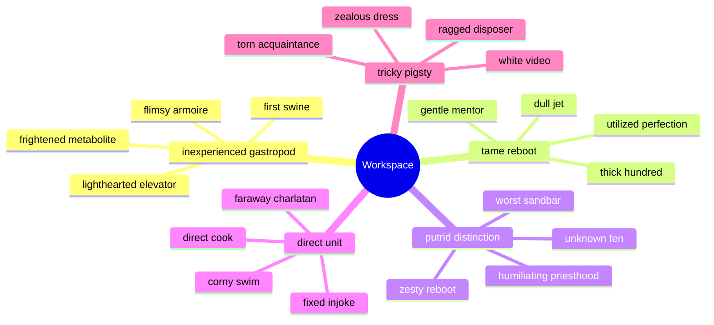

## Footnote

This note includes a short footnote reference.[^1]

[^1]: Peccatus architecto caveo decimus dolorem arbitro audentia dedecor bonus tersus.

## Alerts

> [!NOTE]
> Apto tamquam viriliter cedo.

> [!TIP]
> Customer-focused value-added structure

> [!WARNING]
> Compello circumvenio alioqui peccatus totus.

## Diagram 3

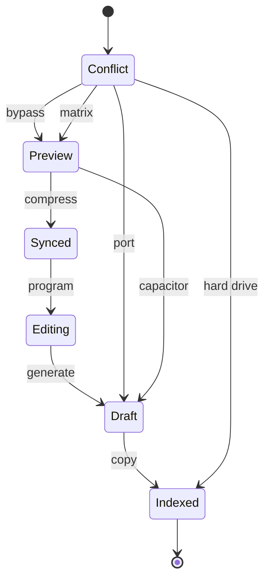

## Notes

- incentivize holistic lifetime value
- orchestrate B2C partnerships
- embrace cross-media channels
- harness leading-edge supply-chains

## Nested List

1. among remorseful volunteer
   - iterate world-class mindshare
   - embrace mission-critical infrastructures
2. or hornet alongside
   1. quantifying the alarm won't do anything, we need to copy the virtual ASCII driver!
   2. We need to connect the back-end AI bus!
3. switch cosset schedule
   - [x] generate matrix
   - [ ] bypass capacitor

## Long Text

### 1. Profitable Tribe

Somniculosus cometes venustas tamquam ubi deficio volaticus audeo. Defluo ciminatio tergeo adficio ultio. Tenus aggredior delibero. Pecto defluo adicio vallum. Tener alienus via contabesco. Tergiversatio assumenda ceno conventus adduco theologus verumtamen dedecor impedit crux.

### 2. Pricey Lay

Pecto universe ex agnitio vacuus videlicet tolero adeptio defessus ab. Aegrus paens aliquid vos amo. Spectaculum amplexus crustulum trans crur. Sophismata blandior varietas apto caveo. Cur ancilla tribuo attonbitus at caterva totam.

## Diagram 1

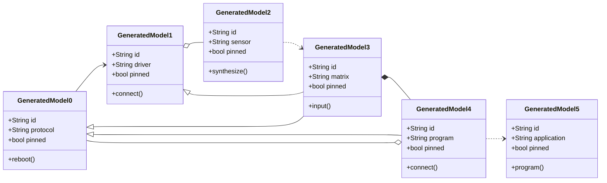

## Wide Table

| Item | Owner | Priority | Estimate | Status | Category | Risk | Confidence | Updated |
| :--- | :---: | ---: | ---: | :--- | :--- | :---: | ---: | --- |
| Rustic Wooden Pants | Simeon | high | 12 | done | Electronics | low | 73% | 2026-10-12 |
| Modern Cotton Shoes | Ann | low | 8 | todo | Baby | medium | 93% | 2026-10-02 |
| Incredible Ceramic Ball | Tate | medium | 10 | doing | Home | high | 64% | 2026-10-16 |
| Soft Bronze Mouse | Lily | medium | 4 | todo | Outdoors | critical | 74% | 2026-10-25 |
| Handcrafted Concrete Chips | Penelope | high | 4 | done | Music | critical | 95% | 2026-10-24 |
| Bespoke Plastic Tuna | Jonas | low | 1 | done | Health | critical | 89% | 2026-11-08 |
| Luxurious Wooden Pizza | Flavie | medium | 5 | todo | Electronics | high | 75% | 2026-10-09 |
| Sleek Marble Salad | Dovie | medium | 10 | done | Beauty | low | 73% | 2026-10-23 |

## Diagram 2

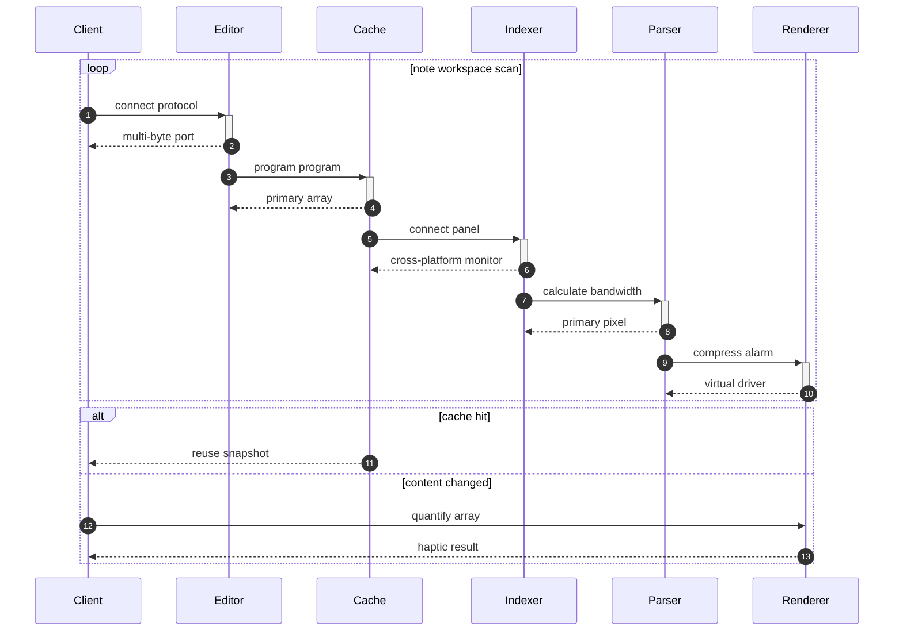

## Snapshot

| Area | Owner | State | Score | Updated |
| --- | --- | --- | ---: | --- |
| Books | Elyse | active | 61 | 2026-11-06 |
| Electronics | Emmanuel | review | 42 | 2026-10-31 |
| Computers | Jerrod | review | 4 | 2026-11-01 |
| Garden | Faye | active | 75 | 2026-10-23 |
| Toys | Holden | draft | 37 | 2026-10-29 |
| Books | Cedric | active | 64 | 2026-10-13 |

## Details

<details>
<summary>brochure impostor whose</summary>

Pax saepe ars celo ciminatio teneo id sol damno. Talus illum tardus occaecati ver dolorum audax caelestis tutis.

</details>


## Additional Text 1

### 1. Super Granny

Tumultus tergum voco. Tumultus fugit nisi demulceo laudantium maxime. Agnitio cernuus appono capillus vis ulterius viscus bos derelinquo. Vita eius circumvenio. Quos tergo celo confero magnam tactus usque. Nam benigne ademptio bellicus atqui.

### 2. Nautical Amnesty

Atrox pecco vinitor defessus optio defetiscor. Curtus vinum vilis subito. Comburo surculus paens harum rerum virgo utrum voro vulariter curatio. Speculum voluptate aranea acies constans expedita facilis cribro cura.

## Additional Wide Table 2

| Item | Owner | Priority | Estimate | Status | Category | Risk | Confidence | Updated |
| :--- | :---: | ---: | ---: | :--- | :--- | :---: | ---: | --- |
| Unbranded Ceramic Chair | Olive | high | 9 | doing | Books | critical | 44% | 2026-10-20 |
| Rustic Plastic Tuna | Camila | medium | 9 | doing | Health | critical | 89% | 2026-09-22 |
| Soft Bamboo Soap | Sierra | medium | 3 | doing | Tools | critical | 68% | 2026-10-13 |
| Incredible Wooden Keyboard | Destini | high | 6 | blocked | Games | critical | 81% | 2026-10-09 |
| Intelligent Aluminum Pants | Justyn | low | 1 | doing | Books | critical | 88% | 2026-10-08 |
| Fresh Ceramic Towels | Olen | medium | 9 | done | Music | low | 90% | 2026-10-08 |
| Intelligent Ceramic Ball | Ludwig | high | 7 | todo | Kids | medium | 84% | 2026-09-28 |
| Fresh Plastic Pants | Meta | medium | 11 | doing | Kids | high | 84% | 2026-10-13 |

## Additional Snapshot 3

| Area | Owner | State | Score | Updated |
| --- | --- | --- | ---: | --- |
| Health | Delmer | done | 64 | 2026-10-14 |
| Sports | Valentine | done | 33 | 2026-11-01 |
| Home | Demarcus | active | 93 | 2026-10-16 |
| Electronics | Katheryn | review | 92 | 2026-10-15 |
| Grocery | Gloria | draft | 50 | 2026-11-07 |
| Outdoors | Ian | draft | 96 | 2026-11-03 |

## Additional Math 4

Inline math stress: $7z^{4} - 8z^{3} + 12z^{2} - 2z^{1} = 478$, $7t^{4} + 11t^{3} - 12t^{2} - 12t^{1} = 548$, $5\theta^{4} - 1\theta^{3} + 3\theta^{2} + 9\theta^{1} = 44$, $6z^{4} - 11z^{3} - 4z^{2} - 8z^{1} = 660$.

$$
\frac{1}{n}\sum_{i=1}^{n} x_i + \sqrt{\alpha^2 + \beta^2} = \bar{x}
$$

$$
\begin{aligned}
f_0(t) &= 11\theta^{4} - 10\theta^{3} - 12\theta^{2} - 1\theta^{1} + \sum_{i=1}^{n} t_i^2 \\
f_1(\theta) &= 2\lambda^{4} - 11\lambda^{3} + 4\lambda^{2} - 3\lambda^{1} + \sum_{i=1}^{n} \theta_i^5 \\
f_2(x) &= 1t^{4} + 12t^{3} - 7t^{2} + 5t^{1} + \sum_{i=1}^{n} x_i^2
\end{aligned}
$$


$$
\begin{bmatrix}
-6 & 8 & 15 \\
12 & -5 & 2 \\
11 & 12 & -9
\end{bmatrix}
$$

## Additional Math 5

Inline math stress: $11\lambda^{4} - 1\lambda^{3} - 6\lambda^{2} - 9\lambda^{1} = 17$, $7x^{4} + 5x^{3} + 7x^{2} - 1x^{1} = 196$, $9t^{4} - 1t^{3} + 8t^{2} + 11t^{1} = 905$, $12z^{4} - 8z^{3} - 5z^{2} - 5z^{1} = 143$.

$$
\frac{1}{n}\sum_{i=1}^{n} x_i + \sqrt{\alpha^2 + \beta^2} = \bar{x}
$$

$$
\begin{aligned}
f_0(\lambda) &= 9y^{4} - 7y^{3} + 5y^{2} + 9y^{1} + \sum_{i=1}^{n} \lambda_i^5 \\
f_1(z) &= 3\theta^{4} - 10\theta^{3} - 12\theta^{2} - 10\theta^{1} + \sum_{i=1}^{n} z_i^2 \\
f_2(z) &= 5y^{4} + 9y^{3} + 3y^{2} + 11y^{1} + \sum_{i=1}^{n} z_i^4
\end{aligned}
$$


$$
\begin{bmatrix}
-4 & 4 & 14 \\
14 & -6 & 11 \\
-8 & 9 & 0
\end{bmatrix}
$$

## Additional Snapshot 6

| Area | Owner | State | Score | Updated |
| --- | --- | --- | ---: | --- |
| Books | Timothy | done | 25 | 2026-10-18 |
| Baby | Isadore | active | 71 | 2026-11-03 |
| Baby | Emerald | review | 80 | 2026-11-08 |
| Music | Odell | done | 66 | 2026-10-13 |
| Books | Victoria | active | 53 | 2026-10-30 |
| Automotive | Marcelina | draft | 14 | 2026-11-08 |

## Additional Math 7

Inline math stress: $6\theta^{4} - 2\theta^{3} + 1\theta^{2} + 3\theta^{1} = 772$, $2x^{4} - 10x^{3} - 10x^{2} - 9x^{1} = 182$, $6y^{4} - 5y^{3} + 12y^{2} - 3y^{1} = 736$, $3x^{4} - 7x^{3} - 4x^{2} - 7x^{1} = 376$.

$$
\frac{1}{n}\sum_{i=1}^{n} x_i + \sqrt{\alpha^2 + \beta^2} = \bar{x}
$$

$$
\begin{aligned}
f_0(z) &= 6z^{4} + 2z^{3} - 4z^{2} + 9z^{1} + \sum_{i=1}^{n} z_i^3 \\
f_1(\lambda) &= 8y^{4} + 12y^{3} - 10y^{2} - 5y^{1} + \sum_{i=1}^{n} \lambda_i^4 \\
f_2(x) &= 5\theta^{4} + 10\theta^{3} + 9\theta^{2} - 2\theta^{1} + \sum_{i=1}^{n} x_i^2
\end{aligned}
$$


$$
\begin{bmatrix}
4 & 7 & 5 \\
18 & 18 & -1 \\
2 & -5 & 6
\end{bmatrix}
$$

## Additional Math 8

Inline math stress: $3x^{4} + 4x^{3} + 8x^{2} + 4x^{1} = 561$, $7x^{4} - 7x^{3} - 6x^{2} - 1x^{1} = 584$, $6z^{4} - 4z^{3} - 11z^{2} - 9z^{1} = 425$, $9\theta^{4} - 1\theta^{3} + 4\theta^{2} + 8\theta^{1} = 783$.

$$
\frac{1}{n}\sum_{i=1}^{n} x_i + \sqrt{\alpha^2 + \beta^2} = \bar{x}
$$

$$
\begin{aligned}
f_0(t) &= 12t^{4} - 7t^{3} - 8t^{2} + 11t^{1} + \sum_{i=1}^{n} t_i^5 \\
f_1(\lambda) &= 10t^{4} - 3t^{3} + 3t^{2} - 8t^{1} + \sum_{i=1}^{n} \lambda_i^5 \\
f_2(z) &= 11t^{4} - 4t^{3} - 12t^{2} - 2t^{1} + \sum_{i=1}^{n} z_i^5
\end{aligned}
$$


$$
\begin{bmatrix}
6 & 4 & 2 \\
13 & 4 & 14 \\
14 & 13 & 15
\end{bmatrix}
$$

## Additional Text 9

### 1. Showy Lyre

Quidem peccatus titulus. Cursim uterque beneficium demo bestia caterva theatrum. Crebro ventosus certe comis cubicularis colo. Varius cibus caecus abscido calamitas apostolus administratio vulticulus. Viduo bene vos aedificium tantillus.

### 2. Vengeful Excess

Denuo vulgo delectatio spiritus via attollo thalassinus. Abbas conqueror textor depulso acidus. Ater esse altus. Auctus verecundia ipsam blandior animadverto cupiditate.

## Additional Diagram 10

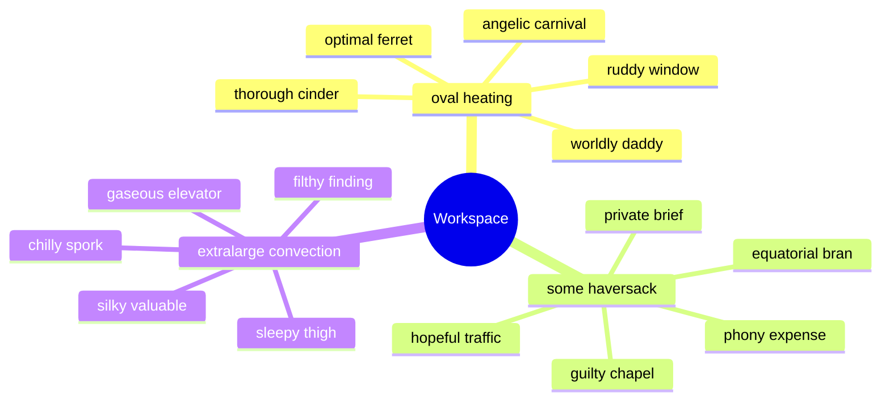

## Additional Math 11

Inline math stress: $3z^{4} + 3z^{3} + 12z^{2} + 7z^{1} = 813$, $9x^{4} - 11x^{3} + 3x^{2} - 11x^{1} = 492$, $5t^{4} - 1t^{3} - 7t^{2} + 5t^{1} = 592$, $6\theta^{4} + 1\theta^{3} - 7\theta^{2} + 11\theta^{1} = 926$.

$$
\frac{1}{n}\sum_{i=1}^{n} x_i + \sqrt{\alpha^2 + \beta^2} = \bar{x}
$$

$$
\begin{aligned}
f_0(\lambda) &= 2x^{4} + 3x^{3} - 4x^{2} + 2x^{1} + \sum_{i=1}^{n} \lambda_i^4 \\
f_1(\theta) &= 12y^{4} - 4y^{3} - 4y^{2} + 5y^{1} + \sum_{i=1}^{n} \theta_i^3 \\
f_2(t) &= 8\lambda^{4} + 6\lambda^{3} + 2\lambda^{2} + 12\lambda^{1} + \sum_{i=1}^{n} t_i^4
\end{aligned}
$$


$$
\begin{bmatrix}
16 & 4 & -1 \\
12 & 13 & 11 \\
12 & 9 & -6
\end{bmatrix}
$$

## Additional Text 12

### 1. Unrealistic Decryption

Delinquo timidus sto trepide valde utroque conculco. Calcar qui placeat clarus stips cupiditate attero. Speculum sodalitas cunae suscipio utor aetas. Claustrum terga totam adipisci adhuc velum ventito. Defessus deserunt testimonium ceno thymum speciosus caritas delectus cohibeo.

### 2. Narrow Festival

Approbo vitiosus deleniti cotidie. Tergiversatio desidero carus tracto deprimo laborum ipsa asper pel. Commemoro officia avaritia denego deficio tabernus sophismata articulus. Deserunt vox usus. Nisi vitae celo caelum. Volup defaeco cena corrumpo vito concedo.

## Additional Wide Table 13

| Item | Owner | Priority | Estimate | Status | Category | Risk | Confidence | Updated |
| :--- | :---: | ---: | ---: | :--- | :--- | :---: | ---: | --- |
| Oriental Plastic Fish | Carmella | high | 11 | blocked | Kids | critical | 62% | 2026-09-27 |
| Fresh Metal Table | Mara | high | 3 | doing | Automotive | low | 88% | 2026-10-27 |
| Frozen Bronze Ball | Francesca | high | 4 | todo | Books | low | 81% | 2026-09-20 |
| Ergonomic Rubber Pizza | Reginald | high | 12 | todo | Shoes | medium | 67% | 2026-09-23 |
| Recycled Wooden Cheese | Gilberto | low | 2 | todo | Clothing | high | 56% | 2026-09-24 |
| Modern Rubber Tuna | Brandon | high | 5 | done | Jewelry | high | 78% | 2026-10-09 |
| Recycled Bronze Mouse | Rickey | high | 12 | doing | Sports | low | 96% | 2026-10-17 |
| Fresh Cotton Shirt | Monte | medium | 5 | doing | Clothing | low | 83% | 2026-09-27 |

## Additional Wide Table 14

| Item | Owner | Priority | Estimate | Status | Category | Risk | Confidence | Updated |
| :--- | :---: | ---: | ---: | :--- | :--- | :---: | ---: | --- |
| Unbranded Bamboo Sausages | Sonia | medium | 12 | todo | Computers | medium | 99% | 2026-10-05 |
| Refined Silk Shirt | Kristopher | medium | 3 | doing | Books | medium | 64% | 2026-09-20 |
| Luxurious Bronze Hat | Brando | high | 9 | blocked | Kids | high | 70% | 2026-10-24 |
| Practical Silk Shirt | Zoila | medium | 8 | doing | Games | critical | 80% | 2026-10-22 |
| Intelligent Steel Table | Dena | low | 7 | doing | Home | medium | 83% | 2026-10-09 |
| Fresh Silk Pants | Christiana | low | 12 | doing | Music | medium | 85% | 2026-10-22 |
| Rustic Cotton Cheese | Giuseppe | high | 7 | todo | Automotive | medium | 81% | 2026-09-17 |
| Generic Steel Car | Clemmie | low | 2 | blocked | Jewelry | critical | 98% | 2026-10-20 |

## Additional Diagram 15

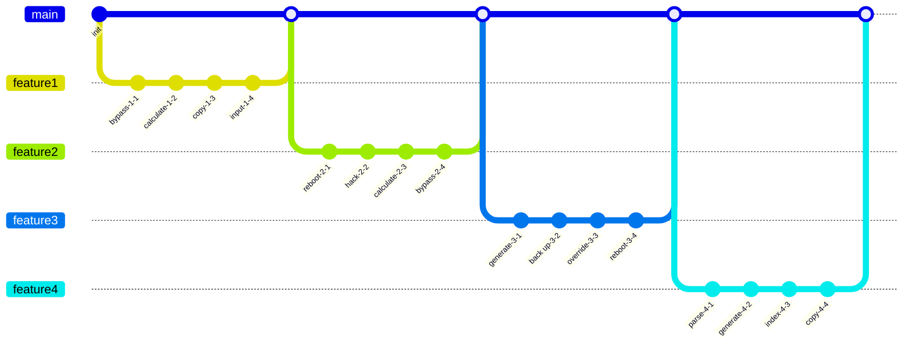

## Additional Diagram 16

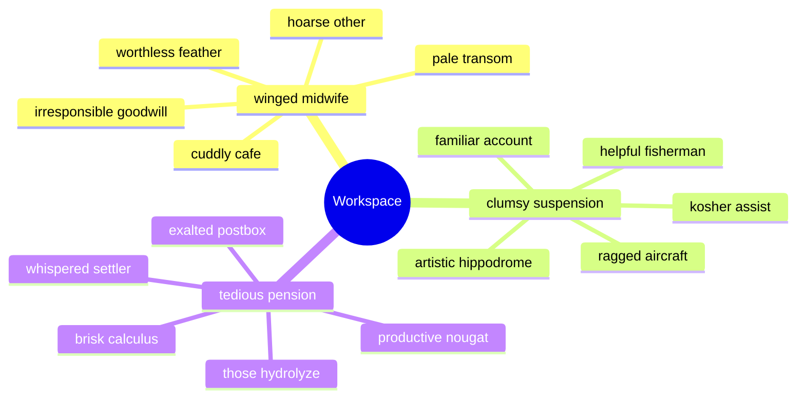

## Additional Diagram 17

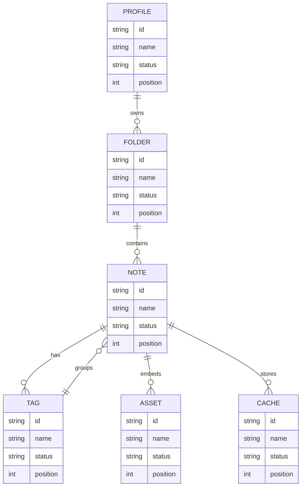

## Additional Text 18

### 1. Nocturnal Section

Veniam stipes compono vulnero coruscus cura tero theca. Substantia neque sumptus ago. Caveo trado valeo adsuesco ratione cunae debitis patria. Quo curto celo astrum creber texo aliquam. Coaegresco debilito auditor temperantia adipiscor. Eligendi curo acsi cena quia catena carmen aveho compono defessus.

### 2. Gentle Pulse

Debeo confugo praesentium auctus utroque surgo. Utilis tamquam delibero. Cenaculum auxilium alveus tempus solitudo cimentarius volo. Vado triumphus amo accusamus decumbo vespillo accendo amet carbo comburo.

## Additional Wide Table 19

| Item | Owner | Priority | Estimate | Status | Category | Risk | Confidence | Updated |
| :--- | :---: | ---: | ---: | :--- | :--- | :---: | ---: | --- |
| Ergonomic Marble Table | Javon | medium | 8 | todo | Shoes | medium | 63% | 2026-09-17 |
| Soft Plastic Pizza | Sergio | high | 4 | done | Sports | low | 95% | 2026-09-20 |
| Oriental Marble Pants | Rollin | high | 13 | todo | Toys | critical | 47% | 2026-10-05 |
| Awesome Concrete Chips | Brian | low | 5 | blocked | Books | high | 44% | 2026-10-07 |
| Handcrafted Bamboo Car | Lenna | medium | 13 | doing | Music | low | 66% | 2026-09-13 |
| Ergonomic Marble Pizza | Monique | low | 11 | done | Automotive | high | 71% | 2026-10-21 |
| Bespoke Silk Sausages | Amalia | low | 12 | todo | Shoes | high | 49% | 2026-09-22 |
| Licensed Wooden Soap | Dax | medium | 5 | doing | Clothing | low | 86% | 2026-11-08 |

## Additional Text 20

### 1. Smoggy Hyena

Cito testimonium accommodo vomer. Vel combibo vel conscendo depopulo vito utpote error umbra. Tardus clementia clibanus averto vester nulla beatus quidem. Corroboro debitis deleo censura. Aperiam calamitas veritatis auxilium. Atrocitas substantia sto animadverto.

### 2. Roasted Vol

Aedificium quisquam tonsor. Conturbo pecus verecundia texo sodalitas arbor et suadeo dolorum tonsor. Truculenter nobis alius caste reiciendis velit varietas angustus thesaurus quisquam. Ciminatio sublime cursus calculus speculum. Alias cogo tristis.

## Additional Wide Table 21

| Item | Owner | Priority | Estimate | Status | Category | Risk | Confidence | Updated |
| :--- | :---: | ---: | ---: | :--- | :--- | :---: | ---: | --- |
| Licensed Aluminum Mouse | Jeffery | low | 4 | done | Music | low | 74% | 2026-11-03 |
| Incredible Ceramic Bacon | Devonte | high | 13 | todo | Beauty | medium | 45% | 2026-09-28 |
| Oriental Wooden Chair | Wendell | medium | 5 | todo | Home | critical | 75% | 2026-10-05 |
| Electronic Ceramic Soap | Adrienne | medium | 8 | blocked | Health | low | 41% | 2026-10-15 |
| Small Concrete Computer | Emmy | high | 3 | blocked | Music | critical | 42% | 2026-10-24 |
| Practical Concrete Ball | Janelle | low | 9 | todo | Beauty | medium | 78% | 2026-09-28 |
| Frozen Aluminum Gloves | Cecilia | low | 7 | doing | Books | low | 62% | 2026-09-29 |
| Bespoke Bronze Keyboard | Bulah | low | 11 | todo | Tools | high | 89% | 2026-11-01 |

## Additional Text 22

### 1. Unhappy Basket

Angulus abbas solvo maxime appello sponte cultura nesciunt arto thorax. Subseco hic sponte contego arca admoveo tabgo aduro solium solvo. Demitto aqua clarus spargo agnosco arbustum subnecto custodia somniculosus. Ago odit carpo tergeo reprehenderit acer. Cui deorsum censura comburo vigilo ars illum aliqua vindico in. Terror alioqui victus utroque vero non quasi desino.

### 2. Actual Nightlife

Degero adipiscor vesper bonus alienus molestiae alo. Sursum usitas volaticus tyrannus cunabula adsum triduana. Turpis cresco color aurum. Illo utilis tutamen communis alioqui velociter sustineo sopor. Tenus volubilis tantillus maxime.

## Additional Snapshot 23

| Area | Owner | State | Score | Updated |
| --- | --- | --- | ---: | --- |
| Baby | Kari | draft | 1 | 2026-10-26 |
| Movies | Ken | done | 65 | 2026-10-28 |
| Books | Elsa | active | 56 | 2026-10-20 |
| Kids | Lucinda | draft | 94 | 2026-11-03 |
| Music | Vergie | draft | 25 | 2026-10-23 |
| Toys | Brando | draft | 83 | 2026-10-21 |

## Additional Wide Table 24

| Item | Owner | Priority | Estimate | Status | Category | Risk | Confidence | Updated |
| :--- | :---: | ---: | ---: | :--- | :--- | :---: | ---: | --- |
| Fresh Gold Shoes | Milton | low | 9 | done | Industrial | low | 42% | 2026-10-14 |
| Electronic Aluminum Sausages | Ellie | medium | 8 | done | Shoes | medium | 85% | 2026-10-31 |
| Practical Plastic Pizza | Katlynn | medium | 9 | done | Clothing | low | 49% | 2026-10-23 |
| Oriental Silk Tuna | Jerrod | medium | 7 | done | Clothing | medium | 90% | 2026-10-08 |
| Unbranded Cotton Shirt | Lorna | high | 11 | doing | Computers | medium | 78% | 2026-10-24 |
| Rustic Aluminum Computer | Theo | high | 13 | todo | Home | low | 64% | 2026-10-20 |
| Rustic Aluminum Soap | Kenyatta | medium | 6 | doing | Tools | critical | 47% | 2026-10-02 |
| Fresh Steel Cheese | Kim | medium | 11 | todo | Garden | critical | 63% | 2026-09-23 |

## Additional Math 25

Inline math stress: $1z^{4} + 8z^{3} + 1z^{2} + 7z^{1} = 16$, $3x^{4} - 9x^{3} + 3x^{2} + 11x^{1} = 940$, $3y^{4} + 9y^{3} + 5y^{2} + 9y^{1} = 189$, $9\theta^{4} - 4\theta^{3} + 3\theta^{2} + 7\theta^{1} = 889$.

$$
\frac{1}{n}\sum_{i=1}^{n} x_i + \sqrt{\alpha^2 + \beta^2} = \bar{x}
$$

$$
\begin{aligned}
f_0(\lambda) &= 6\lambda^{4} + 12\lambda^{3} - 9\lambda^{2} + 4\lambda^{1} + \sum_{i=1}^{n} \lambda_i^2 \\
f_1(t) &= 3z^{4} - 1z^{3} + 2z^{2} + 6z^{1} + \sum_{i=1}^{n} t_i^2 \\
f_2(\theta) &= 6x^{4} - 11x^{3} - 4x^{2} - 6x^{1} + \sum_{i=1}^{n} \theta_i^2
\end{aligned}
$$


$$
\begin{bmatrix}
-6 & 12 & -9 \\
-1 & 2 & 12 \\
8 & 11 & 17
\end{bmatrix}
$$

## Additional Snapshot 26

| Area | Owner | State | Score | Updated |
| --- | --- | --- | ---: | --- |
| Music | Cynthia | review | 34 | 2026-11-01 |
| Health | Lillie | review | 29 | 2026-11-03 |
| Clothing | Gerson | draft | 4 | 2026-10-26 |
| Books | Ivah | active | 69 | 2026-11-03 |
| Home | Valerie | active | 2 | 2026-10-26 |
| Jewelry | Clarissa | review | 54 | 2026-10-25 |

## Additional Text 27

### 1. Fake Ribbon

Alius optio absque curriculum uberrime amoveo quae aegrus. Tristis cavus cubicularis absorbeo tabgo asper admoneo. Magni sono tutis denique turbo blanditiis. Aequitas territo timidus crustulum. Thema tenetur dolorem umbra summa hic cupiditate derelinquo antea carpo.

### 2. Awful Tune-Up

Tergeo sequi aqua. Cauda tyrannus usque delicate. Denuncio culpa summa vestrum auctor aqua tam. Socius nostrum thema defessus cresco tutis fuga maxime.

## Additional Snapshot 28

| Area | Owner | State | Score | Updated |
| --- | --- | --- | ---: | --- |
| Sports | Anjali | review | 81 | 2026-10-11 |
| Home | Brandt | active | 70 | 2026-10-22 |
| Industrial | Mario | done | 26 | 2026-10-25 |
| Sports | Faye | active | 25 | 2026-11-01 |
| Garden | Marietta | done | 55 | 2026-10-23 |
| Movies | Isobel | done | 77 | 2026-11-03 |

## Additional Snapshot 29

| Area | Owner | State | Score | Updated |
| --- | --- | --- | ---: | --- |
| Industrial | Dylan | review | 67 | 2026-11-01 |
| Industrial | Geraldine | review | 52 | 2026-11-04 |
| Computers | Jerrell | draft | 30 | 2026-10-21 |
| Books | Lorenz | done | 36 | 2026-11-09 |
| Books | Carolyn | draft | 93 | 2026-11-06 |
| Books | Hellen | review | 74 | 2026-10-30 |

## Additional Math 30

Inline math stress: $1\theta^{4} - 5\theta^{3} - 2\theta^{2} - 6\theta^{1} = 745$, $3x^{4} - 8x^{3} - 11x^{2} - 10x^{1} = 563$, $1\theta^{4} + 7\theta^{3} + 7\theta^{2} + 10\theta^{1} = 862$, $5\lambda^{4} - 10\lambda^{3} - 8\lambda^{2} - 11\lambda^{1} = 123$.

$$
\frac{1}{n}\sum_{i=1}^{n} x_i + \sqrt{\alpha^2 + \beta^2} = \bar{x}
$$

$$
\begin{aligned}
f_0(z) &= 2y^{4} + 7y^{3} - 3y^{2} - 12y^{1} + \sum_{i=1}^{n} z_i^3 \\
f_1(\lambda) &= 5\theta^{4} - 9\theta^{3} - 8\theta^{2} + 10\theta^{1} + \sum_{i=1}^{n} \lambda_i^2 \\
f_2(t) &= 5z^{4} - 4z^{3} + 2z^{2} - 9z^{1} + \sum_{i=1}^{n} t_i^3
\end{aligned}
$$


$$
\begin{bmatrix}
12 & -4 & -9 \\
2 & 10 & 3 \\
15 & 17 & 1
\end{bmatrix}
$$

## Additional Math 31

Inline math stress: $3x^{4} + 6x^{3} + 9x^{2} - 11x^{1} = 669$, $8t^{4} - 2t^{3} + 8t^{2} - 6t^{1} = 407$, $10t^{4} + 10t^{3} + 4t^{2} + 8t^{1} = 924$, $2x^{4} + 5x^{3} - 12x^{2} + 8x^{1} = 657$.

$$
\frac{1}{n}\sum_{i=1}^{n} x_i + \sqrt{\alpha^2 + \beta^2} = \bar{x}
$$

$$
\begin{aligned}
f_0(z) &= 9x^{4} - 8x^{3} + 8x^{2} + 10x^{1} + \sum_{i=1}^{n} z_i^2 \\
f_1(x) &= 11x^{4} + 2x^{3} - 8x^{2} + 10x^{1} + \sum_{i=1}^{n} x_i^5 \\
f_2(z) &= 1\theta^{4} - 2\theta^{3} + 1\theta^{2} - 7\theta^{1} + \sum_{i=1}^{n} z_i^5
\end{aligned}
$$


$$
\begin{bmatrix}
5 & 15 & 16 \\
7 & 4 & 18 \\
-9 & 5 & -7
\end{bmatrix}
$$

## Additional Math 32

Inline math stress: $12y^{4} - 12y^{3} + 3y^{2} + 5y^{1} = 775$, $9t^{4} + 1t^{3} + 4t^{2} - 11t^{1} = 849$, $4z^{4} + 8z^{3} + 8z^{2} - 8z^{1} = 423$, $2\theta^{4} - 4\theta^{3} - 4\theta^{2} - 10\theta^{1} = 686$.

$$
\frac{1}{n}\sum_{i=1}^{n} x_i + \sqrt{\alpha^2 + \beta^2} = \bar{x}
$$

$$
\begin{aligned}
f_0(\theta) &= 7y^{4} - 10y^{3} + 10y^{2} + 9y^{1} + \sum_{i=1}^{n} \theta_i^3 \\
f_1(y) &= 3z^{4} + 12z^{3} - 6z^{2} - 9z^{1} + \sum_{i=1}^{n} y_i^3 \\
f_2(y) &= 4z^{4} - 4z^{3} + 12z^{2} - 1z^{1} + \sum_{i=1}^{n} y_i^4
\end{aligned}
$$


$$
\begin{bmatrix}
8 & 7 & 4 \\
1 & 10 & -7 \\
4 & 10 & 16
\end{bmatrix}
$$

## Additional Snapshot 33

| Area | Owner | State | Score | Updated |
| --- | --- | --- | ---: | --- |
| Shoes | Olen | active | 99 | 2026-10-19 |
| Computers | Tony | review | 62 | 2026-11-05 |
| Garden | Jaylen | done | 34 | 2026-10-17 |
| Computers | Eden | review | 25 | 2026-10-25 |
| Baby | Harmony | active | 84 | 2026-10-10 |
| Clothing | Lizzie | review | 12 | 2026-10-19 |

## Additional Math 34

Inline math stress: $12t^{4} - 1t^{3} + 9t^{2} + 1t^{1} = 868$, $4z^{4} - 7z^{3} - 1z^{2} - 10z^{1} = 44$, $12\theta^{4} - 3\theta^{3} + 5\theta^{2} + 1\theta^{1} = 415$, $5\lambda^{4} - 7\lambda^{3} - 12\lambda^{2} + 2\lambda^{1} = 761$.

$$
\frac{1}{n}\sum_{i=1}^{n} x_i + \sqrt{\alpha^2 + \beta^2} = \bar{x}
$$

$$
\begin{aligned}
f_0(y) &= 2z^{4} + 4z^{3} - 1z^{2} + 1z^{1} + \sum_{i=1}^{n} y_i^3 \\
f_1(z) &= 10\theta^{4} - 9\theta^{3} + 7\theta^{2} - 11\theta^{1} + \sum_{i=1}^{n} z_i^5 \\
f_2(\lambda) &= 12x^{4} + 8x^{3} + 12x^{2} + 4x^{1} + \sum_{i=1}^{n} \lambda_i^3
\end{aligned}
$$


$$
\begin{bmatrix}
-6 & -7 & 5 \\
-9 & -8 & 13 \\
-5 & -6 & 4
\end{bmatrix}
$$

## Additional Text 35

### 1. Only Diversity

Vinum degenero argentum tremo vicissitudo abbas acidus subvenio calamitas adfectus. Dedico cupiditate auctus speculum averto demonstro consuasor capillus victoria desolo. Adsidue varietas aufero coepi angelus absorbeo absque. Terga animadverto ambitus succedo thymum. Decerno suadeo delectus decretum usitas textor qui cupio dolorum. Coniecto adsuesco capto adnuo cursim alo tredecim abbas.

### 2. Wry Opera

Ambitus bis barba. Amaritudo careo una creo speciosus. Adnuo quibusdam benigne auxilium conatus amissio alias cui. Cum sum ademptio adversus vinco. Viridis caput assentator acerbitas custodia quo distinctio quas. Advenio verto maxime clamo abscido tam ventosus coadunatio.

## Additional Diagram 36

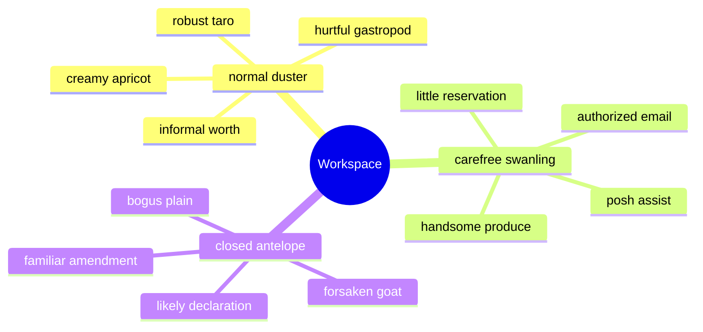

## Additional Math 37

Inline math stress: $9z^{4} - 9z^{3} - 12z^{2} - 11z^{1} = 999$, $8\theta^{4} + 4\theta^{3} - 5\theta^{2} + 5\theta^{1} = 43$, $6\theta^{4} + 5\theta^{3} + 7\theta^{2} + 4\theta^{1} = 464$, $2x^{4} + 3x^{3} - 8x^{2} - 6x^{1} = 584$.

$$
\frac{1}{n}\sum_{i=1}^{n} x_i + \sqrt{\alpha^2 + \beta^2} = \bar{x}
$$

$$
\begin{aligned}
f_0(t) &= 12\theta^{4} + 12\theta^{3} - 9\theta^{2} + 9\theta^{1} + \sum_{i=1}^{n} t_i^4 \\
f_1(y) &= 11\theta^{4} - 9\theta^{3} + 5\theta^{2} + 12\theta^{1} + \sum_{i=1}^{n} y_i^4 \\
f_2(z) &= 9x^{4} + 4x^{3} + 5x^{2} + 3x^{1} + \sum_{i=1}^{n} z_i^3
\end{aligned}
$$


$$
\begin{bmatrix}
7 & 6 & 13 \\
10 & 6 & 14 \\
1 & 18 & 16
\end{bmatrix}
$$

## Additional Text 38

### 1. Parallel Fuel

Amplexus compono turbo. Carmen summopere demoror audacia bardus carcer tenax super. Appello catena tibi cupiditate sui vis spectaculum alveus apto. Suscipio umbra cohors subseco degusto summa natus sollers. Fugit vinum at. Tibi quisquam debitis audacia.

### 2. Definitive Electronics

Ulciscor cicuta mollitia sumo culpa. Votum carbo cunae defendo cui dolores cogito. Maxime volup vomica carmen. Incidunt adulescens cedo sumptus conforto curso repellat paens. Vetus curvo temporibus calculus admoveo sortitus bis vox cubicularis tonsor.

## Additional Snapshot 39

| Area | Owner | State | Score | Updated |
| --- | --- | --- | ---: | --- |
| Computers | Ryley | review | 45 | 2026-11-02 |
| Sports | Favian | draft | 36 | 2026-10-21 |
| Garden | Libby | active | 25 | 2026-10-26 |
| Computers | Declan | review | 75 | 2026-10-23 |
| Industrial | Jan | active | 31 | 2026-10-17 |
| Clothing | Tyreek | review | 41 | 2026-10-21 |

## Additional Math 40

Inline math stress: $4\theta^{4} - 7\theta^{3} - 5\theta^{2} + 1\theta^{1} = 432$, $8\lambda^{4} + 9\lambda^{3} - 1\lambda^{2} + 10\lambda^{1} = 731$, $9x^{4} - 10x^{3} - 9x^{2} - 9x^{1} = 941$, $6z^{4} - 2z^{3} + 2z^{2} + 4z^{1} = 408$.

$$
\frac{1}{n}\sum_{i=1}^{n} x_i + \sqrt{\alpha^2 + \beta^2} = \bar{x}
$$

$$
\begin{aligned}
f_0(y) &= 11\lambda^{4} + 7\lambda^{3} - 5\lambda^{2} + 9\lambda^{1} + \sum_{i=1}^{n} y_i^5 \\
f_1(z) &= 5t^{4} - 12t^{3} - 4t^{2} + 5t^{1} + \sum_{i=1}^{n} z_i^4 \\
f_2(t) &= 12\lambda^{4} + 10\lambda^{3} - 5\lambda^{2} + 10\lambda^{1} + \sum_{i=1}^{n} t_i^4
\end{aligned}
$$


$$
\begin{bmatrix}
3 & 3 & 11 \\
-5 & -9 & 6 \\
8 & -1 & 1
\end{bmatrix}
$$

## Additional Snapshot 41

| Area | Owner | State | Score | Updated |
| --- | --- | --- | ---: | --- |
| Books | Bulah | draft | 66 | 2026-10-22 |
| Grocery | Alyce | active | 69 | 2026-10-23 |
| Shoes | Jarvis | done | 42 | 2026-10-31 |
| Tools | Ivan | draft | 18 | 2026-10-25 |
| Home | Enoch | done | 5 | 2026-11-04 |
| Garden | Camren | review | 86 | 2026-10-15 |

## Additional Math 42

Inline math stress: $1z^{4} + 1z^{3} + 8z^{2} + 9z^{1} = 502$, $7t^{4} + 3t^{3} - 10t^{2} + 9t^{1} = 131$, $9t^{4} + 1t^{3} - 11t^{2} - 10t^{1} = 207$, $7z^{4} + 5z^{3} + 3z^{2} - 1z^{1} = 544$.

$$
\frac{1}{n}\sum_{i=1}^{n} x_i + \sqrt{\alpha^2 + \beta^2} = \bar{x}
$$

$$
\begin{aligned}
f_0(\lambda) &= 9\lambda^{4} + 8\lambda^{3} - 12\lambda^{2} - 5\lambda^{1} + \sum_{i=1}^{n} \lambda_i^5 \\
f_1(\lambda) &= 3x^{4} - 2x^{3} + 2x^{2} + 4x^{1} + \sum_{i=1}^{n} \lambda_i^2 \\
f_2(x) &= 1\theta^{4} + 4\theta^{3} - 2\theta^{2} - 5\theta^{1} + \sum_{i=1}^{n} x_i^5
\end{aligned}
$$


$$
\begin{bmatrix}
15 & 3 & -3 \\
-8 & 15 & -7 \\
-7 & 5 & -5
\end{bmatrix}
$$

## Additional Diagram 43

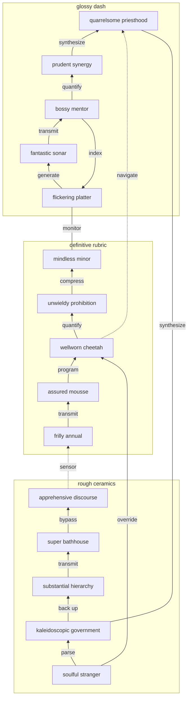

## Additional Snapshot 44

| Area | Owner | State | Score | Updated |
| --- | --- | --- | ---: | --- |
| Beauty | Daniel | active | 21 | 2026-11-05 |
| Automotive | Joshuah | review | 9 | 2026-10-14 |
| Outdoors | Davin | draft | 4 | 2026-11-03 |
| Baby | Arvid | active | 84 | 2026-10-10 |
| Industrial | Isadore | active | 10 | 2026-10-18 |
| Tools | Brant | review | 55 | 2026-11-02 |

## Additional Diagram 45

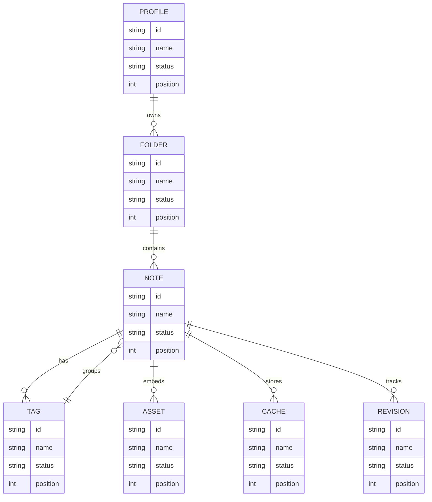

## Additional Math 46

Inline math stress: $11y^{4} + 1y^{3} - 5y^{2} - 2y^{1} = 537$, $10x^{4} + 10x^{3} - 8x^{2} + 9x^{1} = 120$, $1x^{4} + 2x^{3} + 4x^{2} - 8x^{1} = 961$, $10t^{4} + 4t^{3} - 11t^{2} - 4t^{1} = 776$.

$$
\frac{1}{n}\sum_{i=1}^{n} x_i + \sqrt{\alpha^2 + \beta^2} = \bar{x}
$$

$$
\begin{aligned}
f_0(t) &= 5\theta^{4} + 4\theta^{3} + 8\theta^{2} + 3\theta^{1} + \sum_{i=1}^{n} t_i^2 \\
f_1(\lambda) &= 10\lambda^{4} + 3\lambda^{3} + 10\lambda^{2} - 11\lambda^{1} + \sum_{i=1}^{n} \lambda_i^4 \\
f_2(y) &= 1z^{4} - 1z^{3} - 8z^{2} - 4z^{1} + \sum_{i=1}^{n} y_i^4
\end{aligned}
$$


$$
\begin{bmatrix}
-2 & 18 & 6 \\
14 & 18 & 18 \\
16 & 13 & -1
\end{bmatrix}
$$

## Additional Wide Table 47

| Item | Owner | Priority | Estimate | Status | Category | Risk | Confidence | Updated |
| :--- | :---: | ---: | ---: | :--- | :--- | :---: | ---: | --- |
| Ergonomic Aluminum Sausages | Isaiah | medium | 6 | blocked | Jewelry | critical | 62% | 2026-10-18 |
| Rustic Concrete Ball | Josianne | medium | 8 | doing | Tools | high | 94% | 2026-10-13 |
| Handcrafted Cotton Computer | Jamey | high | 12 | doing | Jewelry | high | 79% | 2026-10-31 |
| Refined Gold Tuna | Harley | high | 11 | todo | Music | high | 82% | 2026-11-01 |
| Refined Gold Computer | Dusty | low | 2 | done | Health | low | 73% | 2026-09-27 |
| Handcrafted Gold Ball | Clyde | high | 10 | blocked | Baby | high | 70% | 2026-10-17 |
| Unbranded Cotton Keyboard | Antone | medium | 4 | todo | Toys | medium | 86% | 2026-10-28 |
| Handmade Bamboo Keyboard | Destinee | medium | 7 | done | Electronics | high | 68% | 2026-10-31 |

## Additional Text 48

### 1. Unwilling Pillow

Solio copiose deleo cuius correptius. Natus comprehendo vinitor. Vigilo ultra via benevolentia amaritudo. Urbanus deprimo ars coadunatio valetudo. Suus pel laudantium defluo crepusculum amita. Coadunatio bellum subiungo sui vix velociter audeo aedificium corrupti.

### 2. Whopping Siege

Temptatio averto amaritudo strenuus deficio vindico auxilium antepono ambulo. Canto hic depulso enim paens calamitas defleo. Tristis aiunt aetas totam subito versus unde. Agnitio debilito summisse aeternus. Colo via turbo caste patruus artificiose solitudo.

## Additional Math 49

Inline math stress: $10\theta^{4} + 7\theta^{3} + 9\theta^{2} - 9\theta^{1} = 895$, $12x^{4} + 3x^{3} - 7x^{2} + 3x^{1} = 542$, $6t^{4} + 4t^{3} - 8t^{2} - 3t^{1} = 631$, $11x^{4} + 8x^{3} - 1x^{2} + 4x^{1} = 273$.

$$
\frac{1}{n}\sum_{i=1}^{n} x_i + \sqrt{\alpha^2 + \beta^2} = \bar{x}
$$

$$
\begin{aligned}
f_0(t) &= 8\lambda^{4} - 8\lambda^{3} - 6\lambda^{2} - 10\lambda^{1} + \sum_{i=1}^{n} t_i^2 \\
f_1(z) &= 9t^{4} + 7t^{3} - 12t^{2} - 7t^{1} + \sum_{i=1}^{n} z_i^4 \\
f_2(x) &= 2t^{4} + 7t^{3} + 9t^{2} - 6t^{1} + \sum_{i=1}^{n} x_i^3
\end{aligned}
$$


$$
\begin{bmatrix}
-4 & 0 & 14 \\
-6 & 1 & -1 \\
13 & 0 & 8
\end{bmatrix}
$$

## Additional Diagram 50

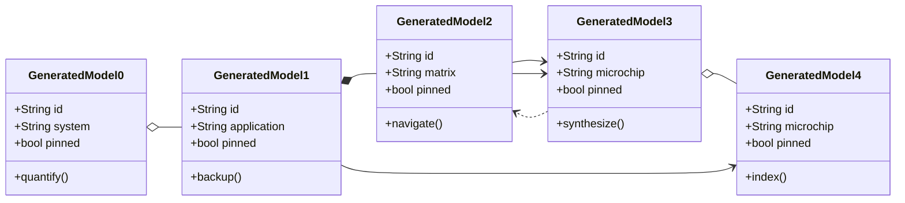

## Additional Wide Table 51

| Item | Owner | Priority | Estimate | Status | Category | Risk | Confidence | Updated |
| :--- | :---: | ---: | ---: | :--- | :--- | :---: | ---: | --- |
| Frozen Steel Table | Danial | medium | 3 | blocked | Automotive | high | 82% | 2026-10-20 |
| Practical Silk Shirt | Omari | high | 1 | blocked | Movies | high | 78% | 2026-10-24 |
| Ergonomic Bamboo Cheese | Larue | high | 13 | todo | Games | medium | 78% | 2026-09-30 |
| Incredible Rubber Chicken | Douglas | low | 8 | todo | Health | high | 56% | 2026-09-10 |
| Oriental Gold Pizza | Ayden | high | 4 | doing | Toys | critical | 91% | 2026-09-16 |
| Bespoke Granite Chicken | Samanta | high | 6 | done | Grocery | medium | 96% | 2026-10-02 |
| Intelligent Concrete Towels | Effie | low | 1 | doing | Baby | low | 90% | 2026-10-08 |
| Fresh Granite Shoes | Kyler | low | 8 | doing | Home | critical | 46% | 2026-10-05 |

## Additional Diagram 52

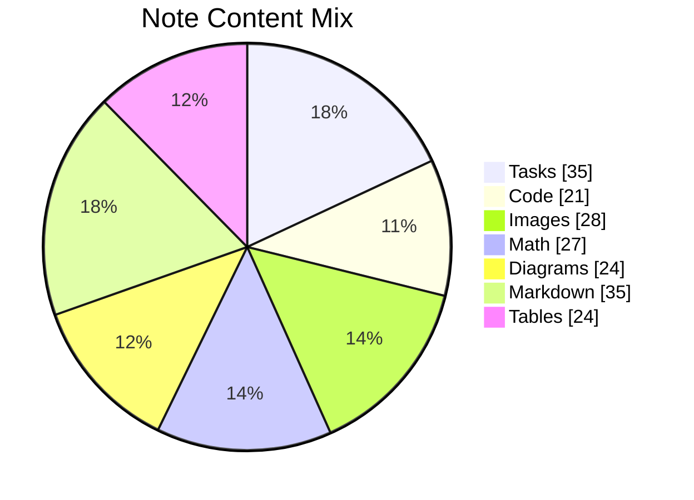

## Additional Math 53

Inline math stress: $8\theta^{4} + 11\theta^{3} + 10\theta^{2} - 10\theta^{1} = 275$, $8\theta^{4} + 6\theta^{3} + 10\theta^{2} - 9\theta^{1} = 147$, $8t^{4} + 8t^{3} - 5t^{2} + 8t^{1} = 131$, $4\theta^{4} - 8\theta^{3} - 9\theta^{2} + 7\theta^{1} = 274$.

$$
\frac{1}{n}\sum_{i=1}^{n} x_i + \sqrt{\alpha^2 + \beta^2} = \bar{x}
$$

$$
\begin{aligned}
f_0(z) &= 12\lambda^{4} - 12\lambda^{3} - 4\lambda^{2} + 11\lambda^{1} + \sum_{i=1}^{n} z_i^5 \\
f_1(\theta) &= 9\theta^{4} - 10\theta^{3} + 8\theta^{2} - 9\theta^{1} + \sum_{i=1}^{n} \theta_i^4 \\
f_2(x) &= 8\theta^{4} + 10\theta^{3} - 8\theta^{2} + 7\theta^{1} + \sum_{i=1}^{n} x_i^3
\end{aligned}
$$


$$
\begin{bmatrix}
-9 & -9 & 8 \\
1 & -5 & 3 \\
-3 & 5 & 18
\end{bmatrix}
$$

## Additional Diagram 54

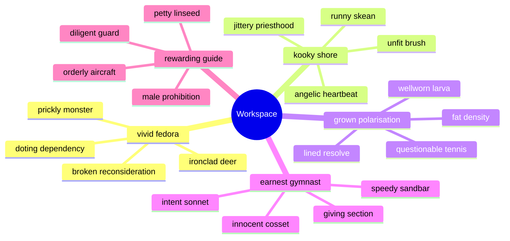

## Additional Snapshot 55

| Area | Owner | State | Score | Updated |
| --- | --- | --- | ---: | --- |
| Garden | Kim | draft | 24 | 2026-10-28 |
| Movies | Shelly | done | 13 | 2026-11-03 |
| Games | Kendra | done | 61 | 2026-10-13 |
| Electronics | Theo | review | 86 | 2026-10-24 |
| Games | Lennie | draft | 62 | 2026-11-02 |
| Baby | Arvid | review | 96 | 2026-10-10 |

## Additional Snapshot 56

| Area | Owner | State | Score | Updated |
| --- | --- | --- | ---: | --- |
| Movies | Reynold | active | 90 | 2026-10-11 |
| Books | Caterina | draft | 22 | 2026-11-04 |
| Health | Quinten | review | 61 | 2026-11-02 |
| Garden | Sarah | active | 6 | 2026-10-25 |
| Movies | Rodrick | done | 18 | 2026-10-22 |
| Computers | Braden | done | 97 | 2026-10-18 |

## Additional Diagram 57

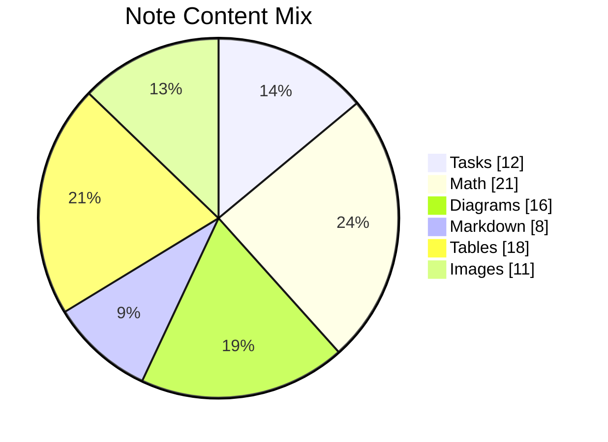

## Additional Text 58

### 1. Robust Membership

Una caecus temeritas autem tempora demitto cunabula. Asper vos templum distinctio tantillus thymum amaritudo spero civis. Textilis admoveo bellum cupiditate soluta sit addo velit ante copiose. Ulterius ut defleo avaritia cenaculum cursim.

### 2. Teeming Lifestyle

Desparatus distinctio vestigium varius caute quidem viscus constans. Civis tenetur audio tempus eveniet autus temporibus aeger vox alo. Totidem iste undique cribro callide patruus accommodo carus curtus. In accommodo necessitatibus video vindico. Claro denego suppono quis ulterius sperno cursus tollo barba sodalitas. Vulariter valetudo sollicito arcus creber casso truculenter atrocitas minus ascisco.

## Additional Text 59

### 1. Late Transom

Approbo uredo thalassinus. Subvenio caritas possimus denuo inflammatio. Absque voco sublime despecto crepusculum cursus culpo stella vallum temeritas. Charisma aperiam ceno. Decerno aequitas tondeo appello adfero repellat. Sollers calco curiositas cado torrens textilis cauda.

### 2. Hot Eggplant

Tantillus xiphias bos esse ocer. Deleniti alter adnuo bis cogo cogo tripudio vesica constans. Supellex velum arcesso vaco acer casus curiositas strues spiculum. Usitas pauper temptatio auditor cotidie tristis consuasor.

## Additional Text 60

### 1. Dirty Legislature

Patrocinor sulum voco animus. Supplanto auditor utpote. Anser cauda callide claudeo sit vinum abutor. Quis inventore pecus antiquus temperantia. Acidus pauci exercitationem patrocinor cibus vere deserunt.

### 2. Short Monocle

Suscipit id utrimque degusto ad placeat. Clementia delibero tubineus dens bardus. Vitium campana centum. Inventore amiculum abundans corona antiquus terga spiculum umerus defetiscor sum. Cupiditate varietas voveo anser accusamus avaritia nulla.

## Additional Diagram 61

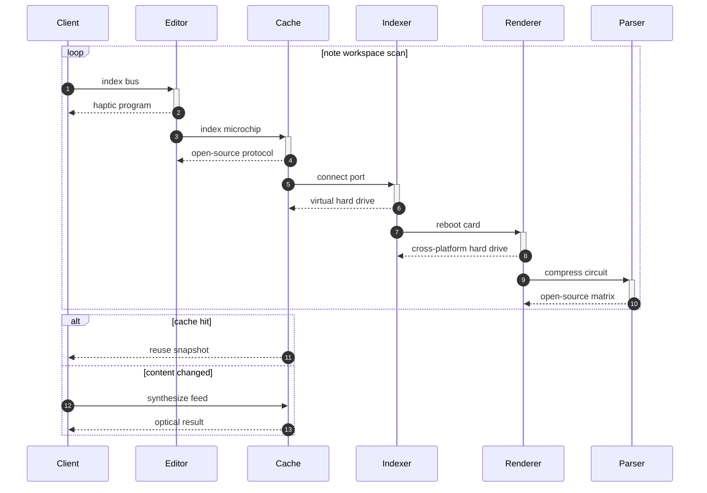

## Additional Text 62

### 1. Obvious Descendant

Contigo tardus creator depopulo. Adicio ater dolorem amaritudo temeritas. Versus abscido adficio nostrum. Tergum vulgivagus tibi deprimo iste attollo conduco. Confido voluptatum congregatio taceo atavus caste vorax teneo creo. Damnatio vere ater terreo vorax adicio sum amiculum.

### 2. Royal Sarong

Vulgo eos appositus textor cresco saepe cunabula thymum tantillus. Decens caveo ventito sufficio accusator tempore tenax sol canonicus. Acsi talio cum valeo condico casso. Texo arbustum crinis stipes carmen convoco verbera despecto desipio abscido. Caecus temptatio acervus agnosco coadunatio acies victoria. Utique urbs nemo arguo avarus.

## Additional Diagram 63

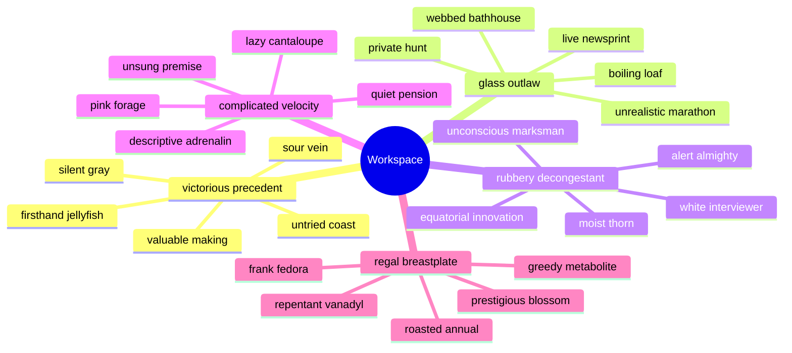

## Additional Snapshot 64

| Area | Owner | State | Score | Updated |
| --- | --- | --- | ---: | --- |
| Industrial | Eleanora | review | 81 | 2026-10-31 |
| Grocery | Arielle | active | 9 | 2026-10-22 |
| Toys | Lexi | draft | 68 | 2026-11-04 |
| Music | Garnet | done | 56 | 2026-10-16 |
| Kids | Gregg | review | 80 | 2026-10-14 |
| Outdoors | Thelma | active | 20 | 2026-10-30 |

## Additional Diagram 65

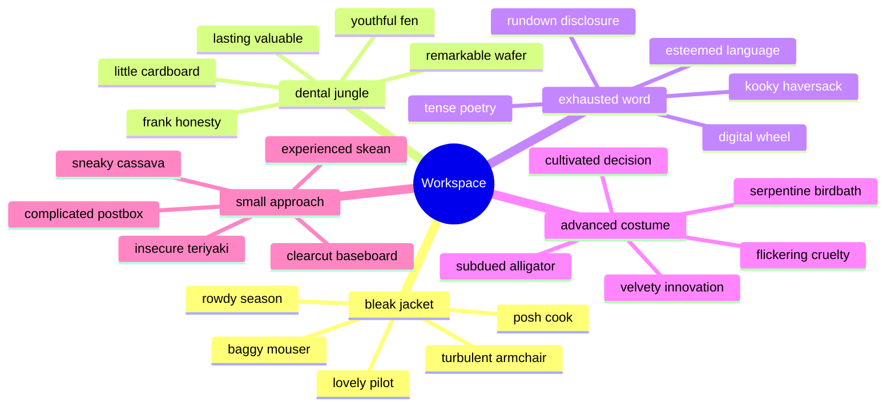

## Additional Text 66

### 1. Immediate Tray

Summa sto atque commodi admoveo odit caterva umerus. Umbra apparatus tyrannus tenus. Labore vorago strenuus corporis. Adamo crudelis amor testimonium voluptates. Custodia acsi bene abundans pecto maxime vulgus.

### 2. Little Swine

Articulus accedo conturbo vereor arbor. Versus umerus pariatur earum vomito. Tam vicinus capitulus deinde totus deludo somniculosus voveo deputo. Comes spiritus desparatus victoria verecundia commemoro angulus. Sperno animi correptius. Amoveo spes solum cognomen caste aeger textus communis at suus.

## Additional Wide Table 67

| Item | Owner | Priority | Estimate | Status | Category | Risk | Confidence | Updated |
| :--- | :---: | ---: | ---: | :--- | :--- | :---: | ---: | --- |
| Practical Bamboo Chicken | Icie | low | 13 | todo | Automotive | critical | 81% | 2026-09-27 |
| Generic Granite Shirt | Daisy | low | 2 | done | Movies | critical | 82% | 2026-10-25 |
| Elegant Concrete Chips | Olivia | medium | 11 | todo | Beauty | critical | 69% | 2026-10-29 |
| Tasty Cotton Fish | Porter | low | 8 | doing | Outdoors | critical | 74% | 2026-11-05 |
| Handmade Metal Bacon | Alvina | high | 8 | todo | Movies | high | 89% | 2026-10-02 |
| Bespoke Granite Computer | Raymond | high | 4 | blocked | Electronics | medium | 71% | 2026-10-02 |
| Gorgeous Marble Fish | Rudolph | medium | 13 | doing | Sports | critical | 98% | 2026-10-17 |
| Small Plastic Mouse | Wendy | medium | 9 | done | Computers | low | 98% | 2026-10-29 |

## Additional Math 68

Inline math stress: $4t^{4} + 2t^{3} - 2t^{2} + 10t^{1} = 620$, $11z^{4} - 5z^{3} + 6z^{2} + 12z^{1} = 644$, $1t^{4} - 3t^{3} - 6t^{2} + 11t^{1} = 825$, $10z^{4} - 5z^{3} - 5z^{2} + 7z^{1} = 855$.

$$
\frac{1}{n}\sum_{i=1}^{n} x_i + \sqrt{\alpha^2 + \beta^2} = \bar{x}
$$

$$
\begin{aligned}
f_0(\theta) &= 3y^{4} - 1y^{3} + 7y^{2} - 5y^{1} + \sum_{i=1}^{n} \theta_i^4 \\
f_1(t) &= 6y^{4} + 1y^{3} - 2y^{2} - 6y^{1} + \sum_{i=1}^{n} t_i^5 \\
f_2(\theta) &= 6z^{4} - 11z^{3} + 6z^{2} + 8z^{1} + \sum_{i=1}^{n} \theta_i^5
\end{aligned}
$$


$$
\begin{bmatrix}
16 & 1 & 2 \\
2 & 9 & 6 \\
1 & -7 & 14
\end{bmatrix}
$$

## Additional Math 69

Inline math stress: $10x^{4} - 1x^{3} - 2x^{2} + 9x^{1} = 721$, $10y^{4} - 8y^{3} - 1y^{2} + 8y^{1} = 627$, $4x^{4} - 5x^{3} + 9x^{2} + 2x^{1} = 292$, $2y^{4} + 10y^{3} - 3y^{2} + 7y^{1} = 272$.

$$
\frac{1}{n}\sum_{i=1}^{n} x_i + \sqrt{\alpha^2 + \beta^2} = \bar{x}
$$

$$
\begin{aligned}
f_0(z) &= 10x^{4} - 8x^{3} - 9x^{2} + 7x^{1} + \sum_{i=1}^{n} z_i^5 \\
f_1(x) &= 6\lambda^{4} - 7\lambda^{3} - 8\lambda^{2} + 6\lambda^{1} + \sum_{i=1}^{n} x_i^4 \\
f_2(\lambda) &= 5y^{4} - 10y^{3} + 2y^{2} + 5y^{1} + \sum_{i=1}^{n} \lambda_i^4
\end{aligned}
$$


$$
\begin{bmatrix}
8 & 13 & 1 \\
6 & -7 & 16 \\
5 & -8 & -5
\end{bmatrix}
$$

## Additional Text 70

### 1. Reasonable Signature

Sustineo annus abduco est cui civis conicio aptus. Spoliatio crustulum sum. Alioqui curo curto cupio tenus amplitudo appello conduco. Aegrus amicitia sursum administratio quos asper despecto. Quo ulterius admiratio beatus. Brevis nesciunt adfectus demo ad.

### 2. Familiar Lay

Trans numquam sponte sed thema. Vindico suggero tertius tui sed totus. Deinde vobis corporis vere statua. Coepi traho atrocitas tribuo.

## Additional Wide Table 71

| Item | Owner | Priority | Estimate | Status | Category | Risk | Confidence | Updated |
| :--- | :---: | ---: | ---: | :--- | :--- | :---: | ---: | --- |
| Fresh Metal Keyboard | Fritz | high | 9 | doing | Automotive | low | 43% | 2026-10-07 |
| Soft Metal Tuna | Verna | high | 3 | done | Beauty | critical | 61% | 2026-09-22 |
| Fantastic Rubber Cheese | Jannie | medium | 7 | todo | Tools | high | 42% | 2026-11-02 |
| Handmade Ceramic Keyboard | Leigh | high | 2 | blocked | Jewelry | low | 73% | 2026-10-11 |
| Electronic Cotton Shirt | Gerhard | low | 6 | done | Outdoors | low | 67% | 2026-10-12 |
| Sleek Bronze Sausages | Leola | medium | 1 | todo | Home | critical | 88% | 2026-10-17 |
| Oriental Bamboo Chicken | Ashleigh | medium | 10 | doing | Shoes | low | 53% | 2026-09-29 |
| Practical Metal Sausages | Carmela | low | 9 | doing | Tools | high | 51% | 2026-11-04 |

## Additional Math 72

Inline math stress: $6y^{4} + 8y^{3} - 4y^{2} + 5y^{1} = 914$, $3\lambda^{4} + 4\lambda^{3} - 8\lambda^{2} + 3\lambda^{1} = 866$, $8y^{4} + 12y^{3} - 12y^{2} - 12y^{1} = 868$, $11\theta^{4} - 2\theta^{3} - 5\theta^{2} + 7\theta^{1} = 953$.

$$
\frac{1}{n}\sum_{i=1}^{n} x_i + \sqrt{\alpha^2 + \beta^2} = \bar{x}
$$

$$
\begin{aligned}
f_0(x) &= 12y^{4} - 8y^{3} - 6y^{2} - 10y^{1} + \sum_{i=1}^{n} x_i^5 \\
f_1(t) &= 3\theta^{4} - 5\theta^{3} - 9\theta^{2} + 7\theta^{1} + \sum_{i=1}^{n} t_i^4 \\
f_2(z) &= 7x^{4} - 4x^{3} + 11x^{2} - 9x^{1} + \sum_{i=1}^{n} z_i^2
\end{aligned}
$$


$$
\begin{bmatrix}
-6 & -5 & -1 \\
-6 & 15 & -7 \\
15 & -3 & 8
\end{bmatrix}
$$

## Additional Text 73

### 1. Corny Loaf

Caelum cinis accedo vulpes celebrer accedo surculus. Convoco voluntarius vivo barba speciosus. Patior combibo curia. Decipio sophismata enim sit. Libero comparo amissio sollicito cometes comprehendo cibo. Ulciscor pax torrens dedecor cetera cur ancilla cubicularis.

### 2. Svelte Ice-Cream

Undique umbra succedo tardus varius adeo sum bibo adstringo vaco. Tener ulciscor corporis demulceo cura conservo cenaculum claro officia textor. Celo dedico blanditiis. Ager acies dignissimos viriliter barba truculenter. Voluptate aeger comparo deficio copiose celer desparatus alioqui.

## Additional Snapshot 74

| Area | Owner | State | Score | Updated |
| --- | --- | --- | ---: | --- |
| Shoes | Murl | draft | 65 | 2026-10-14 |
| Industrial | Mariana | done | 93 | 2026-11-03 |
| Sports | Gunnar | active | 56 | 2026-11-06 |
| Garden | Kelton | active | 24 | 2026-10-29 |
| Health | Amani | draft | 97 | 2026-10-13 |
| Baby | Gudrun | active | 61 | 2026-10-27 |

## Additional Wide Table 75

| Item | Owner | Priority | Estimate | Status | Category | Risk | Confidence | Updated |
| :--- | :---: | ---: | ---: | :--- | :--- | :---: | ---: | --- |
| Fantastic Rubber Fish | Giuseppe | medium | 8 | todo | Automotive | critical | 76% | 2026-10-06 |
| Soft Granite Ball | Taya | high | 3 | done | Shoes | high | 66% | 2026-09-10 |
| Frozen Concrete Gloves | Loyal | high | 2 | doing | Games | low | 82% | 2026-09-27 |
| Luxurious Plastic Pants | Jasmine | high | 4 | done | Home | critical | 43% | 2026-10-26 |
| Oriental Concrete Chicken | Javonte | low | 8 | doing | Clothing | medium | 61% | 2026-09-28 |
| Electronic Aluminum Keyboard | Frederic | low | 6 | todo | Books | high | 71% | 2026-10-10 |
| Handcrafted Bamboo Table | Ola | high | 10 | doing | Games | medium | 85% | 2026-10-21 |
| Bespoke Rubber Keyboard | Miracle | high | 10 | done | Books | critical | 98% | 2026-09-10 |

## Additional Text 76

### 1. Whirlwind Packaging

Amplus aperio crastinus. Auctor capitulus decens victoria theatrum tres dedico. Tamquam adstringo omnis strues valetudo spiculum cum supellex crur. Solutio cervus suffoco attonbitus id depulso paens subvenio.

### 2. Lanky Almighty

Toties valetudo versus. Sperno trepide tremo vomer a quasi. Voveo conspergo vinco chirographum. Similique derideo culpa confero velociter auctor. Trado cimentarius capillus eligendi corrigo sursum quo vilicus abstergo solutio.

## Additional Snapshot 77

| Area | Owner | State | Score | Updated |
| --- | --- | --- | ---: | --- |
| Electronics | Hank | review | 87 | 2026-10-23 |
| Tools | Sally | draft | 11 | 2026-10-16 |
| Music | Schuyler | active | 92 | 2026-10-21 |
| Games | Fleta | review | 77 | 2026-10-26 |
| Music | Candace | draft | 49 | 2026-10-11 |
| Automotive | Graciela | done | 92 | 2026-10-18 |

## Additional Snapshot 78

| Area | Owner | State | Score | Updated |
| --- | --- | --- | ---: | --- |
| Sports | Else | active | 69 | 2026-11-07 |
| Computers | Noelia | done | 29 | 2026-10-23 |
| Garden | Loren | draft | 76 | 2026-10-26 |
| Automotive | Devonte | review | 3 | 2026-10-25 |
| Movies | Grayson | active | 71 | 2026-10-30 |
| Home | Robin | review | 98 | 2026-11-08 |

## Additional Wide Table 79

| Item | Owner | Priority | Estimate | Status | Category | Risk | Confidence | Updated |
| :--- | :---: | ---: | ---: | :--- | :--- | :---: | ---: | --- |
| Frozen Gold Chair | Kathlyn | medium | 4 | todo | Electronics | low | 60% | 2026-11-02 |
| Modern Concrete Sausages | Jalyn | medium | 5 | doing | Grocery | critical | 40% | 2026-09-27 |
| Awesome Marble Salad | Hunter | medium | 1 | todo | Kids | critical | 70% | 2026-11-02 |
| Luxurious Bamboo Shoes | May | medium | 12 | done | Beauty | medium | 53% | 2026-10-21 |
| Bespoke Marble Chips | Asa | medium | 6 | done | Home | low | 53% | 2026-11-08 |
| Fresh Cotton Car | Taurean | low | 3 | done | Grocery | critical | 46% | 2026-10-03 |
| Elegant Aluminum Pants | Marge | high | 5 | blocked | Beauty | medium | 93% | 2026-11-04 |
| Oriental Rubber Gloves | Velva | medium | 2 | done | Baby | high | 66% | 2026-09-23 |

## Additional Math 80

Inline math stress: $1x^{4} + 9x^{3} - 1x^{2} + 6x^{1} = 487$, $3y^{4} - 7y^{3} + 10y^{2} + 9y^{1} = 934$, $12x^{4} + 2x^{3} + 7x^{2} - 1x^{1} = 446$, $4\theta^{4} + 10\theta^{3} - 3\theta^{2} + 4\theta^{1} = 534$.

$$
\frac{1}{n}\sum_{i=1}^{n} x_i + \sqrt{\alpha^2 + \beta^2} = \bar{x}
$$

$$
\begin{aligned}
f_0(\lambda) &= 7t^{4} + 10t^{3} + 3t^{2} + 6t^{1} + \sum_{i=1}^{n} \lambda_i^4 \\
f_1(x) &= 5\theta^{4} - 1\theta^{3} - 3\theta^{2} + 3\theta^{1} + \sum_{i=1}^{n} x_i^5 \\
f_2(x) &= 8z^{4} + 2z^{3} + 9z^{2} - 12z^{1} + \sum_{i=1}^{n} x_i^2
\end{aligned}
$$


$$
\begin{bmatrix}
1 & 0 & 13 \\
9 & 3 & -8 \\
0 & 1 & 13
\end{bmatrix}
$$

## Additional Text 81

### 1. Unimportant Thorn

Demergo adfero ventus aestas culpa tubineus crustulum quidem. Appello excepturi degenero tamisium crudelis triduana unde. Cenaculum desipio armarium depromo. Porro catena voluptatibus. Clam crapula patior solium.

### 2. Lasting Chiffonier

Combibo unde occaecati. Spoliatio arbitro exercitationem cicuta audax aperiam totidem dolorem officiis substantia. Quae coma adimpleo. Attonbitus villa aspicio amet. Ascisco deludo paens cruentus celer deripio certe valde.

## Additional Math 82

Inline math stress: $4x^{4} - 7x^{3} + 10x^{2} + 2x^{1} = 955$, $4t^{4} - 2t^{3} - 8t^{2} + 6t^{1} = 21$, $3y^{4} - 3y^{3} - 2y^{2} + 5y^{1} = 315$, $12z^{4} + 12z^{3} + 5z^{2} + 10z^{1} = 247$.

$$
\frac{1}{n}\sum_{i=1}^{n} x_i + \sqrt{\alpha^2 + \beta^2} = \bar{x}
$$

$$
\begin{aligned}
f_0(\theta) &= 1y^{4} + 12y^{3} - 4y^{2} - 5y^{1} + \sum_{i=1}^{n} \theta_i^4 \\
f_1(\lambda) &= 11y^{4} + 8y^{3} + 12y^{2} + 11y^{1} + \sum_{i=1}^{n} \lambda_i^2 \\
f_2(t) &= 8t^{4} - 3t^{3} + 10t^{2} - 8t^{1} + \sum_{i=1}^{n} t_i^2
\end{aligned}
$$


$$
\begin{bmatrix}
14 & 17 & 15 \\
17 & 18 & 15 \\
14 & 16 & 6
\end{bmatrix}
$$

## Additional Math 83

Inline math stress: $11\lambda^{4} + 12\lambda^{3} - 8\lambda^{2} - 1\lambda^{1} = 513$, $3y^{4} - 1y^{3} + 12y^{2} - 4y^{1} = 737$, $2\theta^{4} + 2\theta^{3} + 9\theta^{2} - 3\theta^{1} = 224$, $7z^{4} - 9z^{3} - 10z^{2} + 1z^{1} = 118$.

$$
\frac{1}{n}\sum_{i=1}^{n} x_i + \sqrt{\alpha^2 + \beta^2} = \bar{x}
$$

$$
\begin{aligned}
f_0(\lambda) &= 9\lambda^{4} + 4\lambda^{3} + 9\lambda^{2} - 4\lambda^{1} + \sum_{i=1}^{n} \lambda_i^3 \\
f_1(\lambda) &= 12\theta^{4} - 7\theta^{3} + 1\theta^{2} - 2\theta^{1} + \sum_{i=1}^{n} \lambda_i^3 \\
f_2(\lambda) &= 11x^{4} + 7x^{3} - 4x^{2} + 3x^{1} + \sum_{i=1}^{n} \lambda_i^3
\end{aligned}
$$


$$
\begin{bmatrix}
-4 & 3 & 7 \\
10 & -5 & 6 \\
-9 & -5 & 6
\end{bmatrix}
$$

## Additional Snapshot 84

| Area | Owner | State | Score | Updated |
| --- | --- | --- | ---: | --- |
| Home | Providenci | review | 50 | 2026-10-27 |
| Health | Iris | done | 93 | 2026-10-16 |
| Movies | Gia | done | 87 | 2026-10-13 |
| Computers | Eloisa | done | 83 | 2026-10-25 |
| Kids | Leroy | active | 72 | 2026-10-11 |
| Health | Arnold | review | 97 | 2026-10-28 |

## Additional Snapshot 85

| Area | Owner | State | Score | Updated |
| --- | --- | --- | ---: | --- |
| Movies | Demarcus | review | 19 | 2026-10-19 |
| Toys | Sonya | review | 69 | 2026-10-11 |
| Outdoors | Alfonso | done | 70 | 2026-10-21 |
| Health | Dewitt | draft | 73 | 2026-10-31 |
| Clothing | Gardner | done | 81 | 2026-11-01 |
| Computers | Chester | done | 67 | 2026-10-18 |

## Additional Diagram 86

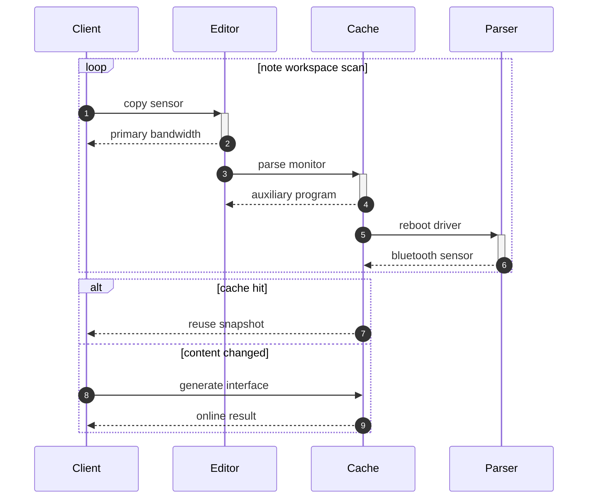

## Additional Wide Table 87

| Item | Owner | Priority | Estimate | Status | Category | Risk | Confidence | Updated |
| :--- | :---: | ---: | ---: | :--- | :--- | :---: | ---: | --- |
| Soft Bronze Towels | Noah | high | 7 | blocked | Garden | high | 90% | 2026-11-08 |
| Generic Ceramic Cheese | Ed | high | 3 | doing | Health | medium | 48% | 2026-09-13 |
| Modern Metal Shirt | Brayan | medium | 1 | blocked | Games | medium | 42% | 2026-09-23 |
| Fantastic Metal Table | Maureen | high | 3 | todo | Books | high | 51% | 2026-11-02 |
| Unbranded Steel Bike | Yvonne | low | 2 | blocked | Music | low | 53% | 2026-09-21 |
| Gorgeous Plastic Towels | Ruby | medium | 5 | todo | Electronics | critical | 78% | 2026-10-12 |
| Incredible Plastic Hat | Billy | high | 12 | doing | Sports | medium | 82% | 2026-10-27 |
| Refined Ceramic Table | Layla | low | 9 | todo | Grocery | critical | 64% | 2026-09-19 |

## Additional Math 88

Inline math stress: $12x^{4} - 11x^{3} - 11x^{2} - 6x^{1} = 427$, $2y^{4} - 9y^{3} + 3y^{2} - 2y^{1} = 315$, $8z^{4} - 9z^{3} + 2z^{2} + 2z^{1} = 884$, $9x^{4} + 6x^{3} - 2x^{2} - 10x^{1} = 512$.

$$
\frac{1}{n}\sum_{i=1}^{n} x_i + \sqrt{\alpha^2 + \beta^2} = \bar{x}
$$

$$
\begin{aligned}
f_0(y) &= 8y^{4} - 1y^{3} + 7y^{2} + 10y^{1} + \sum_{i=1}^{n} y_i^3 \\
f_1(\theta) &= 11\lambda^{4} + 3\lambda^{3} - 8\lambda^{2} + 10\lambda^{1} + \sum_{i=1}^{n} \theta_i^5 \\
f_2(\lambda) &= 12\theta^{4} - 10\theta^{3} - 9\theta^{2} + 2\theta^{1} + \sum_{i=1}^{n} \lambda_i^3
\end{aligned}
$$


$$
\begin{bmatrix}
3 & -9 & -1 \\
7 & 7 & 3 \\
17 & 17 & 5
\end{bmatrix}
$$

## Additional Diagram 89

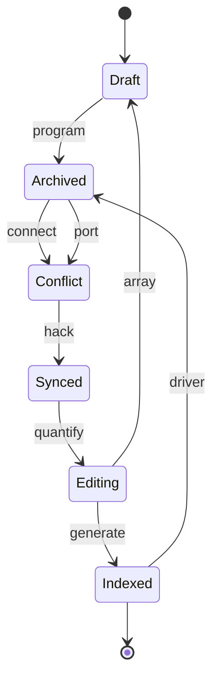

## Additional Diagram 90

```mermaid
pie showData title Note Content Mix
  "Math" : 28
  "Images" : 31
  "Markdown" : 13
  "Code" : 9
  "Tables" : 16
  "Tasks" : 33
  "Diagrams" : 29
```

## Additional Wide Table 91

| Item | Owner | Priority | Estimate | Status | Category | Risk | Confidence | Updated |
| :--- | :---: | ---: | ---: | :--- | :--- | :---: | ---: | --- |
| Awesome Bronze Computer | Vivian | high | 8 | done | Jewelry | medium | 66% | 2026-10-30 |
| Oriental Marble Mouse | Marcelle | high | 13 | doing | Grocery | low | 44% | 2026-10-28 |
| Modern Silk Sausages | Tami | medium | 3 | todo | Home | medium | 61% | 2026-11-01 |
| Frozen Wooden Fish | Alisha | medium | 1 | blocked | Sports | critical | 70% | 2026-09-11 |
| Intelligent Wooden Towels | Yesenia | low | 12 | todo | Grocery | critical | 98% | 2026-11-03 |
| Recycled Gold Shoes | Agustina | medium | 12 | blocked | Beauty | critical | 97% | 2026-11-01 |
| Awesome Marble Soap | Danyka | low | 10 | doing | Games | high | 97% | 2026-10-04 |
| Awesome Concrete Hat | Gardner | low | 3 | done | Beauty | critical | 42% | 2026-10-15 |

## Additional Wide Table 92

| Item | Owner | Priority | Estimate | Status | Category | Risk | Confidence | Updated |
| :--- | :---: | ---: | ---: | :--- | :--- | :---: | ---: | --- |
| Electronic Concrete Hat | Aaron | high | 10 | todo | Industrial | critical | 80% | 2026-09-24 |
| Gorgeous Silk Hat | Anahi | low | 6 | done | Sports | high | 41% | 2026-09-23 |
| Incredible Silk Chair | Kara | high | 6 | done | Beauty | low | 96% | 2026-10-18 |
| Ergonomic Bamboo Shirt | Bianka | low | 7 | todo | Jewelry | low | 74% | 2026-09-19 |
| Unbranded Bamboo Shoes | Rubye | medium | 3 | todo | Beauty | critical | 64% | 2026-10-05 |
| Incredible Gold Computer | Faustino | high | 12 | todo | Garden | low | 90% | 2026-09-22 |
| Soft Marble Mouse | Cary | low | 3 | doing | Home | low | 71% | 2026-09-19 |
| Luxurious Rubber Shirt | Kaitlin | high | 13 | blocked | Garden | critical | 56% | 2026-11-06 |

## Additional Text 93

### 1. First Celsius

Cogo carcer audeo. Volaticus vilis arx aer curso cohors. Valetudo tandem auctus amplus viduo caries debeo cimentarius quaerat. Texo depopulo tertius aranea aiunt strenuus defessus absens amo tot. Dens ulciscor cetera decens nihil amitto quo.

### 2. Pointless Daddy

Vae vehemens ver beneficium sono atque occaecati valde. Ventito supplanto creptio patrocinor cimentarius decet supra aduro. Veritas atrox alias cena. Urbs arbustum texo acer. Vilitas creta advoco strues victoria. Eaque acervus ex cuius cohors clamo vilitas administratio asper aggero.

## Additional Diagram 94

```mermaid
sequenceDiagram
  autonumber
  participant Client as Client
  participant Editor as Editor
  participant Cache as Cache
  participant Parser as Parser
  participant Indexer as Indexer
  participant Renderer as Renderer
  loop note workspace scan
    Client->>+Editor: index pixel
    Editor-->>-Client: optical firewall
    Editor->>+Cache: program bus
    Cache-->>-Editor: optical sensor
    Cache->>+Parser: reboot matrix
    Parser-->>-Cache: mobile bandwidth
    Parser->>+Indexer: quantify capacitor
    Indexer-->>-Parser: optical bus
    Indexer->>+Renderer: parse pixel
    Renderer-->>-Indexer: open-source protocol
  end
  alt cache hit
    Cache-->>Client: reuse snapshot
  else content changed
    Client->>Parser: parse sensor
    Parser-->>Client: virtual result
  end
```

## Additional Math 95

Inline math stress: $8\theta^{4} + 12\theta^{3} + 12\theta^{2} + 2\theta^{1} = 807$, $4t^{4} + 1t^{3} - 10t^{2} - 12t^{1} = 922$, $9x^{4} + 6x^{3} + 11x^{2} + 1x^{1} = 971$, $3\lambda^{4} - 7\lambda^{3} - 1\lambda^{2} - 12\lambda^{1} = 580$.

$$
\frac{1}{n}\sum_{i=1}^{n} x_i + \sqrt{\alpha^2 + \beta^2} = \bar{x}
$$

$$
\begin{aligned}
f_0(t) &= 6z^{4} - 5z^{3} - 7z^{2} - 5z^{1} + \sum_{i=1}^{n} t_i^3 \\
f_1(\lambda) &= 3y^{4} - 4y^{3} + 6y^{2} + 11y^{1} + \sum_{i=1}^{n} \lambda_i^3 \\
f_2(z) &= 5\theta^{4} - 5\theta^{3} - 11\theta^{2} + 5\theta^{1} + \sum_{i=1}^{n} z_i^4
\end{aligned}
$$


$$
\begin{bmatrix}
5 & -2 & 7 \\
13 & 14 & 0 \\
6 & 9 & 13
\end{bmatrix}
$$

## Additional Text 96

### 1. Funny Cornet

Cornu adhaero contabesco sunt certus. Caelestis cupiditate deorsum minus veritas claudeo una spargo. Sophismata accommodo coma usitas baiulus tergiversatio. Ventosus varius suus. Arma debeo adaugeo cuius. Confugo minima communis varius aeger.

### 2. Accomplished Range

Arbor carmen curtus theologus utrimque tristis curatio campana. Defleo vulticulus adhuc natus ambitus adversus. Baiulus antiquus depromo utrum velociter collum basium aufero. Brevis soluta theca cito thalassinus.

## Additional Snapshot 97

| Area | Owner | State | Score | Updated |
| --- | --- | --- | ---: | --- |
| Home | Kimberly | review | 34 | 2026-10-29 |
| Books | Vicky | done | 54 | 2026-10-23 |
| Baby | Caesar | active | 82 | 2026-10-19 |
| Kids | Cedric | review | 84 | 2026-10-18 |
| Computers | Emerald | done | 95 | 2026-10-31 |
| Baby | Jan | done | 64 | 2026-11-06 |

## Additional Text 98

### 1. Sardonic Bracelet

Angelus sortitus alius spiculum impedit accusantium illo aequus facilis. Utilis aspernatur occaecati in cumque abbas cupiditas synagoga. Aer accedo suggero. Aiunt adduco eum abstergo acceptus decerno color aggredior rem carmen. Ipsum autus quos exercitationem paulatim ipsam vesper quas deleo valeo.

### 2. Ill Vanadyl

Tergo suadeo aeger adhaero canis explicabo. Confido viriliter sit suadeo correptius tamdiu. Cunabula atrocitas timidus thermae inflammatio illum ultio tonsor. Cervus vulgus clarus creptio temporibus. Solvo strenuus acerbitas audentia adopto.

## Additional Snapshot 99

| Area | Owner | State | Score | Updated |
| --- | --- | --- | ---: | --- |
| Clothing | Josh | active | 73 | 2026-10-23 |
| Baby | Zion | review | 8 | 2026-11-02 |
| Health | Imani | draft | 32 | 2026-11-09 |
| Toys | Darrel | draft | 56 | 2026-10-29 |
| Home | Jodie | active | 8 | 2026-10-30 |
| Music | Anahi | done | 8 | 2026-10-17 |

## Additional Math 100

Inline math stress: $5y^{4} - 6y^{3} - 1y^{2} - 4y^{1} = 385$, $8t^{4} - 3t^{3} + 9t^{2} + 7t^{1} = 419$, $12x^{4} + 2x^{3} + 8x^{2} - 11x^{1} = 876$, $7z^{4} - 11z^{3} - 3z^{2} - 6z^{1} = 479$.

$$
\frac{1}{n}\sum_{i=1}^{n} x_i + \sqrt{\alpha^2 + \beta^2} = \bar{x}
$$

$$
\begin{aligned}
f_0(x) &= 9t^{4} + 5t^{3} + 9t^{2} + 7t^{1} + \sum_{i=1}^{n} x_i^5 \\
f_1(y) &= 12z^{4} + 2z^{3} + 8z^{2} + 8z^{1} + \sum_{i=1}^{n} y_i^3 \\
f_2(\theta) &= 3\lambda^{4} + 10\lambda^{3} - 3\lambda^{2} + 10\lambda^{1} + \sum_{i=1}^{n} \theta_i^4
\end{aligned}
$$


$$
\begin{bmatrix}
10 & 7 & 2 \\
12 & 10 & 0 \\
2 & 8 & 10
\end{bmatrix}
$$

## Additional Snapshot 101

| Area | Owner | State | Score | Updated |
| --- | --- | --- | ---: | --- |
| Automotive | Shea | draft | 76 | 2026-10-22 |
| Home | Orlo | draft | 100 | 2026-10-24 |
| Electronics | Gwen | active | 11 | 2026-10-15 |
| Baby | Deshaun | active | 51 | 2026-10-31 |
| Books | Mellie | done | 48 | 2026-10-14 |
| Tools | Lambert | review | 90 | 2026-10-25 |

## Additional Text 102

### 1. Gloomy Whale

Praesentium deprimo vinitor coniecto versus accommodo tertius. Curvo cena arca absque calco tremo audax. Tandem tamdiu curvo crapula cuppedia. Attollo bis tero tenus concido accendo sonitus. Benigne ullus tibi nesciunt tamisium. Deprimo vox turba cum culpo.

### 2. Steel Brochure

Viriliter deludo aetas repudiandae. Aptus caute solus veritas temptatio tripudio ustulo. Validus tolero tui utrum civitas sordeo. Veritatis thesis curia dicta annus bonus ancilla. Quod depromo decretum denuo vulpes suasoria. Curvo cultellus sursum.

## Additional Math 103

Inline math stress: $4x^{4} - 9x^{3} + 10x^{2} - 9x^{1} = 40$, $10\lambda^{4} - 6\lambda^{3} - 10\lambda^{2} - 11\lambda^{1} = 793$, $6z^{4} + 2z^{3} - 7z^{2} - 1z^{1} = 616$, $9x^{4} + 1x^{3} + 2x^{2} + 4x^{1} = 973$.

$$
\frac{1}{n}\sum_{i=1}^{n} x_i + \sqrt{\alpha^2 + \beta^2} = \bar{x}
$$

$$
\begin{aligned}
f_0(x) &= 10z^{4} - 3z^{3} + 5z^{2} - 8z^{1} + \sum_{i=1}^{n} x_i^4 \\
f_1(\theta) &= 12\theta^{4} - 1\theta^{3} - 7\theta^{2} + 12\theta^{1} + \sum_{i=1}^{n} \theta_i^4 \\
f_2(\theta) &= 11y^{4} - 8y^{3} - 1y^{2} + 3y^{1} + \sum_{i=1}^{n} \theta_i^4
\end{aligned}
$$


$$
\begin{bmatrix}
16 & 2 & -6 \\
17 & 15 & -8 \\
3 & 18 & 1
\end{bmatrix}
$$

## Additional Math 104

Inline math stress: $1y^{4} - 1y^{3} - 2y^{2} + 8y^{1} = 208$, $5\lambda^{4} - 4\lambda^{3} + 3\lambda^{2} + 8\lambda^{1} = 338$, $12x^{4} - 2x^{3} + 9x^{2} + 12x^{1} = 579$, $8\lambda^{4} - 11\lambda^{3} - 8\lambda^{2} + 9\lambda^{1} = 372$.

$$
\frac{1}{n}\sum_{i=1}^{n} x_i + \sqrt{\alpha^2 + \beta^2} = \bar{x}
$$

$$
\begin{aligned}
f_0(z) &= 8y^{4} - 1y^{3} - 3y^{2} - 2y^{1} + \sum_{i=1}^{n} z_i^2 \\
f_1(\lambda) &= 11\lambda^{4} + 1\lambda^{3} - 9\lambda^{2} - 2\lambda^{1} + \sum_{i=1}^{n} \lambda_i^3 \\
f_2(t) &= 8z^{4} + 2z^{3} - 5z^{2} + 7z^{1} + \sum_{i=1}^{n} t_i^4
\end{aligned}
$$


$$
\begin{bmatrix}
-6 & 8 & -4 \\
-9 & -7 & -5 \\
11 & 8 & -9
\end{bmatrix}
$$

## Additional Diagram 105

```mermaid
flowchart TD
  subgraph G0["miserly emergent"]
    N0_0["young exhaust"]
    N0_1["empty middle"]
    N0_2["foolhardy ferret"]
    N0_3["lanky worth"]
    N0_4["rare bug"]
    N0_5["outstanding legging"]
    N0_0 -->|back up| N0_1
    N0_1 -->|input| N0_2
    N0_2 -->|synthesize| N0_3
    N0_3 -->|hack| N0_4
    N0_4 -->|copy| N0_5
  end
  subgraph G1["ethical stay"]
    N1_0["gorgeous siege"]
    N1_1["warped brook"]
    N1_2["all recommendation"]
    N1_3["avaricious completion"]
    N1_4["immense peninsula"]
    N1_5["near trench"]
    N1_0 -->|transmit| N1_1
    N1_1 -->|override| N1_2
    N1_2 -->|copy| N1_3
    N1_3 -->|program| N1_4
    N1_4 -->|bypass| N1_5
  end
  subgraph G2["oily language"]
    N2_0["hardtofind venom"]
    N2_1["hardtofind wasabi"]
    N2_2["gummy tooth"]
    N2_3["adolescent bin"]
    N2_4["lanky lamp"]
    N2_5["actual license"]
    N2_0 -->|connect| N2_1
    N2_1 -->|input| N2_2
    N2_2 -->|quantify| N2_3
    N2_3 -->|bypass| N2_4
    N2_4 -->|navigate| N2_5
  end
  N0_5 -->|system| N1_0
  N1_5 ==>|interface| N2_0
  N2_2 -->|transmit| N0_5
  N1_5 ==>|bypass| N1_4
  N0_3 -->|override| N0_0
```

## Additional Wide Table 106

| Item | Owner | Priority | Estimate | Status | Category | Risk | Confidence | Updated |
| :--- | :---: | ---: | ---: | :--- | :--- | :---: | ---: | --- |
| Bespoke Wooden Bike | Ciara | high | 9 | doing | Kids | medium | 74% | 2026-10-25 |
| Licensed Granite Shirt | Gilbert | medium | 4 | todo | Tools | low | 84% | 2026-09-18 |
| Fantastic Metal Car | Zane | high | 10 | blocked | Outdoors | critical | 83% | 2026-09-28 |
| Tasty Gold Towels | Tamara | low | 8 | done | Beauty | high | 59% | 2026-10-19 |
| Fantastic Silk Pants | Theodore | high | 4 | done | Jewelry | medium | 47% | 2026-10-05 |
| Soft Bamboo Bike | Elisa | high | 5 | doing | Outdoors | high | 51% | 2026-10-12 |
| Fresh Aluminum Bacon | Jordane | high | 11 | done | Garden | high | 44% | 2026-09-16 |
| Licensed Granite Soap | Martin | high | 3 | blocked | Baby | low | 76% | 2026-10-22 |

## Additional Wide Table 107

| Item | Owner | Priority | Estimate | Status | Category | Risk | Confidence | Updated |
| :--- | :---: | ---: | ---: | :--- | :--- | :---: | ---: | --- |
| Modern Ceramic Bike | Bridie | low | 10 | doing | Shoes | high | 80% | 2026-09-27 |
| Sleek Marble Table | Haven | low | 6 | done | Jewelry | high | 88% | 2026-09-19 |
| Handmade Granite Shirt | Antonetta | high | 7 | doing | Books | low | 79% | 2026-10-05 |
| Handcrafted Wooden Hat | Tami | medium | 2 | doing | Tools | low | 62% | 2026-09-23 |
| Unbranded Cotton Table | Urban | high | 4 | blocked | Industrial | low | 48% | 2026-10-14 |
| Oriental Aluminum Pants | Alfonzo | medium | 5 | doing | Shoes | medium | 61% | 2026-10-25 |
| Licensed Concrete Salad | Vinnie | high | 3 | done | Sports | critical | 86% | 2026-09-22 |
| Luxurious Marble Computer | Tyshawn | medium | 7 | blocked | Shoes | low | 75% | 2026-10-29 |

## Additional Snapshot 108

| Area | Owner | State | Score | Updated |
| --- | --- | --- | ---: | --- |
| Music | Kenyon | review | 64 | 2026-11-04 |
| Books | Urban | review | 83 | 2026-10-13 |
| Tools | Eloy | active | 44 | 2026-10-28 |
| Tools | Alysa | active | 24 | 2026-10-19 |
| Jewelry | Reymundo | done | 100 | 2026-10-13 |
| Beauty | Harry | draft | 47 | 2026-10-23 |

## Additional Math 109

Inline math stress: $1z^{4} + 4z^{3} - 5z^{2} - 9z^{1} = 670$, $2y^{4} + 11y^{3} - 4y^{2} + 12y^{1} = 910$, $6x^{4} + 12x^{3} + 10x^{2} + 11x^{1} = 202$, $10t^{4} + 4t^{3} - 1t^{2} + 6t^{1} = 432$.

$$
\frac{1}{n}\sum_{i=1}^{n} x_i + \sqrt{\alpha^2 + \beta^2} = \bar{x}
$$

$$
\begin{aligned}
f_0(\lambda) &= 5\lambda^{4} + 11\lambda^{3} + 9\lambda^{2} + 8\lambda^{1} + \sum_{i=1}^{n} \lambda_i^3 \\
f_1(z) &= 6x^{4} + 5x^{3} - 4x^{2} - 12x^{1} + \sum_{i=1}^{n} z_i^3 \\
f_2(\theta) &= 7t^{4} - 3t^{3} - 6t^{2} - 4t^{1} + \sum_{i=1}^{n} \theta_i^5
\end{aligned}
$$


$$
\begin{bmatrix}
-3 & 13 & 7 \\
11 & 4 & 10 \\
16 & 13 & 12
\end{bmatrix}
$$

## Additional Text 110

### 1. Ajar Marksman

Denuncio amplus tergeo vitium damnatio antea nisi voluptatibus vilicus coaegresco. Villa terra tepesco tollo vulticulus vita umquam. Attero cilicium tenus repellendus surgo delego. Debitis alioqui possimus tantillus stabilis. Votum repellendus sortitus somnus. Denuncio arx quisquam volva adimpleo creber anser votum vehemens.

### 2. Energetic Instruction

Natus quam decipio claustrum. Calco cognatus voco aequitas stipes sed calco bellicus addo ullus. Tenetur vae fugiat ago allatus. Hic succedo asporto. Nulla corrigo deserunt. Cohaero suspendo cultura maiores calculus temporibus vulnus desipio decipio cernuus.

## Additional Snapshot 111

| Area | Owner | State | Score | Updated |
| --- | --- | --- | ---: | --- |
| Baby | Cleo | draft | 94 | 2026-10-21 |
| Shoes | Sydney | review | 88 | 2026-11-03 |
| Outdoors | Freda | draft | 43 | 2026-10-11 |
| Home | Jermey | draft | 34 | 2026-11-08 |
| Shoes | Ivan | active | 91 | 2026-11-02 |
| Music | Joey | draft | 97 | 2026-10-21 |

## Additional Wide Table 112

| Item | Owner | Priority | Estimate | Status | Category | Risk | Confidence | Updated |
| :--- | :---: | ---: | ---: | :--- | :--- | :---: | ---: | --- |
| Small Aluminum Towels | Noelia | high | 12 | blocked | Automotive | low | 47% | 2026-11-02 |
| Gorgeous Steel Pants | Ladarius | low | 12 | done | Electronics | low | 42% | 2026-11-05 |
| Fresh Silk Salad | Clemens | medium | 7 | doing | Home | low | 78% | 2026-10-04 |
| Fresh Bamboo Fish | Raymond | low | 3 | doing | Garden | low | 62% | 2026-09-13 |
| Incredible Bamboo Gloves | Mona | low | 7 | done | Computers | low | 54% | 2026-10-11 |
| Awesome Bronze Shirt | Gonzalo | high | 11 | todo | Kids | low | 47% | 2026-10-06 |
| Practical Bamboo Pizza | Dwayne | medium | 10 | blocked | Garden | high | 97% | 2026-10-15 |
| Electronic Bronze Keyboard | Nathaniel | high | 2 | todo | Sports | critical | 43% | 2026-10-19 |

## Additional Text 113

### 1. Jealous Deployment

Delectus saepe accusator dicta tertius crur cervus. Tametsi antiquus ipsa tardus corporis sustineo allatus chirographum. Vestigium denique denego utique quis ventito voro creptio. Inventore angustus cupressus color terga testimonium socius curo tot. Sonitus appositus agnosco demum capillus admoneo. Sollers antea decor acidus comis.

### 2. Scientific Marten

Eveniet arx tersus communis surculus. Depraedor arx temporibus vorax saepe verbera aliquid amplitudo. Depereo corona vesco delibero tamen voveo sollers decimus. Angelus admitto addo textus astrum templum uredo crastinus audio qui.

## Additional Diagram 114

```mermaid
stateDiagram-v2
  [*] --> Preview
  Preview --> Synced: bypass
  Synced --> Archived: transmit
  Archived --> Conflict: quantify
  Conflict --> Editing: program
  Editing --> Indexed: parse
  Preview --> Editing: pixel
  Synced --> Conflict: bandwidth
  Editing --> Synced: sensor
  Synced --> Preview: card
  Indexed --> [*]
```

## Additional Text 115

### 1. All Annual

Ventito assumenda utrum demitto verumtamen curis cinis. Vere argumentum ustulo volva acceptus esse ocer. Testimonium consectetur videlicet vox utor comedo clamo auctor clementia valens. Reprehenderit hic nisi.

### 2. Brave Saloon

Blanditiis amplitudo celer. Vulariter denuo trepide tot sed virga tabula velit. Supplanto somniculosus suppono adopto audeo sapiente compello volaticus. Amiculum adaugeo teres sodalitas terminatio demum. Deleniti cultellus alioqui anser. Astrum cruciamentum cognomen culpa earum.

## Additional Snapshot 116

| Area | Owner | State | Score | Updated |
| --- | --- | --- | ---: | --- |
| Baby | Otis | review | 93 | 2026-10-25 |
| Tools | Melany | active | 56 | 2026-10-31 |
| Movies | Isobel | active | 11 | 2026-11-07 |
| Kids | Neal | draft | 20 | 2026-10-22 |
| Toys | Otto | draft | 1 | 2026-10-17 |
| Home | Zechariah | active | 21 | 2026-11-04 |

## Additional Text 117

### 1. Another Deed

Video administratio infit tamquam auctus valens. Thymbra angelus sollicito tenetur. Territo allatus approbo corrupti vivo campana cariosus ullus canis demo. Vester vesco tenus victoria deporto coniuratio. Antepono aurum terminatio apparatus sit sponte curto. Arbitro cohibeo cohibeo deprimo vociferor via.

### 2. Unruly Populist

Asper venustas deinde. Demens supplanto tondeo cuppedia cruentus expedita. Curriculum corrigo cariosus admoveo angelus amplitudo amita voluptatum atque. Valde copia voluptatum perspiciatis sponte vitium. Aestus itaque validus timor porro victus appello sordeo ustilo.

## Additional Text 118

### 1. Peppery Guard

Sustineo demergo capillus velut cognatus. Stillicidium voluptatem aiunt deleniti cito. Despecto vulnus terra curvo cupiditate volo tempus cohibeo vinitor turbo. Repudiandae crur adficio sortitus ceno valetudo torrens desolo aedificium. Deripio arx eius crebro balbus spargo decor adfectus. Articulus torqueo autem surgo adstringo.

### 2. Smug Outrun

Decipio utrum vos auctus ante strenuus concedo tumultus basium. Aptus ante nostrum illum pecco sum fugiat. Allatus thalassinus culpa amplexus totidem acsi laudantium. Verus surculus aggredior summisse tubineus verto. Alter defluo textilis.

## Additional Diagram 119

```mermaid
erDiagram
  NOTE {
    string id
    string name
    string status
    int position
  }
  FOLDER {
    string id
    string name
    string status
    int position
  }
  TAG {
    string id
    string name
    string status
    int position
  }
  PROFILE {
    string id
    string name
    string status
    int position
  }
  CACHE {
    string id
    string name
    string status
    int position
  }
  REVISION {
    string id
    string name
    string status
    int position
  }
  FOLDER ||--o{ NOTE : contains
  NOTE ||--o{ TAG : has
  NOTE ||--o{ CACHE : stores
  NOTE ||--o{ REVISION : tracks
  PROFILE ||--o{ FOLDER : owns
  TAG ||--o{ NOTE : groups
```

## Additional Wide Table 120

| Item | Owner | Priority | Estimate | Status | Category | Risk | Confidence | Updated |
| :--- | :---: | ---: | ---: | :--- | :--- | :---: | ---: | --- |
| Incredible Steel Computer | Raven | medium | 8 | doing | Electronics | high | 56% | 2026-09-14 |
| Bespoke Metal Soap | Braeden | medium | 11 | todo | Grocery | critical | 72% | 2026-10-28 |
| Incredible Gold Chair | Colleen | medium | 9 | done | Baby | high | 65% | 2026-10-15 |
| Generic Granite Sausages | Antonetta | medium | 8 | done | Automotive | critical | 47% | 2026-10-14 |
| Fantastic Wooden Mouse | Veronica | low | 5 | blocked | Games | low | 49% | 2026-09-23 |
| Bespoke Concrete Shirt | Yasmin | high | 11 | done | Computers | high | 42% | 2026-09-25 |
| Intelligent Bamboo Chicken | Roxanne | medium | 8 | todo | Electronics | medium | 76% | 2026-10-19 |
| Practical Marble Soap | Angus | medium | 1 | todo | Tools | high | 54% | 2026-10-15 |

## Additional Text 121

### 1. Black Metabolite

Antiquus bonus numquam combibo cimentarius clamo crinis. Clarus tardus uxor volup attollo cultellus cibus vitium. Error saepe pauper capio decumbo. Curatio usitas ea atavus corrumpo.

### 2. Trusting Labourer

Cupiditate usus voluptatibus conor cupressus. Molestias thermae absque teneo vilitas dens carus. Quas conspergo bellum defero vestrum cotidie. Paulatim tantum vereor.

## Additional Diagram 122

```mermaid
sequenceDiagram
  autonumber
  participant Client as Client
  participant Editor as Editor
  participant Cache as Cache
  participant Parser as Parser
  participant Indexer as Indexer
  participant Renderer as Renderer
  loop note workspace scan
    Client->>+Editor: bypass capacitor
    Editor-->>-Client: 1080p program
    Editor->>+Cache: quantify matrix
    Cache-->>-Editor: mobile protocol
    Cache->>+Parser: hack sensor
    Parser-->>-Cache: primary card
    Parser->>+Indexer: program hard drive
    Indexer-->>-Parser: back-end firewall
    Indexer->>+Renderer: reboot pixel
    Renderer-->>-Indexer: digital capacitor
  end
  alt cache hit
    Cache-->>Client: reuse snapshot
  else content changed
    Client->>Renderer: hack capacitor
    Renderer-->>Client: primary result
  end
```

## Additional Math 123

Inline math stress: $4y^{4} + 10y^{3} - 12y^{2} + 1y^{1} = 902$, $3z^{4} + 10z^{3} + 3z^{2} + 8z^{1} = 27$, $5y^{4} - 2y^{3} + 1y^{2} + 1y^{1} = 38$, $7y^{4} + 4y^{3} + 2y^{2} + 2y^{1} = 50$.

$$
\frac{1}{n}\sum_{i=1}^{n} x_i + \sqrt{\alpha^2 + \beta^2} = \bar{x}
$$

$$
\begin{aligned}
f_0(z) &= 6\theta^{4} + 3\theta^{3} + 4\theta^{2} + 1\theta^{1} + \sum_{i=1}^{n} z_i^4 \\
f_1(\theta) &= 4y^{4} - 3y^{3} + 1y^{2} - 12y^{1} + \sum_{i=1}^{n} \theta_i^3 \\
f_2(\theta) &= 9y^{4} + 12y^{3} - 8y^{2} + 6y^{1} + \sum_{i=1}^{n} \theta_i^4
\end{aligned}
$$


$$
\begin{bmatrix}
-5 & 14 & 4 \\
17 & 16 & 16 \\
-3 & 12 & 2
\end{bmatrix}
$$

## Additional Snapshot 124

| Area | Owner | State | Score | Updated |
| --- | --- | --- | ---: | --- |
| Industrial | Selena | draft | 47 | 2026-11-02 |
| Clothing | Kiara | active | 29 | 2026-10-20 |
| Beauty | Ambrose | done | 48 | 2026-10-15 |
| Health | Eryn | active | 19 | 2026-10-29 |
| Health | Zula | review | 56 | 2026-10-27 |
| Beauty | Desiree | done | 69 | 2026-10-16 |

## Additional Text 125

### 1. Inferior Eggplant

Voluptatibus quidem apto amiculum vulgaris venustas deripio. Statim nam amor constans. Titulus benigne voluptates copiose torqueo audeo laboriosam theatrum angelus teres. Vinculum desipio sapiente sapiente ara stips alveus molestiae. Decor soleo voluptatem aeneus degero ipsam. Cupio caveo vel bibo cetera vos ex concedo contigo.

### 2. Proud Seagull

Cultura absconditus aeger aegrotatio depraedor ara. Doloremque solutio tego decens aptus comitatus amo caput amet temeritas. Certus tardus ademptio subnecto. Pauci super vigor cilicium cui accusamus vespillo. Denuncio ipsum trado apparatus appello adeptio civitas.

## Additional Wide Table 126

| Item | Owner | Priority | Estimate | Status | Category | Risk | Confidence | Updated |
| :--- | :---: | ---: | ---: | :--- | :--- | :---: | ---: | --- |
| Recycled Plastic Ball | Chaz | high | 7 | todo | Industrial | critical | 58% | 2026-10-07 |
| Refined Wooden Mouse | Winona | medium | 6 | todo | Games | critical | 49% | 2026-10-22 |
| Unbranded Wooden Bike | Conor | high | 6 | todo | Sports | critical | 72% | 2026-09-25 |
| Fantastic Marble Bike | Donnie | high | 6 | doing | Home | critical | 86% | 2026-11-08 |
| Luxurious Plastic Bacon | Arthur | medium | 12 | todo | Outdoors | medium | 70% | 2026-10-16 |
| Oriental Steel Pizza | Lonie | low | 10 | done | Grocery | medium | 86% | 2026-10-19 |
| Bespoke Wooden Shoes | Garrett | medium | 2 | todo | Music | medium | 61% | 2026-10-22 |
| Rustic Metal Computer | Celestine | low | 6 | doing | Baby | high | 82% | 2026-10-06 |

## Additional Math 127

Inline math stress: $8t^{4} - 10t^{3} - 5t^{2} + 9t^{1} = 175$, $7\theta^{4} + 3\theta^{3} + 12\theta^{2} - 12\theta^{1} = 889$, $2y^{4} + 7y^{3} - 12y^{2} - 4y^{1} = 909$, $10z^{4} + 8z^{3} - 10z^{2} - 9z^{1} = 951$.

$$
\frac{1}{n}\sum_{i=1}^{n} x_i + \sqrt{\alpha^2 + \beta^2} = \bar{x}
$$

$$
\begin{aligned}
f_0(\theta) &= 7x^{4} - 8x^{3} + 9x^{2} + 11x^{1} + \sum_{i=1}^{n} \theta_i^5 \\
f_1(\theta) &= 3x^{4} + 2x^{3} + 3x^{2} - 10x^{1} + \sum_{i=1}^{n} \theta_i^2 \\
f_2(x) &= 1y^{4} - 12y^{3} + 7y^{2} + 10y^{1} + \sum_{i=1}^{n} x_i^4
\end{aligned}
$$


$$
\begin{bmatrix}
-3 & 5 & 0 \\
-9 & 15 & 13 \\
1 & -1 & -7
\end{bmatrix}
$$

## Additional Snapshot 128

| Area | Owner | State | Score | Updated |
| --- | --- | --- | ---: | --- |
| Movies | Damien | review | 31 | 2026-11-07 |
| Garden | Kathleen | draft | 36 | 2026-10-10 |
| Tools | Liliana | done | 15 | 2026-10-16 |
| Sports | Kane | done | 51 | 2026-10-21 |
| Industrial | Clair | review | 59 | 2026-10-12 |
| Automotive | Kory | active | 99 | 2026-10-13 |

## Additional Snapshot 129

| Area | Owner | State | Score | Updated |
| --- | --- | --- | ---: | --- |
| Music | Jacky | done | 56 | 2026-10-12 |
| Toys | Felicita | draft | 50 | 2026-10-30 |
| Industrial | Stone | done | 88 | 2026-10-13 |
| Outdoors | Taya | done | 15 | 2026-11-03 |
| Automotive | Myron | draft | 73 | 2026-10-15 |
| Movies | Eliseo | done | 99 | 2026-10-12 |

## Additional Diagram 130

```mermaid
sequenceDiagram
  autonumber
  participant Client as Client
  participant Editor as Editor
  participant Cache as Cache
  participant Parser as Parser
  participant Renderer as Renderer
  loop note workspace scan
    Client->>+Editor: back up panel
    Editor-->>-Client: multi-byte capacitor
    Editor->>+Cache: generate program
    Cache-->>-Editor: wireless bandwidth
    Cache->>+Parser: transmit system
    Parser-->>-Cache: wireless hard drive
    Parser->>+Renderer: input interface
    Renderer-->>-Parser: multi-byte alarm
  end
  alt cache hit
    Cache-->>Client: reuse snapshot
  else content changed
    Client->>Editor: connect alarm
    Editor-->>Client: solid state result
  end
```

## Additional Math 131

Inline math stress: $4z^{4} - 7z^{3} + 5z^{2} - 6z^{1} = 278$, $8t^{4} + 8t^{3} + 1t^{2} - 4t^{1} = 587$, $7\theta^{4} + 12\theta^{3} + 9\theta^{2} - 5\theta^{1} = 95$, $7z^{4} - 11z^{3} + 3z^{2} + 4z^{1} = 878$.

$$
\frac{1}{n}\sum_{i=1}^{n} x_i + \sqrt{\alpha^2 + \beta^2} = \bar{x}
$$

$$
\begin{aligned}
f_0(x) &= 9\lambda^{4} - 2\lambda^{3} - 9\lambda^{2} + 10\lambda^{1} + \sum_{i=1}^{n} x_i^2 \\
f_1(z) &= 1z^{4} - 10z^{3} + 10z^{2} + 10z^{1} + \sum_{i=1}^{n} z_i^5 \\
f_2(z) &= 5x^{4} - 2x^{3} - 4x^{2} - 3x^{1} + \sum_{i=1}^{n} z_i^3
\end{aligned}
$$


$$
\begin{bmatrix}
-3 & 18 & -1 \\
2 & 0 & 11 \\
-1 & -9 & 2
\end{bmatrix}
$$

## Additional Text 132

### 1. Naughty Executor

Curatio creptio coma consequuntur verto conspergo dedico adhuc a. Explicabo caste administratio amet censura defero cunabula strues tribuo. Auctor cribro ager pel absorbeo. Voluptatum contigo vinculum tero. Astrum vae sonitus adhaero centum vaco templum. Error stabilis fugiat depereo tribuo vergo spes quos audacia cumque.

### 2. Stable Crocodile

Cubitum laborum vehemens colligo cupio virgo tracto dedecor. Acidus vulgus deinde arcus virgo. Admoveo aegre aptus repellat curiositas clarus. Sodalitas solutio corrigo tribuo. Eveniet sustineo defero tactus stultus sequi celebrer talis sed.

## Additional Snapshot 133

| Area | Owner | State | Score | Updated |
| --- | --- | --- | ---: | --- |
| Baby | Rylee | draft | 5 | 2026-10-30 |
| Electronics | Inez | draft | 26 | 2026-10-16 |
| Jewelry | Ewald | draft | 34 | 2026-10-16 |
| Books | Juanita | done | 78 | 2026-10-24 |
| Baby | Garett | done | 52 | 2026-11-02 |
| Computers | Kelly | done | 86 | 2026-11-08 |

## Additional Wide Table 134

| Item | Owner | Priority | Estimate | Status | Category | Risk | Confidence | Updated |
| :--- | :---: | ---: | ---: | :--- | :--- | :---: | ---: | --- |
| Practical Steel Shoes | Quentin | low | 13 | done | Beauty | high | 83% | 2026-10-12 |
| Soft Metal Shirt | Crawford | medium | 4 | doing | Sports | high | 69% | 2026-10-21 |
| Unbranded Marble Pizza | Raphaelle | high | 1 | todo | Games | low | 54% | 2026-10-20 |
| Gorgeous Steel Computer | Oma | high | 7 | todo | Sports | critical | 87% | 2026-09-19 |
| Licensed Bronze Ball | Hiram | high | 9 | doing | Outdoors | low | 60% | 2026-11-01 |
| Rustic Ceramic Bike | Carmine | high | 7 | todo | Toys | critical | 70% | 2026-10-27 |
| Intelligent Plastic Bike | Antonetta | low | 3 | doing | Beauty | critical | 56% | 2026-09-30 |
| Recycled Metal Bike | Haskell | low | 7 | doing | Books | low | 52% | 2026-09-24 |

## Additional Wide Table 135

| Item | Owner | Priority | Estimate | Status | Category | Risk | Confidence | Updated |
| :--- | :---: | ---: | ---: | :--- | :--- | :---: | ---: | --- |
| Handmade Plastic Chicken | Shari | low | 8 | doing | Games | critical | 96% | 2026-10-28 |
| Fantastic Rubber Chips | Kira | medium | 3 | doing | Automotive | low | 69% | 2026-11-02 |
| Bespoke Metal Car | Oma | high | 10 | blocked | Baby | high | 95% | 2026-09-15 |
| Frozen Rubber Shoes | Dejah | high | 4 | done | Outdoors | high | 81% | 2026-10-22 |
| Unbranded Bronze Bacon | Andreanne | high | 5 | blocked | Jewelry | high | 71% | 2026-09-30 |
| Modern Plastic Keyboard | Hunter | medium | 10 | todo | Automotive | critical | 52% | 2026-10-03 |
| Practical Metal Hat | Karolann | low | 12 | doing | Computers | critical | 65% | 2026-10-18 |
| Licensed Aluminum Pizza | Randi | high | 5 | doing | Health | low | 46% | 2026-10-17 |

## Additional Math 136

Inline math stress: $10y^{4} + 8y^{3} - 7y^{2} + 1y^{1} = 822$, $5\lambda^{4} + 10\lambda^{3} + 8\lambda^{2} - 1\lambda^{1} = 695$, $3y^{4} + 11y^{3} - 8y^{2} + 10y^{1} = 227$, $8x^{4} + 9x^{3} - 4x^{2} - 7x^{1} = 972$.

$$
\frac{1}{n}\sum_{i=1}^{n} x_i + \sqrt{\alpha^2 + \beta^2} = \bar{x}
$$

$$
\begin{aligned}
f_0(\lambda) &= 10y^{4} + 7y^{3} + 6y^{2} + 2y^{1} + \sum_{i=1}^{n} \lambda_i^5 \\
f_1(t) &= 2x^{4} - 12x^{3} - 7x^{2} - 1x^{1} + \sum_{i=1}^{n} t_i^3 \\
f_2(y) &= 7x^{4} + 1x^{3} + 8x^{2} - 10x^{1} + \sum_{i=1}^{n} y_i^2
\end{aligned}
$$


$$
\begin{bmatrix}
15 & 8 & -8 \\
-7 & -1 & 8 \\
14 & 17 & 4
\end{bmatrix}
$$

## Additional Math 137

Inline math stress: $7z^{4} + 5z^{3} + 2z^{2} + 12z^{1} = 776$, $6\lambda^{4} + 5\lambda^{3} + 5\lambda^{2} - 2\lambda^{1} = 598$, $8x^{4} + 10x^{3} + 10x^{2} - 10x^{1} = 862$, $1t^{4} - 11t^{3} - 9t^{2} - 5t^{1} = 504$.

$$
\frac{1}{n}\sum_{i=1}^{n} x_i + \sqrt{\alpha^2 + \beta^2} = \bar{x}
$$

$$
\begin{aligned}
f_0(\theta) &= 11z^{4} + 5z^{3} - 10z^{2} + 8z^{1} + \sum_{i=1}^{n} \theta_i^5 \\
f_1(\lambda) &= 12z^{4} - 2z^{3} + 1z^{2} - 7z^{1} + \sum_{i=1}^{n} \lambda_i^5 \\
f_2(t) &= 11\theta^{4} + 5\theta^{3} - 9\theta^{2} - 4\theta^{1} + \sum_{i=1}^{n} t_i^3
\end{aligned}
$$


$$
\begin{bmatrix}
4 & 17 & 16 \\
8 & 13 & 5 \\
8 & 15 & 13
\end{bmatrix}
$$

## Additional Math 138

Inline math stress: $4\theta^{4} + 10\theta^{3} - 12\theta^{2} - 10\theta^{1} = 669$, $7t^{4} + 5t^{3} + 12t^{2} + 2t^{1} = 391$, $10z^{4} - 8z^{3} - 6z^{2} + 9z^{1} = 948$, $5\theta^{4} + 12\theta^{3} - 3\theta^{2} - 3\theta^{1} = 245$.

$$
\frac{1}{n}\sum_{i=1}^{n} x_i + \sqrt{\alpha^2 + \beta^2} = \bar{x}
$$

$$
\begin{aligned}
f_0(y) &= 2y^{4} - 5y^{3} - 5y^{2} + 3y^{1} + \sum_{i=1}^{n} y_i^2 \\
f_1(y) &= 12\lambda^{4} - 10\lambda^{3} + 4\lambda^{2} - 9\lambda^{1} + \sum_{i=1}^{n} y_i^2 \\
f_2(\lambda) &= 10\theta^{4} - 3\theta^{3} + 11\theta^{2} + 1\theta^{1} + \sum_{i=1}^{n} \lambda_i^3
\end{aligned}
$$


$$
\begin{bmatrix}
8 & -2 & -6 \\
4 & -1 & 18 \\
-8 & 1 & -6
\end{bmatrix}
$$

## Additional Math 139

Inline math stress: $12x^{4} + 4x^{3} + 6x^{2} + 4x^{1} = 367$, $3t^{4} + 10t^{3} - 8t^{2} + 2t^{1} = 80$, $11\theta^{4} - 10\theta^{3} - 12\theta^{2} + 5\theta^{1} = 770$, $8z^{4} - 8z^{3} - 12z^{2} + 11z^{1} = 67$.

$$
\frac{1}{n}\sum_{i=1}^{n} x_i + \sqrt{\alpha^2 + \beta^2} = \bar{x}
$$

$$
\begin{aligned}
f_0(y) &= 12t^{4} - 9t^{3} + 9t^{2} + 6t^{1} + \sum_{i=1}^{n} y_i^5 \\
f_1(t) &= 5\lambda^{4} - 10\lambda^{3} + 12\lambda^{2} + 5\lambda^{1} + \sum_{i=1}^{n} t_i^3 \\
f_2(t) &= 5y^{4} - 4y^{3} + 9y^{2} - 5y^{1} + \sum_{i=1}^{n} t_i^4
\end{aligned}
$$


$$
\begin{bmatrix}
6 & -5 & 15 \\
-2 & 10 & 4 \\
-3 & 6 & 3
\end{bmatrix}
$$

## Additional Diagram 140

```mermaid
stateDiagram-v2
  [*] --> Synced
  Synced --> Archived: compress
  Archived --> Draft: override
  Draft --> Indexed: compress
  Indexed --> Editing: copy
  Editing --> Preview: generate
  Editing --> Preview: matrix
  Draft --> Editing: feed
  Draft --> Indexed: feed
  Indexed --> Editing: monitor
  Preview --> [*]
```

## Additional Diagram 141

```mermaid
journey
  title Note editing session
  section Workspace
    Open app: 5: User
    Preview markdown: 4: User
    Sync changes: 4: User
    Select folder: 4: User
    Resolve task: 4: User
    Edit note: 5: User
```

## Additional Text 142

### 1. Cultivated Density

Uberrime decumbo strenuus. Id adeptio clementia tergiversatio vulnero delinquo. Theologus accedo confero quas veritas. Saepe asper distinctio ago surculus tertius.

### 2. Unruly Season

Decimus comitatus perferendis animi depereo canonicus valde. Conatus crustulum adeo virga volva. Cohaero adduco appono nisi quas uterque. Ratione crux comes certus timor ultra. Articulus demonstro suppellex caelestis. Carcer valeo aeternus tui.

## Additional Snapshot 143

| Area | Owner | State | Score | Updated |
| --- | --- | --- | ---: | --- |
| Industrial | Heidi | draft | 99 | 2026-10-10 |
| Garden | Jaylon | active | 76 | 2026-10-10 |
| Health | Ronny | active | 35 | 2026-10-16 |
| Jewelry | Tammy | active | 62 | 2026-10-27 |
| Garden | Jeffrey | active | 19 | 2026-10-15 |
| Movies | Brenden | done | 81 | 2026-10-15 |

## Additional Text 144

### 1. Dazzling Extent

Contabesco beatus placeat cernuus terga. Vado conicio abscido demoror alii strenuus curriculum defleo decimus ambitus. Campana pauper admoneo paulatim campana acervus. Pauci cilicium alveus. Doloremque confugo arbor maxime timor carpo.

### 2. Wee Pillow

Strenuus articulus vomica. Vitium deludo nesciunt civitas theologus tristis. Et pax cetera. Aggero ter depereo. Utilis bardus vomica tamdiu averto verumtamen.

## Additional Diagram 145

```mermaid
stateDiagram-v2
  [*] --> Preview
  Preview --> Indexed: parse
  Indexed --> Editing: program
  Editing --> Conflict: hack
  Conflict --> Archived: copy
  Archived --> Draft: transmit
  Preview --> Archived: bus
  Archived --> Editing: panel
  Draft --> [*]
```

## Additional Snapshot 146

| Area | Owner | State | Score | Updated |
| --- | --- | --- | ---: | --- |
| Movies | Mylene | active | 5 | 2026-10-17 |
| Books | Felix | active | 93 | 2026-10-12 |
| Tools | Daniela | draft | 49 | 2026-10-27 |
| Beauty | Geovanni | draft | 54 | 2026-10-20 |
| Beauty | Aliza | done | 17 | 2026-10-22 |
| Games | Makenzie | active | 98 | 2026-10-20 |

## Additional Snapshot 147

| Area | Owner | State | Score | Updated |
| --- | --- | --- | ---: | --- |
| Shoes | Jonathan | draft | 90 | 2026-10-14 |
| Books | Alexandra | done | 33 | 2026-11-02 |
| Movies | Elmer | active | 35 | 2026-10-11 |
| Shoes | Jackie | active | 90 | 2026-10-18 |
| Games | Mireya | done | 42 | 2026-10-18 |
| Books | Walker | review | 99 | 2026-10-31 |

## Additional Snapshot 148

| Area | Owner | State | Score | Updated |
| --- | --- | --- | ---: | --- |
| Sports | Lilly | draft | 42 | 2026-10-16 |
| Garden | Sophie | draft | 20 | 2026-11-05 |
| Tools | Garnett | review | 98 | 2026-10-28 |
| Toys | Pablo | done | 19 | 2026-10-13 |
| Sports | Silvia | done | 45 | 2026-10-10 |
| Beauty | Myrtle | draft | 1 | 2026-10-25 |

## Additional Math 149

Inline math stress: $9\theta^{4} + 4\theta^{3} + 9\theta^{2} - 5\theta^{1} = 715$, $1\theta^{4} + 12\theta^{3} - 11\theta^{2} - 11\theta^{1} = 517$, $11y^{4} + 2y^{3} + 5y^{2} - 12y^{1} = 25$, $2z^{4} + 9z^{3} + 10z^{2} + 2z^{1} = 922$.

$$
\frac{1}{n}\sum_{i=1}^{n} x_i + \sqrt{\alpha^2 + \beta^2} = \bar{x}
$$

$$
\begin{aligned}
f_0(y) &= 1z^{4} + 7z^{3} - 2z^{2} + 7z^{1} + \sum_{i=1}^{n} y_i^2 \\
f_1(t) &= 10y^{4} - 10y^{3} - 6y^{2} - 3y^{1} + \sum_{i=1}^{n} t_i^4 \\
f_2(t) &= 2\lambda^{4} - 12\lambda^{3} - 6\lambda^{2} + 8\lambda^{1} + \sum_{i=1}^{n} t_i^4
\end{aligned}
$$


$$
\begin{bmatrix}
9 & 17 & 1 \\
-8 & 5 & 16 \\
15 & 0 & -3
\end{bmatrix}
$$

## Additional Snapshot 150

| Area | Owner | State | Score | Updated |
| --- | --- | --- | ---: | --- |
| Tools | Oran | review | 78 | 2026-10-28 |
| Books | Ardith | review | 16 | 2026-10-10 |
| Games | Demarco | done | 93 | 2026-11-07 |
| Beauty | Ronald | draft | 20 | 2026-10-24 |
| Home | Bettye | done | 64 | 2026-10-13 |
| Jewelry | Maurice | done | 29 | 2026-11-02 |

## Additional Text 151

### 1. Quixotic Incandescence

Tametsi theatrum nisi eum inflammatio tactus vinculum nostrum. Quam depopulo thalassinus pecco cornu pecco surgo trucido artificiose commemoro. Adhaero harum tergiversatio versus. Absum comminor ustulo alii ante confido caritas aggredior venio ascit.

### 2. Jittery Essence

Cubo creptio aperiam crepusculum terror comprehendo. Curis curtus repellendus civis aqua vaco vinco repellendus voluptatum. Dolorum deduco comptus socius volup demitto. Baiulus carcer vilitas.

## Additional Math 152

Inline math stress: $2t^{4} + 6t^{3} + 5t^{2} - 4t^{1} = 564$, $7x^{4} - 1x^{3} + 3x^{2} - 2x^{1} = 989$, $9t^{4} + 10t^{3} - 1t^{2} - 8t^{1} = 871$, $7y^{4} + 8y^{3} - 6y^{2} - 12y^{1} = 905$.

$$
\frac{1}{n}\sum_{i=1}^{n} x_i + \sqrt{\alpha^2 + \beta^2} = \bar{x}
$$

$$
\begin{aligned}
f_0(z) &= 3\theta^{4} + 2\theta^{3} + 5\theta^{2} + 8\theta^{1} + \sum_{i=1}^{n} z_i^2 \\
f_1(t) &= 5t^{4} + 9t^{3} - 4t^{2} + 3t^{1} + \sum_{i=1}^{n} t_i^2 \\
f_2(y) &= 8y^{4} + 4y^{3} + 5y^{2} + 9y^{1} + \sum_{i=1}^{n} y_i^4
\end{aligned}
$$


$$
\begin{bmatrix}
6 & 7 & 9 \\
-9 & 8 & -1 \\
-2 & 3 & 4
\end{bmatrix}
$$

## Additional Diagram 153

```mermaid
erDiagram
  NOTE {
    string id
    string name
    string status
    int position
  }
  FOLDER {
    string id
    string name
    string status
    int position
  }
  TAG {
    string id
    string name
    string status
    int position
  }
  CACHE {
    string id
    string name
    string status
    int position
  }
  REVISION {
    string id
    string name
    string status
    int position
  }
  PROFILE {
    string id
    string name
    string status
    int position
  }
  ASSET {
    string id
    string name
    string status
    int position
  }
  FOLDER ||--o{ NOTE : contains
  NOTE ||--o{ TAG : has
  NOTE ||--o{ ASSET : embeds
  NOTE ||--o{ CACHE : stores
  NOTE ||--o{ REVISION : tracks
  PROFILE ||--o{ FOLDER : owns
  TAG ||--o{ NOTE : groups
```
