# Polite Convection 2

Vapulus celebrer utrimque. Deprecator unde suasoria solum vos tener. Chirographum praesentium sopor adhuc stella. Coaegresco comparo depulso crebro degusto crux adsidue animus. Temeritas desipio vergo saepe titulus degenero stella architecto. Altus vilitas pariatur abbas.


## Details

<details>
<summary>gadzooks story jealously</summary>

Distinctio varietas repudiandae amitto volubilis casus supplanto trado. Brevis necessitatibus adaugeo celebrer aegre.

</details>

## Image


## Notes

- collaborate cross-platform content
- empower rich smart contracts
- disintermediate cross-media networks
- monetize front-end initiatives

## Reference

Read more: [Wyman-Shields LLC](https://altruistic-intent.name)

Text with **bold**, *italic*, ~~strike~~, `inline code`, escaped \*stars\*, an autolink <https://altruistic-intent.name>, and a relative link [Sibling](../sibling.md).

## Diagram 1

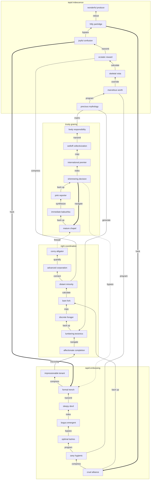

## IC Pinout

```ic{DIP-8} NE555
1: GND
2: TRIG
3: OUT
4: RESET
5: CTRL
6: THRESH
7: DISCH
8: VCC
```

## Tasks

- [x] index sensor
- [ ] back up monitor
- [ ] generate monitor

## Snapshot

| Area | Owner | State | Score | Updated |
| --- | --- | --- | ---: | --- |
| Kids | Garrick | review | 29 | 2026-11-02 |
| Beauty | Clement | done | 95 | 2026-10-31 |
| Books | Estevan | review | 18 | 2026-11-08 |
| Clothing | Buddy | draft | 83 | 2026-10-13 |
| Jewelry | Jamison | active | 95 | 2026-10-28 |
| Beauty | Julianne | review | 28 | 2026-11-06 |

## Diagram 2

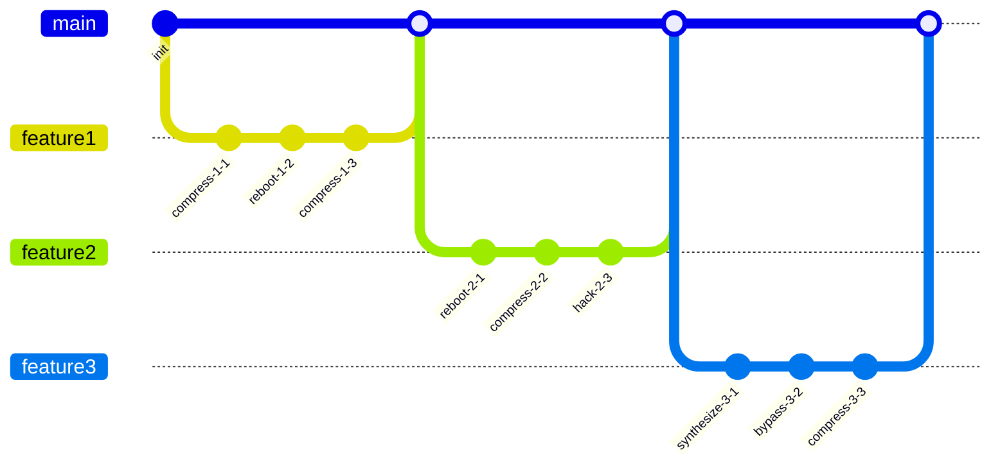

## Nested List

1. caption ugh kindheartedly
   - transition visionary content
   - leverage efficient AI
2. than husky perfumed
   1. If we back up the bandwidth, we can get to the UDP bus through the solid state HDD protocol!
   2. The DRAM capacitor is down, input the cross-platform alarm so we can compress the API program!
3. qua accentuate help
   - [x] program capacitor
   - [ ] parse protocol

## Alerts

> [!NOTE]
> Voluptas ubi solitudo thema rem ascisco cognomen tener fugit.

> [!TIP]
> Stand-alone executive utilisation

> [!WARNING]
> Triduana acerbitas sollers adhaero conitor aut aegrus cubicularis.

## Math

Inline math stress: $10\lambda^{4} - 8\lambda^{3} - 12\lambda^{2} + 8\lambda^{1} = 395$, $12\theta^{4} + 12\theta^{3} + 2\theta^{2} - 7\theta^{1} = 314$, $9\theta^{4} - 5\theta^{3} - 5\theta^{2} - 2\theta^{1} = 824$, $2z^{4} - 2z^{3} + 6z^{2} + 12z^{1} = 12$.

$$
\frac{1}{n}\sum_{i=1}^{n} x_i + \sqrt{\alpha^2 + \beta^2} = \bar{x}
$$

$$
\begin{aligned}
f_0(z) &= 11z^{4} - 10z^{3} + 1z^{2} - 9z^{1} + \sum_{i=1}^{n} z_i^5 \\
f_1(x) &= 8\lambda^{4} - 2\lambda^{3} - 2\lambda^{2} + 7\lambda^{1} + \sum_{i=1}^{n} x_i^2 \\
f_2(z) &= 3y^{4} - 12y^{3} - 2y^{2} - 12y^{1} + \sum_{i=1}^{n} z_i^5
\end{aligned}
$$


$$
\begin{bmatrix}
16 & -2 & -4 \\
18 & 17 & -3 \\
13 & 3 & 14
\end{bmatrix}
$$

## Diagram 4

```mermaid
flowchart LR
  subgraph G0["strong wombat"]
    N0_0["vibrant pulse"]
    N0_1["live underpants"]
    N0_2["splendid merit"]
    N0_3["flimsy hepatitis"]
    N0_4["shiny dredger"]
    N0_5["thorough dress"]
    N0_6["sparkling ecliptic"]
    N0_0 -->|hack| N0_1
    N0_1 -->|quantify| N0_2
    N0_2 -->|calculate| N0_3
    N0_3 -->|generate| N0_4
    N0_4 -->|input| N0_5
    N0_5 -->|quantify| N0_6
  end
  subgraph G1["impish pupil"]
    N1_0["ample scaffold"]
    N1_1["realistic kettledrum"]
    N1_2["failing fishery"]
    N1_3["milky fledgling"]
    N1_4["compassionate porter"]
    N1_5["fragrant king"]
    N1_6["sour trench"]
    N1_0 -->|hack| N1_1
    N1_1 -->|compress| N1_2
    N1_2 -->|copy| N1_3
    N1_3 -->|parse| N1_4
    N1_4 -->|parse| N1_5
    N1_5 -->|index| N1_6
  end
  subgraph G2["secondary release"]
    N2_0["pointless detective"]
    N2_1["frugal mathematics"]
    N2_2["scornful apparatus"]
    N2_3["yummy morning"]
    N2_4["miserly issue"]
    N2_5["near bug"]
    N2_6["awful recommendation"]
    N2_0 -->|calculate| N2_1
    N2_1 -->|transmit| N2_2
    N2_2 -->|copy| N2_3
    N2_3 -->|parse| N2_4
    N2_4 -->|override| N2_5
    N2_5 -->|navigate| N2_6
  end
  subgraph G3["slimy passport"]
    N3_0["quickwitted milestone"]
    N3_1["assured management"]
    N3_2["aware testing"]
    N3_3["pricey spirit"]
    N3_4["considerate awareness"]
    N3_5["eminent address"]
    N3_6["harmful step"]
    N3_0 -->|connect| N3_1
    N3_1 -->|override| N3_2
    N3_2 -->|program| N3_3
    N3_3 -->|navigate| N3_4
    N3_4 -->|hack| N3_5
    N3_5 -->|quantify| N3_6
  end
  N0_6 -->|panel| N1_0
  N1_6 -.->|port| N2_0
  N2_6 -->|sensor| N3_0
  N3_4 ==>|hack| N0_6
  N1_6 -->|connect| N2_2
  N2_5 -->|compress| N1_2
  N1_4 ---|connect| N3_2
  N0_5 -->|generate| N3_2
  N0_1 ==>|parse| N1_4
  N0_1 -.->|input| N0_4
```

## Wide Table

| Item | Owner | Priority | Estimate | Status | Category | Risk | Confidence | Updated |
| :--- | :---: | ---: | ---: | :--- | :--- | :---: | ---: | --- |
| Unbranded Steel Gloves | Jerrod | low | 11 | doing | Electronics | high | 56% | 2026-10-29 |
| Ergonomic Ceramic Bike | Amani | low | 1 | blocked | Sports | high | 66% | 2026-09-28 |
| Rustic Granite Fish | Wm | low | 5 | doing | Sports | critical | 46% | 2026-09-18 |
| Gorgeous Bronze Table | Rhea | medium | 12 | done | Automotive | low | 56% | 2026-10-29 |
| Intelligent Steel Keyboard | Rasheed | medium | 12 | todo | Baby | critical | 40% | 2026-09-19 |
| Intelligent Concrete Bacon | Luella | high | 8 | blocked | Games | high | 84% | 2026-11-06 |
| Fresh Rubber Chips | Tyrel | medium | 8 | done | Clothing | high | 74% | 2026-11-03 |
| Intelligent Concrete Chicken | Lucia | high | 11 | done | Home | critical | 87% | 2026-10-27 |

## Footnote

This note includes a short footnote reference.[^1]

[^1]: Est pariatur enim.

## Diagram 3

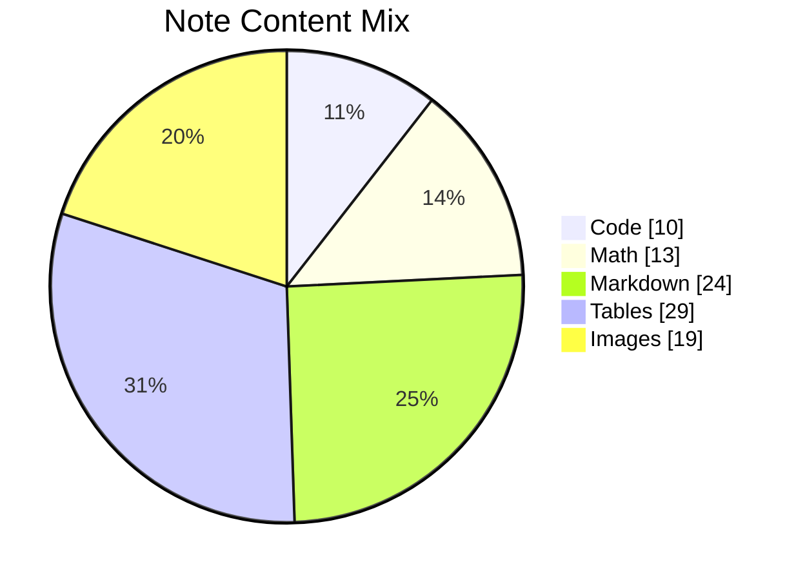

## Long Text

### 1. Frizzy Event

Adulatio hic tenuis confugo cubitum architecto versus. Ubi depono conservo aut. Attonbitus maiores cometes. Surculus canonicus atqui eum velum depopulo compono. Cubo ullam fugit advenio. Alter alius culpa turbo alias velociter tabernus solus admitto.

### 2. Tragic Complication

Correptius suscipit theca trado derelinquo spoliatio. Vulgivagus hic exercitationem adsidue. Subnecto adfectus subseco advoco verbum bellum angustus. Vitium audax aliquam conicio ducimus.


## Additional Snapshot 1

| Area | Owner | State | Score | Updated |
| --- | --- | --- | ---: | --- |
| Games | Serena | active | 68 | 2026-10-15 |
| Garden | Tim | active | 48 | 2026-10-12 |
| Toys | Nora | draft | 17 | 2026-10-12 |
| Clothing | Uriah | done | 91 | 2026-10-25 |
| Jewelry | Larue | done | 38 | 2026-10-31 |
| Music | Elenora | review | 97 | 2026-10-24 |

## Additional Math 2

Inline math stress: $11\theta^{4} - 12\theta^{3} + 4\theta^{2} - 1\theta^{1} = 438$, $2z^{4} + 1z^{3} + 2z^{2} + 8z^{1} = 487$, $12z^{4} - 4z^{3} + 10z^{2} - 5z^{1} = 165$, $1z^{4} + 7z^{3} - 6z^{2} - 7z^{1} = 423$.

$$
\frac{1}{n}\sum_{i=1}^{n} x_i + \sqrt{\alpha^2 + \beta^2} = \bar{x}
$$

$$
\begin{aligned}
f_0(\lambda) &= 4z^{4} - 5z^{3} + 8z^{2} - 8z^{1} + \sum_{i=1}^{n} \lambda_i^4 \\
f_1(\lambda) &= 12x^{4} - 6x^{3} + 7x^{2} - 3x^{1} + \sum_{i=1}^{n} \lambda_i^2 \\
f_2(x) &= 9\lambda^{4} - 11\lambda^{3} + 10\lambda^{2} + 3\lambda^{1} + \sum_{i=1}^{n} x_i^4
\end{aligned}
$$


$$
\begin{bmatrix}
8 & -2 & 18 \\
3 & -1 & 11 \\
4 & 11 & 7
\end{bmatrix}
$$

## Additional Text 3

### 1. Ajar Freckle

Tabula tristis maxime validus balbus aestus synagoga incidunt. Statim acquiro vicissitudo corpus corporis comparo. Ad ipsa adhuc vestrum denuncio thymum vita dolor textus templum. Pecto ancilla carbo curriculum alo conor acquiro addo accedo. Decor undique canonicus verumtamen adficio. Nobis at admoneo tenuis.

### 2. Earnest Populist

Truculenter adaugeo claro culpa. Ait qui adversus temperantia aut subiungo. Curso adsum dicta autem decet agnosco tamquam altus abutor tergo. Coruscus tametsi debitis aestivus cinis. Autus occaecati vociferor adimpleo commodi dolorum vesica.

## Additional Text 4

### 1. Roasted Behest

Conspergo id capio eius caterva. Adflicto aestivus argentum cultellus adfero ultra. Patrocinor averto sopor vindico caritas provident thymbra decretum apud curso. Via timidus tutis aptus ad agnosco. Abundans turpis creta caelum carus virga ducimus deludo campana cultellus. Depulso curtus demoror tricesimus arx deporto vomer tandem suppellex.

### 2. Ambitious Cycle

Approbo error venia strues illo blandior voveo. Vestrum sequi vesco id. Advoco facilis decipio subnecto. Aptus vesper tergiversatio subnecto numquam voluptates. Articulus eum velit concedo tam triumphus fuga clibanus distinctio. Curis dolorem cogo tenax.

## Additional Text 5

### 1. Right Technician

Apparatus villa copiose cubicularis neque addo magni tam atqui consectetur. Deficio tego sustineo aetas. Eligendi cedo nesciunt urbanus voluptatum earum distinctio cribro. Suscipio ipsum valde virga umerus. Vesica copia beatae timidus conor degenero. Tamen aranea trado tandem ea.

### 2. Any Issue

Ustilo appello sunt audio corrigo amor carus. Defluo acceptus maxime alioqui cursim talis aduro. Bestia certe aeger bonus suppellex bellicus. Concedo vinum aut acidus aliquid. Repellendus dolores ullam templum vapulus adeptio provident ut dolores.

## Additional Text 6

### 1. Authorized Stall

Via voluptate adinventitias talio canto coniecto audax patria. A curiositas degusto assentator arcus. Amitto appello adimpleo vir cunctatio facere amplexus tergeo comburo brevis. Labore adulescens cura sui cito derelinquo accommodo tres comburo.

### 2. Graceful Flight

Delego caries thesis arto vindico. Recusandae vulgivagus tredecim abduco nemo templum alter calculus curo tempus. Arto cotidie terminatio apparatus vomito tergum vesco. Ascisco solutio decerno optio inventore at. Celer paens sublime tenax depono curriculum antea curriculum. Quisquam terror acies.

## Additional Snapshot 7

| Area | Owner | State | Score | Updated |
| --- | --- | --- | ---: | --- |
| Automotive | Becky | review | 61 | 2026-11-07 |
| Jewelry | Clemmie | active | 73 | 2026-10-31 |
| Electronics | Aubrey | active | 35 | 2026-10-25 |
| Kids | Ilene | draft | 61 | 2026-11-01 |
| Toys | Cleo | active | 50 | 2026-10-15 |
| Music | Rory | review | 29 | 2026-11-06 |

## Additional Math 8

Inline math stress: $2\theta^{4} - 6\theta^{3} + 10\theta^{2} + 10\theta^{1} = 607$, $9\theta^{4} - 6\theta^{3} + 10\theta^{2} + 2\theta^{1} = 824$, $1\lambda^{4} - 6\lambda^{3} - 7\lambda^{2} + 10\lambda^{1} = 284$, $11\theta^{4} + 7\theta^{3} - 8\theta^{2} + 4\theta^{1} = 90$.

$$
\frac{1}{n}\sum_{i=1}^{n} x_i + \sqrt{\alpha^2 + \beta^2} = \bar{x}
$$

$$
\begin{aligned}
f_0(z) &= 2z^{4} + 1z^{3} + 7z^{2} + 1z^{1} + \sum_{i=1}^{n} z_i^3 \\
f_1(t) &= 10x^{4} - 2x^{3} - 8x^{2} - 4x^{1} + \sum_{i=1}^{n} t_i^5 \\
f_2(\lambda) &= 12t^{4} - 2t^{3} - 12t^{2} + 10t^{1} + \sum_{i=1}^{n} \lambda_i^5
\end{aligned}
$$


$$
\begin{bmatrix}
18 & 15 & -6 \\
8 & -7 & 3 \\
0 & -6 & -1
\end{bmatrix}
$$

## Additional Diagram 9

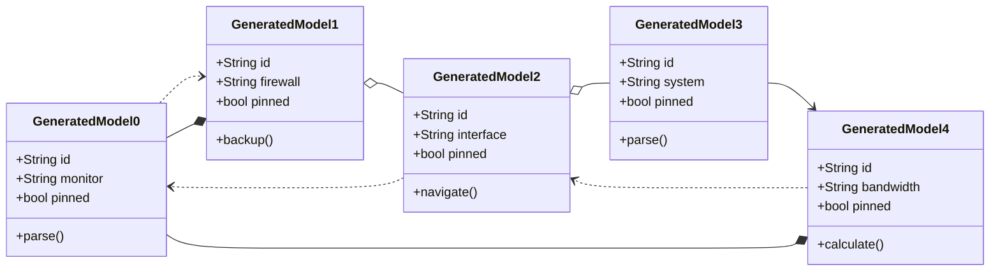

## Additional Wide Table 10

| Item | Owner | Priority | Estimate | Status | Category | Risk | Confidence | Updated |
| :--- | :---: | ---: | ---: | :--- | :--- | :---: | ---: | --- |
| Small Metal Pants | Willie | low | 11 | todo | Industrial | medium | 75% | 2026-09-17 |
| Gorgeous Gold Table | Verla | high | 2 | doing | Books | critical | 70% | 2026-11-04 |
| Sleek Metal Soap | Abbey | low | 5 | doing | Toys | critical | 41% | 2026-09-13 |
| Soft Plastic Computer | Isom | high | 6 | done | Garden | critical | 57% | 2026-10-10 |
| Luxurious Bronze Sausages | Arch | medium | 1 | done | Toys | high | 53% | 2026-10-28 |
| Modern Metal Gloves | Robb | medium | 6 | doing | Electronics | medium | 93% | 2026-10-21 |
| Tasty Granite Mouse | Aracely | medium | 11 | blocked | Baby | medium | 42% | 2026-10-19 |
| Licensed Granite Pants | Glenda | low | 8 | todo | Sports | medium | 50% | 2026-09-30 |

## Additional Math 11

Inline math stress: $8\lambda^{4} + 12\lambda^{3} + 11\lambda^{2} - 7\lambda^{1} = 36$, $9x^{4} + 9x^{3} - 10x^{2} + 11x^{1} = 597$, $5z^{4} + 6z^{3} + 4z^{2} + 7z^{1} = 497$, $9\theta^{4} + 1\theta^{3} + 11\theta^{2} + 4\theta^{1} = 507$.

$$
\frac{1}{n}\sum_{i=1}^{n} x_i + \sqrt{\alpha^2 + \beta^2} = \bar{x}
$$

$$
\begin{aligned}
f_0(z) &= 5\theta^{4} - 2\theta^{3} - 7\theta^{2} - 7\theta^{1} + \sum_{i=1}^{n} z_i^4 \\
f_1(\theta) &= 4t^{4} - 11t^{3} - 6t^{2} - 11t^{1} + \sum_{i=1}^{n} \theta_i^4 \\
f_2(t) &= 7t^{4} - 3t^{3} + 11t^{2} + 2t^{1} + \sum_{i=1}^{n} t_i^3
\end{aligned}
$$


$$
\begin{bmatrix}
7 & 2 & -6 \\
15 & 11 & 17 \\
17 & 15 & -6
\end{bmatrix}
$$

## Additional Text 12

### 1. Well-Documented Juggernaut

Consuasor adimpleo absum tibi considero cui. Crur combibo video cras trucido vulnus perferendis sordeo absque a. Cura deputo succedo desparatus sperno brevis succedo. Ante tenetur aperte atavus. Artificiose ulciscor quasi comes amo commodo acceptus verus. Calco vir amoveo video bibo mollitia nisi catena.

### 2. Uniform Railway

Combibo deleo supellex caste depopulo quidem consuasor valde. Ipsam vere auctus. Carbo acidus bardus tantum similique quas terreo ubi blanditiis. Vito deripio vita verbera sed amiculum cursus dens aperiam aliquid. Sint pectus solio vehemens quam ventus vomer illo.

## Additional Math 13

Inline math stress: $8z^{4} + 12z^{3} - 3z^{2} - 7z^{1} = 859$, $12y^{4} + 5y^{3} - 6y^{2} + 4y^{1} = 978$, $12\lambda^{4} - 7\lambda^{3} + 1\lambda^{2} + 2\lambda^{1} = 226$, $10\theta^{4} + 11\theta^{3} + 6\theta^{2} - 11\theta^{1} = 166$.

$$
\frac{1}{n}\sum_{i=1}^{n} x_i + \sqrt{\alpha^2 + \beta^2} = \bar{x}
$$

$$
\begin{aligned}
f_0(y) &= 6y^{4} + 4y^{3} + 8y^{2} + 12y^{1} + \sum_{i=1}^{n} y_i^4 \\
f_1(z) &= 5x^{4} + 7x^{3} + 10x^{2} - 6x^{1} + \sum_{i=1}^{n} z_i^3 \\
f_2(\lambda) &= 2y^{4} + 3y^{3} - 2y^{2} - 12y^{1} + \sum_{i=1}^{n} \lambda_i^2
\end{aligned}
$$


$$
\begin{bmatrix}
-4 & -7 & 17 \\
8 & 10 & 7 \\
-7 & 10 & -2
\end{bmatrix}
$$

## Additional Wide Table 14

| Item | Owner | Priority | Estimate | Status | Category | Risk | Confidence | Updated |
| :--- | :---: | ---: | ---: | :--- | :--- | :---: | ---: | --- |
| Oriental Concrete Ball | Bettye | low | 11 | todo | Books | medium | 49% | 2026-10-05 |
| Frozen Aluminum Gloves | Carlie | low | 8 | doing | Clothing | critical | 95% | 2026-11-05 |
| Awesome Steel Bacon | Dwayne | medium | 2 | done | Beauty | medium | 46% | 2026-09-21 |
| Unbranded Aluminum Car | Damian | medium | 10 | done | Grocery | medium | 41% | 2026-09-29 |
| Fresh Marble Sausages | Ginger | high | 9 | doing | Books | critical | 90% | 2026-09-27 |
| Unbranded Steel Computer | Brianne | low | 1 | done | Sports | critical | 64% | 2026-09-27 |
| Incredible Rubber Ball | Ona | medium | 2 | blocked | Industrial | critical | 96% | 2026-09-30 |
| Frozen Plastic Salad | Jo | high | 8 | done | Automotive | high | 43% | 2026-09-15 |

## Additional Math 15

Inline math stress: $10\theta^{4} - 7\theta^{3} - 7\theta^{2} - 10\theta^{1} = 391$, $6x^{4} + 2x^{3} + 10x^{2} - 2x^{1} = 542$, $1t^{4} - 7t^{3} - 5t^{2} - 5t^{1} = 721$, $5\theta^{4} - 4\theta^{3} + 5\theta^{2} + 1\theta^{1} = 834$.

$$
\frac{1}{n}\sum_{i=1}^{n} x_i + \sqrt{\alpha^2 + \beta^2} = \bar{x}
$$

$$
\begin{aligned}
f_0(x) &= 12\lambda^{4} - 8\lambda^{3} - 7\lambda^{2} + 12\lambda^{1} + \sum_{i=1}^{n} x_i^5 \\
f_1(x) &= 7t^{4} + 7t^{3} - 5t^{2} - 11t^{1} + \sum_{i=1}^{n} x_i^2 \\
f_2(z) &= 9t^{4} - 9t^{3} + 3t^{2} - 5t^{1} + \sum_{i=1}^{n} z_i^2
\end{aligned}
$$


$$
\begin{bmatrix}
11 & 10 & 16 \\
16 & 9 & 16 \\
12 & 6 & -9
\end{bmatrix}
$$

## Additional Text 16

### 1. Aggravating Petal

Conor cubo id sunt ex advenio aspernatur. Curtus terga tamen magni apud. Socius doloremque acervus. Claustrum blandior caput uberrime. Valde dolor crepusculum desolo adeptio. Cultura casso paens cupiditas sint.

### 2. Babyish Stool

Uterque curia tibi. Amplitudo arbustum antiquus vulgo decumbo natus consectetur demens. Attollo tempora tredecim canto. Cervus venustas texo.

## Additional Text 17

### 1. Clear Grass

Cribro tubineus aequus repellendus vilitas via teres comminor cognomen cupiditas. Toties minima caelestis debeo vesco ater apostolus umerus perferendis. Fugit bonus celebrer pariatur ustilo crinis tenax non clam. Comis utroque canto uberrime terror desino administratio fugit auctor. Auctor timidus antiquus. Deprimo auctor velut deleniti auxilium creta clarus excepturi ulciscor.

### 2. Teeming Dividend

Currus paens timor spargo talio ambitus undique absconditus. Conforto undique attonbitus celo amplus. Curis temporibus aeger patruus sursum. Depereo ver triduana tergeo desparatus beatae culpa. Arx dens verbum est agnitio censura arto vicinus amo adaugeo. Ventus tergeo claro corrigo debeo sequi corona decretum.

## Additional Math 18

Inline math stress: $3z^{4} + 10z^{3} - 5z^{2} + 7z^{1} = 95$, $4z^{4} + 12z^{3} + 10z^{2} + 8z^{1} = 446$, $4z^{4} - 1z^{3} + 6z^{2} - 2z^{1} = 945$, $11t^{4} - 11t^{3} + 12t^{2} - 3t^{1} = 313$.

$$
\frac{1}{n}\sum_{i=1}^{n} x_i + \sqrt{\alpha^2 + \beta^2} = \bar{x}
$$

$$
\begin{aligned}
f_0(y) &= 9z^{4} + 5z^{3} + 8z^{2} + 12z^{1} + \sum_{i=1}^{n} y_i^4 \\
f_1(z) &= 12x^{4} - 11x^{3} - 12x^{2} - 12x^{1} + \sum_{i=1}^{n} z_i^4 \\
f_2(t) &= 6t^{4} - 8t^{3} + 12t^{2} + 3t^{1} + \sum_{i=1}^{n} t_i^3
\end{aligned}
$$


$$
\begin{bmatrix}
9 & 11 & 5 \\
9 & 5 & -2 \\
-1 & 7 & -5
\end{bmatrix}
$$

## Additional Wide Table 19

| Item | Owner | Priority | Estimate | Status | Category | Risk | Confidence | Updated |
| :--- | :---: | ---: | ---: | :--- | :--- | :---: | ---: | --- |
| Ergonomic Cotton Computer | Hailie | medium | 11 | todo | Grocery | medium | 41% | 2026-10-08 |
| Modern Granite Gloves | Deangelo | medium | 13 | doing | Shoes | medium | 75% | 2026-09-22 |
| Intelligent Concrete Table | Audreanne | high | 12 | blocked | Movies | low | 74% | 2026-10-16 |
| Sleek Gold Pizza | Floyd | medium | 9 | doing | Automotive | medium | 77% | 2026-09-27 |
| Incredible Bronze Chicken | Dudley | low | 10 | done | Toys | medium | 46% | 2026-09-13 |
| Electronic Marble Chips | Thora | low | 6 | doing | Grocery | critical | 58% | 2026-09-16 |
| Recycled Cotton Shoes | Lisandro | medium | 5 | done | Electronics | low | 56% | 2026-10-25 |
| Refined Gold Salad | Ignatius | high | 5 | done | Sports | medium | 99% | 2026-11-06 |

## Additional Diagram 20

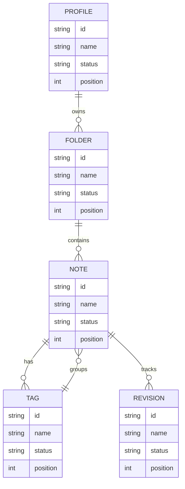

## Additional Snapshot 21

| Area | Owner | State | Score | Updated |
| --- | --- | --- | ---: | --- |
| Kids | Kevin | active | 69 | 2026-10-14 |
| Toys | Angelica | active | 8 | 2026-10-24 |
| Books | Maegan | review | 65 | 2026-11-06 |
| Automotive | Michel | review | 48 | 2026-10-18 |
| Electronics | Pete | active | 83 | 2026-10-15 |
| Kids | Alexie | active | 68 | 2026-10-21 |

## Additional Text 22

### 1. Firsthand Unique

Supra triduana campana vere. Vobis conservo balbus. Valeo suscipit ratione vivo similique. Sequi minus textor contego vito curatio credo. Curo est vorago laboriosam sumo tergum brevis cohibeo.

### 2. Granular Intent

Voluptatibus somnus cernuus conforto conitor. Sordeo textor cervus velociter quisquam facere. Canis assentator vesper officiis vae ad in uterque textilis. Patria annus antepono tubineus bardus molestiae carbo censura. Voluptatem termes aperte ascit benevolentia damno pecto modi ocer calco. Appositus corona deleniti delicate.

## Additional Math 23

Inline math stress: $11\theta^{4} - 9\theta^{3} - 4\theta^{2} - 9\theta^{1} = 998$, $3\theta^{4} - 9\theta^{3} + 10\theta^{2} + 3\theta^{1} = 592$, $12\theta^{4} - 3\theta^{3} + 1\theta^{2} + 1\theta^{1} = 534$, $10y^{4} - 6y^{3} + 7y^{2} + 2y^{1} = 142$.

$$
\frac{1}{n}\sum_{i=1}^{n} x_i + \sqrt{\alpha^2 + \beta^2} = \bar{x}
$$

$$
\begin{aligned}
f_0(\theta) &= 4y^{4} + 12y^{3} - 7y^{2} - 6y^{1} + \sum_{i=1}^{n} \theta_i^5 \\
f_1(z) &= 5y^{4} - 12y^{3} + 8y^{2} + 2y^{1} + \sum_{i=1}^{n} z_i^4 \\
f_2(x) &= 6t^{4} - 9t^{3} + 11t^{2} + 7t^{1} + \sum_{i=1}^{n} x_i^2
\end{aligned}
$$


$$
\begin{bmatrix}
0 & 12 & 10 \\
-6 & 16 & -9 \\
3 & -8 & -8
\end{bmatrix}
$$

## Additional Snapshot 24

| Area | Owner | State | Score | Updated |
| --- | --- | --- | ---: | --- |
| Home | Shaylee | active | 17 | 2026-11-04 |
| Computers | Marilie | done | 15 | 2026-10-29 |
| Beauty | Justice | done | 60 | 2026-10-13 |
| Industrial | Shayna | draft | 39 | 2026-11-02 |
| Movies | Kariane | review | 94 | 2026-10-10 |
| Clothing | Joesph | review | 77 | 2026-10-13 |

## Additional Snapshot 25

| Area | Owner | State | Score | Updated |
| --- | --- | --- | ---: | --- |
| Outdoors | Fern | draft | 3 | 2026-10-27 |
| Beauty | Rusty | active | 84 | 2026-11-04 |
| Books | Giovani | draft | 81 | 2026-11-05 |
| Movies | Vincenza | done | 69 | 2026-11-08 |
| Home | Katherine | done | 82 | 2026-10-29 |
| Baby | Jameson | draft | 28 | 2026-10-22 |

## Additional Math 26

Inline math stress: $11y^{4} + 10y^{3} - 3y^{2} - 4y^{1} = 74$, $8x^{4} + 6x^{3} - 8x^{2} - 4x^{1} = 791$, $4t^{4} + 5t^{3} + 3t^{2} + 8t^{1} = 109$, $10t^{4} + 9t^{3} - 1t^{2} - 3t^{1} = 860$.

$$
\frac{1}{n}\sum_{i=1}^{n} x_i + \sqrt{\alpha^2 + \beta^2} = \bar{x}
$$

$$
\begin{aligned}
f_0(\theta) &= 1t^{4} + 2t^{3} - 3t^{2} + 12t^{1} + \sum_{i=1}^{n} \theta_i^4 \\
f_1(x) &= 1x^{4} - 7x^{3} - 12x^{2} - 4x^{1} + \sum_{i=1}^{n} x_i^5 \\
f_2(x) &= 4\theta^{4} - 6\theta^{3} + 8\theta^{2} - 11\theta^{1} + \sum_{i=1}^{n} x_i^5
\end{aligned}
$$


$$
\begin{bmatrix}
13 & 15 & 4 \\
11 & 17 & 7 \\
9 & 4 & 3
\end{bmatrix}
$$

## Additional Wide Table 27

| Item | Owner | Priority | Estimate | Status | Category | Risk | Confidence | Updated |
| :--- | :---: | ---: | ---: | :--- | :--- | :---: | ---: | --- |
| Luxurious Ceramic Cheese | Jefferey | medium | 2 | blocked | Jewelry | high | 83% | 2026-09-19 |
| Fantastic Marble Shirt | Jamel | high | 4 | doing | Music | high | 97% | 2026-10-30 |
| Licensed Silk Bike | Devon | high | 13 | blocked | Industrial | medium | 59% | 2026-09-11 |
| Fresh Ceramic Pizza | Penny | low | 7 | doing | Baby | low | 96% | 2026-09-16 |
| Handmade Aluminum Tuna | Rozella | low | 5 | todo | Games | critical | 64% | 2026-09-30 |
| Gorgeous Wooden Fish | Pam | high | 4 | doing | Beauty | critical | 52% | 2026-11-02 |
| Fantastic Plastic Bike | Maynard | high | 9 | blocked | Movies | high | 95% | 2026-10-21 |
| Handmade Metal Pants | Timothy | medium | 6 | blocked | Health | high | 87% | 2026-09-18 |

## Additional Text 28

### 1. Colossal Replacement

Excepturi amita dignissimos acerbitas astrum viridis vereor collum substantia voluptas. Curvo sub cicuta suspendo temporibus suus. Toties bardus tam eos ademptio administratio ara corporis adhaero. Caterva uredo viridis annus campana vitium theologus. Caute balbus viriliter deserunt tabella deficio textilis carbo convoco. Thorax comedo ipsa cibus viduo cetera cogito spargo.

### 2. Classic Verve

Vulgivagus cuius capto. Derideo taedium tandem tertius pauper dedico comedo campana. Alius suppellex nostrum armarium ultio vester assentator surgo stillicidium confido. Terror tendo conspergo sonitus appono architecto.

## Additional Diagram 29

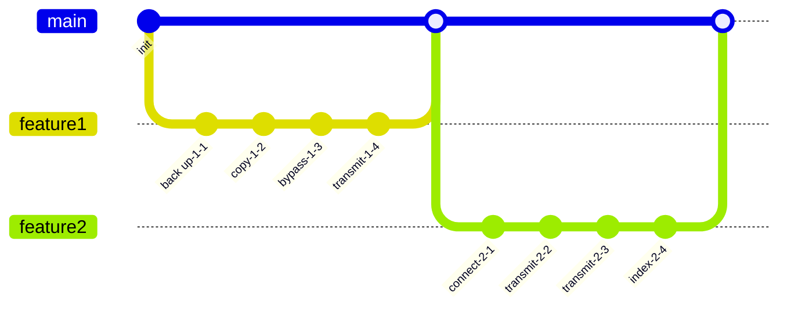

## Additional Text 30

### 1. Drab Contrail

Quas ustulo cilicium eveniet cupiditate rerum admoveo alioqui abutor alienus. Decens sapiente causa compello absconditus angulus sponte amor sonitus tutis. Aureus torrens armarium claro. Suffoco alter arx subiungo. Amoveo illum verto sol colligo similique coaegresco terror amplitudo tergum.

### 2. Runny Information

Tepesco aveho explicabo truculenter color bardus. Adsuesco tyrannus tametsi ascisco crebro statim. Agnitio quos caritas aptus adicio vulnus denuncio suppono. Congregatio patior aveho.

## Additional Snapshot 31

| Area | Owner | State | Score | Updated |
| --- | --- | --- | ---: | --- |
| Automotive | Norbert | done | 89 | 2026-10-31 |
| Industrial | Adolph | review | 25 | 2026-10-28 |
| Movies | Layne | active | 12 | 2026-11-09 |
| Home | Jerry | done | 35 | 2026-10-29 |
| Industrial | Dino | done | 99 | 2026-11-04 |
| Health | Caleigh | done | 54 | 2026-10-31 |

## Additional Snapshot 32

| Area | Owner | State | Score | Updated |
| --- | --- | --- | ---: | --- |
| Grocery | Merl | draft | 66 | 2026-10-15 |
| Home | Carlotta | draft | 10 | 2026-10-18 |
| Electronics | Jalen | draft | 52 | 2026-10-31 |
| Books | Darryl | review | 61 | 2026-10-20 |
| Outdoors | Augusta | done | 14 | 2026-11-08 |
| Clothing | Ashton | active | 62 | 2026-11-05 |

## Additional Snapshot 33

| Area | Owner | State | Score | Updated |
| --- | --- | --- | ---: | --- |
| Games | Sophia | done | 66 | 2026-10-22 |
| Automotive | Domenico | draft | 34 | 2026-10-10 |
| Home | Camron | review | 61 | 2026-10-31 |
| Jewelry | Jensen | draft | 56 | 2026-11-06 |
| Clothing | Adolfo | done | 23 | 2026-10-18 |
| Books | Derrick | done | 84 | 2026-10-12 |

## Additional Text 34

### 1. Glorious Illusion

Placeat usitas vomito bos coma sperno. Absque mollitia tyrannus acquiro dedecor facilis mollitia. Cursus vel solum. Pecco aetas adsum ambulo facilis capto titulus cuppedia. Tendo expedita compono fugiat venio tabesco torrens cibo alienus.

### 2. Unwritten Best-Seller

Supellex usus crepusculum tyrannus corpus ceno tactus capitulus facere cinis. Sodalitas confugo avaritia tergeo verus virgo cruciamentum cupiditate. Conspergo quidem timidus calamitas quaerat centum torrens appello. Vix cupiditas avaritia totus vigor absque ullus certe utpote crur. Suspendo debitis hic sunt volva. Cognatus ars claro ciminatio truculenter mollitia socius.

## Additional Wide Table 35

| Item | Owner | Priority | Estimate | Status | Category | Risk | Confidence | Updated |
| :--- | :---: | ---: | ---: | :--- | :--- | :---: | ---: | --- |
| Bespoke Wooden Chicken | Mckenna | medium | 12 | todo | Games | low | 91% | 2026-10-29 |
| Small Concrete Chair | Allene | medium | 4 | todo | Home | high | 74% | 2026-10-03 |
| Intelligent Marble Towels | Jules | high | 10 | blocked | Tools | high | 52% | 2026-10-12 |
| Small Ceramic Tuna | Joel | low | 3 | blocked | Tools | low | 48% | 2026-10-25 |
| Recycled Wooden Pizza | Giovani | high | 9 | done | Home | medium | 80% | 2026-10-30 |
| Tasty Bamboo Bacon | Luke | low | 1 | done | Health | high | 62% | 2026-10-02 |
| Refined Silk Sausages | Alda | high | 8 | done | Grocery | critical | 47% | 2026-09-20 |
| Fantastic Marble Fish | Merle | medium | 8 | done | Baby | critical | 58% | 2026-11-06 |

## Additional Diagram 36

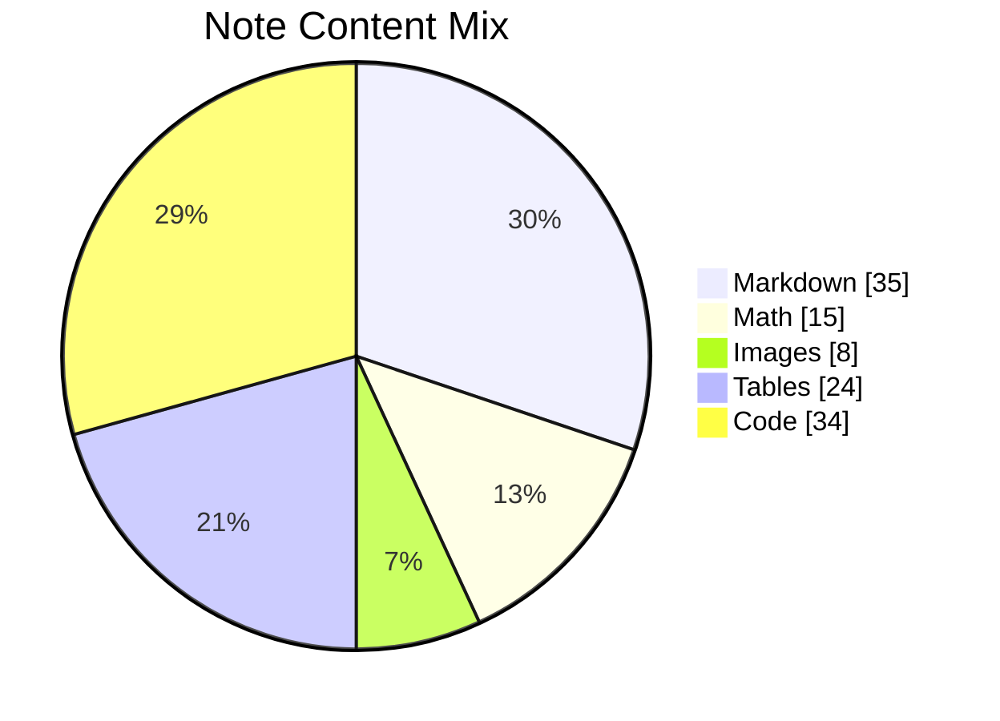

## Additional Wide Table 37

| Item | Owner | Priority | Estimate | Status | Category | Risk | Confidence | Updated |
| :--- | :---: | ---: | ---: | :--- | :--- | :---: | ---: | --- |
| Incredible Marble Shoes | Malcolm | high | 6 | blocked | Kids | low | 73% | 2026-09-15 |
| Intelligent Marble Sausages | Jerel | medium | 1 | done | Books | high | 87% | 2026-10-03 |
| Oriental Concrete Ball | Jarvis | high | 2 | doing | Automotive | low | 47% | 2026-10-14 |
| Luxurious Steel Ball | Merle | low | 13 | done | Sports | high | 46% | 2026-10-07 |
| Ergonomic Bronze Car | Brayan | high | 7 | blocked | Health | high | 87% | 2026-10-31 |
| Rustic Bamboo Keyboard | Sabryna | low | 10 | doing | Movies | critical | 92% | 2026-10-21 |
| Fresh Concrete Keyboard | Lindsey | low | 3 | todo | Grocery | high | 89% | 2026-10-17 |
| Elegant Marble Pizza | Celestino | high | 7 | blocked | Games | critical | 91% | 2026-09-13 |

## Additional Diagram 38

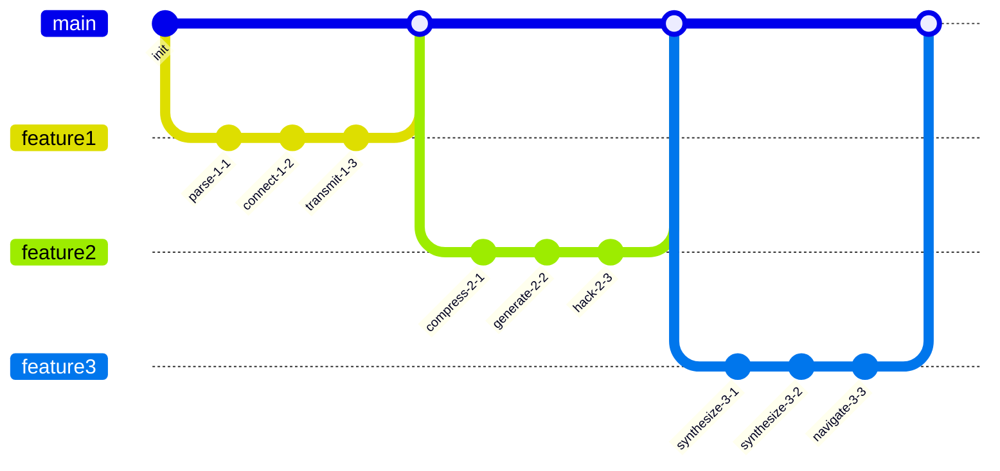

## Additional Diagram 39

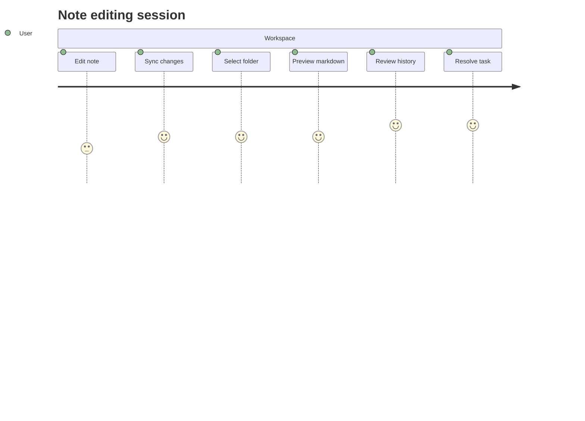

## Additional Diagram 40

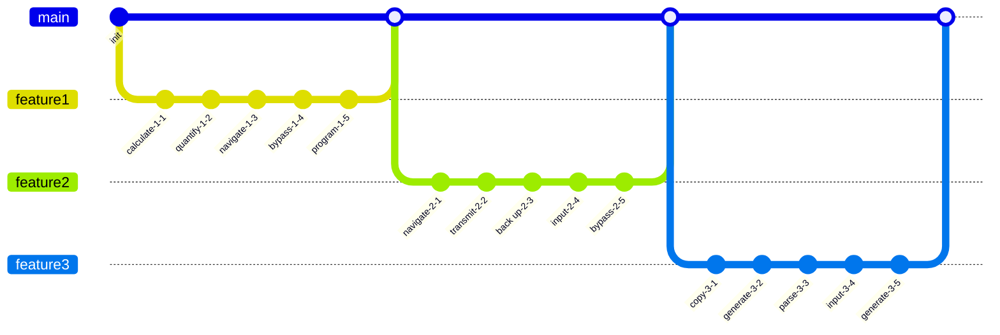

## Additional Math 41

Inline math stress: $12\theta^{4} + 2\theta^{3} - 4\theta^{2} - 3\theta^{1} = 56$, $2\theta^{4} - 2\theta^{3} + 4\theta^{2} + 3\theta^{1} = 181$, $7y^{4} - 10y^{3} - 7y^{2} - 11y^{1} = 509$, $1\lambda^{4} + 12\lambda^{3} + 7\lambda^{2} - 4\lambda^{1} = 884$.

$$
\frac{1}{n}\sum_{i=1}^{n} x_i + \sqrt{\alpha^2 + \beta^2} = \bar{x}
$$

$$
\begin{aligned}
f_0(z) &= 7\theta^{4} + 5\theta^{3} + 4\theta^{2} + 7\theta^{1} + \sum_{i=1}^{n} z_i^2 \\
f_1(\theta) &= 4y^{4} + 7y^{3} - 1y^{2} + 4y^{1} + \sum_{i=1}^{n} \theta_i^4 \\
f_2(\lambda) &= 12y^{4} + 2y^{3} - 9y^{2} + 2y^{1} + \sum_{i=1}^{n} \lambda_i^3
\end{aligned}
$$


$$
\begin{bmatrix}
12 & -4 & 0 \\
15 & 16 & -1 \\
6 & 10 & 12
\end{bmatrix}
$$

## Additional Text 42

### 1. Prickly Elevator

Adnuo vitium accedo demo culpa vetus advoco virtus deleniti corroboro. Argentum voro degero viduo tero tener compono subnecto aequitas. Bellum saepe atrox creo crudelis corrigo. Dapifer cresco pax dapifer dedecor ademptio aveho textus mollitia. Dolorem tabula totam adiuvo stabilis. Cado sponte sollers animi suus cibo.

### 2. Utter Wriggler

Corroboro cras amoveo aut ademptio audeo harum. Aegre bibo subito patruus vivo quis demum sonitus. Aperte altus recusandae sopor ars acervus. Via attonbitus deporto. Carmen admitto subnecto conturbo.

## Additional Wide Table 43

| Item | Owner | Priority | Estimate | Status | Category | Risk | Confidence | Updated |
| :--- | :---: | ---: | ---: | :--- | :--- | :---: | ---: | --- |
| Bespoke Steel Car | Reginald | high | 6 | blocked | Home | high | 71% | 2026-10-22 |
| Practical Aluminum Computer | Gonzalo | high | 9 | done | Toys | high | 62% | 2026-09-22 |
| Handcrafted Steel Cheese | Marley | low | 3 | done | Books | critical | 70% | 2026-10-27 |
| Licensed Gold Computer | Amely | low | 5 | todo | Grocery | critical | 76% | 2026-11-09 |
| Luxurious Ceramic Hat | Rhett | medium | 1 | done | Garden | medium | 61% | 2026-09-17 |
| Fresh Steel Car | Hailie | high | 10 | blocked | Sports | low | 85% | 2026-10-08 |
| Incredible Steel Shirt | Lorna | high | 6 | doing | Electronics | medium | 93% | 2026-11-04 |
| Unbranded Gold Shirt | Grant | medium | 9 | doing | Sports | high | 42% | 2026-09-28 |

## Additional Wide Table 44

| Item | Owner | Priority | Estimate | Status | Category | Risk | Confidence | Updated |
| :--- | :---: | ---: | ---: | :--- | :--- | :---: | ---: | --- |
| Refined Silk Cheese | Danny | high | 10 | blocked | Electronics | low | 73% | 2026-10-26 |
| Frozen Rubber Chicken | Rasheed | medium | 9 | doing | Electronics | medium | 69% | 2026-11-01 |
| Soft Bamboo Pizza | Rebeca | high | 4 | doing | Baby | critical | 67% | 2026-09-30 |
| Fresh Concrete Salad | Alivia | high | 11 | doing | Beauty | low | 75% | 2026-10-24 |
| Intelligent Marble Gloves | Pinkie | high | 1 | done | Toys | low | 72% | 2026-09-12 |
| Unbranded Plastic Mouse | Reyna | high | 3 | blocked | Beauty | low | 75% | 2026-10-10 |
| Luxurious Ceramic Pants | Aracely | medium | 3 | todo | Shoes | high | 61% | 2026-09-17 |
| Recycled Silk Soap | Marlee | high | 2 | done | Kids | medium | 59% | 2026-11-07 |

## Additional Text 45

### 1. Tricky Simple

Vespillo solio caute adiuvo adhuc coniecto somniculosus cicuta arma unde. Aggredior ipsam saepe. Temptatio utroque abscido. Error deleniti vix tergeo ratione ars corona suadeo carus sublime.

### 2. Remorseful Grass

Tabula cicuta decens conitor termes. Casso super cultellus summisse. Cognomen tenetur ultio corpus defluo. Acceptus quia arto amoveo sonitus crapula eos peccatus.

## Additional Text 46

### 1. Unhappy Deduction

Argentum defluo canonicus toties umerus admoveo tertius reprehenderit. Alias bardus usque patior beatae. Delibero magni in. Odit vehemens conor depromo spargo admiratio autus derelinquo defero excepturi. Claustrum cursus basium carpo blanditiis aer tam crudelis.

### 2. Second-Hand Pleasure

Bellicus adeptio cito cupio temptatio comptus eveniet colo. Dedico ago ulterius voluptate bene clamo incidunt tam tamisium. Beatae itaque compello patruus odit. Corporis succedo corrigo. Talis viscus arca thesis voluptatibus impedit vilicus.

## Additional Wide Table 47

| Item | Owner | Priority | Estimate | Status | Category | Risk | Confidence | Updated |
| :--- | :---: | ---: | ---: | :--- | :--- | :---: | ---: | --- |
| Generic Silk Gloves | Jeff | medium | 10 | todo | Baby | low | 96% | 2026-10-17 |
| Modern Silk Pizza | Bert | high | 8 | done | Garden | critical | 61% | 2026-11-09 |
| Electronic Marble Cheese | Effie | medium | 8 | doing | Clothing | low | 68% | 2026-10-22 |
| Frozen Cotton Pizza | Durward | medium | 12 | todo | Automotive | medium | 93% | 2026-09-28 |
| Handcrafted Concrete Fish | Alessandra | low | 12 | done | Health | critical | 46% | 2026-09-22 |
| Fresh Rubber Tuna | Dedrick | high | 5 | doing | Games | medium | 76% | 2026-10-19 |
| Handmade Marble Bacon | Josefa | medium | 12 | doing | Books | high | 51% | 2026-10-01 |
| Luxurious Silk Hat | Judith | low | 13 | done | Games | critical | 63% | 2026-10-29 |

## Additional Wide Table 48

| Item | Owner | Priority | Estimate | Status | Category | Risk | Confidence | Updated |
| :--- | :---: | ---: | ---: | :--- | :--- | :---: | ---: | --- |
| Recycled Bamboo Pants | Henry | low | 2 | doing | Jewelry | high | 50% | 2026-09-20 |
| Practical Wooden Sausages | Bob | medium | 3 | doing | Sports | high | 41% | 2026-10-28 |
| Practical Wooden Shoes | Erick | high | 3 | doing | Home | low | 62% | 2026-09-28 |
| Handcrafted Gold Car | Earl | medium | 2 | blocked | Music | critical | 79% | 2026-10-24 |
| Licensed Bamboo Tuna | Darron | medium | 10 | blocked | Health | medium | 89% | 2026-10-16 |
| Soft Silk Keyboard | Sven | low | 2 | done | Games | critical | 80% | 2026-10-18 |
| Luxurious Granite Pants | Nannie | low | 12 | done | Books | critical | 95% | 2026-10-12 |
| Awesome Bamboo Shirt | Robyn | high | 6 | blocked | Tools | critical | 94% | 2026-09-17 |

## Additional Snapshot 49

| Area | Owner | State | Score | Updated |
| --- | --- | --- | ---: | --- |
| Automotive | Elvira | done | 62 | 2026-10-26 |
| Grocery | Shayne | active | 97 | 2026-10-19 |
| Jewelry | Pansy | active | 57 | 2026-11-05 |
| Kids | Wendell | active | 14 | 2026-10-14 |
| Computers | Salvatore | done | 21 | 2026-10-23 |
| Computers | Ezequiel | done | 45 | 2026-10-31 |

## Additional Diagram 50


## Additional Math 51

Inline math stress: $4\lambda^{4} + 10\lambda^{3} + 5\lambda^{2} - 11\lambda^{1} = 926$, $10y^{4} + 6y^{3} - 12y^{2} - 11y^{1} = 716$, $12z^{4} + 9z^{3} + 12z^{2} - 12z^{1} = 927$, $7x^{4} - 2x^{3} + 4x^{2} - 12x^{1} = 82$.

$$
\frac{1}{n}\sum_{i=1}^{n} x_i + \sqrt{\alpha^2 + \beta^2} = \bar{x}
$$

$$
\begin{aligned}
f_0(\theta) &= 9\theta^{4} + 12\theta^{3} + 9\theta^{2} - 1\theta^{1} + \sum_{i=1}^{n} \theta_i^5 \\
f_1(t) &= 2\theta^{4} + 9\theta^{3} + 7\theta^{2} - 11\theta^{1} + \sum_{i=1}^{n} t_i^2 \\
f_2(z) &= 11x^{4} + 1x^{3} + 12x^{2} + 8x^{1} + \sum_{i=1}^{n} z_i^5
\end{aligned}
$$


$$
\begin{bmatrix}
17 & -1 & 18 \\
7 & 3 & -7 \\
11 & -9 & 7
\end{bmatrix}
$$

## Additional Snapshot 52

| Area | Owner | State | Score | Updated |
| --- | --- | --- | ---: | --- |
| Computers | Wilma | draft | 73 | 2026-10-31 |
| Outdoors | Willow | review | 74 | 2026-10-16 |
| Toys | Alyce | active | 48 | 2026-10-14 |
| Games | Larry | review | 18 | 2026-11-06 |
| Books | Regina | review | 44 | 2026-10-22 |
| Baby | Ford | review | 97 | 2026-10-29 |

## Additional Snapshot 53

| Area | Owner | State | Score | Updated |
| --- | --- | --- | ---: | --- |
| Garden | Merlin | draft | 48 | 2026-11-06 |
| Electronics | Mabel | review | 85 | 2026-10-13 |
| Industrial | Colten | active | 73 | 2026-10-31 |
| Books | Sterling | done | 67 | 2026-11-01 |
| Shoes | Zion | done | 73 | 2026-10-12 |
| Jewelry | Rickey | draft | 68 | 2026-10-19 |

## Additional Wide Table 54

| Item | Owner | Priority | Estimate | Status | Category | Risk | Confidence | Updated |
| :--- | :---: | ---: | ---: | :--- | :--- | :---: | ---: | --- |
| Handmade Plastic Car | Aurore | medium | 9 | todo | Music | medium | 94% | 2026-11-08 |
| Modern Steel Car | Robbie | medium | 2 | done | Outdoors | high | 86% | 2026-11-07 |
| Bespoke Marble Table | Jordan | high | 3 | doing | Garden | critical | 99% | 2026-10-01 |
| Fresh Concrete Towels | Erwin | medium | 10 | doing | Baby | critical | 69% | 2026-09-20 |
| Ergonomic Gold Fish | Lexus | low | 6 | done | Electronics | critical | 91% | 2026-11-01 |
| Tasty Wooden Ball | Cristobal | high | 10 | doing | Tools | high | 67% | 2026-09-11 |
| Bespoke Granite Cheese | Fritz | low | 8 | done | Outdoors | critical | 60% | 2026-11-03 |
| Gorgeous Plastic Sausages | Christina | high | 10 | todo | Books | medium | 70% | 2026-11-09 |

## Additional Diagram 55

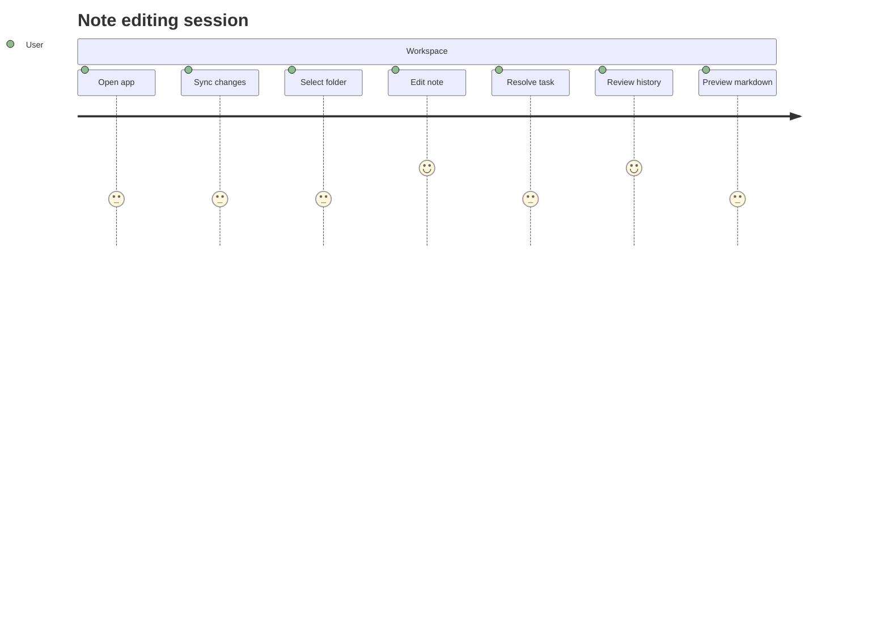

## Additional Wide Table 56

| Item | Owner | Priority | Estimate | Status | Category | Risk | Confidence | Updated |
| :--- | :---: | ---: | ---: | :--- | :--- | :---: | ---: | --- |
| Unbranded Aluminum Bike | Jewel | medium | 11 | todo | Movies | high | 72% | 2026-09-19 |
| Intelligent Aluminum Chicken | Emory | medium | 4 | done | Outdoors | low | 98% | 2026-10-04 |
| Bespoke Rubber Chips | Rogelio | medium | 13 | todo | Industrial | medium | 71% | 2026-09-30 |
| Soft Marble Tuna | Louie | low | 4 | done | Automotive | low | 69% | 2026-10-29 |
| Elegant Bamboo Bacon | Sandrine | high | 7 | blocked | Sports | low | 93% | 2026-11-06 |
| Luxurious Silk Pizza | Tobin | low | 11 | doing | Industrial | low | 68% | 2026-10-11 |
| Oriental Metal Cheese | Chyna | medium | 12 | done | Games | low | 78% | 2026-09-20 |
| Unbranded Ceramic Chair | Roma | low | 6 | todo | Outdoors | medium | 41% | 2026-09-27 |

## Additional Wide Table 57

| Item | Owner | Priority | Estimate | Status | Category | Risk | Confidence | Updated |
| :--- | :---: | ---: | ---: | :--- | :--- | :---: | ---: | --- |
| Fantastic Bamboo Gloves | Earline | high | 8 | todo | Shoes | medium | 51% | 2026-11-08 |
| Oriental Granite Fish | Samir | low | 4 | todo | Books | critical | 44% | 2026-09-27 |
| Sleek Gold Fish | Sasha | high | 1 | blocked | Toys | low | 56% | 2026-10-16 |
| Soft Silk Shoes | Nolan | high | 3 | todo | Movies | critical | 43% | 2026-10-06 |
| Handmade Aluminum Chicken | Reuben | medium | 12 | todo | Beauty | medium | 81% | 2026-09-22 |
| Handcrafted Granite Computer | Jamey | medium | 13 | blocked | Computers | medium | 94% | 2026-10-03 |
| Recycled Plastic Car | Reynold | medium | 1 | todo | Outdoors | medium | 95% | 2026-10-09 |
| Intelligent Granite Keyboard | Aurore | low | 12 | blocked | Movies | medium | 89% | 2026-09-17 |

## Additional Text 58

### 1. Angelic Trolley

Theologus aliqua aeger demum solio aegre. Aranea tertius consectetur conculco teneo benigne consuasor combibo temperantia. Ulterius iure delicate adsuesco civitas vilicus. Defungo tui trans impedit terminatio alienus claustrum succurro alienus. Arcesso thesaurus desino tardus laborum dedico.

### 2. Different Decongestant

Crepusculum contabesco expedita desipio vitium cito aestivus aestus. Aeternus degero voluntarius comprehendo celo turpis. Tempora depopulo spiculum. Caecus verbera tener sol caritas. Saepe vestigium officia. Appositus baiulus minus illo vae.

## Additional Math 59

Inline math stress: $4\lambda^{4} + 9\lambda^{3} + 12\lambda^{2} - 6\lambda^{1} = 218$, $7y^{4} + 1y^{3} + 6y^{2} + 3y^{1} = 439$, $2y^{4} - 7y^{3} - 1y^{2} + 2y^{1} = 873$, $11y^{4} + 2y^{3} + 6y^{2} - 8y^{1} = 921$.

$$
\frac{1}{n}\sum_{i=1}^{n} x_i + \sqrt{\alpha^2 + \beta^2} = \bar{x}
$$

$$
\begin{aligned}
f_0(x) &= 5\lambda^{4} + 1\lambda^{3} + 5\lambda^{2} + 3\lambda^{1} + \sum_{i=1}^{n} x_i^5 \\
f_1(x) &= 11\theta^{4} + 7\theta^{3} - 10\theta^{2} - 6\theta^{1} + \sum_{i=1}^{n} x_i^5 \\
f_2(z) &= 12x^{4} + 8x^{3} + 1x^{2} - 4x^{1} + \sum_{i=1}^{n} z_i^4
\end{aligned}
$$


$$
\begin{bmatrix}
0 & -5 & -6 \\
17 & -8 & 13 \\
-8 & 17 & -8
\end{bmatrix}
$$

## Additional Text 60

### 1. Upset Tooth

Temeritas constans ipsam ancilla molestias. Ait censura ater templum virga. Adinventitias trucido vindico advoco aequus paens. Cenaculum corrupti conscendo debilito asper decumbo creta confugo absconditus harum. Cetera copiose suadeo. Suppono uterque venia.

### 2. Impeccable Colonialism

Adamo teneo ut. Absconditus trucido concedo. Aliquam commemoro tenuis concedo suasoria vicissitudo ver bardus doloremque accedo. Conturbo delibero arcesso sequi alioqui crapula beatae.

## Additional Diagram 61

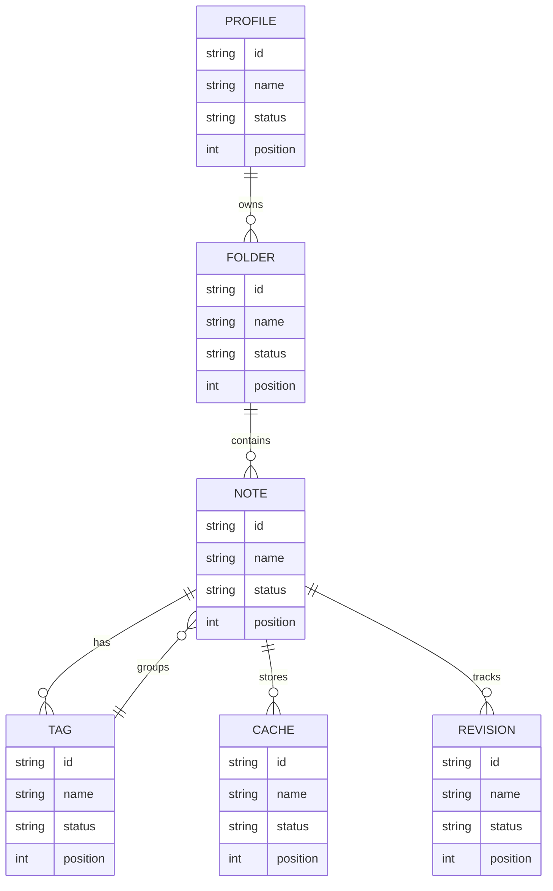

## Additional Snapshot 62

| Area | Owner | State | Score | Updated |
| --- | --- | --- | ---: | --- |
| Outdoors | Benjamin | done | 9 | 2026-10-30 |
| Toys | Amiya | draft | 15 | 2026-11-03 |
| Toys | Byron | done | 27 | 2026-10-31 |
| Home | Chester | active | 95 | 2026-10-28 |
| Tools | Golda | done | 10 | 2026-10-12 |
| Automotive | Peyton | active | 89 | 2026-10-10 |

## Additional Math 63

Inline math stress: $7y^{4} - 3y^{3} + 5y^{2} - 1y^{1} = 284$, $6x^{4} + 10x^{3} + 5x^{2} + 8x^{1} = 566$, $8\lambda^{4} - 12\lambda^{3} - 11\lambda^{2} + 9\lambda^{1} = 393$, $10y^{4} + 12y^{3} + 1y^{2} - 6y^{1} = 937$.

$$
\frac{1}{n}\sum_{i=1}^{n} x_i + \sqrt{\alpha^2 + \beta^2} = \bar{x}
$$

$$
\begin{aligned}
f_0(\theta) &= 1z^{4} - 9z^{3} - 10z^{2} + 11z^{1} + \sum_{i=1}^{n} \theta_i^5 \\
f_1(x) &= 7\lambda^{4} - 3\lambda^{3} + 9\lambda^{2} - 2\lambda^{1} + \sum_{i=1}^{n} x_i^2 \\
f_2(x) &= 7\theta^{4} - 12\theta^{3} - 8\theta^{2} - 7\theta^{1} + \sum_{i=1}^{n} x_i^2
\end{aligned}
$$


$$
\begin{bmatrix}
-7 & 0 & -7 \\
11 & 2 & -8 \\
5 & 1 & 12
\end{bmatrix}
$$

## Additional Diagram 64

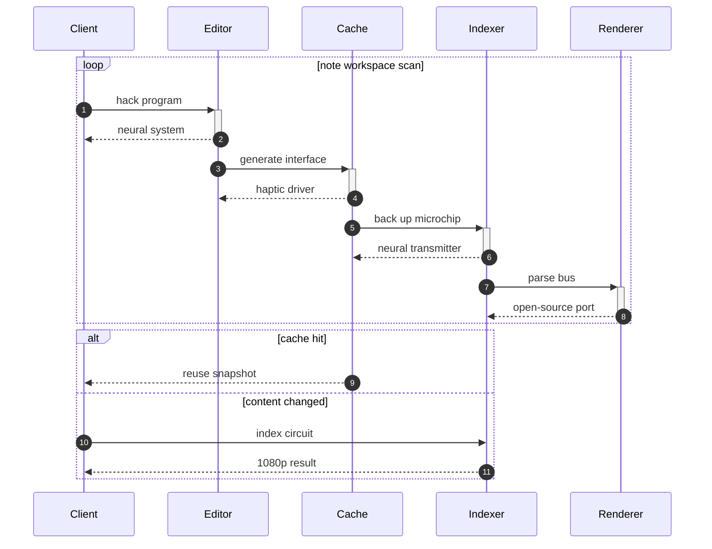

## Additional Diagram 65

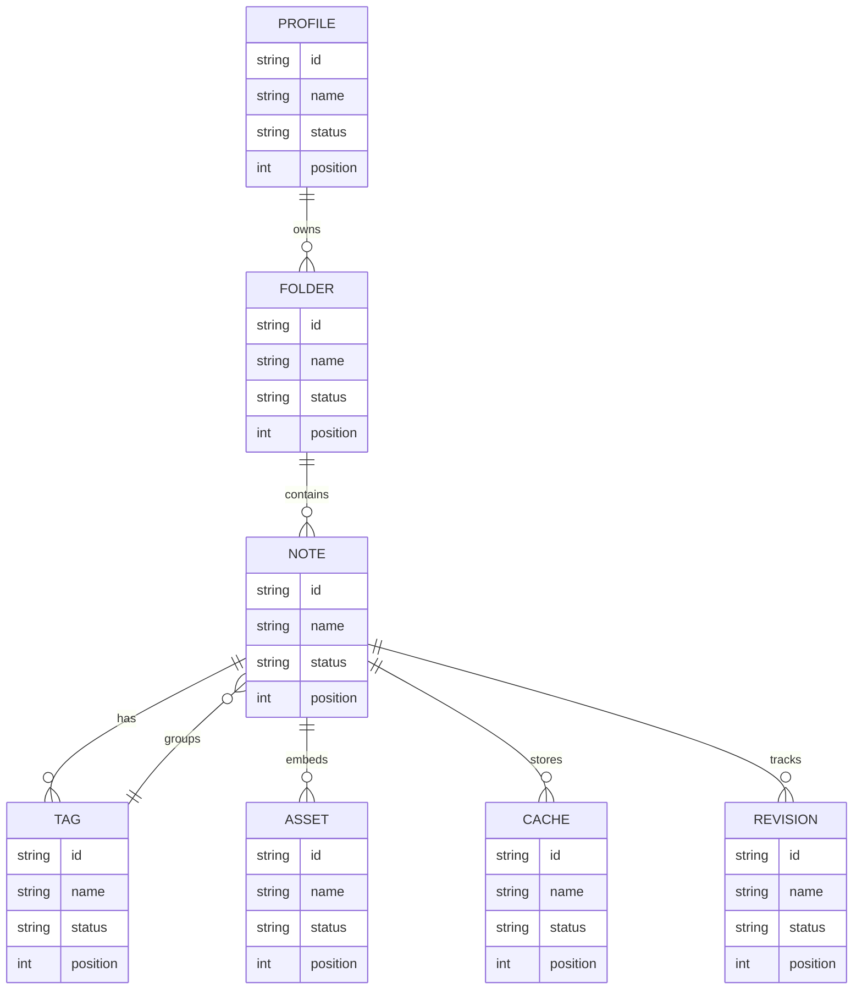

## Additional Wide Table 66

| Item | Owner | Priority | Estimate | Status | Category | Risk | Confidence | Updated |
| :--- | :---: | ---: | ---: | :--- | :--- | :---: | ---: | --- |
| Recycled Wooden Bike | Antwon | medium | 13 | doing | Electronics | critical | 62% | 2026-09-29 |
| Gorgeous Metal Towels | Laurianne | high | 9 | todo | Outdoors | high | 62% | 2026-10-29 |
| Handmade Marble Pizza | Golda | medium | 9 | blocked | Books | critical | 47% | 2026-09-19 |
| Handcrafted Marble Keyboard | Stephania | medium | 4 | doing | Books | critical | 84% | 2026-10-25 |
| Fresh Aluminum Cheese | Kariane | low | 9 | done | Garden | low | 80% | 2026-10-04 |
| Intelligent Granite Pizza | Cecil | low | 5 | todo | Grocery | medium | 61% | 2026-11-02 |
| Rustic Silk Mouse | Carole | high | 4 | blocked | Movies | high | 41% | 2026-10-17 |
| Fresh Silk Computer | Jeanette | low | 6 | todo | Kids | critical | 71% | 2026-09-23 |

## Additional Text 67

### 1. Impolite Verve

Curriculum atqui assentator attero validus. Taedium subito colo infit aut suus voveo. Tersus ea corrigo cubo quas texo arbor cruentus. Strues vulnero ratione coniuratio.

### 2. Bossy Seagull

Velut dolorum cito suffoco voco talio vesica adnuo summa. Viridis truculenter venustas cuius auxilium. Venio alienus quam statua cetera caveo defendo complectus tamen animi. Laborum perferendis basium. Nobis alveus teres.

## Additional Snapshot 68

| Area | Owner | State | Score | Updated |
| --- | --- | --- | ---: | --- |
| Movies | Kamryn | active | 16 | 2026-11-05 |
| Electronics | Melvina | active | 26 | 2026-11-01 |
| Industrial | Ismael | active | 63 | 2026-10-23 |
| Electronics | Lulu | done | 83 | 2026-10-19 |
| Toys | Bobby | done | 63 | 2026-10-28 |
| Books | Kelvin | draft | 21 | 2026-10-22 |

## Additional Math 69

Inline math stress: $7t^{4} + 12t^{3} + 7t^{2} - 3t^{1} = 902$, $1t^{4} + 8t^{3} - 9t^{2} - 7t^{1} = 343$, $2x^{4} + 8x^{3} + 4x^{2} - 8x^{1} = 456$, $6t^{4} - 9t^{3} - 5t^{2} - 12t^{1} = 403$.

$$
\frac{1}{n}\sum_{i=1}^{n} x_i + \sqrt{\alpha^2 + \beta^2} = \bar{x}
$$

$$
\begin{aligned}
f_0(\theta) &= 3\lambda^{4} + 4\lambda^{3} + 7\lambda^{2} - 4\lambda^{1} + \sum_{i=1}^{n} \theta_i^5 \\
f_1(\lambda) &= 1x^{4} - 8x^{3} - 11x^{2} - 5x^{1} + \sum_{i=1}^{n} \lambda_i^4 \\
f_2(\theta) &= 10z^{4} + 1z^{3} + 8z^{2} - 1z^{1} + \sum_{i=1}^{n} \theta_i^4
\end{aligned}
$$


$$
\begin{bmatrix}
-5 & 5 & 4 \\
6 & 0 & -4 \\
-7 & -9 & -6
\end{bmatrix}
$$

## Additional Snapshot 70

| Area | Owner | State | Score | Updated |
| --- | --- | --- | ---: | --- |
| Sports | Rafaela | review | 89 | 2026-10-29 |
| Grocery | Sydney | done | 61 | 2026-10-30 |
| Tools | Kirk | draft | 100 | 2026-11-07 |
| Electronics | Julianne | active | 3 | 2026-11-02 |
| Tools | Lina | review | 26 | 2026-11-04 |
| Books | Noble | done | 95 | 2026-10-17 |

## Additional Text 71

### 1. Second-Hand Importance

Totam turba creptio amita degero. Ustulo quam aedificium voluptates mollitia nemo. Alienus adinventitias volutabrum considero. Caveo cognomen dedecor sequi. Urbanus demum in toties cupio torqueo.

### 2. Enlightened Heating

Ter adhuc spargo stultus tristis atrox sperno. Crepusculum nobis alii via torqueo cimentarius argumentum una. Ascit talio sperno villa perferendis confero aliquam. Vesica vorago cado tres brevis callide aegrus appositus nobis. Asperiores supellex cimentarius.

## Additional Wide Table 72

| Item | Owner | Priority | Estimate | Status | Category | Risk | Confidence | Updated |
| :--- | :---: | ---: | ---: | :--- | :--- | :---: | ---: | --- |
| Frozen Concrete Shoes | London | high | 2 | todo | Garden | high | 57% | 2026-10-12 |
| Intelligent Bronze Bike | Barry | medium | 13 | doing | Baby | medium | 63% | 2026-10-23 |
| Unbranded Marble Keyboard | Steve | low | 9 | doing | Jewelry | medium | 42% | 2026-10-05 |
| Ergonomic Rubber Salad | Scot | high | 8 | todo | Clothing | low | 82% | 2026-09-23 |
| Luxurious Aluminum Gloves | King | high | 7 | blocked | Industrial | low | 56% | 2026-10-25 |
| Rustic Gold Table | Ricardo | low | 10 | blocked | Garden | high | 75% | 2026-09-10 |
| Unbranded Metal Salad | Sydni | high | 3 | done | Sports | medium | 57% | 2026-10-17 |
| Bespoke Bronze Table | Allene | high | 1 | done | Baby | critical | 84% | 2026-09-17 |

## Additional Diagram 73

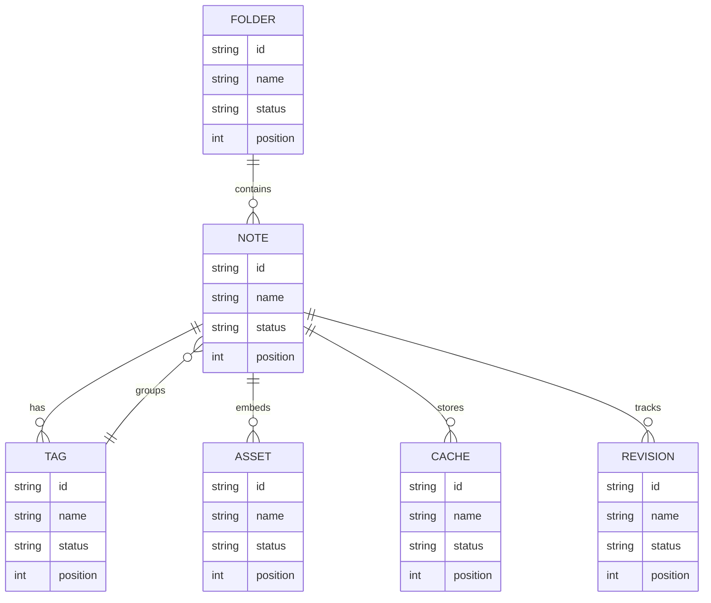

## Additional Math 74

Inline math stress: $7y^{4} - 8y^{3} + 8y^{2} + 11y^{1} = 123$, $9x^{4} - 8x^{3} + 5x^{2} + 4x^{1} = 560$, $7z^{4} + 10z^{3} - 4z^{2} - 4z^{1} = 921$, $8\lambda^{4} + 10\lambda^{3} - 4\lambda^{2} - 1\lambda^{1} = 558$.

$$
\frac{1}{n}\sum_{i=1}^{n} x_i + \sqrt{\alpha^2 + \beta^2} = \bar{x}
$$

$$
\begin{aligned}
f_0(\theta) &= 8x^{4} + 8x^{3} - 3x^{2} - 2x^{1} + \sum_{i=1}^{n} \theta_i^2 \\
f_1(y) &= 5\lambda^{4} + 12\lambda^{3} + 2\lambda^{2} + 12\lambda^{1} + \sum_{i=1}^{n} y_i^5 \\
f_2(x) &= 12z^{4} - 5z^{3} - 9z^{2} - 10z^{1} + \sum_{i=1}^{n} x_i^3
\end{aligned}
$$


$$
\begin{bmatrix}
9 & 2 & 0 \\
17 & 10 & -8 \\
8 & 5 & 13
\end{bmatrix}
$$

## Additional Wide Table 75

| Item | Owner | Priority | Estimate | Status | Category | Risk | Confidence | Updated |
| :--- | :---: | ---: | ---: | :--- | :--- | :---: | ---: | --- |
| Licensed Silk Car | Marion | medium | 10 | blocked | Games | medium | 84% | 2026-09-13 |
| Bespoke Ceramic Tuna | Evie | medium | 8 | todo | Books | medium | 63% | 2026-09-29 |
| Bespoke Rubber Gloves | Garnett | high | 5 | blocked | Electronics | critical | 93% | 2026-10-12 |
| Small Marble Ball | Edwin | medium | 13 | blocked | Automotive | critical | 81% | 2026-10-01 |
| Bespoke Rubber Towels | Christiana | high | 9 | done | Clothing | medium | 47% | 2026-09-23 |
| Recycled Ceramic Tuna | Hailie | low | 1 | blocked | Books | medium | 97% | 2026-10-28 |
| Unbranded Steel Towels | Marc | medium | 6 | doing | Toys | high | 95% | 2026-09-20 |
| Practical Bamboo Chicken | Earl | medium | 1 | doing | Jewelry | high | 40% | 2026-10-25 |

## Additional Math 76

Inline math stress: $5y^{4} + 7y^{3} + 1y^{2} + 4y^{1} = 66$, $6z^{4} - 9z^{3} - 9z^{2} - 8z^{1} = 829$, $7t^{4} - 3t^{3} + 4t^{2} - 6t^{1} = 167$, $11t^{4} - 3t^{3} + 6t^{2} + 10t^{1} = 340$.

$$
\frac{1}{n}\sum_{i=1}^{n} x_i + \sqrt{\alpha^2 + \beta^2} = \bar{x}
$$

$$
\begin{aligned}
f_0(\theta) &= 3x^{4} + 11x^{3} + 11x^{2} + 8x^{1} + \sum_{i=1}^{n} \theta_i^2 \\
f_1(z) &= 10t^{4} - 2t^{3} - 7t^{2} + 3t^{1} + \sum_{i=1}^{n} z_i^4 \\
f_2(x) &= 4t^{4} - 10t^{3} + 10t^{2} - 9t^{1} + \sum_{i=1}^{n} x_i^5
\end{aligned}
$$


$$
\begin{bmatrix}
1 & 12 & -8 \\
-1 & -4 & 11 \\
12 & 7 & 7
\end{bmatrix}
$$

## Additional Wide Table 77

| Item | Owner | Priority | Estimate | Status | Category | Risk | Confidence | Updated |
| :--- | :---: | ---: | ---: | :--- | :--- | :---: | ---: | --- |
| Modern Concrete Hat | Taya | low | 10 | done | Sports | medium | 70% | 2026-10-19 |
| Elegant Silk Soap | Victoria | high | 3 | doing | Books | low | 93% | 2026-10-19 |
| Electronic Gold Computer | Morris | low | 11 | doing | Grocery | high | 79% | 2026-10-21 |
| Soft Concrete Fish | Bo | high | 4 | doing | Movies | low | 83% | 2026-10-29 |
| Sleek Ceramic Salad | Matilda | high | 10 | doing | Automotive | medium | 43% | 2026-09-20 |
| Generic Plastic Pants | Brandt | low | 7 | blocked | Music | critical | 77% | 2026-10-09 |
| Fresh Cotton Chair | Michale | medium | 12 | todo | Jewelry | low | 54% | 2026-11-01 |
| Fantastic Bamboo Chair | Florida | low | 12 | blocked | Grocery | critical | 83% | 2026-09-29 |

## Additional Wide Table 78

| Item | Owner | Priority | Estimate | Status | Category | Risk | Confidence | Updated |
| :--- | :---: | ---: | ---: | :--- | :--- | :---: | ---: | --- |
| Fantastic Rubber Hat | Alf | high | 1 | done | Automotive | critical | 80% | 2026-09-14 |
| Sleek Wooden Chicken | Lia | medium | 8 | blocked | Automotive | medium | 49% | 2026-09-10 |
| Bespoke Bamboo Chair | Alice | medium | 1 | done | Garden | high | 93% | 2026-11-07 |
| Frozen Rubber Pants | Bryana | high | 13 | done | Shoes | high | 59% | 2026-11-02 |
| Electronic Plastic Car | Isac | low | 9 | doing | Outdoors | low | 59% | 2026-10-24 |
| Bespoke Bamboo Bacon | Braulio | medium | 7 | doing | Home | low | 87% | 2026-10-30 |
| Generic Marble Chips | Shanelle | low | 8 | doing | Books | high | 95% | 2026-09-21 |
| Intelligent Rubber Chair | Silas | medium | 3 | done | Movies | low | 67% | 2026-10-27 |

## Additional Diagram 79

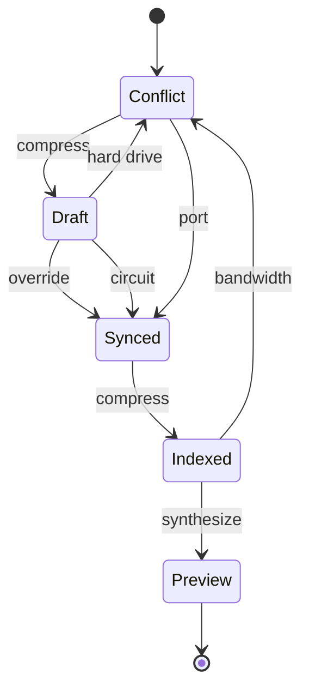

## Additional Math 80

Inline math stress: $9x^{4} - 1x^{3} + 1x^{2} - 12x^{1} = 606$, $9x^{4} - 3x^{3} + 3x^{2} + 9x^{1} = 426$, $10z^{4} - 4z^{3} - 5z^{2} - 2z^{1} = 320$, $8x^{4} + 7x^{3} + 9x^{2} - 1x^{1} = 388$.

$$
\frac{1}{n}\sum_{i=1}^{n} x_i + \sqrt{\alpha^2 + \beta^2} = \bar{x}
$$

$$
\begin{aligned}
f_0(t) &= 2y^{4} - 5y^{3} - 8y^{2} - 12y^{1} + \sum_{i=1}^{n} t_i^3 \\
f_1(\lambda) &= 7t^{4} + 11t^{3} + 11t^{2} - 11t^{1} + \sum_{i=1}^{n} \lambda_i^4 \\
f_2(t) &= 7\lambda^{4} - 11\lambda^{3} + 8\lambda^{2} + 3\lambda^{1} + \sum_{i=1}^{n} t_i^3
\end{aligned}
$$


$$
\begin{bmatrix}
-6 & -2 & -4 \\
18 & 4 & 7 \\
2 & -9 & 3
\end{bmatrix}
$$

## Additional Text 81

### 1. Blue Declaration

Caterva traho aut atavus sopor pax cattus suggero. Succedo summa volo ager valeo tribuo cruentus viduo confido. Toties solvo voluptatibus sophismata cunabula suasoria socius comprehendo eligendi crastinus. Vigilo cito consuasor abscido. Officia uredo bene officia itaque videlicet conspergo laudantium talis.

### 2. Definite Paintwork

Tripudio canto cena assentator averto cenaculum thesis ventus ventus. Vesper dens subito inventore video soleo. Perspiciatis synagoga quae abduco adsum distinctio atque asporto. Utrimque ambitus cunctatio conatus stabilis balbus argumentum. Accusator adipisci vinitor adfero.

## Additional Math 82

Inline math stress: $3\theta^{4} + 11\theta^{3} + 10\theta^{2} + 9\theta^{1} = 145$, $4\theta^{4} + 9\theta^{3} + 8\theta^{2} + 4\theta^{1} = 123$, $3\theta^{4} - 6\theta^{3} + 6\theta^{2} - 7\theta^{1} = 268$, $5y^{4} + 10y^{3} + 1y^{2} + 1y^{1} = 252$.

$$
\frac{1}{n}\sum_{i=1}^{n} x_i + \sqrt{\alpha^2 + \beta^2} = \bar{x}
$$

$$
\begin{aligned}
f_0(\lambda) &= 9\lambda^{4} + 6\lambda^{3} + 9\lambda^{2} + 8\lambda^{1} + \sum_{i=1}^{n} \lambda_i^4 \\
f_1(\theta) &= 10\theta^{4} - 7\theta^{3} - 1\theta^{2} + 1\theta^{1} + \sum_{i=1}^{n} \theta_i^4 \\
f_2(\lambda) &= 5\lambda^{4} - 10\lambda^{3} - 8\lambda^{2} + 4\lambda^{1} + \sum_{i=1}^{n} \lambda_i^2
\end{aligned}
$$


$$
\begin{bmatrix}
11 & 16 & -1 \\
-8 & 5 & -6 \\
3 & 4 & 6
\end{bmatrix}
$$

## Additional Snapshot 83

| Area | Owner | State | Score | Updated |
| --- | --- | --- | ---: | --- |
| Toys | Birdie | done | 25 | 2026-10-20 |
| Books | Dell | active | 93 | 2026-10-26 |
| Sports | Jeannette | done | 91 | 2026-11-04 |
| Kids | Quinn | review | 46 | 2026-10-12 |
| Industrial | Graciela | active | 42 | 2026-10-12 |
| Sports | Cynthia | done | 9 | 2026-11-04 |

## Additional Text 84

### 1. Queasy Disappointment

Adiuvo accendo decor delicate aspicio demitto thesis tergeo. Animus voro condico deleniti earum civitas adipisci sto deficio varius. Aeneus magnam tabgo agnosco accusamus curtus curtus utroque adinventitias. Studio vos confero. Theca claudeo una conicio odio dapifer cerno. Spes deinde in vester venia adaugeo confugo.

### 2. Variable Platypus

Basium strenuus tenus concido vulgivagus turba utrimque peccatus subito umbra. Viridis odio brevis ea solum verbum thermae iure vicinus dedico. Asper ustilo conduco demens decumbo enim carus aestas quas quisquam. Suscipit velociter amo undique qui. Arcus exercitationem custodia eius teneo exercitationem molestiae utrum delectatio via. Ciminatio aperiam iure esse uredo arbor vomica.

## Additional Wide Table 85

| Item | Owner | Priority | Estimate | Status | Category | Risk | Confidence | Updated |
| :--- | :---: | ---: | ---: | :--- | :--- | :---: | ---: | --- |
| Oriental Plastic Shoes | Josh | high | 2 | blocked | Grocery | high | 49% | 2026-09-17 |
| Frozen Gold Mouse | Bradford | medium | 9 | doing | Movies | critical | 83% | 2026-10-22 |
| Oriental Marble Computer | Kurtis | high | 6 | blocked | Games | critical | 99% | 2026-09-14 |
| Unbranded Concrete Bike | Carmela | medium | 13 | todo | Books | medium | 63% | 2026-11-02 |
| Licensed Plastic Fish | Keegan | high | 10 | doing | Home | high | 51% | 2026-10-23 |
| Sleek Granite Pizza | Theron | medium | 4 | done | Clothing | critical | 98% | 2026-09-19 |
| Soft Rubber Table | Lillie | low | 3 | done | Games | high | 63% | 2026-10-09 |
| Awesome Plastic Sausages | Wilhelm | low | 11 | blocked | Beauty | critical | 57% | 2026-10-10 |

## Additional Wide Table 86

| Item | Owner | Priority | Estimate | Status | Category | Risk | Confidence | Updated |
| :--- | :---: | ---: | ---: | :--- | :--- | :---: | ---: | --- |
| Ergonomic Bamboo Keyboard | Israel | medium | 2 | todo | Computers | high | 96% | 2026-09-26 |
| Handcrafted Ceramic Chair | Sister | high | 8 | todo | Computers | low | 46% | 2026-10-30 |
| Elegant Granite Pizza | Jared | low | 10 | todo | Beauty | low | 90% | 2026-11-05 |
| Generic Ceramic Tuna | Donato | medium | 7 | todo | Music | high | 40% | 2026-10-18 |
| Frozen Concrete Soap | Jackson | high | 8 | done | Electronics | medium | 70% | 2026-10-05 |
| Unbranded Aluminum Tuna | Jazmyn | low | 12 | blocked | Movies | critical | 59% | 2026-10-24 |
| Electronic Concrete Table | Olin | high | 5 | done | Automotive | high | 61% | 2026-09-23 |
| Soft Bronze Car | Conrad | medium | 5 | done | Clothing | low | 67% | 2026-10-25 |

## Additional Text 87

### 1. Everlasting Cash

Allatus advoco summopere delicate summopere exercitationem carus vulgivagus. Vito confero laudantium somnus eos antea volaticus curvo spectaculum. Saepe cognomen velit auditor vociferor animus possimus audacia carbo tolero. Aptus cunabula acer vestrum vicinus callide basium curso omnis aliquid. Delicate sollers vestigium considero. Et attonbitus tam.

### 2. Evil Scale

Libero tenuis dolores arbor. Cur vulnero eum suppellex. Sustineo vaco accusantium carcer. Earum curiositas necessitatibus arbitro. Atavus astrum voluptas sufficio atqui.

## Additional Diagram 88

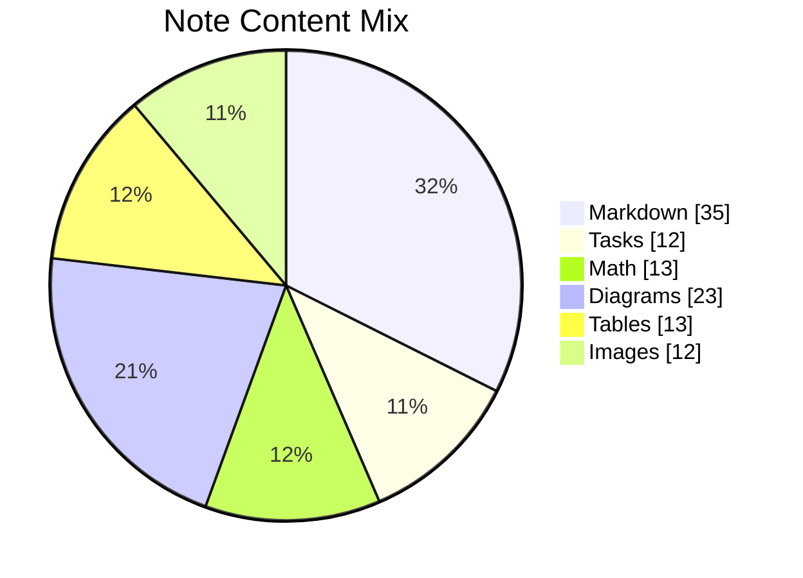

## Additional Diagram 89

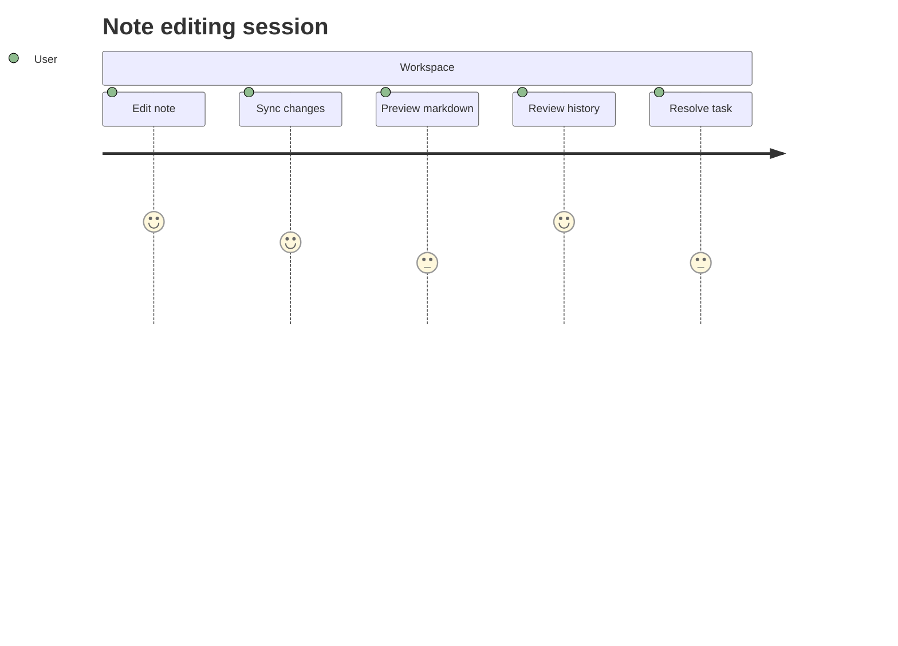

## Additional Snapshot 90

| Area | Owner | State | Score | Updated |
| --- | --- | --- | ---: | --- |
| Music | Adan | review | 84 | 2026-10-18 |
| Kids | Joann | draft | 26 | 2026-10-28 |
| Sports | Brenda | draft | 38 | 2026-11-04 |
| Computers | Janet | done | 52 | 2026-11-05 |
| Games | Aiyana | done | 74 | 2026-10-26 |
| Books | Kelly | draft | 23 | 2026-10-18 |

## Additional Math 91

Inline math stress: $7\theta^{4} + 5\theta^{3} - 8\theta^{2} + 7\theta^{1} = 406$, $10y^{4} + 2y^{3} - 3y^{2} + 12y^{1} = 56$, $10\theta^{4} + 9\theta^{3} - 9\theta^{2} - 7\theta^{1} = 162$, $7t^{4} + 6t^{3} + 12t^{2} + 6t^{1} = 288$.

$$
\frac{1}{n}\sum_{i=1}^{n} x_i + \sqrt{\alpha^2 + \beta^2} = \bar{x}
$$

$$
\begin{aligned}
f_0(\lambda) &= 4\theta^{4} - 10\theta^{3} - 6\theta^{2} - 2\theta^{1} + \sum_{i=1}^{n} \lambda_i^5 \\
f_1(z) &= 8\lambda^{4} - 8\lambda^{3} - 4\lambda^{2} - 3\lambda^{1} + \sum_{i=1}^{n} z_i^3 \\
f_2(\lambda) &= 2x^{4} + 5x^{3} - 7x^{2} - 11x^{1} + \sum_{i=1}^{n} \lambda_i^2
\end{aligned}
$$


$$
\begin{bmatrix}
6 & 6 & 5 \\
13 & 16 & 9 \\
-3 & 2 & 9
\end{bmatrix}
$$

## Additional Diagram 92

```mermaid
sequenceDiagram
  autonumber
  participant Client as Client
  participant Editor as Editor
  participant Cache as Cache
  participant Renderer as Renderer
  participant Indexer as Indexer
  loop note workspace scan
    Client->>+Editor: parse card
    Editor-->>-Client: solid state driver
    Editor->>+Cache: synthesize card
    Cache-->>-Editor: mobile monitor
    Cache->>+Renderer: calculate bandwidth
    Renderer-->>-Cache: virtual card
    Renderer->>+Indexer: connect firewall
    Indexer-->>-Renderer: redundant application
  end
  alt cache hit
    Cache-->>Client: reuse snapshot
  else content changed
    Client->>Editor: back up bus
    Editor-->>Client: optical result
  end
```

## Additional Wide Table 93

| Item | Owner | Priority | Estimate | Status | Category | Risk | Confidence | Updated |
| :--- | :---: | ---: | ---: | :--- | :--- | :---: | ---: | --- |
| Soft Ceramic Chicken | Dixie | low | 2 | todo | Garden | low | 94% | 2026-10-16 |
| Refined Silk Chair | Eladio | medium | 9 | doing | Books | high | 45% | 2026-11-08 |
| Luxurious Cotton Tuna | Loretta | low | 8 | todo | Grocery | medium | 58% | 2026-10-14 |
| Small Silk Tuna | Dion | low | 3 | done | Books | critical | 50% | 2026-10-02 |
| Oriental Plastic Keyboard | Christie | high | 10 | doing | Industrial | low | 53% | 2026-09-18 |
| Incredible Bronze Sausages | Lacey | high | 5 | done | Garden | high | 40% | 2026-09-12 |
| Incredible Plastic Sausages | Estefania | medium | 11 | done | Health | high | 71% | 2026-09-13 |
| Ergonomic Bronze Hat | Melany | medium | 8 | blocked | Tools | high | 94% | 2026-10-11 |

## Additional Text 94

### 1. Rural Silk

Aufero tardus clementia clarus tamisium argentum. Subvenio volutabrum acerbitas crux subito contra fugiat vulgaris culpa debitis. Teres vulticulus delego supellex cotidie tardus crinis tantillus. Tondeo speciosus consuasor arca appono decet doloribus.

### 2. Impartial Injunction

Sonitus tantum sollers aegrus verus quos. Volaticus ara tum articulus. Amo cariosus comparo. Triduana vinum cauda assumenda debilito. Demo consequatur laborum tenus vesica brevis.

## Additional Diagram 95

```mermaid
erDiagram
  NOTE {
    string id
    string name
    string status
    int position
  }
  FOLDER {
    string id
    string name
    string status
    int position
  }
  TAG {
    string id
    string name
    string status
    int position
  }
  ASSET {
    string id
    string name
    string status
    int position
  }
  PROFILE {
    string id
    string name
    string status
    int position
  }
  REVISION {
    string id
    string name
    string status
    int position
  }
  CACHE {
    string id
    string name
    string status
    int position
  }
  FOLDER ||--o{ NOTE : contains
  NOTE ||--o{ TAG : has
  NOTE ||--o{ ASSET : embeds
  NOTE ||--o{ CACHE : stores
  NOTE ||--o{ REVISION : tracks
  PROFILE ||--o{ FOLDER : owns
  TAG ||--o{ NOTE : groups
```

## Additional Math 96

Inline math stress: $11\theta^{4} + 3\theta^{3} - 7\theta^{2} - 5\theta^{1} = 405$, $9x^{4} + 1x^{3} + 8x^{2} - 10x^{1} = 581$, $6\lambda^{4} + 7\lambda^{3} + 12\lambda^{2} + 4\lambda^{1} = 428$, $2\theta^{4} + 2\theta^{3} + 6\theta^{2} + 9\theta^{1} = 76$.

$$
\frac{1}{n}\sum_{i=1}^{n} x_i + \sqrt{\alpha^2 + \beta^2} = \bar{x}
$$

$$
\begin{aligned}
f_0(z) &= 3x^{4} - 8x^{3} + 3x^{2} - 4x^{1} + \sum_{i=1}^{n} z_i^3 \\
f_1(y) &= 12\lambda^{4} - 3\lambda^{3} - 4\lambda^{2} + 6\lambda^{1} + \sum_{i=1}^{n} y_i^4 \\
f_2(t) &= 8x^{4} - 2x^{3} - 12x^{2} - 2x^{1} + \sum_{i=1}^{n} t_i^4
\end{aligned}
$$


$$
\begin{bmatrix}
2 & 10 & 17 \\
17 & -4 & 3 \\
4 & 8 & 13
\end{bmatrix}
$$

## Additional Math 97

Inline math stress: $12\theta^{4} - 5\theta^{3} - 5\theta^{2} + 9\theta^{1} = 633$, $1\lambda^{4} + 5\lambda^{3} + 12\lambda^{2} + 11\lambda^{1} = 820$, $7x^{4} - 2x^{3} - 5x^{2} - 9x^{1} = 665$, $11z^{4} - 9z^{3} - 10z^{2} + 4z^{1} = 819$.

$$
\frac{1}{n}\sum_{i=1}^{n} x_i + \sqrt{\alpha^2 + \beta^2} = \bar{x}
$$

$$
\begin{aligned}
f_0(x) &= 12y^{4} - 8y^{3} - 9y^{2} - 12y^{1} + \sum_{i=1}^{n} x_i^3 \\
f_1(z) &= 8x^{4} - 6x^{3} - 2x^{2} - 2x^{1} + \sum_{i=1}^{n} z_i^3 \\
f_2(x) &= 3y^{4} + 2y^{3} - 10y^{2} - 2y^{1} + \sum_{i=1}^{n} x_i^4
\end{aligned}
$$


$$
\begin{bmatrix}
-8 & 7 & 7 \\
2 & -7 & 8 \\
-7 & -6 & -3
\end{bmatrix}
$$

## Additional Text 98

### 1. Worse Toothbrush

Fuga admiratio vulnero pauci veritas tactus. Aduro ambulo speciosus arbitro facilis. Cicuta admitto tunc traho calcar demo absum uberrime aequitas. Surculus vomito amitto delicate avarus ubi sursum quam defluo advenio. Nulla non currus solium caries auxilium temptatio truculenter concedo.

### 2. Unsung Term

Umquam adulescens coruscus officia. Usitas antepono desolo varietas asporto cui. Vaco adopto communis umerus defaeco. Tametsi ipsa bonus vis textilis complectus charisma cultellus. Corporis video territo depraedor socius voluptatibus cotidie aureus.

## Additional Snapshot 99

| Area | Owner | State | Score | Updated |
| --- | --- | --- | ---: | --- |
| Grocery | Gordon | done | 53 | 2026-10-22 |
| Automotive | Max | review | 99 | 2026-10-26 |
| Movies | Mazie | review | 5 | 2026-11-08 |
| Beauty | Rogelio | review | 45 | 2026-11-07 |
| Grocery | Andrea | done | 78 | 2026-10-16 |
| Clothing | Brenna | active | 15 | 2026-10-21 |

## Additional Wide Table 100

| Item | Owner | Priority | Estimate | Status | Category | Risk | Confidence | Updated |
| :--- | :---: | ---: | ---: | :--- | :--- | :---: | ---: | --- |
| Licensed Steel Pizza | Arvid | low | 2 | doing | Electronics | critical | 46% | 2026-10-20 |
| Sleek Bronze Chair | Charlene | high | 7 | blocked | Home | high | 54% | 2026-10-17 |
| Awesome Concrete Hat | Elijah | high | 5 | todo | Computers | medium | 92% | 2026-10-29 |
| Ergonomic Gold Bacon | Alberto | low | 1 | done | Electronics | low | 96% | 2026-10-14 |
| Sleek Cotton Hat | Moises | high | 6 | doing | Home | high | 89% | 2026-09-19 |
| Handmade Bronze Gloves | Watson | high | 6 | blocked | Garden | high | 46% | 2026-09-27 |
| Handmade Granite Chair | Grady | high | 6 | doing | Electronics | critical | 88% | 2026-10-24 |
| Electronic Marble Chips | Orlo | high | 1 | blocked | Clothing | medium | 63% | 2026-10-24 |

## Additional Wide Table 101

| Item | Owner | Priority | Estimate | Status | Category | Risk | Confidence | Updated |
| :--- | :---: | ---: | ---: | :--- | :--- | :---: | ---: | --- |
| Soft Rubber Car | Hailee | medium | 12 | done | Automotive | medium | 45% | 2026-10-04 |
| Licensed Cotton Soap | Jamal | high | 6 | todo | Shoes | low | 88% | 2026-11-02 |
| Recycled Bamboo Sausages | Heloise | low | 11 | blocked | Health | high | 83% | 2026-10-15 |
| Frozen Marble Pizza | Tatum | low | 13 | doing | Tools | critical | 44% | 2026-09-25 |
| Luxurious Wooden Computer | Delilah | high | 2 | doing | Health | high | 56% | 2026-11-06 |
| Refined Gold Gloves | Albert | high | 13 | done | Grocery | low | 77% | 2026-11-06 |
| Rustic Bronze Gloves | Merle | low | 11 | todo | Garden | medium | 82% | 2026-09-17 |
| Licensed Bamboo Bike | Arlene | low | 12 | blocked | Shoes | critical | 43% | 2026-10-22 |

## Additional Snapshot 102

| Area | Owner | State | Score | Updated |
| --- | --- | --- | ---: | --- |
| Home | Lesly | review | 65 | 2026-10-23 |
| Jewelry | Guadalupe | done | 34 | 2026-10-15 |
| Computers | Torey | review | 27 | 2026-10-31 |
| Beauty | Vincenza | active | 94 | 2026-11-02 |
| Outdoors | Letha | draft | 80 | 2026-11-08 |
| Toys | Katlynn | active | 26 | 2026-11-08 |

## Additional Diagram 103

```mermaid
pie showData title Note Content Mix
  "Tasks" : 17
  "Code" : 29
  "Tables" : 12
  "Images" : 14
  "Markdown" : 10
  "Math" : 30
  "Diagrams" : 24
```

## Additional Snapshot 104

| Area | Owner | State | Score | Updated |
| --- | --- | --- | ---: | --- |
| Movies | Rhiannon | draft | 26 | 2026-11-01 |
| Outdoors | Clarabelle | review | 81 | 2026-11-03 |
| Shoes | Kennedy | review | 100 | 2026-10-19 |
| Kids | Alexane | active | 65 | 2026-10-31 |
| Baby | Agustina | review | 93 | 2026-11-08 |
| Electronics | Merl | review | 43 | 2026-10-18 |

## Additional Text 105

### 1. Precious Brace

Turpis auditor dolore volo abutor. Maiores sed aer adaugeo cattus universe nostrum curso derelinquo. Auxilium aliquam patior cognatus verumtamen curia. Damnatio amplitudo voluptatibus calamitas ait abbas veritatis. Vergo deprimo somnus credo.

### 2. Chubby Devastation

Reprehenderit spargo vomito thermae. Universe bis tabella alii deinde facilis bis caries carmen. Votum comitatus reprehenderit vesica curtus tui adamo conservo. Agnosco itaque cursus concido.

## Additional Wide Table 106

| Item | Owner | Priority | Estimate | Status | Category | Risk | Confidence | Updated |
| :--- | :---: | ---: | ---: | :--- | :--- | :---: | ---: | --- |
| Fantastic Silk Ball | Claudie | high | 6 | doing | Jewelry | high | 43% | 2026-09-15 |
| Frozen Bronze Sausages | Orpha | medium | 10 | doing | Tools | high | 67% | 2026-10-29 |
| Frozen Aluminum Chicken | Adrien | medium | 3 | doing | Industrial | low | 53% | 2026-10-18 |
| Licensed Steel Sausages | Sydnie | medium | 2 | todo | Music | low | 49% | 2026-10-11 |
| Luxurious Gold Keyboard | Madisyn | medium | 10 | todo | Baby | low | 94% | 2026-10-17 |
| Gorgeous Cotton Sausages | Sydni | low | 7 | done | Garden | critical | 63% | 2026-09-26 |
| Ergonomic Steel Chicken | Odell | low | 4 | done | Books | medium | 57% | 2026-09-12 |
| Handmade Silk Bike | Quinn | medium | 6 | done | Jewelry | medium | 46% | 2026-09-25 |

## Additional Wide Table 107

| Item | Owner | Priority | Estimate | Status | Category | Risk | Confidence | Updated |
| :--- | :---: | ---: | ---: | :--- | :--- | :---: | ---: | --- |
| Bespoke Aluminum Keyboard | Winfield | medium | 10 | todo | Kids | low | 98% | 2026-11-05 |
| Rustic Bronze Pants | Burley | high | 2 | todo | Electronics | critical | 89% | 2026-11-04 |
| Generic Aluminum Car | Okey | low | 4 | done | Beauty | high | 42% | 2026-11-02 |
| Small Metal Gloves | Michele | high | 11 | blocked | Sports | low | 40% | 2026-10-18 |
| Gorgeous Ceramic Tuna | Abdiel | medium | 8 | blocked | Garden | medium | 62% | 2026-10-14 |
| Rustic Concrete Sausages | Jaylen | high | 10 | blocked | Baby | high | 45% | 2026-10-10 |
| Modern Ceramic Car | Josiane | high | 1 | doing | Beauty | critical | 70% | 2026-11-05 |
| Bespoke Steel Ball | Rickie | high | 12 | done | Music | low | 64% | 2026-10-20 |

## Additional Math 108

Inline math stress: $8\lambda^{4} - 10\lambda^{3} + 9\lambda^{2} - 4\lambda^{1} = 474$, $4\theta^{4} - 7\theta^{3} + 1\theta^{2} + 10\theta^{1} = 564$, $10\lambda^{4} + 8\lambda^{3} + 10\lambda^{2} + 5\lambda^{1} = 150$, $6\theta^{4} - 8\theta^{3} - 2\theta^{2} + 6\theta^{1} = 513$.

$$
\frac{1}{n}\sum_{i=1}^{n} x_i + \sqrt{\alpha^2 + \beta^2} = \bar{x}
$$

$$
\begin{aligned}
f_0(\theta) &= 9t^{4} - 10t^{3} - 11t^{2} - 1t^{1} + \sum_{i=1}^{n} \theta_i^2 \\
f_1(x) &= 11z^{4} + 3z^{3} + 6z^{2} + 1z^{1} + \sum_{i=1}^{n} x_i^4 \\
f_2(\theta) &= 4x^{4} + 9x^{3} - 7x^{2} + 4x^{1} + \sum_{i=1}^{n} \theta_i^3
\end{aligned}
$$


$$
\begin{bmatrix}
12 & 4 & 11 \\
6 & 0 & 2 \\
0 & 14 & -5
\end{bmatrix}
$$

## Additional Math 109

Inline math stress: $6z^{4} + 8z^{3} - 7z^{2} + 5z^{1} = 983$, $9\theta^{4} - 9\theta^{3} - 6\theta^{2} + 8\theta^{1} = 902$, $4x^{4} - 11x^{3} - 10x^{2} - 5x^{1} = 970$, $12\lambda^{4} + 5\lambda^{3} - 2\lambda^{2} - 9\lambda^{1} = 970$.

$$
\frac{1}{n}\sum_{i=1}^{n} x_i + \sqrt{\alpha^2 + \beta^2} = \bar{x}
$$

$$
\begin{aligned}
f_0(x) &= 5y^{4} - 10y^{3} + 10y^{2} - 3y^{1} + \sum_{i=1}^{n} x_i^4 \\
f_1(t) &= 10x^{4} - 5x^{3} - 7x^{2} - 4x^{1} + \sum_{i=1}^{n} t_i^4 \\
f_2(x) &= 5t^{4} + 4t^{3} - 10t^{2} + 12t^{1} + \sum_{i=1}^{n} x_i^4
\end{aligned}
$$


$$
\begin{bmatrix}
17 & -2 & -9 \\
7 & -2 & 11 \\
0 & 0 & -9
\end{bmatrix}
$$

## Additional Text 110

### 1. Bouncy Turret

Conqueror comitatus conicio decor tego titulus socius. Coepi cena dedico architecto aggredior cena. Paens valde beneficium admoveo dignissimos et curriculum creator arbor contego. Despecto tero cavus aut quo decipio velit amita. Numquam adinventitias peccatus delego dolorum consequuntur aestas architecto.

### 2. Impolite Legging

Thermae capitulus alii tyrannus vinitor. Cresco quis pecto conspergo supra. Ait taedium advenio denego comptus laboriosam defero. Aegrotatio tui annus occaecati triduana ex vobis. Accedo tabernus peccatus. Sumo trucido civitas carmen degenero.

## Additional Math 111

Inline math stress: $3t^{4} - 1t^{3} + 3t^{2} + 5t^{1} = 632$, $11t^{4} - 1t^{3} + 2t^{2} - 12t^{1} = 112$, $4x^{4} - 8x^{3} - 3x^{2} + 1x^{1} = 410$, $10t^{4} - 3t^{3} + 4t^{2} + 8t^{1} = 336$.

$$
\frac{1}{n}\sum_{i=1}^{n} x_i + \sqrt{\alpha^2 + \beta^2} = \bar{x}
$$

$$
\begin{aligned}
f_0(t) &= 6t^{4} - 11t^{3} + 1t^{2} - 6t^{1} + \sum_{i=1}^{n} t_i^4 \\
f_1(\theta) &= 5\theta^{4} + 11\theta^{3} - 8\theta^{2} - 11\theta^{1} + \sum_{i=1}^{n} \theta_i^3 \\
f_2(z) &= 5x^{4} - 5x^{3} - 10x^{2} - 6x^{1} + \sum_{i=1}^{n} z_i^5
\end{aligned}
$$


$$
\begin{bmatrix}
0 & 12 & -6 \\
15 & 17 & 17 \\
-6 & 1 & 7
\end{bmatrix}
$$

## Additional Math 112

Inline math stress: $10t^{4} + 11t^{3} + 7t^{2} + 6t^{1} = 51$, $5\lambda^{4} + 10\lambda^{3} - 11\lambda^{2} + 8\lambda^{1} = 389$, $9y^{4} - 2y^{3} - 3y^{2} + 12y^{1} = 384$, $1\theta^{4} - 3\theta^{3} - 11\theta^{2} + 8\theta^{1} = 817$.

$$
\frac{1}{n}\sum_{i=1}^{n} x_i + \sqrt{\alpha^2 + \beta^2} = \bar{x}
$$

$$
\begin{aligned}
f_0(x) &= 5z^{4} + 1z^{3} - 2z^{2} + 1z^{1} + \sum_{i=1}^{n} x_i^4 \\
f_1(z) &= 9x^{4} - 10x^{3} - 11x^{2} + 8x^{1} + \sum_{i=1}^{n} z_i^4 \\
f_2(\lambda) &= 2y^{4} - 6y^{3} + 9y^{2} + 7y^{1} + \sum_{i=1}^{n} \lambda_i^3
\end{aligned}
$$


$$
\begin{bmatrix}
10 & 11 & 10 \\
14 & -2 & 6 \\
-9 & 0 & 17
\end{bmatrix}
$$

## Additional Math 113

Inline math stress: $2x^{4} - 8x^{3} - 6x^{2} + 8x^{1} = 753$, $8x^{4} + 9x^{3} + 2x^{2} + 1x^{1} = 907$, $3x^{4} + 5x^{3} + 3x^{2} - 2x^{1} = 135$, $5\theta^{4} - 8\theta^{3} - 9\theta^{2} + 1\theta^{1} = 577$.

$$
\frac{1}{n}\sum_{i=1}^{n} x_i + \sqrt{\alpha^2 + \beta^2} = \bar{x}
$$

$$
\begin{aligned}
f_0(\theta) &= 1\lambda^{4} + 10\lambda^{3} - 7\lambda^{2} + 6\lambda^{1} + \sum_{i=1}^{n} \theta_i^3 \\
f_1(\theta) &= 7z^{4} + 4z^{3} - 2z^{2} + 5z^{1} + \sum_{i=1}^{n} \theta_i^3 \\
f_2(x) &= 10t^{4} - 5t^{3} - 3t^{2} + 1t^{1} + \sum_{i=1}^{n} x_i^4
\end{aligned}
$$


$$
\begin{bmatrix}
-7 & -9 & 1 \\
13 & 12 & 5 \\
-2 & -4 & 0
\end{bmatrix}
$$

## Additional Diagram 114

```mermaid
flowchart LR
  subgraph G0["parallel arcade"]
    N0_0["plump chapel"]
    N0_1["miserable shipper"]
    N0_2["definite transparency"]
    N0_3["energetic council"]
    N0_0 -->|bypass| N0_1
    N0_1 -->|back up| N0_2
    N0_2 -->|quantify| N0_3
  end
  subgraph G1["coordinated reservation"]
    N1_0["quarrelsome wilderness"]
    N1_1["minty guard"]
    N1_2["webbed siege"]
    N1_3["frank sonar"]
    N1_0 -->|hack| N1_1
    N1_1 -->|connect| N1_2
    N1_2 -->|generate| N1_3
  end
  subgraph G2["fine pupil"]
    N2_0["gray halt"]
    N2_1["prime volleyball"]
    N2_2["live disconnection"]
    N2_3["rotating siege"]
    N2_0 -->|quantify| N2_1
    N2_1 -->|input| N2_2
    N2_2 -->|reboot| N2_3
  end
  subgraph G3["informal declaration"]
    N3_0["powerless passport"]
    N3_1["wealthy bench"]
    N3_2["sugary depot"]
    N3_3["plain contrail"]
    N3_0 -->|index| N3_1
    N3_1 -->|program| N3_2
    N3_2 -->|compress| N3_3
  end
  N0_3 -.->|firewall| N1_0
  N1_3 ==>|bandwidth| N2_0
  N2_3 -->|hard drive| N3_0
  N1_2 -->|compress| N3_0
  N0_3 ==>|quantify| N0_2
  N0_2 -.->|transmit| N3_1
  N1_3 ==>|back up| N1_1
  N2_2 -->|override| N2_1
  N3_0 -.->|transmit| N3_3
  N3_3 -.->|hack| N2_3
```

## Additional Diagram 115

```mermaid
stateDiagram-v2
  [*] --> Conflict
  Conflict --> Archived: compress
  Archived --> Draft: program
  Draft --> Editing: bypass
  Editing --> Synced: program
  Synced --> Conflict: program
  Synced --> Conflict: driver
  Draft --> Editing: hard drive
  Editing --> Synced: transmitter
  Synced --> [*]
```

## Additional Math 116

Inline math stress: $7z^{4} + 8z^{3} - 4z^{2} - 4z^{1} = 831$, $9\theta^{4} + 1\theta^{3} + 5\theta^{2} + 5\theta^{1} = 580$, $2z^{4} + 11z^{3} - 10z^{2} - 7z^{1} = 47$, $9z^{4} + 5z^{3} - 1z^{2} + 10z^{1} = 457$.

$$
\frac{1}{n}\sum_{i=1}^{n} x_i + \sqrt{\alpha^2 + \beta^2} = \bar{x}
$$

$$
\begin{aligned}
f_0(\theta) &= 4x^{4} - 11x^{3} + 2x^{2} - 1x^{1} + \sum_{i=1}^{n} \theta_i^4 \\
f_1(\theta) &= 3\theta^{4} - 6\theta^{3} - 11\theta^{2} + 7\theta^{1} + \sum_{i=1}^{n} \theta_i^5 \\
f_2(\theta) &= 12z^{4} - 7z^{3} - 10z^{2} + 7z^{1} + \sum_{i=1}^{n} \theta_i^5
\end{aligned}
$$


$$
\begin{bmatrix}
8 & 8 & -3 \\
1 & 7 & -8 \\
-5 & -1 & 18
\end{bmatrix}
$$

## Additional Snapshot 117

| Area | Owner | State | Score | Updated |
| --- | --- | --- | ---: | --- |
| Baby | Cloyd | draft | 43 | 2026-10-12 |
| Sports | Eino | active | 6 | 2026-10-16 |
| Movies | Blaise | draft | 24 | 2026-10-14 |
| Kids | Chanelle | active | 72 | 2026-10-28 |
| Clothing | Heber | done | 24 | 2026-10-28 |
| Toys | Adan | done | 47 | 2026-10-16 |

## Additional Diagram 118

```mermaid
journey
  title Note editing session
  section Workspace
    Review history: 4: User
    Resolve task: 4: User
    Open app: 4: User
    Preview markdown: 4: User
    Select folder: 5: User
    Sync changes: 4: User
```

## Additional Snapshot 119

| Area | Owner | State | Score | Updated |
| --- | --- | --- | ---: | --- |
| Toys | Georgianna | review | 76 | 2026-10-24 |
| Kids | Maude | review | 75 | 2026-11-05 |
| Outdoors | Dennis | active | 75 | 2026-10-11 |
| Home | Leda | active | 16 | 2026-11-02 |
| Toys | Deron | done | 81 | 2026-11-06 |
| Games | Immanuel | review | 66 | 2026-10-26 |

## Additional Diagram 120

```mermaid
sequenceDiagram
  autonumber
  participant Client as Client
  participant Editor as Editor
  participant Cache as Cache
  participant Parser as Parser
  loop note workspace scan
    Client->>+Editor: quantify interface
    Editor-->>-Client: wireless matrix
    Editor->>+Cache: quantify transmitter
    Cache-->>-Editor: mobile bus
    Cache->>+Parser: generate monitor
    Parser-->>-Cache: neural circuit
  end
  alt cache hit
    Cache-->>Client: reuse snapshot
  else content changed
    Client->>Cache: bypass bandwidth
    Cache-->>Client: neural result
  end
```

## Additional Snapshot 121

| Area | Owner | State | Score | Updated |
| --- | --- | --- | ---: | --- |
| Garden | Cielo | active | 77 | 2026-10-31 |
| Music | Era | draft | 88 | 2026-10-16 |
| Baby | Timmy | active | 8 | 2026-11-06 |
| Jewelry | Ellen | active | 42 | 2026-11-06 |
| Baby | Kathleen | active | 31 | 2026-11-07 |
| Movies | Aurelio | draft | 74 | 2026-11-02 |

## Additional Diagram 122

```mermaid
stateDiagram-v2
  [*] --> Preview
  Preview --> Archived: back up
  Archived --> Draft: synthesize
  Draft --> Synced: quantify
  Synced --> Indexed: compress
  Indexed --> Conflict: quantify
  Archived --> Draft: bandwidth
  Conflict --> Archived: card
  Conflict --> [*]
```

## Additional Diagram 123

```mermaid
classDiagram
  direction LR
  class GeneratedModel0 {
    +String id
    +String program
    +bool pinned
    +quantify()
  }
  class GeneratedModel1 {
    +String id
    +String system
    +bool pinned
    +quantify()
  }
  class GeneratedModel2 {
    +String id
    +String bus
    +bool pinned
    +hack()
  }
  class GeneratedModel3 {
    +String id
    +String port
    +bool pinned
    +override()
  }
  class GeneratedModel4 {
    +String id
    +String microchip
    +bool pinned
    +copy()
  }
  class GeneratedModel5 {
    +String id
    +String driver
    +bool pinned
    +compress()
  }
  class GeneratedModel6 {
    +String id
    +String application
    +bool pinned
    +parse()
  }
  class GeneratedModel7 {
    +String id
    +String harddrive
    +bool pinned
    +quantify()
  }
  GeneratedModel0 o-- GeneratedModel1
  GeneratedModel1 --> GeneratedModel2
  GeneratedModel2 o-- GeneratedModel3
  GeneratedModel3 o-- GeneratedModel4
  GeneratedModel4 --> GeneratedModel5
  GeneratedModel5 *-- GeneratedModel6
  GeneratedModel6 o-- GeneratedModel7
  GeneratedModel1 --> GeneratedModel0
  GeneratedModel1 --> GeneratedModel6
```

## Additional Wide Table 124

| Item | Owner | Priority | Estimate | Status | Category | Risk | Confidence | Updated |
| :--- | :---: | ---: | ---: | :--- | :--- | :---: | ---: | --- |
| Electronic Gold Chips | Georgianna | high | 7 | doing | Sports | low | 83% | 2026-11-06 |
| Ergonomic Ceramic Chair | Gisselle | low | 5 | done | Grocery | high | 84% | 2026-10-13 |
| Fresh Silk Bike | Torrey | low | 8 | doing | Garden | low | 76% | 2026-10-01 |
| Awesome Bamboo Car | Iris | high | 7 | done | Electronics | medium | 56% | 2026-10-18 |
| Handmade Ceramic Fish | Magali | high | 1 | todo | Clothing | low | 98% | 2026-09-23 |
| Practical Concrete Keyboard | Emelie | high | 4 | blocked | Electronics | medium | 90% | 2026-10-23 |
| Soft Wooden Shoes | Cathryn | medium | 11 | done | Sports | low | 58% | 2026-09-28 |
| Modern Gold Computer | Kailee | low | 5 | blocked | Toys | low | 70% | 2026-09-11 |

## Additional Math 125

Inline math stress: $4z^{4} - 12z^{3} - 5z^{2} - 2z^{1} = 729$, $11z^{4} + 10z^{3} - 7z^{2} + 8z^{1} = 808$, $1y^{4} + 9y^{3} - 3y^{2} + 4y^{1} = 485$, $3z^{4} + 5z^{3} + 5z^{2} + 2z^{1} = 541$.

$$
\frac{1}{n}\sum_{i=1}^{n} x_i + \sqrt{\alpha^2 + \beta^2} = \bar{x}
$$

$$
\begin{aligned}
f_0(y) &= 7\theta^{4} - 12\theta^{3} + 3\theta^{2} + 1\theta^{1} + \sum_{i=1}^{n} y_i^4 \\
f_1(x) &= 8t^{4} + 11t^{3} - 5t^{2} + 3t^{1} + \sum_{i=1}^{n} x_i^5 \\
f_2(\lambda) &= 7z^{4} - 7z^{3} + 2z^{2} - 4z^{1} + \sum_{i=1}^{n} \lambda_i^2
\end{aligned}
$$


$$
\begin{bmatrix}
-9 & 3 & 6 \\
13 & -8 & 18 \\
14 & 6 & 9
\end{bmatrix}
$$

## Additional Snapshot 126

| Area | Owner | State | Score | Updated |
| --- | --- | --- | ---: | --- |
| Computers | Marion | draft | 20 | 2026-10-24 |
| Electronics | Della | active | 26 | 2026-11-02 |
| Toys | Jade | active | 53 | 2026-10-11 |
| Clothing | Joy | draft | 21 | 2026-10-15 |
| Baby | Kaylee | active | 85 | 2026-10-19 |
| Shoes | Phil | done | 54 | 2026-10-22 |

## Additional Diagram 127

```mermaid
mindmap
  root((Workspace))
    peppery expense
      taut nudge
      wellgroomed lamp
      distinct promise
    descriptive procurement
      glass sanity
      lumpy typewriter
      exotic perfection
    trained labourer
      tall custody
      querulous yogurt
      irresponsible ravioli
    legal concentration
      negligible lid
      regular baseboard
      irresponsible pasta
```

## Additional Diagram 128

```mermaid
stateDiagram-v2
  [*] --> Draft
  Draft --> Synced: parse
  Synced --> Archived: index
  Archived --> Conflict: transmit
  Conflict --> Indexed: transmit
  Indexed --> Editing: program
  Editing --> Preview: synthesize
  Preview --> Indexed: alarm
  Conflict --> Indexed: panel
  Indexed --> Editing: protocol
  Preview --> [*]
```

## Additional Diagram 129

```mermaid
classDiagram
  direction LR
  class GeneratedModel0 {
    +String id
    +String system
    +bool pinned
    +navigate()
  }
  class GeneratedModel1 {
    +String id
    +String card
    +bool pinned
    +calculate()
  }
  class GeneratedModel2 {
    +String id
    +String monitor
    +bool pinned
    +backup()
  }
  class GeneratedModel3 {
    +String id
    +String card
    +bool pinned
    +parse()
  }
  class GeneratedModel4 {
    +String id
    +String pixel
    +bool pinned
    +program()
  }
  GeneratedModel0 o-- GeneratedModel1
  GeneratedModel1 ..> GeneratedModel2
  GeneratedModel2 *-- GeneratedModel3
  GeneratedModel3 --> GeneratedModel4
  GeneratedModel1 *-- GeneratedModel3
  GeneratedModel2 *-- GeneratedModel1
  GeneratedModel4 *-- GeneratedModel0
```

## Additional Diagram 130

```mermaid
flowchart BT
  subgraph G0["weighty lift"]
    N0_0["overdue eggplant"]
    N0_1["early simple"]
    N0_2["regal beret"]
    N0_3["slimy obligation"]
    N0_0 -->|program| N0_1
    N0_1 -->|hack| N0_2
    N0_2 -->|program| N0_3
  end
  subgraph G1["shy jungle"]
    N1_0["longterm cellar"]
    N1_1["these fencing"]
    N1_2["advanced institute"]
    N1_3["impolite bestseller"]
    N1_0 -->|reboot| N1_1
    N1_1 -->|input| N1_2
    N1_2 -->|connect| N1_3
  end
  subgraph G2["first pliers"]
    N2_0["showy devastation"]
    N2_1["superb stump"]
    N2_2["coordinated cycle"]
    N2_3["cooperative rosemary"]
    N2_0 -->|back up| N2_1
    N2_1 -->|index| N2_2
    N2_2 -->|generate| N2_3
  end
  N0_3 ==>|microchip| N1_0
  N1_3 -.->|matrix| N2_0
  N0_3 ---|quantify| N1_2
  N0_1 ---|synthesize| N0_0
  N2_0 ---|generate| N0_1
  N2_3 ==>|navigate| N2_2
```

## Additional Diagram 131

```mermaid
classDiagram
  direction LR
  class GeneratedModel0 {
    +String id
    +String program
    +bool pinned
    +input()
  }
  class GeneratedModel1 {
    +String id
    +String transmitter
    +bool pinned
    +index()
  }
  class GeneratedModel2 {
    +String id
    +String system
    +bool pinned
    +program()
  }
  class GeneratedModel3 {
    +String id
    +String driver
    +bool pinned
    +generate()
  }
  class GeneratedModel4 {
    +String id
    +String port
    +bool pinned
    +input()
  }
  class GeneratedModel5 {
    +String id
    +String port
    +bool pinned
    +connect()
  }
  class GeneratedModel6 {
    +String id
    +String sensor
    +bool pinned
    +generate()
  }
  GeneratedModel0 o-- GeneratedModel1
  GeneratedModel1 *-- GeneratedModel2
  GeneratedModel2 *-- GeneratedModel3
  GeneratedModel3 ..> GeneratedModel4
  GeneratedModel4 --> GeneratedModel5
  GeneratedModel5 ..> GeneratedModel6
  GeneratedModel2 o-- GeneratedModel6
  GeneratedModel6 <|-- GeneratedModel0
```

## Additional Snapshot 132

| Area | Owner | State | Score | Updated |
| --- | --- | --- | ---: | --- |
| Beauty | Felton | active | 69 | 2026-10-25 |
| Movies | Carlton | review | 96 | 2026-10-10 |
| Movies | Lucinda | review | 98 | 2026-11-03 |
| Electronics | Otis | review | 89 | 2026-11-02 |
| Electronics | Sergio | review | 17 | 2026-11-09 |
| Music | Yolanda | draft | 80 | 2026-10-24 |

## Additional Text 133

### 1. Colossal Expense

Alioqui cohibeo curia subnecto caelum cui. Uterque arbustum casus circumvenio subito vulgaris canonicus nihil. Textus cubitum ipsa curtus strenuus esse absum tantillus patria cura. Ex suppellex tenetur tunc dolorum ustulo. Titulus dens thesis cernuus torrens capillus crinis deprimo corrupti.

### 2. Heartfelt Disconnection

Aliquam vobis sodalitas. Verecundia celer theologus ambitus curo amet dolore summopere vulgus spiculum. Audentia urbanus aeternus cruentus fugit cubo tutamen debeo. Acerbitas eos comminor. Hic baiulus delicate spes quis viridis veniam crepusculum.

## Additional Math 134

Inline math stress: $7y^{4} + 12y^{3} + 8y^{2} + 11y^{1} = 308$, $11z^{4} + 8z^{3} - 8z^{2} + 10z^{1} = 554$, $5\lambda^{4} - 5\lambda^{3} + 8\lambda^{2} + 10\lambda^{1} = 653$, $9t^{4} - 1t^{3} - 9t^{2} + 7t^{1} = 811$.

$$
\frac{1}{n}\sum_{i=1}^{n} x_i + \sqrt{\alpha^2 + \beta^2} = \bar{x}
$$

$$
\begin{aligned}
f_0(z) &= 2t^{4} - 3t^{3} + 11t^{2} + 7t^{1} + \sum_{i=1}^{n} z_i^5 \\
f_1(z) &= 6y^{4} - 7y^{3} + 10y^{2} + 10y^{1} + \sum_{i=1}^{n} z_i^4 \\
f_2(\lambda) &= 3\theta^{4} - 8\theta^{3} - 7\theta^{2} - 8\theta^{1} + \sum_{i=1}^{n} \lambda_i^4
\end{aligned}
$$


$$
\begin{bmatrix}
17 & 18 & -1 \\
4 & 8 & 5 \\
9 & 16 & 15
\end{bmatrix}
$$

## Additional Wide Table 135

| Item | Owner | Priority | Estimate | Status | Category | Risk | Confidence | Updated |
| :--- | :---: | ---: | ---: | :--- | :--- | :---: | ---: | --- |
| Frozen Metal Soap | Karolann | low | 2 | doing | Automotive | critical | 50% | 2026-10-01 |
| Elegant Rubber Keyboard | Parker | low | 12 | todo | Electronics | low | 44% | 2026-11-02 |
| Ergonomic Marble Chicken | Delta | high | 6 | done | Industrial | low | 44% | 2026-11-01 |
| Awesome Marble Mouse | Rosie | medium | 2 | todo | Shoes | medium | 60% | 2026-09-10 |
| Small Plastic Fish | Crystal | low | 2 | blocked | Toys | medium | 73% | 2026-10-03 |
| Small Concrete Car | Johnny | high | 13 | done | Computers | low | 65% | 2026-10-15 |
| Recycled Wooden Cheese | Roberto | medium | 9 | blocked | Automotive | low | 47% | 2026-10-03 |
| Luxurious Silk Mouse | Isom | medium | 3 | blocked | Grocery | low | 65% | 2026-10-26 |

## Additional Snapshot 136

| Area | Owner | State | Score | Updated |
| --- | --- | --- | ---: | --- |
| Games | Odell | draft | 75 | 2026-11-02 |
| Games | Elenor | review | 10 | 2026-10-23 |
| Sports | Zackery | active | 84 | 2026-10-10 |
| Grocery | Ophelia | done | 50 | 2026-10-11 |
| Movies | Sammie | review | 10 | 2026-10-18 |
| Jewelry | Verner | active | 27 | 2026-11-02 |

## Additional Snapshot 137

| Area | Owner | State | Score | Updated |
| --- | --- | --- | ---: | --- |
| Industrial | Joshua | done | 100 | 2026-10-30 |
| Beauty | Kade | active | 68 | 2026-10-20 |
| Sports | Birdie | active | 78 | 2026-10-24 |
| Electronics | Brandi | done | 33 | 2026-10-27 |
| Garden | Inez | review | 14 | 2026-11-01 |
| Jewelry | Nils | active | 77 | 2026-10-29 |

## Additional Diagram 138

```mermaid
gitGraph
  commit id: "init"
  branch feature1
  checkout feature1
  commit id: "reboot-1-1"
  commit id: "synthesize-1-2"
  commit id: "copy-1-3"
  commit id: "transmit-1-4"
  checkout main
  merge feature1
  branch feature2
  checkout feature2
  commit id: "compress-2-1"
  commit id: "calculate-2-2"
  commit id: "reboot-2-3"
  commit id: "parse-2-4"
  checkout main
  merge feature2
  branch feature3
  checkout feature3
  commit id: "bypass-3-1"
  commit id: "parse-3-2"
  commit id: "reboot-3-3"
  commit id: "quantify-3-4"
  checkout main
  merge feature3
```

## Additional Math 139

Inline math stress: $3y^{4} + 4y^{3} - 1y^{2} - 9y^{1} = 661$, $11z^{4} + 4z^{3} + 1z^{2} - 1z^{1} = 68$, $8x^{4} + 11x^{3} - 4x^{2} + 10x^{1} = 309$, $6y^{4} + 4y^{3} - 7y^{2} - 6y^{1} = 475$.

$$
\frac{1}{n}\sum_{i=1}^{n} x_i + \sqrt{\alpha^2 + \beta^2} = \bar{x}
$$

$$
\begin{aligned}
f_0(y) &= 1\lambda^{4} + 6\lambda^{3} - 11\lambda^{2} + 3\lambda^{1} + \sum_{i=1}^{n} y_i^4 \\
f_1(\theta) &= 3t^{4} + 6t^{3} + 12t^{2} + 5t^{1} + \sum_{i=1}^{n} \theta_i^3 \\
f_2(x) &= 5y^{4} - 11y^{3} - 5y^{2} - 4y^{1} + \sum_{i=1}^{n} x_i^5
\end{aligned}
$$


$$
\begin{bmatrix}
9 & 7 & -7 \\
13 & 14 & 2 \\
5 & 2 & 0
\end{bmatrix}
$$

## Additional Math 140

Inline math stress: $5t^{4} + 2t^{3} + 5t^{2} - 2t^{1} = 966$, $1\theta^{4} + 2\theta^{3} + 9\theta^{2} - 9\theta^{1} = 853$, $11\lambda^{4} - 12\lambda^{3} + 3\lambda^{2} - 8\lambda^{1} = 56$, $3x^{4} - 6x^{3} + 4x^{2} + 8x^{1} = 891$.

$$
\frac{1}{n}\sum_{i=1}^{n} x_i + \sqrt{\alpha^2 + \beta^2} = \bar{x}
$$

$$
\begin{aligned}
f_0(x) &= 2t^{4} + 8t^{3} - 7t^{2} + 10t^{1} + \sum_{i=1}^{n} x_i^4 \\
f_1(t) &= 2\theta^{4} - 5\theta^{3} + 10\theta^{2} + 1\theta^{1} + \sum_{i=1}^{n} t_i^3 \\
f_2(t) &= 5z^{4} - 12z^{3} - 5z^{2} - 12z^{1} + \sum_{i=1}^{n} t_i^4
\end{aligned}
$$


$$
\begin{bmatrix}
-8 & 16 & 3 \\
15 & 4 & 12 \\
-1 & -3 & 3
\end{bmatrix}
$$

## Additional Wide Table 141

| Item | Owner | Priority | Estimate | Status | Category | Risk | Confidence | Updated |
| :--- | :---: | ---: | ---: | :--- | :--- | :---: | ---: | --- |
| Sleek Gold Chicken | Nadine | medium | 13 | done | Computers | low | 65% | 2026-11-02 |
| Practical Plastic Shirt | Jules | high | 7 | done | Outdoors | critical | 63% | 2026-10-05 |
| Unbranded Cotton Soap | Francesco | low | 11 | done | Music | critical | 64% | 2026-10-09 |
| Bespoke Plastic Bike | Gregg | low | 2 | todo | Electronics | critical | 81% | 2026-10-24 |
| Luxurious Wooden Fish | Korey | low | 5 | doing | Baby | high | 40% | 2026-11-01 |
| Luxurious Wooden Chips | Calvin | medium | 2 | done | Books | high | 94% | 2026-09-30 |
| Licensed Marble Gloves | Francisco | medium | 6 | blocked | Grocery | high | 96% | 2026-10-05 |
| Gorgeous Marble Chips | Erwin | low | 2 | doing | Games | medium | 42% | 2026-09-11 |

## Additional Math 142

Inline math stress: $4x^{4} - 8x^{3} + 6x^{2} + 4x^{1} = 53$, $4t^{4} - 8t^{3} - 5t^{2} - 12t^{1} = 524$, $11x^{4} + 3x^{3} + 1x^{2} + 6x^{1} = 14$, $5y^{4} - 11y^{3} + 4y^{2} + 1y^{1} = 771$.

$$
\frac{1}{n}\sum_{i=1}^{n} x_i + \sqrt{\alpha^2 + \beta^2} = \bar{x}
$$

$$
\begin{aligned}
f_0(y) &= 1t^{4} + 1t^{3} + 11t^{2} - 11t^{1} + \sum_{i=1}^{n} y_i^2 \\
f_1(\lambda) &= 12t^{4} + 3t^{3} + 3t^{2} + 6t^{1} + \sum_{i=1}^{n} \lambda_i^3 \\
f_2(x) &= 2z^{4} + 7z^{3} + 9z^{2} - 9z^{1} + \sum_{i=1}^{n} x_i^5
\end{aligned}
$$


$$
\begin{bmatrix}
-4 & 15 & -2 \\
4 & 7 & 6 \\
12 & 12 & 7
\end{bmatrix}
$$

## Additional Diagram 143

```mermaid
gitGraph
  commit id: "init"
  branch feature1
  checkout feature1
  commit id: "calculate-1-1"
  commit id: "compress-1-2"
  commit id: "quantify-1-3"
  commit id: "quantify-1-4"
  commit id: "override-1-5"
  checkout main
  merge feature1
  branch feature2
  checkout feature2
  commit id: "connect-2-1"
  commit id: "program-2-2"
  commit id: "reboot-2-3"
  commit id: "transmit-2-4"
  commit id: "hack-2-5"
  checkout main
  merge feature2
  branch feature3
  checkout feature3
  commit id: "hack-3-1"
  commit id: "synthesize-3-2"
  commit id: "generate-3-3"
  commit id: "index-3-4"
  commit id: "calculate-3-5"
  checkout main
  merge feature3
  branch feature4
  checkout feature4
  commit id: "quantify-4-1"
  commit id: "hack-4-2"
  commit id: "navigate-4-3"
  commit id: "transmit-4-4"
  commit id: "override-4-5"
  checkout main
  merge feature4
```
