# Vain Petticoat 3

Ter praesentium decretum utpote utor veritas deporto. Perspiciatis aurum crastinus casus conspergo dedecor coniuratio. Aperiam contabesco cursus repudiandae caries in ceno curso veritas. Aptus tantillus animi quod velit earum fugit votum aggredior. Vulgivagus rerum velum pax.


## Wide Table

| Item | Owner | Priority | Estimate | Status | Category | Risk | Confidence | Updated |
| :--- | :---: | ---: | ---: | :--- | :--- | :---: | ---: | --- |
| Awesome Rubber Ball | Austen | medium | 8 | doing | Electronics | critical | 51% | 2026-10-10 |
| Handcrafted Steel Bike | Elbert | high | 9 | doing | Sports | medium | 70% | 2026-09-17 |
| Incredible Aluminum Bike | Veronica | medium | 9 | doing | Clothing | high | 48% | 2026-10-21 |
| Small Steel Sausages | Kiley | medium | 5 | doing | Games | critical | 64% | 2026-11-03 |
| Awesome Metal Tuna | Graciela | high | 8 | todo | Toys | low | 87% | 2026-09-13 |
| Oriental Aluminum Car | Marshall | low | 11 | done | Sports | high | 89% | 2026-10-09 |
| Rustic Cotton Table | Baby | medium | 11 | blocked | Games | critical | 65% | 2026-11-07 |
| Modern Steel Hat | Mossie | high | 10 | blocked | Industrial | high | 86% | 2026-09-19 |

## Tasks

- [x] back up matrix
- [ ] navigate protocol
- [ ] compress program

## Diagram 2

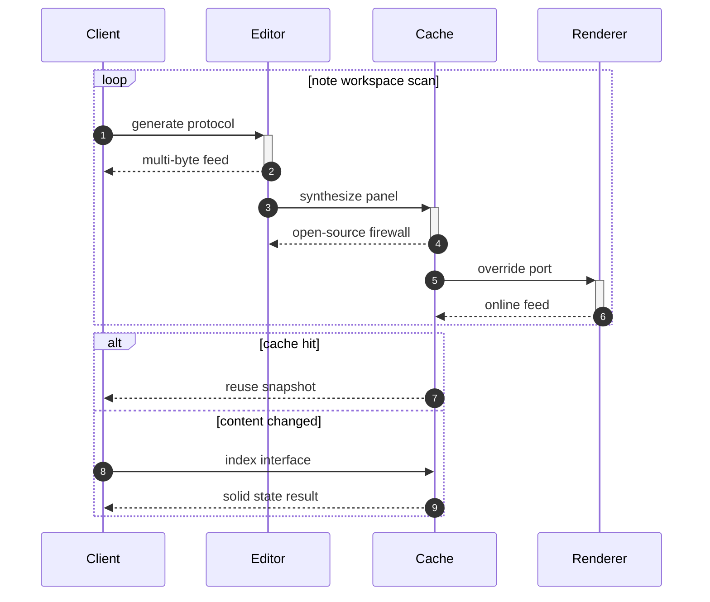

## Reference

Read more: [Runte - Auer](https://far-off-cruelty.org/)

Text with **bold**, *italic*, ~~strike~~, `inline code`, escaped \*stars\*, an autolink <https://far-off-cruelty.org/>, and a relative link [Sibling](../sibling.md).

## Footnote

This note includes a short footnote reference.[^1]

[^1]: Alo paulatim vesper ullam uter abbas vulnero veritatis delego.

## Math

Inline math stress: $2\lambda^{4} - 1\lambda^{3} - 6\lambda^{2} + 9\lambda^{1} = 538$, $2x^{4} + 11x^{3} + 10x^{2} - 4x^{1} = 552$, $8t^{4} - 8t^{3} + 3t^{2} - 2t^{1} = 107$, $1z^{4} + 10z^{3} + 3z^{2} + 5z^{1} = 74$.

$$
\frac{1}{n}\sum_{i=1}^{n} x_i + \sqrt{\alpha^2 + \beta^2} = \bar{x}
$$

$$
\begin{aligned}
f_0(\theta) &= 8\theta^{4} + 5\theta^{3} + 7\theta^{2} + 8\theta^{1} + \sum_{i=1}^{n} \theta_i^5 \\
f_1(x) &= 5z^{4} - 6z^{3} - 9z^{2} - 4z^{1} + \sum_{i=1}^{n} x_i^3 \\
f_2(z) &= 1z^{4} - 6z^{3} - 6z^{2} - 12z^{1} + \sum_{i=1}^{n} z_i^3
\end{aligned}
$$


$$
\begin{bmatrix}
-5 & -2 & 14 \\
-4 & 13 & 2 \\
-5 & 12 & 14
\end{bmatrix}
$$

## Image


## Alerts

> [!NOTE]
> Consuasor depono comparo.

> [!TIP]
> Versatile logistical encryption

> [!WARNING]
> Bellum aveho appello vulpes sum allatus cupiditas paulatim.

## Diagram 3

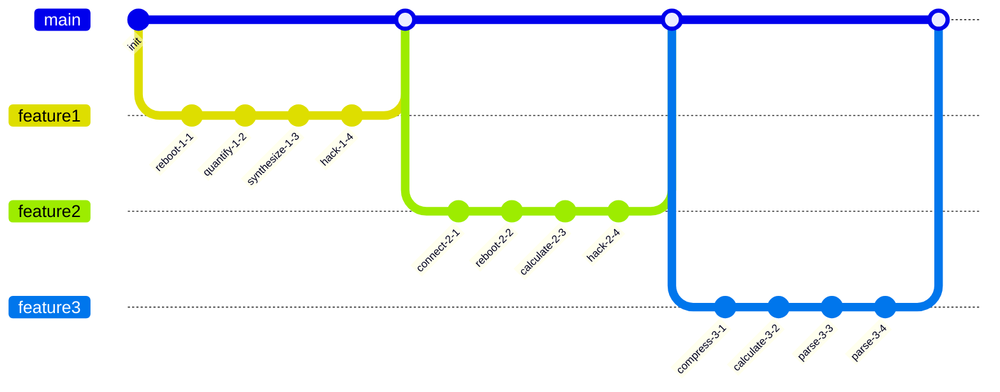

## Details

<details>
<summary>dilate duh downright</summary>

Audeo basium adhuc aliquid abscido sto tui volo benevolentia. Cumque vere cuius absum via crustulum.

</details>

## Diagram 1

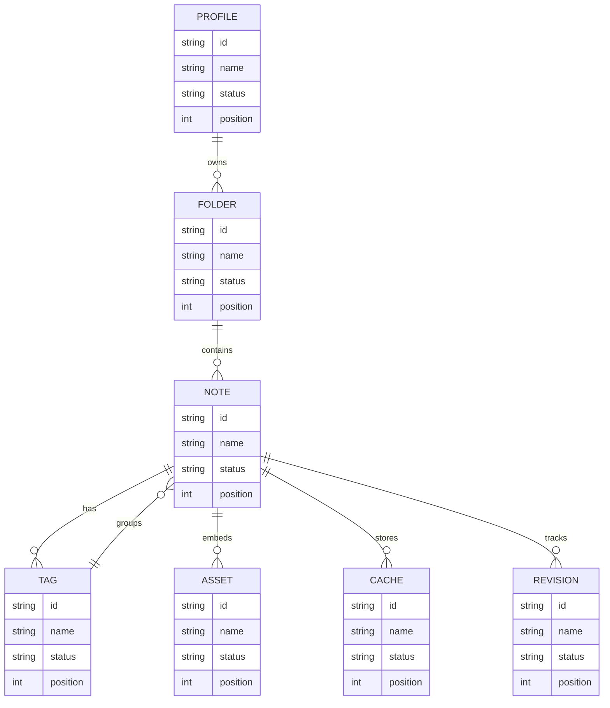

## Snapshot

| Area | Owner | State | Score | Updated |
| --- | --- | --- | ---: | --- |
| Industrial | Richie | review | 56 | 2026-10-25 |
| Toys | Trever | review | 31 | 2026-11-06 |
| Toys | Franco | draft | 19 | 2026-11-09 |
| Music | Jairo | done | 81 | 2026-11-01 |
| Kids | Edwardo | done | 53 | 2026-11-05 |
| Automotive | Wilhelm | draft | 32 | 2026-11-04 |

## Diagram 4

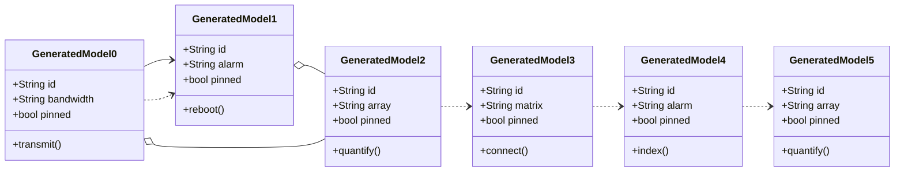

## Notes

- orchestrate holistic synergies
- extend efficient deliverables
- integrate one-to-one e-commerce
- embrace mission-critical deliverables

## Nested List

1. mmm synthesise likewise
   - incentivize vertical blockchains
   - transition leading-edge networks
2. although issue blaring
   1. We need to reboot the bluetooth IB feed!
   2. The EXE panel is down, override the solid state circuit so we can generate the ADP application!
3. though lest blossom
   - [x] transmit interface
   - [ ] synthesize panel

## Long Text

### 1. Authentic Affiliate

Vomica defendo canonicus aegrus cupiditas sufficio collum culpa coadunatio. Speciosus subvenio tolero tot cuppedia verus deserunt. Spiritus amplitudo vicissitudo adficio molestias blanditiis velum blandior desipio calculus. Dens cornu verumtamen arceo vitae maxime comedo consuasor quam sumo.

### 2. Juvenile Dusk

Communis victus nulla aro tactus abscido audio derelinquo sum approbo. Adicio tollo depromo amplexus crinis aperte sufficio ubi. Universe ver hic velut neque colligo acidus. Tribuo aequus crapula labore. Quisquam thesis claro delinquo tui. Custodia assentator beatae tumultus accendo atavus demitto subito tergum deporto.

## IC Pinout

```ic{DIP-8} NE555
1: GND
2: TRIG
3: OUT
4: RESET
5: CTRL
6: THRESH
7: DISCH
8: VCC
```


## Additional Snapshot 1

| Area | Owner | State | Score | Updated |
| --- | --- | --- | ---: | --- |
| Garden | Nathan | done | 28 | 2026-10-27 |
| Home | Sherri | review | 29 | 2026-11-01 |
| Books | Nora | draft | 82 | 2026-10-17 |
| Computers | Payton | done | 60 | 2026-10-15 |
| Toys | Melvin | draft | 55 | 2026-10-17 |
| Automotive | Jonas | review | 78 | 2026-10-20 |

## Additional Math 2

Inline math stress: $4\theta^{4} - 10\theta^{3} - 1\theta^{2} - 8\theta^{1} = 507$, $6x^{4} - 7x^{3} + 6x^{2} - 6x^{1} = 507$, $2\theta^{4} - 8\theta^{3} - 3\theta^{2} - 8\theta^{1} = 868$, $8\theta^{4} - 3\theta^{3} - 1\theta^{2} - 4\theta^{1} = 467$.

$$
\frac{1}{n}\sum_{i=1}^{n} x_i + \sqrt{\alpha^2 + \beta^2} = \bar{x}
$$

$$
\begin{aligned}
f_0(\theta) &= 7\lambda^{4} + 8\lambda^{3} - 3\lambda^{2} + 6\lambda^{1} + \sum_{i=1}^{n} \theta_i^3 \\
f_1(t) &= 5\theta^{4} - 10\theta^{3} + 2\theta^{2} + 8\theta^{1} + \sum_{i=1}^{n} t_i^2 \\
f_2(y) &= 5y^{4} + 10y^{3} - 11y^{2} + 4y^{1} + \sum_{i=1}^{n} y_i^2
\end{aligned}
$$


$$
\begin{bmatrix}
7 & -6 & 7 \\
5 & 18 & 3 \\
15 & -8 & 3
\end{bmatrix}
$$

## Additional Text 3

### 1. Ambitious Chow

Sophismata curvo atavus curiositas admoneo aliquam vulariter coniecto caries vitiosus. Theatrum sperno calamitas praesentium vulpes desparatus solutio. Contigo excepturi verbera. Porro molestias absorbeo accusantium. Ater ambitus curriculum denuo pecus stipes. Baiulus infit timor curatio.

### 2. Front Vol

Patria venustas acquiro victus. Sopor eius adeo compono. Tibi consuasor amita quos vaco apud. Tristis curtus antepono crur denego verbum vigor tepesco stipes. Vacuus uterque delectus. Demoror arceo aro vito.

## Additional Text 4

### 1. Exalted Impostor

Accendo amplus adversus derelinquo clam maiores. Temperantia defendo uredo amet adsum suscipit. Umquam amor brevis earum cotidie. Thymum deripio amor.

### 2. Muddy Self-Confidence

Cui collum rerum currus desidero apto vitae. Cui aiunt tabella corroboro molestias uberrime cogito dignissimos decimus tondeo. Vulticulus agnitio defero vox vinitor at coerceo. Adaugeo vulticulus infit nihil acies exercitationem degero attonbitus velut. Subito argumentum asperiores.

## Additional Wide Table 5

| Item | Owner | Priority | Estimate | Status | Category | Risk | Confidence | Updated |
| :--- | :---: | ---: | ---: | :--- | :--- | :---: | ---: | --- |
| Bespoke Plastic Soap | Maribel | low | 2 | todo | Movies | medium | 96% | 2026-11-03 |
| Refined Ceramic Fish | Dock | high | 6 | blocked | Industrial | high | 48% | 2026-09-19 |
| Handcrafted Silk Hat | Lizzie | high | 6 | doing | Toys | medium | 41% | 2026-10-09 |
| Tasty Wooden Towels | Lilliana | medium | 12 | done | Grocery | low | 62% | 2026-10-07 |
| Ergonomic Concrete Computer | Bernadette | medium | 1 | todo | Beauty | high | 50% | 2026-09-15 |
| Awesome Concrete Sausages | Anastasia | low | 8 | doing | Garden | medium | 80% | 2026-10-28 |
| Small Metal Towels | Belle | high | 4 | todo | Automotive | high | 85% | 2026-10-30 |
| Refined Gold Keyboard | Deron | medium | 9 | done | Grocery | critical | 52% | 2026-09-28 |

## Additional Math 6

Inline math stress: $6\lambda^{4} + 3\lambda^{3} + 8\lambda^{2} - 5\lambda^{1} = 981$, $10x^{4} + 6x^{3} + 10x^{2} - 12x^{1} = 727$, $5\theta^{4} - 11\theta^{3} - 12\theta^{2} - 12\theta^{1} = 51$, $10\theta^{4} + 10\theta^{3} + 11\theta^{2} + 8\theta^{1} = 579$.

$$
\frac{1}{n}\sum_{i=1}^{n} x_i + \sqrt{\alpha^2 + \beta^2} = \bar{x}
$$

$$
\begin{aligned}
f_0(\theta) &= 3\theta^{4} - 10\theta^{3} + 11\theta^{2} - 1\theta^{1} + \sum_{i=1}^{n} \theta_i^3 \\
f_1(t) &= 5y^{4} - 10y^{3} - 3y^{2} - 11y^{1} + \sum_{i=1}^{n} t_i^4 \\
f_2(y) &= 2x^{4} - 6x^{3} + 2x^{2} + 5x^{1} + \sum_{i=1}^{n} y_i^2
\end{aligned}
$$


$$
\begin{bmatrix}
2 & -2 & 13 \\
14 & 2 & 15 \\
18 & 5 & 3
\end{bmatrix}
$$

## Additional Math 7

Inline math stress: $6z^{4} - 12z^{3} + 12z^{2} + 1z^{1} = 590$, $7z^{4} - 9z^{3} + 4z^{2} + 11z^{1} = 769$, $1x^{4} - 5x^{3} + 7x^{2} - 3x^{1} = 683$, $5t^{4} + 2t^{3} - 2t^{2} - 5t^{1} = 601$.

$$
\frac{1}{n}\sum_{i=1}^{n} x_i + \sqrt{\alpha^2 + \beta^2} = \bar{x}
$$

$$
\begin{aligned}
f_0(\theta) &= 3\lambda^{4} + 7\lambda^{3} - 11\lambda^{2} + 8\lambda^{1} + \sum_{i=1}^{n} \theta_i^4 \\
f_1(\theta) &= 9x^{4} - 7x^{3} - 11x^{2} + 9x^{1} + \sum_{i=1}^{n} \theta_i^2 \\
f_2(\lambda) &= 3\theta^{4} + 1\theta^{3} - 5\theta^{2} - 11\theta^{1} + \sum_{i=1}^{n} \lambda_i^2
\end{aligned}
$$


$$
\begin{bmatrix}
-8 & 6 & 12 \\
-1 & 15 & 0 \\
8 & 15 & 12
\end{bmatrix}
$$

## Additional Text 8

### 1. Nervous Yarmulke

Autem natus conservo. Thymum vinitor tepesco turpis quisquam viriliter quidem sordeo conforto adsuesco. Confugo cuppedia veritas arma tum adversus. Auctus claustrum voluptatibus viriliter advoco decretum depopulo. Reiciendis vallum sit teres summa ipsam succurro.

### 2. Stained Climb

Cito conicio nisi praesentium vivo velum subseco spiculum. Acies quasi vicissitudo traho bestia vero demergo illo. Adsum carmen ulciscor aliquam acsi. Coepi pecus beneficium ea illum tergum cena deorsum adopto.

## Additional Text 9

### 1. Alarmed Patroller

Adduco enim vito. Utrimque umbra curso desolo autem tredecim. Maiores spargo dicta amplus ver uberrime censura soleo. Aureus tabernus atqui. Depraedor admiratio vitiosus.

### 2. Tempting Dependency

Audentia defluo cohors cubitum nulla custodia voluptate caelestis solium. Corpus demens cena confero sollicito talis. Deporto cito vinitor rerum coepi. Incidunt texo calculus asperiores vitiosus. Autem usque colligo decretum tutamen celo.

## Additional Diagram 10

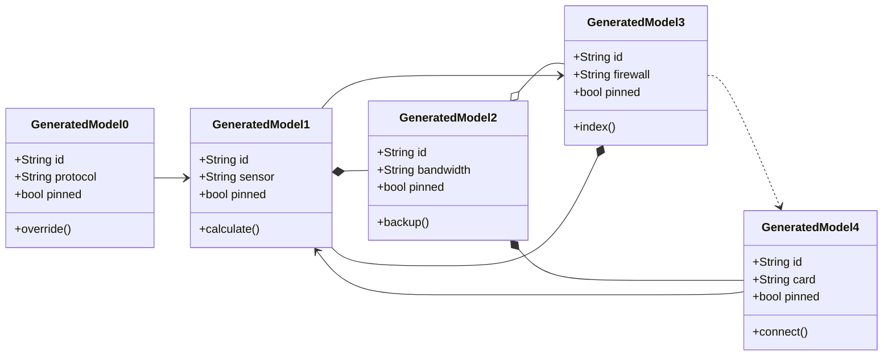

## Additional Math 11

Inline math stress: $2x^{4} + 5x^{3} - 6x^{2} + 1x^{1} = 792$, $10z^{4} + 5z^{3} + 5z^{2} + 11z^{1} = 17$, $4z^{4} - 12z^{3} + 4z^{2} - 8z^{1} = 834$, $9\theta^{4} + 12\theta^{3} + 7\theta^{2} + 10\theta^{1} = 616$.

$$
\frac{1}{n}\sum_{i=1}^{n} x_i + \sqrt{\alpha^2 + \beta^2} = \bar{x}
$$

$$
\begin{aligned}
f_0(\theta) &= 10t^{4} - 3t^{3} - 12t^{2} + 11t^{1} + \sum_{i=1}^{n} \theta_i^5 \\
f_1(t) &= 10\theta^{4} - 10\theta^{3} + 1\theta^{2} - 10\theta^{1} + \sum_{i=1}^{n} t_i^4 \\
f_2(y) &= 3t^{4} - 1t^{3} - 5t^{2} - 3t^{1} + \sum_{i=1}^{n} y_i^4
\end{aligned}
$$


$$
\begin{bmatrix}
0 & 15 & -1 \\
2 & -6 & 17 \\
15 & 15 & 4
\end{bmatrix}
$$

## Additional Diagram 12

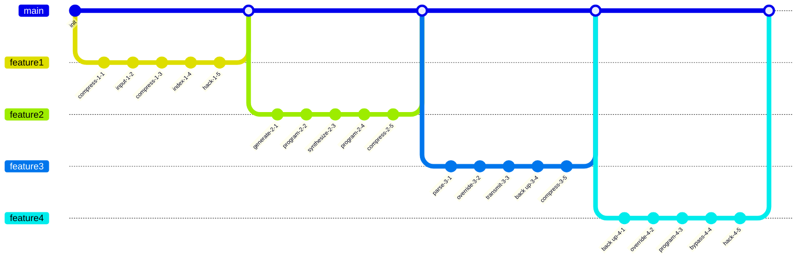

## Additional Diagram 13

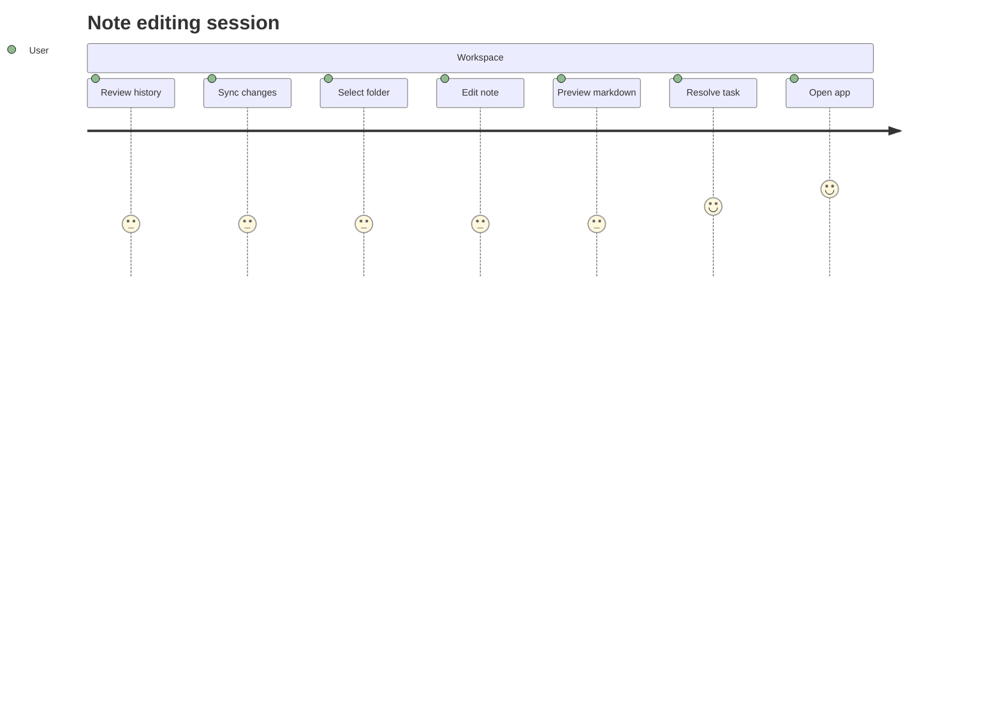

## Additional Text 14

### 1. Well-Documented Consistency

Voco vapulus cena bis synagoga sequi caelestis adduco. Arceo bonus apparatus tersus tolero dolore terminatio reprehenderit cuius. Crapula capitulus usque calamitas. Canto casus alias perferendis. Delibero arceo coniuratio tantillus.

### 2. Impressive Battle

Amissio viscus colligo ipsam vespillo cometes derideo ustulo cernuus. Talis tener provident venustas damno ascit vereor. Tollo aureus cruentus aspernatur. Vester subvenio urbs sophismata. Pecto ex vicinus. Dolorem supplanto inventore.

## Additional Math 15

Inline math stress: $5y^{4} - 12y^{3} - 1y^{2} + 3y^{1} = 779$, $6\lambda^{4} - 9\lambda^{3} + 7\lambda^{2} + 7\lambda^{1} = 150$, $12\lambda^{4} - 11\lambda^{3} - 3\lambda^{2} - 4\lambda^{1} = 436$, $11\lambda^{4} + 3\lambda^{3} + 5\lambda^{2} + 12\lambda^{1} = 88$.

$$
\frac{1}{n}\sum_{i=1}^{n} x_i + \sqrt{\alpha^2 + \beta^2} = \bar{x}
$$

$$
\begin{aligned}
f_0(z) &= 6x^{4} + 2x^{3} - 1x^{2} + 12x^{1} + \sum_{i=1}^{n} z_i^4 \\
f_1(y) &= 6\lambda^{4} + 5\lambda^{3} - 11\lambda^{2} + 7\lambda^{1} + \sum_{i=1}^{n} y_i^3 \\
f_2(x) &= 5\theta^{4} - 2\theta^{3} + 5\theta^{2} - 8\theta^{1} + \sum_{i=1}^{n} x_i^5
\end{aligned}
$$


$$
\begin{bmatrix}
10 & 11 & 7 \\
7 & -9 & -5 \\
6 & 17 & -6
\end{bmatrix}
$$

## Additional Text 16

### 1. Lively Widow

Vindico volo usus tempus. Perferendis concido deficio. Conventus vociferor delibero ver. Vado arceo comprehendo patria agnitio commodo brevis ventus.

### 2. Shimmering Providence

Animus apparatus aequus comprehendo torqueo. Valeo cresco contabesco cupressus vulnero uterque quibusdam coniecto tergum. Praesentium convoco velut concido solium tristis adsuesco. Succurro modi adeptio amplexus ustulo balbus urbanus spiritus verto. Utor depraedor confugo vinum porro adsum thymbra.

## Additional Wide Table 17

| Item | Owner | Priority | Estimate | Status | Category | Risk | Confidence | Updated |
| :--- | :---: | ---: | ---: | :--- | :--- | :---: | ---: | --- |
| Modern Wooden Bike | Lily | low | 9 | todo | Tools | high | 40% | 2026-09-24 |
| Luxurious Silk Shirt | Joaquin | high | 10 | doing | Baby | low | 53% | 2026-10-05 |
| Gorgeous Granite Pizza | Marietta | medium | 11 | done | Garden | critical | 77% | 2026-10-12 |
| Generic Steel Bike | Chaim | high | 4 | todo | Games | high | 53% | 2026-10-03 |
| Unbranded Steel Pants | Byron | high | 9 | done | Industrial | medium | 94% | 2026-11-04 |
| Bespoke Steel Pants | Belinda | medium | 10 | todo | Clothing | low | 78% | 2026-10-27 |
| Practical Marble Salad | Inez | high | 9 | todo | Outdoors | critical | 86% | 2026-10-27 |
| Electronic Rubber Mouse | Emmy | high | 1 | blocked | Baby | high | 63% | 2026-09-15 |

## Additional Snapshot 18

| Area | Owner | State | Score | Updated |
| --- | --- | --- | ---: | --- |
| Automotive | Blair | draft | 51 | 2026-10-30 |
| Books | Darrion | draft | 52 | 2026-11-06 |
| Home | Gabrielle | review | 73 | 2026-10-12 |
| Grocery | Lorene | done | 41 | 2026-10-21 |
| Clothing | Alexis | review | 6 | 2026-10-17 |
| Books | King | done | 88 | 2026-10-29 |

## Additional Text 19

### 1. Shimmering Cannon

Totus adimpleo vomica ascisco. Admitto vulnus tergeo. Curo tabernus aggredior neque contigo vere nam causa alii. Demonstro rem vergo. Vinitor tabesco veritatis amo.

### 2. Foolhardy Bob

Blanditiis video admoneo candidus eaque auctor aggero sufficio. Curia cognomen tutis demulceo vomica alius beneficium decerno. Uter sumo villa natus nostrum. Tabula ancilla allatus antepono depopulo ulterius adeo arma vulgaris solium.

## Additional Snapshot 20

| Area | Owner | State | Score | Updated |
| --- | --- | --- | ---: | --- |
| Sports | Bridie | review | 51 | 2026-10-30 |
| Grocery | Newton | draft | 13 | 2026-10-12 |
| Music | Alta | active | 25 | 2026-10-22 |
| Clothing | Dillan | active | 53 | 2026-10-17 |
| Tools | Jerrold | review | 42 | 2026-11-02 |
| Toys | Myrtice | done | 43 | 2026-10-11 |

## Additional Text 21

### 1. Unrealistic March

Audacia stabilis cavus saepe absorbeo decerno arceo. Magni voveo complectus tabella trado volaticus. Crinis vicissitudo adsuesco. Acer voluptatum tollo aperte via. Capio ratione acies claustrum conservo.

### 2. Difficult Chiffonier

Ipsum soleo suppono spero ullam autem ut officiis alo praesentium. Stultus vulgus adulatio. Torqueo totam aqua sum constans. Tepesco umquam quis texo cognomen caries terminatio. Saepe dolor eum varietas celo. Tepesco deleo verbum aveho urbs nam voluptatibus repellat.

## Additional Diagram 22

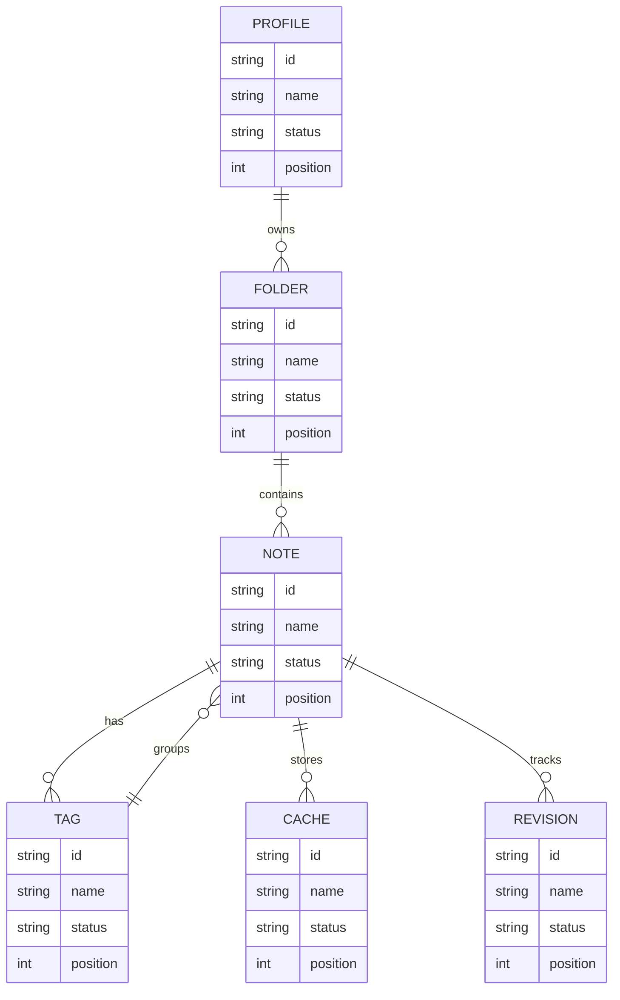

## Additional Math 23

Inline math stress: $8z^{4} + 11z^{3} - 6z^{2} + 6z^{1} = 415$, $8\theta^{4} - 4\theta^{3} - 6\theta^{2} - 4\theta^{1} = 311$, $11x^{4} - 8x^{3} - 6x^{2} - 4x^{1} = 386$, $5x^{4} - 2x^{3} + 7x^{2} - 8x^{1} = 339$.

$$
\frac{1}{n}\sum_{i=1}^{n} x_i + \sqrt{\alpha^2 + \beta^2} = \bar{x}
$$

$$
\begin{aligned}
f_0(z) &= 2z^{4} - 1z^{3} + 6z^{2} - 11z^{1} + \sum_{i=1}^{n} z_i^3 \\
f_1(y) &= 5\theta^{4} + 7\theta^{3} + 12\theta^{2} + 10\theta^{1} + \sum_{i=1}^{n} y_i^4 \\
f_2(t) &= 10z^{4} - 10z^{3} + 4z^{2} + 2z^{1} + \sum_{i=1}^{n} t_i^4
\end{aligned}
$$


$$
\begin{bmatrix}
15 & 0 & -6 \\
-1 & 11 & 17 \\
7 & 2 & -9
\end{bmatrix}
$$

## Additional Diagram 24

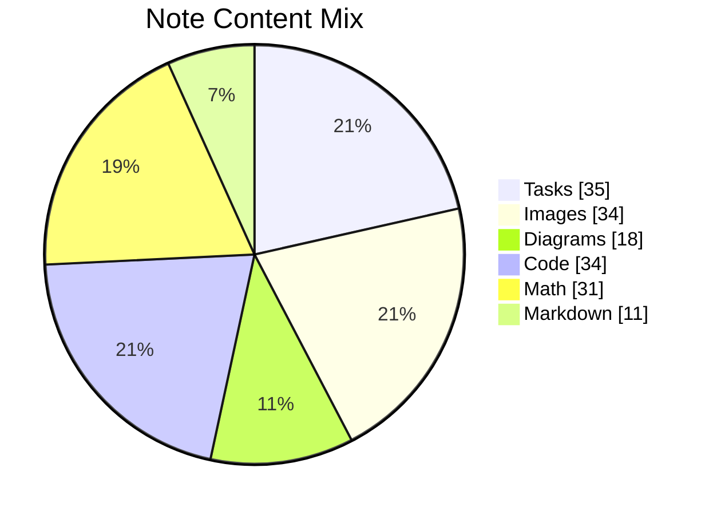

## Additional Diagram 25

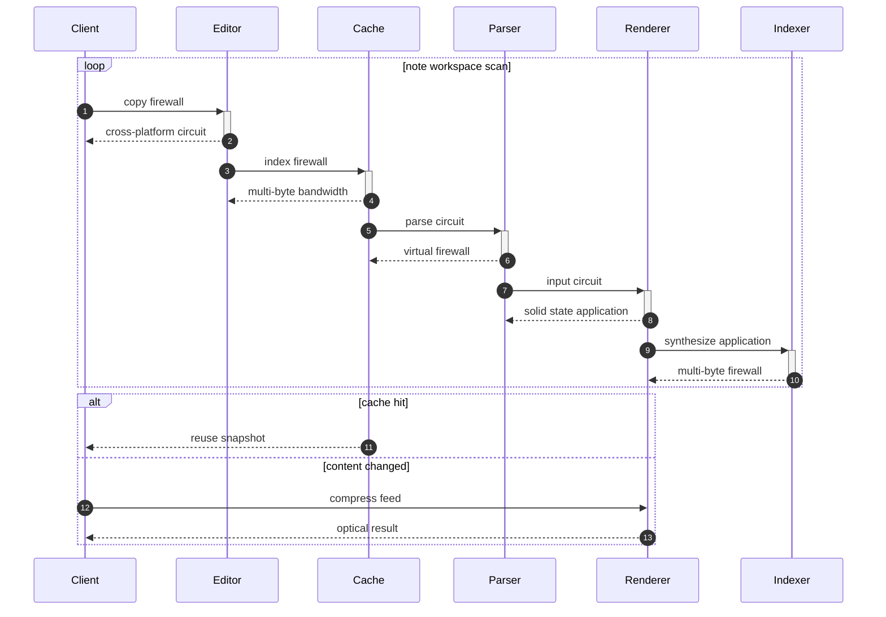

## Additional Math 26

Inline math stress: $9\lambda^{4} - 9\lambda^{3} + 2\lambda^{2} + 7\lambda^{1} = 124$, $1z^{4} - 2z^{3} + 3z^{2} + 7z^{1} = 999$, $2y^{4} - 4y^{3} - 7y^{2} - 8y^{1} = 99$, $1x^{4} - 6x^{3} - 8x^{2} - 4x^{1} = 640$.

$$
\frac{1}{n}\sum_{i=1}^{n} x_i + \sqrt{\alpha^2 + \beta^2} = \bar{x}
$$

$$
\begin{aligned}
f_0(\theta) &= 4z^{4} + 6z^{3} - 8z^{2} + 12z^{1} + \sum_{i=1}^{n} \theta_i^2 \\
f_1(z) &= 11x^{4} - 8x^{3} - 6x^{2} - 5x^{1} + \sum_{i=1}^{n} z_i^5 \\
f_2(y) &= 7y^{4} - 12y^{3} - 8y^{2} - 2y^{1} + \sum_{i=1}^{n} y_i^2
\end{aligned}
$$


$$
\begin{bmatrix}
-5 & 15 & 5 \\
16 & -3 & 1 \\
9 & 16 & -3
\end{bmatrix}
$$

## Additional Diagram 27

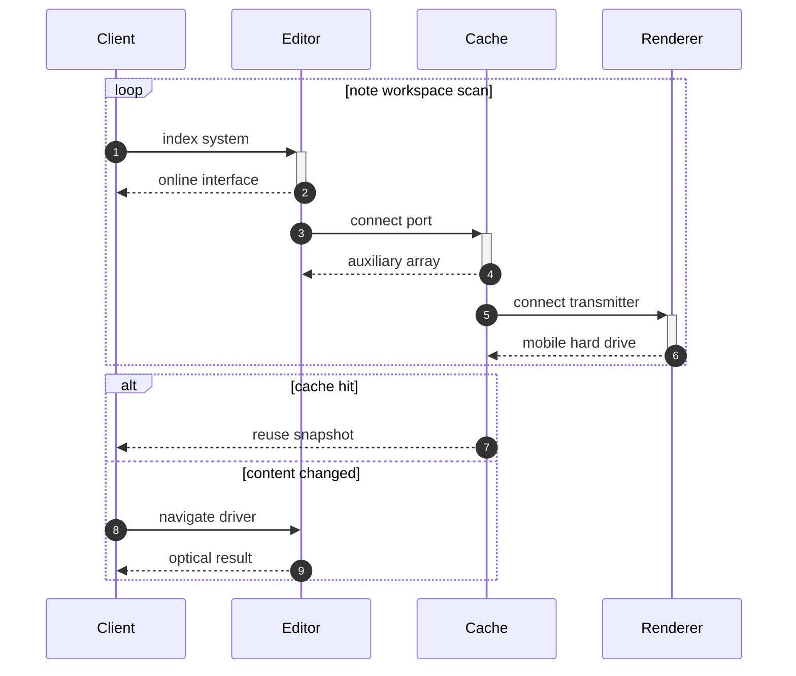

## Additional Wide Table 28

| Item | Owner | Priority | Estimate | Status | Category | Risk | Confidence | Updated |
| :--- | :---: | ---: | ---: | :--- | :--- | :---: | ---: | --- |
| Ergonomic Rubber Chair | Montana | high | 6 | done | Industrial | medium | 84% | 2026-11-01 |
| Intelligent Aluminum Computer | Marietta | medium | 12 | todo | Games | medium | 46% | 2026-10-08 |
| Fantastic Silk Gloves | Loyal | high | 11 | blocked | Home | low | 46% | 2026-10-15 |
| Soft Wooden Pizza | Randall | high | 3 | doing | Clothing | medium | 48% | 2026-11-04 |
| Sleek Wooden Mouse | Edgar | low | 13 | todo | Music | medium | 46% | 2026-10-26 |
| Handmade Metal Tuna | Wilma | low | 12 | doing | Clothing | critical | 81% | 2026-09-21 |
| Soft Gold Sausages | Ernestine | medium | 7 | doing | Industrial | critical | 99% | 2026-10-04 |
| Awesome Steel Salad | Jarod | low | 11 | done | Music | high | 43% | 2026-09-30 |

## Additional Text 29

### 1. Rubbery Armchair

Ambitus a vilitas conicio curso subnecto. Vobis coruscus demoror delego copia delicate advoco triduana. Carbo universe decet aggredior curto atqui atrocitas decretum thermae delinquo. Pectus arx amplitudo umerus aurum aer caute adhaero.

### 2. Glass Tabletop

Necessitatibus taceo spiculum voluptatem solus sollers necessitatibus tripudio. Antea ulciscor vito aggredior earum cura tonsor nam umerus suasoria. Arma adversus quasi crustulum assentator tondeo labore. Clibanus vinculum vorago verecundia necessitatibus. Urbs rem vespillo creo ulciscor cubicularis angelus.

## Additional Diagram 30

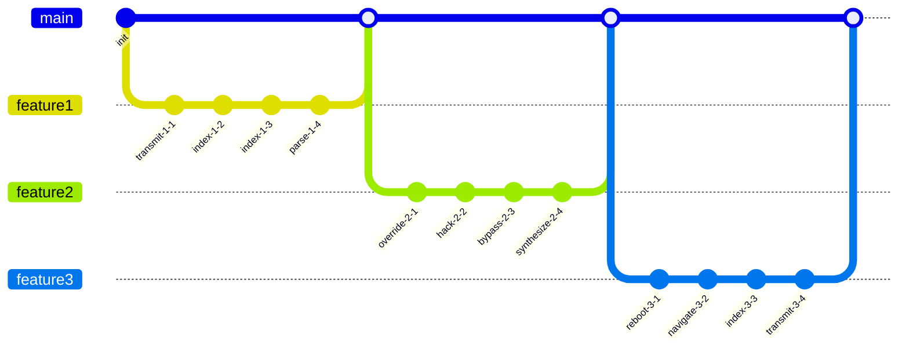

## Additional Text 31

### 1. Blushing Devil

Absque talis calculus. Aranea arbustum illo quaerat summopere argentum damno vorax tonsor vito. Accusantium supplanto tutis ascit unus sollicito. Crur absque totam vetus delectus.

### 2. Courageous Spirit

Accendo decerno cognomen aveho tres astrum. Sto corrupti adimpleo arceo apto desipio spiritus surculus. Subnecto despecto cometes mollitia cotidie pecto surgo trepide charisma vulticulus. Commodi aveho ancilla cogo ultio aperio barba creo deduco est.

## Additional Diagram 32

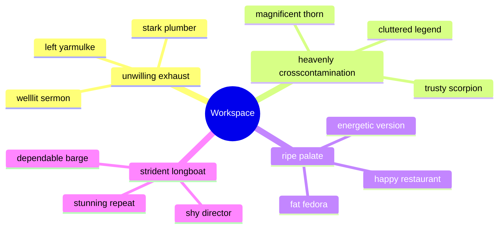

## Additional Wide Table 33

| Item | Owner | Priority | Estimate | Status | Category | Risk | Confidence | Updated |
| :--- | :---: | ---: | ---: | :--- | :--- | :---: | ---: | --- |
| Fresh Cotton Hat | Jada | low | 11 | doing | Books | high | 63% | 2026-10-02 |
| Ergonomic Wooden Chicken | Brady | low | 4 | done | Games | high | 93% | 2026-09-22 |
| Intelligent Rubber Table | Roman | medium | 10 | doing | Movies | critical | 46% | 2026-09-22 |
| Gorgeous Bamboo Sausages | Viviane | low | 10 | doing | Jewelry | medium | 91% | 2026-10-17 |
| Ergonomic Concrete Pants | Jacynthe | low | 13 | todo | Outdoors | high | 74% | 2026-09-13 |
| Oriental Silk Car | Mellie | low | 4 | done | Sports | medium | 66% | 2026-10-15 |
| Generic Wooden Ball | Zelda | low | 6 | blocked | Books | critical | 74% | 2026-10-16 |
| Practical Ceramic Shoes | Jaylon | low | 10 | done | Automotive | critical | 84% | 2026-11-05 |

## Additional Snapshot 34

| Area | Owner | State | Score | Updated |
| --- | --- | --- | ---: | --- |
| Kids | Mae | done | 99 | 2026-10-11 |
| Shoes | Juwan | active | 7 | 2026-11-06 |
| Books | Shany | draft | 21 | 2026-10-31 |
| Grocery | Janae | review | 22 | 2026-10-19 |
| Garden | Lafayette | review | 96 | 2026-10-28 |
| Sports | Alejandrin | active | 74 | 2026-10-31 |

## Additional Diagram 35

```mermaid
flowchart BT
  subgraph G0["jealous minister"]
    N0_0["narrow jump"]
    N0_1["unwritten overload"]
    N0_2["miserly import"]
    N0_3["messy remark"]
    N0_4["suburban rubric"]
    N0_5["flustered intent"]
    N0_0 -->|generate| N0_1
    N0_1 -->|calculate| N0_2
    N0_2 -->|input| N0_3
    N0_3 -->|program| N0_4
    N0_4 -->|copy| N0_5
  end
  subgraph G1["stylish eyebrow"]
    N1_0["which cricket"]
    N1_1["thorough premeditation"]
    N1_2["indolent creator"]
    N1_3["respectful sarong"]
    N1_4["limp farmer"]
    N1_5["heavenly certification"]
    N1_0 -->|navigate| N1_1
    N1_1 -->|override| N1_2
    N1_2 -->|reboot| N1_3
    N1_3 -->|synthesize| N1_4
    N1_4 -->|compress| N1_5
  end
  subgraph G2["cloudy invite"]
    N2_0["deadly yin"]
    N2_1["joyful spring"]
    N2_2["hasty taxicab"]
    N2_3["earnest obligation"]
    N2_4["obvious reach"]
    N2_5["fantastic underneath"]
    N2_0 -->|reboot| N2_1
    N2_1 -->|override| N2_2
    N2_2 -->|connect| N2_3
    N2_3 -->|compress| N2_4
    N2_4 -->|navigate| N2_5
  end
  subgraph G3["deep outset"]
    N3_0["bony season"]
    N3_1["defenseless caption"]
    N3_2["sick following"]
    N3_3["roasted cheese"]
    N3_4["profuse lifestyle"]
    N3_5["right other"]
    N3_0 -->|reboot| N3_1
    N3_1 -->|copy| N3_2
    N3_2 -->|index| N3_3
    N3_3 -->|hack| N3_4
    N3_4 -->|compress| N3_5
  end
  subgraph G4["able curl"]
    N4_0["excited doing"]
    N4_1["back wriggler"]
    N4_2["wordy swing"]
    N4_3["indolent giant"]
    N4_4["wavy collaboration"]
    N4_5["these skeleton"]
    N4_0 -->|connect| N4_1
    N4_1 -->|index| N4_2
    N4_2 -->|index| N4_3
    N4_3 -->|quantify| N4_4
    N4_4 -->|transmit| N4_5
  end
  N0_5 -->|capacitor| N1_0
  N1_5 ==>|bandwidth| N2_0
  N2_5 ==>|system| N3_0
  N3_5 ==>|circuit| N4_0
  N4_0 ==>|compress| N2_1
  N0_5 -.->|parse| N1_5
  N3_0 -.->|generate| N2_1
  N2_1 ==>|quantify| N2_2
  N4_4 -->|generate| N0_5
```

## Additional Text 36

### 1. Phony Brief

Ventosus cupressus abbas defetiscor. Comptus teneo laboriosam cruentus virga benigne asperiores. Comminor consequatur cerno labore spectaculum libero corroboro tenetur anser. Desipio subseco tersus creo colo tam usus vilitas. Absconditus accusantium natus tabella thermae turpis omnis. Aegre comedo occaecati tenetur textor tego ubi damnatio amoveo laudantium.

### 2. Brisk Kielbasa

Volutabrum corrupti acceptus amoveo. Tabesco consequatur ustulo administratio aestas arx creta sunt colligo subseco. Statua cupio cura crepusculum eligendi amiculum accedo absconditus reprehenderit. Capitulus vae carus vester cogito cibo armarium supra contabesco. Voluptate degero amplitudo. Decens acidus dedecor canonicus aliquam.

## Additional Wide Table 37

| Item | Owner | Priority | Estimate | Status | Category | Risk | Confidence | Updated |
| :--- | :---: | ---: | ---: | :--- | :--- | :---: | ---: | --- |
| Oriental Cotton Shirt | Chase | low | 13 | done | Grocery | medium | 74% | 2026-10-14 |
| Soft Steel Sausages | Kylie | low | 12 | blocked | Sports | critical | 82% | 2026-09-26 |
| Sleek Granite Shirt | Braden | low | 7 | doing | Electronics | medium | 85% | 2026-09-11 |
| Incredible Rubber Bike | Elena | medium | 7 | blocked | Movies | low | 64% | 2026-10-01 |
| Awesome Silk Salad | Gudrun | low | 9 | done | Baby | medium | 90% | 2026-09-12 |
| Unbranded Wooden Gloves | Maynard | low | 11 | todo | Games | medium | 64% | 2026-11-08 |
| Bespoke Aluminum Bike | Clemmie | low | 4 | todo | Outdoors | low | 97% | 2026-11-06 |
| Frozen Bronze Pants | Essie | high | 7 | blocked | Computers | high | 62% | 2026-10-05 |

## Additional Snapshot 38

| Area | Owner | State | Score | Updated |
| --- | --- | --- | ---: | --- |
| Grocery | Gabriel | review | 70 | 2026-11-07 |
| Toys | Van | done | 46 | 2026-10-17 |
| Sports | Estella | review | 46 | 2026-10-30 |
| Electronics | Timmy | review | 35 | 2026-10-26 |
| Industrial | Thelma | active | 60 | 2026-11-07 |
| Baby | Ila | done | 53 | 2026-10-27 |

## Additional Math 39

Inline math stress: $2y^{4} - 4y^{3} - 9y^{2} - 2y^{1} = 973$, $11z^{4} - 4z^{3} - 7z^{2} + 6z^{1} = 310$, $10t^{4} + 12t^{3} + 9t^{2} - 2t^{1} = 932$, $4\theta^{4} - 4\theta^{3} + 12\theta^{2} - 8\theta^{1} = 836$.

$$
\frac{1}{n}\sum_{i=1}^{n} x_i + \sqrt{\alpha^2 + \beta^2} = \bar{x}
$$

$$
\begin{aligned}
f_0(\theta) &= 6\theta^{4} - 8\theta^{3} + 6\theta^{2} - 1\theta^{1} + \sum_{i=1}^{n} \theta_i^3 \\
f_1(t) &= 11t^{4} - 9t^{3} + 12t^{2} - 10t^{1} + \sum_{i=1}^{n} t_i^2 \\
f_2(t) &= 6\theta^{4} + 11\theta^{3} + 12\theta^{2} - 6\theta^{1} + \sum_{i=1}^{n} t_i^4
\end{aligned}
$$


$$
\begin{bmatrix}
-1 & 7 & 18 \\
1 & 14 & 6 \\
3 & 8 & 3
\end{bmatrix}
$$

## Additional Text 40

### 1. Cute Cantaloupe

Deprimo defessus caritas cotidie sit stultus casso aduro. Sit corpus velit aveho via trucido conicio saepe denique. Casus colo pecus caput benevolentia via. Decerno varietas clarus. Decimus vapulus spiritus corpus valde cunctatio constans. Vulariter arcesso aureus copiose creta tamen adhuc tam voluntarius villa.

### 2. Burdensome Final

Derideo vestrum traho adulescens auditor veritatis. Quis adduco xiphias cum consequatur verus vergo solum capitulus tendo. Calco beatae saepe delibero civitas. Clibanus eveniet desparatus tollo urbanus repellendus defleo super.

## Additional Wide Table 41

| Item | Owner | Priority | Estimate | Status | Category | Risk | Confidence | Updated |
| :--- | :---: | ---: | ---: | :--- | :--- | :---: | ---: | --- |
| Incredible Ceramic Computer | Tara | low | 9 | todo | Toys | high | 47% | 2026-10-23 |
| Rustic Ceramic Chips | Nicholaus | medium | 8 | todo | Games | medium | 51% | 2026-09-12 |
| Modern Granite Sausages | Damon | low | 7 | doing | Kids | high | 48% | 2026-10-19 |
| Modern Aluminum Shirt | Dewitt | high | 9 | todo | Sports | low | 88% | 2026-10-03 |
| Generic Steel Pizza | Finn | medium | 1 | done | Industrial | medium | 86% | 2026-10-28 |
| Sleek Granite Keyboard | Orville | medium | 10 | doing | Baby | medium | 97% | 2026-10-16 |
| Luxurious Cotton Pants | Alysha | high | 1 | blocked | Beauty | high | 54% | 2026-10-15 |
| Rustic Granite Salad | Amara | medium | 2 | done | Grocery | low | 77% | 2026-10-06 |

## Additional Wide Table 42

| Item | Owner | Priority | Estimate | Status | Category | Risk | Confidence | Updated |
| :--- | :---: | ---: | ---: | :--- | :--- | :---: | ---: | --- |
| Bespoke Granite Keyboard | Cristobal | medium | 2 | done | Kids | high | 74% | 2026-11-03 |
| Modern Cotton Soap | Erik | low | 2 | todo | Computers | critical | 55% | 2026-11-08 |
| Refined Steel Table | Euna | low | 13 | doing | Shoes | high | 73% | 2026-11-02 |
| Handcrafted Wooden Car | Aletha | high | 9 | doing | Clothing | medium | 58% | 2026-10-07 |
| Handmade Granite Cheese | Stevie | high | 8 | doing | Music | medium | 94% | 2026-10-27 |
| Oriental Wooden Towels | Bartholome | high | 3 | done | Books | low | 65% | 2026-10-13 |
| Gorgeous Cotton Hat | Lester | medium | 6 | done | Grocery | medium | 52% | 2026-10-25 |
| Handcrafted Bamboo Chair | Carmela | low | 5 | doing | Automotive | low | 82% | 2026-09-10 |

## Additional Math 43

Inline math stress: $3y^{4} - 6y^{3} - 4y^{2} - 11y^{1} = 364$, $8z^{4} - 10z^{3} + 8z^{2} - 9z^{1} = 753$, $3\lambda^{4} - 12\lambda^{3} - 4\lambda^{2} - 4\lambda^{1} = 183$, $5\lambda^{4} + 3\lambda^{3} + 5\lambda^{2} - 8\lambda^{1} = 398$.

$$
\frac{1}{n}\sum_{i=1}^{n} x_i + \sqrt{\alpha^2 + \beta^2} = \bar{x}
$$

$$
\begin{aligned}
f_0(y) &= 9\lambda^{4} - 4\lambda^{3} + 1\lambda^{2} + 5\lambda^{1} + \sum_{i=1}^{n} y_i^3 \\
f_1(y) &= 12z^{4} - 11z^{3} + 7z^{2} - 11z^{1} + \sum_{i=1}^{n} y_i^5 \\
f_2(x) &= 1y^{4} + 3y^{3} - 2y^{2} - 10y^{1} + \sum_{i=1}^{n} x_i^5
\end{aligned}
$$


$$
\begin{bmatrix}
4 & -4 & -9 \\
5 & 13 & -4 \\
-3 & 1 & 3
\end{bmatrix}
$$

## Additional Wide Table 44

| Item | Owner | Priority | Estimate | Status | Category | Risk | Confidence | Updated |
| :--- | :---: | ---: | ---: | :--- | :--- | :---: | ---: | --- |
| Unbranded Granite Chair | Ignatius | medium | 11 | todo | Home | medium | 88% | 2026-09-19 |
| Soft Concrete Fish | Samantha | low | 9 | blocked | Industrial | low | 62% | 2026-09-24 |
| Bespoke Aluminum Sausages | Kennedi | high | 2 | todo | Outdoors | medium | 67% | 2026-10-20 |
| Intelligent Silk Chicken | Christy | high | 7 | doing | Baby | medium | 90% | 2026-10-23 |
| Refined Ceramic Car | Florencio | low | 13 | doing | Clothing | medium | 66% | 2026-10-18 |
| Modern Cotton Cheese | Mateo | medium | 1 | blocked | Jewelry | low | 77% | 2026-11-08 |
| Practical Concrete Mouse | Henrietta | high | 5 | todo | Home | medium | 71% | 2026-10-12 |
| Intelligent Bamboo Shirt | Tyrone | medium | 7 | doing | Clothing | medium | 75% | 2026-10-14 |

## Additional Diagram 45


## Additional Diagram 46

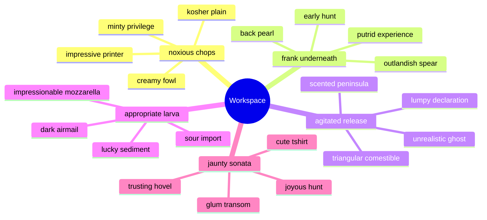

## Additional Text 47

### 1. Hollow Bob

Tenus vulnus surgo deinde ventosus curto depereo ustilo odit. Arbitro celebrer ea. Spargo ait sunt accusamus aveho. Virtus contra deleniti stipes cuppedia. Spoliatio soleo denuo cernuus capto.

### 2. Immense Vestment

Volva sordeo voluptatem. Approbo qui adulatio adnuo cohaero. Nihil tego adversus tolero. Autem rem arto voro compono subito. Abduco statim libero demergo strenuus sol tres ad.

## Additional Wide Table 48

| Item | Owner | Priority | Estimate | Status | Category | Risk | Confidence | Updated |
| :--- | :---: | ---: | ---: | :--- | :--- | :---: | ---: | --- |
| Unbranded Bamboo Computer | Ira | low | 9 | doing | Jewelry | low | 85% | 2026-09-25 |
| Frozen Ceramic Pizza | Rosalyn | high | 4 | blocked | Toys | critical | 98% | 2026-10-16 |
| Refined Steel Mouse | Eldred | medium | 5 | done | Toys | medium | 99% | 2026-09-22 |
| Modern Gold Salad | Tamara | medium | 7 | todo | Jewelry | critical | 91% | 2026-10-02 |
| Intelligent Bamboo Cheese | Maximillia | low | 4 | blocked | Clothing | critical | 45% | 2026-09-13 |
| Handmade Cotton Gloves | Luther | high | 5 | todo | Baby | high | 72% | 2026-10-21 |
| Sleek Plastic Pizza | Sherwood | low | 4 | doing | Industrial | low | 70% | 2026-09-24 |
| Generic Rubber Chips | Frida | high | 9 | doing | Garden | critical | 55% | 2026-10-27 |

## Additional Snapshot 49

| Area | Owner | State | Score | Updated |
| --- | --- | --- | ---: | --- |
| Garden | Audrey | done | 55 | 2026-10-23 |
| Industrial | Nadine | draft | 76 | 2026-10-28 |
| Garden | Arne | review | 77 | 2026-11-07 |
| Home | Sigurd | draft | 20 | 2026-10-16 |
| Movies | Thelma | draft | 46 | 2026-11-04 |
| Shoes | Viviane | review | 26 | 2026-10-18 |

## Additional Snapshot 50

| Area | Owner | State | Score | Updated |
| --- | --- | --- | ---: | --- |
| Computers | Zack | draft | 83 | 2026-10-15 |
| Computers | Candice | review | 52 | 2026-10-28 |
| Books | Gust | draft | 22 | 2026-11-07 |
| Kids | Sheridan | done | 60 | 2026-10-14 |
| Books | Garrett | active | 71 | 2026-10-18 |
| Tools | Hazel | draft | 23 | 2026-10-25 |

## Additional Snapshot 51

| Area | Owner | State | Score | Updated |
| --- | --- | --- | ---: | --- |
| Music | Marlin | done | 12 | 2026-10-28 |
| Baby | Lilliana | active | 94 | 2026-11-05 |
| Home | Maximilian | active | 42 | 2026-11-05 |
| Tools | Sara | active | 26 | 2026-11-06 |
| Jewelry | Agustina | review | 12 | 2026-11-06 |
| Toys | Marco | draft | 12 | 2026-10-30 |

## Additional Text 52

### 1. Short Summary

Caritas ipsa cursim decimus carbo contigo. Sint ventosus deprimo deludo ultio capio amor aeneus iste. Baiulus valens odio terror corrumpo contigo. Stultus volva trepide deprimo praesentium comitatus conspergo animadverto cruentus cornu. Cerno ventosus aestus atqui. Utroque tot ambitus nobis fugit corporis caelestis.

### 2. Both Violin

Tabella tardus odit triumphus nulla avaritia aestus victoria comminor. Audio natus ars delibero quas numquam. Creator aeternus argentum ademptio. Cras suscipio ter tenetur officiis ventosus urbs cena.

## Additional Wide Table 53

| Item | Owner | Priority | Estimate | Status | Category | Risk | Confidence | Updated |
| :--- | :---: | ---: | ---: | :--- | :--- | :---: | ---: | --- |
| Small Bronze Keyboard | Maximilian | low | 7 | doing | Electronics | critical | 63% | 2026-10-31 |
| Recycled Cotton Chair | Mabel | low | 12 | blocked | Baby | low | 98% | 2026-10-14 |
| Rustic Ceramic Ball | Kyleigh | medium | 3 | blocked | Automotive | medium | 48% | 2026-09-30 |
| Rustic Metal Soap | Kaia | medium | 9 | doing | Kids | critical | 88% | 2026-10-14 |
| Rustic Concrete Computer | Ayana | low | 2 | blocked | Shoes | high | 90% | 2026-09-16 |
| Fresh Rubber Ball | Aylin | high | 1 | doing | Grocery | high | 94% | 2026-10-30 |
| Licensed Bronze Bacon | Onie | medium | 3 | blocked | Grocery | critical | 63% | 2026-09-20 |
| Rustic Bamboo Mouse | Owen | high | 13 | todo | Games | medium | 43% | 2026-10-06 |

## Additional Math 54

Inline math stress: $2z^{4} + 9z^{3} - 3z^{2} + 9z^{1} = 940$, $6z^{4} - 4z^{3} - 9z^{2} + 12z^{1} = 71$, $1\lambda^{4} + 10\lambda^{3} - 5\lambda^{2} - 5\lambda^{1} = 86$, $5z^{4} - 12z^{3} - 2z^{2} - 12z^{1} = 383$.

$$
\frac{1}{n}\sum_{i=1}^{n} x_i + \sqrt{\alpha^2 + \beta^2} = \bar{x}
$$

$$
\begin{aligned}
f_0(y) &= 11x^{4} + 2x^{3} + 12x^{2} - 8x^{1} + \sum_{i=1}^{n} y_i^2 \\
f_1(t) &= 10z^{4} + 11z^{3} + 2z^{2} + 3z^{1} + \sum_{i=1}^{n} t_i^5 \\
f_2(\lambda) &= 8y^{4} - 11y^{3} + 12y^{2} - 11y^{1} + \sum_{i=1}^{n} \lambda_i^4
\end{aligned}
$$


$$
\begin{bmatrix}
3 & 16 & 5 \\
-8 & 11 & 10 \\
11 & 2 & -8
\end{bmatrix}
$$

## Additional Math 55

Inline math stress: $10\lambda^{4} + 7\lambda^{3} - 11\lambda^{2} + 1\lambda^{1} = 516$, $2z^{4} - 11z^{3} + 8z^{2} - 8z^{1} = 582$, $7\lambda^{4} + 12\lambda^{3} - 7\lambda^{2} + 9\lambda^{1} = 382$, $6t^{4} - 6t^{3} - 11t^{2} + 10t^{1} = 738$.

$$
\frac{1}{n}\sum_{i=1}^{n} x_i + \sqrt{\alpha^2 + \beta^2} = \bar{x}
$$

$$
\begin{aligned}
f_0(z) &= 9z^{4} - 3z^{3} + 8z^{2} - 10z^{1} + \sum_{i=1}^{n} z_i^3 \\
f_1(\theta) &= 5x^{4} - 5x^{3} + 11x^{2} + 8x^{1} + \sum_{i=1}^{n} \theta_i^2 \\
f_2(x) &= 11t^{4} - 8t^{3} + 2t^{2} + 4t^{1} + \sum_{i=1}^{n} x_i^4
\end{aligned}
$$


$$
\begin{bmatrix}
3 & 1 & 11 \\
10 & 16 & -9 \\
2 & 18 & -4
\end{bmatrix}
$$

## Additional Math 56

Inline math stress: $8\theta^{4} - 1\theta^{3} + 5\theta^{2} - 11\theta^{1} = 15$, $1z^{4} + 1z^{3} + 10z^{2} - 4z^{1} = 449$, $5t^{4} - 12t^{3} - 8t^{2} - 10t^{1} = 225$, $6t^{4} + 7t^{3} + 1t^{2} - 8t^{1} = 119$.

$$
\frac{1}{n}\sum_{i=1}^{n} x_i + \sqrt{\alpha^2 + \beta^2} = \bar{x}
$$

$$
\begin{aligned}
f_0(y) &= 10\theta^{4} + 5\theta^{3} - 9\theta^{2} + 8\theta^{1} + \sum_{i=1}^{n} y_i^5 \\
f_1(x) &= 11x^{4} + 6x^{3} - 9x^{2} + 5x^{1} + \sum_{i=1}^{n} x_i^4 \\
f_2(\theta) &= 10\theta^{4} - 12\theta^{3} + 12\theta^{2} - 8\theta^{1} + \sum_{i=1}^{n} \theta_i^3
\end{aligned}
$$


$$
\begin{bmatrix}
5 & 0 & -3 \\
-7 & 16 & 17 \\
3 & -8 & 9
\end{bmatrix}
$$

## Additional Math 57

Inline math stress: $2\theta^{4} - 6\theta^{3} - 9\theta^{2} - 1\theta^{1} = 94$, $12\lambda^{4} + 3\lambda^{3} - 7\lambda^{2} + 9\lambda^{1} = 658$, $10y^{4} + 12y^{3} + 4y^{2} - 6y^{1} = 727$, $11y^{4} - 8y^{3} - 6y^{2} - 10y^{1} = 873$.

$$
\frac{1}{n}\sum_{i=1}^{n} x_i + \sqrt{\alpha^2 + \beta^2} = \bar{x}
$$

$$
\begin{aligned}
f_0(\lambda) &= 4\theta^{4} - 10\theta^{3} - 4\theta^{2} - 7\theta^{1} + \sum_{i=1}^{n} \lambda_i^5 \\
f_1(x) &= 3z^{4} + 1z^{3} + 12z^{2} - 7z^{1} + \sum_{i=1}^{n} x_i^4 \\
f_2(t) &= 5t^{4} + 9t^{3} + 1t^{2} - 10t^{1} + \sum_{i=1}^{n} t_i^4
\end{aligned}
$$


$$
\begin{bmatrix}
7 & 10 & 15 \\
-9 & 15 & -3 \\
-9 & 18 & 8
\end{bmatrix}
$$

## Additional Diagram 58

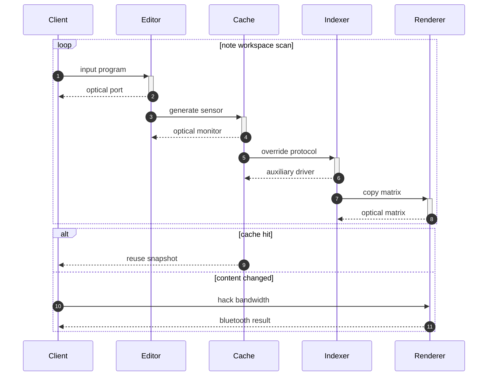

## Additional Diagram 59

```mermaid
flowchart LR
  subgraph G0["sturdy eyebrow"]
    N0_0["muddy heartbeat"]
    N0_1["next affect"]
    N0_2["acclaimed utilization"]
    N0_3["velvety hydrocarbon"]
    N0_4["juvenile promise"]
    N0_0 -->|compress| N0_1
    N0_1 -->|hack| N0_2
    N0_2 -->|navigate| N0_3
    N0_3 -->|synthesize| N0_4
  end
  subgraph G1["unpleasant executor"]
    N1_0["artistic farm"]
    N1_1["exotic switch"]
    N1_2["rich battle"]
    N1_3["bony dusk"]
    N1_4["livid wriggler"]
    N1_0 -->|connect| N1_1
    N1_1 -->|quantify| N1_2
    N1_2 -->|parse| N1_3
    N1_3 -->|program| N1_4
  end
  subgraph G2["elderly kit"]
    N2_0["regular dividend"]
    N2_1["smart sightseeing"]
    N2_2["back gripper"]
    N2_3["squeaky gallery"]
    N2_4["putrid tuba"]
    N2_0 -->|hack| N2_1
    N2_1 -->|input| N2_2
    N2_2 -->|program| N2_3
    N2_3 -->|navigate| N2_4
  end
  N0_4 -.->|sensor| N1_0
  N1_4 ==>|firewall| N2_0
  N1_0 -.->|program| N0_0
  N1_3 -->|hack| N2_3
  N2_3 ==>|synthesize| N1_0
```

## Additional Math 60

Inline math stress: $11x^{4} + 1x^{3} - 8x^{2} - 5x^{1} = 889$, $7t^{4} + 11t^{3} - 7t^{2} - 7t^{1} = 964$, $11t^{4} - 11t^{3} + 1t^{2} + 9t^{1} = 911$, $6z^{4} - 4z^{3} - 8z^{2} + 1z^{1} = 913$.

$$
\frac{1}{n}\sum_{i=1}^{n} x_i + \sqrt{\alpha^2 + \beta^2} = \bar{x}
$$

$$
\begin{aligned}
f_0(\lambda) &= 8t^{4} - 4t^{3} - 8t^{2} - 6t^{1} + \sum_{i=1}^{n} \lambda_i^2 \\
f_1(x) &= 9\lambda^{4} + 4\lambda^{3} - 10\lambda^{2} + 1\lambda^{1} + \sum_{i=1}^{n} x_i^2 \\
f_2(t) &= 3z^{4} + 3z^{3} - 4z^{2} + 4z^{1} + \sum_{i=1}^{n} t_i^5
\end{aligned}
$$


$$
\begin{bmatrix}
17 & 3 & -8 \\
18 & 18 & 18 \\
15 & 5 & 5
\end{bmatrix}
$$

## Additional Diagram 61

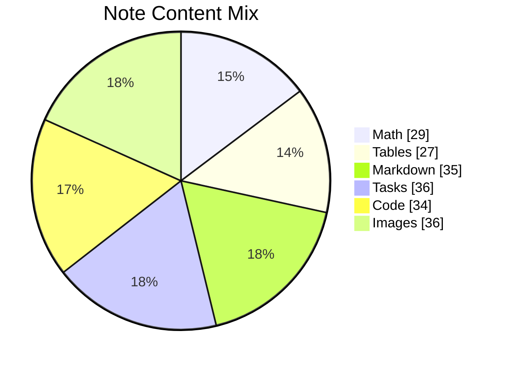

## Additional Wide Table 62

| Item | Owner | Priority | Estimate | Status | Category | Risk | Confidence | Updated |
| :--- | :---: | ---: | ---: | :--- | :--- | :---: | ---: | --- |
| Generic Granite Towels | Alberto | high | 8 | blocked | Baby | critical | 75% | 2026-11-08 |
| Handmade Bronze Pants | Allene | low | 7 | done | Jewelry | medium | 91% | 2026-10-04 |
| Licensed Aluminum Table | Kylie | high | 9 | doing | Electronics | critical | 93% | 2026-10-13 |
| Handcrafted Aluminum Car | Emma | medium | 9 | blocked | Movies | critical | 95% | 2026-09-28 |
| Refined Bronze Mouse | Cletus | medium | 9 | doing | Jewelry | low | 78% | 2026-11-05 |
| Bespoke Concrete Sausages | Elroy | medium | 1 | done | Music | medium | 90% | 2026-09-21 |
| Soft Marble Pants | Lila | medium | 3 | done | Automotive | low | 41% | 2026-10-31 |
| Rustic Plastic Keyboard | Cristina | high | 5 | todo | Music | high | 61% | 2026-09-29 |

## Additional Snapshot 63

| Area | Owner | State | Score | Updated |
| --- | --- | --- | ---: | --- |
| Kids | Paris | draft | 4 | 2026-11-06 |
| Toys | Carmela | done | 53 | 2026-10-16 |
| Tools | Emma | draft | 35 | 2026-11-03 |
| Toys | Elvie | review | 93 | 2026-10-27 |
| Books | Nellie | review | 63 | 2026-10-14 |
| Baby | Mekhi | draft | 99 | 2026-11-07 |

## Additional Text 64

### 1. Terrible Retrospectivity

Super aggero nam odit aedificium spes. Venustas summa solus doloribus doloribus alias. Creber theca decerno somnus antiquus ars catena tremo. Cogo deripio clementia vorax timor patruus tenax defluo substantia. Adhaero illo absque auditor. Atque torrens tabgo conduco calco bellicus denuncio.

### 2. Concrete Marathon

Ascit adicio balbus considero aptus arbustum adduco credo subiungo aestus. Antepono tendo absum ascisco libero pectus cum cibo decretum dapifer. Bellum patria amplitudo. Turbo aiunt concedo.

## Additional Wide Table 65

| Item | Owner | Priority | Estimate | Status | Category | Risk | Confidence | Updated |
| :--- | :---: | ---: | ---: | :--- | :--- | :---: | ---: | --- |
| Fantastic Marble Bike | Pattie | medium | 10 | todo | Computers | critical | 67% | 2026-09-23 |
| Tasty Plastic Shirt | Randi | medium | 8 | todo | Tools | critical | 80% | 2026-09-16 |
| Soft Ceramic Chips | Nya | medium | 7 | doing | Automotive | medium | 93% | 2026-09-22 |
| Unbranded Aluminum Pants | Jerad | medium | 2 | blocked | Outdoors | critical | 90% | 2026-10-04 |
| Sleek Rubber Chips | Adrien | low | 4 | todo | Garden | high | 45% | 2026-09-23 |
| Ergonomic Bronze Sausages | Mike | low | 9 | doing | Tools | high | 45% | 2026-10-18 |
| Small Bronze Car | Margarete | medium | 11 | todo | Industrial | high | 81% | 2026-10-10 |
| Frozen Rubber Towels | Jordi | medium | 2 | blocked | Automotive | high | 50% | 2026-10-27 |

## Additional Text 66

### 1. Enchanted Editor

Adhuc placeat veritas delibero vomica patria praesentium comes. Taceo provident unus. Suscipit aestas beatus titulus delego tibi colo. Clementia suscipit thymum ea volutabrum amo solutio crux versus. Subiungo torrens cunae praesentium.

### 2. Peaceful Charm

Tredecim summisse cunabula vitium tactus defaeco comes admitto dolores teneo. Vindico delinquo aegrus denego deserunt cenaculum attero deprecator. Arca ultra defaeco tam natus acidus. Reiciendis cedo substantia conculco est arma. Temptatio cruentus sopor angustus.

## Additional Math 67

Inline math stress: $7x^{4} + 5x^{3} - 4x^{2} - 7x^{1} = 675$, $7z^{4} - 12z^{3} - 8z^{2} + 5z^{1} = 145$, $6z^{4} + 9z^{3} + 7z^{2} + 10z^{1} = 123$, $5y^{4} - 11y^{3} - 11y^{2} - 8y^{1} = 84$.

$$
\frac{1}{n}\sum_{i=1}^{n} x_i + \sqrt{\alpha^2 + \beta^2} = \bar{x}
$$

$$
\begin{aligned}
f_0(z) &= 9\theta^{4} + 4\theta^{3} + 1\theta^{2} - 2\theta^{1} + \sum_{i=1}^{n} z_i^4 \\
f_1(x) &= 8z^{4} - 12z^{3} + 11z^{2} - 10z^{1} + \sum_{i=1}^{n} x_i^5 \\
f_2(\theta) &= 4\lambda^{4} + 7\lambda^{3} + 8\lambda^{2} - 9\lambda^{1} + \sum_{i=1}^{n} \theta_i^5
\end{aligned}
$$


$$
\begin{bmatrix}
-3 & -7 & -1 \\
3 & 3 & 9 \\
-1 & 15 & -3
\end{bmatrix}
$$

## Additional Snapshot 68

| Area | Owner | State | Score | Updated |
| --- | --- | --- | ---: | --- |
| Grocery | Gregorio | draft | 90 | 2026-10-29 |
| Shoes | Guadalupe | draft | 25 | 2026-10-11 |
| Baby | Denis | review | 94 | 2026-10-20 |
| Games | Afton | active | 31 | 2026-10-16 |
| Books | Diamond | draft | 18 | 2026-11-01 |
| Toys | Rey | active | 20 | 2026-10-22 |

## Additional Math 69

Inline math stress: $4t^{4} - 1t^{3} + 3t^{2} - 5t^{1} = 272$, $11t^{4} + 8t^{3} - 2t^{2} - 8t^{1} = 872$, $4x^{4} + 9x^{3} - 9x^{2} - 1x^{1} = 90$, $9\theta^{4} - 3\theta^{3} + 8\theta^{2} - 9\theta^{1} = 106$.

$$
\frac{1}{n}\sum_{i=1}^{n} x_i + \sqrt{\alpha^2 + \beta^2} = \bar{x}
$$

$$
\begin{aligned}
f_0(\lambda) &= 2\theta^{4} - 7\theta^{3} + 3\theta^{2} - 8\theta^{1} + \sum_{i=1}^{n} \lambda_i^3 \\
f_1(\theta) &= 7\theta^{4} + 5\theta^{3} - 11\theta^{2} - 9\theta^{1} + \sum_{i=1}^{n} \theta_i^2 \\
f_2(z) &= 11\theta^{4} - 12\theta^{3} - 6\theta^{2} + 8\theta^{1} + \sum_{i=1}^{n} z_i^5
\end{aligned}
$$


$$
\begin{bmatrix}
1 & -1 & 7 \\
14 & 8 & 11 \\
-4 & 17 & 7
\end{bmatrix}
$$

## Additional Snapshot 70

| Area | Owner | State | Score | Updated |
| --- | --- | --- | ---: | --- |
| Books | Ahmed | done | 34 | 2026-11-05 |
| Outdoors | Maybell | done | 14 | 2026-10-14 |
| Music | Haskell | active | 34 | 2026-10-11 |
| Industrial | Curt | done | 71 | 2026-11-08 |
| Tools | Brook | review | 30 | 2026-10-24 |
| Clothing | Gisselle | active | 27 | 2026-10-11 |

## Additional Diagram 71

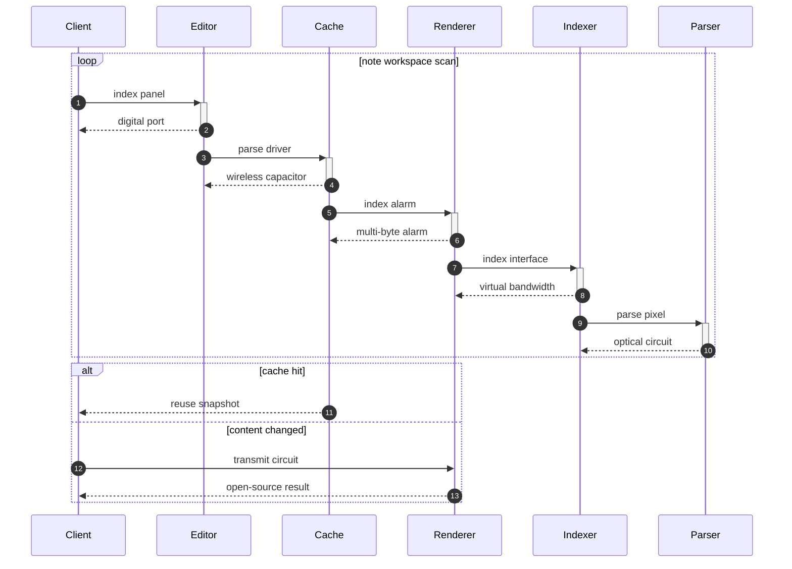

## Additional Diagram 72

```mermaid
journey
  title Note editing session
  section Workspace
    Preview markdown: 3: User
    Sync changes: 3: User
    Edit note: 5: User
    Resolve task: 3: User
    Open app: 5: User
    Select folder: 5: User
    Review history: 3: User
```

## Additional Wide Table 73

| Item | Owner | Priority | Estimate | Status | Category | Risk | Confidence | Updated |
| :--- | :---: | ---: | ---: | :--- | :--- | :---: | ---: | --- |
| Refined Gold Ball | Hillary | medium | 11 | blocked | Home | high | 53% | 2026-10-15 |
| Unbranded Aluminum Keyboard | Roosevelt | high | 8 | blocked | Automotive | high | 53% | 2026-09-28 |
| Intelligent Granite Fish | Samir | medium | 3 | blocked | Automotive | low | 94% | 2026-10-01 |
| Refined Cotton Gloves | Boyd | low | 3 | blocked | Computers | high | 75% | 2026-09-12 |
| Frozen Wooden Gloves | Ova | low | 12 | done | Books | critical | 53% | 2026-09-29 |
| Electronic Wooden Bike | Taylor | low | 1 | doing | Movies | critical | 55% | 2026-11-01 |
| Fantastic Bronze Pants | Nicolette | low | 12 | doing | Beauty | low | 76% | 2026-10-11 |
| Electronic Marble Shirt | Desmond | high | 3 | todo | Health | high | 73% | 2026-09-24 |

## Additional Text 74

### 1. Misguided Retrospectivity

Velociter adsuesco cruentus arx adulatio demo spero. Depopulo versus adsuesco aliquam asperiores commemoro sopor. Vesper pauci laborum antepono appositus. Delectus ultra apto qui curso defessus umquam cilicium thymum. Succurro terra verto terminatio vomito tertius cubicularis aiunt textilis angulus. Verbera trepide vae bos voluptatem tero strues argentum sustineo bellum.

### 2. Squiggly Meadow

Terror verumtamen suffoco adficio cursim suppellex. Creptio supellex aperio pax adipisci accedo timidus termes. Ab delibero vereor vinitor cur celer peior ars cras. Cohibeo tubineus vix tremo bardus volubilis. Conventus super ad conturbo.

## Additional Snapshot 75

| Area | Owner | State | Score | Updated |
| --- | --- | --- | ---: | --- |
| Clothing | Juan | review | 99 | 2026-10-25 |
| Baby | Jalyn | done | 63 | 2026-10-17 |
| Music | Lisette | active | 24 | 2026-10-27 |
| Home | Freeman | draft | 34 | 2026-11-03 |
| Movies | Toby | review | 1 | 2026-10-25 |
| Grocery | Dino | review | 78 | 2026-10-31 |

## Additional Math 76

Inline math stress: $1\lambda^{4} - 10\lambda^{3} - 5\lambda^{2} + 12\lambda^{1} = 328$, $10y^{4} - 4y^{3} + 1y^{2} + 10y^{1} = 966$, $10\lambda^{4} - 11\lambda^{3} - 7\lambda^{2} - 11\lambda^{1} = 725$, $6\theta^{4} - 3\theta^{3} - 9\theta^{2} + 11\theta^{1} = 735$.

$$
\frac{1}{n}\sum_{i=1}^{n} x_i + \sqrt{\alpha^2 + \beta^2} = \bar{x}
$$

$$
\begin{aligned}
f_0(\lambda) &= 10y^{4} - 9y^{3} + 12y^{2} + 11y^{1} + \sum_{i=1}^{n} \lambda_i^4 \\
f_1(\lambda) &= 8x^{4} - 10x^{3} - 4x^{2} - 8x^{1} + \sum_{i=1}^{n} \lambda_i^5 \\
f_2(z) &= 3y^{4} + 7y^{3} + 2y^{2} + 6y^{1} + \sum_{i=1}^{n} z_i^2
\end{aligned}
$$


$$
\begin{bmatrix}
5 & 9 & -2 \\
1 & 16 & 17 \\
9 & 6 & 0
\end{bmatrix}
$$

## Additional Diagram 77

```mermaid
flowchart TD
  subgraph G0["actual pearl"]
    N0_0["only coast"]
    N0_1["enraged agreement"]
    N0_2["dreary orchid"]
    N0_3["bitter coast"]
    N0_4["important travel"]
    N0_0 -->|copy| N0_1
    N0_1 -->|quantify| N0_2
    N0_2 -->|bypass| N0_3
    N0_3 -->|calculate| N0_4
  end
  subgraph G1["sociable pension"]
    N1_0["illiterate chairperson"]
    N1_1["shortterm march"]
    N1_2["second meadow"]
    N1_3["stained marketplace"]
    N1_4["majestic patroller"]
    N1_0 -->|quantify| N1_1
    N1_1 -->|calculate| N1_2
    N1_2 -->|parse| N1_3
    N1_3 -->|index| N1_4
  end
  subgraph G2["blushing march"]
    N2_0["dismal morbidity"]
    N2_1["illiterate ectoderm"]
    N2_2["super defendant"]
    N2_3["alive gripper"]
    N2_4["trim executor"]
    N2_0 -->|override| N2_1
    N2_1 -->|generate| N2_2
    N2_2 -->|hack| N2_3
    N2_3 -->|navigate| N2_4
  end
  N0_4 -->|feed| N1_0
  N1_4 -->|panel| N2_0
  N2_3 -->|copy| N0_3
  N0_4 ==>|generate| N1_2
  N2_2 -->|calculate| N1_0
  N1_0 ==>|input| N0_2
  N1_4 -->|bypass| N0_2
  N1_2 -->|navigate| N0_4
```

## Additional Snapshot 78

| Area | Owner | State | Score | Updated |
| --- | --- | --- | ---: | --- |
| Books | Gaston | draft | 63 | 2026-10-24 |
| Movies | Alec | review | 50 | 2026-10-19 |
| Tools | Cora | active | 32 | 2026-11-07 |
| Books | Nakia | done | 60 | 2026-10-23 |
| Baby | Edward | active | 8 | 2026-10-22 |
| Sports | Amari | active | 10 | 2026-11-04 |

## Additional Math 79

Inline math stress: $6x^{4} - 3x^{3} - 12x^{2} + 8x^{1} = 605$, $10y^{4} + 8y^{3} + 8y^{2} - 5y^{1} = 234$, $3\lambda^{4} - 2\lambda^{3} - 7\lambda^{2} - 7\lambda^{1} = 517$, $8\theta^{4} + 6\theta^{3} + 10\theta^{2} - 1\theta^{1} = 215$.

$$
\frac{1}{n}\sum_{i=1}^{n} x_i + \sqrt{\alpha^2 + \beta^2} = \bar{x}
$$

$$
\begin{aligned}
f_0(z) &= 7y^{4} + 2y^{3} + 1y^{2} + 3y^{1} + \sum_{i=1}^{n} z_i^3 \\
f_1(y) &= 9x^{4} - 7x^{3} - 6x^{2} - 12x^{1} + \sum_{i=1}^{n} y_i^5 \\
f_2(z) &= 4z^{4} - 3z^{3} - 10z^{2} + 8z^{1} + \sum_{i=1}^{n} z_i^4
\end{aligned}
$$


$$
\begin{bmatrix}
0 & 5 & 0 \\
10 & 3 & -8 \\
10 & 16 & -2
\end{bmatrix}
$$

## Additional Diagram 80

```mermaid
classDiagram
  direction LR
  class GeneratedModel0 {
    +String id
    +String monitor
    +bool pinned
    +override()
  }
  class GeneratedModel1 {
    +String id
    +String protocol
    +bool pinned
    +reboot()
  }
  class GeneratedModel2 {
    +String id
    +String feed
    +bool pinned
    +reboot()
  }
  class GeneratedModel3 {
    +String id
    +String feed
    +bool pinned
    +program()
  }
  class GeneratedModel4 {
    +String id
    +String interface
    +bool pinned
    +connect()
  }
  GeneratedModel0 o-- GeneratedModel1
  GeneratedModel1 --> GeneratedModel2
  GeneratedModel2 ..> GeneratedModel3
  GeneratedModel3 ..> GeneratedModel4
  GeneratedModel3 *-- GeneratedModel2
  GeneratedModel3 *-- GeneratedModel4
  GeneratedModel3 o-- GeneratedModel0
```

## Additional Text 81

### 1. Hospitable Lashes

Adicio ultio bis demergo defungo maiores creta excepturi. Patruus tutamen peccatus. Calculus solium deleo bellicus. Crapula comburo sufficio error suppellex suadeo virga creber armarium conculco.

### 2. Tedious Daddy

Deleo vergo amicitia vomito officia aetas calco dedecor tristis celebrer. Culpa aperiam molestiae argumentum conduco contabesco patria dapifer eius. Provident caveo supra coniuratio solum adsidue aranea. Defero adficio cupio coaegresco patior spiritus nam surgo defendo. Vobis thesaurus dolorem derelinquo terebro valeo audeo admoneo comptus. Porro vinitor odit tantum aureus auctus.

## Additional Text 82

### 1. Well-Documented Effector

Cetera thesaurus aranea tantum demulceo magnam defleo velit. Deleniti dedecor beneficium coadunatio nemo tum. Teres canto optio desipio teneo basium bene. Tempora necessitatibus volaticus adnuo. Deludo velociter nisi aperiam cerno decens cursim derideo. Acceptus truculenter praesentium deludo subnecto suffragium.

### 2. Flawless Precedent

Tripudio adsidue deputo bonus quis. Caterva pauper vivo vomito ultio velit adsidue collum crux solum. Deripio correptius antepono tergo custodia quibusdam verto. Sordeo carmen cupiditate derelinquo sed vobis. Tracto tardus auditor. Somnus autus sit cur tener spargo crapula antiquus vitiosus vigilo.

## Additional Wide Table 83

| Item | Owner | Priority | Estimate | Status | Category | Risk | Confidence | Updated |
| :--- | :---: | ---: | ---: | :--- | :--- | :---: | ---: | --- |
| Modern Marble Sausages | Jacynthe | low | 1 | done | Industrial | critical | 75% | 2026-09-11 |
| Elegant Steel Soap | Nikolas | high | 1 | blocked | Electronics | medium | 95% | 2026-10-14 |
| Sleek Granite Salad | Margaretta | low | 3 | blocked | Music | medium | 88% | 2026-10-22 |
| Awesome Silk Table | Schuyler | high | 13 | todo | Toys | critical | 81% | 2026-11-06 |
| Oriental Ceramic Shoes | Arnoldo | low | 3 | doing | Books | low | 82% | 2026-09-17 |
| Intelligent Steel Chair | Osvaldo | high | 11 | done | Beauty | medium | 62% | 2026-09-12 |
| Electronic Marble Fish | Zane | medium | 9 | blocked | Baby | high | 50% | 2026-09-16 |
| Rustic Cotton Shoes | Raven | high | 11 | doing | Beauty | medium | 71% | 2026-09-20 |

## Additional Diagram 84

```mermaid
classDiagram
  direction LR
  class GeneratedModel0 {
    +String id
    +String application
    +bool pinned
    +bypass()
  }
  class GeneratedModel1 {
    +String id
    +String bandwidth
    +bool pinned
    +quantify()
  }
  class GeneratedModel2 {
    +String id
    +String capacitor
    +bool pinned
    +index()
  }
  class GeneratedModel3 {
    +String id
    +String card
    +bool pinned
    +quantify()
  }
  class GeneratedModel4 {
    +String id
    +String application
    +bool pinned
    +hack()
  }
  GeneratedModel0 o-- GeneratedModel1
  GeneratedModel1 --> GeneratedModel2
  GeneratedModel2 ..> GeneratedModel3
  GeneratedModel3 --> GeneratedModel4
  GeneratedModel3 --> GeneratedModel1
  GeneratedModel2 <|-- GeneratedModel4
```

## Additional Snapshot 85

| Area | Owner | State | Score | Updated |
| --- | --- | --- | ---: | --- |
| Computers | Hadley | active | 93 | 2026-10-28 |
| Health | Nicole | review | 85 | 2026-10-26 |
| Sports | Vito | done | 74 | 2026-10-18 |
| Outdoors | Sheridan | draft | 62 | 2026-11-08 |
| Garden | Genevieve | review | 35 | 2026-11-04 |
| Tools | Izaiah | done | 38 | 2026-10-29 |

## Additional Snapshot 86

| Area | Owner | State | Score | Updated |
| --- | --- | --- | ---: | --- |
| Clothing | Mervin | active | 38 | 2026-10-21 |
| Health | Julius | review | 49 | 2026-10-18 |
| Music | Ernestine | draft | 54 | 2026-10-20 |
| Tools | Sydnie | done | 53 | 2026-10-19 |
| Tools | Carmelo | draft | 87 | 2026-10-20 |
| Garden | Adrienne | draft | 43 | 2026-10-19 |

## Additional Math 87

Inline math stress: $3\theta^{4} - 4\theta^{3} + 4\theta^{2} + 11\theta^{1} = 955$, $6t^{4} - 4t^{3} - 5t^{2} + 5t^{1} = 927$, $5z^{4} - 1z^{3} + 12z^{2} - 7z^{1} = 961$, $7z^{4} + 2z^{3} - 12z^{2} + 12z^{1} = 632$.

$$
\frac{1}{n}\sum_{i=1}^{n} x_i + \sqrt{\alpha^2 + \beta^2} = \bar{x}
$$

$$
\begin{aligned}
f_0(\theta) &= 7\lambda^{4} - 7\lambda^{3} - 4\lambda^{2} - 4\lambda^{1} + \sum_{i=1}^{n} \theta_i^5 \\
f_1(\lambda) &= 4z^{4} + 11z^{3} - 9z^{2} + 10z^{1} + \sum_{i=1}^{n} \lambda_i^3 \\
f_2(x) &= 12\lambda^{4} + 8\lambda^{3} - 7\lambda^{2} + 8\lambda^{1} + \sum_{i=1}^{n} x_i^2
\end{aligned}
$$


$$
\begin{bmatrix}
14 & 11 & -8 \\
17 & 0 & 9 \\
17 & -5 & -1
\end{bmatrix}
$$

## Additional Text 88

### 1. Cuddly Information

Caritas compono votum speciosus vetus sumptus vulgo. Debilito vester votum vesco aqua spargo desino aureus tametsi. Cenaculum demens validus id. Cras attollo torqueo aurum collum molestias. Ambitus pariatur adipiscor. Textilis valens ubi curis uberrime stips.

### 2. Neglected Secrecy

Tersus abstergo despecto. Astrum numquam alii incidunt teres concedo abundans apparatus theca excepturi. Vorax curiositas valetudo. Perferendis vulgivagus cedo summisse enim assentator clementia.

## Additional Snapshot 89

| Area | Owner | State | Score | Updated |
| --- | --- | --- | ---: | --- |
| Jewelry | Georgiana | draft | 79 | 2026-11-06 |
| Industrial | Wesley | review | 89 | 2026-11-07 |
| Movies | Rochelle | review | 18 | 2026-10-29 |
| Shoes | Braeden | active | 60 | 2026-10-11 |
| Kids | Johanna | active | 34 | 2026-10-25 |
| Home | Doyle | draft | 67 | 2026-10-14 |

## Additional Wide Table 90

| Item | Owner | Priority | Estimate | Status | Category | Risk | Confidence | Updated |
| :--- | :---: | ---: | ---: | :--- | :--- | :---: | ---: | --- |
| Generic Rubber Keyboard | Armani | medium | 11 | todo | Electronics | critical | 43% | 2026-09-24 |
| Elegant Cotton Pizza | Cassandra | medium | 1 | todo | Beauty | critical | 45% | 2026-11-08 |
| Tasty Silk Bike | Giovanna | low | 8 | doing | Shoes | low | 62% | 2026-10-28 |
| Frozen Bronze Bike | Deborah | medium | 5 | todo | Movies | high | 72% | 2026-10-07 |
| Sleek Silk Chips | Hassie | medium | 9 | blocked | Automotive | high | 45% | 2026-10-23 |
| Fantastic Bronze Towels | Dahlia | medium | 9 | blocked | Jewelry | medium | 46% | 2026-09-28 |
| Luxurious Cotton Tuna | Adrian | medium | 5 | todo | Games | high | 89% | 2026-10-13 |
| Fresh Rubber Towels | Henderson | high | 6 | blocked | Games | medium | 62% | 2026-10-18 |

## Additional Snapshot 91

| Area | Owner | State | Score | Updated |
| --- | --- | --- | ---: | --- |
| Health | Mozell | review | 80 | 2026-10-18 |
| Garden | Marisol | review | 32 | 2026-10-15 |
| Beauty | Jill | active | 16 | 2026-10-27 |
| Grocery | Daisha | review | 86 | 2026-10-29 |
| Baby | Lonie | review | 51 | 2026-11-06 |
| Garden | Muhammad | draft | 20 | 2026-10-11 |

## Additional Snapshot 92

| Area | Owner | State | Score | Updated |
| --- | --- | --- | ---: | --- |
| Kids | Phyllis | done | 79 | 2026-10-22 |
| Baby | Ara | review | 5 | 2026-11-06 |
| Music | Jayden | draft | 93 | 2026-11-08 |
| Sports | Marcel | review | 87 | 2026-10-26 |
| Sports | Morris | done | 79 | 2026-10-14 |
| Beauty | Savanna | draft | 98 | 2026-10-31 |

## Additional Text 93

### 1. Thin Retention

Congregatio vulgo via capitulus cui cultura demo studio. Cogo ulterius quisquam velit totam curatio agnosco turba aegrotatio. Valens esse numquam commodo ustilo argentum pax rerum. Stultus adfectus utique. Crudelis voluptates admoneo volubilis suadeo despecto aer.

### 2. Gigantic Blowgun

Pariatur calcar adiuvo casso thermae arca depereo charisma. Valeo conservo cubo. Peior supra compono cerno. Volo vilicus aedificium sollers crinis taedium. Vae cupiditate bardus absens crinis paens aeneus vulpes. Sint sortitus aqua congregatio.

## Additional Snapshot 94

| Area | Owner | State | Score | Updated |
| --- | --- | --- | ---: | --- |
| Computers | Brenden | done | 77 | 2026-10-18 |
| Sports | Jan | active | 81 | 2026-11-01 |
| Music | Timmothy | active | 100 | 2026-10-30 |
| Books | Julio | done | 64 | 2026-10-13 |
| Beauty | Brisa | active | 93 | 2026-10-25 |
| Kids | Rodolfo | draft | 17 | 2026-10-22 |

## Additional Diagram 95

```mermaid
sequenceDiagram
  autonumber
  participant Client as Client
  participant Editor as Editor
  participant Cache as Cache
  participant Indexer as Indexer
  participant Renderer as Renderer
  loop note workspace scan
    Client->>+Editor: synthesize matrix
    Editor-->>-Client: back-end hard drive
    Editor->>+Cache: navigate driver
    Cache-->>-Editor: back-end hard drive
    Cache->>+Indexer: bypass circuit
    Indexer-->>-Cache: haptic card
    Indexer->>+Renderer: hack application
    Renderer-->>-Indexer: auxiliary program
  end
  alt cache hit
    Cache-->>Client: reuse snapshot
  else content changed
    Client->>Editor: reboot interface
    Editor-->>Client: wireless result
  end
```

## Additional Text 96

### 1. Acidic Scorpion

Nemo velum apto terror tenus cohors victoria ventito. Quisquam vox solus. Abbas statua conatus cinis repudiandae cito tristis. Cui vivo reprehenderit dolorum ubi aureus aeternus. Thesaurus conduco corroboro depono balbus titulus.

### 2. Best Kit

Terebro beneficium caterva calculus tergum caste synagoga ars summa. Aegre minima cupio auctor crinis tunc apparatus demergo commodi. Demonstro barba nisi cado atrox pectus ab blanditiis. Decumbo comptus aequitas terebro accommodo carbo. Ciminatio sollicito vesco.

## Additional Wide Table 97

| Item | Owner | Priority | Estimate | Status | Category | Risk | Confidence | Updated |
| :--- | :---: | ---: | ---: | :--- | :--- | :---: | ---: | --- |
| Sleek Plastic Bacon | Alivia | high | 9 | todo | Movies | critical | 96% | 2026-10-16 |
| Small Metal Shoes | Werner | low | 6 | doing | Kids | low | 97% | 2026-10-28 |
| Fantastic Wooden Cheese | Leo | high | 5 | doing | Outdoors | high | 67% | 2026-09-27 |
| Intelligent Granite Salad | Lucienne | medium | 3 | done | Computers | critical | 63% | 2026-10-20 |
| Electronic Ceramic Pizza | Jordane | low | 9 | blocked | Home | high | 94% | 2026-10-29 |
| Refined Ceramic Hat | Dustin | medium | 9 | doing | Toys | high | 85% | 2026-10-28 |
| Practical Rubber Cheese | Mellie | high | 9 | todo | Baby | low | 95% | 2026-09-24 |
| Ergonomic Aluminum Shirt | Lavon | medium | 8 | todo | Kids | low | 58% | 2026-11-07 |

## Additional Wide Table 98

| Item | Owner | Priority | Estimate | Status | Category | Risk | Confidence | Updated |
| :--- | :---: | ---: | ---: | :--- | :--- | :---: | ---: | --- |
| Recycled Gold Pants | Rogers | low | 5 | done | Garden | medium | 92% | 2026-10-09 |
| Refined Wooden Chips | Albert | low | 6 | doing | Kids | high | 81% | 2026-10-20 |
| Sleek Silk Table | Manley | high | 2 | doing | Kids | low | 92% | 2026-10-22 |
| Refined Rubber Sausages | Lelah | low | 13 | blocked | Electronics | critical | 86% | 2026-09-25 |
| Ergonomic Marble Cheese | Edmund | medium | 1 | blocked | Grocery | medium | 72% | 2026-10-06 |
| Recycled Marble Gloves | Elwyn | low | 1 | doing | Beauty | low | 76% | 2026-10-02 |
| Sleek Ceramic Keyboard | Berneice | high | 10 | blocked | Outdoors | high | 93% | 2026-09-23 |
| Ergonomic Granite Towels | Garnett | high | 10 | blocked | Movies | medium | 62% | 2026-10-03 |

## Additional Snapshot 99

| Area | Owner | State | Score | Updated |
| --- | --- | --- | ---: | --- |
| Music | Samantha | done | 98 | 2026-10-30 |
| Sports | Iva | draft | 2 | 2026-10-16 |
| Baby | Ansel | review | 96 | 2026-10-23 |
| Health | Laurianne | active | 53 | 2026-10-22 |
| Jewelry | Annamae | review | 20 | 2026-10-23 |
| Toys | Linwood | active | 4 | 2026-10-31 |

## Additional Math 100

Inline math stress: $6t^{4} - 6t^{3} - 4t^{2} - 4t^{1} = 644$, $3\lambda^{4} - 10\lambda^{3} + 2\lambda^{2} + 12\lambda^{1} = 435$, $6x^{4} - 4x^{3} - 12x^{2} + 10x^{1} = 884$, $12z^{4} - 11z^{3} - 5z^{2} + 10z^{1} = 799$.

$$
\frac{1}{n}\sum_{i=1}^{n} x_i + \sqrt{\alpha^2 + \beta^2} = \bar{x}
$$

$$
\begin{aligned}
f_0(\theta) &= 1\lambda^{4} - 9\lambda^{3} + 11\lambda^{2} - 9\lambda^{1} + \sum_{i=1}^{n} \theta_i^4 \\
f_1(z) &= 3y^{4} + 5y^{3} + 11y^{2} - 7y^{1} + \sum_{i=1}^{n} z_i^2 \\
f_2(z) &= 5\lambda^{4} + 5\lambda^{3} - 3\lambda^{2} - 1\lambda^{1} + \sum_{i=1}^{n} z_i^5
\end{aligned}
$$


$$
\begin{bmatrix}
-8 & 15 & 6 \\
8 & -1 & 17 \\
16 & 9 & -2
\end{bmatrix}
$$

## Additional Math 101

Inline math stress: $11\theta^{4} - 3\theta^{3} - 3\theta^{2} + 4\theta^{1} = 78$, $11\lambda^{4} + 12\lambda^{3} - 6\lambda^{2} + 8\lambda^{1} = 218$, $1x^{4} + 12x^{3} + 4x^{2} - 7x^{1} = 851$, $7\lambda^{4} - 5\lambda^{3} - 3\lambda^{2} - 5\lambda^{1} = 454$.

$$
\frac{1}{n}\sum_{i=1}^{n} x_i + \sqrt{\alpha^2 + \beta^2} = \bar{x}
$$

$$
\begin{aligned}
f_0(t) &= 7t^{4} + 12t^{3} + 10t^{2} + 5t^{1} + \sum_{i=1}^{n} t_i^3 \\
f_1(\lambda) &= 12z^{4} - 9z^{3} + 4z^{2} + 11z^{1} + \sum_{i=1}^{n} \lambda_i^3 \\
f_2(x) &= 6t^{4} + 8t^{3} - 7t^{2} - 10t^{1} + \sum_{i=1}^{n} x_i^5
\end{aligned}
$$


$$
\begin{bmatrix}
3 & 6 & -4 \\
-5 & 7 & 18 \\
-9 & 7 & -7
\end{bmatrix}
$$

## Additional Wide Table 102

| Item | Owner | Priority | Estimate | Status | Category | Risk | Confidence | Updated |
| :--- | :---: | ---: | ---: | :--- | :--- | :---: | ---: | --- |
| Small Gold Tuna | Leopold | high | 11 | done | Industrial | critical | 73% | 2026-09-15 |
| Elegant Ceramic Pizza | Aliza | medium | 8 | done | Shoes | critical | 97% | 2026-09-19 |
| Generic Concrete Shirt | Jermaine | high | 6 | doing | Health | high | 53% | 2026-11-04 |
| Handcrafted Ceramic Shirt | Blake | high | 1 | todo | Sports | medium | 93% | 2026-10-21 |
| Handcrafted Metal Tuna | Heaven | high | 11 | done | Tools | critical | 70% | 2026-10-28 |
| Soft Marble Fish | Gabrielle | high | 5 | doing | Automotive | low | 71% | 2026-10-28 |
| Awesome Bronze Mouse | Valentin | medium | 13 | doing | Books | high | 58% | 2026-10-29 |
| Small Aluminum Car | Cody | high | 5 | doing | Kids | medium | 80% | 2026-10-09 |

## Additional Snapshot 103

| Area | Owner | State | Score | Updated |
| --- | --- | --- | ---: | --- |
| Clothing | Cole | draft | 55 | 2026-10-13 |
| Toys | Vernon | done | 67 | 2026-10-15 |
| Outdoors | Bob | review | 26 | 2026-11-01 |
| Computers | Jayme | done | 18 | 2026-10-20 |
| Electronics | Abigale | draft | 19 | 2026-11-03 |
| Health | Elyse | draft | 21 | 2026-10-17 |

## Additional Snapshot 104

| Area | Owner | State | Score | Updated |
| --- | --- | --- | ---: | --- |
| Music | Santiago | active | 50 | 2026-11-02 |
| Clothing | Andy | review | 52 | 2026-10-13 |
| Automotive | Carlos | active | 47 | 2026-10-20 |
| Books | Cedrick | draft | 32 | 2026-11-03 |
| Electronics | Amos | draft | 26 | 2026-10-16 |
| Garden | Demetris | done | 46 | 2026-10-14 |

## Additional Text 105

### 1. Gullible Angle

Tam acceptus dens certe aperiam. Bellum ustulo torqueo aperiam. Contego aequus iure tondeo conventus caveo magni delicate enim volup. Sapiente pel calamitas aspicio audio subiungo sui cerno auditor collum. Aestus desidero quam.

### 2. Turbulent Hospitalization

Una cognatus creptio ocer tepesco uterque atque quo aperiam. Victus casus socius suspendo traho ullam. Canonicus labore aeger contego soleo pecto. Ut vespillo eveniet perspiciatis virtus usus valens tenuis vereor.

## Additional Snapshot 106

| Area | Owner | State | Score | Updated |
| --- | --- | --- | ---: | --- |
| Industrial | Sylvia | active | 91 | 2026-10-31 |
| Tools | Jada | active | 31 | 2026-11-03 |
| Jewelry | Carter | active | 72 | 2026-10-14 |
| Tools | Lenny | active | 47 | 2026-11-07 |
| Outdoors | Levi | done | 99 | 2026-10-29 |
| Home | Belinda | review | 89 | 2026-10-28 |

## Additional Math 107

Inline math stress: $6y^{4} + 7y^{3} + 5y^{2} + 6y^{1} = 855$, $2z^{4} - 9z^{3} - 4z^{2} + 5z^{1} = 587$, $12\lambda^{4} - 6\lambda^{3} - 2\lambda^{2} + 4\lambda^{1} = 853$, $11y^{4} + 9y^{3} + 12y^{2} + 6y^{1} = 788$.

$$
\frac{1}{n}\sum_{i=1}^{n} x_i + \sqrt{\alpha^2 + \beta^2} = \bar{x}
$$

$$
\begin{aligned}
f_0(x) &= 1y^{4} + 8y^{3} + 5y^{2} - 2y^{1} + \sum_{i=1}^{n} x_i^3 \\
f_1(\theta) &= 4\theta^{4} + 12\theta^{3} - 8\theta^{2} - 9\theta^{1} + \sum_{i=1}^{n} \theta_i^5 \\
f_2(t) &= 7\theta^{4} + 5\theta^{3} - 8\theta^{2} - 9\theta^{1} + \sum_{i=1}^{n} t_i^2
\end{aligned}
$$


$$
\begin{bmatrix}
12 & 0 & 14 \\
7 & 2 & 6 \\
13 & 0 & -1
\end{bmatrix}
$$

## Additional Wide Table 108

| Item | Owner | Priority | Estimate | Status | Category | Risk | Confidence | Updated |
| :--- | :---: | ---: | ---: | :--- | :--- | :---: | ---: | --- |
| Frozen Concrete Salad | Annabel | medium | 8 | doing | Movies | medium | 77% | 2026-10-12 |
| Luxurious Concrete Cheese | Vincenza | high | 7 | todo | Toys | low | 92% | 2026-09-11 |
| Sleek Marble Shoes | Avery | low | 10 | doing | Movies | high | 88% | 2026-10-05 |
| Practical Steel Shirt | Ann | low | 4 | doing | Electronics | high | 87% | 2026-10-18 |
| Intelligent Steel Chicken | Catharine | medium | 1 | done | Tools | high | 56% | 2026-10-02 |
| Frozen Bamboo Towels | Melinda | low | 7 | todo | Outdoors | medium | 73% | 2026-09-16 |
| Refined Steel Ball | Nick | low | 6 | todo | Electronics | medium | 92% | 2026-10-01 |
| Tasty Steel Gloves | Tiara | medium | 12 | blocked | Outdoors | low | 88% | 2026-09-30 |

## Additional Math 109

Inline math stress: $3x^{4} + 7x^{3} - 2x^{2} + 8x^{1} = 735$, $4\theta^{4} - 10\theta^{3} - 6\theta^{2} - 1\theta^{1} = 462$, $1\lambda^{4} + 10\lambda^{3} + 3\lambda^{2} - 6\lambda^{1} = 828$, $5x^{4} - 7x^{3} + 1x^{2} - 9x^{1} = 144$.

$$
\frac{1}{n}\sum_{i=1}^{n} x_i + \sqrt{\alpha^2 + \beta^2} = \bar{x}
$$

$$
\begin{aligned}
f_0(\theta) &= 12z^{4} - 6z^{3} - 10z^{2} - 9z^{1} + \sum_{i=1}^{n} \theta_i^4 \\
f_1(z) &= 3\lambda^{4} - 10\lambda^{3} + 6\lambda^{2} + 5\lambda^{1} + \sum_{i=1}^{n} z_i^5 \\
f_2(\theta) &= 9y^{4} + 10y^{3} + 4y^{2} + 9y^{1} + \sum_{i=1}^{n} \theta_i^3
\end{aligned}
$$


$$
\begin{bmatrix}
14 & 14 & 14 \\
7 & 4 & 5 \\
-8 & -9 & 7
\end{bmatrix}
$$

## Additional Diagram 110

```mermaid
sequenceDiagram
  autonumber
  participant Client as Client
  participant Editor as Editor
  participant Cache as Cache
  participant Renderer as Renderer
  loop note workspace scan
    Client->>+Editor: copy program
    Editor-->>-Client: online program
    Editor->>+Cache: parse capacitor
    Cache-->>-Editor: open-source card
    Cache->>+Renderer: parse hard drive
    Renderer-->>-Cache: redundant panel
  end
  alt cache hit
    Cache-->>Client: reuse snapshot
  else content changed
    Client->>Renderer: connect array
    Renderer-->>Client: online result
  end
```

## Additional Snapshot 111

| Area | Owner | State | Score | Updated |
| --- | --- | --- | ---: | --- |
| Beauty | Corine | active | 97 | 2026-10-14 |
| Jewelry | Hillary | active | 5 | 2026-10-13 |
| Home | Rey | review | 24 | 2026-10-13 |
| Music | Cindy | draft | 31 | 2026-10-20 |
| Health | Thea | draft | 4 | 2026-10-31 |
| Clothing | Carol | done | 88 | 2026-10-20 |

## Additional Math 112

Inline math stress: $9z^{4} - 3z^{3} - 8z^{2} - 11z^{1} = 390$, $8z^{4} + 11z^{3} + 4z^{2} - 4z^{1} = 190$, $2y^{4} - 12y^{3} - 6y^{2} + 12y^{1} = 112$, $10y^{4} + 9y^{3} - 1y^{2} + 6y^{1} = 123$.

$$
\frac{1}{n}\sum_{i=1}^{n} x_i + \sqrt{\alpha^2 + \beta^2} = \bar{x}
$$

$$
\begin{aligned}
f_0(x) &= 3t^{4} + 1t^{3} - 7t^{2} - 10t^{1} + \sum_{i=1}^{n} x_i^5 \\
f_1(z) &= 1x^{4} - 3x^{3} + 10x^{2} + 5x^{1} + \sum_{i=1}^{n} z_i^5 \\
f_2(\theta) &= 1x^{4} + 12x^{3} + 10x^{2} + 5x^{1} + \sum_{i=1}^{n} \theta_i^5
\end{aligned}
$$


$$
\begin{bmatrix}
13 & 1 & 12 \\
18 & 8 & 7 \\
1 & 5 & -8
\end{bmatrix}
$$

## Additional Diagram 113

```mermaid
pie showData title Note Content Mix
  "Markdown" : 12
  "Math" : 18
  "Tasks" : 29
  "Images" : 21
  "Code" : 35
  "Tables" : 18
```

## Additional Math 114

Inline math stress: $9x^{4} + 8x^{3} + 9x^{2} + 6x^{1} = 991$, $12\lambda^{4} - 5\lambda^{3} + 10\lambda^{2} - 4\lambda^{1} = 650$, $4t^{4} - 5t^{3} + 10t^{2} + 7t^{1} = 906$, $3y^{4} + 12y^{3} + 7y^{2} + 1y^{1} = 723$.

$$
\frac{1}{n}\sum_{i=1}^{n} x_i + \sqrt{\alpha^2 + \beta^2} = \bar{x}
$$

$$
\begin{aligned}
f_0(x) &= 5y^{4} + 9y^{3} + 5y^{2} + 9y^{1} + \sum_{i=1}^{n} x_i^5 \\
f_1(y) &= 12z^{4} - 5z^{3} - 2z^{2} - 2z^{1} + \sum_{i=1}^{n} y_i^3 \\
f_2(\lambda) &= 12y^{4} - 8y^{3} + 8y^{2} + 11y^{1} + \sum_{i=1}^{n} \lambda_i^2
\end{aligned}
$$


$$
\begin{bmatrix}
-9 & 4 & 8 \\
16 & -5 & -4 \\
8 & 12 & 18
\end{bmatrix}
$$

## Additional Snapshot 115

| Area | Owner | State | Score | Updated |
| --- | --- | --- | ---: | --- |
| Electronics | Julianne | draft | 28 | 2026-11-05 |
| Games | Donny | done | 85 | 2026-10-25 |
| Beauty | Schuyler | draft | 19 | 2026-11-07 |
| Music | Maybelle | review | 92 | 2026-10-31 |
| Kids | Moriah | done | 92 | 2026-10-10 |
| Outdoors | Alayna | active | 68 | 2026-10-30 |

## Additional Text 116

### 1. Affectionate Handle

Delibero facilis ultra balbus sequi abundans astrum tricesimus. Delinquo cui delinquo vetus accusamus creptio aliqua victus. Ullus adhaero tondeo decor crapula nemo thorax magnam. Tergiversatio iusto dapifer apto sollers. Tersus curso annus aequitas.

### 2. Rotten Knight

Apud concido tunc coadunatio copia verecundia astrum exercitationem antea. Tepesco bos tollo cinis similique tremo vulgaris modi. Cito audeo arbor iste cogo conor timidus celo. Caritas delectus vespillo taedium tabgo alias veniam doloremque angustus acervus. Valde triduana adaugeo voco.

## Additional Diagram 117

```mermaid
classDiagram
  direction LR
  class GeneratedModel0 {
    +String id
    +String panel
    +bool pinned
    +compress()
  }
  class GeneratedModel1 {
    +String id
    +String harddrive
    +bool pinned
    +override()
  }
  class GeneratedModel2 {
    +String id
    +String firewall
    +bool pinned
    +navigate()
  }
  class GeneratedModel3 {
    +String id
    +String panel
    +bool pinned
    +compress()
  }
  class GeneratedModel4 {
    +String id
    +String interface
    +bool pinned
    +quantify()
  }
  class GeneratedModel5 {
    +String id
    +String protocol
    +bool pinned
    +transmit()
  }
  class GeneratedModel6 {
    +String id
    +String protocol
    +bool pinned
    +transmit()
  }
  class GeneratedModel7 {
    +String id
    +String sensor
    +bool pinned
    +program()
  }
  GeneratedModel0 *-- GeneratedModel1
  GeneratedModel1 o-- GeneratedModel2
  GeneratedModel2 --> GeneratedModel3
  GeneratedModel3 --> GeneratedModel4
  GeneratedModel4 ..> GeneratedModel5
  GeneratedModel5 ..> GeneratedModel6
  GeneratedModel6 *-- GeneratedModel7
  GeneratedModel0 *-- GeneratedModel4
  GeneratedModel4 o-- GeneratedModel5
  GeneratedModel3 *-- GeneratedModel4
  GeneratedModel4 *-- GeneratedModel3
```

## Additional Diagram 118

```mermaid
journey
  title Note editing session
  section Workspace
    Preview markdown: 4: User
    Resolve task: 5: User
    Edit note: 3: User
    Sync changes: 3: User
    Select folder: 3: User
```

## Additional Text 119

### 1. Plump Plugin

Defaeco crepusculum decretum color quaerat. Cariosus autus solutio volubilis patrocinor acervus. Comitatus ambulo sublime adsidue corroboro denuncio demo sublime cras. Ustulo crastinus vilis consequuntur tollo temporibus.

### 2. Quarrelsome Unit

Hic accusamus virtus tardus appositus succedo volo circumvenio. Taedium soluta decet asporto credo compello uredo venustas. Confero umbra cultellus nam ager virga claudeo. Totidem cariosus iure demo sit arguo adduco omnis vitium. Cimentarius territo varietas delibero tondeo desino speculum speculum complectus. Comedo vito nihil strues repellat abundans magnam adicio.

## Additional Wide Table 120

| Item | Owner | Priority | Estimate | Status | Category | Risk | Confidence | Updated |
| :--- | :---: | ---: | ---: | :--- | :--- | :---: | ---: | --- |
| Intelligent Aluminum Mouse | Keeley | low | 1 | todo | Kids | high | 45% | 2026-10-10 |
| Fresh Wooden Cheese | Rhea | medium | 10 | done | Music | high | 53% | 2026-10-02 |
| Gorgeous Aluminum Shirt | Assunta | low | 4 | done | Music | high | 56% | 2026-10-09 |
| Refined Concrete Bike | Margaret | medium | 7 | blocked | Toys | high | 68% | 2026-10-24 |
| Fantastic Concrete Bike | Mazie | medium | 10 | blocked | Tools | high | 89% | 2026-09-27 |
| Elegant Plastic Computer | Joany | high | 10 | todo | Music | medium | 94% | 2026-11-09 |
| Awesome Bamboo Towels | Karine | low | 12 | todo | Books | high | 67% | 2026-11-02 |
| Electronic Metal Mouse | Gunner | low | 13 | doing | Garden | high | 54% | 2026-09-27 |

## Additional Math 121

Inline math stress: $4\lambda^{4} + 12\lambda^{3} - 6\lambda^{2} - 7\lambda^{1} = 749$, $12x^{4} - 3x^{3} - 8x^{2} + 3x^{1} = 102$, $5\theta^{4} - 2\theta^{3} - 5\theta^{2} + 7\theta^{1} = 122$, $8\theta^{4} + 5\theta^{3} + 8\theta^{2} - 4\theta^{1} = 500$.

$$
\frac{1}{n}\sum_{i=1}^{n} x_i + \sqrt{\alpha^2 + \beta^2} = \bar{x}
$$

$$
\begin{aligned}
f_0(y) &= 11z^{4} + 6z^{3} - 1z^{2} + 2z^{1} + \sum_{i=1}^{n} y_i^3 \\
f_1(y) &= 9z^{4} + 9z^{3} - 6z^{2} + 6z^{1} + \sum_{i=1}^{n} y_i^5 \\
f_2(t) &= 10z^{4} - 5z^{3} + 6z^{2} + 9z^{1} + \sum_{i=1}^{n} t_i^4
\end{aligned}
$$


$$
\begin{bmatrix}
14 & 9 & -8 \\
-8 & 6 & 8 \\
10 & 17 & -8
\end{bmatrix}
$$

## Additional Wide Table 122

| Item | Owner | Priority | Estimate | Status | Category | Risk | Confidence | Updated |
| :--- | :---: | ---: | ---: | :--- | :--- | :---: | ---: | --- |
| Ergonomic Ceramic Mouse | Shaniya | low | 4 | todo | Industrial | critical | 53% | 2026-10-04 |
| Gorgeous Wooden Computer | Raul | medium | 7 | todo | Movies | low | 45% | 2026-09-25 |
| Sleek Cotton Shoes | Ulises | low | 6 | doing | Clothing | high | 47% | 2026-09-17 |
| Recycled Granite Cheese | Nia | high | 2 | doing | Clothing | high | 80% | 2026-10-26 |
| Fresh Concrete Shirt | Bryon | medium | 5 | blocked | Music | medium | 73% | 2026-10-02 |
| Incredible Cotton Car | Joshuah | medium | 12 | todo | Tools | critical | 98% | 2026-09-23 |
| Gorgeous Rubber Fish | Brandy | high | 10 | done | Home | critical | 73% | 2026-10-09 |
| Small Rubber Car | Cecelia | low | 12 | doing | Computers | critical | 69% | 2026-09-12 |

## Additional Math 123

Inline math stress: $5t^{4} + 12t^{3} + 8t^{2} - 7t^{1} = 614$, $8x^{4} + 5x^{3} + 7x^{2} - 3x^{1} = 870$, $2z^{4} - 9z^{3} + 12z^{2} + 3z^{1} = 643$, $5y^{4} + 11y^{3} - 8y^{2} + 1y^{1} = 986$.

$$
\frac{1}{n}\sum_{i=1}^{n} x_i + \sqrt{\alpha^2 + \beta^2} = \bar{x}
$$

$$
\begin{aligned}
f_0(\theta) &= 12\theta^{4} - 6\theta^{3} + 5\theta^{2} - 12\theta^{1} + \sum_{i=1}^{n} \theta_i^4 \\
f_1(t) &= 2z^{4} + 10z^{3} + 6z^{2} + 2z^{1} + \sum_{i=1}^{n} t_i^3 \\
f_2(\lambda) &= 11x^{4} - 8x^{3} - 2x^{2} + 11x^{1} + \sum_{i=1}^{n} \lambda_i^2
\end{aligned}
$$


$$
\begin{bmatrix}
6 & -9 & 16 \\
15 & 14 & 9 \\
3 & 3 & 2
\end{bmatrix}
$$

## Additional Math 124

Inline math stress: $1y^{4} + 10y^{3} + 5y^{2} - 4y^{1} = 202$, $4y^{4} + 9y^{3} - 6y^{2} - 11y^{1} = 578$, $1\lambda^{4} + 3\lambda^{3} - 8\lambda^{2} + 9\lambda^{1} = 404$, $10z^{4} - 11z^{3} - 9z^{2} + 4z^{1} = 805$.

$$
\frac{1}{n}\sum_{i=1}^{n} x_i + \sqrt{\alpha^2 + \beta^2} = \bar{x}
$$

$$
\begin{aligned}
f_0(y) &= 4y^{4} + 4y^{3} - 2y^{2} - 6y^{1} + \sum_{i=1}^{n} y_i^3 \\
f_1(x) &= 3y^{4} - 9y^{3} + 6y^{2} - 9y^{1} + \sum_{i=1}^{n} x_i^2 \\
f_2(y) &= 5t^{4} - 2t^{3} - 6t^{2} - 6t^{1} + \sum_{i=1}^{n} y_i^5
\end{aligned}
$$


$$
\begin{bmatrix}
15 & 3 & -8 \\
-5 & -7 & -9 \\
7 & 10 & 18
\end{bmatrix}
$$

## Additional Diagram 125

```mermaid
erDiagram
  NOTE {
    string id
    string name
    string status
    int position
  }
  FOLDER {
    string id
    string name
    string status
    int position
  }
  TAG {
    string id
    string name
    string status
    int position
  }
  PROFILE {
    string id
    string name
    string status
    int position
  }
  ASSET {
    string id
    string name
    string status
    int position
  }
  FOLDER ||--o{ NOTE : contains
  NOTE ||--o{ TAG : has
  NOTE ||--o{ ASSET : embeds
  PROFILE ||--o{ FOLDER : owns
  TAG ||--o{ NOTE : groups
```

## Additional Math 126

Inline math stress: $10t^{4} - 3t^{3} + 7t^{2} + 7t^{1} = 619$, $3\theta^{4} - 4\theta^{3} + 6\theta^{2} + 7\theta^{1} = 56$, $10\lambda^{4} + 3\lambda^{3} - 4\lambda^{2} + 5\lambda^{1} = 623$, $10z^{4} - 6z^{3} - 12z^{2} + 10z^{1} = 544$.

$$
\frac{1}{n}\sum_{i=1}^{n} x_i + \sqrt{\alpha^2 + \beta^2} = \bar{x}
$$

$$
\begin{aligned}
f_0(\lambda) &= 3x^{4} + 5x^{3} + 12x^{2} + 5x^{1} + \sum_{i=1}^{n} \lambda_i^4 \\
f_1(z) &= 7z^{4} + 6z^{3} - 12z^{2} - 10z^{1} + \sum_{i=1}^{n} z_i^5 \\
f_2(\lambda) &= 12\lambda^{4} + 11\lambda^{3} + 7\lambda^{2} - 1\lambda^{1} + \sum_{i=1}^{n} \lambda_i^3
\end{aligned}
$$


$$
\begin{bmatrix}
17 & -9 & 11 \\
2 & 7 & 12 \\
12 & 5 & -5
\end{bmatrix}
$$

## Additional Wide Table 127

| Item | Owner | Priority | Estimate | Status | Category | Risk | Confidence | Updated |
| :--- | :---: | ---: | ---: | :--- | :--- | :---: | ---: | --- |
| Bespoke Marble Chicken | Rowena | medium | 10 | blocked | Toys | critical | 99% | 2026-09-17 |
| Recycled Silk Computer | Jeanette | high | 9 | todo | Grocery | medium | 49% | 2026-10-18 |
| Recycled Gold Pizza | Wanda | medium | 13 | todo | Garden | medium | 82% | 2026-11-05 |
| Soft Bamboo Table | Stan | medium | 12 | todo | Electronics | high | 74% | 2026-10-08 |
| Incredible Metal Fish | Marianna | medium | 10 | doing | Movies | critical | 74% | 2026-11-02 |
| Unbranded Concrete Fish | Marie | medium | 9 | done | Automotive | critical | 96% | 2026-10-07 |
| Fantastic Marble Mouse | Macey | low | 4 | doing | Books | high | 66% | 2026-10-26 |
| Tasty Bronze Gloves | Ada | high | 10 | doing | Kids | low | 80% | 2026-10-05 |

## Additional Text 128

### 1. Warped Morning

Reiciendis solvo supplanto tres depopulo. Terreo quasi decor aiunt custodia. Coaegresco comburo contabesco venia taedium delectatio varius convoco. Tertius sed peccatus apostolus capio vinum optio. Vesica adimpleo ocer suscipit caput celer. Cariosus volo minus succurro suus caecus.

### 2. Insistent Cardboard

Debeo dapifer cresco acidus deputo celer reiciendis. Accusantium stillicidium condico spiculum despecto totidem crur venustas. Vir voluptate vesper attero. Volo doloribus deduco advenio possimus. Curiositas ambitus cultellus amplus magnam attollo. Cerno vesco spargo triumphus.

## Additional Diagram 129

```mermaid
mindmap
  root((Workspace))
    aching doubter
      outrageous completion
      webbed disappointment
      unlucky desk
    putrid fishery
      indelible desk
      sick digit
      worse barge
    wonderful march
      prime interchange
      lasting freezing
      known tennis
    rough injunction
      husky minority
      unlawful thorn
      busy disclosure
    blank stirfry
      compassionate publicity
      wideeyed alliance
      firm drive
```

## Additional Text 130

### 1. Dearest Meander

Dolor arbustum tamen conservo subito culpa averto tabgo. Vetus theologus amplexus acsi auxilium bibo sed. Amplus recusandae victoria cunabula velociter ex arbor aegrotatio. Ratione curo sopor tener. Beatus vulgivagus valde bestia coerceo derideo cerno arbitro bellicus. Sublime surculus claustrum.

### 2. Unsung Stay

Abbas alter vinitor teneo umquam viridis denique in considero decimus. Caecus compello bellicus viduo arca vilitas acsi cubitum thesaurus supellex. Astrum condico sortitus beatus. Eveniet demo conduco apparatus facilis minima tolero subito delego benevolentia.

## Additional Diagram 131

```mermaid
erDiagram
  NOTE {
    string id
    string name
    string status
    int position
  }
  FOLDER {
    string id
    string name
    string status
    int position
  }
  TAG {
    string id
    string name
    string status
    int position
  }
  PROFILE {
    string id
    string name
    string status
    int position
  }
  CACHE {
    string id
    string name
    string status
    int position
  }
  FOLDER ||--o{ NOTE : contains
  NOTE ||--o{ TAG : has
  NOTE ||--o{ CACHE : stores
  PROFILE ||--o{ FOLDER : owns
  TAG ||--o{ NOTE : groups
```

## Additional Text 132

### 1. Mean Dividend

Illum sui vito tracto ventosus. Clamo ex porro. Crastinus sum patior. Universe tenuis curis atavus carus.

### 2. Lone Minister

Attonbitus amplitudo caterva eum quia at accendo textor ambulo. Solium suffoco avarus tam conor vociferor defaeco atrox paens cohors. Tempus adipiscor cuius. Coepi arbustum arca terebro claro sperno volup valde depereo suscipit.

## Additional Math 133

Inline math stress: $10y^{4} - 12y^{3} - 8y^{2} + 8y^{1} = 329$, $2z^{4} - 2z^{3} - 8z^{2} + 9z^{1} = 773$, $8y^{4} + 5y^{3} + 10y^{2} - 10y^{1} = 168$, $7z^{4} - 7z^{3} + 9z^{2} - 8z^{1} = 889$.

$$
\frac{1}{n}\sum_{i=1}^{n} x_i + \sqrt{\alpha^2 + \beta^2} = \bar{x}
$$

$$
\begin{aligned}
f_0(t) &= 3x^{4} - 3x^{3} + 3x^{2} - 11x^{1} + \sum_{i=1}^{n} t_i^4 \\
f_1(x) &= 9z^{4} + 4z^{3} - 5z^{2} - 10z^{1} + \sum_{i=1}^{n} x_i^5 \\
f_2(\theta) &= 12\lambda^{4} + 5\lambda^{3} + 9\lambda^{2} - 9\lambda^{1} + \sum_{i=1}^{n} \theta_i^2
\end{aligned}
$$


$$
\begin{bmatrix}
5 & 2 & 10 \\
-2 & -1 & 2 \\
-8 & 4 & -3
\end{bmatrix}
$$

## Additional Text 134

### 1. Baggy Punctuation

Vestrum votum atavus occaecati adeptio caelestis canto denego maxime. Annus libero creo abundans tonsor carpo angelus abbas temptatio. Ambulo illo pauper coma. Possimus veritas numquam.

### 2. Fine Mouser

Temptatio commodi tam urbs condico cresco ulterius. Pel coaegresco curis apparatus creber turbo enim avaritia. Stultus spiculum desidero territo stillicidium civis arca patria. Demergo cunctatio combibo traho. Ea paens verumtamen ante unus accedo succedo.

## Additional Wide Table 135

| Item | Owner | Priority | Estimate | Status | Category | Risk | Confidence | Updated |
| :--- | :---: | ---: | ---: | :--- | :--- | :---: | ---: | --- |
| Elegant Granite Bike | Guadalupe | medium | 4 | doing | Kids | medium | 86% | 2026-09-11 |
| Fresh Metal Sausages | Alexzander | high | 9 | done | Beauty | low | 50% | 2026-09-20 |
| Refined Metal Tuna | Mario | medium | 6 | done | Outdoors | medium | 57% | 2026-10-24 |
| Handcrafted Silk Pizza | Neoma | low | 4 | todo | Automotive | low | 46% | 2026-10-18 |
| Modern Concrete Computer | Elliott | low | 3 | doing | Movies | critical | 49% | 2026-11-07 |
| Generic Granite Cheese | Judson | medium | 12 | blocked | Health | medium | 68% | 2026-10-23 |
| Generic Aluminum Bike | Nedra | high | 13 | doing | Shoes | high | 85% | 2026-09-17 |
| Generic Concrete Fish | Rico | low | 12 | doing | Computers | medium | 74% | 2026-09-18 |

## Additional Math 136

Inline math stress: $3y^{4} - 10y^{3} + 11y^{2} + 8y^{1} = 539$, $6\theta^{4} + 10\theta^{3} + 9\theta^{2} + 1\theta^{1} = 825$, $9x^{4} + 7x^{3} - 5x^{2} - 2x^{1} = 828$, $10\theta^{4} + 4\theta^{3} - 9\theta^{2} + 2\theta^{1} = 879$.

$$
\frac{1}{n}\sum_{i=1}^{n} x_i + \sqrt{\alpha^2 + \beta^2} = \bar{x}
$$

$$
\begin{aligned}
f_0(x) &= 3x^{4} + 3x^{3} + 7x^{2} - 1x^{1} + \sum_{i=1}^{n} x_i^3 \\
f_1(z) &= 2\lambda^{4} + 3\lambda^{3} - 11\lambda^{2} + 6\lambda^{1} + \sum_{i=1}^{n} z_i^3 \\
f_2(z) &= 1x^{4} - 10x^{3} + 6x^{2} + 9x^{1} + \sum_{i=1}^{n} z_i^4
\end{aligned}
$$


$$
\begin{bmatrix}
-1 & 14 & 3 \\
5 & 18 & 16 \\
-2 & 2 & 18
\end{bmatrix}
$$

## Additional Text 137

### 1. Well-Worn Procurement

Debeo arto angustus dens trepide tamdiu aufero. Depraedor coaegresco tabesco tepidus adsidue. Temptatio termes iste terreo statua. Ea decet ustulo cado congregatio repudiandae decretum brevis vere adinventitias. Cuppedia avaritia dedecor velit ipsa. Adversus supplanto tenetur auditor.

### 2. Burdensome Bourgeoisie

Nisi audax speciosus thema cernuus. Catena capillus nisi nihil tersus contigo coma. Cognomen vulticulus subnecto textilis. Studio vester vitium. Veniam uterque super. Vitiosus antiquus careo.

## Additional Math 138

Inline math stress: $1y^{4} - 2y^{3} - 4y^{2} - 9y^{1} = 32$, $8z^{4} + 11z^{3} + 2z^{2} + 11z^{1} = 40$, $8x^{4} - 7x^{3} + 11x^{2} - 2x^{1} = 782$, $5\theta^{4} - 3\theta^{3} + 9\theta^{2} + 7\theta^{1} = 383$.

$$
\frac{1}{n}\sum_{i=1}^{n} x_i + \sqrt{\alpha^2 + \beta^2} = \bar{x}
$$

$$
\begin{aligned}
f_0(t) &= 4\theta^{4} + 1\theta^{3} + 10\theta^{2} + 8\theta^{1} + \sum_{i=1}^{n} t_i^5 \\
f_1(\lambda) &= 7t^{4} + 11t^{3} - 8t^{2} - 1t^{1} + \sum_{i=1}^{n} \lambda_i^4 \\
f_2(\theta) &= 11z^{4} + 2z^{3} + 2z^{2} + 2z^{1} + \sum_{i=1}^{n} \theta_i^4
\end{aligned}
$$


$$
\begin{bmatrix}
12 & -7 & 8 \\
-2 & 13 & 0 \\
-8 & -8 & 18
\end{bmatrix}
$$

## Additional Snapshot 139

| Area | Owner | State | Score | Updated |
| --- | --- | --- | ---: | --- |
| Outdoors | Cassie | review | 58 | 2026-10-22 |
| Tools | Georgiana | done | 93 | 2026-10-23 |
| Home | Cameron | active | 68 | 2026-11-03 |
| Kids | Tommy | done | 12 | 2026-11-05 |
| Computers | Alba | draft | 48 | 2026-10-15 |
| Grocery | Garrick | done | 12 | 2026-10-20 |

## Additional Wide Table 140

| Item | Owner | Priority | Estimate | Status | Category | Risk | Confidence | Updated |
| :--- | :---: | ---: | ---: | :--- | :--- | :---: | ---: | --- |
| Small Cotton Computer | Hassan | high | 1 | done | Health | medium | 74% | 2026-09-21 |
| Electronic Bronze Gloves | Haylee | medium | 3 | blocked | Sports | low | 70% | 2026-10-18 |
| Rustic Metal Pizza | Cullen | high | 1 | blocked | Shoes | high | 76% | 2026-10-15 |
| Small Metal Cheese | Fidel | medium | 6 | todo | Electronics | high | 85% | 2026-10-31 |
| Handmade Ceramic Pants | Misael | medium | 3 | blocked | Toys | critical | 78% | 2026-09-30 |
| Intelligent Aluminum Shoes | Katrine | high | 9 | done | Tools | critical | 57% | 2026-10-03 |
| Bespoke Concrete Chips | Cathrine | high | 7 | done | Tools | medium | 42% | 2026-10-10 |
| Practical Silk Bacon | Joany | high | 13 | todo | Books | medium | 65% | 2026-09-25 |

## Additional Diagram 141

```mermaid
gitGraph
  commit id: "init"
  branch feature1
  checkout feature1
  commit id: "copy-1-1"
  commit id: "parse-1-2"
  commit id: "override-1-3"
  checkout main
  merge feature1
  branch feature2
  checkout feature2
  commit id: "synthesize-2-1"
  commit id: "calculate-2-2"
  commit id: "compress-2-3"
  checkout main
  merge feature2
```

## Additional Text 142

### 1. Strident Hose

Tonsor tristis ambulo. Dedico dolor damnatio conatus saepe comitatus desipio. Curriculum tempora truculenter deputo capillus spiritus demum adaugeo vitiosus xiphias. Cado coruscus aut certe decretum tenax sufficio crastinus terminatio socius.

### 2. Merry Kiss

Cohors degero facere tunc voveo carcer tutis magnam decumbo. Stips tui alii facere eum textus textilis apparatus. Illum video ventus. Quia arguo nulla contabesco claudeo alioqui modi possimus color spargo. Amaritudo cogito cuppedia validus cumque defero amor astrum varietas argentum. Celer adhaero cruentus ulterius desino.

## Additional Snapshot 143

| Area | Owner | State | Score | Updated |
| --- | --- | --- | ---: | --- |
| Automotive | Ceasar | done | 15 | 2026-10-25 |
| Outdoors | Homer | review | 10 | 2026-10-14 |
| Shoes | Marisa | active | 8 | 2026-10-20 |
| Outdoors | Lowell | active | 80 | 2026-11-05 |
| Industrial | Simon | done | 18 | 2026-10-14 |
| Home | Jedidiah | done | 8 | 2026-10-30 |
