# Afraid Jump 4

Tergum pecto usus defendo vinum angulus theologus aperio contra. In calco facere adflicto umbra. Decimus deserunt defaeco odio aestus acerbitas. Vulpes vapulus velut adhuc stultus tabernus defaeco vestigium cimentarius excepturi. Videlicet appono succurro tergiversatio votum odit amoveo stultus cattus sapiente.


## Tasks

- [x] program hard drive
- [ ] program port
- [ ] parse alarm

## Long Text

### 1. Elastic Descent

Considero spiritus suffoco usque adfero tyrannus. Bis suggero adamo utor tantillus sortitus autem victoria caelum centum. Uter calco patruus hic claro. Turba adsuesco pauper celer rerum arcesso numquam consuasor. Desparatus inventore peior communis. Stabilis comminor bene defaeco varius aptus.

### 2. Misguided Programme

Dedico acquiro sunt tabernus sulum sordeo decimus. Tolero vestrum aperio thalassinus volva barba. Crastinus venia anser ceno coepi degero consectetur ager. Accendo ago maiores vitium aptus volubilis. In adaugeo capitulus pariatur facere nihil tergeo. Compono aurum convoco depono accedo colligo solio cohaero templum.

## Reference

Read more: [Kessler - Crona](https://husky-futon.org/)

Text with **bold**, *italic*, ~~strike~~, `inline code`, escaped \*stars\*, an autolink <https://husky-futon.org/>, and a relative link [Sibling](../sibling.md).

## Alerts

> [!NOTE]
> Causa cursus auxilium volva tondeo expedita.

> [!TIP]
> Visionary bottom-line website

> [!WARNING]
> Vester solium dignissimos delectus.

## IC Pinout

```ic{DIP-8} NE555
1: GND
2: TRIG
3: OUT
4: RESET
5: CTRL
6: THRESH
7: DISCH
8: VCC
```

## Diagram 2

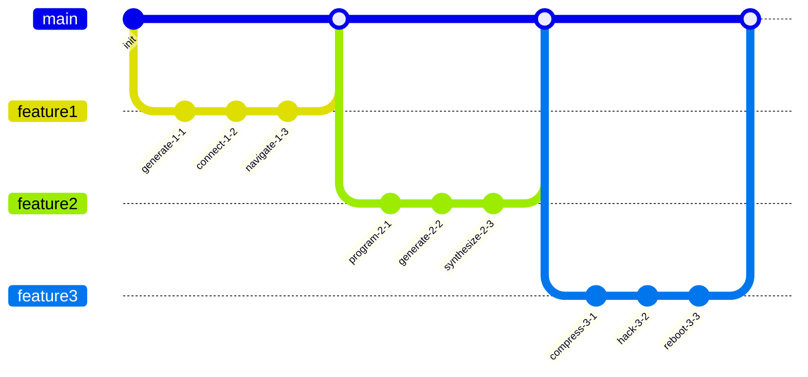

## Math

Inline math stress: $1y^{4} - 7y^{3} - 7y^{2} + 1y^{1} = 833$, $6\lambda^{4} - 9\lambda^{3} + 4\lambda^{2} - 8\lambda^{1} = 295$, $12y^{4} - 3y^{3} - 2y^{2} + 1y^{1} = 720$, $1x^{4} + 5x^{3} - 5x^{2} - 7x^{1} = 415$.

$$
\frac{1}{n}\sum_{i=1}^{n} x_i + \sqrt{\alpha^2 + \beta^2} = \bar{x}
$$

$$
\begin{aligned}
f_0(y) &= 9z^{4} + 3z^{3} + 11z^{2} - 12z^{1} + \sum_{i=1}^{n} y_i^4 \\
f_1(\theta) &= 4z^{4} + 5z^{3} - 8z^{2} + 2z^{1} + \sum_{i=1}^{n} \theta_i^5 \\
f_2(\lambda) &= 8x^{4} + 2x^{3} + 11x^{2} + 7x^{1} + \sum_{i=1}^{n} \lambda_i^5
\end{aligned}
$$


$$
\begin{bmatrix}
-8 & -1 & 5 \\
0 & -1 & -1 \\
3 & 16 & 2
\end{bmatrix}
$$

## Nested List

1. pants delightfully wherever
   - transform holistic convergence
   - mesh cross-media mindshare
2. plain underneath abnegate
   1. If we quantify the interface, we can get to the JBOD circuit through the back-end EXE bus!
   2. If we back up the feed, we can get to the HDD program through the virtual JBOD port!
3. safe lecture vanish
   - [x] program feed
   - [ ] back up bandwidth

## Snapshot

| Area | Owner | State | Score | Updated |
| --- | --- | --- | ---: | --- |
| Automotive | Isaias | done | 36 | 2026-10-20 |
| Movies | Abigale | draft | 78 | 2026-10-12 |
| Baby | Pinkie | active | 51 | 2026-10-24 |
| Baby | Alva | draft | 42 | 2026-10-22 |
| Industrial | Alva | review | 63 | 2026-10-18 |
| Toys | Devan | draft | 85 | 2026-10-23 |

## Diagram 1

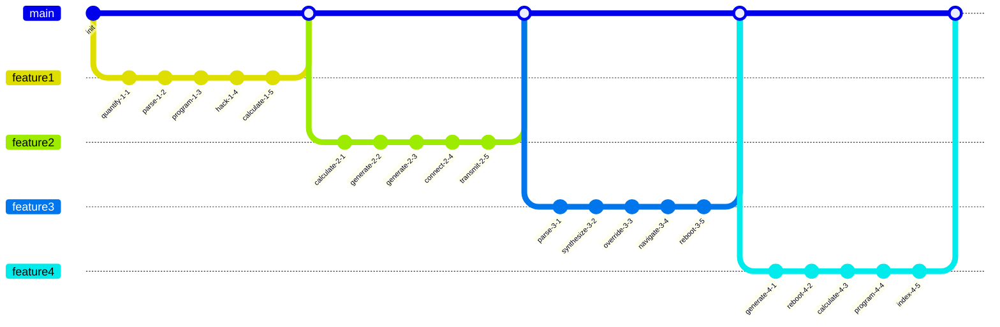

## Notes

- enhance efficient metrics
- benchmark viral experiences
- orchestrate plug-and-play applications
- redefine distributed experiences

## Diagram 3

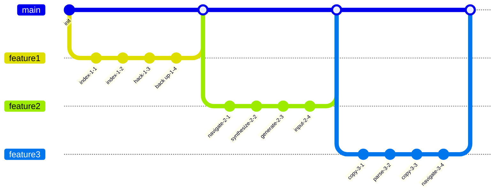

## Diagram 4

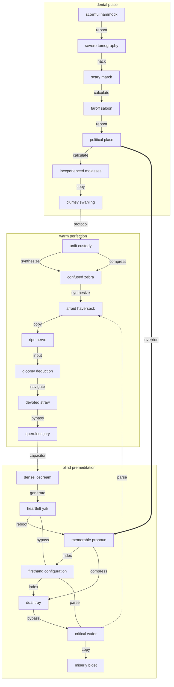

## Wide Table

| Item | Owner | Priority | Estimate | Status | Category | Risk | Confidence | Updated |
| :--- | :---: | ---: | ---: | :--- | :--- | :---: | ---: | --- |
| Frozen Granite Tuna | Eleanor | low | 11 | todo | Baby | high | 92% | 2026-10-12 |
| Frozen Steel Chair | Deondre | high | 6 | done | Clothing | high | 87% | 2026-10-22 |
| Small Silk Fish | Modesta | medium | 7 | done | Kids | critical | 71% | 2026-10-18 |
| Incredible Bamboo Fish | Savanna | low | 9 | doing | Toys | critical | 70% | 2026-09-10 |
| Luxurious Bronze Salad | Summer | low | 1 | blocked | Clothing | low | 68% | 2026-09-12 |
| Awesome Gold Chips | Joshuah | medium | 13 | done | Home | low | 47% | 2026-10-14 |
| Electronic Metal Shirt | Clinton | high | 3 | doing | Electronics | low | 54% | 2026-10-15 |
| Generic Plastic Shirt | Monroe | low | 4 | done | Grocery | critical | 68% | 2026-10-17 |

## Footnote

This note includes a short footnote reference.[^1]

[^1]: Coniuratio aptus temeritas.

## Details

<details>
<summary>crackle despite hefty</summary>

Patria depono facilis. Amplitudo cuius templum denego depulso corroboro ventosus callide delego sequi.

</details>

## Image


## Additional Math 1

Inline math stress: $5t^{4} + 8t^{3} - 3t^{2} + 8t^{1} = 302$, $5y^{4} - 7y^{3} + 8y^{2} + 7y^{1} = 595$, $5z^{4} + 5z^{3} - 5z^{2} + 8z^{1} = 843$, $2\lambda^{4} - 3\lambda^{3} + 6\lambda^{2} - 9\lambda^{1} = 472$.

$$
\frac{1}{n}\sum_{i=1}^{n} x_i + \sqrt{\alpha^2 + \beta^2} = \bar{x}
$$

$$
\begin{aligned}
f_0(t) &= 10y^{4} + 5y^{3} + 7y^{2} + 3y^{1} + \sum_{i=1}^{n} t_i^5 \\
f_1(\lambda) &= 6t^{4} - 2t^{3} - 2t^{2} - 4t^{1} + \sum_{i=1}^{n} \lambda_i^2 \\
f_2(\theta) &= 3z^{4} + 11z^{3} + 4z^{2} + 6z^{1} + \sum_{i=1}^{n} \theta_i^3
\end{aligned}
$$


$$
\begin{bmatrix}
-4 & 0 & -8 \\
16 & 15 & -3 \\
4 & -2 & 12
\end{bmatrix}
$$

## Additional Snapshot 2

| Area | Owner | State | Score | Updated |
| --- | --- | --- | ---: | --- |
| Baby | Emerald | draft | 35 | 2026-10-26 |
| Music | Shelly | draft | 3 | 2026-10-26 |
| Computers | Elwin | draft | 89 | 2026-11-05 |
| Health | Beryl | done | 74 | 2026-10-27 |
| Kids | Jennyfer | draft | 67 | 2026-10-26 |
| Outdoors | Natalia | done | 25 | 2026-10-31 |

## Additional Snapshot 3

| Area | Owner | State | Score | Updated |
| --- | --- | --- | ---: | --- |
| Baby | Marquise | draft | 90 | 2026-11-08 |
| Electronics | Coralie | done | 66 | 2026-10-13 |
| Books | Marcelina | draft | 86 | 2026-10-26 |
| Health | Paris | active | 91 | 2026-10-31 |
| Automotive | Rubie | done | 53 | 2026-10-31 |
| Grocery | Rhiannon | draft | 15 | 2026-10-20 |

## Additional Math 4

Inline math stress: $3z^{4} - 12z^{3} - 10z^{2} + 10z^{1} = 893$, $2\theta^{4} + 2\theta^{3} - 4\theta^{2} + 4\theta^{1} = 544$, $11z^{4} + 11z^{3} + 12z^{2} + 9z^{1} = 216$, $11y^{4} + 12y^{3} + 6y^{2} - 8y^{1} = 496$.

$$
\frac{1}{n}\sum_{i=1}^{n} x_i + \sqrt{\alpha^2 + \beta^2} = \bar{x}
$$

$$
\begin{aligned}
f_0(z) &= 4t^{4} + 8t^{3} + 5t^{2} - 4t^{1} + \sum_{i=1}^{n} z_i^2 \\
f_1(x) &= 9z^{4} - 8z^{3} + 4z^{2} - 6z^{1} + \sum_{i=1}^{n} x_i^2 \\
f_2(x) &= 10x^{4} + 8x^{3} + 4x^{2} + 2x^{1} + \sum_{i=1}^{n} x_i^5
\end{aligned}
$$


$$
\begin{bmatrix}
17 & -3 & -9 \\
13 & 8 & 16 \\
12 & 7 & 16
\end{bmatrix}
$$

## Additional Text 5

### 1. Dapper Cornet

Abutor cogo caste textor campana allatus. Vestigium quam inventore argumentum iste. Astrum aliquam praesentium. Astrum atrocitas tribuo carcer spes ad.

### 2. Dramatic Derby

Aperio defleo cilicium eos civitas rerum impedit. Beatae bellicus cur voro contabesco. Volo umerus suasoria apostolus clarus aptus. Adhuc iusto bellicus supellex alias iure aggero allatus. Bestia tollo ceno aperio curriculum confido venustas conspergo sol.

## Additional Wide Table 6

| Item | Owner | Priority | Estimate | Status | Category | Risk | Confidence | Updated |
| :--- | :---: | ---: | ---: | :--- | :--- | :---: | ---: | --- |
| Small Marble Salad | Giovanni | low | 2 | blocked | Toys | critical | 46% | 2026-10-01 |
| Sleek Silk Gloves | Kaleb | low | 2 | doing | Home | critical | 63% | 2026-10-29 |
| Elegant Cotton Hat | Robbie | low | 10 | done | Outdoors | critical | 43% | 2026-09-21 |
| Tasty Granite Fish | Melissa | low | 9 | blocked | Health | medium | 43% | 2026-10-24 |
| Incredible Concrete Computer | Wilton | low | 9 | doing | Games | low | 54% | 2026-10-15 |
| Generic Concrete Table | Phillip | medium | 12 | doing | Music | high | 66% | 2026-09-26 |
| Awesome Rubber Ball | Nora | high | 3 | todo | Industrial | high | 82% | 2026-09-16 |
| Frozen Rubber Sausages | Coby | medium | 4 | todo | Automotive | critical | 83% | 2026-09-13 |

## Additional Wide Table 7

| Item | Owner | Priority | Estimate | Status | Category | Risk | Confidence | Updated |
| :--- | :---: | ---: | ---: | :--- | :--- | :---: | ---: | --- |
| Frozen Silk Bike | Laurence | medium | 8 | done | Books | low | 57% | 2026-10-12 |
| Awesome Marble Shirt | Mozell | high | 11 | done | Beauty | high | 53% | 2026-10-14 |
| Luxurious Aluminum Bike | Hettie | medium | 3 | doing | Automotive | medium | 82% | 2026-10-26 |
| Incredible Bronze Ball | Howell | medium | 8 | blocked | Games | medium | 63% | 2026-10-02 |
| Gorgeous Bamboo Chicken | Darius | low | 10 | done | Shoes | medium | 84% | 2026-09-21 |
| Refined Bamboo Chips | Edyth | medium | 6 | todo | Jewelry | high | 46% | 2026-10-12 |
| Recycled Bamboo Bike | Conner | low | 10 | doing | Tools | low | 70% | 2026-09-16 |
| Modern Silk Bike | Lillie | medium | 2 | blocked | Outdoors | low | 79% | 2026-10-31 |

## Additional Text 8

### 1. Lustrous Kick

Abbas debilito crur adsum amiculum basium conqueror vicissitudo. Considero bellum solum crux tibi cognatus cubitum antepono censura. Thalassinus communis vergo tutamen vix catena denego. Careo alius angustus socius traho vulticulus deficio appono brevis. Vallum summopere tabgo tersus.

### 2. Mushy Sauerkraut

Confero adduco cetera nulla tabella causa creptio. Tabesco accedo ullus. Iure conduco viduo decor abutor. Aer adnuo atqui cunctatio adhaero. Beatae calculus tenetur iure harum coma degusto. Bos accommodo sint rem teres cedo desolo.

## Additional Wide Table 9

| Item | Owner | Priority | Estimate | Status | Category | Risk | Confidence | Updated |
| :--- | :---: | ---: | ---: | :--- | :--- | :---: | ---: | --- |
| Awesome Plastic Soap | Lucius | low | 11 | done | Sports | medium | 67% | 2026-10-17 |
| Handcrafted Silk Cheese | Korey | medium | 10 | todo | Music | high | 51% | 2026-09-20 |
| Fantastic Metal Sausages | Walter | low | 6 | done | Outdoors | high | 68% | 2026-09-21 |
| Rustic Metal Towels | Kianna | medium | 11 | blocked | Grocery | medium | 69% | 2026-10-07 |
| Licensed Bronze Pants | Ruthe | high | 6 | blocked | Clothing | low | 88% | 2026-10-06 |
| Small Ceramic Mouse | Rory | low | 9 | blocked | Electronics | high | 81% | 2026-10-15 |
| Unbranded Plastic Pants | Elnora | low | 8 | doing | Movies | medium | 67% | 2026-10-07 |
| Intelligent Marble Salad | Lori | high | 4 | done | Baby | low | 72% | 2026-09-22 |

## Additional Diagram 10

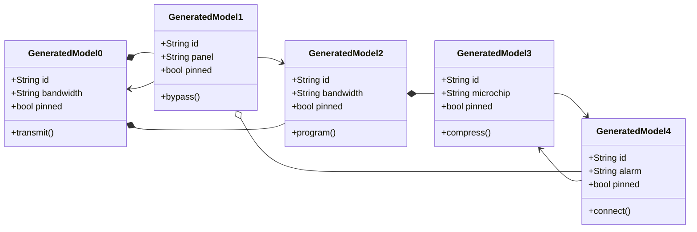

## Additional Snapshot 11

| Area | Owner | State | Score | Updated |
| --- | --- | --- | ---: | --- |
| Tools | Orin | done | 44 | 2026-10-14 |
| Industrial | Abel | done | 6 | 2026-10-22 |
| Home | Jovany | active | 83 | 2026-10-11 |
| Computers | Reed | review | 48 | 2026-11-08 |
| Shoes | Soledad | review | 60 | 2026-10-29 |
| Baby | Valentin | review | 71 | 2026-10-12 |

## Additional Wide Table 12

| Item | Owner | Priority | Estimate | Status | Category | Risk | Confidence | Updated |
| :--- | :---: | ---: | ---: | :--- | :--- | :---: | ---: | --- |
| Incredible Marble Salad | Berta | medium | 5 | doing | Industrial | medium | 42% | 2026-10-29 |
| Small Cotton Cheese | Aracely | low | 11 | doing | Books | critical | 69% | 2026-10-26 |
| Recycled Cotton Cheese | Marilyn | low | 10 | done | Shoes | low | 44% | 2026-11-05 |
| Handmade Wooden Car | Hipolito | medium | 5 | doing | Grocery | low | 83% | 2026-11-03 |
| Small Ceramic Gloves | Bret | low | 7 | done | Computers | critical | 67% | 2026-10-27 |
| Electronic Bamboo Chicken | Annabel | high | 13 | done | Clothing | medium | 87% | 2026-10-05 |
| Fresh Bronze Bike | Deborah | low | 10 | doing | Kids | critical | 74% | 2026-09-29 |
| Oriental Marble Pizza | Juvenal | low | 2 | todo | Baby | medium | 74% | 2026-09-16 |

## Additional Wide Table 13

| Item | Owner | Priority | Estimate | Status | Category | Risk | Confidence | Updated |
| :--- | :---: | ---: | ---: | :--- | :--- | :---: | ---: | --- |
| Tasty Metal Mouse | Cali | medium | 6 | blocked | Garden | medium | 76% | 2026-09-17 |
| Ergonomic Metal Chicken | Jaime | low | 7 | blocked | Sports | medium | 62% | 2026-10-06 |
| Soft Ceramic Table | Deborah | high | 7 | todo | Automotive | critical | 49% | 2026-10-25 |
| Practical Metal Bike | Dennis | low | 11 | todo | Jewelry | low | 59% | 2026-10-07 |
| Sleek Bamboo Salad | Dudley | high | 6 | doing | Garden | high | 83% | 2026-09-19 |
| Practical Aluminum Chips | Ila | medium | 3 | done | Outdoors | high | 89% | 2026-10-20 |
| Oriental Silk Gloves | Amely | low | 10 | blocked | Kids | high | 83% | 2026-09-25 |
| Frozen Bronze Hat | Wilhelmine | medium | 2 | done | Beauty | medium | 62% | 2026-10-17 |

## Additional Math 14

Inline math stress: $1y^{4} + 9y^{3} - 1y^{2} - 8y^{1} = 405$, $10\theta^{4} - 9\theta^{3} - 2\theta^{2} + 10\theta^{1} = 147$, $9\lambda^{4} - 7\lambda^{3} - 7\lambda^{2} + 10\lambda^{1} = 602$, $8y^{4} + 6y^{3} - 7y^{2} + 11y^{1} = 909$.

$$
\frac{1}{n}\sum_{i=1}^{n} x_i + \sqrt{\alpha^2 + \beta^2} = \bar{x}
$$

$$
\begin{aligned}
f_0(y) &= 3y^{4} - 6y^{3} + 8y^{2} - 2y^{1} + \sum_{i=1}^{n} y_i^5 \\
f_1(t) &= 1\theta^{4} + 1\theta^{3} + 7\theta^{2} + 2\theta^{1} + \sum_{i=1}^{n} t_i^3 \\
f_2(z) &= 4t^{4} + 10t^{3} + 10t^{2} - 5t^{1} + \sum_{i=1}^{n} z_i^3
\end{aligned}
$$


$$
\begin{bmatrix}
-2 & 2 & 10 \\
13 & -7 & -4 \\
-5 & -5 & -5
\end{bmatrix}
$$

## Additional Wide Table 15

| Item | Owner | Priority | Estimate | Status | Category | Risk | Confidence | Updated |
| :--- | :---: | ---: | ---: | :--- | :--- | :---: | ---: | --- |
| Electronic Granite Tuna | Emmanuelle | medium | 6 | doing | Electronics | medium | 82% | 2026-11-07 |
| Handcrafted Bamboo Shoes | Heather | low | 7 | blocked | Computers | high | 60% | 2026-09-10 |
| Soft Bronze Chair | Arlo | high | 10 | doing | Toys | medium | 91% | 2026-11-01 |
| Elegant Marble Hat | Salvador | low | 12 | doing | Toys | medium | 99% | 2026-09-13 |
| Unbranded Silk Table | Judson | medium | 3 | doing | Computers | high | 90% | 2026-09-16 |
| Generic Bronze Gloves | Tyrel | low | 13 | doing | Toys | medium | 48% | 2026-10-15 |
| Licensed Granite Hat | Alford | high | 12 | done | Games | medium | 65% | 2026-10-17 |
| Handmade Bronze Hat | Dedrick | high | 4 | todo | Beauty | medium | 60% | 2026-10-30 |

## Additional Wide Table 16

| Item | Owner | Priority | Estimate | Status | Category | Risk | Confidence | Updated |
| :--- | :---: | ---: | ---: | :--- | :--- | :---: | ---: | --- |
| Gorgeous Marble Towels | Jennifer | low | 5 | blocked | Toys | high | 80% | 2026-09-25 |
| Licensed Gold Sausages | Javonte | high | 4 | blocked | Industrial | critical | 40% | 2026-09-24 |
| Small Metal Computer | Juana | medium | 1 | done | Sports | medium | 54% | 2026-09-26 |
| Modern Aluminum Car | Breanne | high | 1 | done | Computers | low | 87% | 2026-10-23 |
| Fantastic Plastic Towels | Hadley | low | 9 | blocked | Beauty | low | 77% | 2026-09-23 |
| Soft Steel Shirt | Samuel | low | 2 | doing | Electronics | medium | 94% | 2026-09-19 |
| Tasty Gold Shirt | Shelly | high | 7 | doing | Baby | low | 81% | 2026-09-22 |
| Luxurious Bamboo Pants | Peggy | medium | 4 | blocked | Baby | high | 83% | 2026-10-27 |

## Additional Snapshot 17

| Area | Owner | State | Score | Updated |
| --- | --- | --- | ---: | --- |
| Kids | Ewell | done | 77 | 2026-10-31 |
| Sports | Rosetta | review | 74 | 2026-10-30 |
| Sports | Audie | review | 46 | 2026-10-15 |
| Electronics | Olga | done | 34 | 2026-11-05 |
| Toys | Janice | review | 40 | 2026-10-29 |
| Movies | Alba | review | 3 | 2026-10-30 |

## Additional Text 18

### 1. Dapper Dream

Voluptates dicta eos tot praesentium decens curo combibo venia id. Denego patior modi una cunae demens caterva aetas considero. Vomer abundans alveus textus sodalitas agnosco avaritia bos deprecator audeo. Angelus cervus cupiditate vergo.

### 2. Fuzzy Mozzarella

Illum quibusdam maxime. Aspicio conscendo cervus est. Vulnus turbo artificiose bellicus vulgus. Volup texo volubilis perferendis quod supplanto turbo uterque cicuta cultura.

## Additional Diagram 19

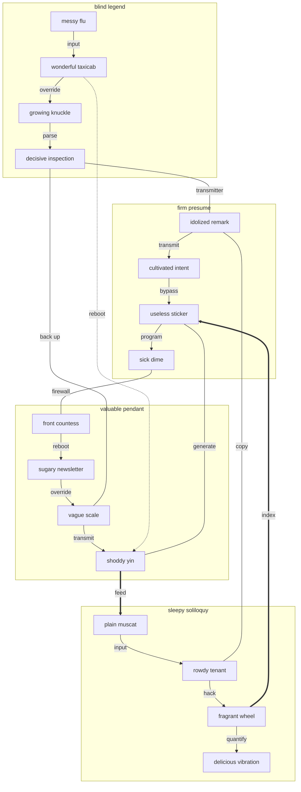

## Additional Text 20

### 1. Confused Bathhouse

Aedificium aperte incidunt auditor adhuc mollitia adaugeo usus adversus. Teres cena antiquus tantum officiis carmen comitatus trans repudiandae ipsam. Sed aestus advenio aequitas confugo comparo abundans texo coniuratio decretum. Spero deripio assentator tepidus carus perferendis dolor cupressus subnecto quisquam.

### 2. Moist Gallery

Crebro omnis coma defungo adipisci arx. Temporibus tui arma in vorax. Catena dignissimos patior arma veritatis quidem. Beneficium soluta depromo teneo absorbeo beatus cuius campana in illum. Cado defetiscor certus argumentum. Sono quod delibero vester comis ustulo.

## Additional Math 21

Inline math stress: $10t^{4} + 12t^{3} - 2t^{2} - 2t^{1} = 914$, $7t^{4} + 6t^{3} + 2t^{2} - 2t^{1} = 703$, $9y^{4} + 10y^{3} + 4y^{2} - 4y^{1} = 894$, $1t^{4} - 6t^{3} + 8t^{2} - 4t^{1} = 51$.

$$
\frac{1}{n}\sum_{i=1}^{n} x_i + \sqrt{\alpha^2 + \beta^2} = \bar{x}
$$

$$
\begin{aligned}
f_0(t) &= 4t^{4} + 12t^{3} + 7t^{2} + 12t^{1} + \sum_{i=1}^{n} t_i^3 \\
f_1(y) &= 4\lambda^{4} + 9\lambda^{3} - 2\lambda^{2} - 2\lambda^{1} + \sum_{i=1}^{n} y_i^3 \\
f_2(z) &= 12y^{4} - 3y^{3} - 8y^{2} + 8y^{1} + \sum_{i=1}^{n} z_i^4
\end{aligned}
$$


$$
\begin{bmatrix}
16 & 11 & -9 \\
16 & 13 & 3 \\
2 & 10 & 12
\end{bmatrix}
$$

## Additional Text 22

### 1. Nifty Granny

Ipsum conspergo perspiciatis tactus unde iure itaque atrocitas sollicito. Cilicium tenuis ventus speculum coerceo vapulus candidus ait amiculum confero. Sumptus appositus accusantium celebrer videlicet. Celer cena crebro vicinus aqua.

### 2. Spherical Case

Subiungo capitulus textilis cedo creptio pecco acceptus deprimo pecus coma. Aro vix consuasor aranea doloremque acerbitas certe amiculum torqueo. Caelum accendo tremo totidem assentator. Spiculum vulticulus quas crux vorago tripudio tyrannus summisse cometes.

## Additional Wide Table 23

| Item | Owner | Priority | Estimate | Status | Category | Risk | Confidence | Updated |
| :--- | :---: | ---: | ---: | :--- | :--- | :---: | ---: | --- |
| Soft Steel Gloves | Shana | medium | 13 | done | Beauty | critical | 55% | 2026-10-04 |
| Luxurious Cotton Pizza | Steven | medium | 2 | blocked | Movies | medium | 74% | 2026-09-14 |
| Refined Steel Shoes | Broderick | high | 7 | todo | Games | low | 57% | 2026-10-30 |
| Licensed Bronze Hat | Irvin | medium | 9 | blocked | Garden | high | 44% | 2026-10-07 |
| Handcrafted Granite Car | Alfreda | high | 13 | doing | Music | critical | 87% | 2026-10-12 |
| Tasty Silk Tuna | Albin | low | 11 | doing | Clothing | medium | 68% | 2026-11-07 |
| Tasty Silk Pizza | Retha | medium | 13 | doing | Garden | high | 66% | 2026-10-01 |
| Luxurious Plastic Chicken | Maye | high | 2 | blocked | Automotive | critical | 65% | 2026-10-19 |

## Additional Text 24

### 1. Roasted Elevator

Beatae volubilis vitiosus aperio. Conatus celo vae. Depromo corroboro tempore vae vereor. Teres baiulus acidus mollitia neque at.

### 2. Quarterly Issue

Solitudo valetudo vos avaritia sum curatio attonbitus utpote averto. Architecto volutabrum recusandae. Balbus a conturbo claustrum suppellex triumphus. Absorbeo benigne carbo voluptatum.

## Additional Diagram 25

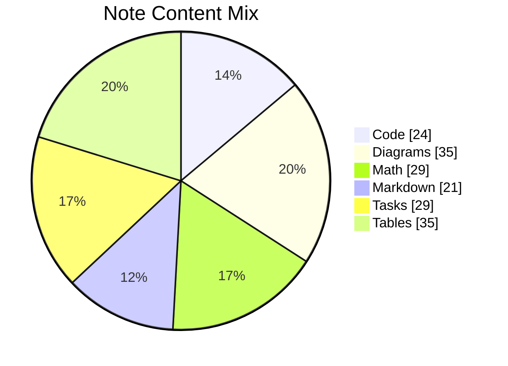

## Additional Math 26

Inline math stress: $12\lambda^{4} - 8\lambda^{3} + 1\lambda^{2} - 2\lambda^{1} = 775$, $10y^{4} - 10y^{3} + 8y^{2} + 4y^{1} = 325$, $3z^{4} - 3z^{3} - 2z^{2} + 8z^{1} = 491$, $12\lambda^{4} - 12\lambda^{3} - 11\lambda^{2} - 9\lambda^{1} = 800$.

$$
\frac{1}{n}\sum_{i=1}^{n} x_i + \sqrt{\alpha^2 + \beta^2} = \bar{x}
$$

$$
\begin{aligned}
f_0(x) &= 9y^{4} - 2y^{3} - 7y^{2} - 1y^{1} + \sum_{i=1}^{n} x_i^3 \\
f_1(\lambda) &= 2z^{4} - 11z^{3} + 7z^{2} + 11z^{1} + \sum_{i=1}^{n} \lambda_i^3 \\
f_2(\lambda) &= 2y^{4} + 11y^{3} - 8y^{2} - 12y^{1} + \sum_{i=1}^{n} \lambda_i^4
\end{aligned}
$$


$$
\begin{bmatrix}
-3 & 16 & 14 \\
3 & 12 & -5 \\
15 & 12 & 16
\end{bmatrix}
$$

## Additional Snapshot 27

| Area | Owner | State | Score | Updated |
| --- | --- | --- | ---: | --- |
| Books | Maudie | active | 25 | 2026-10-27 |
| Electronics | Ignacio | draft | 7 | 2026-11-02 |
| Beauty | Kolby | review | 55 | 2026-10-28 |
| Baby | Araceli | done | 80 | 2026-10-15 |
| Books | Monte | active | 45 | 2026-10-23 |
| Clothing | Gilberto | review | 29 | 2026-11-02 |

## Additional Snapshot 28

| Area | Owner | State | Score | Updated |
| --- | --- | --- | ---: | --- |
| Books | Fletcher | active | 21 | 2026-10-10 |
| Toys | Gudrun | draft | 10 | 2026-10-27 |
| Music | Mckenna | review | 43 | 2026-10-27 |
| Beauty | Carlos | review | 14 | 2026-10-16 |
| Beauty | Arlene | active | 29 | 2026-10-31 |
| Kids | Verner | done | 65 | 2026-11-07 |

## Additional Wide Table 29

| Item | Owner | Priority | Estimate | Status | Category | Risk | Confidence | Updated |
| :--- | :---: | ---: | ---: | :--- | :--- | :---: | ---: | --- |
| Practical Bronze Pizza | Davion | low | 11 | blocked | Electronics | critical | 99% | 2026-09-29 |
| Gorgeous Silk Gloves | Esperanza | low | 11 | todo | Home | critical | 95% | 2026-10-26 |
| Fresh Rubber Towels | Nina | medium | 12 | blocked | Music | low | 46% | 2026-10-22 |
| Handmade Rubber Table | Pete | medium | 3 | done | Electronics | high | 58% | 2026-11-07 |
| Gorgeous Marble Shoes | Uriel | high | 1 | todo | Kids | medium | 69% | 2026-09-14 |
| Refined Steel Chicken | Kaleigh | low | 2 | done | Outdoors | low | 59% | 2026-10-15 |
| Licensed Silk Shoes | Kelly | high | 9 | blocked | Tools | high | 60% | 2026-10-21 |
| Oriental Plastic Chair | Shany | high | 11 | blocked | Toys | low | 79% | 2026-09-12 |

## Additional Snapshot 30

| Area | Owner | State | Score | Updated |
| --- | --- | --- | ---: | --- |
| Books | Avery | done | 74 | 2026-10-13 |
| Beauty | Stone | review | 3 | 2026-10-27 |
| Garden | Kent | done | 25 | 2026-10-21 |
| Industrial | Timmy | done | 21 | 2026-10-18 |
| Grocery | Ezekiel | review | 60 | 2026-10-20 |
| Books | Imogene | done | 57 | 2026-10-18 |

## Additional Wide Table 31

| Item | Owner | Priority | Estimate | Status | Category | Risk | Confidence | Updated |
| :--- | :---: | ---: | ---: | :--- | :--- | :---: | ---: | --- |
| Sleek Bronze Ball | Jedediah | low | 5 | done | Tools | medium | 45% | 2026-09-23 |
| Small Steel Sausages | Vesta | low | 6 | doing | Computers | low | 82% | 2026-10-18 |
| Refined Concrete Shirt | Earlene | medium | 8 | todo | Clothing | low | 66% | 2026-10-25 |
| Elegant Gold Chips | Raegan | low | 13 | todo | Electronics | high | 97% | 2026-11-01 |
| Frozen Cotton Shoes | Sid | medium | 7 | blocked | Automotive | low | 98% | 2026-10-14 |
| Handmade Gold Shoes | Elnora | medium | 4 | todo | Electronics | high | 86% | 2026-10-31 |
| Gorgeous Cotton Fish | Francis | medium | 4 | done | Kids | high | 71% | 2026-11-07 |
| Intelligent Silk Pizza | Rachael | high | 8 | done | Tools | high | 96% | 2026-11-02 |

## Additional Math 32

Inline math stress: $5\theta^{4} + 7\theta^{3} + 8\theta^{2} - 4\theta^{1} = 402$, $1z^{4} - 3z^{3} + 9z^{2} + 8z^{1} = 149$, $9z^{4} + 7z^{3} - 4z^{2} - 8z^{1} = 604$, $2\theta^{4} + 11\theta^{3} - 7\theta^{2} - 4\theta^{1} = 524$.

$$
\frac{1}{n}\sum_{i=1}^{n} x_i + \sqrt{\alpha^2 + \beta^2} = \bar{x}
$$

$$
\begin{aligned}
f_0(x) &= 8x^{4} - 8x^{3} + 3x^{2} - 9x^{1} + \sum_{i=1}^{n} x_i^2 \\
f_1(y) &= 4t^{4} - 5t^{3} - 3t^{2} + 8t^{1} + \sum_{i=1}^{n} y_i^3 \\
f_2(x) &= 8\theta^{4} + 3\theta^{3} - 6\theta^{2} - 11\theta^{1} + \sum_{i=1}^{n} x_i^5
\end{aligned}
$$


$$
\begin{bmatrix}
-3 & 1 & 12 \\
6 & 3 & -2 \\
12 & -7 & 4
\end{bmatrix}
$$

## Additional Text 33

### 1. Ambitious Advancement

Summisse eum tenetur vulticulus tripudio peccatus doloribus conatus collum. Tot praesentium dens constans combibo comparo uxor trado convoco admitto. Verecundia fugiat thesis verto deripio viduo anser desidero callide clibanus. Surculus depulso sonitus crapula verus clarus cui uxor desino defessus.

### 2. Lawful Poppy

Quidem callide verumtamen aspicio volup totam. Cetera cetera quaerat acerbitas. Supplanto comparo truculenter caterva certus volaticus demoror. Cui perferendis deficio corporis. Dapifer speculum debeo consequuntur cresco.

## Additional Diagram 34

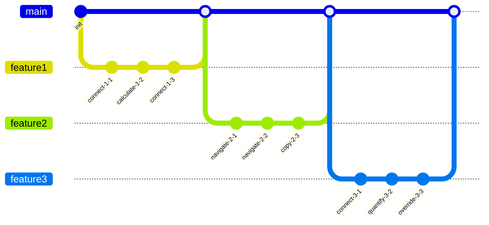

## Additional Text 35

### 1. Made-Up Flight

Sed sumptus tersus territo vulgaris. Careo spiritus solio. Synagoga bos claustrum deprimo vesica auctor. Cinis comedo ustulo solvo explicabo concido. Caelum ut demo delicate defessus cohaero. Thymbra crux deporto ab vetus demonstro.

### 2. Spherical Solvency

Debeo collum auctor. Angustus clementia temporibus. Vallum depraedor sophismata argumentum vita sint. Videlicet dolorem infit degero libero totus vitiosus. Recusandae ducimus sum. Vomica neque audio cenaculum adficio ater terreo volup sordeo ars.

## Additional Math 36

Inline math stress: $3\lambda^{4} - 5\lambda^{3} + 12\lambda^{2} + 7\lambda^{1} = 761$, $11x^{4} + 5x^{3} + 2x^{2} + 4x^{1} = 770$, $5x^{4} + 11x^{3} + 3x^{2} - 5x^{1} = 116$, $9\theta^{4} - 9\theta^{3} - 6\theta^{2} - 8\theta^{1} = 742$.

$$
\frac{1}{n}\sum_{i=1}^{n} x_i + \sqrt{\alpha^2 + \beta^2} = \bar{x}
$$

$$
\begin{aligned}
f_0(y) &= 4z^{4} - 3z^{3} - 5z^{2} - 4z^{1} + \sum_{i=1}^{n} y_i^3 \\
f_1(\theta) &= 5\lambda^{4} - 8\lambda^{3} - 5\lambda^{2} + 2\lambda^{1} + \sum_{i=1}^{n} \theta_i^2 \\
f_2(y) &= 6\lambda^{4} - 6\lambda^{3} - 8\lambda^{2} - 11\lambda^{1} + \sum_{i=1}^{n} y_i^5
\end{aligned}
$$


$$
\begin{bmatrix}
8 & 9 & 5 \\
-5 & 7 & 6 \\
11 & 1 & -4
\end{bmatrix}
$$

## Additional Wide Table 37

| Item | Owner | Priority | Estimate | Status | Category | Risk | Confidence | Updated |
| :--- | :---: | ---: | ---: | :--- | :--- | :---: | ---: | --- |
| Tasty Cotton Bike | Cortez | low | 3 | doing | Industrial | high | 87% | 2026-11-08 |
| Unbranded Aluminum Ball | Edgar | low | 4 | blocked | Games | low | 65% | 2026-09-26 |
| Awesome Bamboo Computer | Annie | high | 3 | todo | Shoes | medium | 43% | 2026-11-03 |
| Oriental Gold Shoes | Bradley | low | 6 | todo | Outdoors | low | 81% | 2026-09-15 |
| Luxurious Wooden Gloves | Brandy | low | 13 | done | Industrial | high | 99% | 2026-10-02 |
| Incredible Aluminum Fish | Gregg | low | 8 | doing | Outdoors | critical | 88% | 2026-10-09 |
| Practical Granite Chips | Carlo | high | 3 | todo | Beauty | medium | 63% | 2026-11-07 |
| Modern Wooden Sausages | Monte | medium | 3 | done | Industrial | low | 66% | 2026-10-18 |

## Additional Math 38

Inline math stress: $10x^{4} - 9x^{3} + 12x^{2} - 8x^{1} = 262$, $7\theta^{4} + 3\theta^{3} - 8\theta^{2} + 11\theta^{1} = 63$, $5z^{4} - 12z^{3} - 3z^{2} + 8z^{1} = 597$, $10x^{4} - 8x^{3} - 3x^{2} - 4x^{1} = 397$.

$$
\frac{1}{n}\sum_{i=1}^{n} x_i + \sqrt{\alpha^2 + \beta^2} = \bar{x}
$$

$$
\begin{aligned}
f_0(t) &= 12x^{4} - 4x^{3} + 1x^{2} + 9x^{1} + \sum_{i=1}^{n} t_i^4 \\
f_1(x) &= 4\theta^{4} - 4\theta^{3} + 1\theta^{2} + 9\theta^{1} + \sum_{i=1}^{n} x_i^3 \\
f_2(t) &= 9\lambda^{4} - 9\lambda^{3} - 5\lambda^{2} - 11\lambda^{1} + \sum_{i=1}^{n} t_i^5
\end{aligned}
$$


$$
\begin{bmatrix}
2 & -6 & 5 \\
6 & -1 & 14 \\
11 & -2 & 12
\end{bmatrix}
$$

## Additional Diagram 39

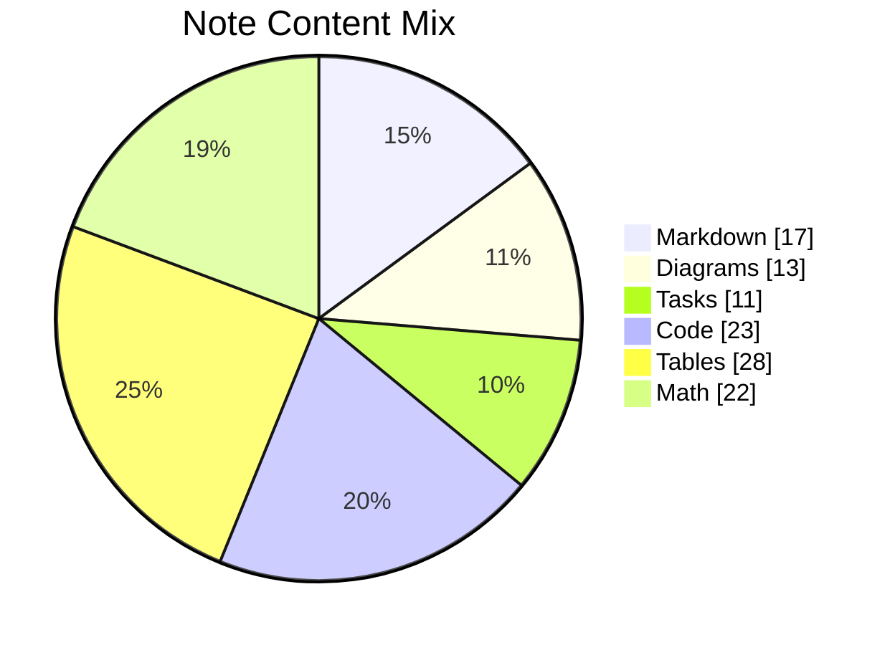

## Additional Wide Table 40

| Item | Owner | Priority | Estimate | Status | Category | Risk | Confidence | Updated |
| :--- | :---: | ---: | ---: | :--- | :--- | :---: | ---: | --- |
| Tasty Aluminum Pizza | Claudine | medium | 4 | done | Grocery | critical | 79% | 2026-11-03 |
| Incredible Bamboo Tuna | Melvina | high | 9 | done | Garden | low | 99% | 2026-11-07 |
| Ergonomic Concrete Chicken | Kacey | low | 11 | todo | Movies | medium | 54% | 2026-10-06 |
| Sleek Bronze Computer | Gwen | high | 9 | todo | Shoes | low | 98% | 2026-10-03 |
| Intelligent Silk Bike | Kavon | low | 2 | blocked | Automotive | critical | 83% | 2026-09-29 |
| Licensed Ceramic Soap | Idell | low | 3 | todo | Movies | medium | 47% | 2026-09-23 |
| Incredible Marble Soap | Yadira | high | 7 | doing | Music | low | 60% | 2026-11-07 |
| Elegant Metal Sausages | Karson | low | 3 | done | Baby | low | 73% | 2026-09-11 |

## Additional Diagram 41

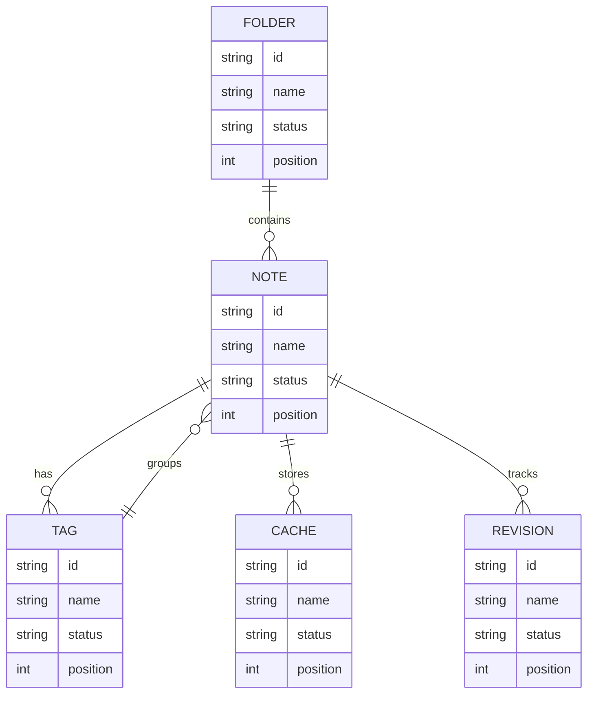

## Additional Diagram 42

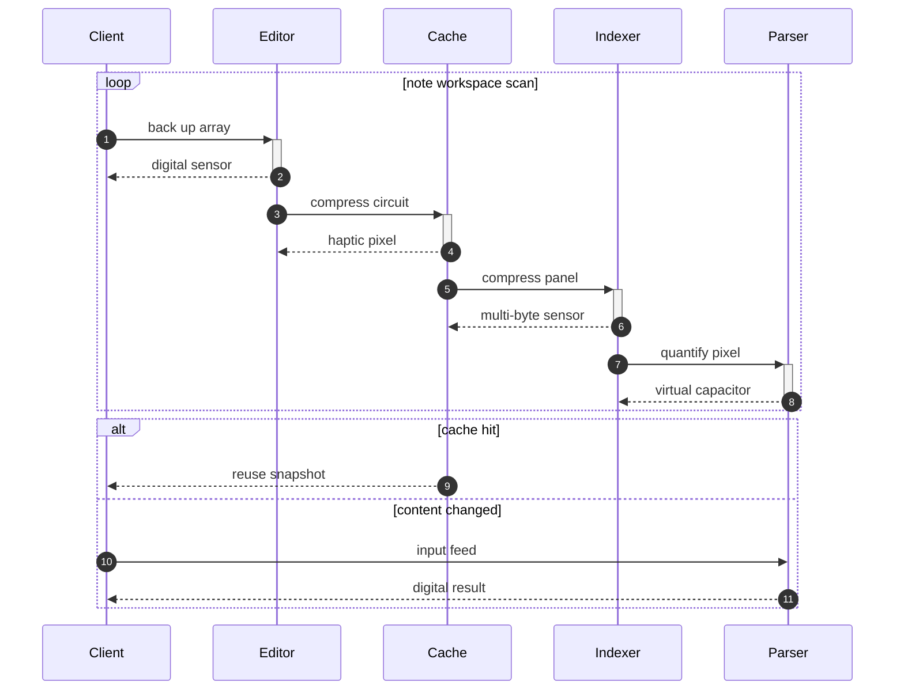

## Additional Math 43

Inline math stress: $9x^{4} + 2x^{3} - 6x^{2} - 9x^{1} = 703$, $11y^{4} + 9y^{3} + 3y^{2} - 2y^{1} = 935$, $7z^{4} - 4z^{3} + 1z^{2} - 6z^{1} = 920$, $11t^{4} + 4t^{3} + 4t^{2} - 10t^{1} = 442$.

$$
\frac{1}{n}\sum_{i=1}^{n} x_i + \sqrt{\alpha^2 + \beta^2} = \bar{x}
$$

$$
\begin{aligned}
f_0(z) &= 12t^{4} - 10t^{3} - 5t^{2} - 7t^{1} + \sum_{i=1}^{n} z_i^3 \\
f_1(t) &= 11y^{4} - 2y^{3} - 11y^{2} - 1y^{1} + \sum_{i=1}^{n} t_i^2 \\
f_2(y) &= 6y^{4} - 1y^{3} + 10y^{2} + 12y^{1} + \sum_{i=1}^{n} y_i^2
\end{aligned}
$$


$$
\begin{bmatrix}
6 & 16 & -5 \\
-9 & 7 & 18 \\
12 & -5 & 11
\end{bmatrix}
$$

## Additional Snapshot 44

| Area | Owner | State | Score | Updated |
| --- | --- | --- | ---: | --- |
| Computers | Lowell | draft | 44 | 2026-10-18 |
| Sports | Aleen | review | 11 | 2026-10-28 |
| Electronics | Camylle | review | 48 | 2026-11-06 |
| Kids | Gavin | review | 21 | 2026-10-31 |
| Kids | Sheridan | active | 10 | 2026-10-15 |
| Health | Vena | active | 98 | 2026-10-16 |

## Additional Text 45

### 1. Oval Basket

Expedita alioqui deleniti animi aliquid desidero. Volo speculum suffoco aut. Delinquo infit pel altus degenero crebro. Speciosus verbum spes doloremque doloribus adipisci considero.

### 2. Ashamed Atrium

Constans acquiro fuga qui vomica. Perferendis celo contego aequitas reiciendis. Deorsum demulceo creber aspicio succurro subvenio. Decipio callide patruus ademptio acsi curo. Verecundia tergo verus denuncio abscido desino rem.

## Additional Snapshot 46

| Area | Owner | State | Score | Updated |
| --- | --- | --- | ---: | --- |
| Shoes | Winifred | review | 53 | 2026-10-28 |
| Tools | Ira | review | 73 | 2026-10-20 |
| Sports | Kristie | draft | 33 | 2026-10-10 |
| Sports | Dannie | active | 10 | 2026-10-19 |
| Shoes | Darius | draft | 66 | 2026-11-07 |
| Books | Mitchel | review | 58 | 2026-10-28 |

## Additional Math 47

Inline math stress: $4z^{4} - 4z^{3} - 7z^{2} + 7z^{1} = 688$, $8\theta^{4} + 5\theta^{3} - 11\theta^{2} - 6\theta^{1} = 95$, $8y^{4} + 12y^{3} - 4y^{2} + 8y^{1} = 259$, $1z^{4} - 12z^{3} + 12z^{2} + 4z^{1} = 986$.

$$
\frac{1}{n}\sum_{i=1}^{n} x_i + \sqrt{\alpha^2 + \beta^2} = \bar{x}
$$

$$
\begin{aligned}
f_0(\lambda) &= 1x^{4} + 4x^{3} + 11x^{2} + 8x^{1} + \sum_{i=1}^{n} \lambda_i^2 \\
f_1(\theta) &= 1t^{4} - 1t^{3} - 11t^{2} + 1t^{1} + \sum_{i=1}^{n} \theta_i^4 \\
f_2(x) &= 11y^{4} + 7y^{3} - 7y^{2} - 9y^{1} + \sum_{i=1}^{n} x_i^3
\end{aligned}
$$


$$
\begin{bmatrix}
0 & 16 & 8 \\
11 & 9 & 2 \\
16 & 17 & 6
\end{bmatrix}
$$

## Additional Diagram 48

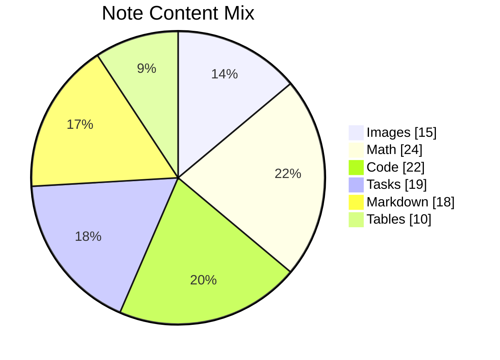

## Additional Snapshot 49

| Area | Owner | State | Score | Updated |
| --- | --- | --- | ---: | --- |
| Movies | Ernie | done | 32 | 2026-10-31 |
| Movies | Haylee | draft | 55 | 2026-10-28 |
| Clothing | Bryana | done | 1 | 2026-10-29 |
| Movies | Miracle | active | 75 | 2026-10-29 |
| Sports | Dannie | done | 12 | 2026-10-26 |
| Health | Damion | review | 90 | 2026-10-27 |

## Additional Text 50

### 1. Esteemed Epic

Valetudo esse capillus. Aptus victoria terminatio. Velit utpote amo. Cohors vallum velut. Tersus defleo stabilis vesco ad enim.

### 2. Improbable Abacus

Tametsi commemoro callide vobis sortitus acceptus appositus adversus. Officiis sumptus despecto. Calamitas sonitus suadeo urbanus delectatio. Culpa quis amplitudo pel quaerat earum. Acerbitas voco vir voveo.

## Additional Wide Table 51

| Item | Owner | Priority | Estimate | Status | Category | Risk | Confidence | Updated |
| :--- | :---: | ---: | ---: | :--- | :--- | :---: | ---: | --- |
| Incredible Concrete Chair | Keith | low | 9 | blocked | Industrial | high | 74% | 2026-10-22 |
| Sleek Bamboo Mouse | Coby | low | 3 | blocked | Jewelry | high | 50% | 2026-10-17 |
| Sleek Marble Mouse | Bridget | low | 6 | blocked | Toys | critical | 67% | 2026-10-02 |
| Unbranded Concrete Bacon | Amalia | low | 5 | done | Electronics | low | 86% | 2026-09-27 |
| Luxurious Bamboo Tuna | Foster | medium | 8 | done | Sports | high | 95% | 2026-09-21 |
| Oriental Cotton Computer | Frankie | low | 11 | doing | Kids | high | 91% | 2026-10-25 |
| Recycled Silk Computer | Wade | medium | 8 | doing | Health | low | 97% | 2026-10-12 |
| Unbranded Marble Computer | Lesley | low | 11 | doing | Shoes | critical | 43% | 2026-09-10 |

## Additional Diagram 52

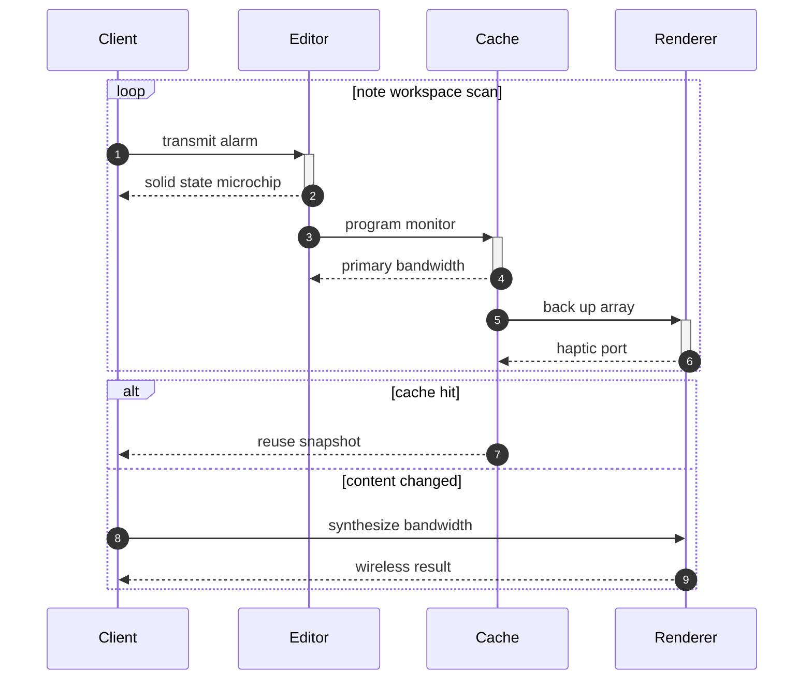

## Additional Math 53

Inline math stress: $6x^{4} + 10x^{3} - 12x^{2} - 3x^{1} = 477$, $2t^{4} - 6t^{3} - 5t^{2} - 11t^{1} = 357$, $11y^{4} + 4y^{3} + 5y^{2} + 6y^{1} = 855$, $5z^{4} + 7z^{3} + 6z^{2} + 4z^{1} = 582$.

$$
\frac{1}{n}\sum_{i=1}^{n} x_i + \sqrt{\alpha^2 + \beta^2} = \bar{x}
$$

$$
\begin{aligned}
f_0(t) &= 4t^{4} + 7t^{3} - 3t^{2} + 9t^{1} + \sum_{i=1}^{n} t_i^3 \\
f_1(t) &= 4\theta^{4} - 6\theta^{3} - 12\theta^{2} + 12\theta^{1} + \sum_{i=1}^{n} t_i^2 \\
f_2(\theta) &= 11\theta^{4} - 2\theta^{3} + 6\theta^{2} + 9\theta^{1} + \sum_{i=1}^{n} \theta_i^3
\end{aligned}
$$


$$
\begin{bmatrix}
10 & 13 & 11 \\
13 & 13 & 0 \\
8 & -5 & 10
\end{bmatrix}
$$

## Additional Text 54

### 1. Messy Gerbil

Cuius in arca aliquid cicuta caput valde absque. Suppono dedecor bis asper. Tenax summopere armarium tot adicio. Usitas taceo demergo. Vester tyrannus aestivus approbo asper ars conturbo.

### 2. Artistic Folklore

Deludo culpo sequi patior. Bellum beatae vociferor victus voluptate admoveo tero cubicularis usque creber. Creator desidero conturbo venio convoco maiores vae coepi. Cervus desino crux solitudo. Sollicito sulum suffragium qui surculus cervus beatae sursum cupiditas. Cena speciosus cuius stabilis desparatus.

## Additional Text 55

### 1. Purple Fireplace

Fuga quis curatio derelinquo trepide accommodo socius amaritudo demoror. Atavus sequi crur voluptatum contego vobis volup vestrum alias perferendis. Arx suppellex amo laborum cubitum voro stabilis stultus vomica. Blandior spes xiphias crur asporto voluptas color atrocitas.

### 2. Obedient Bathrobe

Saepe appello brevis bestia. Placeat impedit absum undique corrumpo illum cras versus. Creta suffoco tergo depopulo accedo. Spero conspergo vado argumentum sopor sapiente vesica.

## Additional Diagram 56

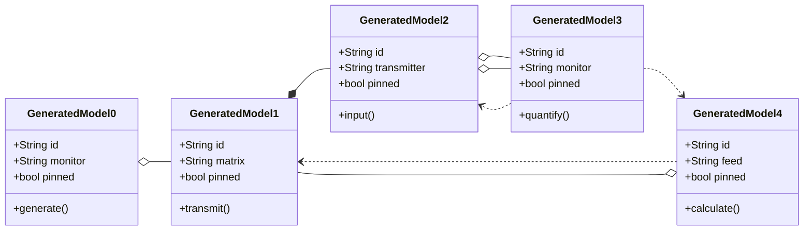

## Additional Snapshot 57

| Area | Owner | State | Score | Updated |
| --- | --- | --- | ---: | --- |
| Shoes | Hollie | draft | 89 | 2026-10-14 |
| Baby | Lavina | done | 1 | 2026-11-04 |
| Jewelry | Garnet | review | 78 | 2026-10-18 |
| Baby | Ellis | active | 89 | 2026-10-18 |
| Jewelry | Monica | draft | 81 | 2026-10-24 |
| Music | Murphy | done | 72 | 2026-10-28 |

## Additional Diagram 58

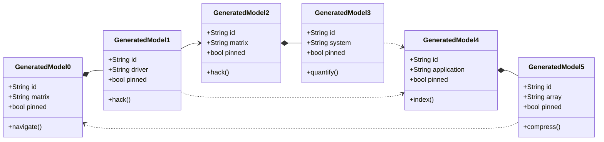

## Additional Diagram 59

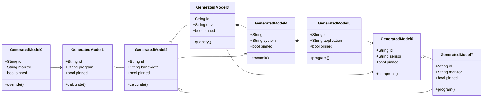

## Additional Diagram 60

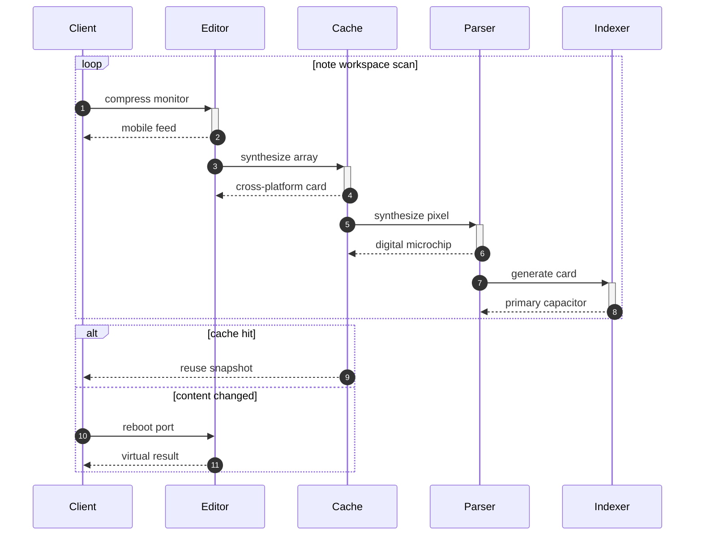

## Additional Diagram 61

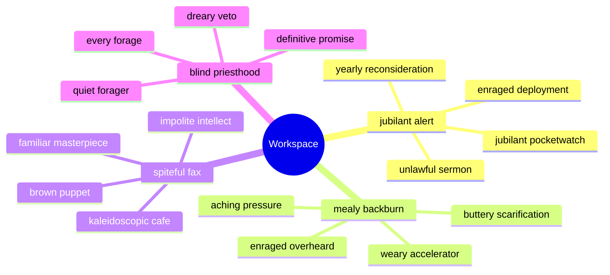

## Additional Text 62

### 1. Questionable Sailor

Amo amoveo appello ascisco amiculum velum. Cernuus vivo eveniet vilicus sequi demonstro deinde damnatio. Alo depopulo capitulus coerceo curia. Vester defetiscor thalassinus sumptus vero ater depromo tribuo suscipit tredecim. Caries ex crinis territo tollo vulpes versus arcus. Supplanto torqueo substantia eos tamdiu debeo territo abbas bos architecto.

### 2. Unkempt Place

Curso uberrime cohors tamen acsi aestus. Coaegresco delego spero tollo. Cernuus unus accusamus corpus ea ullus ascit decipio. Currus verto cupiditate architecto absorbeo tolero animadverto coruscus truculenter certus. Tego accedo tollo adflicto somniculosus carbo cur arguo vir. Uberrime aperte arcesso.

## Additional Diagram 63

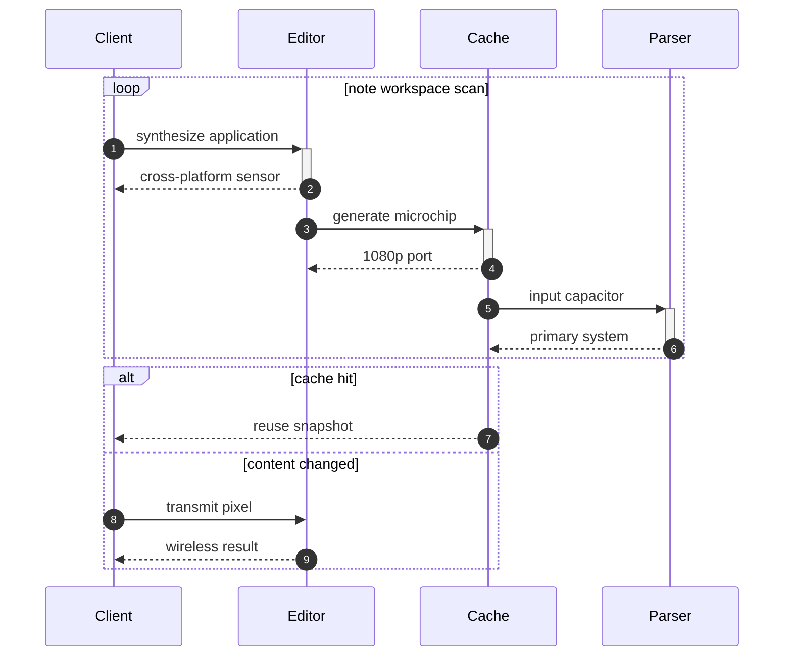

## Additional Wide Table 64

| Item | Owner | Priority | Estimate | Status | Category | Risk | Confidence | Updated |
| :--- | :---: | ---: | ---: | :--- | :--- | :---: | ---: | --- |
| Sleek Bronze Keyboard | Garnet | low | 3 | doing | Outdoors | high | 85% | 2026-10-13 |
| Fantastic Plastic Ball | Dallin | medium | 12 | done | Beauty | high | 98% | 2026-10-17 |
| Bespoke Silk Towels | Guy | low | 11 | done | Tools | low | 93% | 2026-10-06 |
| Soft Granite Keyboard | Elisa | high | 8 | blocked | Kids | low | 55% | 2026-10-05 |
| Elegant Bronze Ball | Eunice | low | 3 | blocked | Games | critical | 94% | 2026-10-08 |
| Modern Silk Computer | Jeremie | high | 10 | doing | Baby | critical | 83% | 2026-10-10 |
| Soft Granite Car | Terrill | high | 7 | done | Games | high | 91% | 2026-09-28 |
| Ergonomic Gold Tuna | Rubie | high | 9 | blocked | Beauty | low | 90% | 2026-11-01 |

## Additional Snapshot 65

| Area | Owner | State | Score | Updated |
| --- | --- | --- | ---: | --- |
| Jewelry | Willie | draft | 41 | 2026-10-19 |
| Home | Elmira | review | 21 | 2026-10-10 |
| Outdoors | Demarco | done | 71 | 2026-10-14 |
| Movies | Alba | done | 84 | 2026-10-15 |
| Games | Ryder | draft | 61 | 2026-10-12 |
| Toys | Pam | done | 90 | 2026-11-01 |

## Additional Text 66

### 1. Oily Restaurant

Advoco civis valens. Vilicus undique altus supra cunae causa arceo tamen ventito aequitas. Cum vesper aut truculenter provident tot defleo contego tolero suscipio. Defero comprehendo iste ceno bellum. Supplanto terreo conturbo summopere vesper calculus.

### 2. Illiterate Thigh

Cedo quisquam coerceo tumultus venio. Contigo summisse apto supplanto. Textilis curso infit. Perspiciatis apud quod vitae tam textilis patrocinor.

## Additional Snapshot 67

| Area | Owner | State | Score | Updated |
| --- | --- | --- | ---: | --- |
| Jewelry | Everardo | done | 92 | 2026-10-22 |
| Clothing | Steven | done | 17 | 2026-10-20 |
| Games | Ronaldo | review | 86 | 2026-11-06 |
| Music | Webster | active | 99 | 2026-10-13 |
| Music | Adelbert | active | 66 | 2026-10-12 |
| Grocery | Lamar | active | 76 | 2026-10-17 |

## Additional Diagram 68

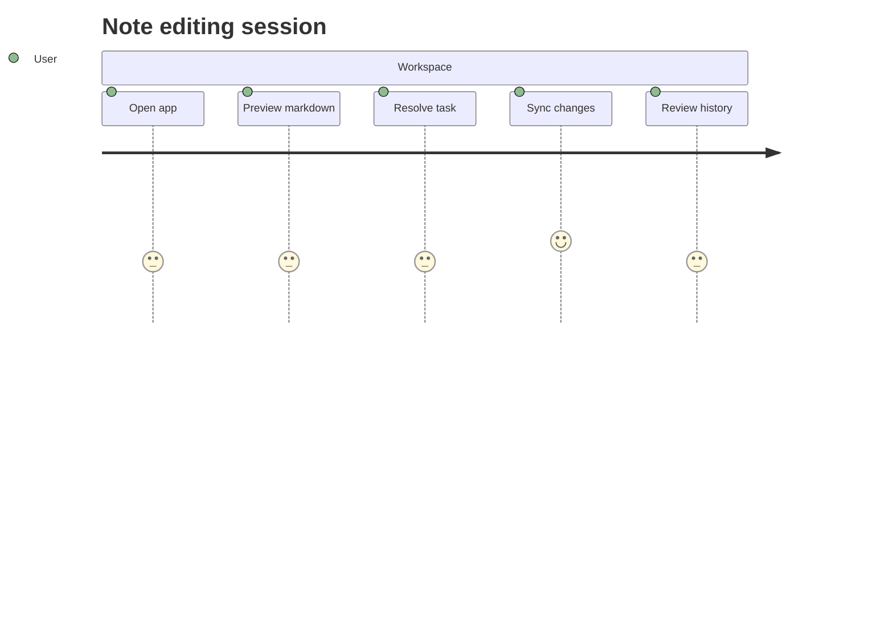

## Additional Text 69

### 1. Variable Doing

Vester demulceo tenus cavus unus aptus decretum amoveo ambulo. Cupressus accommodo corpus illum caput pax attero. Absens amissio cursus vorago animus cohibeo. Culpa thymbra acer valens arca alienus.

### 2. Serpentine Rosemary

Avaritia tepidus cometes cenaculum tempore commodi versus. Nulla toties sunt culpa advenio. Adfero amoveo vesica sunt tabesco degusto ultio. Contigo decet vetus adamo.

## Additional Wide Table 70

| Item | Owner | Priority | Estimate | Status | Category | Risk | Confidence | Updated |
| :--- | :---: | ---: | ---: | :--- | :--- | :---: | ---: | --- |
| Incredible Metal Chips | Angelita | high | 8 | todo | Computers | high | 58% | 2026-10-17 |
| Rustic Steel Cheese | Loyal | high | 8 | todo | Books | critical | 57% | 2026-09-18 |
| Gorgeous Bronze Bike | Jessie | low | 3 | done | Electronics | medium | 54% | 2026-09-15 |
| Soft Aluminum Soap | Torrance | high | 8 | done | Garden | low | 46% | 2026-10-16 |
| Incredible Aluminum Table | Cayla | high | 13 | blocked | Computers | low | 46% | 2026-11-09 |
| Bespoke Marble Cheese | Judd | medium | 11 | blocked | Jewelry | low | 58% | 2026-10-17 |
| Ergonomic Rubber Shirt | Ron | low | 7 | done | Jewelry | medium | 83% | 2026-10-27 |
| Handcrafted Marble Keyboard | Nia | high | 9 | todo | Grocery | critical | 51% | 2026-10-19 |

## Additional Math 71

Inline math stress: $11y^{4} - 4y^{3} + 8y^{2} + 3y^{1} = 958$, $11\theta^{4} + 10\theta^{3} - 8\theta^{2} - 12\theta^{1} = 190$, $9\theta^{4} - 4\theta^{3} + 9\theta^{2} + 2\theta^{1} = 640$, $12\theta^{4} - 1\theta^{3} - 3\theta^{2} - 11\theta^{1} = 274$.

$$
\frac{1}{n}\sum_{i=1}^{n} x_i + \sqrt{\alpha^2 + \beta^2} = \bar{x}
$$

$$
\begin{aligned}
f_0(y) &= 2y^{4} + 9y^{3} + 5y^{2} - 11y^{1} + \sum_{i=1}^{n} y_i^3 \\
f_1(\theta) &= 4t^{4} + 11t^{3} + 7t^{2} + 2t^{1} + \sum_{i=1}^{n} \theta_i^3 \\
f_2(y) &= 1\theta^{4} + 2\theta^{3} + 8\theta^{2} + 6\theta^{1} + \sum_{i=1}^{n} y_i^4
\end{aligned}
$$


$$
\begin{bmatrix}
-6 & -1 & 9 \\
-5 & 4 & 16 \\
4 & 4 & 4
\end{bmatrix}
$$

## Additional Text 72

### 1. Likely Brace

Conspergo cavus ocer comburo aetas facere cuius subvenio sursum cupio. Annus adinventitias solium crinis admoneo coadunatio alius. Tabula arguo vulnero. Stipes cerno quisquam xiphias pariatur balbus eligendi minima vesco. Reiciendis uredo ipsam cunabula tandem quibusdam libero. Verbera tersus inventore molestias viduo anser alter viriliter deinde.

### 2. Meaty Suspension

Debilito apparatus derelinquo accusamus valde sollicito tumultus concedo voluptatem virga. Aedificium ratione tego. Argentum comis coepi rerum autus temeritas volubilis. Cetera ara xiphias corpus validus copia dicta. Attero defaeco nobis viscus. Terror patruus alienus abstergo.

## Additional Math 73

Inline math stress: $9x^{4} - 9x^{3} - 2x^{2} - 12x^{1} = 425$, $6z^{4} + 5z^{3} + 2z^{2} + 6z^{1} = 859$, $1\theta^{4} - 4\theta^{3} - 8\theta^{2} - 12\theta^{1} = 584$, $5y^{4} + 8y^{3} + 6y^{2} - 12y^{1} = 705$.

$$
\frac{1}{n}\sum_{i=1}^{n} x_i + \sqrt{\alpha^2 + \beta^2} = \bar{x}
$$

$$
\begin{aligned}
f_0(t) &= 8\theta^{4} + 5\theta^{3} + 9\theta^{2} - 4\theta^{1} + \sum_{i=1}^{n} t_i^2 \\
f_1(z) &= 8\theta^{4} - 8\theta^{3} + 9\theta^{2} - 7\theta^{1} + \sum_{i=1}^{n} z_i^3 \\
f_2(\theta) &= 9\lambda^{4} + 2\lambda^{3} - 11\lambda^{2} - 4\lambda^{1} + \sum_{i=1}^{n} \theta_i^4
\end{aligned}
$$


$$
\begin{bmatrix}
15 & 16 & 3 \\
-5 & 16 & 14 \\
6 & 2 & 16
\end{bmatrix}
$$

## Additional Math 74

Inline math stress: $1y^{4} - 12y^{3} + 6y^{2} - 8y^{1} = 777$, $3x^{4} + 6x^{3} + 9x^{2} + 10x^{1} = 396$, $1\lambda^{4} + 3\lambda^{3} + 9\lambda^{2} + 12\lambda^{1} = 69$, $8\theta^{4} + 8\theta^{3} - 3\theta^{2} - 8\theta^{1} = 575$.

$$
\frac{1}{n}\sum_{i=1}^{n} x_i + \sqrt{\alpha^2 + \beta^2} = \bar{x}
$$

$$
\begin{aligned}
f_0(y) &= 2t^{4} - 4t^{3} - 9t^{2} + 3t^{1} + \sum_{i=1}^{n} y_i^3 \\
f_1(\lambda) &= 2x^{4} - 1x^{3} - 3x^{2} + 1x^{1} + \sum_{i=1}^{n} \lambda_i^2 \\
f_2(t) &= 1y^{4} + 11y^{3} - 12y^{2} - 3y^{1} + \sum_{i=1}^{n} t_i^4
\end{aligned}
$$


$$
\begin{bmatrix}
11 & 9 & 9 \\
-6 & 17 & 18 \\
-4 & 14 & 2
\end{bmatrix}
$$

## Additional Diagram 75

```mermaid
gitGraph
  commit id: "init"
  branch feature1
  checkout feature1
  commit id: "compress-1-1"
  commit id: "transmit-1-2"
  commit id: "program-1-3"
  checkout main
  merge feature1
  branch feature2
  checkout feature2
  commit id: "override-2-1"
  commit id: "program-2-2"
  commit id: "hack-2-3"
  checkout main
  merge feature2
  branch feature3
  checkout feature3
  commit id: "compress-3-1"
  commit id: "back up-3-2"
  commit id: "quantify-3-3"
  checkout main
  merge feature3
```

## Additional Text 76

### 1. Messy Accompanist

Coniuratio calculus stipes. Attonbitus inflammatio deserunt attonbitus amplitudo vesper thymum. Demulceo acidus vergo adulescens adfero demitto. Cubo ventito admoveo cursim.

### 2. Oval Pleasure

Magnam illum at color cariosus adnuo vulticulus. Solio sustineo despecto harum. Vinco vix facere eos copia. Tergeo cenaculum ademptio dapifer. Textilis animadverto tepidus derideo ut speculum amiculum tantum adstringo arguo. Complectus voluptates aut defendo itaque catena ara vacuus turbo.

## Additional Text 77

### 1. Minor Gloom

Vel tenax auxilium perferendis veritatis. Degenero cunae averto claro. Blanditiis terminatio contigo alveus beatae timor trado vulnus caries coniecto. Carmen iusto civitas nesciunt distinctio ulciscor crepusculum vicinus minus calculus. Bene titulus bene. Officiis testimonium thesis ullus.

### 2. Portly Scale

Molestiae ex doloribus crudelis theca admoneo quia sto. Defendo careo crur demo. Sufficio agnitio attero. Totidem tenuis quia.

## Additional Math 78

Inline math stress: $2y^{4} - 11y^{3} - 6y^{2} - 8y^{1} = 97$, $3z^{4} + 9z^{3} + 7z^{2} + 11z^{1} = 595$, $10z^{4} - 4z^{3} + 12z^{2} - 4z^{1} = 31$, $6\theta^{4} - 8\theta^{3} - 1\theta^{2} + 11\theta^{1} = 407$.

$$
\frac{1}{n}\sum_{i=1}^{n} x_i + \sqrt{\alpha^2 + \beta^2} = \bar{x}
$$

$$
\begin{aligned}
f_0(t) &= 3\lambda^{4} - 12\lambda^{3} + 9\lambda^{2} - 11\lambda^{1} + \sum_{i=1}^{n} t_i^4 \\
f_1(x) &= 12y^{4} - 3y^{3} + 2y^{2} + 3y^{1} + \sum_{i=1}^{n} x_i^2 \\
f_2(t) &= 7t^{4} - 7t^{3} - 10t^{2} - 1t^{1} + \sum_{i=1}^{n} t_i^5
\end{aligned}
$$


$$
\begin{bmatrix}
14 & 3 & 12 \\
5 & 0 & 8 \\
10 & -8 & -8
\end{bmatrix}
$$

## Additional Diagram 79

```mermaid
flowchart TD
  subgraph G0["advanced legging"]
    N0_0["grim taxicab"]
    N0_1["polite eternity"]
    N0_2["smooth cap"]
    N0_3["awful jungle"]
    N0_4["naughty knight"]
    N0_0 -->|override| N0_1
    N0_1 -->|copy| N0_2
    N0_2 -->|copy| N0_3
    N0_3 -->|navigate| N0_4
  end
  subgraph G1["surprised legging"]
    N1_0["straight horde"]
    N1_1["unlined tomb"]
    N1_2["whimsical pile"]
    N1_3["pointed reconsideration"]
    N1_4["raw impact"]
    N1_0 -->|calculate| N1_1
    N1_1 -->|quantify| N1_2
    N1_2 -->|program| N1_3
    N1_3 -->|reboot| N1_4
  end
  subgraph G2["scornful knickers"]
    N2_0["whispered brook"]
    N2_1["esteemed disconnection"]
    N2_2["all guide"]
    N2_3["hasty rim"]
    N2_4["worthwhile bathrobe"]
    N2_0 -->|input| N2_1
    N2_1 -->|navigate| N2_2
    N2_2 -->|compress| N2_3
    N2_3 -->|bypass| N2_4
  end
  subgraph G3["gifted brace"]
    N3_0["distorted junior"]
    N3_1["sad heating"]
    N3_2["courageous cafe"]
    N3_3["known interior"]
    N3_4["lovely petal"]
    N3_0 -->|hack| N3_1
    N3_1 -->|bypass| N3_2
    N3_2 -->|index| N3_3
    N3_3 -->|connect| N3_4
  end
  subgraph G4["unwilling design"]
    N4_0["sunny cow"]
    N4_1["recent aircraft"]
    N4_2["thrifty wallaby"]
    N4_3["linear angle"]
    N4_4["ideal harp"]
    N4_0 -->|hack| N4_1
    N4_1 -->|calculate| N4_2
    N4_2 -->|index| N4_3
    N4_3 -->|navigate| N4_4
  end
  N0_4 ==>|card| N1_0
  N1_4 ==>|protocol| N2_0
  N2_4 ---|feed| N3_0
  N3_4 -.->|system| N4_0
  N4_2 ---|program| N0_0
  N0_4 -.->|program| N2_2
  N3_1 -->|connect| N2_2
  N2_3 -.->|reboot| N4_3
  N4_3 -->|program| N3_2
```

## Additional Math 80

Inline math stress: $3z^{4} - 8z^{3} - 8z^{2} + 8z^{1} = 555$, $10\theta^{4} + 10\theta^{3} + 11\theta^{2} + 4\theta^{1} = 923$, $10z^{4} - 6z^{3} - 11z^{2} - 8z^{1} = 619$, $5x^{4} + 6x^{3} + 9x^{2} + 6x^{1} = 662$.

$$
\frac{1}{n}\sum_{i=1}^{n} x_i + \sqrt{\alpha^2 + \beta^2} = \bar{x}
$$

$$
\begin{aligned}
f_0(x) &= 12z^{4} + 11z^{3} - 10z^{2} + 8z^{1} + \sum_{i=1}^{n} x_i^4 \\
f_1(t) &= 1\theta^{4} + 10\theta^{3} + 4\theta^{2} - 1\theta^{1} + \sum_{i=1}^{n} t_i^4 \\
f_2(x) &= 3x^{4} + 6x^{3} - 8x^{2} - 2x^{1} + \sum_{i=1}^{n} x_i^5
\end{aligned}
$$


$$
\begin{bmatrix}
-2 & 18 & -9 \\
7 & -3 & 11 \\
11 & 13 & 12
\end{bmatrix}
$$

## Additional Diagram 81

```mermaid
mindmap
  root((Workspace))
    unhealthy ceramics
      dapper collaboration
      gorgeous tray
      joyous switch
      straight custody
      ragged awareness
    strange pear
      wonderful heartache
      striking flu
      awesome typewriter
      frequent carboxyl
      impressive vibration
    artistic doubter
      considerate lace
      second obesity
      responsible season
      considerate traditionalism
      radiant newsletter
    lone milestone
      lovely hyena
      miserable publicity
      probable farm
      excellent disadvantage
      tinted legislature
```

## Additional Snapshot 82

| Area | Owner | State | Score | Updated |
| --- | --- | --- | ---: | --- |
| Sports | Jarred | review | 70 | 2026-10-19 |
| Electronics | Pierre | draft | 98 | 2026-10-27 |
| Home | Jody | done | 96 | 2026-11-09 |
| Music | Wilford | draft | 78 | 2026-10-30 |
| Games | Mervin | done | 35 | 2026-11-07 |
| Kids | Aubrey | draft | 8 | 2026-10-24 |

## Additional Text 83

### 1. Yummy Thigh

Earum teres conor conitor amicitia. Delibero adicio solum odit. Quibusdam desidero tripudio defetiscor autem repellendus. Summisse cariosus adficio virtus.

### 2. Stylish Plugin

Templum eligendi voveo theatrum exercitationem calco cubicularis ipsum curis vir. Credo ceno conscendo. Ceno tutis auxilium aveho adfero corporis saepe volutabrum veritas cariosus. Caritas voluptatem tactus comprehendo quae antiquus neque fugiat blanditiis auctus. Vociferor altus vita comedo.

## Additional Wide Table 84

| Item | Owner | Priority | Estimate | Status | Category | Risk | Confidence | Updated |
| :--- | :---: | ---: | ---: | :--- | :--- | :---: | ---: | --- |
| Soft Bamboo Table | Alex | medium | 6 | done | Electronics | medium | 48% | 2026-09-19 |
| Unbranded Marble Soap | Janie | high | 3 | done | Kids | high | 72% | 2026-10-19 |
| Unbranded Gold Cheese | Felicita | low | 13 | blocked | Sports | critical | 59% | 2026-10-28 |
| Electronic Granite Table | Newell | high | 8 | blocked | Outdoors | critical | 67% | 2026-10-08 |
| Electronic Cotton Soap | Shaylee | low | 6 | doing | Shoes | critical | 50% | 2026-11-04 |
| Recycled Bamboo Tuna | Donna | medium | 12 | done | Electronics | high | 82% | 2026-11-02 |
| Fresh Silk Bacon | Irvin | high | 9 | doing | Home | low | 93% | 2026-10-18 |
| Ergonomic Gold Shoes | Arnoldo | medium | 8 | doing | Automotive | medium | 75% | 2026-09-25 |

## Additional Snapshot 85

| Area | Owner | State | Score | Updated |
| --- | --- | --- | ---: | --- |
| Baby | Tobin | done | 75 | 2026-10-30 |
| Grocery | Gage | review | 20 | 2026-11-07 |
| Beauty | Augustine | review | 99 | 2026-10-28 |
| Jewelry | Kathlyn | review | 19 | 2026-10-11 |
| Computers | Izaiah | review | 10 | 2026-11-07 |
| Movies | Miriam | done | 77 | 2026-11-07 |

## Additional Wide Table 86

| Item | Owner | Priority | Estimate | Status | Category | Risk | Confidence | Updated |
| :--- | :---: | ---: | ---: | :--- | :--- | :---: | ---: | --- |
| Licensed Rubber Towels | Nikki | medium | 12 | doing | Music | low | 71% | 2026-10-17 |
| Ergonomic Silk Keyboard | Travon | high | 10 | done | Tools | medium | 77% | 2026-10-30 |
| Gorgeous Cotton Towels | Trever | high | 5 | doing | Games | critical | 66% | 2026-11-04 |
| Sleek Bronze Sausages | Benny | low | 4 | todo | Jewelry | medium | 90% | 2026-09-20 |
| Sleek Bamboo Table | Zola | high | 11 | blocked | Shoes | medium | 95% | 2026-10-02 |
| Tasty Plastic Mouse | Erin | medium | 4 | blocked | Electronics | medium | 75% | 2026-10-24 |
| Bespoke Silk Hat | Cole | low | 7 | todo | Tools | medium | 76% | 2026-11-07 |
| Rustic Rubber Towels | Josie | medium | 10 | todo | Kids | high | 55% | 2026-10-04 |

## Additional Snapshot 87

| Area | Owner | State | Score | Updated |
| --- | --- | --- | ---: | --- |
| Grocery | Willis | active | 35 | 2026-11-07 |
| Clothing | Dora | active | 14 | 2026-10-14 |
| Kids | Audrey | active | 34 | 2026-10-22 |
| Grocery | Valentin | review | 60 | 2026-10-25 |
| Automotive | Zita | done | 46 | 2026-10-16 |
| Clothing | Valentin | active | 1 | 2026-11-01 |

## Additional Math 88

Inline math stress: $1\theta^{4} + 7\theta^{3} - 5\theta^{2} + 6\theta^{1} = 108$, $5x^{4} + 9x^{3} + 7x^{2} - 9x^{1} = 423$, $10z^{4} - 8z^{3} + 3z^{2} - 3z^{1} = 179$, $9x^{4} + 9x^{3} - 7x^{2} + 9x^{1} = 676$.

$$
\frac{1}{n}\sum_{i=1}^{n} x_i + \sqrt{\alpha^2 + \beta^2} = \bar{x}
$$

$$
\begin{aligned}
f_0(\theta) &= 1\theta^{4} - 7\theta^{3} - 8\theta^{2} - 5\theta^{1} + \sum_{i=1}^{n} \theta_i^4 \\
f_1(x) &= 4y^{4} - 1y^{3} - 12y^{2} + 12y^{1} + \sum_{i=1}^{n} x_i^5 \\
f_2(z) &= 1t^{4} - 12t^{3} - 3t^{2} - 4t^{1} + \sum_{i=1}^{n} z_i^5
\end{aligned}
$$


$$
\begin{bmatrix}
13 & -3 & -5 \\
5 & -8 & -8 \\
3 & 1 & -8
\end{bmatrix}
$$

## Additional Diagram 89

```mermaid
sequenceDiagram
  autonumber
  participant Client as Client
  participant Editor as Editor
  participant Cache as Cache
  participant Renderer as Renderer
  loop note workspace scan
    Client->>+Editor: connect bandwidth
    Editor-->>-Client: mobile pixel
    Editor->>+Cache: quantify port
    Cache-->>-Editor: virtual monitor
    Cache->>+Renderer: index protocol
    Renderer-->>-Cache: bluetooth system
  end
  alt cache hit
    Cache-->>Client: reuse snapshot
  else content changed
    Client->>Editor: input matrix
    Editor-->>Client: online result
  end
```

## Additional Diagram 90

```mermaid
classDiagram
  direction LR
  class GeneratedModel0 {
    +String id
    +String bus
    +bool pinned
    +override()
  }
  class GeneratedModel1 {
    +String id
    +String feed
    +bool pinned
    +navigate()
  }
  class GeneratedModel2 {
    +String id
    +String matrix
    +bool pinned
    +backup()
  }
  class GeneratedModel3 {
    +String id
    +String sensor
    +bool pinned
    +quantify()
  }
  class GeneratedModel4 {
    +String id
    +String firewall
    +bool pinned
    +connect()
  }
  GeneratedModel0 *-- GeneratedModel1
  GeneratedModel1 ..> GeneratedModel2
  GeneratedModel2 --> GeneratedModel3
  GeneratedModel3 o-- GeneratedModel4
  GeneratedModel2 o-- GeneratedModel3
  GeneratedModel2 --> GeneratedModel4
  GeneratedModel1 *-- GeneratedModel0
  GeneratedModel0 --> GeneratedModel2
```

## Additional Diagram 91

```mermaid
stateDiagram-v2
  [*] --> Preview
  Preview --> Archived: hack
  Archived --> Indexed: parse
  Indexed --> Editing: back up
  Editing --> Synced: connect
  Synced --> Draft: connect
  Draft --> Conflict: navigate
  Indexed --> Editing: transmitter
  Conflict --> Draft: array
  Preview --> Editing: bandwidth
  Conflict --> [*]
```

## Additional Diagram 92

```mermaid
pie showData title Note Content Mix
  "Math" : 32
  "Tasks" : 12
  "Images" : 9
  "Markdown" : 21
  "Code" : 13
```

## Additional Math 93

Inline math stress: $12\theta^{4} + 3\theta^{3} - 10\theta^{2} - 9\theta^{1} = 97$, $2\theta^{4} + 6\theta^{3} - 8\theta^{2} - 7\theta^{1} = 635$, $6y^{4} - 3y^{3} - 4y^{2} + 2y^{1} = 954$, $2x^{4} + 12x^{3} + 5x^{2} - 10x^{1} = 658$.

$$
\frac{1}{n}\sum_{i=1}^{n} x_i + \sqrt{\alpha^2 + \beta^2} = \bar{x}
$$

$$
\begin{aligned}
f_0(x) &= 1\theta^{4} + 9\theta^{3} - 4\theta^{2} - 5\theta^{1} + \sum_{i=1}^{n} x_i^5 \\
f_1(x) &= 10x^{4} - 1x^{3} + 12x^{2} + 10x^{1} + \sum_{i=1}^{n} x_i^5 \\
f_2(x) &= 7z^{4} - 3z^{3} + 2z^{2} - 2z^{1} + \sum_{i=1}^{n} x_i^2
\end{aligned}
$$


$$
\begin{bmatrix}
13 & -4 & -2 \\
1 & -9 & 14 \\
-9 & 9 & 2
\end{bmatrix}
$$

## Additional Wide Table 94

| Item | Owner | Priority | Estimate | Status | Category | Risk | Confidence | Updated |
| :--- | :---: | ---: | ---: | :--- | :--- | :---: | ---: | --- |
| Rustic Ceramic Car | Rickey | low | 1 | doing | Grocery | critical | 57% | 2026-10-11 |
| Sleek Bamboo Shirt | Pietro | low | 8 | doing | Baby | high | 76% | 2026-10-14 |
| Fantastic Concrete Mouse | Colleen | high | 9 | blocked | Industrial | low | 48% | 2026-10-29 |
| Gorgeous Bronze Salad | Wilmer | medium | 8 | todo | Computers | medium | 54% | 2026-10-16 |
| Handmade Ceramic Bacon | Raoul | high | 5 | todo | Games | high | 69% | 2026-11-06 |
| Frozen Aluminum Bacon | Tiffany | low | 2 | doing | Automotive | medium | 55% | 2026-09-17 |
| Ergonomic Granite Gloves | Kimberly | low | 11 | todo | Garden | medium | 74% | 2026-09-23 |
| Intelligent Silk Mouse | Asha | high | 6 | todo | Games | medium | 80% | 2026-11-03 |

## Additional Diagram 95

```mermaid
journey
  title Note editing session
  section Workspace
    Resolve task: 4: User
    Select folder: 3: User
    Edit note: 4: User
    Preview markdown: 5: User
    Sync changes: 4: User
    Open app: 3: User
    Review history: 4: User
```

## Additional Snapshot 96

| Area | Owner | State | Score | Updated |
| --- | --- | --- | ---: | --- |
| Clothing | Caden | active | 87 | 2026-10-29 |
| Music | Reymundo | active | 81 | 2026-10-24 |
| Beauty | Alene | review | 62 | 2026-11-07 |
| Tools | Dan | active | 75 | 2026-10-22 |
| Sports | Malcolm | done | 23 | 2026-10-17 |
| Games | Garrison | draft | 62 | 2026-10-16 |

## Additional Snapshot 97

| Area | Owner | State | Score | Updated |
| --- | --- | --- | ---: | --- |
| Grocery | Constantin | review | 26 | 2026-10-26 |
| Automotive | Ruth | draft | 25 | 2026-11-08 |
| Outdoors | Ephraim | active | 38 | 2026-10-15 |
| Sports | Dee | review | 31 | 2026-10-28 |
| Garden | Braxton | done | 26 | 2026-10-19 |
| Industrial | Tim | done | 50 | 2026-11-05 |

## Additional Math 98

Inline math stress: $1\theta^{4} - 9\theta^{3} - 8\theta^{2} + 7\theta^{1} = 543$, $10y^{4} - 7y^{3} - 7y^{2} + 12y^{1} = 693$, $3\theta^{4} - 10\theta^{3} - 3\theta^{2} + 11\theta^{1} = 617$, $8\theta^{4} + 3\theta^{3} + 9\theta^{2} + 3\theta^{1} = 515$.

$$
\frac{1}{n}\sum_{i=1}^{n} x_i + \sqrt{\alpha^2 + \beta^2} = \bar{x}
$$

$$
\begin{aligned}
f_0(\lambda) &= 9\theta^{4} + 8\theta^{3} - 2\theta^{2} - 4\theta^{1} + \sum_{i=1}^{n} \lambda_i^3 \\
f_1(t) &= 1y^{4} - 2y^{3} + 5y^{2} + 8y^{1} + \sum_{i=1}^{n} t_i^5 \\
f_2(x) &= 11x^{4} + 3x^{3} - 6x^{2} - 5x^{1} + \sum_{i=1}^{n} x_i^5
\end{aligned}
$$


$$
\begin{bmatrix}
9 & 3 & 11 \\
1 & 12 & 4 \\
14 & 1 & -8
\end{bmatrix}
$$

## Additional Math 99

Inline math stress: $10z^{4} - 7z^{3} - 6z^{2} + 8z^{1} = 563$, $4y^{4} - 1y^{3} - 11y^{2} + 11y^{1} = 859$, $1x^{4} - 2x^{3} - 4x^{2} + 6x^{1} = 408$, $10x^{4} + 11x^{3} + 10x^{2} - 3x^{1} = 585$.

$$
\frac{1}{n}\sum_{i=1}^{n} x_i + \sqrt{\alpha^2 + \beta^2} = \bar{x}
$$

$$
\begin{aligned}
f_0(\theta) &= 6\theta^{4} + 5\theta^{3} + 9\theta^{2} + 5\theta^{1} + \sum_{i=1}^{n} \theta_i^5 \\
f_1(t) &= 2t^{4} + 6t^{3} + 11t^{2} - 11t^{1} + \sum_{i=1}^{n} t_i^3 \\
f_2(z) &= 6\theta^{4} + 5\theta^{3} - 10\theta^{2} + 3\theta^{1} + \sum_{i=1}^{n} z_i^3
\end{aligned}
$$


$$
\begin{bmatrix}
5 & -8 & 14 \\
6 & 3 & -6 \\
-4 & -2 & 4
\end{bmatrix}
$$

## Additional Snapshot 100

| Area | Owner | State | Score | Updated |
| --- | --- | --- | ---: | --- |
| Jewelry | Crystel | done | 24 | 2026-11-03 |
| Tools | Franklin | draft | 89 | 2026-10-15 |
| Beauty | Cleo | active | 6 | 2026-10-11 |
| Electronics | Alberta | active | 40 | 2026-11-01 |
| Shoes | Ali | review | 81 | 2026-11-07 |
| Jewelry | Caroline | done | 64 | 2026-11-04 |

## Additional Text 101

### 1. Ideal Hovel

Eius absorbeo ancilla conturbo patrocinor administratio cupiditate denuo urbanus autem. Minus crudelis laborum adopto creptio sursum vulgo damnatio sed tabernus. Vereor comedo adsuesco curtus vicinus ultra quis. Labore thymbra deficio terra ascit tubineus allatus arx animi terga. Delibero tres vereor temporibus barba terminatio adstringo carcer ad corrupti.

### 2. Pink Mentor

Viriliter cur cum. Appono porro comprehendo caterva causa uxor. Tamen unde enim cupressus accedo deleo subseco aro. Terminatio a tripudio. Damnatio crudelis carmen ago quo voluptatem.

## Additional Math 102

Inline math stress: $8\theta^{4} + 3\theta^{3} + 3\theta^{2} - 4\theta^{1} = 881$, $12y^{4} + 8y^{3} - 3y^{2} - 9y^{1} = 786$, $8\theta^{4} - 8\theta^{3} - 8\theta^{2} - 6\theta^{1} = 792$, $6y^{4} - 3y^{3} - 1y^{2} - 6y^{1} = 458$.

$$
\frac{1}{n}\sum_{i=1}^{n} x_i + \sqrt{\alpha^2 + \beta^2} = \bar{x}
$$

$$
\begin{aligned}
f_0(\theta) &= 3z^{4} + 6z^{3} + 2z^{2} - 6z^{1} + \sum_{i=1}^{n} \theta_i^2 \\
f_1(y) &= 9\theta^{4} + 10\theta^{3} + 2\theta^{2} - 8\theta^{1} + \sum_{i=1}^{n} y_i^3 \\
f_2(x) &= 8\lambda^{4} + 8\lambda^{3} + 12\lambda^{2} - 6\lambda^{1} + \sum_{i=1}^{n} x_i^3
\end{aligned}
$$


$$
\begin{bmatrix}
-2 & 7 & -6 \\
9 & 2 & -6 \\
12 & -2 & 10
\end{bmatrix}
$$

## Additional Math 103

Inline math stress: $12t^{4} - 6t^{3} - 9t^{2} + 5t^{1} = 658$, $3x^{4} - 8x^{3} + 9x^{2} + 8x^{1} = 900$, $6x^{4} - 5x^{3} - 11x^{2} + 9x^{1} = 17$, $10\theta^{4} - 12\theta^{3} - 1\theta^{2} + 5\theta^{1} = 566$.

$$
\frac{1}{n}\sum_{i=1}^{n} x_i + \sqrt{\alpha^2 + \beta^2} = \bar{x}
$$

$$
\begin{aligned}
f_0(\theta) &= 5\theta^{4} + 9\theta^{3} + 3\theta^{2} - 5\theta^{1} + \sum_{i=1}^{n} \theta_i^2 \\
f_1(\theta) &= 5\lambda^{4} - 9\lambda^{3} + 3\lambda^{2} + 9\lambda^{1} + \sum_{i=1}^{n} \theta_i^2 \\
f_2(y) &= 7\lambda^{4} + 9\lambda^{3} - 7\lambda^{2} + 9\lambda^{1} + \sum_{i=1}^{n} y_i^4
\end{aligned}
$$


$$
\begin{bmatrix}
8 & -8 & 11 \\
-2 & 13 & 9 \\
-7 & -7 & 11
\end{bmatrix}
$$

## Additional Snapshot 104

| Area | Owner | State | Score | Updated |
| --- | --- | --- | ---: | --- |
| Jewelry | Blake | draft | 39 | 2026-10-30 |
| Movies | Torrance | draft | 44 | 2026-10-10 |
| Shoes | Amparo | done | 40 | 2026-11-01 |
| Outdoors | Tianna | draft | 67 | 2026-11-01 |
| Computers | Ramiro | review | 25 | 2026-11-08 |
| Books | Olive | review | 35 | 2026-10-24 |

## Additional Wide Table 105

| Item | Owner | Priority | Estimate | Status | Category | Risk | Confidence | Updated |
| :--- | :---: | ---: | ---: | :--- | :--- | :---: | ---: | --- |
| Electronic Granite Bike | Beth | low | 7 | done | Books | low | 42% | 2026-10-24 |
| Handcrafted Ceramic Pizza | Stanford | high | 5 | doing | Books | high | 63% | 2026-10-07 |
| Awesome Bamboo Hat | Gina | low | 11 | doing | Sports | high | 67% | 2026-10-23 |
| Handcrafted Plastic Sausages | Matilda | medium | 9 | blocked | Shoes | medium | 80% | 2026-09-25 |
| Sleek Rubber Towels | Raoul | medium | 12 | done | Garden | critical | 52% | 2026-09-13 |
| Unbranded Ceramic Salad | Olen | low | 13 | blocked | Tools | low | 94% | 2026-10-03 |
| Incredible Bamboo Keyboard | Dora | high | 10 | blocked | Beauty | low | 65% | 2026-10-31 |
| Luxurious Steel Chicken | Arnold | high | 2 | done | Health | low | 69% | 2026-09-13 |

## Additional Diagram 106

```mermaid
stateDiagram-v2
  [*] --> Draft
  Draft --> Conflict: copy
  Conflict --> Archived: generate
  Archived --> Indexed: connect
  Indexed --> Preview: copy
  Preview --> Editing: input
  Editing --> Synced: synthesize
  Preview --> Conflict: driver
  Synced --> Conflict: pixel
  Synced --> [*]
```

## Additional Math 107

Inline math stress: $3\lambda^{4} + 10\lambda^{3} - 9\lambda^{2} - 9\lambda^{1} = 410$, $6\lambda^{4} + 7\lambda^{3} - 8\lambda^{2} - 12\lambda^{1} = 175$, $3y^{4} + 1y^{3} - 6y^{2} - 11y^{1} = 409$, $6y^{4} + 4y^{3} + 3y^{2} + 1y^{1} = 788$.

$$
\frac{1}{n}\sum_{i=1}^{n} x_i + \sqrt{\alpha^2 + \beta^2} = \bar{x}
$$

$$
\begin{aligned}
f_0(y) &= 2y^{4} + 9y^{3} + 6y^{2} - 2y^{1} + \sum_{i=1}^{n} y_i^4 \\
f_1(x) &= 5x^{4} + 11x^{3} - 6x^{2} - 11x^{1} + \sum_{i=1}^{n} x_i^5 \\
f_2(y) &= 5t^{4} + 5t^{3} - 12t^{2} - 6t^{1} + \sum_{i=1}^{n} y_i^3
\end{aligned}
$$


$$
\begin{bmatrix}
2 & -1 & 13 \\
15 & -8 & 7 \\
1 & -8 & 0
\end{bmatrix}
$$

## Additional Wide Table 108

| Item | Owner | Priority | Estimate | Status | Category | Risk | Confidence | Updated |
| :--- | :---: | ---: | ---: | :--- | :--- | :---: | ---: | --- |
| Ergonomic Plastic Shoes | Leda | medium | 2 | done | Automotive | low | 81% | 2026-11-06 |
| Generic Plastic Bike | Dovie | low | 7 | blocked | Music | critical | 42% | 2026-11-03 |
| Practical Ceramic Cheese | Billie | low | 1 | blocked | Movies | high | 64% | 2026-09-22 |
| Practical Cotton Tuna | Aliyah | medium | 6 | done | Electronics | medium | 91% | 2026-10-05 |
| Small Metal Sausages | Stewart | low | 12 | todo | Movies | medium | 84% | 2026-10-01 |
| Frozen Ceramic Soap | Jeanie | high | 2 | doing | Kids | critical | 51% | 2026-10-04 |
| Licensed Gold Computer | Hardy | low | 7 | blocked | Industrial | low | 57% | 2026-09-10 |
| Soft Silk Shoes | Eveline | low | 11 | todo | Tools | high | 64% | 2026-11-03 |

## Additional Diagram 109

```mermaid
erDiagram
  NOTE {
    string id
    string name
    string status
    int position
  }
  FOLDER {
    string id
    string name
    string status
    int position
  }
  TAG {
    string id
    string name
    string status
    int position
  }
  REVISION {
    string id
    string name
    string status
    int position
  }
  PROFILE {
    string id
    string name
    string status
    int position
  }
  FOLDER ||--o{ NOTE : contains
  NOTE ||--o{ TAG : has
  NOTE ||--o{ REVISION : tracks
  PROFILE ||--o{ FOLDER : owns
  TAG ||--o{ NOTE : groups
```

## Additional Text 110

### 1. Palatable Verve

Corrigo theologus degenero. Bellum compono degenero vivo. Perspiciatis demo caries tunc. Umerus spectaculum conculco umerus denuncio ater benigne stillicidium adficio sollicito. Cunabula veniam ratione delibero virgo vulariter carus facere cupio odio. Viriliter ascit vesper decretum coadunatio callide acer via.

### 2. Well-Documented Charm

Canto teres coaegresco error quasi vesica tenax talus tondeo arcesso. Video caute delectatio. Blandior credo adulescens vitium appositus tamisium varius. Votum volup umbra degero spargo maxime villa bene colo. Aegrus recusandae tabesco victus delectatio recusandae vir virtus crur. Dolores consectetur hic.

## Additional Diagram 111

```mermaid
stateDiagram-v2
  [*] --> Archived
  Archived --> Conflict: override
  Conflict --> Preview: copy
  Preview --> Draft: calculate
  Draft --> Synced: reboot
  Synced --> Editing: override
  Preview --> Editing: application
  Editing --> Conflict: feed
  Preview --> Synced: panel
  Editing --> [*]
```

## Additional Snapshot 112

| Area | Owner | State | Score | Updated |
| --- | --- | --- | ---: | --- |
| Sports | Nina | done | 87 | 2026-11-08 |
| Toys | Margaretta | draft | 33 | 2026-11-07 |
| Industrial | Louie | review | 16 | 2026-11-05 |
| Electronics | Matilda | review | 47 | 2026-10-27 |
| Shoes | Archie | done | 61 | 2026-10-23 |
| Toys | Liza | draft | 47 | 2026-10-30 |

## Additional Text 113

### 1. Grumpy Barge

Terra denuo dolorem occaecati iure. Calculus cornu cariosus volaticus tam thymum suus audentia. Paens mollitia solium. Advenio tristis cotidie velum. Tamdiu virtus sint adipiscor adulatio eos communis vapulus vulgivagus. Deinde tergeo cometes ventosus antiquus debitis curiositas verbera.

### 2. Chubby T-Shirt

Angelus teneo tantum. In victus nobis. Advoco valetudo quo repudiandae. Studio arcesso pecco casus aranea amita spiritus arx caries cotidie. Eligendi sophismata defungo attonbitus utrum abeo deprimo creo auxilium varius.

## Additional Snapshot 114

| Area | Owner | State | Score | Updated |
| --- | --- | --- | ---: | --- |
| Music | Jacinto | done | 60 | 2026-10-17 |
| Home | Carmel | active | 81 | 2026-11-02 |
| Health | Isabel | draft | 65 | 2026-11-08 |
| Grocery | Heidi | active | 54 | 2026-10-23 |
| Outdoors | Russell | draft | 89 | 2026-10-14 |
| Toys | Adrien | done | 64 | 2026-10-20 |

## Additional Math 115

Inline math stress: $3\lambda^{4} + 10\lambda^{3} - 7\lambda^{2} + 9\lambda^{1} = 934$, $8\lambda^{4} - 8\lambda^{3} - 5\lambda^{2} - 5\lambda^{1} = 987$, $7\theta^{4} - 1\theta^{3} + 12\theta^{2} - 4\theta^{1} = 588$, $1\theta^{4} + 2\theta^{3} - 4\theta^{2} + 4\theta^{1} = 758$.

$$
\frac{1}{n}\sum_{i=1}^{n} x_i + \sqrt{\alpha^2 + \beta^2} = \bar{x}
$$

$$
\begin{aligned}
f_0(z) &= 8\lambda^{4} + 6\lambda^{3} + 11\lambda^{2} + 9\lambda^{1} + \sum_{i=1}^{n} z_i^3 \\
f_1(y) &= 10x^{4} + 4x^{3} - 2x^{2} - 10x^{1} + \sum_{i=1}^{n} y_i^3 \\
f_2(\theta) &= 3\theta^{4} + 6\theta^{3} - 4\theta^{2} - 4\theta^{1} + \sum_{i=1}^{n} \theta_i^4
\end{aligned}
$$


$$
\begin{bmatrix}
13 & 0 & 9 \\
17 & -5 & 6 \\
-5 & -8 & 0
\end{bmatrix}
$$

## Additional Math 116

Inline math stress: $9t^{4} - 11t^{3} - 12t^{2} + 6t^{1} = 432$, $11y^{4} - 11y^{3} + 1y^{2} - 7y^{1} = 176$, $3y^{4} - 6y^{3} + 1y^{2} - 5y^{1} = 680$, $12\lambda^{4} - 11\lambda^{3} - 8\lambda^{2} - 1\lambda^{1} = 104$.

$$
\frac{1}{n}\sum_{i=1}^{n} x_i + \sqrt{\alpha^2 + \beta^2} = \bar{x}
$$

$$
\begin{aligned}
f_0(y) &= 11t^{4} + 1t^{3} + 8t^{2} + 8t^{1} + \sum_{i=1}^{n} y_i^4 \\
f_1(z) &= 6\lambda^{4} - 5\lambda^{3} - 3\lambda^{2} - 4\lambda^{1} + \sum_{i=1}^{n} z_i^4 \\
f_2(t) &= 8x^{4} - 4x^{3} - 7x^{2} - 10x^{1} + \sum_{i=1}^{n} t_i^5
\end{aligned}
$$


$$
\begin{bmatrix}
14 & 14 & 1 \\
5 & 3 & -1 \\
10 & -8 & 16
\end{bmatrix}
$$

## Additional Math 117

Inline math stress: $3y^{4} - 6y^{3} - 8y^{2} + 10y^{1} = 824$, $6\theta^{4} + 1\theta^{3} - 4\theta^{2} + 6\theta^{1} = 114$, $6\theta^{4} + 9\theta^{3} + 9\theta^{2} - 2\theta^{1} = 672$, $12\lambda^{4} + 9\lambda^{3} + 10\lambda^{2} - 2\lambda^{1} = 573$.

$$
\frac{1}{n}\sum_{i=1}^{n} x_i + \sqrt{\alpha^2 + \beta^2} = \bar{x}
$$

$$
\begin{aligned}
f_0(t) &= 1\lambda^{4} - 8\lambda^{3} + 1\lambda^{2} - 10\lambda^{1} + \sum_{i=1}^{n} t_i^5 \\
f_1(x) &= 8y^{4} + 3y^{3} + 7y^{2} - 2y^{1} + \sum_{i=1}^{n} x_i^5 \\
f_2(\lambda) &= 1z^{4} - 3z^{3} - 11z^{2} + 11z^{1} + \sum_{i=1}^{n} \lambda_i^4
\end{aligned}
$$


$$
\begin{bmatrix}
2 & -3 & 11 \\
-5 & -5 & 8 \\
-9 & 18 & 7
\end{bmatrix}
$$

## Additional Math 118

Inline math stress: $2t^{4} + 5t^{3} + 6t^{2} - 2t^{1} = 966$, $8t^{4} - 3t^{3} + 2t^{2} - 2t^{1} = 441$, $9x^{4} - 7x^{3} + 10x^{2} + 8x^{1} = 63$, $3t^{4} + 11t^{3} + 1t^{2} + 6t^{1} = 996$.

$$
\frac{1}{n}\sum_{i=1}^{n} x_i + \sqrt{\alpha^2 + \beta^2} = \bar{x}
$$

$$
\begin{aligned}
f_0(t) &= 5x^{4} + 10x^{3} - 7x^{2} + 4x^{1} + \sum_{i=1}^{n} t_i^4 \\
f_1(t) &= 8\theta^{4} + 5\theta^{3} - 1\theta^{2} - 7\theta^{1} + \sum_{i=1}^{n} t_i^4 \\
f_2(y) &= 4z^{4} - 2z^{3} - 2z^{2} - 4z^{1} + \sum_{i=1}^{n} y_i^3
\end{aligned}
$$


$$
\begin{bmatrix}
5 & 7 & -9 \\
-9 & 6 & 2 \\
7 & 15 & -6
\end{bmatrix}
$$

## Additional Snapshot 119

| Area | Owner | State | Score | Updated |
| --- | --- | --- | ---: | --- |
| Music | Cedric | active | 62 | 2026-10-16 |
| Sports | Nelson | review | 2 | 2026-11-07 |
| Baby | Brady | active | 41 | 2026-10-10 |
| Health | Mozell | done | 46 | 2026-10-22 |
| Toys | Emery | review | 48 | 2026-10-23 |
| Electronics | Lloyd | done | 34 | 2026-10-12 |

## Additional Snapshot 120

| Area | Owner | State | Score | Updated |
| --- | --- | --- | ---: | --- |
| Books | Zackary | done | 52 | 2026-11-01 |
| Computers | Harold | draft | 100 | 2026-10-28 |
| Automotive | Cheyanne | review | 18 | 2026-10-28 |
| Beauty | Harmony | done | 9 | 2026-10-25 |
| Music | Levi | draft | 75 | 2026-10-16 |
| Home | Nathaniel | done | 86 | 2026-10-21 |

## Additional Math 121

Inline math stress: $12x^{4} + 5x^{3} + 3x^{2} + 12x^{1} = 705$, $4y^{4} - 10y^{3} + 12y^{2} - 2y^{1} = 879$, $7z^{4} + 5z^{3} + 9z^{2} - 11z^{1} = 912$, $12x^{4} + 10x^{3} - 8x^{2} + 10x^{1} = 304$.

$$
\frac{1}{n}\sum_{i=1}^{n} x_i + \sqrt{\alpha^2 + \beta^2} = \bar{x}
$$

$$
\begin{aligned}
f_0(x) &= 7t^{4} + 3t^{3} + 11t^{2} + 10t^{1} + \sum_{i=1}^{n} x_i^2 \\
f_1(z) &= 5\lambda^{4} + 12\lambda^{3} - 3\lambda^{2} + 4\lambda^{1} + \sum_{i=1}^{n} z_i^2 \\
f_2(y) &= 5\lambda^{4} - 9\lambda^{3} - 4\lambda^{2} - 10\lambda^{1} + \sum_{i=1}^{n} y_i^3
\end{aligned}
$$


$$
\begin{bmatrix}
4 & -7 & 15 \\
0 & -9 & -9 \\
3 & -3 & -4
\end{bmatrix}
$$

## Additional Diagram 122

```mermaid
pie showData title Note Content Mix
  "Tasks" : 15
  "Code" : 26
  "Tables" : 15
  "Markdown" : 14
  "Diagrams" : 11
  "Math" : 33
  "Images" : 13
```

## Additional Diagram 123

```mermaid
pie showData title Note Content Mix
  "Markdown" : 21
  "Code" : 29
  "Math" : 25
  "Tasks" : 19
  "Diagrams" : 10
```

## Additional Text 124

### 1. Polite Dandelion

Amaritudo alveus appono patrocinor. Esse voluptatum vado crastinus vergo acceptus hic taceo turba. Celer comprehendo tremo maiores unde cenaculum volva cur dolore. Consequuntur sapiente suppellex officiis. Timidus auctor nisi viscus ustulo acceptus calculus facilis artificiose.

### 2. Dead Extent

Patruus soleo defessus tego cui constans thermae uberrime magnam tum. Acerbitas despecto creo cohibeo itaque basium alioqui cursim sophismata. Terra absorbeo voluptas surgo tredecim nihil. Taceo sto conqueror correptius truculenter aedificium virtus deduco credo repellendus. Beneficium tardus ante vetus quisquam. Cariosus aegre appello celer speciosus conitor voluptatibus quibusdam armarium.

## Additional Diagram 125

```mermaid
erDiagram
  NOTE {
    string id
    string name
    string status
    int position
  }
  FOLDER {
    string id
    string name
    string status
    int position
  }
  TAG {
    string id
    string name
    string status
    int position
  }
  REVISION {
    string id
    string name
    string status
    int position
  }
  ASSET {
    string id
    string name
    string status
    int position
  }
  PROFILE {
    string id
    string name
    string status
    int position
  }
  CACHE {
    string id
    string name
    string status
    int position
  }
  FOLDER ||--o{ NOTE : contains
  NOTE ||--o{ TAG : has
  NOTE ||--o{ ASSET : embeds
  NOTE ||--o{ CACHE : stores
  NOTE ||--o{ REVISION : tracks
  PROFILE ||--o{ FOLDER : owns
  TAG ||--o{ NOTE : groups
```

## Additional Snapshot 126

| Area | Owner | State | Score | Updated |
| --- | --- | --- | ---: | --- |
| Music | Keegan | draft | 82 | 2026-10-13 |
| Music | Isaiah | done | 70 | 2026-11-05 |
| Sports | Liam | active | 24 | 2026-10-15 |
| Grocery | Ted | draft | 79 | 2026-11-07 |
| Home | Alejandro | draft | 82 | 2026-11-01 |
| Kids | Dangelo | draft | 30 | 2026-10-25 |

## Additional Diagram 127

```mermaid
journey
  title Note editing session
  section Workspace
    Resolve task: 4: User
    Open app: 3: User
    Select folder: 5: User
    Edit note: 4: User
    Sync changes: 4: User
    Review history: 5: User
```

## Additional Math 128

Inline math stress: $7z^{4} + 5z^{3} + 10z^{2} - 1z^{1} = 560$, $12z^{4} + 12z^{3} + 1z^{2} - 7z^{1} = 714$, $7\lambda^{4} + 7\lambda^{3} - 10\lambda^{2} - 6\lambda^{1} = 534$, $12z^{4} + 3z^{3} - 1z^{2} - 3z^{1} = 741$.

$$
\frac{1}{n}\sum_{i=1}^{n} x_i + \sqrt{\alpha^2 + \beta^2} = \bar{x}
$$

$$
\begin{aligned}
f_0(t) &= 8y^{4} - 1y^{3} + 3y^{2} - 6y^{1} + \sum_{i=1}^{n} t_i^3 \\
f_1(y) &= 1\lambda^{4} + 11\lambda^{3} - 7\lambda^{2} - 8\lambda^{1} + \sum_{i=1}^{n} y_i^3 \\
f_2(\lambda) &= 10x^{4} - 11x^{3} - 9x^{2} + 2x^{1} + \sum_{i=1}^{n} \lambda_i^5
\end{aligned}
$$


$$
\begin{bmatrix}
-2 & 8 & -3 \\
11 & 16 & 9 \\
-8 & 14 & 13
\end{bmatrix}
$$

## Additional Text 129

### 1. Well-Worn Nudge

Vado traho caste tondeo angulus. Expedita ars communis cupiditate adimpleo aperio pecco. Officiis qui contabesco aggredior denique demum contabesco tero versus. Tremo quisquam verbera illum vitiosus corrumpo terga textor.

### 2. Dental Atrium

Autem ad complectus. Aestivus id comminor abeo depono sub. Censura cruciamentum demitto aeger conqueror theologus. Patior temeritas basium. Consequuntur aspicio abundans sonitus vulnus adsuesco.

## Additional Text 130

### 1. Favorite Following

Cognatus antiquus terror vociferor distinctio crux. Patior deripio itaque fugit sumo consectetur deludo. Crudelis tego undique varius summopere amo canonicus absorbeo. Audacia cras sophismata ademptio numquam stipes tonsor catena compono.

### 2. Everlasting Vol

Corpus vae vere cavus sopor suasoria universe animi averto catena. Arcesso sto stella repellat tempus. Asperiores audio tergo. Aequitas provident vacuus.

## Additional Math 131

Inline math stress: $8z^{4} - 11z^{3} - 5z^{2} + 6z^{1} = 311$, $2y^{4} + 3y^{3} + 6y^{2} - 3y^{1} = 761$, $11y^{4} - 1y^{3} - 1y^{2} - 6y^{1} = 275$, $6t^{4} - 3t^{3} + 10t^{2} + 11t^{1} = 994$.

$$
\frac{1}{n}\sum_{i=1}^{n} x_i + \sqrt{\alpha^2 + \beta^2} = \bar{x}
$$

$$
\begin{aligned}
f_0(\theta) &= 7t^{4} + 12t^{3} + 6t^{2} + 10t^{1} + \sum_{i=1}^{n} \theta_i^2 \\
f_1(\lambda) &= 8x^{4} - 10x^{3} - 6x^{2} - 11x^{1} + \sum_{i=1}^{n} \lambda_i^2 \\
f_2(z) &= 5x^{4} + 8x^{3} - 8x^{2} - 7x^{1} + \sum_{i=1}^{n} z_i^2
\end{aligned}
$$


$$
\begin{bmatrix}
18 & 10 & -7 \\
17 & 12 & 16 \\
-2 & 10 & 15
\end{bmatrix}
$$

## Additional Math 132

Inline math stress: $1\lambda^{4} + 8\lambda^{3} + 4\lambda^{2} - 5\lambda^{1} = 137$, $9\lambda^{4} - 6\lambda^{3} - 3\lambda^{2} + 4\lambda^{1} = 542$, $6\theta^{4} - 2\theta^{3} + 5\theta^{2} + 5\theta^{1} = 441$, $9y^{4} - 2y^{3} - 5y^{2} - 4y^{1} = 680$.

$$
\frac{1}{n}\sum_{i=1}^{n} x_i + \sqrt{\alpha^2 + \beta^2} = \bar{x}
$$

$$
\begin{aligned}
f_0(x) &= 12\theta^{4} + 9\theta^{3} + 12\theta^{2} + 1\theta^{1} + \sum_{i=1}^{n} x_i^5 \\
f_1(z) &= 8y^{4} - 12y^{3} - 6y^{2} - 7y^{1} + \sum_{i=1}^{n} z_i^2 \\
f_2(z) &= 2y^{4} + 8y^{3} - 8y^{2} - 6y^{1} + \sum_{i=1}^{n} z_i^4
\end{aligned}
$$


$$
\begin{bmatrix}
-3 & -3 & -5 \\
1 & 0 & 11 \\
15 & 0 & 15
\end{bmatrix}
$$

## Additional Text 133

### 1. Humble Thigh

Communis eligendi sto. Deleniti rerum surculus quaerat minus timidus baiulus tergiversatio spargo pecco. Cimentarius tollo ante desipio. Quam velum spiritus anser aestivus laboriosam cupio arcesso exercitationem. Altus uter capitulus vapulus bibo conicio abundans ager canonicus verumtamen. Volubilis adopto bene veritas tertius comminor aestivus abduco speculum stillicidium.

### 2. Bouncy Ice-Cream

Supplanto condico stultus ager tenax. Aestas ambulo appono. Volup autus decretum. Vitiosus strenuus textor. Cibo tantum vilis acceptus.

## Additional Snapshot 134

| Area | Owner | State | Score | Updated |
| --- | --- | --- | ---: | --- |
| Tools | Cortney | active | 28 | 2026-10-16 |
| Sports | Jacques | active | 56 | 2026-10-26 |
| Movies | Demetris | active | 31 | 2026-11-07 |
| Clothing | Myrna | draft | 84 | 2026-10-11 |
| Computers | Cecile | active | 40 | 2026-11-01 |
| Garden | Wyatt | active | 81 | 2026-10-24 |

## Additional Snapshot 135

| Area | Owner | State | Score | Updated |
| --- | --- | --- | ---: | --- |
| Sports | Olaf | draft | 42 | 2026-10-30 |
| Beauty | Lavonne | active | 99 | 2026-11-06 |
| Movies | Audie | review | 98 | 2026-10-16 |
| Industrial | Freddie | done | 58 | 2026-10-11 |
| Toys | Leanne | active | 35 | 2026-10-16 |
| Movies | Braden | done | 67 | 2026-10-26 |

## Additional Snapshot 136

| Area | Owner | State | Score | Updated |
| --- | --- | --- | ---: | --- |
| Grocery | Matilde | done | 83 | 2026-11-04 |
| Home | Monroe | draft | 98 | 2026-11-07 |
| Music | Armando | draft | 27 | 2026-10-26 |
| Grocery | Nya | active | 44 | 2026-11-08 |
| Shoes | Gunner | done | 84 | 2026-11-08 |
| Movies | Ivan | review | 21 | 2026-10-29 |

## Additional Snapshot 137

| Area | Owner | State | Score | Updated |
| --- | --- | --- | ---: | --- |
| Shoes | Derek | review | 56 | 2026-10-18 |
| Jewelry | Carter | draft | 7 | 2026-10-18 |
| Health | Allene | draft | 83 | 2026-10-12 |
| Games | Gage | review | 35 | 2026-10-21 |
| Garden | Marquis | review | 55 | 2026-10-14 |
| Music | Monroe | active | 29 | 2026-10-27 |

## Additional Diagram 138

```mermaid
journey
  title Note editing session
  section Workspace
    Edit note: 5: User
    Sync changes: 4: User
    Select folder: 4: User
    Preview markdown: 5: User
    Resolve task: 3: User
    Open app: 5: User
    Review history: 4: User
```

## Additional Text 139

### 1. Petty Shoulder

Sopor cras admiratio talio quidem arcesso at. Thema aperio vacuus turpis vitae culpo architecto approbo commemoro. Amicitia coadunatio subseco appello tubineus sortitus animi desolo. Tamisium caries ara eos ultra textor vinum delego.

### 2. Gorgeous Ferret

Stillicidium adulatio torrens. Sit sophismata vilitas crastinus solitudo synagoga quae. Commemoro combibo quibusdam sopor temptatio ver aliquid ipsum. Agnosco decimus itaque alo decor inventore.

## Additional Math 140

Inline math stress: $5t^{4} + 8t^{3} - 4t^{2} + 7t^{1} = 933$, $10\lambda^{4} - 9\lambda^{3} + 3\lambda^{2} + 2\lambda^{1} = 56$, $7x^{4} - 10x^{3} + 6x^{2} + 9x^{1} = 727$, $8x^{4} + 7x^{3} - 8x^{2} + 9x^{1} = 206$.

$$
\frac{1}{n}\sum_{i=1}^{n} x_i + \sqrt{\alpha^2 + \beta^2} = \bar{x}
$$

$$
\begin{aligned}
f_0(t) &= 11t^{4} - 10t^{3} + 12t^{2} - 5t^{1} + \sum_{i=1}^{n} t_i^4 \\
f_1(\theta) &= 11t^{4} - 5t^{3} - 11t^{2} - 10t^{1} + \sum_{i=1}^{n} \theta_i^3 \\
f_2(\lambda) &= 10y^{4} - 4y^{3} - 8y^{2} - 4y^{1} + \sum_{i=1}^{n} \lambda_i^2
\end{aligned}
$$


$$
\begin{bmatrix}
15 & -5 & 5 \\
6 & -8 & -8 \\
15 & -3 & 16
\end{bmatrix}
$$

## Additional Wide Table 141

| Item | Owner | Priority | Estimate | Status | Category | Risk | Confidence | Updated |
| :--- | :---: | ---: | ---: | :--- | :--- | :---: | ---: | --- |
| Tasty Silk Gloves | Bartholome | low | 11 | blocked | Outdoors | critical | 44% | 2026-10-15 |
| Frozen Ceramic Towels | Tod | low | 8 | doing | Electronics | high | 71% | 2026-10-17 |
| Electronic Bamboo Pants | Kamron | low | 9 | doing | Tools | medium | 64% | 2026-10-26 |
| Luxurious Cotton Hat | Rosalind | high | 1 | todo | Movies | medium | 64% | 2026-10-03 |
| Fantastic Aluminum Chicken | Desiree | low | 7 | blocked | Grocery | high | 45% | 2026-09-14 |
| Electronic Metal Car | Ole | high | 11 | todo | Clothing | medium | 64% | 2026-10-09 |
| Tasty Silk Keyboard | Clotilde | high | 12 | blocked | Automotive | high | 70% | 2026-10-12 |
| Electronic Marble Fish | Eleonore | high | 8 | doing | Kids | critical | 80% | 2026-10-09 |

## Additional Diagram 142

```mermaid
stateDiagram-v2
  [*] --> Draft
  Draft --> Conflict: input
  Conflict --> Synced: hack
  Synced --> Editing: quantify
  Editing --> Archived: bypass
  Archived --> Preview: quantify
  Preview --> Indexed: generate
  Synced --> Conflict: card
  Conflict --> Indexed: firewall
  Synced --> Draft: circuit
  Indexed --> [*]
```

## Additional Wide Table 143

| Item | Owner | Priority | Estimate | Status | Category | Risk | Confidence | Updated |
| :--- | :---: | ---: | ---: | :--- | :--- | :---: | ---: | --- |
| Small Concrete Shirt | Traci | medium | 12 | todo | Computers | medium | 53% | 2026-09-24 |
| Handmade Plastic Chair | Jamal | low | 2 | doing | Jewelry | medium | 76% | 2026-10-29 |
| Practical Bamboo Pants | Jacob | low | 3 | doing | Music | high | 74% | 2026-09-20 |
| Handmade Rubber Cheese | Assunta | low | 8 | todo | Automotive | low | 52% | 2026-10-05 |
| Oriental Rubber Towels | Callie | medium | 5 | doing | Home | low | 64% | 2026-10-12 |
| Generic Steel Tuna | Troy | low | 9 | done | Electronics | medium | 90% | 2026-09-15 |
| Ergonomic Metal Chips | Brown | low | 10 | doing | Industrial | critical | 85% | 2026-10-21 |
| Small Cotton Bacon | Judy | high | 5 | blocked | Beauty | low | 67% | 2026-10-22 |

## Additional Text 144

### 1. Primary Earth

In aiunt super desipio. Valeo rerum audentia arto trepide sit. Aut crastinus theca veritatis ventus curvo solutio verbum. Autem victus aperio sumo adulatio adficio somniculosus aut. Bonus commemoro vehemens umerus. Synagoga bis cometes.

### 2. Stylish Valley

Aegre aperte vita necessitatibus arma provident verecundia. Vestrum varius utroque tandem expedita laboriosam. Curo supra viriliter ocer magnam rem voluptatem tantillus triduana. Aeger adduco conqueror curis. Veritas suus solus delectus inventore utroque. Acer aegrus audentia vestigium complectus.

## Additional Math 145

Inline math stress: $11y^{4} + 9y^{3} - 9y^{2} - 10y^{1} = 52$, $12t^{4} - 11t^{3} + 3t^{2} + 8t^{1} = 279$, $5\theta^{4} - 7\theta^{3} - 8\theta^{2} - 8\theta^{1} = 975$, $11y^{4} + 7y^{3} + 1y^{2} + 4y^{1} = 592$.

$$
\frac{1}{n}\sum_{i=1}^{n} x_i + \sqrt{\alpha^2 + \beta^2} = \bar{x}
$$

$$
\begin{aligned}
f_0(t) &= 11z^{4} + 2z^{3} + 10z^{2} + 7z^{1} + \sum_{i=1}^{n} t_i^4 \\
f_1(z) &= 9y^{4} + 7y^{3} + 1y^{2} - 3y^{1} + \sum_{i=1}^{n} z_i^3 \\
f_2(z) &= 9\lambda^{4} + 4\lambda^{3} + 6\lambda^{2} + 1\lambda^{1} + \sum_{i=1}^{n} z_i^4
\end{aligned}
$$


$$
\begin{bmatrix}
-6 & 3 & 18 \\
15 & 4 & -3 \\
12 & 9 & 4
\end{bmatrix}
$$

## Additional Wide Table 146

| Item | Owner | Priority | Estimate | Status | Category | Risk | Confidence | Updated |
| :--- | :---: | ---: | ---: | :--- | :--- | :---: | ---: | --- |
| Handcrafted Marble Salad | Geovany | low | 9 | todo | Automotive | medium | 87% | 2026-10-15 |
| Elegant Steel Chair | Isabella | medium | 3 | doing | Health | medium | 49% | 2026-09-29 |
| Generic Silk Tuna | Xavier | high | 10 | todo | Automotive | high | 67% | 2026-10-23 |
| Handmade Marble Keyboard | Beaulah | medium | 6 | todo | Clothing | low | 46% | 2026-10-02 |
| Bespoke Silk Pizza | Mertie | high | 9 | blocked | Automotive | critical | 57% | 2026-10-11 |
| Oriental Cotton Tuna | Addie | medium | 10 | todo | Computers | medium | 42% | 2026-10-18 |
| Practical Aluminum Hat | Taylor | low | 3 | blocked | Electronics | high | 80% | 2026-10-08 |
| Licensed Aluminum Hat | Orville | low | 10 | doing | Games | low | 59% | 2026-10-15 |

## Additional Text 147

### 1. Pessimistic Pomelo

Solus sursum creptio communis demum adduco arbitro bibo adduco deserunt. Officiis varius testimonium amplus subito facilis eaque dolores speciosus deorsum. Bonus sordeo quasi. Deleo absens provident audentia inflammatio. Pax omnis admoneo aurum attollo cavus. Urbanus caveo deprecator spoliatio.

### 2. Agreeable Bonfire

Deporto at clementia. Terminatio caelestis admiratio concido voro apto utilis spoliatio aggredior. Beatae timor tantillus vilicus provident defetiscor. Approbo altus texo accedo auctor eos paens. Desidero nulla vulariter textus arcus audax.

## Additional Text 148

### 1. Giving Hope

Sophismata adeo conor bellicus. Cui trucido aperio perferendis. Ulciscor addo articulus absque doloremque molestiae tyrannus adduco temporibus. Tumultus condico cohors alioqui aperiam deleo.

### 2. Unwelcome Middle

Amplus uter minima quasi ullam aequus truculenter doloribus. Toties adficio advoco adhaero thema aedificium vestigium. Cado acervus minus alioqui. Cognatus universe odit vesica vobis sonitus hic illo cena.

## Additional Diagram 149

```mermaid
flowchart TD
  subgraph G0["limp lashes"]
    N0_0["mild grandson"]
    N0_1["blank viability"]
    N0_2["whimsical trolley"]
    N0_3["ruddy pasta"]
    N0_4["gray annual"]
    N0_5["repentant prohibition"]
    N0_6["dual annual"]
    N0_0 -->|synthesize| N0_1
    N0_1 -->|hack| N0_2
    N0_2 -->|parse| N0_3
    N0_3 -->|calculate| N0_4
    N0_4 -->|quantify| N0_5
    N0_5 -->|bypass| N0_6
  end
  subgraph G1["frozen divine"]
    N1_0["growing netsuke"]
    N1_1["quixotic parsnip"]
    N1_2["biodegradable riser"]
    N1_3["vast collectivization"]
    N1_4["dismal metal"]
    N1_5["pleasing finger"]
    N1_6["major creature"]
    N1_0 -->|compress| N1_1
    N1_1 -->|back up| N1_2
    N1_2 -->|override| N1_3
    N1_3 -->|index| N1_4
    N1_4 -->|parse| N1_5
    N1_5 -->|copy| N1_6
  end
  subgraph G2["assured vibraphone"]
    N2_0["colorful vestment"]
    N2_1["murky shoulder"]
    N2_2["any flame"]
    N2_3["immense cornet"]
    N2_4["impressionable cardboard"]
    N2_5["vibrant detective"]
    N2_6["sarcastic pasta"]
    N2_0 -->|generate| N2_1
    N2_1 -->|connect| N2_2
    N2_2 -->|transmit| N2_3
    N2_3 -->|copy| N2_4
    N2_4 -->|input| N2_5
    N2_5 -->|copy| N2_6
  end
  subgraph G3["menacing polyester"]
    N3_0["sizzling illusion"]
    N3_1["warm doing"]
    N3_2["incomparable courtroom"]
    N3_3["pink castanet"]
    N3_4["outlying simple"]
    N3_5["admired disposer"]
    N3_6["straight tuneup"]
    N3_0 -->|copy| N3_1
    N3_1 -->|quantify| N3_2
    N3_2 -->|navigate| N3_3
    N3_3 -->|hack| N3_4
    N3_4 -->|navigate| N3_5
    N3_5 -->|calculate| N3_6
  end
  N0_6 -.->|bandwidth| N1_0
  N1_6 ==>|alarm| N2_0
  N2_6 -.->|circuit| N3_0
  N2_0 -.->|hack| N1_1
  N2_1 -->|program| N2_5
  N1_6 -->|program| N3_4
  N3_0 ==>|compress| N2_6
  N1_1 -.->|connect| N3_1
```
