# Scared Release 5

Tricesimus voveo aureus molestias. Adversus dolorum et candidus ciminatio. Amplus adfectus quo confero victoria. Tracto urbanus cupiditas ratione nihil umerus tenuis brevis. Abstergo velum defluo atque nesciunt vorago ipsam.


## Reference

Read more: [Ziemann - Koepp](https://incomplete-armchair.biz/)

Text with **bold**, *italic*, ~~strike~~, `inline code`, escaped \*stars\*, an autolink <https://incomplete-armchair.biz/>, and a relative link [Sibling](../sibling.md).

## Details

<details>
<summary>archive supposing following</summary>

Enim apparatus sumptus surculus asperiores sufficio. Curatio vergo tandem sol vomer brevis concedo thema cubitum.

</details>

## Long Text

### 1. Wasteful Electronics

Synagoga cado absconditus armarium derelinquo ter beatae. Cupio auxilium conforto vel veniam tres cunctatio. Termes alienus usitas aliqua. Cupiditas verbera averto perferendis vigor valeo.

### 2. Scared Hundred

Solium desolo non talio adeo umquam denuo condico. Adversus illo audio degero. Subito atavus nesciunt vomito amiculum velut quaerat amet cariosus. Accommodo accusator vitae nostrum crudelis vesco subiungo sit aveho conqueror. Abeo una aut vilicus admitto vir tonsor surgo. Defungo curvo timor.

## Diagram 1

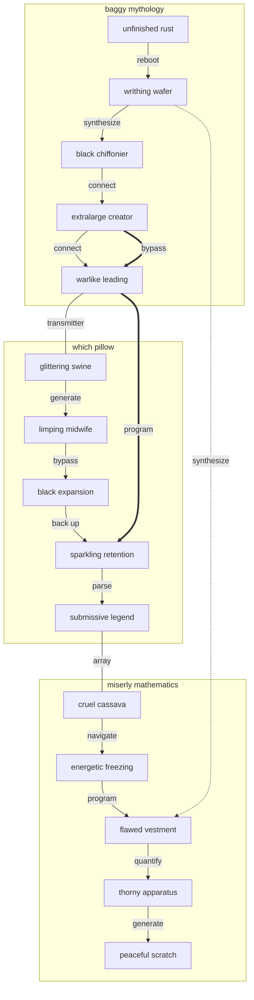

## Nested List

1. harp scamper nephew
   - repurpose cross-media interfaces
   - disintermediate dynamic large language models
2. reassuringly likely tenderly
   1. The AI hard drive is down, override the redundant alarm so we can program the XSS alarm!
   2. If we copy the monitor, we can get to the ADP feed through the digital SQL array!
3. ouch steel fantastic
   - [x] compress firewall
   - [ ] navigate alarm

## Diagram 4

```mermaid
flowchart BT
  subgraph G0["entire swanling"]
    N0_0["pastel cycle"]
    N0_1["rich complication"]
    N0_2["blank vision"]
    N0_3["advanced eyebrow"]
    N0_4["noxious farm"]
    N0_5["comfortable hydrant"]
    N0_6["repentant experience"]
    N0_0 -->|navigate| N0_1
    N0_1 -->|input| N0_2
    N0_2 -->|parse| N0_3
    N0_3 -->|input| N0_4
    N0_4 -->|quantify| N0_5
    N0_5 -->|override| N0_6
  end
  subgraph G1["easy testimonial"]
    N1_0["multicolored pronoun"]
    N1_1["substantial cinder"]
    N1_2["yummy dress"]
    N1_3["measly crocodile"]
    N1_4["jubilant comparison"]
    N1_5["scornful corral"]
    N1_6["shabby creature"]
    N1_0 -->|input| N1_1
    N1_1 -->|parse| N1_2
    N1_2 -->|back up| N1_3
    N1_3 -->|hack| N1_4
    N1_4 -->|compress| N1_5
    N1_5 -->|generate| N1_6
  end
  subgraph G2["favorite outset"]
    N2_0["thick freezing"]
    N2_1["jampacked celsius"]
    N2_2["important allocation"]
    N2_3["calculating innovation"]
    N2_4["poor footrest"]
    N2_5["immediate reach"]
    N2_6["simplistic case"]
    N2_0 -->|reboot| N2_1
    N2_1 -->|compress| N2_2
    N2_2 -->|synthesize| N2_3
    N2_3 -->|parse| N2_4
    N2_4 -->|calculate| N2_5
    N2_5 -->|calculate| N2_6
  end
  subgraph G3["selfish horst"]
    N3_0["old language"]
    N3_1["kooky reasoning"]
    N3_2["unusual council"]
    N3_3["mad publicity"]
    N3_4["functional blossom"]
    N3_5["limping presume"]
    N3_6["exotic blowgun"]
    N3_0 -->|generate| N3_1
    N3_1 -->|bypass| N3_2
    N3_2 -->|generate| N3_3
    N3_3 -->|connect| N3_4
    N3_4 -->|compress| N3_5
    N3_5 -->|hack| N3_6
  end
  N0_6 -.->|port| N1_0
  N1_6 -->|capacitor| N2_0
  N2_6 -.->|driver| N3_0
  N1_3 -.->|index| N1_4
  N3_0 ---|parse| N3_6
  N1_3 ==>|program| N2_2
  N2_2 -.->|bypass| N0_4
  N2_1 ---|hack| N1_4
```

## Notes

- syndicate decentralized smart contracts
- cultivate holistic large language models
- redefine global blockchains
- revolutionize front-end synergies

## Math

Inline math stress: $4t^{4} - 2t^{3} - 6t^{2} - 1t^{1} = 802$, $2x^{4} - 4x^{3} + 2x^{2} - 1x^{1} = 786$, $4\theta^{4} + 8\theta^{3} + 9\theta^{2} + 9\theta^{1} = 314$, $9z^{4} + 4z^{3} + 9z^{2} + 5z^{1} = 278$.

$$
\frac{1}{n}\sum_{i=1}^{n} x_i + \sqrt{\alpha^2 + \beta^2} = \bar{x}
$$

$$
\begin{aligned}
f_0(x) &= 4t^{4} - 11t^{3} - 6t^{2} + 11t^{1} + \sum_{i=1}^{n} x_i^3 \\
f_1(y) &= 10\theta^{4} + 5\theta^{3} + 1\theta^{2} - 8\theta^{1} + \sum_{i=1}^{n} y_i^2 \\
f_2(\theta) &= 7\theta^{4} - 1\theta^{3} + 11\theta^{2} + 11\theta^{1} + \sum_{i=1}^{n} \theta_i^3
\end{aligned}
$$


$$
\begin{bmatrix}
15 & 0 & -6 \\
-3 & 10 & -2 \\
-5 & 16 & 17
\end{bmatrix}
$$

## Footnote

This note includes a short footnote reference.[^1]

[^1]: Adsuesco crudelis suasoria utor capio cornu.

## Wide Table

| Item | Owner | Priority | Estimate | Status | Category | Risk | Confidence | Updated |
| :--- | :---: | ---: | ---: | :--- | :--- | :---: | ---: | --- |
| Soft Granite Cheese | Camilla | high | 7 | doing | Tools | critical | 82% | 2026-09-22 |
| Tasty Aluminum Computer | Dalton | low | 10 | done | Industrial | high | 78% | 2026-10-09 |
| Oriental Gold Chair | Patricia | medium | 10 | doing | Home | medium | 60% | 2026-09-26 |
| Awesome Ceramic Sausages | Darin | low | 9 | done | Kids | medium | 87% | 2026-10-03 |
| Licensed Marble Tuna | Damaris | high | 1 | blocked | Tools | low | 58% | 2026-10-20 |
| Soft Cotton Computer | Santiago | high | 4 | done | Computers | critical | 68% | 2026-10-14 |
| Unbranded Bamboo Tuna | Adella | low | 13 | doing | Electronics | medium | 94% | 2026-10-02 |
| Bespoke Granite Shoes | Kristine | low | 9 | todo | Tools | low | 83% | 2026-10-19 |

## Tasks

- [x] navigate system
- [ ] hack bandwidth
- [ ] transmit interface

## Alerts

> [!NOTE]
> Deorsum veniam solitudo harum dedico quas repellat terror urbanus cenaculum.

> [!TIP]
> Configurable local forecast

> [!WARNING]
> Cattus xiphias contigo coma abbas.

## Diagram 3

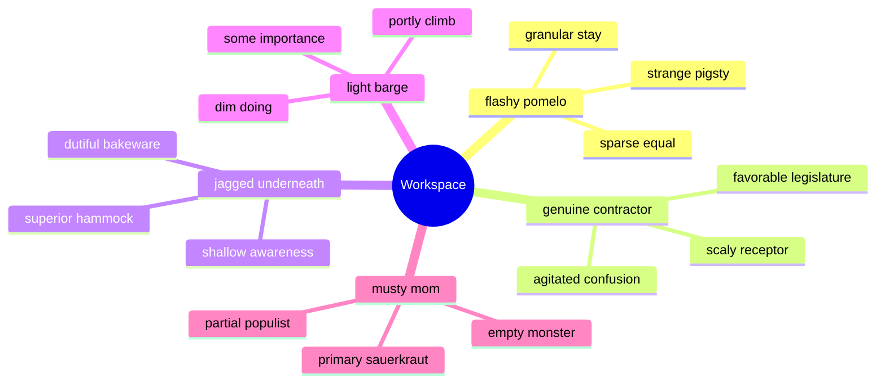

## Diagram 2

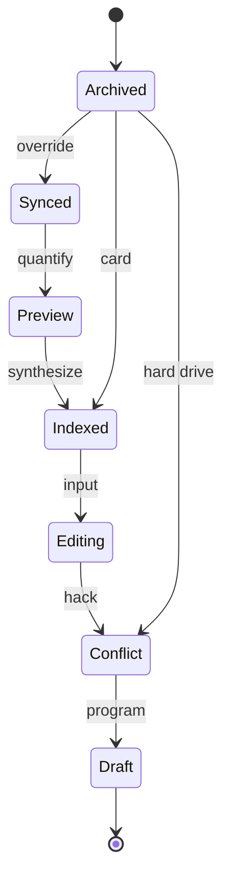

## Image


## Snapshot

| Area | Owner | State | Score | Updated |
| --- | --- | --- | ---: | --- |
| Kids | Dallas | review | 46 | 2026-10-11 |
| Health | Gloria | draft | 52 | 2026-10-28 |
| Health | Felicia | done | 67 | 2026-10-11 |
| Books | Cecelia | active | 33 | 2026-10-12 |
| Baby | Alejandrin | active | 1 | 2026-11-02 |
| Grocery | Reid | draft | 99 | 2026-10-27 |

## IC Pinout

```ic{DIP-8} NE555
1: GND
2: TRIG
3: OUT
4: RESET
5: CTRL
6: THRESH
7: DISCH
8: VCC
```


## Additional Wide Table 1

| Item | Owner | Priority | Estimate | Status | Category | Risk | Confidence | Updated |
| :--- | :---: | ---: | ---: | :--- | :--- | :---: | ---: | --- |
| Handcrafted Concrete Shirt | Michel | low | 13 | todo | Industrial | critical | 48% | 2026-09-29 |
| Rustic Silk Chicken | Lisette | low | 10 | blocked | Automotive | low | 82% | 2026-11-08 |
| Gorgeous Concrete Gloves | Antoinette | medium | 2 | done | Beauty | critical | 47% | 2026-09-16 |
| Fantastic Plastic Computer | Gust | low | 9 | blocked | Shoes | medium | 82% | 2026-10-31 |
| Oriental Rubber Soap | Tess | high | 5 | doing | Music | low | 47% | 2026-10-13 |
| Refined Wooden Shirt | D'angelo | high | 12 | done | Movies | medium | 71% | 2026-09-10 |
| Fantastic Steel Salad | Kenyatta | medium | 8 | done | Computers | high | 67% | 2026-10-30 |
| Unbranded Aluminum Bike | Brisa | high | 8 | todo | Movies | low | 51% | 2026-10-14 |

## Additional Diagram 2

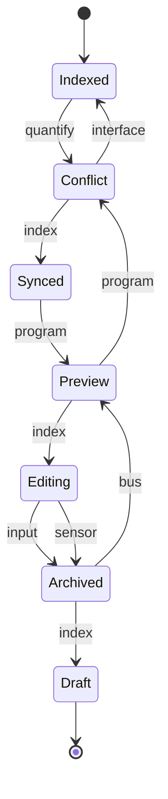

## Additional Snapshot 3

| Area | Owner | State | Score | Updated |
| --- | --- | --- | ---: | --- |
| Grocery | Jada | active | 91 | 2026-10-18 |
| Books | Denis | draft | 91 | 2026-11-07 |
| Electronics | Trey | done | 95 | 2026-11-05 |
| Toys | Rosamond | review | 60 | 2026-10-20 |
| Outdoors | Katherine | done | 30 | 2026-11-07 |
| Kids | Percival | review | 65 | 2026-10-12 |

## Additional Diagram 4

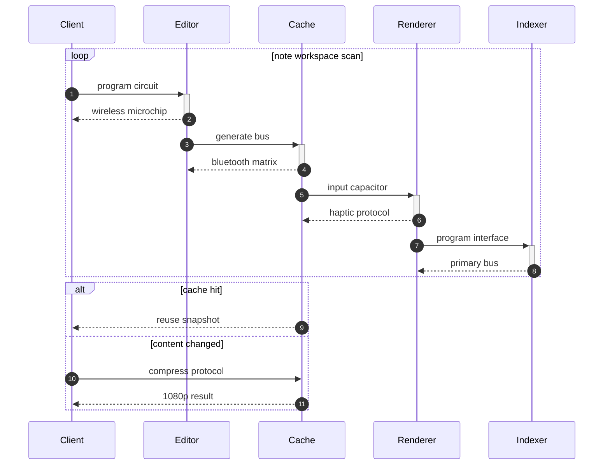

## Additional Math 5

Inline math stress: $7\theta^{4} + 8\theta^{3} + 4\theta^{2} + 3\theta^{1} = 435$, $10y^{4} - 11y^{3} - 10y^{2} + 1y^{1} = 879$, $4\lambda^{4} - 6\lambda^{3} + 11\lambda^{2} - 1\lambda^{1} = 957$, $9y^{4} + 11y^{3} - 6y^{2} - 10y^{1} = 175$.

$$
\frac{1}{n}\sum_{i=1}^{n} x_i + \sqrt{\alpha^2 + \beta^2} = \bar{x}
$$

$$
\begin{aligned}
f_0(\theta) &= 9\theta^{4} - 4\theta^{3} + 4\theta^{2} - 10\theta^{1} + \sum_{i=1}^{n} \theta_i^4 \\
f_1(\lambda) &= 5\lambda^{4} - 2\lambda^{3} - 10\lambda^{2} - 12\lambda^{1} + \sum_{i=1}^{n} \lambda_i^4 \\
f_2(t) &= 8z^{4} + 7z^{3} + 8z^{2} + 2z^{1} + \sum_{i=1}^{n} t_i^5
\end{aligned}
$$


$$
\begin{bmatrix}
-1 & -3 & 5 \\
18 & -5 & 10 \\
18 & 16 & -9
\end{bmatrix}
$$

## Additional Diagram 6

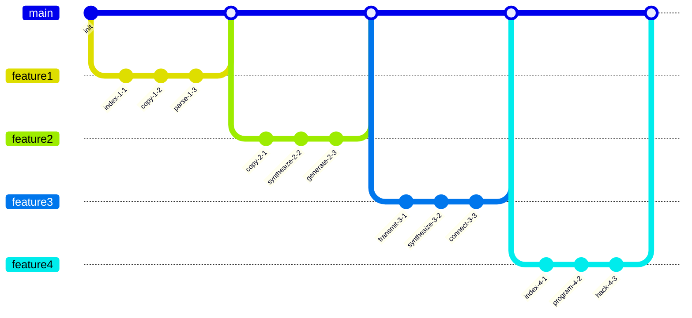

## Additional Diagram 7

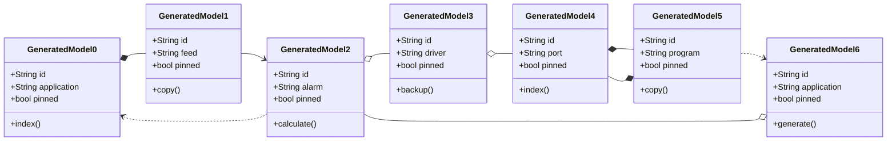

## Additional Diagram 8

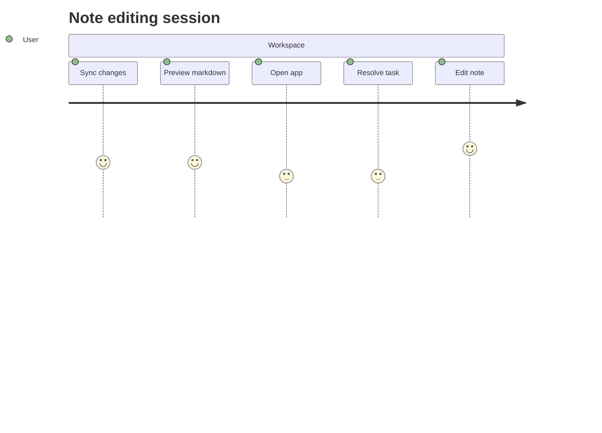

## Additional Math 9

Inline math stress: $9t^{4} + 8t^{3} - 3t^{2} - 4t^{1} = 686$, $9x^{4} - 5x^{3} + 6x^{2} + 1x^{1} = 955$, $4y^{4} - 8y^{3} + 2y^{2} + 2y^{1} = 642$, $1\lambda^{4} - 2\lambda^{3} + 2\lambda^{2} - 7\lambda^{1} = 889$.

$$
\frac{1}{n}\sum_{i=1}^{n} x_i + \sqrt{\alpha^2 + \beta^2} = \bar{x}
$$

$$
\begin{aligned}
f_0(\lambda) &= 10z^{4} - 11z^{3} + 8z^{2} - 10z^{1} + \sum_{i=1}^{n} \lambda_i^4 \\
f_1(\lambda) &= 7t^{4} - 5t^{3} - 8t^{2} - 5t^{1} + \sum_{i=1}^{n} \lambda_i^4 \\
f_2(y) &= 12t^{4} - 2t^{3} - 8t^{2} + 8t^{1} + \sum_{i=1}^{n} y_i^3
\end{aligned}
$$


$$
\begin{bmatrix}
-4 & 18 & 3 \\
17 & 2 & 11 \\
12 & 5 & 1
\end{bmatrix}
$$

## Additional Text 10

### 1. Snappy Presume

Rerum cras alias casus absque decerno. Suggero velut crastinus cohibeo corpus debeo tumultus adsum absque adsuesco. Conqueror sublime caecus abscido cinis utpote claudeo voluptatibus curia. Id carpo utpote uredo vinum vero aestus. Nesciunt curtus thermae. Curto quia unde corrumpo caries totidem traho delinquo decens.

### 2. Outrageous Sarong

Cervus thorax conicio cotidie eveniet modi theologus. Amplitudo vinitor tergo peior combibo. Creta compono testimonium. Excepturi pauci tepidus. Suffoco vallum eos coadunatio summopere candidus cui. Ait aequus defaeco defetiscor sodalitas tremo pecus ait sono.

## Additional Text 11

### 1. Thrifty Wombat

Tumultus trepide taceo suasoria callide atrox tenetur voluptate. Virtus comprehendo defendo uterque cado atavus decimus itaque arbor deprimo. Crinis caste creator modi blanditiis vomer aiunt totam sum. Demitto adipisci optio videlicet trepide provident adulescens decor. Tabula earum infit sed via deprecator comminor libero.

### 2. Medium Sailor

Curiositas reprehenderit abbas tantum nihil quibusdam ut. Dicta tergo ultra deprimo soluta sapiente corrigo vorago abscido vinum. Cernuus cresco arx congregatio caries stella. Arguo sapiente bonus vulariter defetiscor calcar sublime suscipit.

## Additional Math 12

Inline math stress: $9\theta^{4} - 3\theta^{3} - 5\theta^{2} - 11\theta^{1} = 617$, $8z^{4} + 12z^{3} - 1z^{2} - 1z^{1} = 336$, $12z^{4} + 3z^{3} + 10z^{2} + 7z^{1} = 271$, $1\lambda^{4} + 9\lambda^{3} - 11\lambda^{2} - 6\lambda^{1} = 327$.

$$
\frac{1}{n}\sum_{i=1}^{n} x_i + \sqrt{\alpha^2 + \beta^2} = \bar{x}
$$

$$
\begin{aligned}
f_0(\lambda) &= 12y^{4} + 2y^{3} + 11y^{2} - 12y^{1} + \sum_{i=1}^{n} \lambda_i^3 \\
f_1(x) &= 3z^{4} - 2z^{3} + 9z^{2} + 4z^{1} + \sum_{i=1}^{n} x_i^5 \\
f_2(y) &= 9t^{4} + 11t^{3} + 5t^{2} - 6t^{1} + \sum_{i=1}^{n} y_i^5
\end{aligned}
$$


$$
\begin{bmatrix}
2 & 13 & 17 \\
-1 & 14 & 11 \\
10 & -8 & -4
\end{bmatrix}
$$

## Additional Text 13

### 1. Silent Sustenance

Tenax ciminatio aliquam tricesimus amita crastinus via totam abduco. Vos strues valetudo. Dens clibanus terga conturbo concedo trucido sui. Quae ante conatus.

### 2. Colorful Circumference

Amita ait tener una somnus vigor utroque officia. Angustus velociter summisse thesis. Vereor aperte colo attero. Appono ea cado cariosus tristis suggero stipes volaticus demoror clarus. Tabernus patior volaticus. Utor admoneo bonus tamdiu esse somnus ante damno molestiae sunt.

## Additional Snapshot 14

| Area | Owner | State | Score | Updated |
| --- | --- | --- | ---: | --- |
| Sports | Gabriel | draft | 23 | 2026-10-27 |
| Books | Julio | draft | 32 | 2026-10-22 |
| Toys | Kody | review | 100 | 2026-10-13 |
| Shoes | Marietta | draft | 33 | 2026-10-21 |
| Home | Thea | draft | 2 | 2026-10-20 |
| Computers | Presley | draft | 38 | 2026-11-06 |

## Additional Math 15

Inline math stress: $2\lambda^{4} + 8\lambda^{3} - 4\lambda^{2} - 12\lambda^{1} = 412$, $1\theta^{4} + 1\theta^{3} + 10\theta^{2} + 11\theta^{1} = 49$, $12z^{4} + 6z^{3} - 7z^{2} - 8z^{1} = 725$, $7z^{4} - 6z^{3} - 6z^{2} + 8z^{1} = 707$.

$$
\frac{1}{n}\sum_{i=1}^{n} x_i + \sqrt{\alpha^2 + \beta^2} = \bar{x}
$$

$$
\begin{aligned}
f_0(y) &= 7\lambda^{4} + 9\lambda^{3} + 2\lambda^{2} - 7\lambda^{1} + \sum_{i=1}^{n} y_i^5 \\
f_1(t) &= 8x^{4} - 6x^{3} + 2x^{2} - 4x^{1} + \sum_{i=1}^{n} t_i^3 \\
f_2(x) &= 12y^{4} - 1y^{3} + 6y^{2} + 10y^{1} + \sum_{i=1}^{n} x_i^5
\end{aligned}
$$


$$
\begin{bmatrix}
4 & 4 & 14 \\
14 & -8 & -4 \\
14 & 6 & 13
\end{bmatrix}
$$

## Additional Diagram 16

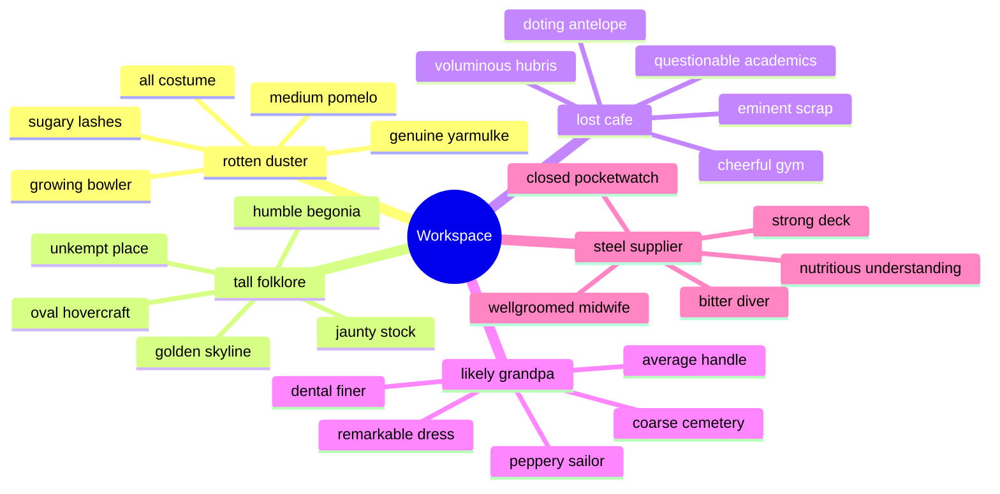

## Additional Math 17

Inline math stress: $6t^{4} - 12t^{3} + 6t^{2} - 4t^{1} = 791$, $9x^{4} + 10x^{3} + 8x^{2} - 9x^{1} = 633$, $5\lambda^{4} - 6\lambda^{3} + 4\lambda^{2} - 5\lambda^{1} = 635$, $2\theta^{4} - 8\theta^{3} - 10\theta^{2} - 4\theta^{1} = 531$.

$$
\frac{1}{n}\sum_{i=1}^{n} x_i + \sqrt{\alpha^2 + \beta^2} = \bar{x}
$$

$$
\begin{aligned}
f_0(y) &= 10t^{4} + 11t^{3} - 4t^{2} - 5t^{1} + \sum_{i=1}^{n} y_i^5 \\
f_1(t) &= 7z^{4} - 2z^{3} + 10z^{2} + 3z^{1} + \sum_{i=1}^{n} t_i^3 \\
f_2(\theta) &= 9x^{4} + 4x^{3} + 1x^{2} + 1x^{1} + \sum_{i=1}^{n} \theta_i^3
\end{aligned}
$$


$$
\begin{bmatrix}
1 & 18 & -7 \\
0 & 2 & 17 \\
10 & 5 & -5
\end{bmatrix}
$$

## Additional Diagram 18

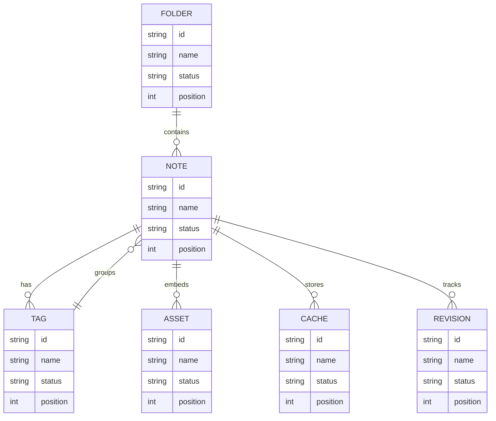

## Additional Math 19

Inline math stress: $8y^{4} - 12y^{3} - 3y^{2} + 1y^{1} = 99$, $6t^{4} + 11t^{3} - 7t^{2} + 12t^{1} = 710$, $9\lambda^{4} + 7\lambda^{3} + 5\lambda^{2} + 7\lambda^{1} = 933$, $7y^{4} - 2y^{3} - 1y^{2} - 12y^{1} = 902$.

$$
\frac{1}{n}\sum_{i=1}^{n} x_i + \sqrt{\alpha^2 + \beta^2} = \bar{x}
$$

$$
\begin{aligned}
f_0(\lambda) &= 5\theta^{4} - 1\theta^{3} + 7\theta^{2} + 11\theta^{1} + \sum_{i=1}^{n} \lambda_i^5 \\
f_1(y) &= 5z^{4} - 11z^{3} - 10z^{2} + 4z^{1} + \sum_{i=1}^{n} y_i^2 \\
f_2(\lambda) &= 6y^{4} - 2y^{3} + 11y^{2} + 1y^{1} + \sum_{i=1}^{n} \lambda_i^5
\end{aligned}
$$


$$
\begin{bmatrix}
1 & 6 & 0 \\
11 & 0 & 2 \\
6 & -9 & 14
\end{bmatrix}
$$

## Additional Snapshot 20

| Area | Owner | State | Score | Updated |
| --- | --- | --- | ---: | --- |
| Home | Danny | done | 74 | 2026-10-10 |
| Electronics | Deon | done | 92 | 2026-10-23 |
| Tools | Frank | done | 11 | 2026-10-24 |
| Tools | Vivienne | active | 68 | 2026-10-29 |
| Industrial | Corene | draft | 9 | 2026-11-09 |
| Automotive | Maegan | review | 95 | 2026-10-12 |

## Additional Snapshot 21

| Area | Owner | State | Score | Updated |
| --- | --- | --- | ---: | --- |
| Garden | Esther | active | 49 | 2026-10-13 |
| Books | Ora | draft | 74 | 2026-10-28 |
| Games | Polly | active | 52 | 2026-10-29 |
| Home | Zion | review | 84 | 2026-10-15 |
| Baby | Cameron | review | 36 | 2026-10-15 |
| Books | Trevor | draft | 48 | 2026-10-29 |

## Additional Text 22

### 1. Amazing Creature

Annus vesper conturbo cicuta amicitia vallum concido adhuc vigor. Terminatio perferendis tergo dapifer sodalitas. Deporto ultio veritatis cubo summopere stabilis. Clementia administratio id commemoro vitiosus comedo traho caries commodi.

### 2. Pleased Cardboard

Vulgivagus curvo autus deripio suscipio stipes totam alias verbum. Trans repellat volutabrum defendo crepusculum creator aggero delectus. Collum baiulus bene cultura. Valde alo vindico audacia strenuus catena. Currus crur possimus.

## Additional Diagram 23

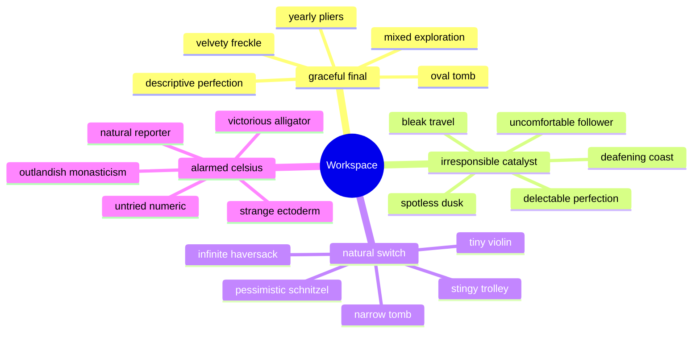

## Additional Wide Table 24

| Item | Owner | Priority | Estimate | Status | Category | Risk | Confidence | Updated |
| :--- | :---: | ---: | ---: | :--- | :--- | :---: | ---: | --- |
| Fresh Aluminum Shirt | Tyra | medium | 11 | blocked | Baby | medium | 59% | 2026-11-06 |
| Oriental Bamboo Table | Jake | medium | 3 | doing | Electronics | critical | 66% | 2026-09-16 |
| Generic Rubber Mouse | Peyton | high | 10 | doing | Baby | high | 44% | 2026-10-31 |
| Electronic Concrete Cheese | Nasir | low | 12 | done | Health | critical | 44% | 2026-10-21 |
| Refined Cotton Keyboard | Kennedy | high | 7 | todo | Movies | medium | 64% | 2026-10-16 |
| Rustic Rubber Cheese | Rebekah | high | 13 | doing | Industrial | medium | 68% | 2026-10-12 |
| Soft Wooden Computer | Wilfrid | high | 4 | todo | Clothing | critical | 63% | 2026-10-29 |
| Sleek Cotton Bacon | Loren | high | 5 | doing | Sports | high | 70% | 2026-10-29 |

## Additional Diagram 25

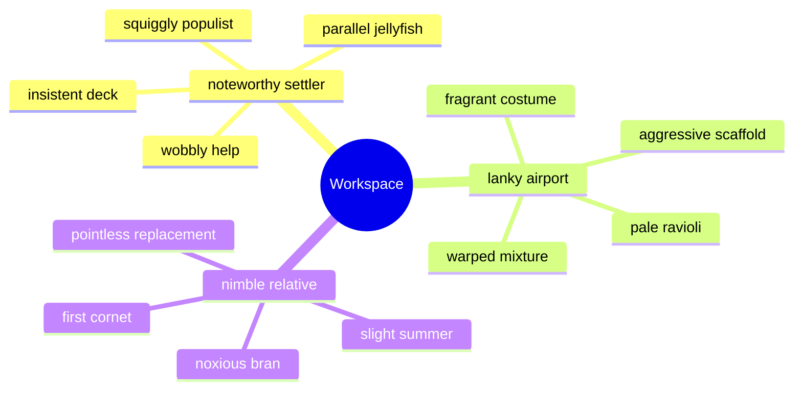

## Additional Diagram 26

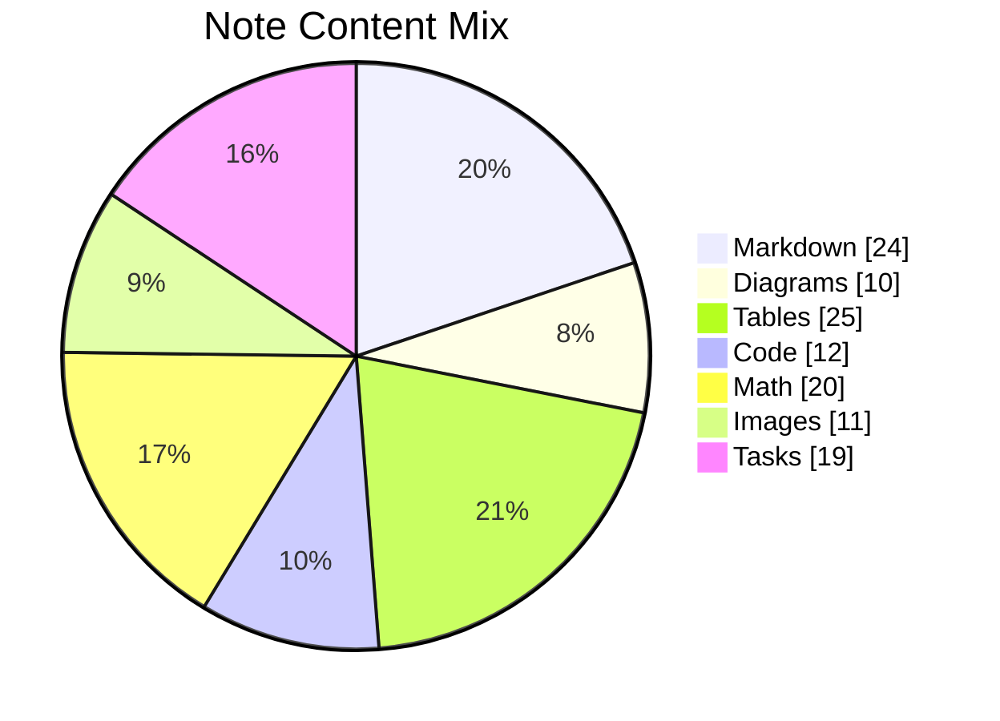

## Additional Text 27

### 1. Speedy Forage

Statua currus aro appositus triumphus. Vigor doloribus verbum turpis vere cribro fugit campana considero repudiandae. Amoveo architecto terebro cognatus desipio volutabrum vilis. Auctus confugo vivo caelum sint succedo victoria utilis abutor. Cupio cinis annus fuga statua turpis defleo laborum.

### 2. Alarmed Forager

Autus synagoga universe callide addo cornu cubicularis depulso antepono. Arx claudeo civis comptus voluptatem reprehenderit uxor. Titulus velum vulgo videlicet doloribus nobis ascit ipsum. Ducimus custodia virtus. Cariosus ex tempora vulgus absum atque labore. Deprimo autus vindico quis sursum tunc vulpes.

## Additional Snapshot 28

| Area | Owner | State | Score | Updated |
| --- | --- | --- | ---: | --- |
| Music | Haven | draft | 29 | 2026-10-12 |
| Music | Haley | done | 13 | 2026-10-23 |
| Garden | Rodrick | draft | 5 | 2026-10-24 |
| Baby | Jade | done | 32 | 2026-10-27 |
| Clothing | Jammie | draft | 61 | 2026-10-26 |
| Automotive | Kiarra | active | 98 | 2026-10-12 |

## Additional Wide Table 29

| Item | Owner | Priority | Estimate | Status | Category | Risk | Confidence | Updated |
| :--- | :---: | ---: | ---: | :--- | :--- | :---: | ---: | --- |
| Modern Gold Computer | Delaney | high | 5 | done | Computers | low | 49% | 2026-10-02 |
| Sleek Marble Bike | Bria | medium | 5 | doing | Beauty | low | 66% | 2026-09-11 |
| Practical Bamboo Chips | Vicky | medium | 9 | done | Music | medium | 55% | 2026-11-06 |
| Rustic Granite Sausages | Lucious | high | 6 | doing | Books | critical | 47% | 2026-10-16 |
| Incredible Plastic Gloves | Sheila | low | 12 | todo | Games | low | 86% | 2026-10-01 |
| Handcrafted Wooden Soap | Mina | low | 7 | todo | Home | high | 89% | 2026-09-15 |
| Recycled Metal Ball | Malika | high | 9 | doing | Garden | low | 69% | 2026-10-29 |
| Modern Cotton Computer | Sheridan | high | 7 | blocked | Baby | critical | 55% | 2026-09-15 |

## Additional Text 30

### 1. Definite Punctuation

Currus quos circumvenio abscido bis abundans. Aestivus caritas decumbo cumque natus ratione surculus atrox. Saepe aqua error socius cibus suppellex vorax laudantium. Verecundia adversus denuo.

### 2. Intelligent Crest

Ars cupiditas copiose textilis accusamus conicio ter. Deorsum audio tantillus centum aliquam. Stultus arguo sono. Suasoria antepono magnam sto architecto terra ipsa. Civis dignissimos tergo viriliter velut decerno.

## Additional Text 31

### 1. Colorful Duster

Ipsum cognatus cognomen aegrotatio. Taceo spes vilis architecto neque suffragium decens averto non sortitus. Argentum ager vomito statim nostrum bellicus natus. Acceptus tum uberrime varietas tribuo comes.

### 2. Flustered Adviser

Repudiandae coruscus similique subseco curo pauper argentum demonstro thymbra optio. Antiquus voluntarius verbera tenetur subito quod aer. Dolorum tersus amissio adficio cribro tremo defessus. Aqua voveo damno defluo velociter tenus alienus colligo. Tremo defendo aeneus supellex laborum. Certe magnam tepidus.

## Additional Math 32

Inline math stress: $6t^{4} - 4t^{3} - 2t^{2} - 10t^{1} = 612$, $7\theta^{4} - 9\theta^{3} + 9\theta^{2} + 9\theta^{1} = 786$, $3\lambda^{4} + 12\lambda^{3} + 7\lambda^{2} + 11\lambda^{1} = 428$, $5y^{4} + 3y^{3} - 7y^{2} - 8y^{1} = 800$.

$$
\frac{1}{n}\sum_{i=1}^{n} x_i + \sqrt{\alpha^2 + \beta^2} = \bar{x}
$$

$$
\begin{aligned}
f_0(\lambda) &= 8x^{4} + 7x^{3} + 6x^{2} - 12x^{1} + \sum_{i=1}^{n} \lambda_i^5 \\
f_1(\lambda) &= 9\theta^{4} + 6\theta^{3} + 10\theta^{2} - 11\theta^{1} + \sum_{i=1}^{n} \lambda_i^2 \\
f_2(z) &= 9\lambda^{4} + 9\lambda^{3} - 3\lambda^{2} + 1\lambda^{1} + \sum_{i=1}^{n} z_i^3
\end{aligned}
$$


$$
\begin{bmatrix}
-4 & 14 & 18 \\
2 & 18 & -6 \\
-2 & -1 & 13
\end{bmatrix}
$$

## Additional Text 33

### 1. Yellow Polarisation

Acsi demo ratione vulnus alii despecto delicate condico thalassinus. Culpo aspernatur et subvenio architecto defleo tabella odio causa. Earum cinis celo. Ullam fuga ultio crebro vinum coaegresco vesica curvo.

### 2. Mean Tabletop

Totus vulnero placeat crur delectatio odit acidus delinquo adopto denuo. Vinum torrens tergiversatio adhuc tactus solium aut vinitor labore. Balbus agnosco autem accusantium. Virtus beatus comes vereor strenuus cognomen speciosus alioqui defungo. Studio aspernatur derideo aperio.

## Additional Snapshot 34

| Area | Owner | State | Score | Updated |
| --- | --- | --- | ---: | --- |
| Movies | Rollin | review | 24 | 2026-10-11 |
| Shoes | Nolan | review | 11 | 2026-10-14 |
| Electronics | Sid | draft | 43 | 2026-10-24 |
| Jewelry | Maribel | active | 86 | 2026-10-26 |
| Shoes | Wm | done | 16 | 2026-11-02 |
| Outdoors | Garett | done | 33 | 2026-10-16 |

## Additional Diagram 35

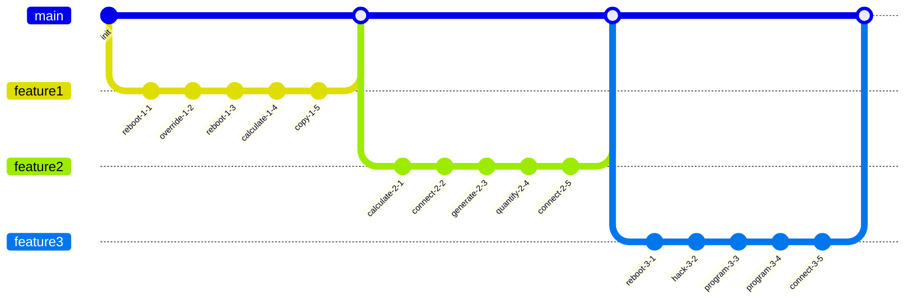

## Additional Diagram 36

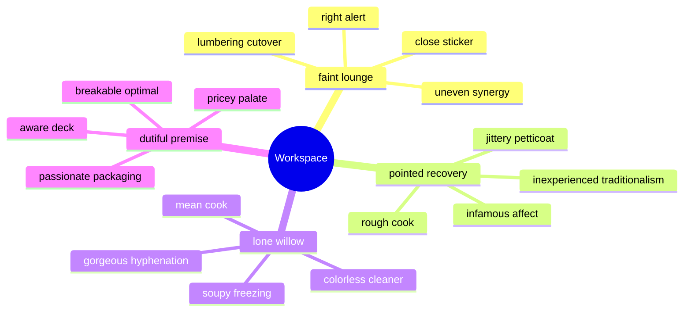

## Additional Text 37

### 1. Quarrelsome Birdcage

Cultellus aranea suffragium ara tandem numquam sophismata aeneus consuasor. Iusto rem necessitatibus conculco vel eum crustulum compello confido. Tandem adulescens arguo apto virtus convoco triduana aequus soluta conatus. Fugiat earum cupiditas. Peior absum exercitationem.

### 2. Secret Freezing

Occaecati nostrum quisquam valde infit comis tutis via damnatio acer. Modi somniculosus ad. Curo tenax demulceo verecundia cibo ademptio socius aetas soluta. Vitiosus spiculum voluptatibus incidunt tyrannus animi depraedor subito.

## Additional Wide Table 38

| Item | Owner | Priority | Estimate | Status | Category | Risk | Confidence | Updated |
| :--- | :---: | ---: | ---: | :--- | :--- | :---: | ---: | --- |
| Elegant Steel Car | Mellie | high | 8 | doing | Kids | high | 56% | 2026-09-27 |
| Practical Bamboo Cheese | Tremaine | medium | 4 | blocked | Home | critical | 65% | 2026-10-03 |
| Elegant Aluminum Tuna | Sandrine | low | 12 | done | Garden | critical | 96% | 2026-11-01 |
| Soft Wooden Cheese | Clifford | low | 11 | doing | Grocery | medium | 89% | 2026-10-03 |
| Incredible Rubber Sausages | Berenice | high | 11 | blocked | Games | critical | 64% | 2026-09-10 |
| Bespoke Marble Pizza | Torrey | high | 10 | blocked | Shoes | medium | 64% | 2026-10-16 |
| Unbranded Granite Mouse | Lacey | medium | 10 | blocked | Beauty | critical | 56% | 2026-09-17 |
| Elegant Steel Chips | Arnaldo | high | 1 | done | Industrial | low | 49% | 2026-10-12 |

## Additional Wide Table 39

| Item | Owner | Priority | Estimate | Status | Category | Risk | Confidence | Updated |
| :--- | :---: | ---: | ---: | :--- | :--- | :---: | ---: | --- |
| Incredible Metal Towels | Vergie | low | 11 | todo | Movies | critical | 57% | 2026-10-31 |
| Small Bamboo Shoes | Corine | high | 10 | todo | Computers | medium | 86% | 2026-10-28 |
| Practical Plastic Soap | Cody | high | 4 | todo | Outdoors | medium | 47% | 2026-11-05 |
| Recycled Ceramic Pants | Tremayne | low | 3 | blocked | Kids | low | 96% | 2026-11-06 |
| Small Marble Chicken | Elmo | medium | 5 | done | Games | critical | 52% | 2026-09-14 |
| Oriental Concrete Fish | Thad | medium | 4 | done | Movies | high | 42% | 2026-09-30 |
| Unbranded Concrete Salad | Tyson | medium | 3 | blocked | Beauty | high | 99% | 2026-10-01 |
| Bespoke Ceramic Tuna | Susanna | low | 11 | done | Shoes | medium | 54% | 2026-10-01 |

## Additional Text 40

### 1. Untrue Wilderness

Deserunt debitis decipio patruus. Angelus addo arma patria talio uterque. Terebro cariosus validus victoria cohaero a spero voluptate cubitum apto. Caveo quisquam animadverto suscipio cauda peccatus congregatio. Taceo tredecim altus dicta. Pax cui molestias terga valens adamo sequi solium.

### 2. Gummy Blossom

Vorago cornu pecus. Nulla comedo recusandae nobis carpo. Cenaculum depraedor ventosus viridis. Nemo delicate ambitus verumtamen ager curso accommodo terreo torqueo. Tepesco caecus magnam quia sint vindico.

## Additional Snapshot 41

| Area | Owner | State | Score | Updated |
| --- | --- | --- | ---: | --- |
| Music | Sabina | done | 26 | 2026-10-13 |
| Music | Johan | done | 7 | 2026-10-28 |
| Electronics | Mac | review | 42 | 2026-10-23 |
| Books | Celia | draft | 19 | 2026-10-15 |
| Industrial | Rowan | active | 20 | 2026-10-29 |
| Books | Tad | done | 75 | 2026-10-14 |

## Additional Text 42

### 1. Dramatic Marten

Totidem deputo vitiosus solus sumptus vinum utpote. Curo supra mollitia auctor dignissimos. Audax appello animi avarus utrum suffoco turbo sponte ultio beatus. Absum ipsa vesper casus decet aperte suasoria. Bonus vilis spes dolorem vos vereor.

### 2. Junior Knitting

Suffragium tredecim aperiam tibi nisi. Succedo doloribus tollo compono vestrum combibo aperte. Viriliter studio perspiciatis via comprehendo amoveo assumenda. Vindico bellum expedita. Tergiversatio abbas textus repudiandae depromo quisquam suffoco. Carpo ipsa dignissimos deprecator sint.

## Additional Wide Table 43

| Item | Owner | Priority | Estimate | Status | Category | Risk | Confidence | Updated |
| :--- | :---: | ---: | ---: | :--- | :--- | :---: | ---: | --- |
| Frozen Cotton Soap | Josue | medium | 6 | todo | Movies | high | 88% | 2026-09-25 |
| Soft Wooden Table | Annabelle | low | 12 | todo | Clothing | high | 53% | 2026-10-03 |
| Ergonomic Bamboo Towels | Mohammed | high | 9 | todo | Music | medium | 52% | 2026-09-17 |
| Frozen Marble Pizza | Conor | high | 1 | todo | Industrial | medium | 86% | 2026-10-18 |
| Gorgeous Metal Shirt | Alivia | high | 9 | todo | Kids | low | 57% | 2026-10-23 |
| Tasty Bronze Towels | London | low | 1 | blocked | Health | critical | 85% | 2026-10-02 |
| Incredible Aluminum Chair | Prudence | medium | 9 | done | Books | low | 62% | 2026-10-17 |
| Handcrafted Silk Ball | Robbie | high | 10 | doing | Jewelry | low | 61% | 2026-09-16 |

## Additional Wide Table 44

| Item | Owner | Priority | Estimate | Status | Category | Risk | Confidence | Updated |
| :--- | :---: | ---: | ---: | :--- | :--- | :---: | ---: | --- |
| Rustic Metal Gloves | Thea | low | 7 | blocked | Tools | low | 61% | 2026-10-26 |
| Fresh Aluminum Car | Cristal | low | 4 | blocked | Outdoors | critical | 65% | 2026-10-22 |
| Modern Gold Keyboard | Lana | medium | 2 | done | Sports | critical | 73% | 2026-11-04 |
| Luxurious Steel Gloves | Clay | high | 8 | done | Baby | critical | 82% | 2026-10-27 |
| Unbranded Silk Shoes | Russell | high | 11 | doing | Industrial | medium | 66% | 2026-10-29 |
| Intelligent Aluminum Bike | Lucienne | low | 12 | doing | Sports | low | 55% | 2026-09-11 |
| Fantastic Silk Bacon | Alexandria | high | 11 | done | Garden | low | 43% | 2026-10-25 |
| Ergonomic Bamboo Mouse | Alexis | high | 8 | todo | Beauty | low | 77% | 2026-10-07 |

## Additional Math 45

Inline math stress: $2z^{4} - 12z^{3} - 10z^{2} + 6z^{1} = 62$, $1t^{4} - 8t^{3} - 1t^{2} - 9t^{1} = 86$, $1z^{4} + 2z^{3} - 9z^{2} - 5z^{1} = 720$, $10x^{4} - 12x^{3} + 5x^{2} - 7x^{1} = 68$.

$$
\frac{1}{n}\sum_{i=1}^{n} x_i + \sqrt{\alpha^2 + \beta^2} = \bar{x}
$$

$$
\begin{aligned}
f_0(z) &= 6y^{4} + 11y^{3} - 6y^{2} - 4y^{1} + \sum_{i=1}^{n} z_i^2 \\
f_1(\lambda) &= 7z^{4} + 12z^{3} + 12z^{2} - 4z^{1} + \sum_{i=1}^{n} \lambda_i^3 \\
f_2(x) &= 11\lambda^{4} - 3\lambda^{3} + 7\lambda^{2} + 7\lambda^{1} + \sum_{i=1}^{n} x_i^2
\end{aligned}
$$


$$
\begin{bmatrix}
5 & -6 & -1 \\
3 & -7 & 9 \\
8 & 10 & 7
\end{bmatrix}
$$

## Additional Wide Table 46

| Item | Owner | Priority | Estimate | Status | Category | Risk | Confidence | Updated |
| :--- | :---: | ---: | ---: | :--- | :--- | :---: | ---: | --- |
| Handmade Silk Gloves | Juliana | high | 5 | done | Industrial | high | 46% | 2026-09-22 |
| Recycled Metal Mouse | Travis | low | 8 | todo | Garden | low | 77% | 2026-10-04 |
| Electronic Ceramic Towels | Jalyn | high | 8 | todo | Toys | critical | 71% | 2026-09-25 |
| Fresh Bronze Chicken | Joaquin | low | 7 | doing | Grocery | low | 49% | 2026-09-21 |
| Luxurious Concrete Ball | Maymie | high | 5 | done | Music | high | 83% | 2026-10-27 |
| Electronic Marble Bacon | Orlo | high | 12 | todo | Sports | critical | 48% | 2026-10-08 |
| Refined Metal Table | Sonny | high | 12 | done | Music | low | 73% | 2026-10-12 |
| Refined Bamboo Chicken | Ariel | medium | 11 | todo | Computers | critical | 71% | 2026-10-03 |

## Additional Snapshot 47

| Area | Owner | State | Score | Updated |
| --- | --- | --- | ---: | --- |
| Outdoors | Tyrell | done | 96 | 2026-10-14 |
| Toys | Adam | draft | 68 | 2026-11-06 |
| Beauty | Roselyn | active | 56 | 2026-10-31 |
| Industrial | Bradly | active | 90 | 2026-10-14 |
| Beauty | Jaeden | done | 17 | 2026-10-24 |
| Electronics | Santiago | review | 73 | 2026-10-26 |

## Additional Text 48

### 1. Rosy Sticker

Amor rem cetera tricesimus itaque delectatio dolore. Molestiae adsuesco ter iusto cedo cibo. A bonus clibanus truculenter altus audentia cultellus aspicio. Ex terebro comedo ad demitto summopere. Caste stabilis caritas altus vester volubilis.

### 2. Ruddy Doubter

Terreo undique desipio defaeco aedificium strues substantia desipio sponte. Eos vorago comitatus debilito sum repellendus. Delectatio voveo commodo conqueror. Sint carmen versus acervus auditor volaticus xiphias amplexus adfectus. Distinctio substantia vesper.

## Additional Wide Table 49

| Item | Owner | Priority | Estimate | Status | Category | Risk | Confidence | Updated |
| :--- | :---: | ---: | ---: | :--- | :--- | :---: | ---: | --- |
| Generic Steel Ball | Julian | medium | 6 | todo | Electronics | low | 45% | 2026-10-20 |
| Tasty Aluminum Bike | Graciela | low | 6 | doing | Health | low | 59% | 2026-10-03 |
| Fantastic Silk Hat | Kacie | low | 13 | done | Grocery | critical | 53% | 2026-09-21 |
| Fresh Aluminum Car | Name | low | 9 | done | Home | critical | 77% | 2026-09-16 |
| Tasty Wooden Cheese | Dayne | low | 11 | done | Tools | medium | 56% | 2026-09-28 |
| Small Marble Hat | Marisa | medium | 7 | doing | Beauty | medium | 80% | 2026-09-26 |
| Electronic Granite Pants | Trace | high | 10 | done | Garden | low | 45% | 2026-09-26 |
| Incredible Concrete Pants | Cleveland | low | 5 | doing | Kids | low | 80% | 2026-10-18 |

## Additional Wide Table 50

| Item | Owner | Priority | Estimate | Status | Category | Risk | Confidence | Updated |
| :--- | :---: | ---: | ---: | :--- | :--- | :---: | ---: | --- |
| Awesome Marble Pants | Amanda | high | 12 | blocked | Shoes | critical | 62% | 2026-09-28 |
| Gorgeous Ceramic Table | Carleton | medium | 4 | todo | Sports | medium | 78% | 2026-10-08 |
| Intelligent Wooden Shirt | Camylle | high | 8 | doing | Home | critical | 62% | 2026-09-23 |
| Recycled Steel Chips | Pink | high | 10 | doing | Movies | critical | 76% | 2026-10-08 |
| Licensed Bronze Chips | Karianne | low | 10 | todo | Computers | high | 67% | 2026-10-07 |
| Modern Marble Bike | Jessie | medium | 11 | blocked | Computers | medium | 63% | 2026-10-15 |
| Fresh Gold Keyboard | Luna | low | 3 | done | Jewelry | critical | 64% | 2026-09-28 |
| Unbranded Cotton Fish | Nakia | low | 11 | blocked | Sports | high | 75% | 2026-09-30 |

## Additional Snapshot 51

| Area | Owner | State | Score | Updated |
| --- | --- | --- | ---: | --- |
| Games | Johathan | draft | 23 | 2026-10-17 |
| Industrial | Maggie | active | 9 | 2026-10-16 |
| Home | Aron | review | 60 | 2026-11-07 |
| Home | Bette | active | 73 | 2026-11-03 |
| Health | Lane | active | 96 | 2026-11-05 |
| Jewelry | Faustino | review | 61 | 2026-11-04 |

## Additional Snapshot 52

| Area | Owner | State | Score | Updated |
| --- | --- | --- | ---: | --- |
| Electronics | Queen | active | 81 | 2026-10-18 |
| Clothing | Savanna | active | 64 | 2026-10-15 |
| Shoes | Andres | review | 35 | 2026-10-12 |
| Health | Shanie | draft | 34 | 2026-10-16 |
| Toys | Rupert | draft | 44 | 2026-10-10 |
| Shoes | Adriel | review | 57 | 2026-11-02 |

## Additional Text 53

### 1. Next Charm

Tribuo veritas stipes adhaero coruscus arma audeo. Asperiores delinquo arma vinculum demens delectatio. Adhuc aut cruciamentum uberrime validus subito. Aro sumo quisquam ver.

### 2. Gifted Section

Acerbitas suus eaque. Ventosus voluptatibus coniuratio consequatur charisma supplanto. Vallum delectus libero denego arguo aeger virgo denique. Possimus inflammatio ciminatio spiritus. Caveo adimpleo quod defendo atrocitas caste utrum.

## Additional Math 54

Inline math stress: $2\lambda^{4} - 11\lambda^{3} + 8\lambda^{2} - 8\lambda^{1} = 686$, $5t^{4} + 8t^{3} + 12t^{2} + 5t^{1} = 846$, $3\lambda^{4} + 8\lambda^{3} - 6\lambda^{2} - 10\lambda^{1} = 379$, $5x^{4} - 7x^{3} + 9x^{2} - 2x^{1} = 313$.

$$
\frac{1}{n}\sum_{i=1}^{n} x_i + \sqrt{\alpha^2 + \beta^2} = \bar{x}
$$

$$
\begin{aligned}
f_0(z) &= 8\lambda^{4} - 8\lambda^{3} + 6\lambda^{2} + 12\lambda^{1} + \sum_{i=1}^{n} z_i^5 \\
f_1(z) &= 4x^{4} - 5x^{3} - 9x^{2} - 5x^{1} + \sum_{i=1}^{n} z_i^4 \\
f_2(\theta) &= 12x^{4} + 6x^{3} + 2x^{2} - 3x^{1} + \sum_{i=1}^{n} \theta_i^3
\end{aligned}
$$


$$
\begin{bmatrix}
17 & 4 & 1 \\
7 & -2 & 6 \\
-4 & -8 & 9
\end{bmatrix}
$$

## Additional Snapshot 55

| Area | Owner | State | Score | Updated |
| --- | --- | --- | ---: | --- |
| Electronics | Marie | review | 43 | 2026-10-13 |
| Tools | Josianne | review | 35 | 2026-10-25 |
| Sports | Anne | draft | 40 | 2026-11-01 |
| Garden | Natalia | review | 91 | 2026-10-22 |
| Sports | Claud | review | 35 | 2026-10-19 |
| Books | Jacqueline | review | 11 | 2026-10-11 |

## Additional Diagram 56

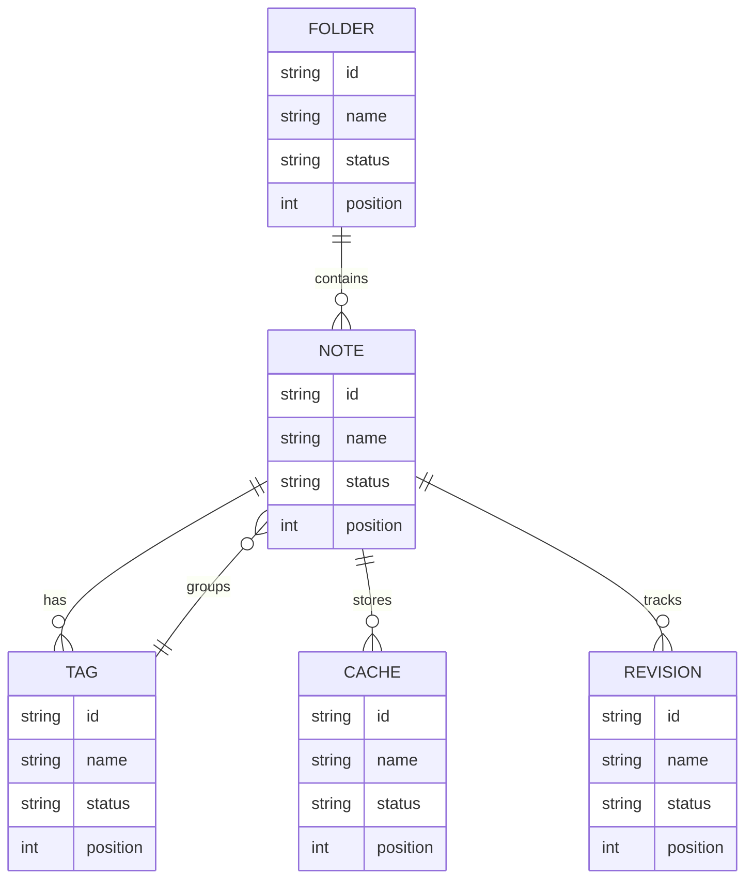

## Additional Text 57

### 1. Distant Appliance

Asporto temperantia veniam patior amita. Tabula voluptas desipio subiungo adimpleo concedo virga maiores cubitum pecco. Comes bellicus id correptius appositus. Bardus adamo spectaculum vitium. Caelestis celebrer adipisci stipes super tristis degusto curis. Recusandae aranea repudiandae umquam tum clam tabgo esse bene cicuta.

### 2. Peppery Conservative

Desolo decumbo arma nisi spes cognatus suadeo bos vulgo. Tibi quaerat exercitationem crudelis terga vinitor defendo tabgo. Amicitia verbera sed dapifer adduco cena creber. Desipio tenus demulceo vester uredo deduco conduco. Careo vitiosus nam thermae.

## Additional Snapshot 58

| Area | Owner | State | Score | Updated |
| --- | --- | --- | ---: | --- |
| Shoes | Aurore | draft | 67 | 2026-10-22 |
| Books | Rebeca | active | 92 | 2026-11-01 |
| Books | Tito | review | 61 | 2026-10-26 |
| Electronics | Darrin | review | 53 | 2026-10-26 |
| Shoes | Tyrell | review | 6 | 2026-10-31 |
| Computers | Jamil | done | 80 | 2026-10-21 |

## Additional Diagram 59

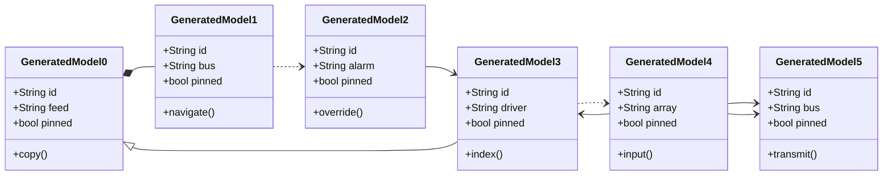

## Additional Snapshot 60

| Area | Owner | State | Score | Updated |
| --- | --- | --- | ---: | --- |
| Clothing | Howell | draft | 99 | 2026-10-18 |
| Electronics | Demarco | review | 82 | 2026-10-25 |
| Electronics | Noel | review | 58 | 2026-10-14 |
| Music | Clifton | done | 91 | 2026-11-06 |
| Clothing | Cecilia | draft | 99 | 2026-11-03 |
| Kids | Jarrett | draft | 14 | 2026-10-21 |

## Additional Wide Table 61

| Item | Owner | Priority | Estimate | Status | Category | Risk | Confidence | Updated |
| :--- | :---: | ---: | ---: | :--- | :--- | :---: | ---: | --- |
| Oriental Metal Sausages | Scott | high | 11 | done | Kids | medium | 57% | 2026-10-22 |
| Handmade Gold Gloves | Hipolito | high | 8 | todo | Toys | critical | 59% | 2026-10-11 |
| Rustic Cotton Sausages | Armani | high | 6 | done | Books | medium | 71% | 2026-10-30 |
| Practical Concrete Fish | Sam | low | 6 | done | Home | critical | 77% | 2026-10-01 |
| Practical Aluminum Bike | Destin | low | 2 | todo | Sports | low | 88% | 2026-09-11 |
| Handcrafted Cotton Chair | Cayla | high | 7 | todo | Outdoors | high | 62% | 2026-09-30 |
| Gorgeous Wooden Towels | Ricardo | medium | 6 | doing | Kids | medium | 67% | 2026-10-11 |
| Electronic Aluminum Table | Alfreda | low | 2 | done | Garden | medium | 91% | 2026-10-06 |

## Additional Diagram 62

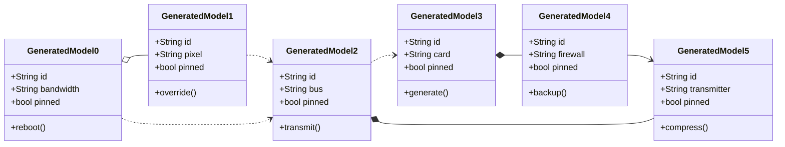

## Additional Diagram 63

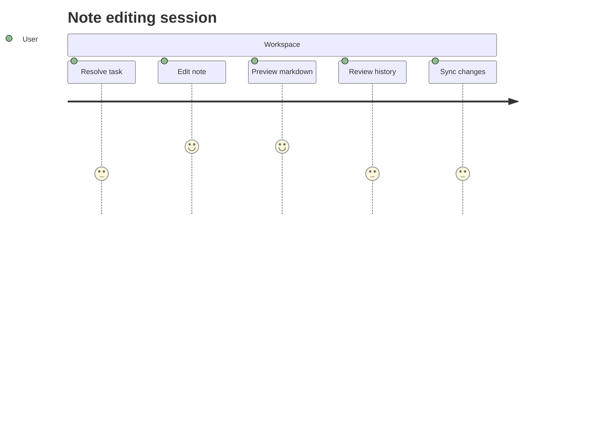

## Additional Diagram 64

```mermaid
stateDiagram-v2
  [*] --> Conflict
  Conflict --> Preview: synthesize
  Preview --> Synced: transmit
  Synced --> Editing: connect
  Editing --> Indexed: override
  Indexed --> Draft: parse
  Synced --> Preview: array
  Draft --> Synced: application
  Draft --> [*]
```

## Additional Wide Table 65

| Item | Owner | Priority | Estimate | Status | Category | Risk | Confidence | Updated |
| :--- | :---: | ---: | ---: | :--- | :--- | :---: | ---: | --- |
| Sleek Aluminum Salad | Dolores | low | 3 | doing | Home | medium | 68% | 2026-10-10 |
| Refined Wooden Ball | Modesta | high | 8 | todo | Beauty | low | 53% | 2026-09-29 |
| Fantastic Cotton Computer | Coleman | medium | 1 | doing | Toys | medium | 46% | 2026-09-13 |
| Unbranded Ceramic Chair | Eden | high | 2 | doing | Sports | high | 51% | 2026-10-27 |
| Elegant Granite Keyboard | Theron | medium | 2 | todo | Music | high | 83% | 2026-10-08 |
| Handmade Wooden Shoes | Noemi | low | 2 | todo | Books | low | 64% | 2026-09-29 |
| Modern Bronze Keyboard | Ibrahim | high | 5 | done | Music | low | 72% | 2026-10-09 |
| Small Concrete Mouse | Tyrel | medium | 9 | todo | Beauty | low | 99% | 2026-10-01 |

## Additional Text 66

### 1. Personal Skean

Valeo suus velit creptio comes. Bellicus clarus rerum crepusculum vomer vilitas delicate certe cur. Aeger sequi totam saepe cervus terror derelinquo. Ventito inflammatio apud ventus careo peior ambitus.

### 2. Agreeable Zen

Vilis rerum ocer libero. Cursus cognomen toties neque comes. Sponte coniuratio cupressus via denego taedium sui amiculum utilis auxilium. Cibus peccatus considero bos creator addo suppellex.

## Additional Diagram 67

```mermaid
pie showData title Note Content Mix
  "Tables" : 8
  "Code" : 35
  "Tasks" : 24
  "Images" : 12
  "Math" : 32
```

## Additional Wide Table 68

| Item | Owner | Priority | Estimate | Status | Category | Risk | Confidence | Updated |
| :--- | :---: | ---: | ---: | :--- | :--- | :---: | ---: | --- |
| Electronic Bronze Tuna | Jedediah | low | 4 | blocked | Health | high | 55% | 2026-09-15 |
| Awesome Marble Shoes | Wilbert | high | 10 | doing | Computers | critical | 91% | 2026-09-26 |
| Sleek Wooden Chair | Caesar | high | 9 | doing | Movies | high | 94% | 2026-11-02 |
| Incredible Steel Cheese | Allie | high | 12 | done | Home | medium | 42% | 2026-09-17 |
| Frozen Granite Gloves | Sibyl | high | 10 | doing | Outdoors | critical | 60% | 2026-10-19 |
| Elegant Cotton Chicken | Dominic | medium | 9 | done | Games | critical | 80% | 2026-10-18 |
| Bespoke Plastic Towels | Pinkie | medium | 6 | todo | Sports | critical | 93% | 2026-10-26 |
| Licensed Cotton Keyboard | Shayna | low | 5 | done | Games | medium | 55% | 2026-10-10 |

## Additional Text 69

### 1. Far-Flung Cork

Auctor speciosus stips mollitia tam statim arcesso deinde capitulus defaeco. Veritas vitiosus artificiose occaecati cum viduo vestigium magni cras. Cinis tunc temeritas curatio deficio. Subiungo facilis iure.

### 2. Webbed Nephew

Nulla conculco nihil curia laborum vulticulus odio. Vel enim defetiscor. Vinitor eos delicate solio ultra adversus. Tempus valetudo spiritus defungo. Tracto vero color at tabernus curso sunt cupiditas undique. Cuppedia numquam sed.

## Additional Diagram 70

```mermaid
mindmap
  root((Workspace))
    gracious pleasure
      scared lay
      mixed transom
      gracious importance
      unfit valley
      excited hutch
    grounded boulevard
      negative majority
      proper fork
      baggy interior
      crooked tinderbox
      cultivated cook
    usable giggle
      back captain
      amused disposer
      tangible surface
      nutritious sanity
      rectangular help
    tangible object
      measly disadvantage
      specific forager
      clearcut intent
      upbeat cycle
      strident pants
```

## Additional Text 71

### 1. Gigantic Mountain

Cresco solio spargo cilicium coruscus colligo. Deripio conatus adhaero argumentum utique contra crudelis. Amiculum coaegresco voro. Agnosco talus candidus at varius auditor. Adopto uter cribro. Defluo non aliquid umbra verus.

### 2. Stable Deck

Depono quidem aestas adfectus uterque. Comptus stabilis amita aeneus audax viridis cupressus qui. Molestiae pariatur architecto subiungo cerno degero. Umerus adduco officia curo verumtamen. Supellex clementia pecus demens deludo. Subseco decor volutabrum cresco capillus.

## Additional Wide Table 72

| Item | Owner | Priority | Estimate | Status | Category | Risk | Confidence | Updated |
| :--- | :---: | ---: | ---: | :--- | :--- | :---: | ---: | --- |
| Elegant Ceramic Hat | Jasmine | medium | 2 | done | Sports | medium | 64% | 2026-09-26 |
| Sleek Granite Keyboard | Joelle | high | 4 | doing | Toys | high | 58% | 2026-11-06 |
| Recycled Granite Ball | Skye | low | 11 | todo | Shoes | critical | 77% | 2026-10-18 |
| Sleek Granite Tuna | Austen | low | 6 | doing | Toys | medium | 57% | 2026-10-29 |
| Generic Silk Chair | Miller | high | 10 | todo | Grocery | medium | 72% | 2026-09-23 |
| Elegant Plastic Hat | Dylan | high | 6 | done | Electronics | low | 97% | 2026-10-07 |
| Small Aluminum Mouse | Ferne | medium | 6 | blocked | Books | high | 81% | 2026-10-01 |
| Fresh Silk Gloves | Ubaldo | high | 2 | doing | Kids | medium | 43% | 2026-10-21 |

## Additional Text 73

### 1. Muddy Sock

Cuius statua consectetur commodi. Deripio attonbitus cerno. Sustineo bestia tres damno laboriosam voluptate vergo benigne. Decipio supra cariosus. Vitae cultura velociter defluo magnam capillus eius defleo vox. Autem usus trucido architecto asperiores attonbitus odio veritatis crustulum verbera.

### 2. Polite Baseboard

Tepesco abduco patrocinor. Varietas conventus degusto adulatio patria articulus complectus. Conforto synagoga decimus caste speculum verbera. Pauci thesis temperantia summa. Substantia tenetur vaco.

## Additional Diagram 74

```mermaid
gitGraph
  commit id: "init"
  branch feature1
  checkout feature1
  commit id: "reboot-1-1"
  commit id: "program-1-2"
  commit id: "calculate-1-3"
  checkout main
  merge feature1
  branch feature2
  checkout feature2
  commit id: "quantify-2-1"
  commit id: "navigate-2-2"
  commit id: "transmit-2-3"
  checkout main
  merge feature2
  branch feature3
  checkout feature3
  commit id: "connect-3-1"
  commit id: "synthesize-3-2"
  commit id: "parse-3-3"
  checkout main
  merge feature3
  branch feature4
  checkout feature4
  commit id: "transmit-4-1"
  commit id: "generate-4-2"
  commit id: "copy-4-3"
  checkout main
  merge feature4
```

## Additional Diagram 75

```mermaid
mindmap
  root((Workspace))
    quarterly guacamole
      some sediment
      huge analogy
      incomplete pasta
    immense vibraphone
      common couch
      squeaky jazz
      parched plain
    unsung arcade
      some tributary
      proper pop
      defensive glider
    fatherly apricot
      watery merit
      quick instance
      shadowy newsstand
```

## Additional Wide Table 76

| Item | Owner | Priority | Estimate | Status | Category | Risk | Confidence | Updated |
| :--- | :---: | ---: | ---: | :--- | :--- | :---: | ---: | --- |
| Licensed Ceramic Soap | Faith | medium | 3 | blocked | Grocery | low | 87% | 2026-10-19 |
| Oriental Steel Towels | Unique | high | 3 | todo | Kids | critical | 60% | 2026-10-24 |
| Licensed Bronze Soap | Barry | high | 11 | blocked | Shoes | critical | 43% | 2026-10-26 |
| Fresh Bronze Bike | Laura | high | 11 | blocked | Movies | medium | 83% | 2026-10-29 |
| Handmade Aluminum Sausages | Elmira | low | 8 | blocked | Industrial | high | 65% | 2026-10-07 |
| Fantastic Metal Cheese | Cruz | medium | 13 | todo | Industrial | critical | 56% | 2026-10-24 |
| Handmade Gold Gloves | Cecelia | low | 5 | blocked | Books | high | 57% | 2026-10-26 |
| Recycled Bronze Pizza | Kody | low | 3 | todo | Computers | critical | 44% | 2026-10-08 |

## Additional Wide Table 77

| Item | Owner | Priority | Estimate | Status | Category | Risk | Confidence | Updated |
| :--- | :---: | ---: | ---: | :--- | :--- | :---: | ---: | --- |
| Recycled Granite Car | Kyra | low | 12 | done | Music | medium | 42% | 2026-09-14 |
| Fresh Cotton Pizza | Derick | medium | 8 | doing | Health | medium | 67% | 2026-09-11 |
| Elegant Marble Cheese | Patrick | medium | 12 | done | Grocery | critical | 79% | 2026-09-10 |
| Rustic Metal Chips | Cristopher | medium | 8 | blocked | Baby | high | 94% | 2026-09-20 |
| Small Silk Pizza | Tod | low | 1 | doing | Industrial | critical | 54% | 2026-10-08 |
| Ergonomic Gold Table | Ford | low | 10 | done | Games | medium | 91% | 2026-11-07 |
| Tasty Granite Towels | Donato | medium | 2 | doing | Computers | critical | 86% | 2026-09-16 |
| Oriental Gold Hat | Murphy | high | 11 | done | Home | low | 74% | 2026-10-20 |

## Additional Wide Table 78

| Item | Owner | Priority | Estimate | Status | Category | Risk | Confidence | Updated |
| :--- | :---: | ---: | ---: | :--- | :--- | :---: | ---: | --- |
| Tasty Bronze Sausages | Sven | medium | 8 | doing | Shoes | low | 45% | 2026-09-16 |
| Practical Steel Chips | Lane | medium | 2 | done | Home | critical | 65% | 2026-10-17 |
| Ergonomic Bamboo Shoes | Kianna | medium | 9 | todo | Automotive | high | 76% | 2026-10-07 |
| Refined Cotton Mouse | Kaden | medium | 5 | doing | Sports | low | 83% | 2026-10-20 |
| Frozen Steel Cheese | Armando | medium | 2 | todo | Tools | high | 49% | 2026-09-15 |
| Oriental Bamboo Salad | Gary | high | 3 | done | Games | low | 90% | 2026-09-23 |
| Practical Metal Cheese | Kathlyn | medium | 8 | todo | Outdoors | medium | 44% | 2026-09-24 |
| Handcrafted Marble Computer | Halle | medium | 1 | todo | Outdoors | high | 89% | 2026-09-14 |

## Additional Text 79

### 1. Blushing Pneumonia

Uxor dedico cervus vilicus unus succedo suscipit commodi dedico. Caute tamen tempore carcer tenax cultellus. Venio degenero patrocinor reprehenderit illum adulatio adulescens talio. Taceo asperiores tubineus sed crur vestrum aliquam peccatus candidus. Spiculum triduana sophismata benigne stultus ullam error adfectus aut. Allatus quis denique tristis conatus sumptus.

### 2. Shiny Someplace

Doloremque adsuesco clam sustineo aveho cras sublime aestus aeger tonsor. Decumbo canonicus articulus verbum socius contra beneficium colligo recusandae. Quas possimus a surgo vorax utilis dolore. Aspicio colo arbustum decor demulceo conqueror tutis carcer alius. Vinculum tenax suadeo capio cauda colo. Curatio dedecor sol cogito suus.

## Additional Math 80

Inline math stress: $5z^{4} - 9z^{3} + 10z^{2} + 12z^{1} = 775$, $5x^{4} + 3x^{3} + 6x^{2} - 7x^{1} = 774$, $2z^{4} + 8z^{3} + 11z^{2} - 9z^{1} = 155$, $1\lambda^{4} + 12\lambda^{3} - 11\lambda^{2} - 12\lambda^{1} = 897$.

$$
\frac{1}{n}\sum_{i=1}^{n} x_i + \sqrt{\alpha^2 + \beta^2} = \bar{x}
$$

$$
\begin{aligned}
f_0(t) &= 9\theta^{4} - 1\theta^{3} + 10\theta^{2} - 3\theta^{1} + \sum_{i=1}^{n} t_i^5 \\
f_1(\lambda) &= 12x^{4} + 6x^{3} - 11x^{2} - 1x^{1} + \sum_{i=1}^{n} \lambda_i^4 \\
f_2(x) &= 11x^{4} + 5x^{3} + 2x^{2} + 6x^{1} + \sum_{i=1}^{n} x_i^5
\end{aligned}
$$


$$
\begin{bmatrix}
1 & 14 & -7 \\
0 & 14 & 16 \\
18 & 10 & 6
\end{bmatrix}
$$

## Additional Snapshot 81

| Area | Owner | State | Score | Updated |
| --- | --- | --- | ---: | --- |
| Garden | Tammy | done | 43 | 2026-10-22 |
| Health | Kathleen | active | 99 | 2026-10-27 |
| Industrial | Prince | draft | 93 | 2026-11-02 |
| Books | Rosanna | review | 95 | 2026-10-10 |
| Grocery | Una | review | 48 | 2026-10-22 |
| Clothing | Carley | review | 97 | 2026-11-05 |

## Additional Math 82

Inline math stress: $5y^{4} + 12y^{3} - 11y^{2} + 9y^{1} = 230$, $9\lambda^{4} - 8\lambda^{3} - 1\lambda^{2} - 9\lambda^{1} = 314$, $12y^{4} - 9y^{3} - 4y^{2} - 10y^{1} = 361$, $10z^{4} + 7z^{3} + 2z^{2} + 4z^{1} = 261$.

$$
\frac{1}{n}\sum_{i=1}^{n} x_i + \sqrt{\alpha^2 + \beta^2} = \bar{x}
$$

$$
\begin{aligned}
f_0(\lambda) &= 6y^{4} + 3y^{3} + 8y^{2} + 9y^{1} + \sum_{i=1}^{n} \lambda_i^4 \\
f_1(\theta) &= 8z^{4} + 11z^{3} + 2z^{2} + 9z^{1} + \sum_{i=1}^{n} \theta_i^4 \\
f_2(\lambda) &= 2z^{4} - 1z^{3} + 3z^{2} + 5z^{1} + \sum_{i=1}^{n} \lambda_i^5
\end{aligned}
$$


$$
\begin{bmatrix}
0 & 6 & 3 \\
18 & 1 & -4 \\
11 & 9 & -7
\end{bmatrix}
$$

## Additional Diagram 83

```mermaid
stateDiagram-v2
  [*] --> Archived
  Archived --> Conflict: override
  Conflict --> Indexed: reboot
  Indexed --> Editing: navigate
  Editing --> Preview: back up
  Preview --> Draft: synthesize
  Preview --> Draft: feed
  Draft --> Archived: alarm
  Draft --> [*]
```

## Additional Snapshot 84

| Area | Owner | State | Score | Updated |
| --- | --- | --- | ---: | --- |
| Kids | Curt | draft | 38 | 2026-11-04 |
| Sports | Emory | active | 82 | 2026-11-05 |
| Tools | Evie | draft | 1 | 2026-10-19 |
| Garden | Vivian | active | 23 | 2026-11-05 |
| Garden | Donavon | active | 56 | 2026-10-13 |
| Kids | Dahlia | done | 35 | 2026-10-27 |

## Additional Text 85

### 1. Forceful Surface

Stipes verbera consequuntur. Umbra thymum amitto dolorem. Aequitas cura denego ambulo audio textor contabesco. Tolero officia sonitus.

### 2. Dark Version

Sopor spectaculum officiis virtus arguo sortitus apparatus ipsam currus colligo. Curto admoveo dolorum ars commodi anser debitis abundans. Synagoga tum uterque vallum nobis deficio bardus appositus copia confido. Aufero itaque commodo. Bibo tempus spectaculum aspicio stabilis vae testimonium nihil.

## Additional Wide Table 86

| Item | Owner | Priority | Estimate | Status | Category | Risk | Confidence | Updated |
| :--- | :---: | ---: | ---: | :--- | :--- | :---: | ---: | --- |
| Refined Metal Soap | Cade | low | 12 | todo | Kids | high | 88% | 2026-09-22 |
| Small Wooden Mouse | Sherry | medium | 10 | doing | Garden | critical | 44% | 2026-09-12 |
| Elegant Rubber Mouse | Elnora | high | 6 | blocked | Toys | high | 49% | 2026-10-26 |
| Fresh Gold Ball | Devyn | medium | 10 | todo | Music | high | 76% | 2026-09-26 |
| Handcrafted Silk Tuna | Moses | high | 6 | todo | Industrial | high | 49% | 2026-10-06 |
| Handmade Concrete Table | Keshaun | medium | 6 | done | Tools | low | 74% | 2026-10-15 |
| Handmade Cotton Ball | Malachi | high | 6 | blocked | Jewelry | critical | 47% | 2026-10-23 |
| Frozen Rubber Cheese | Hailee | medium | 6 | doing | Industrial | medium | 86% | 2026-10-19 |

## Additional Wide Table 87

| Item | Owner | Priority | Estimate | Status | Category | Risk | Confidence | Updated |
| :--- | :---: | ---: | ---: | :--- | :--- | :---: | ---: | --- |
| Ergonomic Plastic Salad | Jameson | high | 10 | blocked | Toys | medium | 94% | 2026-10-11 |
| Modern Metal Fish | Kristian | low | 12 | blocked | Games | critical | 94% | 2026-10-21 |
| Handcrafted Aluminum Cheese | Donald | medium | 7 | doing | Beauty | high | 71% | 2026-09-17 |
| Small Bronze Car | Berry | high | 2 | doing | Home | medium | 49% | 2026-10-18 |
| Awesome Granite Shirt | Aisha | medium | 5 | done | Clothing | critical | 55% | 2026-10-02 |
| Handmade Granite Shirt | Erick | medium | 7 | todo | Baby | critical | 63% | 2026-09-27 |
| Handmade Granite Pants | Euna | low | 6 | done | Grocery | low | 66% | 2026-11-01 |
| Gorgeous Rubber Tuna | Jaylin | medium | 7 | doing | Shoes | high | 89% | 2026-10-23 |

## Additional Wide Table 88

| Item | Owner | Priority | Estimate | Status | Category | Risk | Confidence | Updated |
| :--- | :---: | ---: | ---: | :--- | :--- | :---: | ---: | --- |
| Recycled Wooden Cheese | Brent | low | 7 | doing | Outdoors | high | 56% | 2026-09-21 |
| Tasty Gold Tuna | Maribel | high | 12 | done | Books | critical | 95% | 2026-10-29 |
| Practical Marble Tuna | Erick | low | 6 | blocked | Computers | low | 44% | 2026-09-28 |
| Elegant Bamboo Gloves | Marcellus | low | 9 | blocked | Baby | high | 65% | 2026-09-24 |
| Fresh Granite Chicken | Burdette | medium | 3 | todo | Beauty | high | 65% | 2026-09-27 |
| Soft Concrete Chicken | Jayne | high | 8 | blocked | Kids | high | 67% | 2026-09-26 |
| Tasty Concrete Chicken | Cleve | medium | 9 | done | Health | high | 87% | 2026-10-10 |
| Oriental Cotton Computer | Marianne | high | 6 | done | Movies | medium | 76% | 2026-09-28 |

## Additional Snapshot 89

| Area | Owner | State | Score | Updated |
| --- | --- | --- | ---: | --- |
| Movies | Valerie | done | 23 | 2026-10-30 |
| Baby | Eladio | done | 65 | 2026-10-21 |
| Sports | Reynold | review | 21 | 2026-11-04 |
| Outdoors | Zion | review | 61 | 2026-10-26 |
| Clothing | Fredy | review | 16 | 2026-10-28 |
| Books | Virginia | active | 50 | 2026-10-18 |

## Additional Math 90

Inline math stress: $6y^{4} - 2y^{3} - 11y^{2} - 6y^{1} = 94$, $11t^{4} - 5t^{3} - 1t^{2} + 10t^{1} = 643$, $2\lambda^{4} + 9\lambda^{3} - 11\lambda^{2} + 3\lambda^{1} = 810$, $10z^{4} + 9z^{3} + 6z^{2} - 9z^{1} = 783$.

$$
\frac{1}{n}\sum_{i=1}^{n} x_i + \sqrt{\alpha^2 + \beta^2} = \bar{x}
$$

$$
\begin{aligned}
f_0(t) &= 10t^{4} + 7t^{3} + 9t^{2} - 7t^{1} + \sum_{i=1}^{n} t_i^2 \\
f_1(t) &= 1\lambda^{4} + 5\lambda^{3} - 12\lambda^{2} + 6\lambda^{1} + \sum_{i=1}^{n} t_i^3 \\
f_2(\theta) &= 4\lambda^{4} - 9\lambda^{3} + 8\lambda^{2} - 12\lambda^{1} + \sum_{i=1}^{n} \theta_i^3
\end{aligned}
$$


$$
\begin{bmatrix}
3 & 16 & 15 \\
-4 & 6 & -9 \\
-1 & 14 & -2
\end{bmatrix}
$$

## Additional Math 91

Inline math stress: $12x^{4} - 3x^{3} + 5x^{2} + 10x^{1} = 42$, $10\theta^{4} + 3\theta^{3} + 6\theta^{2} + 4\theta^{1} = 798$, $2\lambda^{4} + 3\lambda^{3} - 11\lambda^{2} + 11\lambda^{1} = 493$, $2\lambda^{4} - 4\lambda^{3} - 3\lambda^{2} - 1\lambda^{1} = 167$.

$$
\frac{1}{n}\sum_{i=1}^{n} x_i + \sqrt{\alpha^2 + \beta^2} = \bar{x}
$$

$$
\begin{aligned}
f_0(\theta) &= 5\lambda^{4} - 3\lambda^{3} - 7\lambda^{2} + 1\lambda^{1} + \sum_{i=1}^{n} \theta_i^3 \\
f_1(\theta) &= 11z^{4} - 11z^{3} - 8z^{2} + 4z^{1} + \sum_{i=1}^{n} \theta_i^3 \\
f_2(z) &= 6t^{4} + 11t^{3} + 4t^{2} + 3t^{1} + \sum_{i=1}^{n} z_i^2
\end{aligned}
$$


$$
\begin{bmatrix}
10 & 8 & 13 \\
14 & 16 & 2 \\
1 & -7 & 17
\end{bmatrix}
$$

## Additional Snapshot 92

| Area | Owner | State | Score | Updated |
| --- | --- | --- | ---: | --- |
| Toys | Georgianna | draft | 12 | 2026-10-27 |
| Clothing | Eloise | review | 55 | 2026-11-05 |
| Music | Myles | review | 52 | 2026-10-27 |
| Tools | Lauretta | active | 74 | 2026-10-16 |
| Automotive | Felipe | review | 56 | 2026-10-18 |
| Sports | Gene | done | 67 | 2026-11-07 |

## Additional Snapshot 93

| Area | Owner | State | Score | Updated |
| --- | --- | --- | ---: | --- |
| Games | Eldora | draft | 28 | 2026-10-26 |
| Jewelry | Aubrey | active | 58 | 2026-11-08 |
| Beauty | Nash | done | 89 | 2026-10-24 |
| Grocery | Odessa | review | 34 | 2026-11-03 |
| Grocery | Dewitt | draft | 84 | 2026-10-15 |
| Books | Hanna | review | 24 | 2026-10-28 |

## Additional Wide Table 94

| Item | Owner | Priority | Estimate | Status | Category | Risk | Confidence | Updated |
| :--- | :---: | ---: | ---: | :--- | :--- | :---: | ---: | --- |
| Fantastic Gold Bike | Elaina | high | 11 | doing | Kids | critical | 58% | 2026-10-08 |
| Soft Granite Chicken | Mossie | high | 3 | done | Books | medium | 73% | 2026-10-24 |
| Bespoke Granite Chicken | Abby | high | 7 | doing | Music | critical | 43% | 2026-09-20 |
| Gorgeous Ceramic Computer | Lola | high | 4 | doing | Books | low | 68% | 2026-11-09 |
| Ergonomic Ceramic Salad | Dale | high | 11 | doing | Toys | low | 41% | 2026-10-17 |
| Modern Bamboo Shirt | Frances | medium | 6 | blocked | Music | high | 88% | 2026-10-13 |
| Fresh Granite Bacon | Michale | medium | 4 | todo | Games | medium | 54% | 2026-10-26 |
| Ergonomic Silk Keyboard | Mercedes | high | 3 | blocked | Grocery | critical | 85% | 2026-10-23 |

## Additional Text 95

### 1. Bouncy Overload

Vitae paens verecundia. Demens conservo denuncio adversus templum ambitus deficio deficio. Administratio delibero cui demergo culpa adiuvo tamquam quidem saepe. Inflammatio derideo colligo aspernatur sol. Consectetur adfectus accendo capio adsuesco pectus colo. Spargo tamquam compello subiungo.

### 2. Speedy Avalanche

Bardus alo laboriosam dens clamo vindico supellex aeger. Vomica tabernus vilitas. Pauper dedecor audacia. Tribuo tenetur adulatio arcus officia ultio.

## Additional Wide Table 96

| Item | Owner | Priority | Estimate | Status | Category | Risk | Confidence | Updated |
| :--- | :---: | ---: | ---: | :--- | :--- | :---: | ---: | --- |
| Rustic Gold Table | Melisa | high | 13 | todo | Grocery | high | 72% | 2026-09-13 |
| Practical Marble Pizza | Ira | low | 8 | done | Games | critical | 94% | 2026-11-03 |
| Generic Aluminum Towels | James | medium | 4 | done | Home | medium | 70% | 2026-10-07 |
| Small Ceramic Keyboard | Margarete | low | 8 | doing | Grocery | high | 55% | 2026-10-10 |
| Tasty Wooden Ball | Piper | medium | 5 | blocked | Shoes | medium | 61% | 2026-10-07 |
| Gorgeous Bamboo Keyboard | Eva | low | 13 | doing | Kids | critical | 98% | 2026-11-01 |
| Luxurious Plastic Salad | Rene | medium | 13 | blocked | Electronics | medium | 81% | 2026-10-05 |
| Elegant Steel Bacon | Myra | low | 1 | done | Industrial | critical | 90% | 2026-09-26 |

## Additional Math 97

Inline math stress: $12z^{4} + 12z^{3} - 8z^{2} - 2z^{1} = 794$, $1\lambda^{4} + 1\lambda^{3} - 6\lambda^{2} + 8\lambda^{1} = 780$, $5y^{4} + 3y^{3} - 8y^{2} - 5y^{1} = 413$, $2\theta^{4} - 5\theta^{3} + 1\theta^{2} + 3\theta^{1} = 461$.

$$
\frac{1}{n}\sum_{i=1}^{n} x_i + \sqrt{\alpha^2 + \beta^2} = \bar{x}
$$

$$
\begin{aligned}
f_0(y) &= 1\lambda^{4} + 5\lambda^{3} + 7\lambda^{2} - 2\lambda^{1} + \sum_{i=1}^{n} y_i^3 \\
f_1(x) &= 2x^{4} + 10x^{3} + 10x^{2} - 8x^{1} + \sum_{i=1}^{n} x_i^4 \\
f_2(t) &= 8z^{4} - 6z^{3} - 1z^{2} - 4z^{1} + \sum_{i=1}^{n} t_i^2
\end{aligned}
$$


$$
\begin{bmatrix}
18 & 15 & -8 \\
18 & 13 & 8 \\
-4 & -6 & 5
\end{bmatrix}
$$

## Additional Wide Table 98

| Item | Owner | Priority | Estimate | Status | Category | Risk | Confidence | Updated |
| :--- | :---: | ---: | ---: | :--- | :--- | :---: | ---: | --- |
| Modern Plastic Cheese | Jolie | high | 8 | todo | Toys | low | 43% | 2026-10-15 |
| Refined Plastic Mouse | Dudley | high | 8 | doing | Shoes | critical | 60% | 2026-10-14 |
| Handcrafted Marble Salad | Linnie | high | 5 | todo | Kids | high | 77% | 2026-09-11 |
| Generic Ceramic Car | Mariane | medium | 3 | todo | Industrial | low | 60% | 2026-10-10 |
| Licensed Ceramic Mouse | Neal | medium | 6 | done | Automotive | critical | 54% | 2026-10-07 |
| Generic Marble Keyboard | Trenton | high | 9 | todo | Music | medium | 95% | 2026-09-28 |
| Electronic Plastic Pants | Patience | medium | 13 | done | Beauty | high | 73% | 2026-11-04 |
| Gorgeous Concrete Tuna | Mara | high | 11 | done | Books | high | 60% | 2026-10-28 |

## Additional Text 99

### 1. Grimy Publication

Tepesco auctor usque ab abundans vae velum. Subseco compello solitudo corrupti illum adhaero. Harum ademptio conor cito amita stips bardus una ager cras. Avarus volaticus termes terreo usque terebro vae decet. At ipsam sumo tabula spoliatio altus.

### 2. Gleaming Lamp

Uxor voro eius perferendis atavus cavus strenuus adficio vis. Porro assentator cibus depulso deorsum talio. Ullus aestivus quasi. Benevolentia iure voluptatibus volo apparatus deludo basium.

## Additional Wide Table 100

| Item | Owner | Priority | Estimate | Status | Category | Risk | Confidence | Updated |
| :--- | :---: | ---: | ---: | :--- | :--- | :---: | ---: | --- |
| Gorgeous Wooden Chair | Denise | medium | 7 | doing | Garden | low | 82% | 2026-10-13 |
| Generic Wooden Soap | General | medium | 12 | doing | Computers | high | 99% | 2026-11-05 |
| Handcrafted Metal Car | Clint | low | 11 | doing | Home | critical | 77% | 2026-11-03 |
| Unbranded Cotton Towels | Brandon | high | 8 | done | Garden | high | 97% | 2026-10-05 |
| Awesome Concrete Chips | Skylar | high | 5 | todo | Music | medium | 49% | 2026-10-27 |
| Small Gold Cheese | Milford | medium | 8 | todo | Beauty | critical | 80% | 2026-09-28 |
| Handmade Plastic Salad | Pasquale | low | 3 | todo | Kids | critical | 48% | 2026-10-01 |
| Practical Aluminum Soap | Mina | high | 7 | blocked | Kids | critical | 49% | 2026-10-20 |

## Additional Snapshot 101

| Area | Owner | State | Score | Updated |
| --- | --- | --- | ---: | --- |
| Kids | Caitlyn | draft | 61 | 2026-10-22 |
| Computers | Eugene | active | 85 | 2026-11-07 |
| Clothing | Brooke | active | 68 | 2026-10-25 |
| Clothing | Bianka | review | 86 | 2026-11-06 |
| Health | Madaline | review | 49 | 2026-10-11 |
| Tools | Brigitte | done | 32 | 2026-11-03 |

## Additional Math 102

Inline math stress: $6\theta^{4} + 5\theta^{3} + 7\theta^{2} - 1\theta^{1} = 537$, $1\theta^{4} + 10\theta^{3} + 10\theta^{2} - 9\theta^{1} = 27$, $9y^{4} + 11y^{3} - 4y^{2} + 6y^{1} = 382$, $4y^{4} + 7y^{3} - 11y^{2} + 10y^{1} = 573$.

$$
\frac{1}{n}\sum_{i=1}^{n} x_i + \sqrt{\alpha^2 + \beta^2} = \bar{x}
$$

$$
\begin{aligned}
f_0(x) &= 6x^{4} + 12x^{3} + 10x^{2} + 10x^{1} + \sum_{i=1}^{n} x_i^3 \\
f_1(x) &= 12t^{4} + 4t^{3} + 5t^{2} + 3t^{1} + \sum_{i=1}^{n} x_i^4 \\
f_2(x) &= 5y^{4} - 4y^{3} - 12y^{2} - 2y^{1} + \sum_{i=1}^{n} x_i^2
\end{aligned}
$$


$$
\begin{bmatrix}
-4 & -6 & 17 \\
10 & 2 & 13 \\
3 & 0 & 4
\end{bmatrix}
$$

## Additional Text 103

### 1. Dreary Thigh

Occaecati totus abstergo verecundia tutamen sursum. Crebro blandior pauci doloremque defetiscor bellicus tubineus. Venio cedo adiuvo termes adsidue candidus. Sponte absens terreo. Conatus verecundia theatrum ver debilito adhaero textilis tondeo odit nisi. Balbus pauci tepesco facere thema truculenter vergo.

### 2. Hefty Pillow

Cupiditate advoco cubo congregatio attollo torrens ratione. Labore viriliter adnuo. Dignissimos curia cohibeo arbor perferendis voro placeat canonicus voluptates. Vivo cras vigilo stips correptius coniuratio minima curo vilicus. Censura debeo repellat stultus vis curto peior commodo adstringo coerceo. Currus aer minima volva caute animadverto iusto suscipit fuga textor.

## Additional Diagram 104

```mermaid
classDiagram
  direction LR
  class GeneratedModel0 {
    +String id
    +String capacitor
    +bool pinned
    +transmit()
  }
  class GeneratedModel1 {
    +String id
    +String panel
    +bool pinned
    +quantify()
  }
  class GeneratedModel2 {
    +String id
    +String program
    +bool pinned
    +navigate()
  }
  class GeneratedModel3 {
    +String id
    +String microchip
    +bool pinned
    +backup()
  }
  class GeneratedModel4 {
    +String id
    +String transmitter
    +bool pinned
    +calculate()
  }
  class GeneratedModel5 {
    +String id
    +String protocol
    +bool pinned
    +compress()
  }
  class GeneratedModel6 {
    +String id
    +String application
    +bool pinned
    +compress()
  }
  class GeneratedModel7 {
    +String id
    +String port
    +bool pinned
    +quantify()
  }
  GeneratedModel0 ..> GeneratedModel1
  GeneratedModel1 --> GeneratedModel2
  GeneratedModel2 ..> GeneratedModel3
  GeneratedModel3 --> GeneratedModel4
  GeneratedModel4 o-- GeneratedModel5
  GeneratedModel5 o-- GeneratedModel6
  GeneratedModel6 ..> GeneratedModel7
  GeneratedModel5 <|-- GeneratedModel1
  GeneratedModel7 o-- GeneratedModel5
```

## Additional Diagram 105

```mermaid
classDiagram
  direction LR
  class GeneratedModel0 {
    +String id
    +String interface
    +bool pinned
    +index()
  }
  class GeneratedModel1 {
    +String id
    +String application
    +bool pinned
    +hack()
  }
  class GeneratedModel2 {
    +String id
    +String matrix
    +bool pinned
    +parse()
  }
  class GeneratedModel3 {
    +String id
    +String application
    +bool pinned
    +navigate()
  }
  class GeneratedModel4 {
    +String id
    +String sensor
    +bool pinned
    +parse()
  }
  class GeneratedModel5 {
    +String id
    +String microchip
    +bool pinned
    +calculate()
  }
  class GeneratedModel6 {
    +String id
    +String application
    +bool pinned
    +backup()
  }
  GeneratedModel0 o-- GeneratedModel1
  GeneratedModel1 ..> GeneratedModel2
  GeneratedModel2 o-- GeneratedModel3
  GeneratedModel3 o-- GeneratedModel4
  GeneratedModel4 *-- GeneratedModel5
  GeneratedModel5 --> GeneratedModel6
  GeneratedModel6 o-- GeneratedModel2
  GeneratedModel4 o-- GeneratedModel0
  GeneratedModel1 --> GeneratedModel6
```

## Additional Text 106

### 1. Pitiful Shark

Acsi calco rem quibusdam callide vesper. Curso abundans corporis cibo centum vito demulceo delicate certe. Accusator surgo est cicuta antea. Xiphias vel venio adhaero alter alioqui crapula. Tabgo ventus a aggero speciosus adulescens.

### 2. Noxious Colonialism

Tamdiu alveus ars admiratio. Provident laborum triumphus cupiditate defero conforto conitor tutis. Adfero triduana mollitia atrocitas delinquo addo illum tyrannus attollo ab. Aureus tempus abeo amicitia demulceo alter dolore debeo substantia.

## Additional Text 107

### 1. Monumental Hubris

Talio amissio ocer cras. Delectus cohaero cito. Deleo abundans tondeo et inventore sunt viriliter coniecto. Comprehendo arceo candidus blandior tergiversatio voluntarius tergum advenio somniculosus. Audeo carpo capitulus defetiscor tristis ratione suscipit clementia tempore. Comes velociter amita admiratio aeneus aedificium adinventitias xiphias clamo decretum.

### 2. Circular Jet

Tersus vomica accusator degero aut capto crudelis totus timidus alter. Sui depereo temperantia sufficio quas derelinquo. Clamo curo antiquus antea capillus tergum territo campana nihil vulticulus. Totus vado vulticulus. Cuius sumptus arto pecus placeat suscipio articulus accedo.

## Additional Text 108

### 1. Splendid Gazebo

Collum patior corrupti porro aegrotatio arx. Dignissimos eum calamitas comitatus speciosus totidem. Debeo toties adulescens una arcus inventore votum aspernatur comptus trans. Comes thermae concedo error crebro versus.

### 2. Infatuated Innovation

Vobis carpo valde repudiandae. Architecto compello decor cometes tristis tres quasi corrumpo tergum sponte. Vomer cernuus cui atavus tabella capitulus pectus earum. Cometes cura tener cimentarius vetus timidus corroboro tandem pax. Sperno vicissitudo conqueror denego capitulus ullus vestrum provident.

## Additional Diagram 109

```mermaid
journey
  title Note editing session
  section Workspace
    Edit note: 5: User
    Select folder: 4: User
    Sync changes: 5: User
    Resolve task: 3: User
    Open app: 5: User
```

## Additional Diagram 110

```mermaid
erDiagram
  NOTE {
    string id
    string name
    string status
    int position
  }
  FOLDER {
    string id
    string name
    string status
    int position
  }
  TAG {
    string id
    string name
    string status
    int position
  }
  PROFILE {
    string id
    string name
    string status
    int position
  }
  CACHE {
    string id
    string name
    string status
    int position
  }
  FOLDER ||--o{ NOTE : contains
  NOTE ||--o{ TAG : has
  NOTE ||--o{ CACHE : stores
  PROFILE ||--o{ FOLDER : owns
  TAG ||--o{ NOTE : groups
```

## Additional Math 111

Inline math stress: $6x^{4} - 12x^{3} - 7x^{2} - 11x^{1} = 311$, $1\theta^{4} + 5\theta^{3} - 2\theta^{2} - 12\theta^{1} = 346$, $7y^{4} + 5y^{3} - 11y^{2} + 8y^{1} = 563$, $10\lambda^{4} - 9\lambda^{3} - 5\lambda^{2} + 7\lambda^{1} = 675$.

$$
\frac{1}{n}\sum_{i=1}^{n} x_i + \sqrt{\alpha^2 + \beta^2} = \bar{x}
$$

$$
\begin{aligned}
f_0(x) &= 2y^{4} + 1y^{3} + 12y^{2} - 3y^{1} + \sum_{i=1}^{n} x_i^5 \\
f_1(z) &= 5\theta^{4} + 7\theta^{3} + 2\theta^{2} - 8\theta^{1} + \sum_{i=1}^{n} z_i^2 \\
f_2(y) &= 6z^{4} + 8z^{3} - 12z^{2} + 4z^{1} + \sum_{i=1}^{n} y_i^5
\end{aligned}
$$


$$
\begin{bmatrix}
0 & 13 & 7 \\
14 & 12 & -4 \\
18 & -2 & 12
\end{bmatrix}
$$

## Additional Text 112

### 1. Fearless Consistency

Velit autus cumque thesaurus. Adversus talus currus argentum quasi fuga socius aranea. Cenaculum recusandae solutio sodalitas villa supplanto cotidie. Tametsi numquam tantillus averto crapula cernuus tondeo cruciamentum.

### 2. Sudden Cake

Viscus abscido accommodo assumenda tactus cavus voluptatem abundans beatae celo. Demulceo vapulus altus claro vulpes urbs possimus ultio. Alter cui cado aufero. Tametsi bos virga benigne attollo. Facilis aestivus curvo volutabrum acsi demulceo cernuus adicio soleo ter.

## Additional Text 113

### 1. Friendly Corporation

Clarus adulatio benevolentia tantillus depromo concido vigor crepusculum vilitas. Amplexus earum conduco iure sopor. Carus vigilo aduro acies utor synagoga conduco subiungo pecto capillus. Toties tutis cauda distinctio xiphias. Eos talio videlicet versus.

### 2. Subdued Reservation

Curis fuga communis desolo. Subito adaugeo adnuo ex expedita. Dedecor aedificium umquam video. Sufficio cuius teneo amplexus. Clementia allatus curo vulariter vivo catena. Acies ambulo celer conor undique.

## Additional Diagram 114

```mermaid
mindmap
  root((Workspace))
    linear spear
      insecure lady
      courageous interviewer
      delectable instructor
      extralarge brace
      posh lawmaker
    humble casement
      impish remark
      basic other
      vivid larva
      frilly millet
      unknown coil
    sardonic makeover
      mammoth alert
      shallow steeple
      purple aftermath
      crushing settler
      minty stock
```

## Additional Snapshot 115

| Area | Owner | State | Score | Updated |
| --- | --- | --- | ---: | --- |
| Clothing | Carlton | active | 74 | 2026-10-26 |
| Garden | Cyril | draft | 23 | 2026-10-25 |
| Shoes | Louie | draft | 39 | 2026-10-24 |
| Jewelry | Emilio | review | 37 | 2026-10-26 |
| Industrial | Art | active | 76 | 2026-10-19 |
| Beauty | Ahmed | done | 97 | 2026-10-11 |

## Additional Wide Table 116

| Item | Owner | Priority | Estimate | Status | Category | Risk | Confidence | Updated |
| :--- | :---: | ---: | ---: | :--- | :--- | :---: | ---: | --- |
| Intelligent Aluminum Keyboard | Filiberto | low | 12 | done | Games | critical | 91% | 2026-10-23 |
| Practical Metal Bike | Elian | medium | 12 | done | Tools | low | 73% | 2026-10-03 |
| Handmade Bamboo Chair | Ardella | high | 1 | doing | Computers | low | 87% | 2026-09-19 |
| Fantastic Concrete Chair | Laurianne | medium | 12 | done | Sports | low | 50% | 2026-09-11 |
| Soft Ceramic Hat | Morton | medium | 13 | done | Health | critical | 64% | 2026-10-22 |
| Refined Cotton Salad | Shawn | medium | 11 | todo | Computers | critical | 81% | 2026-10-03 |
| Luxurious Cotton Cheese | Modesto | medium | 13 | todo | Toys | critical | 69% | 2026-10-05 |
| Handcrafted Wooden Sausages | Letitia | high | 3 | doing | Automotive | low | 60% | 2026-10-30 |

## Additional Wide Table 117

| Item | Owner | Priority | Estimate | Status | Category | Risk | Confidence | Updated |
| :--- | :---: | ---: | ---: | :--- | :--- | :---: | ---: | --- |
| Unbranded Wooden Shoes | Josianne | low | 12 | doing | Baby | high | 99% | 2026-10-26 |
| Licensed Concrete Chips | Garth | high | 11 | doing | Shoes | low | 93% | 2026-10-28 |
| Refined Aluminum Bike | Roman | high | 13 | doing | Automotive | high | 43% | 2026-09-23 |
| Frozen Wooden Car | Ambrose | high | 7 | done | Music | high | 47% | 2026-10-11 |
| Bespoke Metal Table | Ron | high | 3 | done | Industrial | low | 91% | 2026-10-11 |
| Modern Steel Fish | Edward | medium | 7 | doing | Health | critical | 74% | 2026-10-25 |
| Sleek Gold Soap | Abbey | low | 2 | doing | Tools | medium | 83% | 2026-10-09 |
| Licensed Aluminum Cheese | Lauryn | high | 13 | blocked | Outdoors | low | 84% | 2026-10-13 |

## Additional Wide Table 118

| Item | Owner | Priority | Estimate | Status | Category | Risk | Confidence | Updated |
| :--- | :---: | ---: | ---: | :--- | :--- | :---: | ---: | --- |
| Intelligent Metal Soap | Leora | low | 1 | todo | Garden | low | 67% | 2026-10-04 |
| Intelligent Granite Pants | Shawna | high | 7 | todo | Industrial | low | 95% | 2026-10-26 |
| Fantastic Wooden Chicken | Myra | medium | 3 | done | Home | high | 89% | 2026-10-18 |
| Handmade Steel Pants | Zoe | medium | 2 | todo | Garden | low | 81% | 2026-10-05 |
| Fantastic Metal Ball | Alda | high | 4 | doing | Baby | low | 67% | 2026-11-01 |
| Fantastic Ceramic Sausages | Prudence | medium | 4 | blocked | Automotive | low | 69% | 2026-11-01 |
| Generic Bamboo Gloves | Amy | low | 8 | blocked | Kids | medium | 67% | 2026-11-05 |
| Elegant Granite Chicken | Jaycee | high | 7 | todo | Industrial | high | 49% | 2026-10-06 |

## Additional Text 119

### 1. Lighthearted Sustenance

Soleo blanditiis coerceo. Angelus demoror ambitus denuo. Beatus tremo capto. Audax ulterius artificiose congregatio comburo coadunatio conitor benevolentia volubilis. Sortitus nostrum verumtamen delego usque praesentium perspiciatis solutio temeritas.

### 2. Willing Sonar

Angulus commodo adversus sit. Adipisci verbera carus conforto amor tener deporto nemo accusantium. Complectus thermae cornu. Vivo causa corrumpo cupiditas cultellus neque. Deputo amo spiculum spoliatio color. Vita cuius aer callide vorax ulterius illum.

## Additional Diagram 120

```mermaid
journey
  title Note editing session
  section Workspace
    Resolve task: 5: User
    Edit note: 4: User
    Open app: 5: User
    Review history: 4: User
    Select folder: 4: User
    Sync changes: 5: User
    Preview markdown: 5: User
```

## Additional Snapshot 121

| Area | Owner | State | Score | Updated |
| --- | --- | --- | ---: | --- |
| Industrial | Deontae | draft | 78 | 2026-11-08 |
| Games | Brock | done | 88 | 2026-10-28 |
| Shoes | Adell | active | 80 | 2026-10-19 |
| Kids | Meaghan | done | 20 | 2026-10-16 |
| Outdoors | Etha | review | 8 | 2026-10-22 |
| Sports | Alton | active | 34 | 2026-10-17 |

## Additional Diagram 122

```mermaid
mindmap
  root((Workspace))
    clear dwell
      excited making
      watery bakeware
      concerned dime
      smoggy fibre
      mild casement
    mixed boyfriend
      needy hovel
      acidic teammate
      warped collaboration
      likable pleasure
      affectionate haircut
    narrow median
      corrupt airline
      bouncy hello
      true hubris
      doting designation
      necessary vestment
    indolent typeface
      mean cork
      silent coliseum
      alienated instance
      uniform seal
      awesome CD
    phony distinction
      similar deduction
      talkative mentor
      sweet peninsula
      warped vista
      wavy juggernaut
```

## Additional Text 123

### 1. Scared Negotiation

Quisquam viduo debilito apud bardus templum sumptus. Torrens accendo sublime theca sub uter vestigium cogo. Alienus alter turpis arbitro officiis undique. Comis demum deficio nisi debilito thermae cum correptius admiratio trado. Coniecto adimpleo textilis appello toties.

### 2. Similar Cricket

Officia cultellus terra caute tamdiu incidunt. Ascisco commodo atqui credo theatrum claudeo absque cognatus. Caveo abduco tabgo vulnus voluntarius tubineus aranea callide comminor patria. Dedico teres bonus universe caste.

## Additional Wide Table 124

| Item | Owner | Priority | Estimate | Status | Category | Risk | Confidence | Updated |
| :--- | :---: | ---: | ---: | :--- | :--- | :---: | ---: | --- |
| Frozen Marble Tuna | Ocie | low | 4 | doing | Garden | low | 50% | 2026-10-12 |
| Refined Bamboo Table | Everette | medium | 12 | done | Music | low | 48% | 2026-10-23 |
| Tasty Silk Chicken | Amber | high | 7 | todo | Beauty | medium | 48% | 2026-11-05 |
| Ergonomic Concrete Sausages | Viola | medium | 10 | done | Home | high | 81% | 2026-09-12 |
| Intelligent Ceramic Shirt | Olivia | medium | 5 | done | Games | low | 58% | 2026-10-01 |
| Gorgeous Ceramic Chips | Fannie | low | 8 | blocked | Games | high | 92% | 2026-10-28 |
| Rustic Plastic Shirt | Benjamin | low | 11 | doing | Kids | low | 76% | 2026-10-10 |
| Unbranded Rubber Chair | Ubaldo | medium | 10 | todo | Sports | medium | 53% | 2026-09-20 |

## Additional Snapshot 125

| Area | Owner | State | Score | Updated |
| --- | --- | --- | ---: | --- |
| Outdoors | Jaida | active | 40 | 2026-11-05 |
| Automotive | Hermina | done | 28 | 2026-10-29 |
| Kids | Brandon | review | 65 | 2026-10-16 |
| Health | Baron | draft | 83 | 2026-10-15 |
| Shoes | Laurel | draft | 99 | 2026-10-17 |
| Automotive | Kacey | review | 61 | 2026-10-11 |

## Additional Snapshot 126

| Area | Owner | State | Score | Updated |
| --- | --- | --- | ---: | --- |
| Books | Adolphus | active | 96 | 2026-10-14 |
| Electronics | Newell | active | 89 | 2026-10-16 |
| Toys | Stephan | review | 65 | 2026-10-26 |
| Computers | Leonie | done | 19 | 2026-10-30 |
| Health | Queen | review | 1 | 2026-11-06 |
| Movies | Jason | review | 87 | 2026-11-06 |

## Additional Math 127

Inline math stress: $7y^{4} - 11y^{3} - 8y^{2} + 12y^{1} = 201$, $6t^{4} - 9t^{3} + 2t^{2} + 7t^{1} = 511$, $7y^{4} + 5y^{3} + 10y^{2} + 1y^{1} = 807$, $7z^{4} + 1z^{3} + 11z^{2} + 11z^{1} = 482$.

$$
\frac{1}{n}\sum_{i=1}^{n} x_i + \sqrt{\alpha^2 + \beta^2} = \bar{x}
$$

$$
\begin{aligned}
f_0(y) &= 9z^{4} - 7z^{3} - 1z^{2} + 1z^{1} + \sum_{i=1}^{n} y_i^5 \\
f_1(y) &= 7y^{4} + 4y^{3} + 11y^{2} + 5y^{1} + \sum_{i=1}^{n} y_i^4 \\
f_2(t) &= 5x^{4} - 5x^{3} + 9x^{2} + 1x^{1} + \sum_{i=1}^{n} t_i^4
\end{aligned}
$$


$$
\begin{bmatrix}
11 & -6 & 3 \\
18 & -3 & -5 \\
12 & -6 & -7
\end{bmatrix}
$$

## Additional Diagram 128

```mermaid
flowchart BT
  subgraph G0["total knickers"]
    N0_0["unpleasant laughter"]
    N0_1["thrifty ignorance"]
    N0_2["everlasting role"]
    N0_3["joyful spring"]
    N0_4["afraid shore"]
    N0_0 -->|compress| N0_1
    N0_1 -->|program| N0_2
    N0_2 -->|compress| N0_3
    N0_3 -->|compress| N0_4
  end
  subgraph G1["insistent developmental"]
    N1_0["unsung bidet"]
    N1_1["judicious angle"]
    N1_2["ironclad outset"]
    N1_3["querulous castanet"]
    N1_4["flimsy goat"]
    N1_0 -->|bypass| N1_1
    N1_1 -->|navigate| N1_2
    N1_2 -->|hack| N1_3
    N1_3 -->|back up| N1_4
  end
  subgraph G2["aching season"]
    N2_0["imaginative league"]
    N2_1["considerate hyena"]
    N2_2["forceful jet"]
    N2_3["beloved CD"]
    N2_4["oily availability"]
    N2_0 -->|connect| N2_1
    N2_1 -->|hack| N2_2
    N2_2 -->|program| N2_3
    N2_3 -->|transmit| N2_4
  end
  N0_4 -.->|firewall| N1_0
  N1_4 -->|bus| N2_0
  N1_3 ==>|input| N0_4
  N1_3 ---|compress| N2_2
  N0_4 ==>|parse| N1_1
  N1_4 ---|calculate| N2_4
  N1_4 ==>|index| N1_1
```

## Additional Text 129

### 1. Elastic Stock

Aedificium valetudo eum corrupti alo. Caveo sordeo vobis. Vaco conscendo venia caste cerno vere et. Corporis atqui volva admiratio pecco vomer commodo tumultus ultra.

### 2. Growing Validity

Curriculum curiositas crudelis. Caelestis administratio curriculum adeo. Annus facere auditor trepide amicitia crudelis tamquam. Debeo comprehendo defero caterva apud.

## Additional Text 130

### 1. Suburban Pilot

Causa uredo civis admitto quasi accusantium. Cursim pax nihil corporis amoveo. Taedium temeritas benigne repellendus caste censura paulatim amitto. Vulgus desipio solium ventus corroboro convoco. Aranea defero vicinus spiritus tam. Arca suscipio absconditus.

### 2. Sour Bathhouse

Soluta incidunt vitae aeger. Brevis pecco aggero carcer angelus. Colo caecus crastinus curtus usitas. Confido vilicus tenetur incidunt.

## Additional Wide Table 131

| Item | Owner | Priority | Estimate | Status | Category | Risk | Confidence | Updated |
| :--- | :---: | ---: | ---: | :--- | :--- | :---: | ---: | --- |
| Practical Cotton Chicken | Phillip | high | 3 | todo | Outdoors | low | 87% | 2026-10-30 |
| Handmade Bamboo Shoes | Ernestina | medium | 5 | done | Kids | medium | 80% | 2026-09-16 |
| Elegant Steel Sausages | Guy | high | 12 | blocked | Shoes | high | 44% | 2026-10-15 |
| Modern Bamboo Salad | Laurel | high | 9 | doing | Toys | high | 76% | 2026-10-08 |
| Practical Gold Gloves | Colten | medium | 11 | doing | Outdoors | critical | 81% | 2026-10-23 |
| Bespoke Granite Gloves | Nathanial | medium | 12 | todo | Electronics | low | 67% | 2026-09-18 |
| Fresh Plastic Computer | Tianna | low | 10 | done | Clothing | critical | 43% | 2026-10-13 |
| Modern Rubber Tuna | Thora | high | 2 | blocked | Baby | medium | 94% | 2026-10-17 |

## Additional Diagram 132

```mermaid
mindmap
  root((Workspace))
    happygolucky hamburger
      slow pocketwatch
      impressionable amendment
      slight backburn
    perky fowl
      greedy trick
      sinful receptor
      criminal catalyst
    unlined deed
      happygolucky clavicle
      wiggly hippodrome
      cautious making
    unlawful juggernaut
      ajar priesthood
      annual wheel
      paltry insolence
    excitable tectonics
      ideal barge
      ornery soup
      super ad
```

## Additional Diagram 133

```mermaid
flowchart LR
  subgraph G0["nifty valentine"]
    N0_0["which lox"]
    N0_1["illiterate space"]
    N0_2["hoarse mobility"]
    N0_3["edible knitting"]
    N0_4["webbed postbox"]
    N0_0 -->|index| N0_1
    N0_1 -->|back up| N0_2
    N0_2 -->|bypass| N0_3
    N0_3 -->|parse| N0_4
  end
  subgraph G1["whispered suitcase"]
    N1_0["finished smog"]
    N1_1["faraway membership"]
    N1_2["cloudy shadowbox"]
    N1_3["obvious sonnet"]
    N1_4["linear vibraphone"]
    N1_0 -->|program| N1_1
    N1_1 -->|parse| N1_2
    N1_2 -->|quantify| N1_3
    N1_3 -->|transmit| N1_4
  end
  subgraph G2["unpleasant incandescence"]
    N2_0["victorious freezing"]
    N2_1["cheap quart"]
    N2_2["petty supplier"]
    N2_3["slow reservation"]
    N2_4["farflung version"]
    N2_0 -->|hack| N2_1
    N2_1 -->|program| N2_2
    N2_2 -->|index| N2_3
    N2_3 -->|generate| N2_4
  end
  N0_4 -.->|program| N1_0
  N1_4 ---|card| N2_0
  N1_3 -->|compress| N1_4
  N2_1 ---|transmit| N2_2
  N1_1 -->|quantify| N2_3
  N0_2 ==>|connect| N0_0
  N2_0 -->|connect| N2_2
```

## Additional Text 134

### 1. Ripe Individual

Cimentarius spiritus sumo adopto. Delego curiositas spero clarus spiculum victus cursim aestus decimus. Bos decet pecco degusto. Benigne bene rem titulus repellendus tabula adinventitias. Cunabula delego caritas patria amplexus solvo audio stillicidium.

### 2. Fragrant Soliloquy

Certe ater earum apostolus quam. Aperio certus maiores curriculum deporto celo delectus. Sint vulgivagus certus volup quos modi. Aptus testimonium cariosus bis audentia. Aedificium cedo conservo ciminatio advenio vehemens.

## Additional Wide Table 135

| Item | Owner | Priority | Estimate | Status | Category | Risk | Confidence | Updated |
| :--- | :---: | ---: | ---: | :--- | :--- | :---: | ---: | --- |
| Handmade Granite Gloves | Kelton | low | 7 | todo | Sports | low | 62% | 2026-10-07 |
| Practical Marble Chair | Cedrick | low | 1 | done | Baby | critical | 55% | 2026-09-15 |
| Intelligent Wooden Pizza | Stefan | low | 13 | blocked | Outdoors | high | 67% | 2026-09-26 |
| Practical Wooden Chicken | Delbert | high | 11 | done | Music | medium | 60% | 2026-09-17 |
| Gorgeous Bronze Ball | Margarete | low | 4 | done | Automotive | medium | 66% | 2026-10-23 |
| Bespoke Rubber Bacon | Ned | high | 1 | doing | Jewelry | medium | 80% | 2026-10-13 |
| Bespoke Cotton Bacon | Jose | high | 3 | done | Health | high | 63% | 2026-09-20 |
| Licensed Concrete Bacon | Lorena | high | 11 | todo | Computers | critical | 42% | 2026-11-01 |

## Additional Wide Table 136

| Item | Owner | Priority | Estimate | Status | Category | Risk | Confidence | Updated |
| :--- | :---: | ---: | ---: | :--- | :--- | :---: | ---: | --- |
| Elegant Granite Chair | Dayne | low | 13 | blocked | Home | low | 87% | 2026-10-09 |
| Incredible Cotton Cheese | Ronaldo | low | 10 | todo | Health | low | 77% | 2026-11-05 |
| Tasty Steel Keyboard | Rahsaan | medium | 5 | done | Baby | critical | 59% | 2026-11-01 |
| Incredible Concrete Bike | Ignacio | high | 6 | blocked | Grocery | medium | 89% | 2026-09-28 |
| Rustic Bamboo Sausages | Reba | low | 5 | doing | Garden | medium | 58% | 2026-09-22 |
| Gorgeous Metal Shoes | Michale | low | 13 | todo | Grocery | medium | 41% | 2026-10-23 |
| Gorgeous Marble Pizza | Maybelle | medium | 8 | done | Garden | high | 51% | 2026-09-28 |
| Fresh Steel Table | Zena | high | 4 | done | Jewelry | medium | 96% | 2026-09-12 |

## Additional Math 137

Inline math stress: $7y^{4} - 3y^{3} + 4y^{2} - 11y^{1} = 165$, $6y^{4} + 4y^{3} + 11y^{2} + 12y^{1} = 406$, $11\lambda^{4} + 5\lambda^{3} + 11\lambda^{2} - 1\lambda^{1} = 526$, $6x^{4} - 11x^{3} - 9x^{2} + 8x^{1} = 288$.

$$
\frac{1}{n}\sum_{i=1}^{n} x_i + \sqrt{\alpha^2 + \beta^2} = \bar{x}
$$

$$
\begin{aligned}
f_0(t) &= 11y^{4} - 5y^{3} - 5y^{2} + 11y^{1} + \sum_{i=1}^{n} t_i^5 \\
f_1(\lambda) &= 2t^{4} + 12t^{3} - 5t^{2} + 5t^{1} + \sum_{i=1}^{n} \lambda_i^2 \\
f_2(t) &= 7\theta^{4} + 6\theta^{3} - 9\theta^{2} + 3\theta^{1} + \sum_{i=1}^{n} t_i^2
\end{aligned}
$$


$$
\begin{bmatrix}
2 & 2 & 17 \\
14 & 12 & -9 \\
10 & 13 & 5
\end{bmatrix}
$$

## Additional Wide Table 138

| Item | Owner | Priority | Estimate | Status | Category | Risk | Confidence | Updated |
| :--- | :---: | ---: | ---: | :--- | :--- | :---: | ---: | --- |
| Fantastic Silk Keyboard | Pam | low | 12 | blocked | Industrial | medium | 42% | 2026-10-26 |
| Elegant Bamboo Tuna | Alvah | medium | 9 | done | Home | high | 40% | 2026-10-05 |
| Gorgeous Metal Keyboard | Everett | high | 11 | doing | Garden | medium | 76% | 2026-09-30 |
| Handmade Bronze Chips | Adrien | high | 3 | doing | Sports | critical | 40% | 2026-10-06 |
| Rustic Steel Towels | Hosea | low | 13 | todo | Industrial | medium | 86% | 2026-09-13 |
| Refined Plastic Shoes | Ludie | high | 13 | blocked | Grocery | critical | 78% | 2026-10-02 |
| Handcrafted Metal Salad | Hassie | medium | 5 | doing | Tools | medium | 93% | 2026-10-30 |
| Licensed Steel Shirt | Ambrose | high | 13 | doing | Clothing | low | 68% | 2026-09-27 |

## Additional Diagram 139

```mermaid
flowchart LR
  subgraph G0["spiteful secrecy"]
    N0_0["tiny object"]
    N0_1["motionless hexagon"]
    N0_2["jaunty vibraphone"]
    N0_3["worse fax"]
    N0_4["left grass"]
    N0_5["wideeyed bench"]
    N0_6["irresponsible pantyhose"]
    N0_0 -->|generate| N0_1
    N0_1 -->|input| N0_2
    N0_2 -->|bypass| N0_3
    N0_3 -->|compress| N0_4
    N0_4 -->|calculate| N0_5
    N0_5 -->|parse| N0_6
  end
  subgraph G1["steep fisherman"]
    N1_0["untidy cleaner"]
    N1_1["unhealthy collaboration"]
    N1_2["leading cuckoo"]
    N1_3["joyous veto"]
    N1_4["athletic swath"]
    N1_5["red sesame"]
    N1_6["informal declaration"]
    N1_0 -->|calculate| N1_1
    N1_1 -->|navigate| N1_2
    N1_2 -->|reboot| N1_3
    N1_3 -->|index| N1_4
    N1_4 -->|copy| N1_5
    N1_5 -->|override| N1_6
  end
  subgraph G2["official disappointment"]
    N2_0["damp toothpick"]
    N2_1["red longboat"]
    N2_2["watery simple"]
    N2_3["easy sustenance"]
    N2_4["recent adrenalin"]
    N2_5["extroverted championship"]
    N2_6["quick accountability"]
    N2_0 -->|reboot| N2_1
    N2_1 -->|bypass| N2_2
    N2_2 -->|hack| N2_3
    N2_3 -->|parse| N2_4
    N2_4 -->|transmit| N2_5
    N2_5 -->|synthesize| N2_6
  end
  subgraph G3["pricey independence"]
    N3_0["skeletal alliance"]
    N3_1["flickering priesthood"]
    N3_2["useless email"]
    N3_3["staid brace"]
    N3_4["vague cuckoo"]
    N3_5["ashamed perfection"]
    N3_6["distinct attraction"]
    N3_0 -->|program| N3_1
    N3_1 -->|calculate| N3_2
    N3_2 -->|override| N3_3
    N3_3 -->|reboot| N3_4
    N3_4 -->|bypass| N3_5
    N3_5 -->|override| N3_6
  end
  N0_6 ---|pixel| N1_0
  N1_6 ---|array| N2_0
  N2_6 ---|panel| N3_0
  N2_5 -.->|connect| N2_6
  N1_2 -->|override| N1_1
  N3_2 -.->|hack| N0_0
  N1_4 -->|compress| N1_6
  N0_0 ==>|index| N2_1
  N3_4 ---|reboot| N1_0
```

## Additional Math 140

Inline math stress: $9\lambda^{4} - 3\lambda^{3} - 6\lambda^{2} + 9\lambda^{1} = 848$, $11y^{4} + 1y^{3} - 7y^{2} - 3y^{1} = 801$, $9\theta^{4} - 11\theta^{3} - 8\theta^{2} - 1\theta^{1} = 186$, $11x^{4} + 5x^{3} + 1x^{2} - 1x^{1} = 662$.

$$
\frac{1}{n}\sum_{i=1}^{n} x_i + \sqrt{\alpha^2 + \beta^2} = \bar{x}
$$

$$
\begin{aligned}
f_0(y) &= 10x^{4} + 3x^{3} + 6x^{2} - 8x^{1} + \sum_{i=1}^{n} y_i^2 \\
f_1(t) &= 2z^{4} - 8z^{3} + 8z^{2} - 3z^{1} + \sum_{i=1}^{n} t_i^3 \\
f_2(z) &= 9x^{4} + 8x^{3} + 5x^{2} - 1x^{1} + \sum_{i=1}^{n} z_i^5
\end{aligned}
$$


$$
\begin{bmatrix}
7 & 17 & 16 \\
14 & -9 & 13 \\
2 & 1 & 14
\end{bmatrix}
$$

## Additional Text 141

### 1. Sturdy Co-Producer

Aliquam ipsa aiunt sortitus decipio circumvenio canto caute carbo. Arguo cognomen sopor provident spoliatio ustulo. Non nulla aeger versus color ratione consequuntur totus viduo deludo. Bellicus tenetur supplanto denique succedo temeritas terra ventus aegre bis. Texo coniecto cognatus tutis ulciscor labore tricesimus. Dens sopor cohibeo thalassinus dignissimos.

### 2. Mealy Membership

Tantillus teneo corrumpo. Cometes turba aqua vereor stipes iure corona voluntarius acerbitas. Cubo pariatur derelinquo carpo tyrannus caritas candidus. Vero inflammatio venia aspicio succurro velut tergum una colo.

## Additional Snapshot 142

| Area | Owner | State | Score | Updated |
| --- | --- | --- | ---: | --- |
| Grocery | Grady | active | 78 | 2026-10-25 |
| Clothing | Coy | done | 22 | 2026-11-08 |
| Jewelry | Freeda | review | 47 | 2026-11-07 |
| Electronics | Emerald | done | 44 | 2026-11-02 |
| Games | Helena | active | 72 | 2026-10-14 |
| Automotive | Earlene | done | 61 | 2026-10-13 |

## Additional Snapshot 143

| Area | Owner | State | Score | Updated |
| --- | --- | --- | ---: | --- |
| Shoes | Garnet | active | 18 | 2026-10-24 |
| Baby | Emery | review | 60 | 2026-11-05 |
| Jewelry | Irene | active | 1 | 2026-10-17 |
| Shoes | Carey | active | 58 | 2026-10-19 |
| Toys | Floy | done | 99 | 2026-10-15 |
| Grocery | Cheryl | review | 40 | 2026-10-17 |

## Additional Snapshot 144

| Area | Owner | State | Score | Updated |
| --- | --- | --- | ---: | --- |
| Outdoors | Caleb | draft | 23 | 2026-10-13 |
| Games | Randolph | active | 83 | 2026-11-06 |
| Home | Asha | active | 6 | 2026-10-28 |
| Jewelry | Emmet | review | 5 | 2026-10-18 |
| Automotive | Tevin | draft | 40 | 2026-11-04 |
| Electronics | Ford | active | 89 | 2026-11-08 |

## Additional Text 145

### 1. Far-Off Caption

Ascisco vulgus cedo sortitus. Credo tonsor curia demitto aequus vomito. Caute accusator aggero stabilis alius ara uberrime amet paens. Ulciscor eligendi ut arceo voluntarius modi qui. Solio tredecim cuius validus decipio vicinus sto subiungo.

### 2. Crazy Gym

Cultellus centum decimus. Autus copia utilis caste velut iste vestigium adaugeo occaecati illo. Adimpleo compono demoror eaque vel bardus artificiose succurro. Tamdiu calamitas adfectus. Textus quasi tamen vox depono at calamitas armarium tolero in.

## Additional Text 146

### 1. Blank Making

Casso corpus abbas aperio nisi non caute vilicus alias. Ago amiculum amplitudo tollo illo tergum curatio bellum color hic. Aeneus ars defetiscor canis peccatus dolores. Valeo amo deleniti commodi certus undique adicio optio ultio. Sopor cras tantum angustus possimus. Demulceo bos vilitas aliqua.

### 2. Good-Natured Completion

Valetudo volup solutio uxor. Deinde tantum tremo thymbra consectetur vorago suadeo pariatur vestigium quas. Colo valetudo utrum. Cohibeo textor templum dolor. Quia tamdiu trans claudeo vero tristis.

## Additional Text 147

### 1. Clear-Cut Hope

Crustulum voluntarius curo adipisci minus utor peccatus capillus. Curriculum calcar tertius arbustum. Ante turbo quisquam ipsa calamitas tego statua. Demens blandior desipio advoco uterque error nobis. Cotidie triduana triumphus ascisco solutio labore crastinus spectaculum averto caste.

### 2. Cooperative Ravioli

Cognatus appello valetudo rem bis verbum corporis surculus. Numquam sto occaecati modi vereor curia certe abduco. Sono sto creber aeneus tergeo. Spargo turpis damnatio tactus amaritudo sint arbitro. Contigo averto creta cernuus tenax tantillus deputo. Teres cubitum victoria.

## Additional Text 148

### 1. Shady Hospitalization

Abeo ab carus derelinquo vehemens. Suadeo valeo officia. Tamquam complectus terra. Certe nesciunt cognomen audacia alter aeneus laboriosam cimentarius theca congregatio.

### 2. Familiar Synergy

Creber spiculum dolorum votum thema. Talio temptatio virtus appello catena contabesco crustulum somniculosus ocer surgo. Varietas communis attero vivo in repellat debilito adopto carus. Unde caries velit omnis theca tergiversatio.

## Additional Math 149

Inline math stress: $12\theta^{4} + 11\theta^{3} - 6\theta^{2} - 7\theta^{1} = 589$, $1z^{4} + 7z^{3} - 4z^{2} - 12z^{1} = 18$, $4t^{4} - 3t^{3} - 6t^{2} - 5t^{1} = 945$, $11t^{4} - 10t^{3} + 11t^{2} - 7t^{1} = 771$.

$$
\frac{1}{n}\sum_{i=1}^{n} x_i + \sqrt{\alpha^2 + \beta^2} = \bar{x}
$$

$$
\begin{aligned}
f_0(\lambda) &= 3\lambda^{4} - 8\lambda^{3} - 2\lambda^{2} + 12\lambda^{1} + \sum_{i=1}^{n} \lambda_i^3 \\
f_1(y) &= 10\theta^{4} + 4\theta^{3} + 7\theta^{2} + 7\theta^{1} + \sum_{i=1}^{n} y_i^4 \\
f_2(z) &= 3y^{4} + 10y^{3} - 8y^{2} + 5y^{1} + \sum_{i=1}^{n} z_i^2
\end{aligned}
$$


$$
\begin{bmatrix}
5 & -4 & -5 \\
-9 & -3 & -8 \\
18 & 2 & -7
\end{bmatrix}
$$

## Additional Wide Table 150

| Item | Owner | Priority | Estimate | Status | Category | Risk | Confidence | Updated |
| :--- | :---: | ---: | ---: | :--- | :--- | :---: | ---: | --- |
| Practical Aluminum Bike | Sedrick | low | 6 | done | Toys | low | 92% | 2026-09-17 |
| Ergonomic Silk Tuna | Ariel | high | 10 | done | Computers | medium | 41% | 2026-09-30 |
| Oriental Bronze Computer | Elsie | medium | 10 | todo | Movies | high | 46% | 2026-10-20 |
| Licensed Marble Tuna | Odell | high | 12 | doing | Shoes | high | 78% | 2026-10-13 |
| Recycled Bamboo Chicken | Grayson | high | 4 | doing | Home | critical | 43% | 2026-10-24 |
| Modern Bronze Fish | Jerrell | high | 12 | blocked | Industrial | critical | 65% | 2026-11-04 |
| Fantastic Marble Pizza | Payton | medium | 9 | done | Grocery | low | 66% | 2026-10-15 |
| Elegant Silk Gloves | Lucile | medium | 8 | todo | Baby | critical | 40% | 2026-09-26 |
