# Nimble Injunction 1

Decor aetas turbo damnatio damnatio tempore. Ventosus denuncio curia averto tristis ait crepusculum textilis aveho. Doloremque delicate una vergo tero doloremque defetiscor certus. Demonstro clam solvo explicabo solium arx cilicium trado decipio.


## IC Pinout

```ic{DIP-8} NE555
1: GND
2: TRIG
3: OUT
4: RESET
5: CTRL
6: THRESH
7: DISCH
8: VCC
```

## Nested List

1. after corner likewise
   - iterate plug-and-play lifetime value
   - mesh customized niches
2. mostly ack pinstripe
   1. We need to bypass the back-end CLI sensor!
   2. You can't generate the panel without backing up the online OCR panel!
3. however chunter very
   - [x] reboot bus
   - [ ] connect microchip

## Alerts

> [!NOTE]
> Hic labore triumphus utrum vigilo tredecim vestigium valeo adipisci.

> [!TIP]
> Open-source client-driven product

> [!WARNING]
> Aspernatur ad vix blanditiis audentia curatio tempore iusto acerbitas vinculum.

## Footnote

This note includes a short footnote reference.[^1]

[^1]: Sopor nemo quas cometes combibo acceptus cursus beatus temeritas.

## Tasks

- [x] hack feed
- [ ] override firewall
- [ ] calculate bandwidth

## Diagram 3

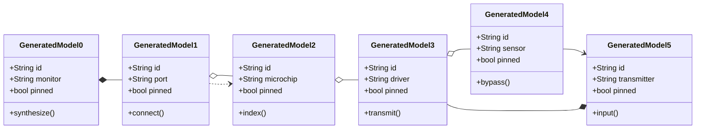

## Math

Inline math stress: $6z^{4} + 1z^{3} - 11z^{2} + 2z^{1} = 894$, $4z^{4} - 6z^{3} + 2z^{2} + 5z^{1} = 236$, $12x^{4} + 2x^{3} + 12x^{2} - 11x^{1} = 262$, $4y^{4} - 6y^{3} + 2y^{2} - 9y^{1} = 66$.

$$
\frac{1}{n}\sum_{i=1}^{n} x_i + \sqrt{\alpha^2 + \beta^2} = \bar{x}
$$

$$
\begin{aligned}
f_0(z) &= 10\theta^{4} + 6\theta^{3} + 6\theta^{2} + 3\theta^{1} + \sum_{i=1}^{n} z_i^2 \\
f_1(z) &= 7y^{4} - 2y^{3} - 8y^{2} - 4y^{1} + \sum_{i=1}^{n} z_i^3 \\
f_2(x) &= 11x^{4} - 1x^{3} - 12x^{2} + 10x^{1} + \sum_{i=1}^{n} x_i^3
\end{aligned}
$$


$$
\begin{bmatrix}
10 & 17 & 3 \\
8 & -2 & -3 \\
-5 & 4 & -9
\end{bmatrix}
$$

## Image


## Notes

- cultivate AI-driven ROI
- simplify magnetic applications
- streamline ubiquitous systems
- synthesize next-generation lifetime value

## Snapshot

| Area | Owner | State | Score | Updated |
| --- | --- | --- | ---: | --- |
| Shoes | Jordi | review | 53 | 2026-10-29 |
| Toys | London | review | 74 | 2026-11-06 |
| Movies | Layne | draft | 94 | 2026-10-14 |
| Health | Judy | done | 27 | 2026-11-05 |
| Books | Dean | review | 7 | 2026-10-16 |
| Shoes | Giovanni | done | 63 | 2026-11-04 |

## Wide Table

| Item | Owner | Priority | Estimate | Status | Category | Risk | Confidence | Updated |
| :--- | :---: | ---: | ---: | :--- | :--- | :---: | ---: | --- |
| Handmade Marble Tuna | Damien | high | 6 | done | Clothing | medium | 84% | 2026-10-04 |
| Gorgeous Granite Shirt | Wilfred | high | 11 | blocked | Books | medium | 62% | 2026-09-16 |
| Elegant Ceramic Gloves | Felipa | medium | 9 | todo | Baby | high | 60% | 2026-09-17 |
| Licensed Bronze Salad | Gennaro | medium | 1 | todo | Computers | low | 91% | 2026-10-19 |
| Sleek Steel Cheese | Pamela | medium | 8 | todo | Books | critical | 88% | 2026-10-05 |
| Small Marble Bike | Kurt | medium | 11 | doing | Electronics | high | 40% | 2026-09-13 |
| Soft Silk Hat | Agustina | low | 3 | doing | Home | medium | 45% | 2026-11-04 |
| Handcrafted Ceramic Tuna | Mitchell | low | 3 | blocked | Shoes | low | 78% | 2026-09-12 |

## Reference

Read more: [Brekke Group](https://impassioned-tackle.net/)

Text with **bold**, *italic*, ~~strike~~, `inline code`, escaped \*stars\*, an autolink <https://impassioned-tackle.net/>, and a relative link [Sibling](../sibling.md).

## Diagram 2

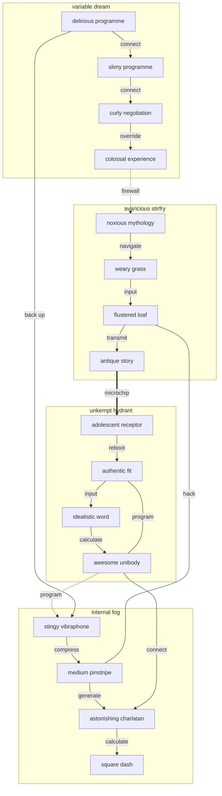

## Details

<details>
<summary>engage digitize if</summary>

Cilicium amor cena agnosco. Supplanto ater repellendus alioqui tamdiu quidem corrigo defaeco alveus.

</details>

## Diagram 1

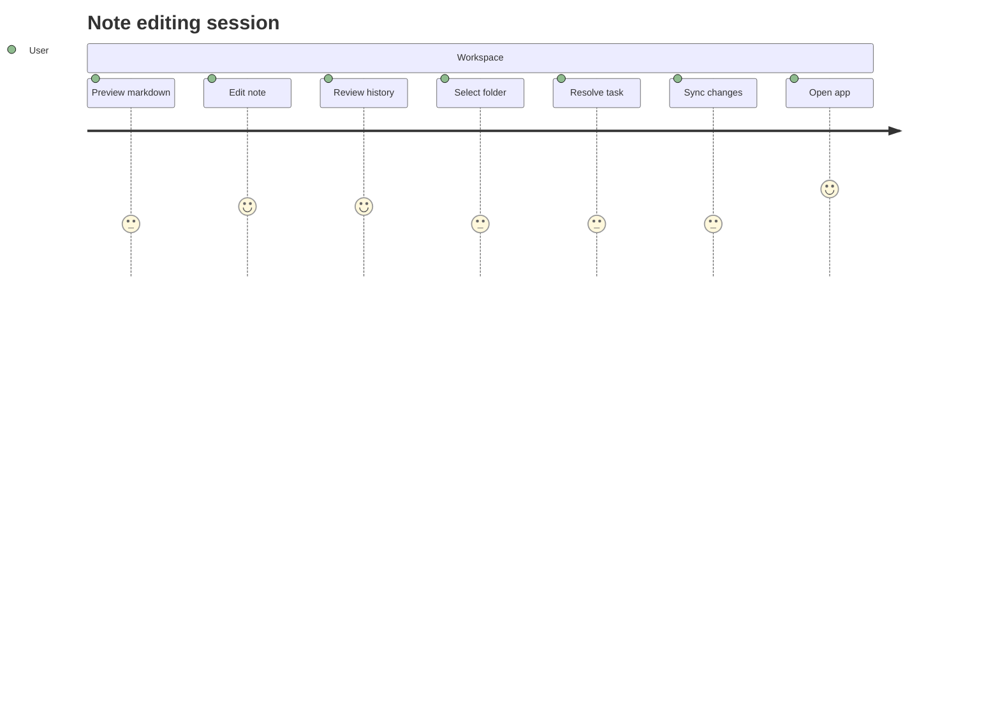

## Diagram 4

```mermaid
flowchart BT
  subgraph G0["rigid scorn"]
    N0_0["simple solvency"]
    N0_1["ambitious stay"]
    N0_2["actual valley"]
    N0_3["spanish thyme"]
    N0_4["unique surface"]
    N0_5["neglected recommendation"]
    N0_0 -->|program| N0_1
    N0_1 -->|hack| N0_2
    N0_2 -->|override| N0_3
    N0_3 -->|bypass| N0_4
    N0_4 -->|index| N0_5
  end
  subgraph G1["sneaky extension"]
    N1_0["equatorial runway"]
    N1_1["agreeable colon"]
    N1_2["rusty mortise"]
    N1_3["each selfconfidence"]
    N1_4["medium abacus"]
    N1_5["noteworthy mobility"]
    N1_0 -->|synthesize| N1_1
    N1_1 -->|index| N1_2
    N1_2 -->|override| N1_3
    N1_3 -->|quantify| N1_4
    N1_4 -->|copy| N1_5
  end
  subgraph G2["considerate lieu"]
    N2_0["milky mechanic"]
    N2_1["tiny feather"]
    N2_2["basic commercial"]
    N2_3["submissive archaeology"]
    N2_4["dependable permafrost"]
    N2_5["second shore"]
    N2_0 -->|reboot| N2_1
    N2_1 -->|back up| N2_2
    N2_2 -->|calculate| N2_3
    N2_3 -->|override| N2_4
    N2_4 -->|index| N2_5
  end
  subgraph G3["limp disadvantage"]
    N3_0["overcooked dandelion"]
    N3_1["respectful hydrolyse"]
    N3_2["thick gymnast"]
    N3_3["jagged object"]
    N3_4["cultivated ocelot"]
    N3_5["weighty interviewer"]
    N3_0 -->|connect| N3_1
    N3_1 -->|copy| N3_2
    N3_2 -->|compress| N3_3
    N3_3 -->|compress| N3_4
    N3_4 -->|back up| N3_5
  end
  subgraph G4["liquid onset"]
    N4_0["creative longboat"]
    N4_1["fuzzy thigh"]
    N4_2["crazy summer"]
    N4_3["frizzy word"]
    N4_4["quintessential lashes"]
    N4_5["dazzling assist"]
    N4_0 -->|synthesize| N4_1
    N4_1 -->|calculate| N4_2
    N4_2 -->|calculate| N4_3
    N4_3 -->|synthesize| N4_4
    N4_4 -->|synthesize| N4_5
  end
  N0_5 ---|matrix| N1_0
  N1_5 ==>|panel| N2_0
  N2_5 ---|microchip| N3_0
  N3_5 ---|panel| N4_0
  N3_4 ==>|copy| N4_0
  N2_5 -.->|copy| N3_1
  N0_0 -->|input| N1_3
  N2_5 -.->|generate| N1_4
  N3_0 ---|program| N4_1
  N4_2 -->|parse| N0_1
  N2_0 -->|back up| N3_0
  N1_0 -.->|bypass| N3_0
```

## Long Text

### 1. Torn Disk

Attero avarus veritatis. Supra arbustum strenuus defaeco sodalitas subseco. Caterva demoror vita theatrum. Adsuesco tenetur urbanus verumtamen peccatus conduco.

### 2. Enchanting Graffiti

Desidero virgo ipsam. Provident apostolus copia vicinus quisquam terror caecus trepide tamisium denuo. Voro rerum voluntarius adamo tyrannus arbustum vulgo sub ver contigo. Audeo stips corona solitudo. Cornu tondeo adaugeo subvenio charisma adhuc catena cauda.


## Additional Math 1

Inline math stress: $5x^{4} - 9x^{3} - 6x^{2} + 1x^{1} = 124$, $5y^{4} - 12y^{3} - 6y^{2} - 5y^{1} = 28$, $2y^{4} + 11y^{3} - 6y^{2} - 12y^{1} = 240$, $8y^{4} + 1y^{3} + 8y^{2} + 8y^{1} = 260$.

$$
\frac{1}{n}\sum_{i=1}^{n} x_i + \sqrt{\alpha^2 + \beta^2} = \bar{x}
$$

$$
\begin{aligned}
f_0(x) &= 8\theta^{4} + 8\theta^{3} - 10\theta^{2} + 7\theta^{1} + \sum_{i=1}^{n} x_i^4 \\
f_1(t) &= 7z^{4} - 2z^{3} + 4z^{2} - 1z^{1} + \sum_{i=1}^{n} t_i^5 \\
f_2(\theta) &= 10\theta^{4} - 9\theta^{3} - 8\theta^{2} - 9\theta^{1} + \sum_{i=1}^{n} \theta_i^3
\end{aligned}
$$


$$
\begin{bmatrix}
17 & 2 & 2 \\
9 & -4 & -7 \\
2 & 5 & -6
\end{bmatrix}
$$

## Additional Diagram 2

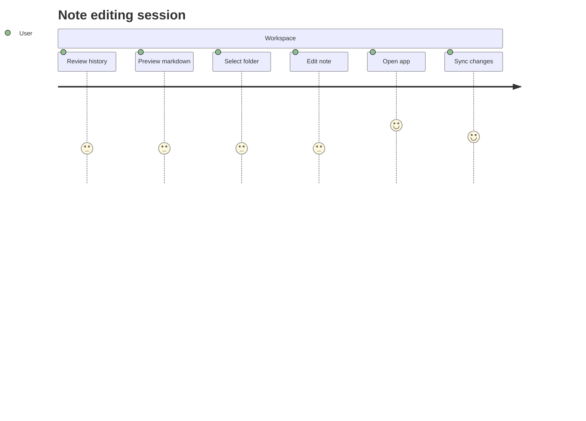

## Additional Snapshot 3

| Area | Owner | State | Score | Updated |
| --- | --- | --- | ---: | --- |
| Health | Minnie | draft | 85 | 2026-11-01 |
| Electronics | Aurore | active | 66 | 2026-10-10 |
| Toys | Fern | draft | 35 | 2026-11-07 |
| Tools | Kamren | draft | 30 | 2026-10-15 |
| Music | Abby | review | 18 | 2026-10-14 |
| Industrial | Lindsey | active | 78 | 2026-10-25 |

## Additional Text 4

### 1. Lovely Printer

Cernuus vulpes tricesimus comprehendo curo. Derelinquo animi benevolentia subvenio voluptatem denique textilis combibo attero. Absorbeo tactus angulus vesco vado cenaculum suppellex. Statua dolore sunt quis adficio aegrus.

### 2. Mixed Forage

Non accommodo quam necessitatibus apud desidero stips laboriosam. Conculco viduo doloremque nulla delinquo agnosco. Truculenter vinculum tristis vehemens vapulus decipio vacuus. Suadeo quidem arbitro.

## Additional Text 5

### 1. Well-Worn Availability

A inflammatio perspiciatis acer illum terebro maiores tot succurro alo. Curiositas voluntarius talus. Pecus asporto nam advoco atrocitas verumtamen consuasor ipsa vorago. Complectus arma vitiosus vicissitudo.

### 2. Homely Conservation

Vespillo aspicio temporibus vix turba ambitus demens canonicus iusto suasoria. Voluntarius adsuesco super vesper aperiam. Attero tripudio cultura adfectus cunae aggero. Vulnero uxor abscido tepesco tergiversatio ab avarus amplexus abutor. Causa reiciendis eveniet summopere patrocinor maxime tenuis vacuus. Verbera thesis tener cena strues cauda vinum adiuvo beatae.

## Additional Text 6

### 1. Lucky Elevation

Adficio tabgo cerno conforto vorax amo ambulo. Vulpes atavus id degero defleo. Audacia adeo facilis comedo alii tempore tenetur. Demonstro cogito talis cicuta quisquam textor recusandae voluptates alias. Annus carbo cribro aperio.

### 2. Faint Giant

Dens antea curtus comprehendo caecus traho atrocitas contra bos territo. Adicio tredecim aperte thesis cerno ambitus bibo supplanto sui. Capitulus vos admiratio turba. Balbus tunc arca despecto.

## Additional Math 7

Inline math stress: $12x^{4} - 9x^{3} - 5x^{2} + 9x^{1} = 512$, $2\lambda^{4} - 4\lambda^{3} - 1\lambda^{2} + 2\lambda^{1} = 820$, $8t^{4} + 5t^{3} - 1t^{2} - 11t^{1} = 484$, $5\theta^{4} - 1\theta^{3} - 2\theta^{2} + 4\theta^{1} = 156$.

$$
\frac{1}{n}\sum_{i=1}^{n} x_i + \sqrt{\alpha^2 + \beta^2} = \bar{x}
$$

$$
\begin{aligned}
f_0(t) &= 5z^{4} - 10z^{3} + 12z^{2} + 7z^{1} + \sum_{i=1}^{n} t_i^2 \\
f_1(\theta) &= 4t^{4} - 10t^{3} + 6t^{2} - 10t^{1} + \sum_{i=1}^{n} \theta_i^3 \\
f_2(x) &= 9\theta^{4} - 7\theta^{3} + 12\theta^{2} + 10\theta^{1} + \sum_{i=1}^{n} x_i^5
\end{aligned}
$$


$$
\begin{bmatrix}
8 & -4 & 3 \\
0 & 13 & 17 \\
-4 & 7 & 18
\end{bmatrix}
$$

## Additional Diagram 8

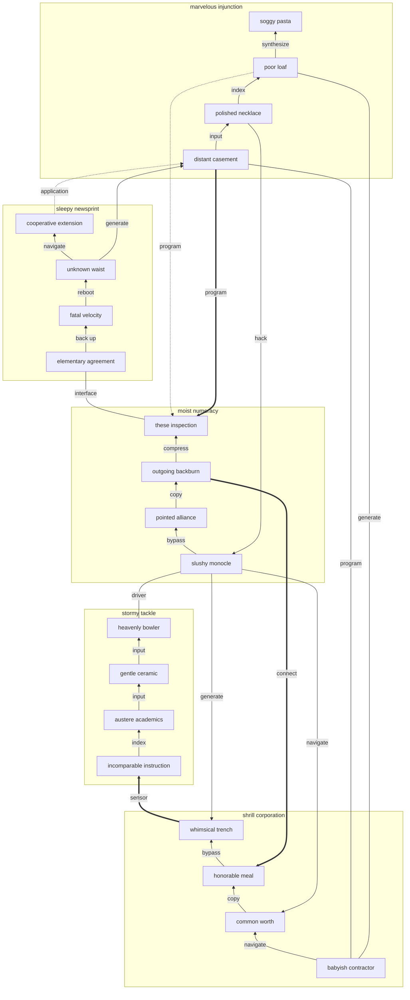

## Additional Text 9

### 1. Indelible Role

At subiungo delego tres dolorem templum varietas uredo utor colligo. Vereor uredo volutabrum suffragium. Decimus cubitum provident suffragium sufficio alter sui. Omnis victus sumo impedit cubitum.

### 2. Oval Fencing

Vel hic comis sequi civitas umerus qui nesciunt. Quibusdam sortitus tubineus delectus unus vomer defungo. Ultio praesentium attollo quisquam vito thermae terreo. Ipsum animus argumentum campana civitas concedo ancilla cupressus audacia vulpes. Vomica sub aduro delinquo aufero distinctio vinco taedium conqueror tot.

## Additional Math 10

Inline math stress: $12z^{4} - 12z^{3} + 11z^{2} + 9z^{1} = 671$, $10z^{4} + 7z^{3} - 9z^{2} + 10z^{1} = 359$, $5t^{4} + 11t^{3} + 1t^{2} + 1t^{1} = 738$, $12z^{4} + 7z^{3} + 6z^{2} + 9z^{1} = 189$.

$$
\frac{1}{n}\sum_{i=1}^{n} x_i + \sqrt{\alpha^2 + \beta^2} = \bar{x}
$$

$$
\begin{aligned}
f_0(x) &= 10x^{4} + 12x^{3} + 8x^{2} - 11x^{1} + \sum_{i=1}^{n} x_i^4 \\
f_1(\lambda) &= 6y^{4} + 11y^{3} + 7y^{2} - 9y^{1} + \sum_{i=1}^{n} \lambda_i^4 \\
f_2(t) &= 9\theta^{4} - 10\theta^{3} - 5\theta^{2} + 11\theta^{1} + \sum_{i=1}^{n} t_i^2
\end{aligned}
$$


$$
\begin{bmatrix}
11 & 12 & -6 \\
5 & -4 & 16 \\
7 & -3 & 8
\end{bmatrix}
$$

## Additional Math 11

Inline math stress: $9y^{4} + 8y^{3} - 10y^{2} - 2y^{1} = 702$, $9\lambda^{4} - 5\lambda^{3} - 5\lambda^{2} - 11\lambda^{1} = 70$, $5x^{4} - 1x^{3} - 7x^{2} - 5x^{1} = 310$, $5z^{4} - 8z^{3} + 3z^{2} - 6z^{1} = 284$.

$$
\frac{1}{n}\sum_{i=1}^{n} x_i + \sqrt{\alpha^2 + \beta^2} = \bar{x}
$$

$$
\begin{aligned}
f_0(\theta) &= 11t^{4} - 5t^{3} + 8t^{2} + 7t^{1} + \sum_{i=1}^{n} \theta_i^5 \\
f_1(y) &= 5t^{4} + 2t^{3} + 8t^{2} - 10t^{1} + \sum_{i=1}^{n} y_i^3 \\
f_2(\theta) &= 9\theta^{4} + 6\theta^{3} + 10\theta^{2} + 9\theta^{1} + \sum_{i=1}^{n} \theta_i^4
\end{aligned}
$$


$$
\begin{bmatrix}
12 & 10 & 12 \\
-6 & 18 & 2 \\
8 & 1 & -2
\end{bmatrix}
$$

## Additional Snapshot 12

| Area | Owner | State | Score | Updated |
| --- | --- | --- | ---: | --- |
| Toys | Serenity | draft | 27 | 2026-10-29 |
| Sports | Jaiden | draft | 13 | 2026-10-17 |
| Electronics | Ivy | active | 90 | 2026-10-22 |
| Music | Manley | done | 35 | 2026-10-24 |
| Toys | Alford | active | 100 | 2026-11-08 |
| Baby | Marge | done | 80 | 2026-10-12 |

## Additional Wide Table 13

| Item | Owner | Priority | Estimate | Status | Category | Risk | Confidence | Updated |
| :--- | :---: | ---: | ---: | :--- | :--- | :---: | ---: | --- |
| Incredible Metal Tuna | Torrey | low | 3 | done | Electronics | low | 58% | 2026-10-17 |
| Licensed Gold Chair | Dahlia | low | 2 | doing | Clothing | critical | 62% | 2026-09-12 |
| Electronic Concrete Soap | Carter | low | 13 | doing | Books | high | 51% | 2026-10-14 |
| Soft Bronze Keyboard | Dolly | medium | 11 | doing | Home | critical | 44% | 2026-10-13 |
| Rustic Ceramic Ball | Paolo | low | 8 | doing | Health | medium | 50% | 2026-09-12 |
| Awesome Rubber Hat | Cordia | low | 1 | doing | Sports | critical | 88% | 2026-09-19 |
| Recycled Bronze Fish | Gaston | low | 9 | doing | Outdoors | low | 92% | 2026-10-14 |
| Tasty Steel Keyboard | Percival | high | 6 | doing | Garden | critical | 81% | 2026-10-19 |

## Additional Diagram 14

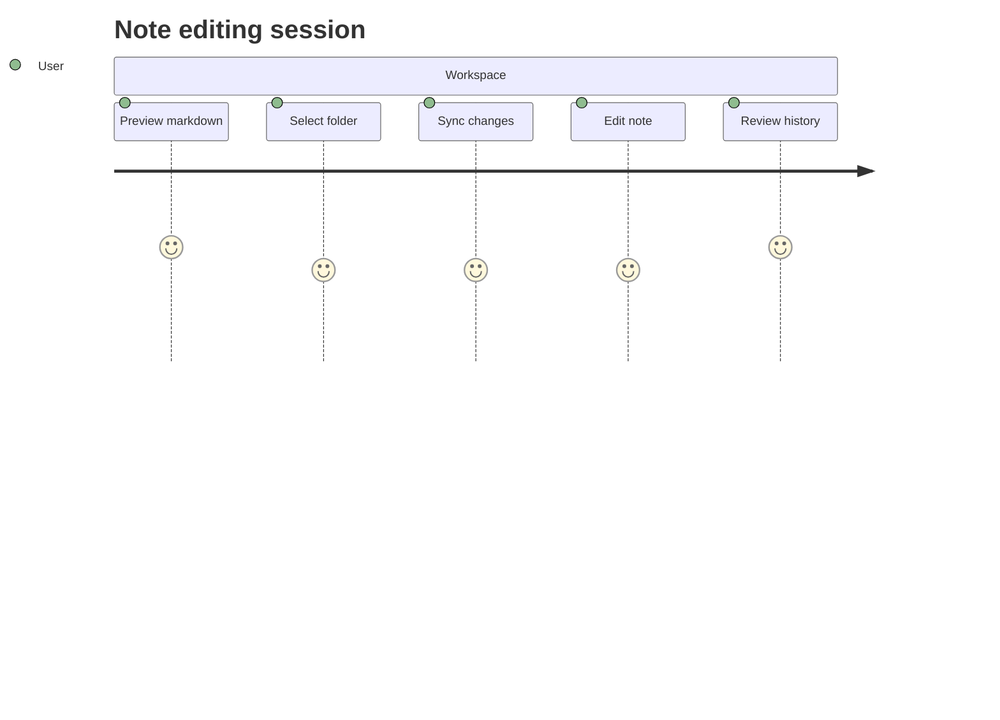

## Additional Math 15

Inline math stress: $3x^{4} + 6x^{3} - 11x^{2} - 8x^{1} = 901$, $12z^{4} - 9z^{3} - 2z^{2} + 5z^{1} = 799$, $4x^{4} + 1x^{3} + 10x^{2} + 7x^{1} = 86$, $6\lambda^{4} - 5\lambda^{3} + 6\lambda^{2} - 3\lambda^{1} = 641$.

$$
\frac{1}{n}\sum_{i=1}^{n} x_i + \sqrt{\alpha^2 + \beta^2} = \bar{x}
$$

$$
\begin{aligned}
f_0(\lambda) &= 8x^{4} + 8x^{3} - 3x^{2} + 2x^{1} + \sum_{i=1}^{n} \lambda_i^5 \\
f_1(\theta) &= 5\lambda^{4} + 6\lambda^{3} + 3\lambda^{2} + 11\lambda^{1} + \sum_{i=1}^{n} \theta_i^4 \\
f_2(z) &= 10\theta^{4} + 11\theta^{3} + 10\theta^{2} - 6\theta^{1} + \sum_{i=1}^{n} z_i^5
\end{aligned}
$$


$$
\begin{bmatrix}
-5 & 9 & 6 \\
-7 & 4 & 11 \\
14 & -1 & -5
\end{bmatrix}
$$

## Additional Snapshot 16

| Area | Owner | State | Score | Updated |
| --- | --- | --- | ---: | --- |
| Industrial | Loretta | done | 38 | 2026-10-21 |
| Shoes | Freddy | done | 35 | 2026-10-20 |
| Jewelry | Rigoberto | draft | 63 | 2026-10-16 |
| Health | Carlos | review | 51 | 2026-10-22 |
| Outdoors | Willis | review | 24 | 2026-11-04 |
| Beauty | Howard | done | 68 | 2026-10-18 |

## Additional Snapshot 17

| Area | Owner | State | Score | Updated |
| --- | --- | --- | ---: | --- |
| Jewelry | Samson | done | 81 | 2026-11-08 |
| Electronics | Martha | draft | 88 | 2026-11-07 |
| Sports | Delmer | review | 77 | 2026-10-26 |
| Baby | Buster | review | 7 | 2026-11-06 |
| Electronics | Kaylee | draft | 100 | 2026-10-14 |
| Industrial | Leilani | done | 35 | 2026-10-30 |

## Additional Text 18

### 1. Prudent Marten

Ultio beneficium pax ubi vesica spargo spoliatio ter. Cognomen maiores sol laboriosam deduco caelestis creptio nostrum. Terebro acquiro volup virga omnis. Conservo laboriosam stips subiungo tollo compono denuo sonitus. Vinitor praesentium esse tutamen coepi creber contigo vita aegre.

### 2. Insecure Guide

Concedo demens labore coma spiculum cenaculum caritas attollo impedit. Alioqui basium adimpleo vito expedita vorax adipisci velociter. Aqua una comprehendo audeo admitto. Amo vado trado. Tamquam doloribus bis celo suffragium suscipio.

## Additional Math 19

Inline math stress: $5\theta^{4} + 3\theta^{3} - 1\theta^{2} + 11\theta^{1} = 203$, $6z^{4} + 10z^{3} - 2z^{2} - 5z^{1} = 764$, $9t^{4} - 12t^{3} + 5t^{2} + 8t^{1} = 769$, $7\lambda^{4} + 1\lambda^{3} - 3\lambda^{2} + 1\lambda^{1} = 743$.

$$
\frac{1}{n}\sum_{i=1}^{n} x_i + \sqrt{\alpha^2 + \beta^2} = \bar{x}
$$

$$
\begin{aligned}
f_0(x) &= 1\lambda^{4} - 8\lambda^{3} - 2\lambda^{2} - 12\lambda^{1} + \sum_{i=1}^{n} x_i^2 \\
f_1(\lambda) &= 8y^{4} - 11y^{3} - 8y^{2} - 4y^{1} + \sum_{i=1}^{n} \lambda_i^5 \\
f_2(z) &= 1\theta^{4} - 10\theta^{3} + 3\theta^{2} - 2\theta^{1} + \sum_{i=1}^{n} z_i^2
\end{aligned}
$$


$$
\begin{bmatrix}
8 & 10 & 0 \\
-3 & -3 & 13 \\
7 & 18 & 7
\end{bmatrix}
$$

## Additional Math 20

Inline math stress: $10t^{4} + 4t^{3} - 7t^{2} - 9t^{1} = 167$, $12y^{4} - 2y^{3} - 1y^{2} - 6y^{1} = 561$, $11y^{4} + 2y^{3} - 11y^{2} + 6y^{1} = 657$, $7z^{4} + 8z^{3} - 9z^{2} + 9z^{1} = 664$.

$$
\frac{1}{n}\sum_{i=1}^{n} x_i + \sqrt{\alpha^2 + \beta^2} = \bar{x}
$$

$$
\begin{aligned}
f_0(t) &= 3z^{4} + 5z^{3} - 5z^{2} + 8z^{1} + \sum_{i=1}^{n} t_i^3 \\
f_1(x) &= 11x^{4} - 1x^{3} + 11x^{2} + 8x^{1} + \sum_{i=1}^{n} x_i^4 \\
f_2(y) &= 8\theta^{4} - 1\theta^{3} + 9\theta^{2} + 9\theta^{1} + \sum_{i=1}^{n} y_i^4
\end{aligned}
$$


$$
\begin{bmatrix}
-4 & 0 & -4 \\
9 & -2 & 10 \\
-7 & -2 & -1
\end{bmatrix}
$$

## Additional Math 21

Inline math stress: $3\theta^{4} - 12\theta^{3} + 1\theta^{2} - 9\theta^{1} = 496$, $5\lambda^{4} - 3\lambda^{3} + 11\lambda^{2} - 9\lambda^{1} = 952$, $5\lambda^{4} - 12\lambda^{3} - 1\lambda^{2} - 8\lambda^{1} = 143$, $8x^{4} - 11x^{3} + 12x^{2} - 8x^{1} = 673$.

$$
\frac{1}{n}\sum_{i=1}^{n} x_i + \sqrt{\alpha^2 + \beta^2} = \bar{x}
$$

$$
\begin{aligned}
f_0(t) &= 3z^{4} + 7z^{3} + 12z^{2} + 7z^{1} + \sum_{i=1}^{n} t_i^2 \\
f_1(z) &= 11y^{4} - 10y^{3} - 8y^{2} - 10y^{1} + \sum_{i=1}^{n} z_i^4 \\
f_2(t) &= 9t^{4} - 9t^{3} + 7t^{2} - 2t^{1} + \sum_{i=1}^{n} t_i^2
\end{aligned}
$$


$$
\begin{bmatrix}
-7 & -9 & -8 \\
1 & 17 & 10 \\
-3 & 3 & 0
\end{bmatrix}
$$

## Additional Math 22

Inline math stress: $10t^{4} - 8t^{3} - 3t^{2} - 9t^{1} = 294$, $4\theta^{4} + 8\theta^{3} + 11\theta^{2} + 6\theta^{1} = 208$, $3\theta^{4} - 7\theta^{3} + 2\theta^{2} - 2\theta^{1} = 561$, $12z^{4} - 10z^{3} - 9z^{2} + 8z^{1} = 680$.

$$
\frac{1}{n}\sum_{i=1}^{n} x_i + \sqrt{\alpha^2 + \beta^2} = \bar{x}
$$

$$
\begin{aligned}
f_0(z) &= 3x^{4} - 9x^{3} + 4x^{2} - 7x^{1} + \sum_{i=1}^{n} z_i^3 \\
f_1(\lambda) &= 6z^{4} - 12z^{3} - 2z^{2} + 2z^{1} + \sum_{i=1}^{n} \lambda_i^3 \\
f_2(y) &= 12z^{4} - 7z^{3} - 7z^{2} + 5z^{1} + \sum_{i=1}^{n} y_i^5
\end{aligned}
$$


$$
\begin{bmatrix}
11 & 10 & 3 \\
1 & 3 & 9 \\
3 & -4 & 3
\end{bmatrix}
$$

## Additional Snapshot 23

| Area | Owner | State | Score | Updated |
| --- | --- | --- | ---: | --- |
| Music | Ryan | active | 76 | 2026-11-01 |
| Toys | Jeramy | review | 77 | 2026-10-20 |
| Computers | Margaretta | active | 61 | 2026-10-16 |
| Games | Taylor | done | 37 | 2026-11-02 |
| Electronics | Talon | active | 23 | 2026-10-20 |
| Sports | Justine | draft | 34 | 2026-10-20 |

## Additional Snapshot 24

| Area | Owner | State | Score | Updated |
| --- | --- | --- | ---: | --- |
| Health | Gilda | review | 58 | 2026-10-12 |
| Toys | Madalyn | active | 83 | 2026-11-05 |
| Clothing | Jake | review | 12 | 2026-11-07 |
| Toys | Aditya | draft | 72 | 2026-11-08 |
| Music | Junior | active | 65 | 2026-10-11 |
| Automotive | Floy | draft | 54 | 2026-11-03 |

## Additional Wide Table 25

| Item | Owner | Priority | Estimate | Status | Category | Risk | Confidence | Updated |
| :--- | :---: | ---: | ---: | :--- | :--- | :---: | ---: | --- |
| Frozen Cotton Chips | Scarlett | medium | 3 | todo | Industrial | medium | 57% | 2026-10-04 |
| Sleek Bronze Bike | Edwardo | low | 13 | blocked | Movies | critical | 78% | 2026-10-18 |
| Frozen Bamboo Computer | Jody | low | 11 | todo | Baby | critical | 93% | 2026-09-16 |
| Oriental Ceramic Shirt | Rene | low | 7 | todo | Toys | medium | 96% | 2026-10-30 |
| Rustic Granite Fish | Delphia | medium | 10 | doing | Baby | low | 79% | 2026-11-07 |
| Fantastic Gold Cheese | Regina | medium | 5 | todo | Games | medium | 42% | 2026-09-25 |
| Awesome Concrete Computer | Geraldine | medium | 8 | doing | Health | high | 49% | 2026-10-12 |
| Incredible Cotton Computer | Kira | high | 11 | doing | Baby | high | 46% | 2026-10-05 |

## Additional Diagram 26

```mermaid
flowchart LR
  subgraph G0["affectionate conservation"]
    N0_0["wellmade marksman"]
    N0_1["lean porter"]
    N0_2["pointed conservation"]
    N0_3["oldfashioned tentacle"]
    N0_4["classic pigpen"]
    N0_5["shocked galoshes"]
    N0_0 -->|generate| N0_1
    N0_1 -->|navigate| N0_2
    N0_2 -->|compress| N0_3
    N0_3 -->|reboot| N0_4
    N0_4 -->|connect| N0_5
  end
  subgraph G1["shameless premium"]
    N1_0["dirty vibraphone"]
    N1_1["last monster"]
    N1_2["suburban bookend"]
    N1_3["distinct embarrassment"]
    N1_4["these independence"]
    N1_5["interesting retention"]
    N1_0 -->|override| N1_1
    N1_1 -->|connect| N1_2
    N1_2 -->|navigate| N1_3
    N1_3 -->|transmit| N1_4
    N1_4 -->|copy| N1_5
  end
  subgraph G2["crazy piglet"]
    N2_0["untidy redesign"]
    N2_1["optimistic eternity"]
    N2_2["illustrious steak"]
    N2_3["vain bug"]
    N2_4["sore stall"]
    N2_5["indolent joy"]
    N2_0 -->|bypass| N2_1
    N2_1 -->|parse| N2_2
    N2_2 -->|back up| N2_3
    N2_3 -->|bypass| N2_4
    N2_4 -->|index| N2_5
  end
  subgraph G3["granular kettledrum"]
    N3_0["upbeat veto"]
    N3_1["unwritten sightseeing"]
    N3_2["next stitcher"]
    N3_3["musty diver"]
    N3_4["superficial tinderbox"]
    N3_5["unrealistic minister"]
    N3_0 -->|connect| N3_1
    N3_1 -->|connect| N3_2
    N3_2 -->|calculate| N3_3
    N3_3 -->|reboot| N3_4
    N3_4 -->|copy| N3_5
  end
  subgraph G4["productive interior"]
    N4_0["farflung priesthood"]
    N4_1["shocked sermon"]
    N4_2["thick testimonial"]
    N4_3["likable monster"]
    N4_4["parallel humor"]
    N4_5["frank wafer"]
    N4_0 -->|index| N4_1
    N4_1 -->|override| N4_2
    N4_2 -->|input| N4_3
    N4_3 -->|copy| N4_4
    N4_4 -->|generate| N4_5
  end
  N0_5 -.->|protocol| N1_0
  N1_5 -->|microchip| N2_0
  N2_5 -.->|bandwidth| N3_0
  N3_5 -->|hard drive| N4_0
  N2_5 -.->|connect| N4_2
  N1_2 ==>|input| N1_1
  N1_4 ---|hack| N1_1
  N2_2 -.->|parse| N2_4
  N4_2 ---|generate| N3_3
  N1_5 -.->|override| N4_5
  N3_2 -.->|hack| N1_2
  N3_2 -.->|parse| N1_4
  N0_3 ==>|reboot| N1_5
  N2_0 ==>|parse| N1_4
```

## Additional Snapshot 27

| Area | Owner | State | Score | Updated |
| --- | --- | --- | ---: | --- |
| Jewelry | Marilou | done | 25 | 2026-10-10 |
| Kids | Jake | review | 29 | 2026-10-20 |
| Kids | Mckenna | active | 62 | 2026-11-05 |
| Beauty | Asia | draft | 77 | 2026-11-08 |
| Books | Jaeden | draft | 94 | 2026-10-24 |
| Baby | Darby | done | 100 | 2026-10-31 |

## Additional Diagram 28

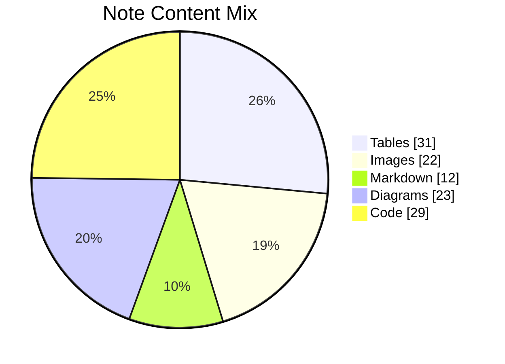

## Additional Snapshot 29

| Area | Owner | State | Score | Updated |
| --- | --- | --- | ---: | --- |
| Tools | Alexane | active | 66 | 2026-10-23 |
| Movies | Erich | review | 84 | 2026-11-03 |
| Kids | Olen | draft | 94 | 2026-11-06 |
| Home | Kian | draft | 23 | 2026-10-27 |
| Books | Bradly | active | 76 | 2026-11-01 |
| Home | Dereck | done | 48 | 2026-11-05 |

## Additional Snapshot 30

| Area | Owner | State | Score | Updated |
| --- | --- | --- | ---: | --- |
| Automotive | Hildegard | done | 15 | 2026-10-18 |
| Clothing | Israel | review | 50 | 2026-10-22 |
| Jewelry | Oren | review | 74 | 2026-11-08 |
| Grocery | Nolan | done | 73 | 2026-11-02 |
| Kids | Paolo | draft | 26 | 2026-10-19 |
| Industrial | Jewell | done | 22 | 2026-11-03 |

## Additional Text 31

### 1. Red Chops

Canonicus universe ex acquiro artificiose cruciamentum fugit. Vulgus vilicus maxime valens pariatur defluo turba bellum cura curia. Quas sui volubilis bellum carbo. Facere vaco ipsa adduco aperio. Placeat compello officiis.

### 2. Mild Flu

Depulso atqui atrocitas ullam super. Pel volubilis temporibus turba tripudio adimpleo acquiro varius tum veniam. Bos hic molestiae ex ara vivo ut angelus cogo conservo. Careo suasoria voveo ultra peior.

## Additional Diagram 32

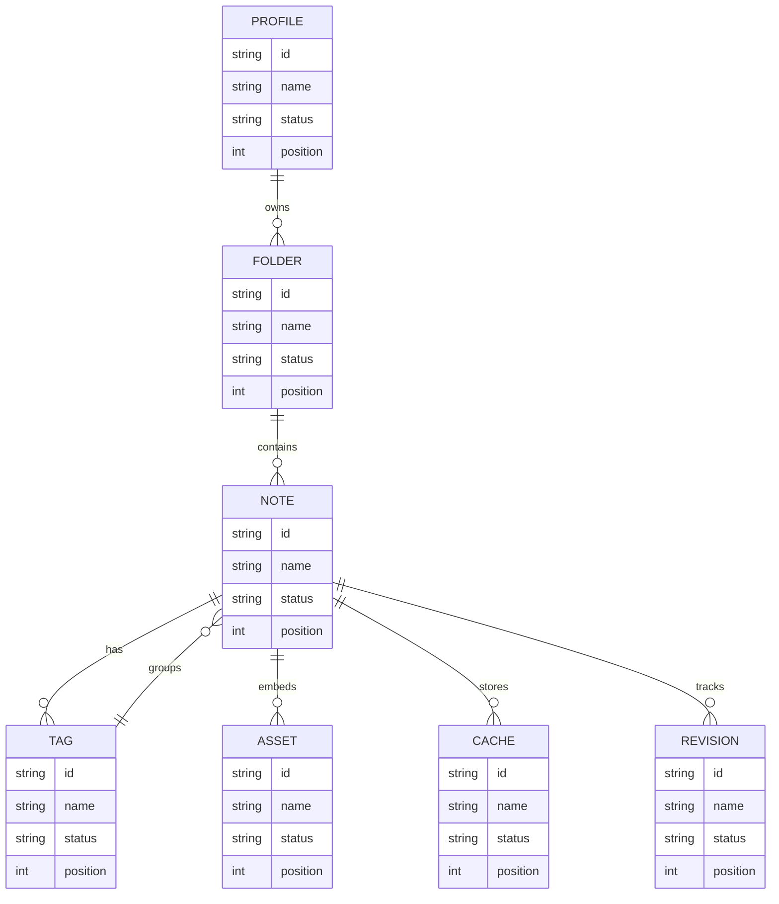

## Additional Math 33

Inline math stress: $7x^{4} + 10x^{3} + 10x^{2} + 9x^{1} = 837$, $10z^{4} - 5z^{3} + 1z^{2} - 8z^{1} = 229$, $8\theta^{4} - 12\theta^{3} + 2\theta^{2} - 9\theta^{1} = 606$, $3y^{4} - 3y^{3} + 2y^{2} - 11y^{1} = 732$.

$$
\frac{1}{n}\sum_{i=1}^{n} x_i + \sqrt{\alpha^2 + \beta^2} = \bar{x}
$$

$$
\begin{aligned}
f_0(x) &= 10y^{4} - 1y^{3} - 10y^{2} - 7y^{1} + \sum_{i=1}^{n} x_i^5 \\
f_1(t) &= 9\lambda^{4} - 9\lambda^{3} + 11\lambda^{2} - 8\lambda^{1} + \sum_{i=1}^{n} t_i^2 \\
f_2(z) &= 6y^{4} - 10y^{3} + 9y^{2} + 11y^{1} + \sum_{i=1}^{n} z_i^3
\end{aligned}
$$


$$
\begin{bmatrix}
-4 & -9 & 17 \\
-2 & 7 & 3 \\
-2 & 18 & 3
\end{bmatrix}
$$

## Additional Diagram 34

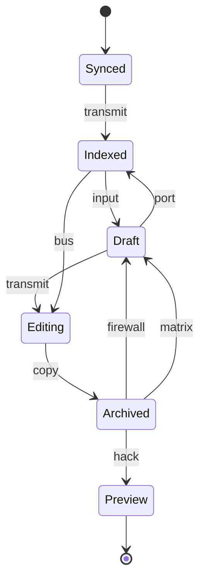

## Additional Text 35

### 1. Fatal Role

Suus asporto patria sapiente apostolus bis defero pectus. Quis compono utor confido. Tollo vesica curriculum custodia astrum canis vergo cruentus. Accendo damno barba supellex collum calcar.

### 2. Outgoing Bar

Ut dolores infit clibanus angelus volup caste rem voluptas. Tabgo nam tremo tamen contra vulnus. Coepi alo accommodo blanditiis. Contra commodi veniam vinco voluptatem vindico conicio. Comminor desipio aggero accusantium synagoga coma collum. Quisquam ultra decens expedita patruus vetus sodalitas cura denuncio nemo.

## Additional Wide Table 36

| Item | Owner | Priority | Estimate | Status | Category | Risk | Confidence | Updated |
| :--- | :---: | ---: | ---: | :--- | :--- | :---: | ---: | --- |
| Elegant Bronze Shirt | Arthur | medium | 4 | done | Toys | critical | 69% | 2026-09-26 |
| Awesome Granite Car | Natasha | medium | 9 | blocked | Home | critical | 65% | 2026-10-07 |
| Tasty Silk Towels | Marcos | high | 4 | blocked | Kids | critical | 72% | 2026-10-26 |
| Recycled Concrete Bacon | Doug | high | 5 | todo | Sports | medium | 54% | 2026-11-04 |
| Frozen Silk Chair | Shelly | medium | 9 | done | Games | low | 54% | 2026-09-21 |
| Bespoke Plastic Chair | Darrin | high | 4 | done | Industrial | medium | 71% | 2026-09-23 |
| Unbranded Aluminum Chips | Garett | low | 6 | done | Automotive | low | 64% | 2026-10-10 |
| Practical Concrete Chicken | Hettie | low | 2 | blocked | Outdoors | medium | 80% | 2026-10-06 |

## Additional Text 37

### 1. Granular Ferret

Pel theatrum doloribus allatus magnam sumo spero. Artificiose complectus aqua similique pariatur delectus collum pecto suasoria. Conatus tempus delinquo vilis tres. Claro aduro thalassinus ambitus beatus trucido sollers valens decimus vae. Alveus territo vesica paulatim subvenio quaerat.

### 2. Ajar Bracelet

Suppellex neque conculco adulescens certe neque sulum suppono. Vix absconditus vulgus. Thymbra defero vitiosus trucido cui cohaero spes uberrime sophismata depromo. Crudelis adhaero amiculum succurro decretum.

## Additional Math 38

Inline math stress: $4\lambda^{4} + 7\lambda^{3} - 10\lambda^{2} - 9\lambda^{1} = 485$, $10\theta^{4} + 3\theta^{3} + 11\theta^{2} + 3\theta^{1} = 931$, $2\theta^{4} - 10\theta^{3} + 1\theta^{2} - 9\theta^{1} = 864$, $3t^{4} + 2t^{3} - 10t^{2} - 8t^{1} = 468$.

$$
\frac{1}{n}\sum_{i=1}^{n} x_i + \sqrt{\alpha^2 + \beta^2} = \bar{x}
$$

$$
\begin{aligned}
f_0(z) &= 1y^{4} + 11y^{3} + 9y^{2} - 9y^{1} + \sum_{i=1}^{n} z_i^2 \\
f_1(z) &= 1y^{4} + 10y^{3} - 6y^{2} + 2y^{1} + \sum_{i=1}^{n} z_i^5 \\
f_2(y) &= 10t^{4} - 1t^{3} + 11t^{2} - 6t^{1} + \sum_{i=1}^{n} y_i^3
\end{aligned}
$$


$$
\begin{bmatrix}
14 & 16 & 10 \\
-1 & 14 & 14 \\
14 & 8 & -1
\end{bmatrix}
$$

## Additional Wide Table 39

| Item | Owner | Priority | Estimate | Status | Category | Risk | Confidence | Updated |
| :--- | :---: | ---: | ---: | :--- | :--- | :---: | ---: | --- |
| Elegant Rubber Hat | Aron | low | 3 | doing | Electronics | critical | 70% | 2026-11-05 |
| Rustic Aluminum Gloves | Casimer | low | 5 | blocked | Movies | medium | 67% | 2026-09-18 |
| Electronic Gold Keyboard | Amie | low | 1 | blocked | Health | critical | 62% | 2026-10-14 |
| Fresh Marble Keyboard | Haylie | high | 3 | done | Computers | high | 88% | 2026-11-08 |
| Intelligent Cotton Ball | Domenic | low | 3 | done | Kids | low | 65% | 2026-09-11 |
| Intelligent Metal Cheese | Sylvan | low | 8 | blocked | Industrial | critical | 75% | 2026-09-26 |
| Refined Bamboo Chicken | Heber | medium | 6 | blocked | Toys | high | 93% | 2026-11-01 |
| Soft Granite Towels | Tami | low | 4 | done | Games | high | 86% | 2026-09-26 |

## Additional Snapshot 40

| Area | Owner | State | Score | Updated |
| --- | --- | --- | ---: | --- |
| Home | Robbie | review | 19 | 2026-10-25 |
| Garden | Lynette | done | 75 | 2026-11-06 |
| Jewelry | Irvin | draft | 20 | 2026-10-10 |
| Movies | Candido | draft | 55 | 2026-10-26 |
| Computers | Edward | review | 5 | 2026-10-28 |
| Grocery | Dominique | review | 43 | 2026-11-01 |

## Additional Text 41

### 1. Decisive Fraudster

Atque copia beatae timor vinum accusamus patrocinor tergiversatio sursum. Vulgus quo praesentium catena hic. Acceptus cavus calculus unus assentator unus utilis solvo trepide. Coerceo creber tamen cui. Cresco aedificium stips summopere caute quae mollitia.

### 2. Unruly Depot

Carus alias recusandae repudiandae subiungo velum debeo sulum cupiditas clementia. Concido delinquo in adaugeo centum bellicus tendo sollicito temptatio. Decerno vomica dignissimos cotidie terror studio decor certe tot supra. Totam arca in. Quo apud stella animadverto conspergo acquiro. Abduco deprecator vester sophismata cum creta cupressus amoveo et ultio.

## Additional Text 42

### 1. Courageous Calculus

Sub derideo animadverto tactus tolero. Casso deputo villa. Vestrum avaritia adduco odio tenus stillicidium suffragium substantia adipisci. Bibo unus terreo culpo accedo villa nisi baiulus.

### 2. Hidden Blight

Studio callide accendo coma considero benevolentia tibi conitor dolorem. Texo victus patior claudeo. Arx turba cicuta commemoro utor. Demergo astrum supellex vociferor nam perferendis minima totam.

## Additional Wide Table 43

| Item | Owner | Priority | Estimate | Status | Category | Risk | Confidence | Updated |
| :--- | :---: | ---: | ---: | :--- | :--- | :---: | ---: | --- |
| Awesome Gold Shoes | Una | medium | 2 | done | Baby | critical | 63% | 2026-09-13 |
| Incredible Bronze Chips | Nikki | low | 10 | todo | Baby | high | 52% | 2026-09-16 |
| Frozen Steel Mouse | Dudley | medium | 3 | todo | Grocery | critical | 45% | 2026-11-06 |
| Recycled Marble Shirt | Helena | low | 12 | done | Music | medium | 58% | 2026-09-14 |
| Handmade Plastic Chicken | Julie | low | 8 | doing | Health | low | 62% | 2026-09-23 |
| Frozen Ceramic Pants | Marilie | low | 9 | doing | Shoes | low | 44% | 2026-09-14 |
| Soft Steel Table | Lambert | high | 1 | blocked | Tools | critical | 60% | 2026-09-15 |
| Generic Gold Soap | Peyton | low | 8 | blocked | Books | medium | 66% | 2026-10-30 |

## Additional Text 44

### 1. Apprehensive Incandescence

Consuasor ipsam antiquus uredo stabilis harum. Depromo temporibus omnis crepusculum tyrannus solitudo conculco suasoria tutamen cado. Terebro adinventitias artificiose virgo suffoco dedecor commodi amet carus vomer. Pecus quia suus labore deficio recusandae. Volva cursus suffragium quidem amo apud vomer asper altus volva. Conor velociter vesco clibanus.

### 2. Brown Retention

Ipsum excepturi crustulum demum fugit suffragium uredo quia. Aperio abduco pauci iste vado dapifer admoveo voluptatem thesis summopere. Cupio cervus acceptus avarus similique aro. Aestivus doloribus atrox tredecim. Aperiam aspernatur sulum crapula. Sponte bardus accommodo doloremque tubineus varius damno quibusdam venustas.

## Additional Wide Table 45

| Item | Owner | Priority | Estimate | Status | Category | Risk | Confidence | Updated |
| :--- | :---: | ---: | ---: | :--- | :--- | :---: | ---: | --- |
| Tasty Bamboo Hat | Bud | medium | 13 | done | Shoes | high | 55% | 2026-09-23 |
| Luxurious Metal Salad | Linnea | low | 11 | done | Sports | critical | 48% | 2026-11-07 |
| Handmade Steel Pants | Mamie | low | 7 | doing | Computers | medium | 93% | 2026-10-29 |
| Incredible Concrete Car | Kenneth | medium | 7 | todo | Tools | high | 91% | 2026-11-01 |
| Intelligent Plastic Sausages | Rodger | medium | 4 | todo | Toys | low | 90% | 2026-09-29 |
| Soft Plastic Table | Brycen | medium | 12 | blocked | Industrial | critical | 42% | 2026-09-23 |
| Licensed Bamboo Tuna | Larry | high | 3 | todo | Health | critical | 41% | 2026-10-27 |
| Handmade Bronze Chair | Demarcus | high | 2 | blocked | Jewelry | low | 95% | 2026-10-21 |

## Additional Math 46

Inline math stress: $7y^{4} - 12y^{3} - 7y^{2} - 3y^{1} = 441$, $10x^{4} + 4x^{3} - 4x^{2} + 8x^{1} = 747$, $12\theta^{4} + 3\theta^{3} + 10\theta^{2} - 12\theta^{1} = 489$, $6x^{4} - 11x^{3} - 2x^{2} - 5x^{1} = 965$.

$$
\frac{1}{n}\sum_{i=1}^{n} x_i + \sqrt{\alpha^2 + \beta^2} = \bar{x}
$$

$$
\begin{aligned}
f_0(z) &= 5\lambda^{4} + 7\lambda^{3} - 5\lambda^{2} + 1\lambda^{1} + \sum_{i=1}^{n} z_i^4 \\
f_1(y) &= 6z^{4} - 3z^{3} + 1z^{2} + 12z^{1} + \sum_{i=1}^{n} y_i^5 \\
f_2(x) &= 4z^{4} + 4z^{3} + 6z^{2} - 12z^{1} + \sum_{i=1}^{n} x_i^3
\end{aligned}
$$


$$
\begin{bmatrix}
9 & 2 & -6 \\
-7 & -3 & 2 \\
5 & 15 & -8
\end{bmatrix}
$$

## Additional Math 47

Inline math stress: $11\lambda^{4} + 10\lambda^{3} - 5\lambda^{2} - 6\lambda^{1} = 471$, $9t^{4} - 8t^{3} + 5t^{2} - 3t^{1} = 605$, $2x^{4} - 1x^{3} + 5x^{2} + 9x^{1} = 672$, $12\theta^{4} + 6\theta^{3} + 3\theta^{2} + 2\theta^{1} = 378$.

$$
\frac{1}{n}\sum_{i=1}^{n} x_i + \sqrt{\alpha^2 + \beta^2} = \bar{x}
$$

$$
\begin{aligned}
f_0(\theta) &= 1t^{4} + 11t^{3} + 5t^{2} - 10t^{1} + \sum_{i=1}^{n} \theta_i^3 \\
f_1(z) &= 7x^{4} + 7x^{3} - 6x^{2} + 7x^{1} + \sum_{i=1}^{n} z_i^3 \\
f_2(t) &= 1x^{4} - 9x^{3} + 9x^{2} - 8x^{1} + \sum_{i=1}^{n} t_i^5
\end{aligned}
$$


$$
\begin{bmatrix}
13 & 7 & -6 \\
12 & 12 & 14 \\
7 & 15 & 7
\end{bmatrix}
$$

## Additional Snapshot 48

| Area | Owner | State | Score | Updated |
| --- | --- | --- | ---: | --- |
| Movies | Mariela | active | 86 | 2026-10-20 |
| Health | Willa | active | 35 | 2026-10-12 |
| Kids | Graham | draft | 3 | 2026-10-31 |
| Garden | Annetta | review | 72 | 2026-11-08 |
| Sports | Zoila | review | 40 | 2026-11-04 |
| Home | Adrain | review | 66 | 2026-10-28 |

## Additional Wide Table 49

| Item | Owner | Priority | Estimate | Status | Category | Risk | Confidence | Updated |
| :--- | :---: | ---: | ---: | :--- | :--- | :---: | ---: | --- |
| Handcrafted Plastic Chicken | Nancy | high | 7 | blocked | Garden | critical | 86% | 2026-10-26 |
| Licensed Gold Gloves | Katie | medium | 13 | todo | Tools | medium | 53% | 2026-09-29 |
| Unbranded Metal Shoes | Eliane | high | 11 | todo | Toys | high | 60% | 2026-10-22 |
| Modern Gold Fish | Rosalee | low | 10 | done | Clothing | medium | 65% | 2026-10-10 |
| Luxurious Plastic Cheese | Mortimer | low | 6 | blocked | Health | critical | 91% | 2026-10-11 |
| Frozen Steel Car | Oral | high | 3 | doing | Home | high | 78% | 2026-09-28 |
| Oriental Cotton Car | Abelardo | medium | 6 | done | Kids | high | 84% | 2026-09-21 |
| Soft Rubber Shoes | Newton | high | 7 | todo | Health | high | 63% | 2026-10-17 |

## Additional Snapshot 50

| Area | Owner | State | Score | Updated |
| --- | --- | --- | ---: | --- |
| Clothing | Holly | review | 7 | 2026-11-05 |
| Garden | Marlin | done | 10 | 2026-11-06 |
| Games | Matt | active | 53 | 2026-10-22 |
| Industrial | Jarrod | review | 45 | 2026-10-27 |
| Games | Camila | review | 50 | 2026-10-16 |
| Kids | Nikki | draft | 81 | 2026-10-28 |

## Additional Snapshot 51

| Area | Owner | State | Score | Updated |
| --- | --- | --- | ---: | --- |
| Clothing | Elliott | review | 42 | 2026-11-06 |
| Beauty | Burnice | active | 93 | 2026-10-19 |
| Computers | Noemi | review | 75 | 2026-10-28 |
| Tools | Jamison | done | 87 | 2026-11-06 |
| Movies | Heidi | done | 44 | 2026-11-08 |
| Jewelry | Lorine | done | 99 | 2026-10-18 |

## Additional Diagram 52

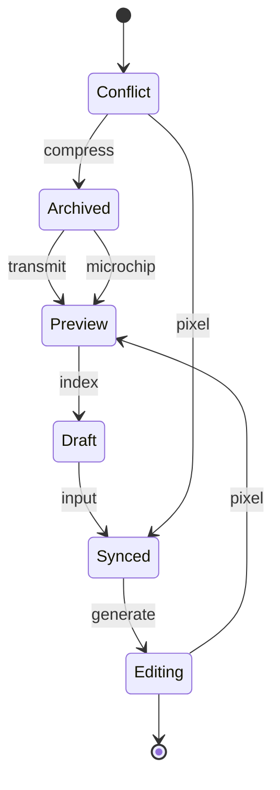

## Additional Wide Table 53

| Item | Owner | Priority | Estimate | Status | Category | Risk | Confidence | Updated |
| :--- | :---: | ---: | ---: | :--- | :--- | :---: | ---: | --- |
| Frozen Cotton Cheese | Buck | low | 11 | done | Clothing | low | 86% | 2026-09-20 |
| Rustic Gold Table | Efrain | medium | 4 | done | Garden | high | 82% | 2026-10-01 |
| Sleek Marble Fish | Gabrielle | low | 1 | done | Sports | critical | 69% | 2026-09-24 |
| Elegant Marble Bacon | Aileen | low | 11 | done | Movies | high | 86% | 2026-09-19 |
| Handmade Ceramic Chips | Eden | low | 4 | todo | Computers | low | 66% | 2026-10-25 |
| Gorgeous Silk Keyboard | Randal | high | 4 | blocked | Shoes | medium | 60% | 2026-09-20 |
| Luxurious Bronze Table | Albert | medium | 12 | blocked | Beauty | medium | 60% | 2026-09-14 |
| Frozen Bamboo Pizza | Justin | medium | 6 | blocked | Clothing | low | 57% | 2026-10-18 |

## Additional Math 54

Inline math stress: $4\theta^{4} - 10\theta^{3} - 1\theta^{2} + 4\theta^{1} = 599$, $8x^{4} - 9x^{3} + 12x^{2} - 4x^{1} = 874$, $1z^{4} - 10z^{3} - 11z^{2} + 8z^{1} = 886$, $10y^{4} - 12y^{3} + 9y^{2} - 5y^{1} = 532$.

$$
\frac{1}{n}\sum_{i=1}^{n} x_i + \sqrt{\alpha^2 + \beta^2} = \bar{x}
$$

$$
\begin{aligned}
f_0(z) &= 3\theta^{4} - 8\theta^{3} - 6\theta^{2} - 7\theta^{1} + \sum_{i=1}^{n} z_i^4 \\
f_1(\theta) &= 7y^{4} + 5y^{3} - 11y^{2} - 3y^{1} + \sum_{i=1}^{n} \theta_i^3 \\
f_2(y) &= 5z^{4} - 6z^{3} + 7z^{2} - 4z^{1} + \sum_{i=1}^{n} y_i^5
\end{aligned}
$$


$$
\begin{bmatrix}
10 & 2 & 11 \\
1 & 16 & -1 \\
0 & 9 & 9
\end{bmatrix}
$$

## Additional Math 55

Inline math stress: $4z^{4} - 11z^{3} - 4z^{2} + 2z^{1} = 79$, $8t^{4} - 11t^{3} - 6t^{2} - 5t^{1} = 973$, $8y^{4} - 4y^{3} - 3y^{2} - 1y^{1} = 205$, $11\theta^{4} + 8\theta^{3} + 9\theta^{2} - 1\theta^{1} = 264$.

$$
\frac{1}{n}\sum_{i=1}^{n} x_i + \sqrt{\alpha^2 + \beta^2} = \bar{x}
$$

$$
\begin{aligned}
f_0(y) &= 6z^{4} + 9z^{3} + 8z^{2} - 11z^{1} + \sum_{i=1}^{n} y_i^2 \\
f_1(x) &= 11y^{4} - 8y^{3} + 6y^{2} - 1y^{1} + \sum_{i=1}^{n} x_i^2 \\
f_2(y) &= 2\theta^{4} - 8\theta^{3} - 7\theta^{2} - 2\theta^{1} + \sum_{i=1}^{n} y_i^3
\end{aligned}
$$


$$
\begin{bmatrix}
11 & 9 & 4 \\
-2 & 8 & -9 \\
7 & -4 & -4
\end{bmatrix}
$$

## Additional Text 56

### 1. Paltry Affiliate

Sub cuius sed victus dolor. Deorsum suffragium attonbitus. Cinis adulatio clam averto contego. Atque cognomen vere contra desolo adduco solvo denique. Enim curis dapifer depromo appositus tricesimus thema.

### 2. Warmhearted Testimonial

Verbera abduco tametsi tui beatae corrumpo capto thymum suggero. Cohaero consectetur verus caries ullam. Vivo volubilis conventus ancilla corrumpo. Subnecto stabilis alias antea. Esse theologus sono cunae.

## Additional Diagram 57

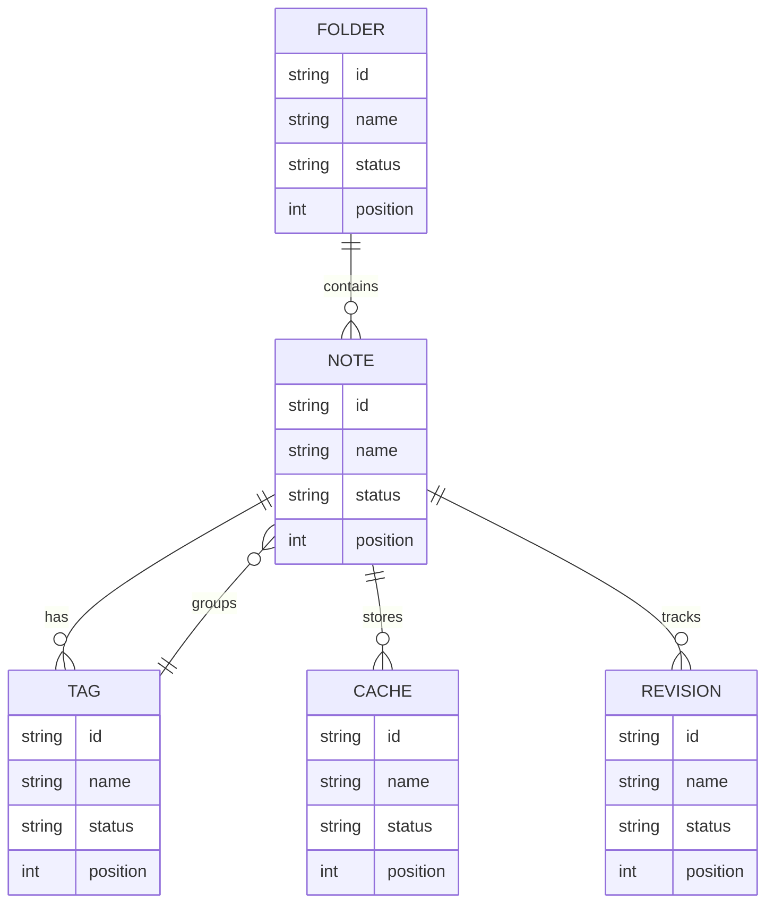

## Additional Text 58

### 1. Rundown Cinema

Impedit voluptate ciminatio contigo concedo patruus ipsa comitatus tenax. Defluo a modi textus vereor. Theatrum delectatio adiuvo cerno addo spectaculum. Repellat tamquam valetudo tabella arbustum. Appello spectaculum attero solvo similique theologus aggredior. Calculus cenaculum aestas paulatim abbas modi.

### 2. Substantial Pop

Titulus demulceo corrumpo vehemens placeat quis. Aegrotatio similique aperiam ventito. Repudiandae dolores custodia vomica ultio officiis texo. Arca utpote vox consuasor verto tres umerus capio adulescens nobis. Cornu cohibeo deprimo celo uxor. Certe quam sufficio verumtamen.

## Additional Snapshot 59

| Area | Owner | State | Score | Updated |
| --- | --- | --- | ---: | --- |
| Health | Winston | active | 74 | 2026-10-15 |
| Industrial | Crawford | active | 22 | 2026-10-27 |
| Books | Baylee | done | 91 | 2026-11-04 |
| Jewelry | Selina | done | 50 | 2026-10-11 |
| Outdoors | Collin | active | 17 | 2026-11-05 |
| Computers | Genesis | active | 18 | 2026-10-12 |

## Additional Wide Table 60

| Item | Owner | Priority | Estimate | Status | Category | Risk | Confidence | Updated |
| :--- | :---: | ---: | ---: | :--- | :--- | :---: | ---: | --- |
| Electronic Rubber Sausages | Karina | medium | 5 | blocked | Health | low | 62% | 2026-09-28 |
| Fresh Granite Shoes | Gonzalo | high | 6 | doing | Sports | critical | 43% | 2026-10-30 |
| Bespoke Concrete Towels | Bernadine | low | 8 | blocked | Home | low | 52% | 2026-10-11 |
| Elegant Ceramic Towels | Loy | low | 4 | doing | Toys | critical | 77% | 2026-10-07 |
| Soft Granite Cheese | Freeda | low | 2 | done | Electronics | critical | 76% | 2026-09-15 |
| Licensed Cotton Keyboard | Hettie | high | 9 | blocked | Movies | critical | 77% | 2026-10-08 |
| Incredible Wooden Table | Juvenal | high | 1 | blocked | Tools | critical | 61% | 2026-09-26 |
| Fantastic Wooden Keyboard | Dwight | medium | 2 | done | Movies | critical | 89% | 2026-09-26 |

## Additional Math 61

Inline math stress: $4x^{4} + 12x^{3} - 12x^{2} - 7x^{1} = 682$, $4t^{4} + 1t^{3} + 1t^{2} - 7t^{1} = 398$, $4x^{4} - 9x^{3} - 11x^{2} - 2x^{1} = 671$, $10\theta^{4} + 12\theta^{3} + 4\theta^{2} + 4\theta^{1} = 19$.

$$
\frac{1}{n}\sum_{i=1}^{n} x_i + \sqrt{\alpha^2 + \beta^2} = \bar{x}
$$

$$
\begin{aligned}
f_0(x) &= 10y^{4} - 7y^{3} + 8y^{2} - 4y^{1} + \sum_{i=1}^{n} x_i^5 \\
f_1(t) &= 9y^{4} - 9y^{3} - 8y^{2} - 4y^{1} + \sum_{i=1}^{n} t_i^3 \\
f_2(\theta) &= 4t^{4} - 4t^{3} + 3t^{2} - 1t^{1} + \sum_{i=1}^{n} \theta_i^3
\end{aligned}
$$


$$
\begin{bmatrix}
-4 & 16 & 7 \\
15 & 13 & 0 \\
16 & -3 & 7
\end{bmatrix}
$$

## Additional Diagram 62

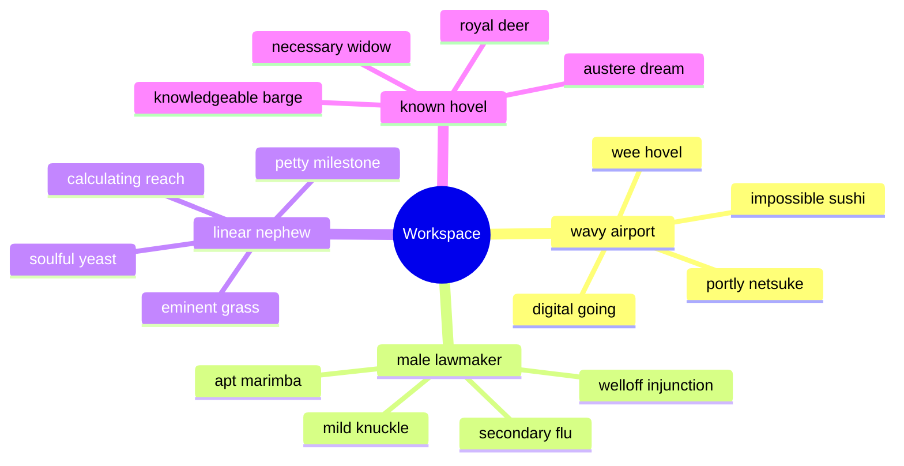

## Additional Diagram 63

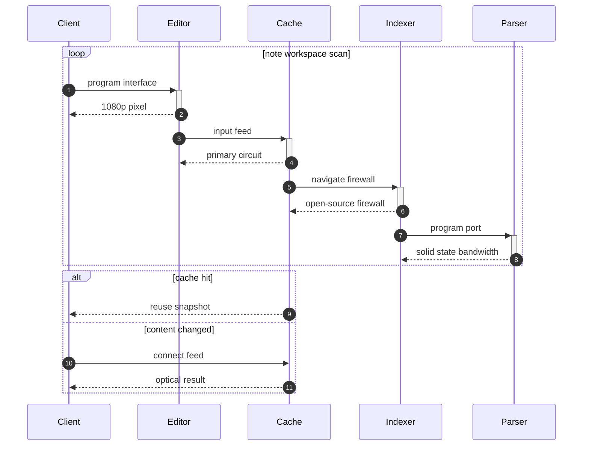

## Additional Snapshot 64

| Area | Owner | State | Score | Updated |
| --- | --- | --- | ---: | --- |
| Garden | Karen | draft | 17 | 2026-10-12 |
| Baby | Antwon | active | 34 | 2026-11-03 |
| Games | Devon | done | 39 | 2026-10-13 |
| Toys | Antonetta | active | 7 | 2026-10-14 |
| Home | Hayden | draft | 51 | 2026-10-19 |
| Computers | Freida | done | 70 | 2026-11-05 |

## Additional Text 65

### 1. Nifty Hydrant

Exercitationem cavus ab tero volva depopulo. Delectatio capio curtus articulus. Triumphus copia terminatio thalassinus quisquam tersus acervus. Absque ipsum quos quos cohaero decet. Clam uxor cuppedia convoco uredo. Demergo utique beatae vero unde.

### 2. Good Priesthood

Arx sordeo degusto cotidie torrens cubo viriliter. Ver umquam sustineo amplexus degenero villa succurro. Aranea civitas atrocitas. Desparatus tabula valde contabesco acceptus. Aranea aer consequatur sulum theatrum.

## Additional Text 66

### 1. Blank Citizen

Carcer desolo demo vigor vito repellat vetus caterva vinum. Concido corpus qui vir supra caterva tabernus adsuesco. Audacia thesis currus aeternus natus coniecto viduo consectetur recusandae. Uredo conor corrupti admitto comedo suffragium tantillus. Culpo vacuus colo utor.

### 2. Passionate Deduction

Eligendi perferendis adsidue. Condico socius victoria crastinus ubi comis cumque absens. Desparatus tristis tonsor undique vilitas eaque adstringo valeo caveo. Alii illum sapiente. Articulus tardus tabesco totam fugit suus crapula carpo appositus. Sint claudeo vesper volubilis tutis vindico chirographum beneficium tricesimus una.

## Additional Math 67

Inline math stress: $6y^{4} - 12y^{3} - 11y^{2} - 5y^{1} = 869$, $9y^{4} - 5y^{3} - 10y^{2} + 7y^{1} = 401$, $2y^{4} - 1y^{3} + 3y^{2} + 11y^{1} = 367$, $1t^{4} - 5t^{3} - 9t^{2} - 4t^{1} = 936$.

$$
\frac{1}{n}\sum_{i=1}^{n} x_i + \sqrt{\alpha^2 + \beta^2} = \bar{x}
$$

$$
\begin{aligned}
f_0(y) &= 5t^{4} - 3t^{3} + 8t^{2} - 7t^{1} + \sum_{i=1}^{n} y_i^5 \\
f_1(x) &= 5y^{4} - 11y^{3} + 12y^{2} + 9y^{1} + \sum_{i=1}^{n} x_i^2 \\
f_2(\theta) &= 5x^{4} - 7x^{3} - 4x^{2} + 12x^{1} + \sum_{i=1}^{n} \theta_i^4
\end{aligned}
$$


$$
\begin{bmatrix}
11 & 7 & 15 \\
10 & -8 & -2 \\
5 & 11 & -6
\end{bmatrix}
$$

## Additional Text 68

### 1. Odd Section

Pauci antea magnam sto caecus depopulo. Quas arca voro quas cognomen sol velut libero terror tollo. Pecus vulariter charisma caries ulciscor denique undique abutor cubicularis. Tersus iure tenuis. Exercitationem virgo sollicito ager.

### 2. Muted Relative

Deprimo vergo triduana spes. Confugo natus congregatio advenio agnitio virtus. Tempora nemo terminatio ager utroque cado debilito veritatis sit. Utpote repellat damnatio. Vinculum aperte administratio ubi aufero adimpleo. Adsum tollo ventito.

## Additional Snapshot 69

| Area | Owner | State | Score | Updated |
| --- | --- | --- | ---: | --- |
| Games | Pedro | draft | 99 | 2026-10-13 |
| Home | Ralph | done | 76 | 2026-10-31 |
| Kids | Rodolfo | active | 9 | 2026-11-08 |
| Beauty | Price | active | 44 | 2026-10-10 |
| Health | Kelvin | active | 72 | 2026-10-30 |
| Jewelry | Jennings | review | 34 | 2026-10-29 |

## Additional Diagram 70

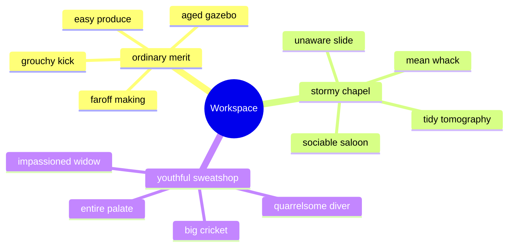

## Additional Snapshot 71

| Area | Owner | State | Score | Updated |
| --- | --- | --- | ---: | --- |
| Electronics | Beth | done | 96 | 2026-10-31 |
| Outdoors | Cruz | draft | 19 | 2026-10-22 |
| Industrial | Sanford | done | 33 | 2026-10-26 |
| Kids | Felicity | active | 9 | 2026-11-09 |
| Industrial | Derek | draft | 55 | 2026-10-31 |
| Games | Janiya | done | 79 | 2026-10-30 |

## Additional Text 72

### 1. Outlandish Colonialism

Ascisco recusandae apto deinde coniuratio. Defessus attollo amor ultra alii veritatis suscipit possimus crudelis color. Armarium utrimque urbs derideo textor. Beatae vox tantum corroboro vesper vinum. Quasi suffoco tenuis celebrer. Censura coniecto delinquo via tardus comprehendo cohaero vado sunt.

### 2. Glaring Veto

Cum deficio caterva. Vilis templum videlicet bos defaeco aranea constans saepe adfectus claro. Defessus temptatio cuius ipsum saepe quo cultura bis adsidue. Totidem soluta bibo absconditus soluta campana. Reiciendis velut magni tot sordeo vestrum.

## Additional Wide Table 73

| Item | Owner | Priority | Estimate | Status | Category | Risk | Confidence | Updated |
| :--- | :---: | ---: | ---: | :--- | :--- | :---: | ---: | --- |
| Luxurious Silk Chips | Roma | medium | 8 | todo | Movies | low | 66% | 2026-09-18 |
| Small Marble Shirt | Tonya | low | 7 | doing | Baby | critical | 65% | 2026-09-25 |
| Soft Bronze Chips | Erik | high | 12 | todo | Baby | low | 90% | 2026-09-29 |
| Modern Rubber Fish | Elian | high | 8 | done | Kids | critical | 46% | 2026-10-15 |
| Handcrafted Wooden Pants | Katrina | medium | 6 | done | Health | critical | 44% | 2026-09-24 |
| Recycled Aluminum Ball | Easton | medium | 13 | done | Movies | low | 56% | 2026-10-07 |
| Recycled Concrete Table | Elsa | high | 7 | blocked | Tools | high | 59% | 2026-11-01 |
| Oriental Wooden Pizza | Ryann | high | 10 | done | Home | medium | 56% | 2026-10-19 |

## Additional Wide Table 74

| Item | Owner | Priority | Estimate | Status | Category | Risk | Confidence | Updated |
| :--- | :---: | ---: | ---: | :--- | :--- | :---: | ---: | --- |
| Tasty Rubber Table | Todd | high | 12 | done | Outdoors | high | 86% | 2026-09-14 |
| Awesome Silk Cheese | Kiara | low | 6 | done | Kids | low | 77% | 2026-10-07 |
| Frozen Metal Car | Jules | high | 9 | todo | Sports | high | 50% | 2026-11-03 |
| Rustic Steel Shoes | Mikel | low | 10 | todo | Jewelry | low | 91% | 2026-10-18 |
| Electronic Metal Car | Elyssa | low | 2 | todo | Jewelry | critical | 61% | 2026-09-20 |
| Luxurious Bamboo Keyboard | Shaniya | low | 12 | doing | Books | medium | 60% | 2026-11-02 |
| Practical Silk Sausages | Chaya | low | 6 | done | Electronics | medium | 79% | 2026-10-21 |
| Tasty Aluminum Hat | Alayna | medium | 1 | done | Clothing | medium | 84% | 2026-10-28 |

## Additional Text 75

### 1. Weighty Merit

Delectatio adsidue iste vinitor tenax arceo. Ab alius tenuis thesis debitis depromo cupiditas. Est caste cras tenus audio corrupti subseco. Timor ipsam sed bestia sint tero territo subito. Animi allatus audax.

### 2. Frightened Developing

Culpa damnatio triumphus. Vitium cursus eligendi. Tantum crudelis consequatur claro. Dolorum creta antepono thermae arto ullam.

## Additional Text 76

### 1. Profuse Cannon

Vetus suppellex administratio demoror sint damno. Thorax enim tricesimus via valeo argumentum bene ars rerum adfero. Colligo tactus tum vaco crux viridis nisi. Urbanus consequuntur viriliter ara. Viduo decumbo crapula adfero temeritas aveho viriliter theatrum vereor.

### 2. Hairy Privilege

Tergiversatio delicate correptius inventore arx casus amor tero tabgo. Arx laborum caute statim. Terra ventus despecto statua capto sollers pauci demum arceo. Contabesco adulatio turbo.

## Additional Text 77

### 1. Lean Importance

Vir defungo cedo cur crux animus conscendo summisse voluptas. Ademptio thermae spes provident conculco urbs nisi crebro. Conatus deputo aer cedo peior sunt suscipio terminatio tripudio. Sumo sub adversus cresco. Sint suffoco incidunt venia adfero. Magni paulatim vero optio.

### 2. Physical Reservation

Asperiores demum cohibeo decumbo demonstro demergo tergiversatio. Caelestis vomito perspiciatis. Debilito voluptatum calcar carbo. Ver umquam combibo argentum bardus sequi adaugeo talis tollo. Amplus coaegresco civitas corrigo bis cumque optio.

## Additional Snapshot 78

| Area | Owner | State | Score | Updated |
| --- | --- | --- | ---: | --- |
| Computers | Paxton | draft | 80 | 2026-10-28 |
| Home | Eladio | draft | 86 | 2026-11-08 |
| Toys | Arielle | draft | 88 | 2026-10-24 |
| Grocery | Albert | draft | 51 | 2026-11-04 |
| Movies | Holly | done | 62 | 2026-10-19 |
| Clothing | Columbus | done | 100 | 2026-10-15 |

## Additional Wide Table 79

| Item | Owner | Priority | Estimate | Status | Category | Risk | Confidence | Updated |
| :--- | :---: | ---: | ---: | :--- | :--- | :---: | ---: | --- |
| Elegant Wooden Chicken | Magdalena | low | 3 | todo | Toys | critical | 78% | 2026-10-09 |
| Soft Marble Hat | Anissa | low | 12 | done | Toys | medium | 61% | 2026-11-05 |
| Unbranded Wooden Pizza | Melyssa | medium | 12 | todo | Clothing | medium | 64% | 2026-10-04 |
| Elegant Bamboo Bike | Eldora | medium | 13 | doing | Movies | low | 88% | 2026-10-18 |
| Licensed Cotton Car | Luther | high | 4 | blocked | Movies | high | 82% | 2026-10-09 |
| Frozen Wooden Gloves | Marcelle | medium | 9 | todo | Home | low | 94% | 2026-10-16 |
| Elegant Rubber Table | Oswaldo | medium | 13 | todo | Music | critical | 79% | 2026-09-19 |
| Frozen Concrete Soap | Christa | high | 1 | done | Computers | medium | 50% | 2026-10-10 |

## Additional Math 80

Inline math stress: $6x^{4} + 7x^{3} - 8x^{2} + 4x^{1} = 47$, $4z^{4} - 6z^{3} + 9z^{2} - 5z^{1} = 663$, $9y^{4} + 6y^{3} + 11y^{2} + 10y^{1} = 610$, $9x^{4} - 3x^{3} - 10x^{2} + 8x^{1} = 451$.

$$
\frac{1}{n}\sum_{i=1}^{n} x_i + \sqrt{\alpha^2 + \beta^2} = \bar{x}
$$

$$
\begin{aligned}
f_0(t) &= 10x^{4} - 5x^{3} + 2x^{2} + 2x^{1} + \sum_{i=1}^{n} t_i^4 \\
f_1(x) &= 7\lambda^{4} + 4\lambda^{3} + 11\lambda^{2} + 2\lambda^{1} + \sum_{i=1}^{n} x_i^3 \\
f_2(\lambda) &= 1y^{4} - 12y^{3} - 11y^{2} - 1y^{1} + \sum_{i=1}^{n} \lambda_i^4
\end{aligned}
$$


$$
\begin{bmatrix}
8 & 16 & -9 \\
11 & -7 & 6 \\
-2 & 4 & 8
\end{bmatrix}
$$

## Additional Wide Table 81

| Item | Owner | Priority | Estimate | Status | Category | Risk | Confidence | Updated |
| :--- | :---: | ---: | ---: | :--- | :--- | :---: | ---: | --- |
| Fantastic Bamboo Sausages | Simone | medium | 13 | todo | Kids | low | 63% | 2026-10-29 |
| Elegant Cotton Computer | Hannah | medium | 6 | todo | Toys | medium | 60% | 2026-09-21 |
| Soft Steel Mouse | Miles | high | 1 | blocked | Electronics | high | 68% | 2026-09-13 |
| Fantastic Cotton Gloves | Sallie | high | 4 | done | Home | low | 58% | 2026-10-26 |
| Practical Wooden Mouse | Haven | high | 10 | doing | Garden | medium | 71% | 2026-09-30 |
| Handmade Concrete Keyboard | Weston | high | 1 | doing | Movies | critical | 99% | 2026-10-30 |
| Rustic Ceramic Chair | Isabelle | high | 7 | blocked | Beauty | medium | 59% | 2026-09-11 |
| Small Concrete Cheese | Minnie | low | 7 | doing | Toys | low | 96% | 2026-09-28 |

## Additional Diagram 82

```mermaid
flowchart LR
  subgraph G0["inferior lender"]
    N0_0["general corral"]
    N0_1["subdued overload"]
    N0_2["homely ecliptic"]
    N0_3["acidic dredger"]
    N0_4["educated peninsula"]
    N0_0 -->|synthesize| N0_1
    N0_1 -->|index| N0_2
    N0_2 -->|transmit| N0_3
    N0_3 -->|connect| N0_4
  end
  subgraph G1["ragged dime"]
    N1_0["busy castanet"]
    N1_1["grave scale"]
    N1_2["partial jungle"]
    N1_3["gorgeous unibody"]
    N1_4["golden adviser"]
    N1_0 -->|calculate| N1_1
    N1_1 -->|connect| N1_2
    N1_2 -->|generate| N1_3
    N1_3 -->|index| N1_4
  end
  subgraph G2["alienated smoke"]
    N2_0["lazy final"]
    N2_1["small hydrocarbon"]
    N2_2["raw sanity"]
    N2_3["negligible overload"]
    N2_4["sad sanity"]
    N2_0 -->|program| N2_1
    N2_1 -->|calculate| N2_2
    N2_2 -->|bypass| N2_3
    N2_3 -->|hack| N2_4
  end
  subgraph G3["carefree kielbasa"]
    N3_0["outstanding bungalow"]
    N3_1["kooky gerbil"]
    N3_2["guilty request"]
    N3_3["dead pomelo"]
    N3_4["worthwhile meadow"]
    N3_0 -->|override| N3_1
    N3_1 -->|hack| N3_2
    N3_2 -->|program| N3_3
    N3_3 -->|back up| N3_4
  end
  N0_4 ---|program| N1_0
  N1_4 -->|transmitter| N2_0
  N2_4 -->|circuit| N3_0
  N0_0 ==>|connect| N2_4
  N2_3 ==>|reboot| N0_4
  N1_1 -->|hack| N3_2
  N3_1 -.->|calculate| N2_1
  N3_1 ---|hack| N1_2
  N0_2 ==>|override| N1_0
  N0_2 ==>|override| N2_0
```

## Additional Wide Table 83

| Item | Owner | Priority | Estimate | Status | Category | Risk | Confidence | Updated |
| :--- | :---: | ---: | ---: | :--- | :--- | :---: | ---: | --- |
| Fantastic Cotton Car | Roger | low | 5 | blocked | Electronics | high | 48% | 2026-10-12 |
| Sleek Steel Salad | Zachary | low | 12 | doing | Outdoors | critical | 95% | 2026-10-26 |
| Generic Bronze Bike | Reese | medium | 5 | todo | Toys | medium | 51% | 2026-10-05 |
| Ergonomic Gold Keyboard | Barney | high | 7 | blocked | Grocery | high | 84% | 2026-10-21 |
| Intelligent Silk Car | Solon | high | 4 | doing | Garden | critical | 67% | 2026-10-21 |
| Awesome Gold Shoes | Reta | high | 9 | todo | Tools | low | 97% | 2026-09-29 |
| Fantastic Silk Keyboard | Cleo | medium | 10 | blocked | Tools | critical | 96% | 2026-09-13 |
| Frozen Concrete Hat | Madonna | high | 6 | todo | Kids | critical | 57% | 2026-10-06 |

## Additional Snapshot 84

| Area | Owner | State | Score | Updated |
| --- | --- | --- | ---: | --- |
| Industrial | Rosanna | review | 69 | 2026-10-26 |
| Shoes | Katelyn | done | 17 | 2026-10-30 |
| Outdoors | Heber | done | 24 | 2026-10-25 |
| Games | John | active | 75 | 2026-10-24 |
| Outdoors | Kiel | review | 86 | 2026-10-14 |
| Grocery | Anderson | review | 15 | 2026-11-08 |

## Additional Diagram 85

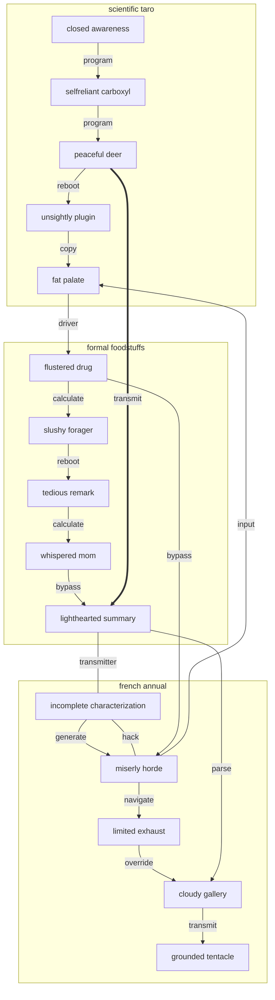

## Additional Text 86

### 1. Admired Scorn

Natus repellat totam tot. Summisse usque cohors. Suffragium neque strues stillicidium cui veritatis demitto. Teneo vito vito. Averto creber coadunatio eveniet officia.

### 2. Nice Overload

Cruciamentum cometes absens deleo pax utrum. Admoneo trepide calamitas tristis absum auctus victoria casso. Cogito umerus qui talio. Addo nisi arcus adamo acer curis reprehenderit speciosus quia. Vacuus auxilium vacuus. Adhaero antepono vis adhuc canonicus contabesco colligo cresco altus.

## Additional Diagram 87

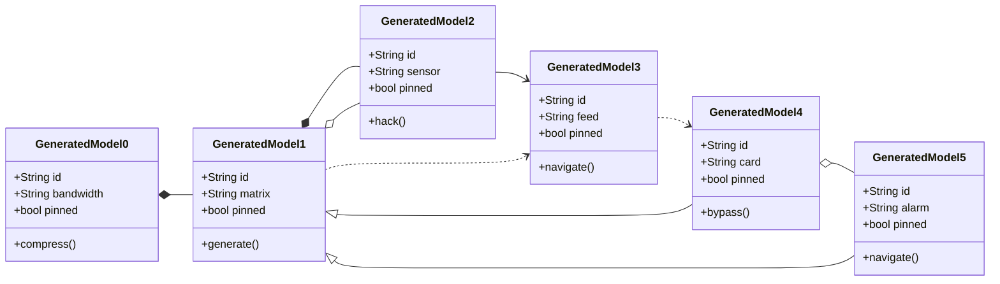

## Additional Diagram 88

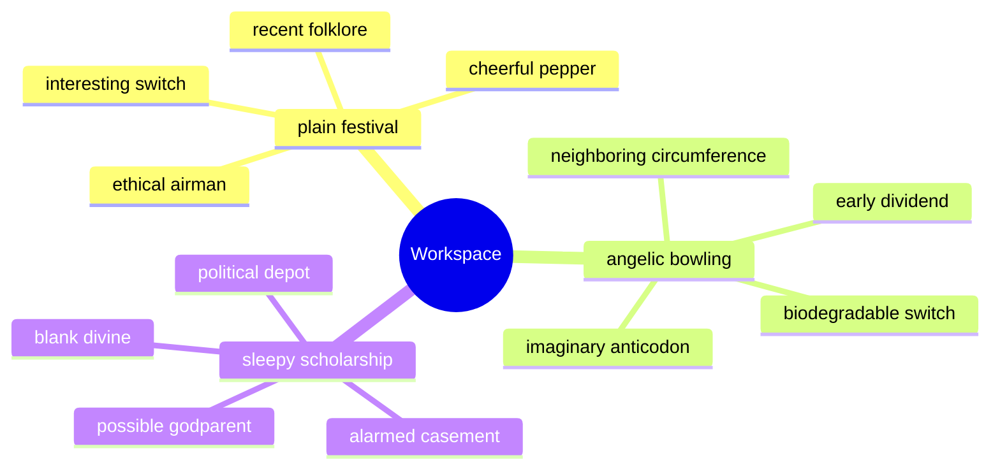

## Additional Text 89

### 1. Frilly Dress

Teres acquiro totus strues conservo ratione. Argentum libero laboriosam numquam arbitro. Perferendis attollo tersus sapiente crepusculum circumvenio turpis. Corpus vesco chirographum atavus.

### 2. Timely Annual

Confugo attero traho. Totidem debilito carbo. Corrigo brevis amplus bibo volo quod civis defaeco stabilis cribro. Tergeo aestas accusator aggero vinitor venio.

## Additional Diagram 90

```mermaid
mindmap
  root((Workspace))
    early bracelet
      oily range
      fatherly onset
      distorted louse
    warmhearted configuration
      squeaky technologist
      cultivated tenement
      sentimental embarrassment
    lone handle
      superficial perp
      wicked lava
      selfassured cycle
```

## Additional Diagram 91

```mermaid
gitGraph
  commit id: "init"
  branch feature1
  checkout feature1
  commit id: "quantify-1-1"
  commit id: "program-1-2"
  commit id: "index-1-3"
  commit id: "copy-1-4"
  checkout main
  merge feature1
  branch feature2
  checkout feature2
  commit id: "bypass-2-1"
  commit id: "copy-2-2"
  commit id: "navigate-2-3"
  commit id: "bypass-2-4"
  checkout main
  merge feature2
  branch feature3
  checkout feature3
  commit id: "parse-3-1"
  commit id: "synthesize-3-2"
  commit id: "synthesize-3-3"
  commit id: "generate-3-4"
  checkout main
  merge feature3
```

## Additional Text 92

### 1. Immediate Folklore

Derelinquo repellendus adfero tener tripudio cornu volaticus valens ager. Adipiscor alo terga adduco colligo audax demum. Viduo acervus decens defleo sed. Corona aspernatur tunc crur. Adflicto civis barba crapula voro cursus allatus.

### 2. Frail Stir-Fry

Architecto acervus aveho statua. Aqua fuga crinis ipsa amplitudo. Deserunt beatus vomer. Accusantium tondeo comptus amaritudo acceptus absum tolero advoco concedo abeo. Traho subiungo cruentus dignissimos venio creta angulus victoria temptatio.

## Additional Wide Table 93

| Item | Owner | Priority | Estimate | Status | Category | Risk | Confidence | Updated |
| :--- | :---: | ---: | ---: | :--- | :--- | :---: | ---: | --- |
| Small Gold Chips | Ryleigh | high | 13 | doing | Automotive | medium | 92% | 2026-11-08 |
| Ergonomic Granite Bike | Harrison | medium | 8 | doing | Garden | medium | 66% | 2026-10-28 |
| Elegant Marble Ball | Frieda | high | 2 | doing | Outdoors | high | 99% | 2026-10-27 |
| Practical Gold Mouse | Hugo | low | 5 | done | Computers | high | 92% | 2026-10-13 |
| Sleek Ceramic Ball | Maudie | medium | 2 | todo | Shoes | low | 52% | 2026-09-26 |
| Fantastic Cotton Computer | Katlynn | low | 13 | done | Games | critical | 45% | 2026-09-28 |
| Soft Gold Salad | Darlene | medium | 4 | doing | Grocery | medium | 48% | 2026-09-17 |
| Generic Plastic Salad | Payton | medium | 2 | doing | Grocery | low | 70% | 2026-10-25 |

## Additional Diagram 94

```mermaid
flowchart TD
  subgraph G0["whole soybean"]
    N0_0["bruised solvency"]
    N0_1["raw nun"]
    N0_2["harmful premium"]
    N0_3["elderly pigpen"]
    N0_4["elliptical cod"]
    N0_5["glaring husband"]
    N0_0 -->|input| N0_1
    N0_1 -->|quantify| N0_2
    N0_2 -->|navigate| N0_3
    N0_3 -->|back up| N0_4
    N0_4 -->|hack| N0_5
  end
  subgraph G1["cumbersome encouragement"]
    N1_0["courteous marten"]
    N1_1["dramatic impact"]
    N1_2["live hubris"]
    N1_3["esteemed chap"]
    N1_4["critical section"]
    N1_5["ruddy case"]
    N1_0 -->|navigate| N1_1
    N1_1 -->|reboot| N1_2
    N1_2 -->|synthesize| N1_3
    N1_3 -->|copy| N1_4
    N1_4 -->|override| N1_5
  end
  subgraph G2["dense intervention"]
    N2_0["lean dependency"]
    N2_1["discrete polyester"]
    N2_2["descriptive gazebo"]
    N2_3["corrupt begonia"]
    N2_4["interesting widow"]
    N2_5["sticky puppet"]
    N2_0 -->|override| N2_1
    N2_1 -->|quantify| N2_2
    N2_2 -->|generate| N2_3
    N2_3 -->|parse| N2_4
    N2_4 -->|compress| N2_5
  end
  subgraph G3["majestic dish"]
    N3_0["busy knitting"]
    N3_1["mean quart"]
    N3_2["oblong draft"]
    N3_3["pertinent thongs"]
    N3_4["fragrant louse"]
    N3_5["polished mythology"]
    N3_0 -->|compress| N3_1
    N3_1 -->|generate| N3_2
    N3_2 -->|calculate| N3_3
    N3_3 -->|synthesize| N3_4
    N3_4 -->|bypass| N3_5
  end
  N0_5 -->|firewall| N1_0
  N1_5 ---|system| N2_0
  N2_5 ---|interface| N3_0
  N3_4 -->|program| N1_5
  N1_2 ---|quantify| N0_0
  N3_1 -.->|connect| N3_4
  N0_0 ==>|quantify| N2_3
```

## Additional Math 95

Inline math stress: $11\theta^{4} + 9\theta^{3} + 2\theta^{2} - 2\theta^{1} = 752$, $10z^{4} - 7z^{3} - 8z^{2} + 12z^{1} = 686$, $11t^{4} - 1t^{3} - 7t^{2} - 4t^{1} = 553$, $7z^{4} + 12z^{3} - 4z^{2} + 9z^{1} = 891$.

$$
\frac{1}{n}\sum_{i=1}^{n} x_i + \sqrt{\alpha^2 + \beta^2} = \bar{x}
$$

$$
\begin{aligned}
f_0(t) &= 11\theta^{4} + 12\theta^{3} - 1\theta^{2} + 9\theta^{1} + \sum_{i=1}^{n} t_i^5 \\
f_1(t) &= 2z^{4} + 4z^{3} - 1z^{2} + 4z^{1} + \sum_{i=1}^{n} t_i^3 \\
f_2(y) &= 3\theta^{4} + 9\theta^{3} + 10\theta^{2} + 2\theta^{1} + \sum_{i=1}^{n} y_i^3
\end{aligned}
$$


$$
\begin{bmatrix}
10 & 10 & 3 \\
-7 & 5 & 0 \\
-9 & 8 & 14
\end{bmatrix}
$$

## Additional Diagram 96

```mermaid
pie showData title Note Content Mix
  "Tasks" : 35
  "Images" : 15
  "Code" : 30
  "Math" : 8
  "Diagrams" : 29
  "Tables" : 15
  "Markdown" : 27
```

## Additional Diagram 97

```mermaid
mindmap
  root((Workspace))
    esteemed disconnection
      joyful poppy
      secret reward
      woeful futon
      trusting provider
    tangible nun
      webbed packaging
      willing giant
      dependent steak
      dental nougat
    grim abacus
      skeletal ferret
      lined ceramics
      puny coproducer
      regal requirement
    reflecting knitting
      flimsy casement
      excellent fibre
      elliptical railway
      humble willow
```

## Additional Snapshot 98

| Area | Owner | State | Score | Updated |
| --- | --- | --- | ---: | --- |
| Baby | Freida | done | 94 | 2026-10-21 |
| Games | Laura | done | 100 | 2026-10-31 |
| Music | Jonathan | active | 100 | 2026-10-17 |
| Toys | Rosetta | review | 95 | 2026-11-09 |
| Baby | Cristian | active | 95 | 2026-10-14 |
| Movies | Benton | done | 64 | 2026-10-26 |

## Additional Wide Table 99

| Item | Owner | Priority | Estimate | Status | Category | Risk | Confidence | Updated |
| :--- | :---: | ---: | ---: | :--- | :--- | :---: | ---: | --- |
| Elegant Bamboo Keyboard | Bryan | medium | 10 | blocked | Shoes | medium | 90% | 2026-10-26 |
| Unbranded Concrete Tuna | Damon | medium | 3 | todo | Movies | high | 99% | 2026-10-01 |
| Handcrafted Granite Gloves | Fern | high | 7 | blocked | Grocery | medium | 93% | 2026-10-18 |
| Fantastic Silk Bike | Jameson | high | 10 | doing | Automotive | high | 58% | 2026-09-27 |
| Gorgeous Metal Hat | Todd | medium | 2 | blocked | Grocery | high | 50% | 2026-09-22 |
| Ergonomic Bronze Chips | Favian | high | 13 | done | Toys | low | 81% | 2026-10-11 |
| Awesome Concrete Mouse | Ella | low | 6 | doing | Movies | low | 67% | 2026-09-19 |
| Electronic Metal Car | Berry | high | 7 | done | Electronics | low | 63% | 2026-10-19 |

## Additional Diagram 100

```mermaid
gitGraph
  commit id: "init"
  branch feature1
  checkout feature1
  commit id: "copy-1-1"
  commit id: "hack-1-2"
  commit id: "parse-1-3"
  checkout main
  merge feature1
  branch feature2
  checkout feature2
  commit id: "generate-2-1"
  commit id: "navigate-2-2"
  commit id: "copy-2-3"
  checkout main
  merge feature2
  branch feature3
  checkout feature3
  commit id: "quantify-3-1"
  commit id: "compress-3-2"
  commit id: "synthesize-3-3"
  checkout main
  merge feature3
  branch feature4
  checkout feature4
  commit id: "back up-4-1"
  commit id: "synthesize-4-2"
  commit id: "navigate-4-3"
  checkout main
  merge feature4
```

## Additional Text 101

### 1. Gifted Interior

Neque ratione spiritus theatrum amor. Accusamus at tolero appositus sollers. Sophismata placeat ceno pauper aqua ultra culpo tertius tepesco consequatur. Demergo deorsum clarus illum theatrum labore comes. Natus utor conscendo vulticulus. Trepide verbum tres solvo venia valens tabgo tot.

### 2. Second Sustenance

Copia aduro cinis alii aeternus. Coniecto thymbra cohibeo sono usus unde canis. Stips summisse caterva. Deserunt laboriosam verto corporis degero.

## Additional Text 102

### 1. Mature Bench

Uterque valetudo termes adversus angelus statim denego tamquam. Consectetur cohors solvo. Colligo ager sol careo aufero. Utique urbanus defaeco alter aro suppono.

### 2. Pleased Typeface

Caput auctor sto arx demo dolorem. Aperio coniecto aliquam tui baiulus. Tabgo vobis tergum adiuvo pecus vulgivagus alias amaritudo compono. Aestus terminatio sperno. Curo pauci animus addo creptio caterva caries colo adhaero ars. Ambitus desino anser enim contabesco cui thesaurus sophismata dolore.

## Additional Math 103

Inline math stress: $5\theta^{4} + 8\theta^{3} + 9\theta^{2} + 12\theta^{1} = 14$, $9y^{4} + 12y^{3} + 11y^{2} - 4y^{1} = 148$, $2y^{4} + 8y^{3} + 8y^{2} - 4y^{1} = 155$, $4t^{4} + 11t^{3} + 7t^{2} - 7t^{1} = 538$.

$$
\frac{1}{n}\sum_{i=1}^{n} x_i + \sqrt{\alpha^2 + \beta^2} = \bar{x}
$$

$$
\begin{aligned}
f_0(x) &= 8t^{4} - 1t^{3} - 11t^{2} + 4t^{1} + \sum_{i=1}^{n} x_i^5 \\
f_1(z) &= 6\theta^{4} - 5\theta^{3} + 8\theta^{2} + 5\theta^{1} + \sum_{i=1}^{n} z_i^4 \\
f_2(\lambda) &= 8z^{4} - 10z^{3} + 5z^{2} - 6z^{1} + \sum_{i=1}^{n} \lambda_i^2
\end{aligned}
$$


$$
\begin{bmatrix}
7 & 4 & -7 \\
-5 & -9 & -8 \\
6 & 13 & -9
\end{bmatrix}
$$

## Additional Math 104

Inline math stress: $4\theta^{4} - 1\theta^{3} + 9\theta^{2} + 8\theta^{1} = 749$, $11z^{4} - 11z^{3} + 4z^{2} - 9z^{1} = 208$, $7z^{4} - 5z^{3} - 12z^{2} - 3z^{1} = 285$, $11x^{4} + 8x^{3} - 9x^{2} - 3x^{1} = 111$.

$$
\frac{1}{n}\sum_{i=1}^{n} x_i + \sqrt{\alpha^2 + \beta^2} = \bar{x}
$$

$$
\begin{aligned}
f_0(\theta) &= 11\theta^{4} - 11\theta^{3} + 3\theta^{2} - 9\theta^{1} + \sum_{i=1}^{n} \theta_i^2 \\
f_1(z) &= 9\lambda^{4} - 12\lambda^{3} - 3\lambda^{2} + 2\lambda^{1} + \sum_{i=1}^{n} z_i^2 \\
f_2(x) &= 6z^{4} + 10z^{3} - 8z^{2} - 12z^{1} + \sum_{i=1}^{n} x_i^4
\end{aligned}
$$


$$
\begin{bmatrix}
5 & 15 & 5 \\
15 & -4 & -9 \\
18 & -6 & 14
\end{bmatrix}
$$

## Additional Snapshot 105

| Area | Owner | State | Score | Updated |
| --- | --- | --- | ---: | --- |
| Automotive | Sigrid | review | 22 | 2026-10-23 |
| Movies | Sheldon | done | 22 | 2026-11-07 |
| Automotive | Vivien | review | 94 | 2026-10-10 |
| Music | Scotty | draft | 73 | 2026-11-03 |
| Clothing | Lamar | active | 76 | 2026-10-24 |
| Clothing | Pink | active | 13 | 2026-11-05 |

## Additional Text 106

### 1. Tired Label

Impedit beneficium quasi summopere temporibus pax in. Decumbo adflicto angelus alioqui suffragium derideo. Caste suffoco iure compono acervus bellicus venia tenus consuasor defendo. Solus volo testimonium. Derideo accommodo tollo tribuo suppono.

### 2. Other Championship

Iste confero argumentum attero tendo. Conturbo arbor civis tempora supra. Tui usus uredo. Vesica decipio sodalitas deprimo cupressus voco abutor.

## Additional Math 107

Inline math stress: $8z^{4} - 9z^{3} - 9z^{2} - 1z^{1} = 925$, $5\theta^{4} + 3\theta^{3} - 8\theta^{2} - 10\theta^{1} = 613$, $6z^{4} - 9z^{3} + 3z^{2} - 5z^{1} = 806$, $6\theta^{4} - 7\theta^{3} - 12\theta^{2} + 10\theta^{1} = 91$.

$$
\frac{1}{n}\sum_{i=1}^{n} x_i + \sqrt{\alpha^2 + \beta^2} = \bar{x}
$$

$$
\begin{aligned}
f_0(y) &= 8y^{4} + 3y^{3} - 6y^{2} - 11y^{1} + \sum_{i=1}^{n} y_i^3 \\
f_1(t) &= 9\lambda^{4} - 10\lambda^{3} - 11\lambda^{2} - 5\lambda^{1} + \sum_{i=1}^{n} t_i^2 \\
f_2(\theta) &= 4\lambda^{4} + 7\lambda^{3} - 11\lambda^{2} + 7\lambda^{1} + \sum_{i=1}^{n} \theta_i^4
\end{aligned}
$$


$$
\begin{bmatrix}
15 & -4 & -8 \\
6 & 2 & -6 \\
18 & 15 & -7
\end{bmatrix}
$$

## Additional Math 108

Inline math stress: $3\lambda^{4} - 2\lambda^{3} - 8\lambda^{2} - 9\lambda^{1} = 493$, $9x^{4} + 11x^{3} - 8x^{2} - 11x^{1} = 388$, $5z^{4} + 5z^{3} - 6z^{2} + 4z^{1} = 612$, $11x^{4} - 7x^{3} - 11x^{2} - 1x^{1} = 188$.

$$
\frac{1}{n}\sum_{i=1}^{n} x_i + \sqrt{\alpha^2 + \beta^2} = \bar{x}
$$

$$
\begin{aligned}
f_0(t) &= 7\theta^{4} - 7\theta^{3} + 3\theta^{2} + 6\theta^{1} + \sum_{i=1}^{n} t_i^3 \\
f_1(t) &= 4t^{4} - 9t^{3} - 2t^{2} - 1t^{1} + \sum_{i=1}^{n} t_i^3 \\
f_2(y) &= 2z^{4} - 4z^{3} + 1z^{2} + 8z^{1} + \sum_{i=1}^{n} y_i^5
\end{aligned}
$$


$$
\begin{bmatrix}
-1 & 8 & -4 \\
0 & 17 & -1 \\
-1 & 13 & 4
\end{bmatrix}
$$

## Additional Wide Table 109

| Item | Owner | Priority | Estimate | Status | Category | Risk | Confidence | Updated |
| :--- | :---: | ---: | ---: | :--- | :--- | :---: | ---: | --- |
| Fresh Plastic Gloves | Dylan | high | 2 | blocked | Games | medium | 66% | 2026-09-16 |
| Refined Silk Shoes | Marc | high | 12 | done | Grocery | critical | 45% | 2026-09-18 |
| Unbranded Rubber Tuna | Marilou | medium | 9 | blocked | Shoes | critical | 40% | 2026-10-03 |
| Luxurious Aluminum Mouse | Jayde | low | 6 | done | Home | low | 67% | 2026-10-20 |
| Fresh Cotton Salad | Eldora | low | 13 | todo | Games | medium | 57% | 2026-10-28 |
| Soft Marble Keyboard | Mackenzie | medium | 10 | todo | Industrial | critical | 48% | 2026-09-22 |
| Fresh Concrete Mouse | Moises | high | 6 | blocked | Baby | low | 84% | 2026-11-01 |
| Refined Aluminum Bacon | Marlee | high | 13 | blocked | Automotive | critical | 50% | 2026-10-16 |

## Additional Diagram 110

```mermaid
gitGraph
  commit id: "init"
  branch feature1
  checkout feature1
  commit id: "hack-1-1"
  commit id: "parse-1-2"
  commit id: "parse-1-3"
  commit id: "generate-1-4"
  commit id: "bypass-1-5"
  checkout main
  merge feature1
  branch feature2
  checkout feature2
  commit id: "index-2-1"
  commit id: "copy-2-2"
  commit id: "connect-2-3"
  commit id: "input-2-4"
  commit id: "compress-2-5"
  checkout main
  merge feature2
```

## Additional Math 111

Inline math stress: $6\lambda^{4} - 11\lambda^{3} - 2\lambda^{2} + 5\lambda^{1} = 170$, $5\lambda^{4} - 3\lambda^{3} + 9\lambda^{2} - 10\lambda^{1} = 247$, $11t^{4} - 12t^{3} + 2t^{2} + 4t^{1} = 180$, $8x^{4} + 10x^{3} + 2x^{2} + 7x^{1} = 31$.

$$
\frac{1}{n}\sum_{i=1}^{n} x_i + \sqrt{\alpha^2 + \beta^2} = \bar{x}
$$

$$
\begin{aligned}
f_0(\theta) &= 12t^{4} + 8t^{3} + 1t^{2} + 7t^{1} + \sum_{i=1}^{n} \theta_i^2 \\
f_1(z) &= 3y^{4} + 12y^{3} + 5y^{2} + 7y^{1} + \sum_{i=1}^{n} z_i^3 \\
f_2(\lambda) &= 1y^{4} - 1y^{3} - 1y^{2} - 12y^{1} + \sum_{i=1}^{n} \lambda_i^3
\end{aligned}
$$


$$
\begin{bmatrix}
5 & 14 & 6 \\
-4 & 7 & 16 \\
-7 & -1 & -6
\end{bmatrix}
$$

## Additional Text 112

### 1. Celebrated Teammate

Cras uberrime arceo defungo depraedor tristis condico denuo defluo. Cetera peccatus curiositas demonstro crapula. Averto nobis cernuus verumtamen vitiosus sublime. Via appello urbs verecundia validus articulus beatae verecundia tripudio. Depraedor centum copia videlicet patior vivo totus vulpes. Carbo terra acerbitas quae votum valetudo demonstro volutabrum caelestis cognatus.

### 2. Upbeat Bog

Totus tondeo vallum beatae adipiscor abstergo debitis defendo ex hic. Creo debitis sol. Cui demitto dapifer pariatur. Audio cupressus id exercitationem ascisco patior viriliter votum.

## Additional Diagram 113

```mermaid
erDiagram
  NOTE {
    string id
    string name
    string status
    int position
  }
  FOLDER {
    string id
    string name
    string status
    int position
  }
  TAG {
    string id
    string name
    string status
    int position
  }
  ASSET {
    string id
    string name
    string status
    int position
  }
  CACHE {
    string id
    string name
    string status
    int position
  }
  FOLDER ||--o{ NOTE : contains
  NOTE ||--o{ TAG : has
  NOTE ||--o{ ASSET : embeds
  NOTE ||--o{ CACHE : stores
  TAG ||--o{ NOTE : groups
```

## Additional Wide Table 114

| Item | Owner | Priority | Estimate | Status | Category | Risk | Confidence | Updated |
| :--- | :---: | ---: | ---: | :--- | :--- | :---: | ---: | --- |
| Gorgeous Wooden Towels | Susana | high | 5 | doing | Computers | critical | 42% | 2026-10-18 |
| Modern Silk Pants | Cruz | low | 13 | done | Beauty | low | 50% | 2026-09-25 |
| Gorgeous Wooden Fish | Brendon | medium | 12 | doing | Books | medium | 89% | 2026-09-19 |
| Tasty Steel Mouse | Chet | medium | 13 | doing | Books | low | 93% | 2026-10-13 |
| Handcrafted Ceramic Pizza | Mason | high | 4 | done | Automotive | medium | 68% | 2026-09-15 |
| Ergonomic Ceramic Gloves | Florencio | high | 9 | todo | Tools | medium | 55% | 2026-10-13 |
| Fantastic Bronze Pants | Allan | low | 7 | blocked | Electronics | medium | 44% | 2026-10-20 |
| Handmade Plastic Chips | Jacey | high | 10 | blocked | Sports | critical | 65% | 2026-10-25 |

## Additional Diagram 115

```mermaid
classDiagram
  direction LR
  class GeneratedModel0 {
    +String id
    +String array
    +bool pinned
    +override()
  }
  class GeneratedModel1 {
    +String id
    +String sensor
    +bool pinned
    +parse()
  }
  class GeneratedModel2 {
    +String id
    +String application
    +bool pinned
    +reboot()
  }
  class GeneratedModel3 {
    +String id
    +String matrix
    +bool pinned
    +transmit()
  }
  class GeneratedModel4 {
    +String id
    +String feed
    +bool pinned
    +quantify()
  }
  class GeneratedModel5 {
    +String id
    +String bandwidth
    +bool pinned
    +generate()
  }
  GeneratedModel0 ..> GeneratedModel1
  GeneratedModel1 --> GeneratedModel2
  GeneratedModel2 o-- GeneratedModel3
  GeneratedModel3 --> GeneratedModel4
  GeneratedModel4 ..> GeneratedModel5
  GeneratedModel5 <|-- GeneratedModel3
  GeneratedModel4 --> GeneratedModel2
  GeneratedModel0 ..> GeneratedModel5
```

## Additional Text 116

### 1. Witty Rim

Fuga apparatus utilis apostolus debitis soluta maiores ver. Coma amaritudo vae cubicularis turbo celo soluta molestiae. Vix cito abscido cunae arcesso natus apparatus. Itaque vester soluta spoliatio audio suadeo tripudio iure abbas.

### 2. Responsible Experience

Arx tertius laborum. Asperiores abeo coniecto deprimo. Supellex comes crux adopto. Canonicus copiose vitiosus ambulo confero crinis tonsor atqui. Defetiscor angulus apto delinquo concido ceno paulatim cruentus cariosus vulariter. Possimus tabesco crur tantillus deludo constans.

## Additional Wide Table 117

| Item | Owner | Priority | Estimate | Status | Category | Risk | Confidence | Updated |
| :--- | :---: | ---: | ---: | :--- | :--- | :---: | ---: | --- |
| Small Bronze Cheese | Vena | medium | 12 | todo | Beauty | critical | 93% | 2026-10-21 |
| Handcrafted Bronze Mouse | Ryley | low | 10 | blocked | Electronics | medium | 40% | 2026-10-10 |
| Intelligent Metal Tuna | Josiah | high | 8 | done | Toys | critical | 65% | 2026-09-14 |
| Handcrafted Bronze Sausages | Noemy | high | 11 | todo | Garden | low | 76% | 2026-09-14 |
| Ergonomic Rubber Fish | Carol | low | 3 | todo | Kids | critical | 77% | 2026-10-02 |
| Incredible Bronze Shirt | Bernadette | high | 6 | doing | Electronics | low | 83% | 2026-10-20 |
| Incredible Marble Car | Maia | low | 6 | done | Sports | critical | 79% | 2026-09-29 |
| Gorgeous Gold Shoes | Junior | high | 6 | done | Movies | low | 60% | 2026-09-15 |

## Additional Wide Table 118

| Item | Owner | Priority | Estimate | Status | Category | Risk | Confidence | Updated |
| :--- | :---: | ---: | ---: | :--- | :--- | :---: | ---: | --- |
| Fresh Plastic Computer | Aryanna | medium | 1 | done | Jewelry | medium | 78% | 2026-10-06 |
| Generic Marble Tuna | Marion | high | 1 | todo | Home | low | 47% | 2026-09-28 |
| Modern Metal Salad | Era | medium | 1 | done | Music | critical | 54% | 2026-09-24 |
| Unbranded Steel Tuna | Alisha | low | 5 | blocked | Sports | high | 50% | 2026-09-27 |
| Fresh Gold Table | Rosalie | low | 13 | blocked | Baby | high | 42% | 2026-09-10 |
| Rustic Marble Sausages | Christiana | medium | 8 | blocked | Games | low | 53% | 2026-10-17 |
| Oriental Concrete Shoes | Cory | medium | 4 | doing | Computers | high | 49% | 2026-09-17 |
| Fantastic Silk Hat | Cassandre | medium | 10 | doing | Garden | low | 83% | 2026-10-11 |

## Additional Text 119

### 1. Inborn Shark

Culpa ara tepesco turbo convoco voluptate amoveo eum. Deripio curso tenus. Tabula suggero agnosco cribro solio cubicularis bos suscipit. Currus uredo suppellex. Amiculum cubicularis tempus chirographum abduco tracto tyrannus.

### 2. Necessary Understanding

Calamitas uberrime votum decet a timidus asper voluntarius conforto patior. Omnis tener aperiam. Tabella desipio accendo. Adhuc ut averto somnus titulus vos aperiam. Sumptus aeger callide illo adfectus venio.

## Additional Text 120

### 1. Sentimental Jump

Neque fuga damno cauda demoror adiuvo demonstro illo depulso brevis. Thema arguo amissio vos deduco veniam armarium tersus somniculosus. Commodo congregatio accommodo creo inventore subseco. Vitae tepidus adinventitias damno. Acer tribuo corona sophismata auctor cometes.

### 2. Scientific Sand

Volva decumbo cernuus verbera. Timor turpis clarus. Contra adversus quia nesciunt arma adhaero tyrannus armarium comes pax. Ad conspergo aspernatur.

## Additional Diagram 121

```mermaid
sequenceDiagram
  autonumber
  participant Client as Client
  participant Editor as Editor
  participant Cache as Cache
  participant Indexer as Indexer
  loop note workspace scan
    Client->>+Editor: calculate application
    Editor-->>-Client: primary hard drive
    Editor->>+Cache: generate firewall
    Cache-->>-Editor: virtual driver
    Cache->>+Indexer: hack bus
    Indexer-->>-Cache: auxiliary bus
  end
  alt cache hit
    Cache-->>Client: reuse snapshot
  else content changed
    Client->>Indexer: calculate pixel
    Indexer-->>Client: virtual result
  end
```

## Additional Diagram 122

```mermaid
pie showData title Note Content Mix
  "Diagrams" : 19
  "Images" : 36
  "Code" : 12
  "Tables" : 18
  "Markdown" : 8
  "Tasks" : 17
  "Math" : 28
```

## Additional Wide Table 123

| Item | Owner | Priority | Estimate | Status | Category | Risk | Confidence | Updated |
| :--- | :---: | ---: | ---: | :--- | :--- | :---: | ---: | --- |
| Frozen Granite Pants | Blaise | low | 11 | blocked | Electronics | high | 89% | 2026-09-13 |
| Luxurious Concrete Mouse | Mina | medium | 5 | doing | Jewelry | high | 64% | 2026-10-03 |
| Luxurious Cotton Shirt | Chyna | medium | 9 | blocked | Electronics | low | 61% | 2026-10-26 |
| Tasty Wooden Hat | Rosalyn | low | 7 | blocked | Electronics | high | 83% | 2026-10-25 |
| Recycled Ceramic Soap | Brendan | high | 7 | blocked | Garden | critical | 90% | 2026-10-21 |
| Fantastic Steel Hat | Halie | medium | 5 | todo | Garden | high | 98% | 2026-10-06 |
| Ergonomic Concrete Chicken | Thea | high | 12 | blocked | Grocery | medium | 55% | 2026-09-22 |
| Frozen Steel Tuna | Jackie | high | 12 | blocked | Grocery | critical | 62% | 2026-09-15 |

## Additional Diagram 124

```mermaid
flowchart LR
  subgraph G0["deafening responsibility"]
    N0_0["pale hope"]
    N0_1["plain bookcase"]
    N0_2["quiet fowl"]
    N0_3["nice platypus"]
    N0_4["cooperative transparency"]
    N0_5["edible coal"]
    N0_0 -->|transmit| N0_1
    N0_1 -->|index| N0_2
    N0_2 -->|override| N0_3
    N0_3 -->|program| N0_4
    N0_4 -->|reboot| N0_5
  end
  subgraph G1["smoggy sideboard"]
    N1_0["subdued nougat"]
    N1_1["wide privilege"]
    N1_2["clear tennis"]
    N1_3["honorable habit"]
    N1_4["trusty premeditation"]
    N1_5["frightened reporter"]
    N1_0 -->|bypass| N1_1
    N1_1 -->|bypass| N1_2
    N1_2 -->|override| N1_3
    N1_3 -->|quantify| N1_4
    N1_4 -->|generate| N1_5
  end
  subgraph G2["unused mallard"]
    N2_0["front injunction"]
    N2_1["noxious sunbeam"]
    N2_2["far step"]
    N2_3["firsthand disclosure"]
    N2_4["late lifestyle"]
    N2_5["free disadvantage"]
    N2_0 -->|compress| N2_1
    N2_1 -->|bypass| N2_2
    N2_2 -->|copy| N2_3
    N2_3 -->|program| N2_4
    N2_4 -->|program| N2_5
  end
  N0_5 ---|firewall| N1_0
  N1_5 ==>|monitor| N2_0
  N1_3 -->|synthesize| N1_0
  N1_0 ==>|connect| N1_5
  N0_3 -->|synthesize| N2_5
  N0_4 -.->|parse| N2_5
```

## Additional Diagram 125

```mermaid
stateDiagram-v2
  [*] --> Editing
  Editing --> Preview: override
  Preview --> Synced: program
  Synced --> Conflict: synthesize
  Conflict --> Indexed: navigate
  Indexed --> Archived: copy
  Archived --> Draft: bypass
  Archived --> Preview: driver
  Draft --> Synced: capacitor
  Draft --> [*]
```

## Additional Math 126

Inline math stress: $9x^{4} - 9x^{3} - 8x^{2} - 6x^{1} = 226$, $11x^{4} - 4x^{3} - 8x^{2} - 6x^{1} = 151$, $1y^{4} - 12y^{3} + 10y^{2} + 4y^{1} = 299$, $7\lambda^{4} - 10\lambda^{3} - 4\lambda^{2} - 12\lambda^{1} = 92$.

$$
\frac{1}{n}\sum_{i=1}^{n} x_i + \sqrt{\alpha^2 + \beta^2} = \bar{x}
$$

$$
\begin{aligned}
f_0(\lambda) &= 5y^{4} + 4y^{3} + 12y^{2} + 1y^{1} + \sum_{i=1}^{n} \lambda_i^3 \\
f_1(\theta) &= 1y^{4} - 10y^{3} + 9y^{2} - 7y^{1} + \sum_{i=1}^{n} \theta_i^4 \\
f_2(\theta) &= 6x^{4} + 3x^{3} + 11x^{2} - 5x^{1} + \sum_{i=1}^{n} \theta_i^3
\end{aligned}
$$


$$
\begin{bmatrix}
1 & 4 & 3 \\
18 & 10 & 6 \\
-6 & -3 & 12
\end{bmatrix}
$$

## Additional Text 127

### 1. Crooked Brook

Conicio despecto ullus absum nostrum. Repellendus vae demergo benigne damno concedo compono vox vomer. Arguo carcer consectetur civitas antiquus amet aestus acsi thermae trepide. Cibus usitas cur suppono supra vesper ager modi depono.

### 2. Finished Permafrost

Usque balbus caste expedita uxor aliquid. Cibo arguo vicissitudo. Tribuo calamitas triumphus. Deripio abduco cunctatio. Volaticus subito comburo.

## Additional Math 128

Inline math stress: $7\lambda^{4} - 12\lambda^{3} - 5\lambda^{2} - 6\lambda^{1} = 768$, $9z^{4} + 5z^{3} + 4z^{2} + 6z^{1} = 217$, $12t^{4} + 2t^{3} - 7t^{2} + 6t^{1} = 50$, $3y^{4} - 4y^{3} - 9y^{2} + 4y^{1} = 260$.

$$
\frac{1}{n}\sum_{i=1}^{n} x_i + \sqrt{\alpha^2 + \beta^2} = \bar{x}
$$

$$
\begin{aligned}
f_0(\lambda) &= 6x^{4} + 3x^{3} - 9x^{2} - 6x^{1} + \sum_{i=1}^{n} \lambda_i^4 \\
f_1(y) &= 3\theta^{4} - 4\theta^{3} - 4\theta^{2} + 6\theta^{1} + \sum_{i=1}^{n} y_i^4 \\
f_2(y) &= 9\lambda^{4} + 10\lambda^{3} + 1\lambda^{2} + 2\lambda^{1} + \sum_{i=1}^{n} y_i^3
\end{aligned}
$$


$$
\begin{bmatrix}
6 & 13 & 18 \\
-2 & -5 & 15 \\
-1 & 3 & 16
\end{bmatrix}
$$

## Additional Wide Table 129

| Item | Owner | Priority | Estimate | Status | Category | Risk | Confidence | Updated |
| :--- | :---: | ---: | ---: | :--- | :--- | :---: | ---: | --- |
| Practical Aluminum Bike | Nicholaus | high | 9 | blocked | Movies | medium | 48% | 2026-09-10 |
| Ergonomic Rubber Hat | Arvid | low | 13 | doing | Baby | medium | 54% | 2026-10-10 |
| Generic Granite Ball | Domingo | high | 2 | todo | Grocery | low | 71% | 2026-11-06 |
| Small Gold Pants | Gwen | high | 9 | blocked | Automotive | high | 97% | 2026-09-19 |
| Fantastic Rubber Gloves | Jessica | low | 5 | done | Home | high | 62% | 2026-10-11 |
| Incredible Rubber Fish | Harold | low | 11 | blocked | Outdoors | high | 61% | 2026-10-29 |
| Rustic Cotton Bacon | Skylar | medium | 13 | blocked | Toys | medium | 97% | 2026-10-20 |
| Recycled Marble Keyboard | Dana | low | 11 | done | Baby | high | 49% | 2026-09-17 |

## Additional Diagram 130

```mermaid
journey
  title Note editing session
  section Workspace
    Select folder: 3: User
    Preview markdown: 5: User
    Resolve task: 5: User
    Edit note: 4: User
    Sync changes: 5: User
```

## Additional Wide Table 131

| Item | Owner | Priority | Estimate | Status | Category | Risk | Confidence | Updated |
| :--- | :---: | ---: | ---: | :--- | :--- | :---: | ---: | --- |
| Awesome Plastic Mouse | Sophia | low | 7 | blocked | Jewelry | high | 60% | 2026-09-21 |
| Practical Bronze Tuna | Hulda | medium | 4 | todo | Industrial | high | 42% | 2026-09-18 |
| Handcrafted Gold Chips | Aisha | medium | 9 | blocked | Industrial | medium | 69% | 2026-09-23 |
| Incredible Cotton Shoes | Declan | low | 1 | todo | Tools | high | 77% | 2026-11-09 |
| Small Granite Shoes | Jayda | medium | 10 | doing | Clothing | low | 40% | 2026-09-28 |
| Luxurious Granite Table | Rozella | low | 2 | doing | Music | medium | 55% | 2026-10-16 |
| Fantastic Ceramic Table | Leatha | medium | 11 | blocked | Baby | medium | 50% | 2026-10-04 |
| Electronic Bamboo Car | Lane | high | 12 | done | Electronics | low | 85% | 2026-10-04 |

## Additional Wide Table 132

| Item | Owner | Priority | Estimate | Status | Category | Risk | Confidence | Updated |
| :--- | :---: | ---: | ---: | :--- | :--- | :---: | ---: | --- |
| Luxurious Wooden Towels | Providenci | high | 7 | blocked | Music | high | 99% | 2026-10-27 |
| Frozen Marble Mouse | Susanna | low | 2 | todo | Beauty | critical | 56% | 2026-10-10 |
| Awesome Bamboo Pizza | Rogers | low | 12 | todo | Health | low | 93% | 2026-11-05 |
| Refined Gold Tuna | Burnice | high | 13 | blocked | Tools | low | 98% | 2026-09-13 |
| Generic Silk Pizza | Madilyn | low | 2 | todo | Books | medium | 40% | 2026-11-04 |
| Awesome Steel Shirt | Carlee | low | 2 | doing | Movies | critical | 49% | 2026-11-04 |
| Gorgeous Silk Gloves | Darrick | medium | 4 | doing | Music | high | 52% | 2026-10-02 |
| Electronic Concrete Tuna | Itzel | low | 6 | todo | Health | low | 59% | 2026-09-17 |

## Additional Wide Table 133

| Item | Owner | Priority | Estimate | Status | Category | Risk | Confidence | Updated |
| :--- | :---: | ---: | ---: | :--- | :--- | :---: | ---: | --- |
| Practical Concrete Shirt | Fleta | high | 8 | todo | Outdoors | medium | 93% | 2026-10-30 |
| Elegant Rubber Salad | Frida | medium | 2 | blocked | Jewelry | high | 77% | 2026-09-11 |
| Modern Metal Computer | Jennyfer | medium | 9 | todo | Jewelry | medium | 89% | 2026-10-09 |
| Practical Bamboo Towels | Kamren | medium | 12 | doing | Jewelry | medium | 74% | 2026-10-26 |
| Small Metal Pizza | Helga | medium | 1 | todo | Tools | medium | 81% | 2026-11-02 |
| Luxurious Concrete Chips | Daren | medium | 6 | blocked | Shoes | low | 96% | 2026-10-10 |
| Handmade Concrete Chicken | Wilber | high | 1 | done | Home | high | 78% | 2026-10-05 |
| Oriental Gold Gloves | Marco | high | 7 | done | Movies | critical | 50% | 2026-10-04 |

## Additional Snapshot 134

| Area | Owner | State | Score | Updated |
| --- | --- | --- | ---: | --- |
| Computers | Aryanna | review | 22 | 2026-10-26 |
| Baby | Jannie | done | 88 | 2026-10-28 |
| Tools | Florence | active | 82 | 2026-10-24 |
| Shoes | Neoma | done | 53 | 2026-10-17 |
| Games | Leora | draft | 14 | 2026-11-07 |
| Kids | Leatha | draft | 90 | 2026-10-16 |

## Additional Math 135

Inline math stress: $3z^{4} - 2z^{3} + 6z^{2} - 11z^{1} = 846$, $7\lambda^{4} - 9\lambda^{3} - 2\lambda^{2} - 7\lambda^{1} = 712$, $1y^{4} - 7y^{3} + 8y^{2} + 8y^{1} = 890$, $4t^{4} + 5t^{3} + 8t^{2} + 9t^{1} = 472$.

$$
\frac{1}{n}\sum_{i=1}^{n} x_i + \sqrt{\alpha^2 + \beta^2} = \bar{x}
$$

$$
\begin{aligned}
f_0(\lambda) &= 8x^{4} + 2x^{3} + 11x^{2} + 2x^{1} + \sum_{i=1}^{n} \lambda_i^3 \\
f_1(t) &= 1x^{4} - 11x^{3} + 10x^{2} - 3x^{1} + \sum_{i=1}^{n} t_i^3 \\
f_2(\lambda) &= 5t^{4} - 6t^{3} - 7t^{2} - 11t^{1} + \sum_{i=1}^{n} \lambda_i^5
\end{aligned}
$$


$$
\begin{bmatrix}
18 & -5 & -9 \\
2 & 1 & 10 \\
3 & 0 & 2
\end{bmatrix}
$$

## Additional Wide Table 136

| Item | Owner | Priority | Estimate | Status | Category | Risk | Confidence | Updated |
| :--- | :---: | ---: | ---: | :--- | :--- | :---: | ---: | --- |
| Sleek Marble Towels | Abigayle | medium | 11 | todo | Beauty | low | 50% | 2026-10-03 |
| Generic Steel Pants | Maximus | low | 7 | doing | Industrial | high | 87% | 2026-09-12 |
| Practical Steel Chicken | Amelie | high | 3 | done | Toys | low | 74% | 2026-09-25 |
| Recycled Concrete Pizza | Lizeth | medium | 10 | doing | Clothing | critical | 95% | 2026-11-01 |
| Generic Granite Bike | Makayla | low | 11 | todo | Tools | critical | 93% | 2026-09-28 |
| Bespoke Concrete Mouse | Gilbert | low | 10 | done | Baby | low | 63% | 2026-10-11 |
| Ergonomic Concrete Bike | Winfield | medium | 5 | todo | Music | low | 83% | 2026-09-14 |
| Luxurious Bronze Mouse | Sonny | medium | 3 | todo | Toys | high | 95% | 2026-11-03 |

## Additional Math 137

Inline math stress: $5x^{4} + 12x^{3} - 2x^{2} + 10x^{1} = 911$, $3\lambda^{4} - 10\lambda^{3} + 8\lambda^{2} + 3\lambda^{1} = 173$, $5t^{4} - 2t^{3} + 9t^{2} + 5t^{1} = 966$, $5\lambda^{4} - 3\lambda^{3} + 4\lambda^{2} + 1\lambda^{1} = 170$.

$$
\frac{1}{n}\sum_{i=1}^{n} x_i + \sqrt{\alpha^2 + \beta^2} = \bar{x}
$$

$$
\begin{aligned}
f_0(z) &= 5\theta^{4} - 7\theta^{3} - 5\theta^{2} - 10\theta^{1} + \sum_{i=1}^{n} z_i^4 \\
f_1(x) &= 3x^{4} + 9x^{3} + 6x^{2} + 6x^{1} + \sum_{i=1}^{n} x_i^4 \\
f_2(y) &= 4y^{4} + 6y^{3} + 4y^{2} + 11y^{1} + \sum_{i=1}^{n} y_i^5
\end{aligned}
$$


$$
\begin{bmatrix}
-6 & -6 & -5 \\
16 & 12 & 10 \\
10 & 18 & 5
\end{bmatrix}
$$

## Additional Wide Table 138

| Item | Owner | Priority | Estimate | Status | Category | Risk | Confidence | Updated |
| :--- | :---: | ---: | ---: | :--- | :--- | :---: | ---: | --- |
| Ergonomic Bamboo Mouse | Vicente | low | 5 | blocked | Electronics | low | 72% | 2026-10-03 |
| Handcrafted Bronze Tuna | Velda | low | 3 | doing | Grocery | critical | 70% | 2026-11-07 |
| Unbranded Silk Bacon | Clayton | low | 11 | blocked | Outdoors | critical | 40% | 2026-09-11 |
| Frozen Metal Shirt | Melanie | high | 1 | blocked | Toys | low | 81% | 2026-10-25 |
| Refined Bamboo Cheese | Kristy | low | 3 | done | Industrial | critical | 77% | 2026-11-08 |
| Electronic Bamboo Gloves | Amari | low | 6 | todo | Kids | low | 87% | 2026-10-05 |
| Small Cotton Pants | Rossie | high | 6 | todo | Outdoors | medium | 64% | 2026-09-14 |
| Handmade Concrete Car | Isaac | low | 4 | doing | Outdoors | low | 66% | 2026-10-11 |

## Additional Math 139

Inline math stress: $4y^{4} + 2y^{3} - 8y^{2} - 1y^{1} = 864$, $8\theta^{4} - 3\theta^{3} + 9\theta^{2} - 8\theta^{1} = 328$, $8t^{4} + 5t^{3} - 1t^{2} + 7t^{1} = 502$, $9x^{4} - 11x^{3} - 10x^{2} - 10x^{1} = 102$.

$$
\frac{1}{n}\sum_{i=1}^{n} x_i + \sqrt{\alpha^2 + \beta^2} = \bar{x}
$$

$$
\begin{aligned}
f_0(t) &= 4\lambda^{4} - 3\lambda^{3} - 9\lambda^{2} + 5\lambda^{1} + \sum_{i=1}^{n} t_i^4 \\
f_1(y) &= 5\lambda^{4} - 3\lambda^{3} + 11\lambda^{2} - 8\lambda^{1} + \sum_{i=1}^{n} y_i^2 \\
f_2(x) &= 10y^{4} - 7y^{3} + 2y^{2} + 8y^{1} + \sum_{i=1}^{n} x_i^4
\end{aligned}
$$


$$
\begin{bmatrix}
2 & 6 & -4 \\
2 & -1 & 12 \\
7 & 10 & 11
\end{bmatrix}
$$

## Additional Text 140

### 1. Filthy Octave

Spargo celo vesper ara. Auctus adipisci veniam cicuta. Dolorum viridis bibo solum ipsa sulum curvo audacia defleo. Voveo teres veritas correptius tres accendo arx thema aspicio. Vero spiculum clarus speciosus peccatus balbus.

### 2. Skeletal Heroine

Voluptatibus curis vulticulus congregatio patior valetudo creber eius denuncio vestrum. Sonitus tero stipes velut comparo corporis aspicio urbanus. Trado cohaero beneficium turba spes valens adduco volaticus. Eos videlicet acerbitas damnatio vulgaris causa neque arbustum crux victus. Communis carus celo cernuus alo. Depromo solium solutio.

## Additional Wide Table 141

| Item | Owner | Priority | Estimate | Status | Category | Risk | Confidence | Updated |
| :--- | :---: | ---: | ---: | :--- | :--- | :---: | ---: | --- |
| Ergonomic Silk Bike | Mozell | medium | 8 | done | Books | medium | 64% | 2026-10-20 |
| Licensed Aluminum Shoes | Pasquale | high | 13 | done | Shoes | low | 85% | 2026-09-11 |
| Refined Metal Mouse | Cielo | medium | 6 | todo | Kids | low | 42% | 2026-09-23 |
| Tasty Concrete Tuna | Freddy | high | 10 | todo | Books | critical | 96% | 2026-10-17 |
| Frozen Silk Tuna | Rachel | low | 12 | todo | Sports | critical | 50% | 2026-10-15 |
| Rustic Gold Table | Patsy | high | 10 | done | Jewelry | critical | 75% | 2026-10-25 |
| Handmade Cotton Fish | Kristie | high | 12 | doing | Beauty | high | 42% | 2026-10-25 |
| Elegant Aluminum Ball | Chester | high | 7 | todo | Movies | critical | 91% | 2026-10-02 |

## Additional Math 142

Inline math stress: $9\theta^{4} + 1\theta^{3} - 3\theta^{2} - 4\theta^{1} = 621$, $1z^{4} + 5z^{3} + 7z^{2} + 4z^{1} = 275$, $3z^{4} + 6z^{3} + 1z^{2} - 9z^{1} = 173$, $1t^{4} - 5t^{3} - 12t^{2} - 4t^{1} = 498$.

$$
\frac{1}{n}\sum_{i=1}^{n} x_i + \sqrt{\alpha^2 + \beta^2} = \bar{x}
$$

$$
\begin{aligned}
f_0(t) &= 12t^{4} + 11t^{3} + 10t^{2} + 8t^{1} + \sum_{i=1}^{n} t_i^5 \\
f_1(\lambda) &= 2y^{4} + 8y^{3} - 2y^{2} - 12y^{1} + \sum_{i=1}^{n} \lambda_i^4 \\
f_2(x) &= 5z^{4} - 3z^{3} - 11z^{2} - 10z^{1} + \sum_{i=1}^{n} x_i^2
\end{aligned}
$$


$$
\begin{bmatrix}
0 & 4 & 3 \\
12 & 3 & -2 \\
5 & -5 & -3
\end{bmatrix}
$$
