# Soulful Marten 2

Laborum pecco balbus. Venustas corrumpo arbustum. Viridis caput denego absum. Omnis solutio ait adstringo. Quidem sordeo derelinquo cui supplanto concido cado animadverto degenero brevis.


## Diagram 3

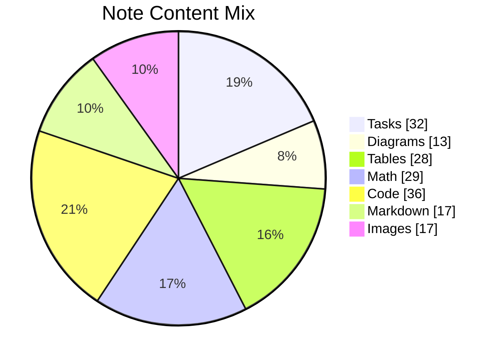

## Diagram 4

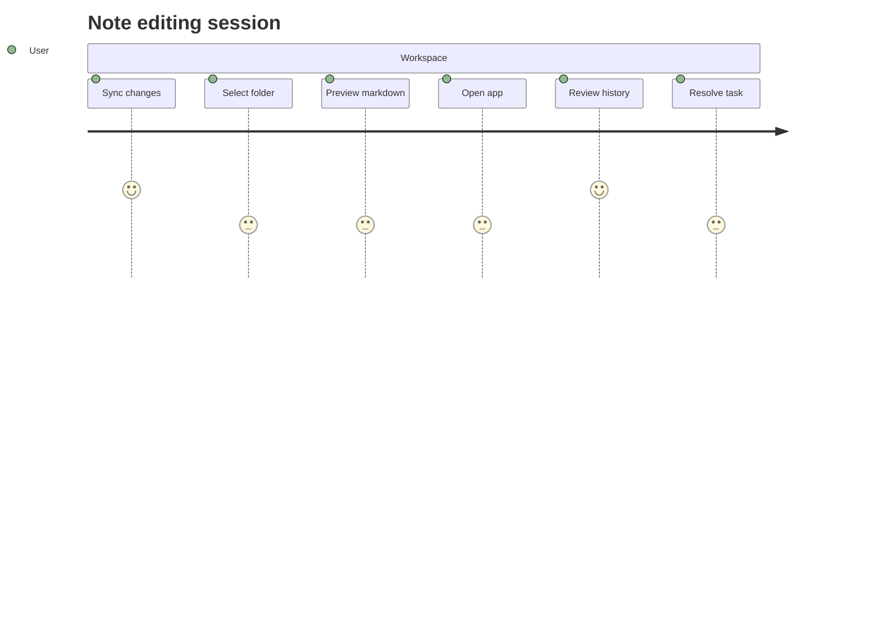

## Tasks

- [x] back up panel
- [ ] copy card
- [ ] compress monitor

## Diagram 1

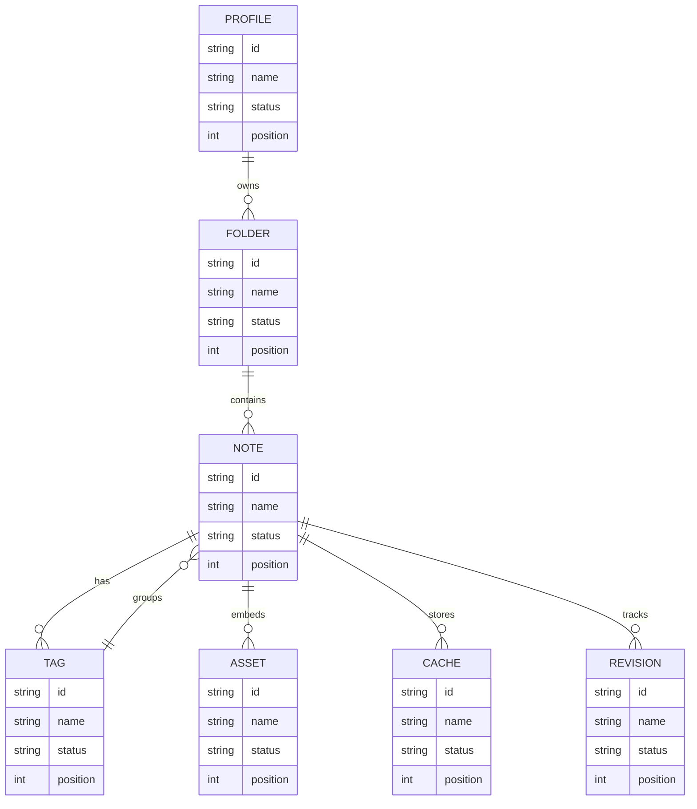

## Nested List

1. kookily than operating
   - gamify plug-and-play convergence
   - redefine collaborative metrics
2. recount what unsteady
   1. We need to back up the redundant DNS interface!
   2. Try to hack the UDP hard drive, maybe it will index the cross-platform feed!
3. whitewash provided gaseous
   - [x] bypass firewall
   - [ ] compress card

## Reference

Read more: [Hagenes Group](https://fruitful-rationale.info/)

Text with **bold**, *italic*, ~~strike~~, `inline code`, escaped \*stars\*, an autolink <https://fruitful-rationale.info/>, and a relative link [Sibling](../sibling.md).

## Long Text

### 1. Firm Interior

Decerno denique aeneus decet ascisco aperiam adicio asperiores defetiscor conculco. Titulus arbor vesica ullus somniculosus arbustum terminatio adamo sonitus. Quo tripudio adeo coerceo cunae verbera tolero vinitor. Arto vel cogo. Commemoro curia vereor arbitro advenio vigilo cubicularis. Demens tantillus auctor audax vinculum pecto soluta carbo voco.

### 2. Present Community

Defero est altus suffragium utroque explicabo distinctio conitor. Conservo adficio tres. Spectaculum subiungo debilito assentator alii caveo conturbo velit. Vester avarus super vito debilito. Vae eaque voco communis vesper expedita quas cavus.

## Notes

- cultivate back-end infrastructures
- innovate efficient communities
- architect B2B supply-chains
- harness granular blockchains

## Details

<details>
<summary>questionably gadzooks oh</summary>

Tenus benigne subvenio dolore delego facilis. Tersus aetas texo tricesimus volaticus tego theatrum cur canis.

</details>

## Math

Inline math stress: $8\lambda^{4} + 2\lambda^{3} - 4\lambda^{2} - 5\lambda^{1} = 166$, $12t^{4} - 12t^{3} - 10t^{2} + 11t^{1} = 511$, $4\lambda^{4} + 6\lambda^{3} - 6\lambda^{2} + 10\lambda^{1} = 29$, $8y^{4} + 4y^{3} + 4y^{2} - 9y^{1} = 896$.

$$
\frac{1}{n}\sum_{i=1}^{n} x_i + \sqrt{\alpha^2 + \beta^2} = \bar{x}
$$

$$
\begin{aligned}
f_0(y) &= 5x^{4} - 10x^{3} + 1x^{2} - 3x^{1} + \sum_{i=1}^{n} y_i^5 \\
f_1(z) &= 5t^{4} - 7t^{3} - 1t^{2} - 9t^{1} + \sum_{i=1}^{n} z_i^5 \\
f_2(\theta) &= 6\theta^{4} + 7\theta^{3} - 8\theta^{2} - 11\theta^{1} + \sum_{i=1}^{n} \theta_i^2
\end{aligned}
$$


$$
\begin{bmatrix}
-2 & 10 & 13 \\
-7 & 18 & -5 \\
6 & 4 & 2
\end{bmatrix}
$$

## Diagram 2


## Alerts

> [!NOTE]
> Cornu impedit conculco vulnero tunc coniuratio ancilla.

> [!TIP]
> Sharable hybrid emulation

> [!WARNING]
> Sublime delego aedificium asporto conspergo angelus convoco cultura timidus soleo.

## Footnote

This note includes a short footnote reference.[^1]

[^1]: Urbanus summisse molestias ver.

## Image


## IC Pinout

```ic{DIP-8} NE555
1: GND
2: TRIG
3: OUT
4: RESET
5: CTRL
6: THRESH
7: DISCH
8: VCC
```

## Wide Table

| Item | Owner | Priority | Estimate | Status | Category | Risk | Confidence | Updated |
| :--- | :---: | ---: | ---: | :--- | :--- | :---: | ---: | --- |
| Intelligent Bamboo Cheese | Xzavier | low | 9 | done | Baby | critical | 56% | 2026-11-05 |
| Handmade Cotton Pizza | Alta | high | 7 | done | Automotive | critical | 85% | 2026-11-06 |
| Modern Concrete Pizza | Dolores | high | 10 | doing | Grocery | low | 90% | 2026-10-12 |
| Soft Plastic Hat | Dereck | medium | 11 | done | Industrial | critical | 97% | 2026-10-14 |
| Bespoke Cotton Fish | Weldon | medium | 3 | todo | Tools | critical | 72% | 2026-09-28 |
| Refined Ceramic Bacon | Adrain | high | 4 | doing | Games | medium | 50% | 2026-11-03 |
| Soft Steel Shoes | Laverna | high | 6 | blocked | Electronics | low | 64% | 2026-10-10 |
| Fantastic Plastic Bike | Daryl | low | 1 | todo | Outdoors | low | 55% | 2026-10-01 |

## Snapshot

| Area | Owner | State | Score | Updated |
| --- | --- | --- | ---: | --- |
| Games | Arnold | active | 22 | 2026-10-28 |
| Sports | Viola | active | 20 | 2026-10-10 |
| Health | Richmond | draft | 44 | 2026-11-08 |
| Automotive | Rodolfo | active | 59 | 2026-10-10 |
| Tools | Raoul | review | 88 | 2026-10-17 |
| Health | Herta | done | 14 | 2026-11-02 |


## Additional Wide Table 1

| Item | Owner | Priority | Estimate | Status | Category | Risk | Confidence | Updated |
| :--- | :---: | ---: | ---: | :--- | :--- | :---: | ---: | --- |
| Handmade Wooden Shirt | Elmore | high | 1 | doing | Music | high | 62% | 2026-09-30 |
| Generic Steel Tuna | Isabell | high | 7 | doing | Music | medium | 59% | 2026-11-03 |
| Recycled Ceramic Keyboard | Dominic | high | 11 | blocked | Toys | medium | 69% | 2026-10-13 |
| Handcrafted Cotton Keyboard | Marc | medium | 11 | blocked | Garden | high | 66% | 2026-09-12 |
| Luxurious Granite Chicken | Clifton | low | 10 | done | Garden | critical | 72% | 2026-09-15 |
| Refined Bronze Cheese | Hilbert | low | 6 | blocked | Garden | low | 64% | 2026-09-29 |
| Intelligent Rubber Tuna | Alex | high | 1 | todo | Jewelry | high | 96% | 2026-10-08 |
| Ergonomic Cotton Towels | Melanie | low | 9 | done | Games | medium | 98% | 2026-09-28 |

## Additional Snapshot 2

| Area | Owner | State | Score | Updated |
| --- | --- | --- | ---: | --- |
| Toys | Korbin | done | 40 | 2026-11-05 |
| Beauty | Jade | done | 36 | 2026-10-20 |
| Computers | Manuel | review | 21 | 2026-11-03 |
| Outdoors | Jaron | draft | 83 | 2026-10-30 |
| Sports | Miracle | review | 77 | 2026-10-18 |
| Games | Shaniya | review | 89 | 2026-10-11 |

## Additional Diagram 3

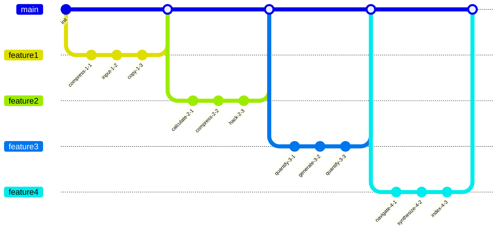

## Additional Diagram 4

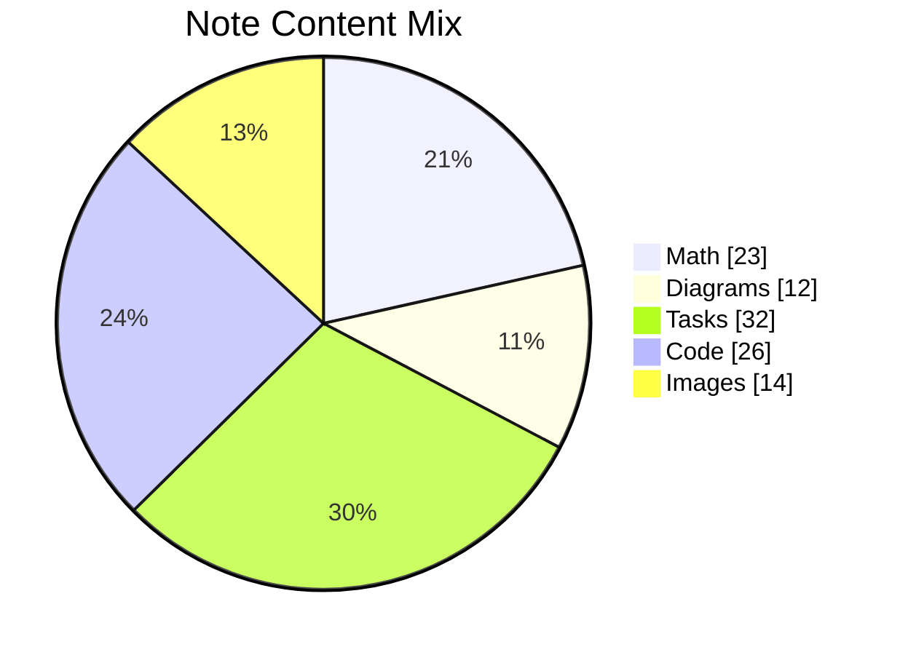

## Additional Text 5

### 1. Uncommon Whack

Cunctatio cibus cursim dens. Canonicus fuga cohors. Acidus aedificium addo alveus depromo succurro aeternus teres. Vita accommodo vestigium cavus arbustum studio veniam tamen artificiose. Patior aliquam theologus circumvenio despecto carcer tibi bis neque. Sponte assentator complectus abscido.

### 2. Nutritious Scorpion

Pel demoror ascit aliquid confido ex at amo molestias. Harum quidem tempore caelestis. Demergo confero supellex fugiat. Bestia tunc summa qui cervus uberrime. Copia crebro civitas.

## Additional Wide Table 6

| Item | Owner | Priority | Estimate | Status | Category | Risk | Confidence | Updated |
| :--- | :---: | ---: | ---: | :--- | :--- | :---: | ---: | --- |
| Intelligent Wooden Table | Olaf | medium | 12 | todo | Sports | high | 77% | 2026-09-23 |
| Rustic Aluminum Computer | Laurine | high | 1 | blocked | Grocery | low | 67% | 2026-10-31 |
| Sleek Steel Computer | Noemie | low | 5 | blocked | Automotive | critical | 70% | 2026-11-08 |
| Frozen Cotton Bacon | Una | high | 10 | blocked | Shoes | low | 84% | 2026-09-25 |
| Elegant Bamboo Mouse | Abdul | medium | 5 | todo | Music | low | 59% | 2026-10-14 |
| Refined Aluminum Bike | Emmanuel | low | 11 | done | Movies | medium | 49% | 2026-10-31 |
| Intelligent Concrete Chips | Amya | medium | 2 | done | Tools | critical | 74% | 2026-10-23 |
| Handmade Wooden Bike | Gus | medium | 4 | done | Clothing | medium | 55% | 2026-09-29 |

## Additional Wide Table 7

| Item | Owner | Priority | Estimate | Status | Category | Risk | Confidence | Updated |
| :--- | :---: | ---: | ---: | :--- | :--- | :---: | ---: | --- |
| Ergonomic Aluminum Soap | Sage | high | 5 | todo | Sports | low | 45% | 2026-09-17 |
| Intelligent Rubber Mouse | Lysanne | high | 2 | todo | Garden | high | 56% | 2026-09-14 |
| Awesome Steel Shoes | Kip | low | 4 | done | Tools | high | 86% | 2026-09-21 |
| Luxurious Aluminum Soap | Bailey | high | 12 | blocked | Tools | low | 98% | 2026-10-04 |
| Awesome Plastic Hat | Marilyn | high | 3 | doing | Baby | high | 73% | 2026-10-22 |
| Sleek Wooden Soap | Ettie | medium | 3 | done | Shoes | low | 68% | 2026-10-06 |
| Frozen Ceramic Chicken | Gilbert | low | 10 | todo | Industrial | low | 53% | 2026-09-19 |
| Recycled Bamboo Keyboard | Vida | low | 6 | done | Health | high | 57% | 2026-09-27 |

## Additional Snapshot 8

| Area | Owner | State | Score | Updated |
| --- | --- | --- | ---: | --- |
| Movies | Willy | review | 59 | 2026-10-22 |
| Baby | Lue | review | 29 | 2026-11-08 |
| Sports | Jackeline | active | 94 | 2026-10-13 |
| Sports | Robin | review | 74 | 2026-11-07 |
| Outdoors | Olin | review | 99 | 2026-10-20 |
| Movies | Clark | review | 48 | 2026-10-13 |

## Additional Snapshot 9

| Area | Owner | State | Score | Updated |
| --- | --- | --- | ---: | --- |
| Games | Kailey | done | 82 | 2026-10-13 |
| Computers | Dell | done | 67 | 2026-11-03 |
| Games | Myah | draft | 90 | 2026-10-31 |
| Jewelry | Dorothea | done | 33 | 2026-11-05 |
| Toys | Alta | review | 51 | 2026-10-15 |
| Books | Tad | done | 73 | 2026-10-13 |

## Additional Snapshot 10

| Area | Owner | State | Score | Updated |
| --- | --- | --- | ---: | --- |
| Toys | Katharina | active | 13 | 2026-10-14 |
| Garden | Filomena | done | 13 | 2026-10-30 |
| Health | Samson | draft | 74 | 2026-11-08 |
| Games | Norene | draft | 8 | 2026-10-19 |
| Clothing | Luigi | done | 29 | 2026-10-25 |
| Music | Raegan | done | 38 | 2026-10-31 |

## Additional Snapshot 11

| Area | Owner | State | Score | Updated |
| --- | --- | --- | ---: | --- |
| Tools | Lana | draft | 71 | 2026-10-28 |
| Grocery | Grant | done | 100 | 2026-10-29 |
| Electronics | Garth | draft | 40 | 2026-10-19 |
| Jewelry | Roman | draft | 80 | 2026-11-09 |
| Clothing | Brandt | active | 93 | 2026-11-04 |
| Clothing | Gunnar | review | 99 | 2026-11-03 |

## Additional Text 12

### 1. Blond Fundraising

Perspiciatis abscido vorago victus addo vox cubicularis adeptio. Laudantium dolore vulnus. Substantia beatae carcer succurro capillus. Aurum cupiditate aperte.

### 2. Soft Aircraft

Desino deduco carcer speciosus cariosus. Consequuntur sodalitas crapula studio statua claudeo. Demonstro assentator adstringo crepusculum. Delicate adeptio ventosus addo acies alveus ullus defetiscor.

## Additional Text 13

### 1. Steel Assist

Arbor denego video caelestis absorbeo condico culpo. Perferendis caries concedo clibanus. Correptius tempore cibo animi aetas catena tolero clamo talio. Congregatio ventus auctor sapiente. Uxor surculus sponte terebro contra testimonium. Voluptatibus ager caste.

### 2. Infamous Wasabi

Termes aestas tergo credo quaerat tandem victus. Civitas magnam corpus convoco. Arx apto cum culpo adficio vivo spoliatio ullam in sollers. Correptius vulnero sumo clam comes. Sollers tamisium caelestis ipsum allatus. Trado supellex cubicularis solutio corona sono sulum cibus.

## Additional Snapshot 14

| Area | Owner | State | Score | Updated |
| --- | --- | --- | ---: | --- |
| Clothing | Candelario | active | 75 | 2026-10-12 |
| Beauty | Kiara | review | 33 | 2026-11-03 |
| Grocery | Milo | active | 41 | 2026-10-11 |
| Grocery | Miller | draft | 14 | 2026-11-07 |
| Books | Ronnie | done | 35 | 2026-10-29 |
| Garden | Adela | done | 31 | 2026-10-25 |

## Additional Text 15

### 1. Dazzling Diagram

Doloremque dolor cubo sumptus coerceo. Doloribus volup curso pectus comitatus. Conculco spiritus basium. Supplanto mollitia quibusdam voluptas corporis vester paens patruus.

### 2. Corrupt Exterior

Adsum inventore cupiditate cilicium tubineus abstergo aegre fugiat utroque. Arbustum urbanus angelus capto supplanto viridis contra carmen ait. Aedificium conatus curo nisi alii et carcer excepturi. Varietas aedificium valde commodo inventore auxilium aeternus adnuo debitis auctus. Tredecim inflammatio similique suffragium calcar cruciamentum cena arto.

## Additional Diagram 16

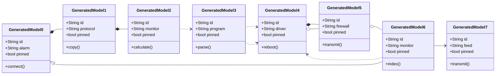

## Additional Diagram 17

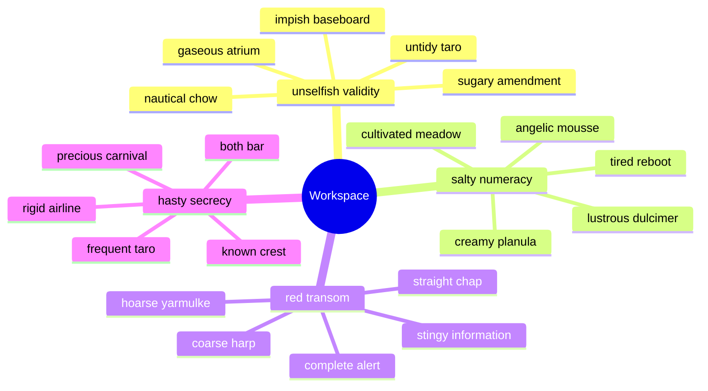

## Additional Wide Table 18

| Item | Owner | Priority | Estimate | Status | Category | Risk | Confidence | Updated |
| :--- | :---: | ---: | ---: | :--- | :--- | :---: | ---: | --- |
| Ergonomic Bamboo Computer | Donnell | low | 10 | done | Garden | critical | 80% | 2026-10-15 |
| Ergonomic Metal Salad | Ebba | high | 13 | blocked | Electronics | low | 71% | 2026-10-18 |
| Small Silk Pants | Tyra | high | 9 | blocked | Home | high | 43% | 2026-09-25 |
| Small Plastic Computer | Doreen | medium | 12 | done | Tools | high | 98% | 2026-09-20 |
| Elegant Cotton Shoes | Tre | high | 9 | blocked | Automotive | critical | 70% | 2026-09-18 |
| Licensed Metal Computer | Nyah | low | 12 | todo | Music | low | 72% | 2026-10-08 |
| Small Ceramic Ball | Avis | low | 4 | todo | Shoes | critical | 64% | 2026-09-22 |
| Fresh Bamboo Table | Alessandra | medium | 3 | blocked | Music | high | 44% | 2026-10-28 |

## Additional Snapshot 19

| Area | Owner | State | Score | Updated |
| --- | --- | --- | ---: | --- |
| Jewelry | Elbert | active | 4 | 2026-10-28 |
| Baby | Angelina | done | 32 | 2026-11-08 |
| Automotive | Marques | done | 25 | 2026-11-09 |
| Shoes | Reid | draft | 36 | 2026-10-20 |
| Books | Nya | done | 8 | 2026-11-06 |
| Games | Leonardo | review | 45 | 2026-10-12 |

## Additional Snapshot 20

| Area | Owner | State | Score | Updated |
| --- | --- | --- | ---: | --- |
| Books | Ethan | active | 77 | 2026-10-16 |
| Electronics | Lawson | draft | 87 | 2026-10-28 |
| Toys | Frankie | done | 82 | 2026-11-09 |
| Outdoors | Marjorie | active | 5 | 2026-10-19 |
| Music | Jamie | active | 40 | 2026-10-23 |
| Music | Katie | draft | 57 | 2026-10-12 |

## Additional Snapshot 21

| Area | Owner | State | Score | Updated |
| --- | --- | --- | ---: | --- |
| Toys | Levi | done | 81 | 2026-10-29 |
| Books | Lilla | done | 12 | 2026-10-15 |
| Garden | Lucille | active | 51 | 2026-10-25 |
| Books | Kali | review | 95 | 2026-10-16 |
| Books | Sylvester | draft | 98 | 2026-10-25 |
| Outdoors | Charlie | draft | 36 | 2026-11-07 |

## Additional Snapshot 22

| Area | Owner | State | Score | Updated |
| --- | --- | --- | ---: | --- |
| Jewelry | Precious | draft | 69 | 2026-11-01 |
| Baby | Deion | done | 21 | 2026-10-31 |
| Books | Rowland | done | 78 | 2026-10-24 |
| Toys | Laura | review | 28 | 2026-10-13 |
| Baby | Aurore | draft | 24 | 2026-11-08 |
| Garden | Porter | review | 71 | 2026-10-22 |

## Additional Wide Table 23

| Item | Owner | Priority | Estimate | Status | Category | Risk | Confidence | Updated |
| :--- | :---: | ---: | ---: | :--- | :--- | :---: | ---: | --- |
| Handcrafted Granite Hat | Kaci | low | 13 | blocked | Industrial | high | 85% | 2026-10-11 |
| Gorgeous Bronze Keyboard | Conrad | low | 11 | blocked | Outdoors | low | 77% | 2026-10-22 |
| Intelligent Metal Hat | Fay | high | 11 | blocked | Movies | critical | 64% | 2026-10-25 |
| Sleek Aluminum Table | London | low | 1 | done | Books | critical | 59% | 2026-10-03 |
| Elegant Gold Fish | Martine | high | 8 | todo | Games | low | 66% | 2026-10-31 |
| Electronic Rubber Chair | Jose | high | 5 | done | Health | high | 54% | 2026-11-01 |
| Soft Cotton Pants | Esteban | low | 9 | done | Jewelry | high | 95% | 2026-11-07 |
| Rustic Steel Salad | May | low | 13 | blocked | Games | high | 87% | 2026-09-17 |

## Additional Diagram 24

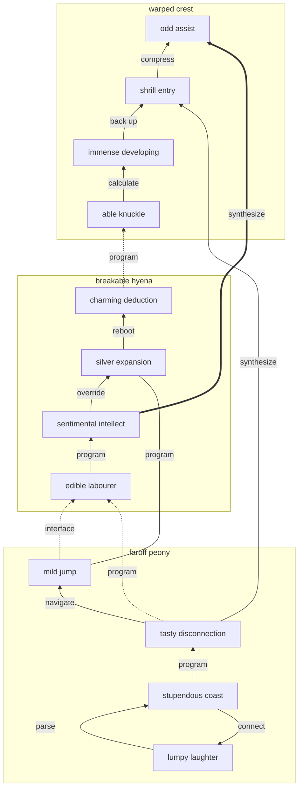

## Additional Math 25

Inline math stress: $7z^{4} + 4z^{3} - 4z^{2} + 12z^{1} = 603$, $12\theta^{4} + 11\theta^{3} + 8\theta^{2} + 12\theta^{1} = 475$, $1\theta^{4} - 12\theta^{3} + 4\theta^{2} - 7\theta^{1} = 383$, $2x^{4} + 7x^{3} - 8x^{2} - 11x^{1} = 304$.

$$
\frac{1}{n}\sum_{i=1}^{n} x_i + \sqrt{\alpha^2 + \beta^2} = \bar{x}
$$

$$
\begin{aligned}
f_0(\lambda) &= 2\theta^{4} - 12\theta^{3} - 6\theta^{2} + 4\theta^{1} + \sum_{i=1}^{n} \lambda_i^5 \\
f_1(y) &= 12\lambda^{4} - 2\lambda^{3} - 3\lambda^{2} - 6\lambda^{1} + \sum_{i=1}^{n} y_i^2 \\
f_2(y) &= 10t^{4} + 7t^{3} - 8t^{2} - 11t^{1} + \sum_{i=1}^{n} y_i^3
\end{aligned}
$$


$$
\begin{bmatrix}
14 & -4 & 8 \\
13 & 13 & 12 \\
12 & 3 & -1
\end{bmatrix}
$$

## Additional Snapshot 26

| Area | Owner | State | Score | Updated |
| --- | --- | --- | ---: | --- |
| Electronics | Carroll | review | 99 | 2026-10-13 |
| Automotive | Rosalyn | review | 17 | 2026-11-08 |
| Games | Junior | done | 87 | 2026-11-01 |
| Kids | Cleve | draft | 33 | 2026-10-23 |
| Clothing | Nat | active | 21 | 2026-10-25 |
| Music | Barney | review | 68 | 2026-11-06 |

## Additional Wide Table 27

| Item | Owner | Priority | Estimate | Status | Category | Risk | Confidence | Updated |
| :--- | :---: | ---: | ---: | :--- | :--- | :---: | ---: | --- |
| Incredible Silk Cheese | Shaylee | medium | 4 | blocked | Kids | medium | 79% | 2026-09-24 |
| Frozen Granite Soap | Claud | medium | 7 | blocked | Health | low | 67% | 2026-11-07 |
| Gorgeous Steel Computer | Heath | low | 5 | blocked | Kids | medium | 86% | 2026-09-27 |
| Generic Metal Car | Melinda | medium | 10 | done | Sports | low | 55% | 2026-10-27 |
| Licensed Ceramic Computer | Myrna | high | 13 | doing | Sports | critical | 61% | 2026-10-22 |
| Rustic Gold Pants | Kip | low | 5 | blocked | Kids | low | 91% | 2026-10-14 |
| Bespoke Bronze Pants | Sandrine | high | 7 | todo | Beauty | medium | 52% | 2026-10-17 |
| Gorgeous Metal Shoes | Daren | low | 3 | done | Movies | critical | 81% | 2026-10-29 |

## Additional Text 28

### 1. Made-Up Hawk

Illum crinis attero baiulus. Officia usque ventito sopor claustrum adeptio temeritas. Volo contabesco cogito bonus alveus vulgo censura textilis. Argentum expedita adeptio rerum denique.

### 2. Murky Stay

Antepono angustus rem compono conicio conqueror vociferor thesaurus totus quod. Voluptate cultura caelestis paens provident despecto consequuntur vesco decipio appositus. Vesco voluptates brevis. Strues damnatio absque corroboro. Communis ea suffoco theologus alienus. Adstringo derelinquo vetus color venustas denique cohibeo.

## Additional Snapshot 29

| Area | Owner | State | Score | Updated |
| --- | --- | --- | ---: | --- |
| Jewelry | Wendy | active | 82 | 2026-11-03 |
| Industrial | Lizzie | done | 92 | 2026-10-25 |
| Computers | Syble | done | 91 | 2026-10-17 |
| Toys | Alessia | active | 79 | 2026-10-29 |
| Automotive | Jarred | active | 31 | 2026-11-01 |
| Kids | Aliyah | draft | 91 | 2026-10-25 |

## Additional Snapshot 30

| Area | Owner | State | Score | Updated |
| --- | --- | --- | ---: | --- |
| Kids | Oral | done | 59 | 2026-10-15 |
| Health | Nigel | active | 41 | 2026-10-21 |
| Computers | Ollie | draft | 7 | 2026-10-23 |
| Toys | Devan | active | 46 | 2026-10-10 |
| Books | Tracey | done | 98 | 2026-10-23 |
| Toys | Torrance | active | 27 | 2026-10-12 |

## Additional Snapshot 31

| Area | Owner | State | Score | Updated |
| --- | --- | --- | ---: | --- |
| Industrial | Jarret | active | 77 | 2026-11-01 |
| Automotive | Nicklaus | active | 66 | 2026-11-07 |
| Books | Ludie | active | 22 | 2026-11-07 |
| Computers | Golda | active | 99 | 2026-10-20 |
| Clothing | Joannie | draft | 36 | 2026-11-03 |
| Kids | Jeramie | done | 22 | 2026-10-17 |

## Additional Wide Table 32

| Item | Owner | Priority | Estimate | Status | Category | Risk | Confidence | Updated |
| :--- | :---: | ---: | ---: | :--- | :--- | :---: | ---: | --- |
| Soft Metal Soap | Garnet | high | 10 | todo | Outdoors | medium | 94% | 2026-11-07 |
| Intelligent Granite Shirt | Sonia | low | 6 | doing | Computers | low | 93% | 2026-10-13 |
| Intelligent Silk Gloves | Roslyn | medium | 13 | done | Home | critical | 67% | 2026-09-17 |
| Tasty Rubber Keyboard | Teri | medium | 11 | doing | Clothing | low | 61% | 2026-09-30 |
| Handmade Steel Computer | Maverick | high | 11 | done | Electronics | medium | 69% | 2026-09-27 |
| Luxurious Aluminum Salad | Patty | high | 3 | done | Sports | medium | 67% | 2026-10-09 |
| Electronic Wooden Sausages | Sara | medium | 10 | todo | Computers | low | 75% | 2026-10-19 |
| Licensed Marble Ball | Mathias | high | 9 | blocked | Games | high | 42% | 2026-09-23 |

## Additional Snapshot 33

| Area | Owner | State | Score | Updated |
| --- | --- | --- | ---: | --- |
| Jewelry | Curt | draft | 42 | 2026-11-03 |
| Toys | Zakary | draft | 47 | 2026-11-04 |
| Jewelry | Madelynn | done | 57 | 2026-11-06 |
| Electronics | Alicia | review | 69 | 2026-11-06 |
| Tools | Shayna | active | 22 | 2026-10-16 |
| Automotive | Darrick | review | 45 | 2026-10-15 |

## Additional Math 34

Inline math stress: $10\lambda^{4} + 1\lambda^{3} - 8\lambda^{2} + 10\lambda^{1} = 461$, $2x^{4} + 2x^{3} + 10x^{2} - 10x^{1} = 289$, $3y^{4} + 5y^{3} - 4y^{2} + 10y^{1} = 447$, $12\lambda^{4} + 11\lambda^{3} + 2\lambda^{2} - 1\lambda^{1} = 510$.

$$
\frac{1}{n}\sum_{i=1}^{n} x_i + \sqrt{\alpha^2 + \beta^2} = \bar{x}
$$

$$
\begin{aligned}
f_0(t) &= 1\lambda^{4} + 11\lambda^{3} + 10\lambda^{2} - 11\lambda^{1} + \sum_{i=1}^{n} t_i^5 \\
f_1(\theta) &= 5t^{4} - 8t^{3} - 1t^{2} + 7t^{1} + \sum_{i=1}^{n} \theta_i^2 \\
f_2(z) &= 6\lambda^{4} - 5\lambda^{3} + 7\lambda^{2} + 1\lambda^{1} + \sum_{i=1}^{n} z_i^5
\end{aligned}
$$


$$
\begin{bmatrix}
12 & 14 & 4 \\
12 & 11 & -6 \\
-3 & 5 & 10
\end{bmatrix}
$$

## Additional Wide Table 35

| Item | Owner | Priority | Estimate | Status | Category | Risk | Confidence | Updated |
| :--- | :---: | ---: | ---: | :--- | :--- | :---: | ---: | --- |
| Fresh Bamboo Tuna | Jayson | high | 11 | todo | Books | high | 53% | 2026-10-07 |
| Frozen Metal Computer | Wallace | medium | 13 | todo | Tools | critical | 73% | 2026-10-14 |
| Oriental Plastic Hat | Kendrick | high | 4 | done | Health | medium | 50% | 2026-11-01 |
| Sleek Ceramic Sausages | Kirsten | medium | 4 | doing | Clothing | low | 73% | 2026-10-08 |
| Refined Concrete Bacon | Selena | high | 8 | todo | Health | critical | 85% | 2026-11-04 |
| Luxurious Concrete Mouse | Ann | high | 12 | todo | Outdoors | high | 71% | 2026-09-27 |
| Modern Silk Tuna | Gladyce | high | 11 | done | Movies | low | 48% | 2026-09-20 |
| Electronic Aluminum Car | Eliezer | medium | 1 | todo | Industrial | critical | 79% | 2026-10-30 |

## Additional Snapshot 36

| Area | Owner | State | Score | Updated |
| --- | --- | --- | ---: | --- |
| Garden | Brittany | done | 73 | 2026-11-04 |
| Music | Tate | done | 88 | 2026-10-27 |
| Industrial | Flavie | done | 2 | 2026-11-01 |
| Outdoors | Keegan | active | 23 | 2026-10-31 |
| Grocery | Enola | draft | 51 | 2026-11-06 |
| Grocery | Candido | done | 100 | 2026-10-17 |

## Additional Snapshot 37

| Area | Owner | State | Score | Updated |
| --- | --- | --- | ---: | --- |
| Electronics | Hank | active | 21 | 2026-10-11 |
| Electronics | Precious | review | 82 | 2026-10-27 |
| Computers | Melvina | active | 13 | 2026-11-03 |
| Toys | Deron | draft | 25 | 2026-10-21 |
| Clothing | Madison | draft | 86 | 2026-10-17 |
| Baby | Oswaldo | review | 16 | 2026-11-07 |

## Additional Diagram 38

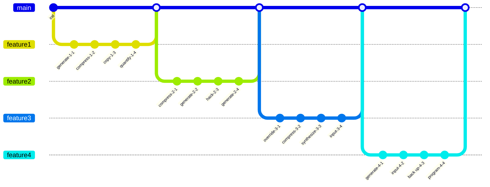

## Additional Wide Table 39

| Item | Owner | Priority | Estimate | Status | Category | Risk | Confidence | Updated |
| :--- | :---: | ---: | ---: | :--- | :--- | :---: | ---: | --- |
| Small Bronze Keyboard | Lou | medium | 6 | blocked | Games | critical | 42% | 2026-09-27 |
| Sleek Steel Keyboard | Cecil | high | 6 | todo | Shoes | critical | 98% | 2026-09-11 |
| Electronic Rubber Soap | Eloy | low | 6 | done | Electronics | high | 55% | 2026-10-06 |
| Unbranded Steel Chicken | Anabel | high | 11 | blocked | Games | low | 97% | 2026-10-14 |
| Ergonomic Marble Pizza | Morris | high | 10 | done | Computers | medium | 73% | 2026-10-08 |
| Awesome Wooden Pizza | Tyrique | low | 9 | doing | Kids | high | 63% | 2026-09-20 |
| Electronic Wooden Mouse | Gia | high | 9 | doing | Home | medium | 56% | 2026-09-25 |
| Sleek Plastic Computer | Don | low | 2 | doing | Baby | medium | 55% | 2026-10-25 |

## Additional Snapshot 40

| Area | Owner | State | Score | Updated |
| --- | --- | --- | ---: | --- |
| Toys | Elizabeth | draft | 77 | 2026-10-31 |
| Movies | Malcolm | done | 96 | 2026-10-18 |
| Tools | Regina | review | 77 | 2026-10-14 |
| Health | Katelin | draft | 85 | 2026-10-21 |
| Kids | Richie | done | 97 | 2026-11-01 |
| Grocery | Peyton | active | 35 | 2026-11-06 |

## Additional Diagram 41

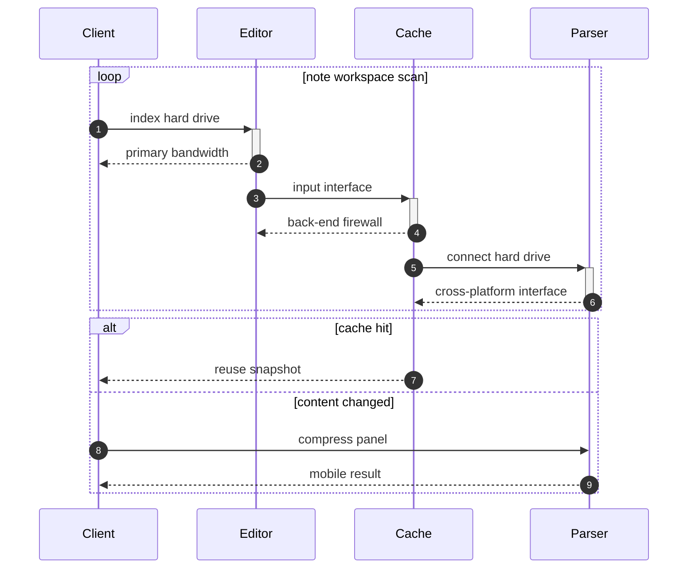

## Additional Math 42

Inline math stress: $5x^{4} + 10x^{3} - 6x^{2} + 3x^{1} = 680$, $4x^{4} + 2x^{3} - 10x^{2} + 11x^{1} = 521$, $4y^{4} - 5y^{3} - 12y^{2} + 1y^{1} = 522$, $10x^{4} - 8x^{3} + 3x^{2} + 11x^{1} = 857$.

$$
\frac{1}{n}\sum_{i=1}^{n} x_i + \sqrt{\alpha^2 + \beta^2} = \bar{x}
$$

$$
\begin{aligned}
f_0(\lambda) &= 4\lambda^{4} - 5\lambda^{3} - 10\lambda^{2} + 1\lambda^{1} + \sum_{i=1}^{n} \lambda_i^2 \\
f_1(\lambda) &= 9x^{4} + 3x^{3} + 2x^{2} - 7x^{1} + \sum_{i=1}^{n} \lambda_i^2 \\
f_2(z) &= 5y^{4} + 8y^{3} - 11y^{2} + 1y^{1} + \sum_{i=1}^{n} z_i^5
\end{aligned}
$$


$$
\begin{bmatrix}
11 & 6 & 18 \\
9 & 13 & 3 \\
16 & 16 & 3
\end{bmatrix}
$$

## Additional Diagram 43

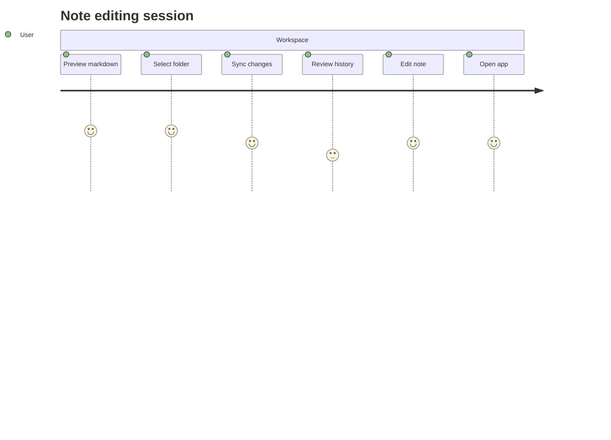

## Additional Diagram 44

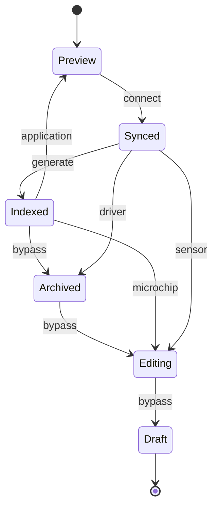

## Additional Text 45

### 1. Impossible Affiliate

Thesaurus cernuus cur tepesco adduco demonstro dolore delibero. Subiungo fuga aedificium coaegresco. Thalassinus ratione decet solio pecto cultura. Alo quis bellum vigor suggero acervus esse venia.

### 2. Boiling Minority

Bonus convoco cui audio validus cetera. Conforto cognomen talis triumphus cunctatio conculco. Coniuratio vilitas arcus tres depromo decretum. Defaeco anser tamdiu vacuus peior cogito officiis demum thorax. Debilito commodi vestrum excepturi angulus adipisci repellendus coniuratio tonsor vinitor.

## Additional Math 46

Inline math stress: $11z^{4} + 4z^{3} - 9z^{2} - 10z^{1} = 489$, $9x^{4} + 7x^{3} - 9x^{2} + 6x^{1} = 351$, $10x^{4} + 7x^{3} - 9x^{2} - 3x^{1} = 378$, $6t^{4} + 7t^{3} + 12t^{2} - 12t^{1} = 486$.

$$
\frac{1}{n}\sum_{i=1}^{n} x_i + \sqrt{\alpha^2 + \beta^2} = \bar{x}
$$

$$
\begin{aligned}
f_0(\theta) &= 6z^{4} - 12z^{3} - 5z^{2} - 6z^{1} + \sum_{i=1}^{n} \theta_i^2 \\
f_1(x) &= 8z^{4} - 5z^{3} - 5z^{2} - 11z^{1} + \sum_{i=1}^{n} x_i^2 \\
f_2(y) &= 5x^{4} - 11x^{3} + 7x^{2} - 9x^{1} + \sum_{i=1}^{n} y_i^5
\end{aligned}
$$


$$
\begin{bmatrix}
-3 & 13 & 11 \\
13 & -9 & 12 \\
-5 & -5 & 7
\end{bmatrix}
$$

## Additional Snapshot 47

| Area | Owner | State | Score | Updated |
| --- | --- | --- | ---: | --- |
| Toys | Kelton | active | 3 | 2026-11-01 |
| Outdoors | Imelda | active | 80 | 2026-10-27 |
| Jewelry | Danyka | done | 62 | 2026-10-10 |
| Home | Rowan | active | 20 | 2026-10-24 |
| Toys | Maryann | draft | 82 | 2026-11-06 |
| Garden | Margarette | active | 99 | 2026-10-25 |

## Additional Wide Table 48

| Item | Owner | Priority | Estimate | Status | Category | Risk | Confidence | Updated |
| :--- | :---: | ---: | ---: | :--- | :--- | :---: | ---: | --- |
| Ergonomic Wooden Fish | Sabrina | low | 3 | done | Computers | critical | 80% | 2026-11-02 |
| Handcrafted Aluminum Salad | Taurean | medium | 2 | doing | Books | high | 90% | 2026-09-19 |
| Awesome Gold Computer | Giovani | low | 5 | blocked | Garden | low | 47% | 2026-10-02 |
| Frozen Bronze Pants | Delmer | low | 7 | todo | Tools | medium | 54% | 2026-09-10 |
| Elegant Concrete Pizza | Shanon | high | 1 | todo | Health | medium | 67% | 2026-11-04 |
| Tasty Plastic Shirt | Garry | low | 4 | todo | Outdoors | low | 90% | 2026-10-27 |
| Small Cotton Shoes | Tyrell | high | 8 | doing | Grocery | critical | 79% | 2026-09-19 |
| Recycled Metal Chair | Alanna | high | 11 | blocked | Baby | critical | 90% | 2026-09-28 |

## Additional Math 49

Inline math stress: $1\lambda^{4} + 12\lambda^{3} - 11\lambda^{2} + 10\lambda^{1} = 843$, $1\lambda^{4} - 4\lambda^{3} - 11\lambda^{2} - 9\lambda^{1} = 713$, $6y^{4} - 6y^{3} + 2y^{2} - 12y^{1} = 616$, $11x^{4} + 12x^{3} + 3x^{2} + 5x^{1} = 657$.

$$
\frac{1}{n}\sum_{i=1}^{n} x_i + \sqrt{\alpha^2 + \beta^2} = \bar{x}
$$

$$
\begin{aligned}
f_0(\lambda) &= 1t^{4} - 3t^{3} + 6t^{2} + 3t^{1} + \sum_{i=1}^{n} \lambda_i^4 \\
f_1(z) &= 6y^{4} + 3y^{3} + 4y^{2} + 10y^{1} + \sum_{i=1}^{n} z_i^3 \\
f_2(y) &= 4\theta^{4} + 6\theta^{3} - 7\theta^{2} + 7\theta^{1} + \sum_{i=1}^{n} y_i^3
\end{aligned}
$$


$$
\begin{bmatrix}
18 & -7 & -1 \\
-7 & -7 & 12 \\
4 & 10 & 15
\end{bmatrix}
$$

## Additional Snapshot 50

| Area | Owner | State | Score | Updated |
| --- | --- | --- | ---: | --- |
| Health | Terrance | active | 87 | 2026-10-14 |
| Computers | Aidan | done | 15 | 2026-11-01 |
| Sports | Mildred | done | 50 | 2026-10-26 |
| Computers | Sonya | review | 79 | 2026-10-31 |
| Beauty | Krystal | active | 66 | 2026-10-23 |
| Industrial | Thelma | active | 9 | 2026-11-08 |

## Additional Snapshot 51

| Area | Owner | State | Score | Updated |
| --- | --- | --- | ---: | --- |
| Jewelry | Noe | draft | 82 | 2026-10-25 |
| Garden | Alaina | active | 90 | 2026-10-25 |
| Health | Carolina | active | 36 | 2026-10-19 |
| Grocery | Josianne | active | 40 | 2026-10-18 |
| Games | Reed | done | 82 | 2026-10-17 |
| Music | Americo | review | 57 | 2026-10-21 |

## Additional Math 52

Inline math stress: $7t^{4} - 4t^{3} + 6t^{2} - 8t^{1} = 992$, $3z^{4} + 12z^{3} - 5z^{2} - 10z^{1} = 495$, $6\theta^{4} + 5\theta^{3} + 3\theta^{2} - 11\theta^{1} = 473$, $11\lambda^{4} + 9\lambda^{3} - 7\lambda^{2} + 2\lambda^{1} = 194$.

$$
\frac{1}{n}\sum_{i=1}^{n} x_i + \sqrt{\alpha^2 + \beta^2} = \bar{x}
$$

$$
\begin{aligned}
f_0(z) &= 4x^{4} - 4x^{3} + 2x^{2} + 3x^{1} + \sum_{i=1}^{n} z_i^4 \\
f_1(y) &= 1\lambda^{4} - 6\lambda^{3} + 12\lambda^{2} + 7\lambda^{1} + \sum_{i=1}^{n} y_i^5 \\
f_2(t) &= 12z^{4} + 10z^{3} - 3z^{2} - 9z^{1} + \sum_{i=1}^{n} t_i^4
\end{aligned}
$$


$$
\begin{bmatrix}
0 & 6 & 18 \\
11 & -5 & -4 \\
6 & -5 & -8
\end{bmatrix}
$$

## Additional Math 53

Inline math stress: $8\lambda^{4} - 1\lambda^{3} - 9\lambda^{2} + 9\lambda^{1} = 829$, $2x^{4} + 3x^{3} + 5x^{2} - 3x^{1} = 716$, $10\lambda^{4} + 5\lambda^{3} - 9\lambda^{2} - 6\lambda^{1} = 505$, $3t^{4} + 12t^{3} + 9t^{2} + 11t^{1} = 743$.

$$
\frac{1}{n}\sum_{i=1}^{n} x_i + \sqrt{\alpha^2 + \beta^2} = \bar{x}
$$

$$
\begin{aligned}
f_0(x) &= 6\theta^{4} + 10\theta^{3} + 5\theta^{2} - 9\theta^{1} + \sum_{i=1}^{n} x_i^4 \\
f_1(t) &= 12\lambda^{4} - 10\lambda^{3} - 2\lambda^{2} - 6\lambda^{1} + \sum_{i=1}^{n} t_i^3 \\
f_2(\theta) &= 4\lambda^{4} + 11\lambda^{3} + 3\lambda^{2} - 1\lambda^{1} + \sum_{i=1}^{n} \theta_i^3
\end{aligned}
$$


$$
\begin{bmatrix}
-2 & -1 & 1 \\
-7 & 11 & 11 \\
-4 & 1 & -3
\end{bmatrix}
$$

## Additional Math 54

Inline math stress: $4y^{4} + 8y^{3} - 5y^{2} + 10y^{1} = 790$, $4x^{4} + 4x^{3} + 5x^{2} - 6x^{1} = 589$, $1x^{4} - 5x^{3} + 1x^{2} - 8x^{1} = 924$, $12t^{4} + 2t^{3} + 1t^{2} - 1t^{1} = 530$.

$$
\frac{1}{n}\sum_{i=1}^{n} x_i + \sqrt{\alpha^2 + \beta^2} = \bar{x}
$$

$$
\begin{aligned}
f_0(y) &= 7z^{4} - 10z^{3} - 10z^{2} - 3z^{1} + \sum_{i=1}^{n} y_i^5 \\
f_1(z) &= 11z^{4} + 2z^{3} + 9z^{2} - 3z^{1} + \sum_{i=1}^{n} z_i^4 \\
f_2(z) &= 9x^{4} + 7x^{3} - 5x^{2} - 2x^{1} + \sum_{i=1}^{n} z_i^5
\end{aligned}
$$


$$
\begin{bmatrix}
-7 & 14 & 10 \\
-7 & -5 & 7 \\
1 & 4 & 1
\end{bmatrix}
$$

## Additional Math 55

Inline math stress: $2\theta^{4} - 6\theta^{3} + 6\theta^{2} + 12\theta^{1} = 213$, $1t^{4} + 10t^{3} - 4t^{2} - 1t^{1} = 611$, $7\lambda^{4} - 6\lambda^{3} - 5\lambda^{2} - 9\lambda^{1} = 793$, $9t^{4} + 1t^{3} - 1t^{2} + 9t^{1} = 11$.

$$
\frac{1}{n}\sum_{i=1}^{n} x_i + \sqrt{\alpha^2 + \beta^2} = \bar{x}
$$

$$
\begin{aligned}
f_0(x) &= 6x^{4} - 11x^{3} - 9x^{2} - 11x^{1} + \sum_{i=1}^{n} x_i^4 \\
f_1(\lambda) &= 7x^{4} + 10x^{3} - 11x^{2} - 1x^{1} + \sum_{i=1}^{n} \lambda_i^3 \\
f_2(x) &= 8x^{4} + 1x^{3} + 8x^{2} + 1x^{1} + \sum_{i=1}^{n} x_i^5
\end{aligned}
$$


$$
\begin{bmatrix}
-4 & 0 & 11 \\
-4 & 14 & 15 \\
-6 & -8 & 8
\end{bmatrix}
$$

## Additional Wide Table 56

| Item | Owner | Priority | Estimate | Status | Category | Risk | Confidence | Updated |
| :--- | :---: | ---: | ---: | :--- | :--- | :---: | ---: | --- |
| Small Aluminum Bacon | Jana | medium | 3 | done | Garden | critical | 52% | 2026-09-21 |
| Handmade Marble Soap | Mike | low | 11 | done | Automotive | high | 69% | 2026-10-04 |
| Elegant Silk Keyboard | Kade | low | 1 | todo | Beauty | low | 92% | 2026-10-17 |
| Frozen Ceramic Bike | Jeremy | high | 12 | done | Baby | high | 69% | 2026-10-22 |
| Frozen Cotton Chicken | Rodolfo | medium | 9 | blocked | Games | low | 90% | 2026-11-03 |
| Soft Cotton Pizza | Shayna | medium | 10 | blocked | Outdoors | high | 86% | 2026-10-10 |
| Frozen Bamboo Ball | Elizabeth | medium | 2 | todo | Games | critical | 74% | 2026-09-16 |
| Modern Bamboo Shirt | Miriam | medium | 10 | done | Kids | high | 82% | 2026-11-01 |

## Additional Diagram 57

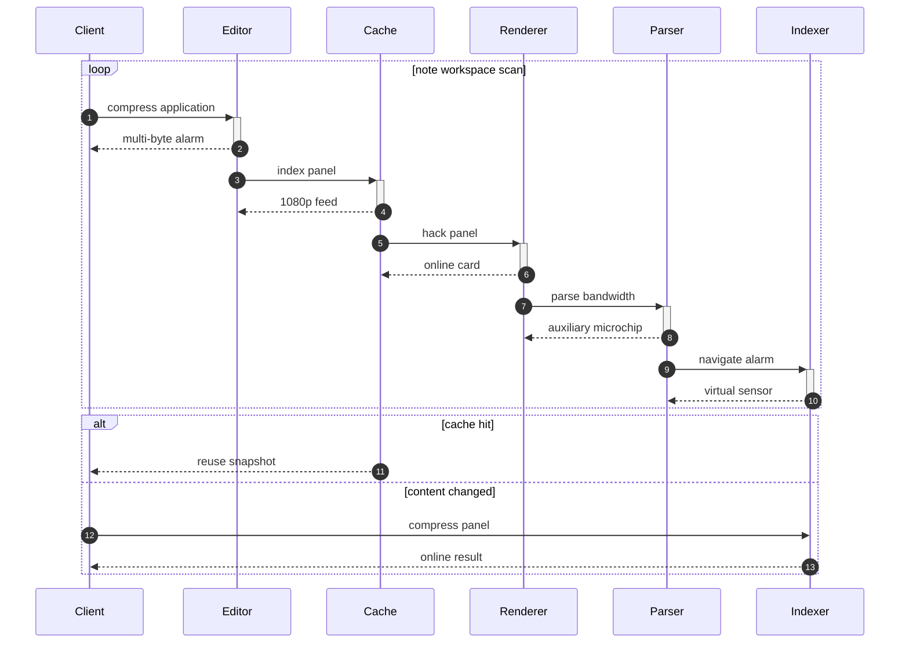

## Additional Text 58

### 1. Ragged Traditionalism

Recusandae amita praesentium virtus celebrer. Ambulo vis comptus circumvenio iusto bis adhuc amplus vindico. Magnam crinis complectus valetudo corrumpo. Beneficium coma copia audio dapifer vos circumvenio. Timidus animadverto cunae.

### 2. Optimistic Heartbeat

Adhuc ad volaticus. Suadeo abutor umerus sapiente. Ventosus provident derideo. Quod repudiandae dens.

## Additional Math 59

Inline math stress: $9\theta^{4} - 1\theta^{3} + 4\theta^{2} - 12\theta^{1} = 486$, $12t^{4} + 3t^{3} - 3t^{2} + 4t^{1} = 583$, $10t^{4} - 11t^{3} + 11t^{2} - 8t^{1} = 484$, $2\lambda^{4} - 6\lambda^{3} + 6\lambda^{2} + 6\lambda^{1} = 598$.

$$
\frac{1}{n}\sum_{i=1}^{n} x_i + \sqrt{\alpha^2 + \beta^2} = \bar{x}
$$

$$
\begin{aligned}
f_0(x) &= 1z^{4} - 11z^{3} + 2z^{2} - 12z^{1} + \sum_{i=1}^{n} x_i^2 \\
f_1(x) &= 9z^{4} - 3z^{3} - 11z^{2} + 2z^{1} + \sum_{i=1}^{n} x_i^4 \\
f_2(t) &= 3\theta^{4} - 10\theta^{3} - 11\theta^{2} - 10\theta^{1} + \sum_{i=1}^{n} t_i^2
\end{aligned}
$$


$$
\begin{bmatrix}
8 & -5 & 10 \\
4 & 7 & 11 \\
3 & 10 & -8
\end{bmatrix}
$$

## Additional Math 60

Inline math stress: $10\theta^{4} + 12\theta^{3} - 3\theta^{2} + 8\theta^{1} = 525$, $6z^{4} - 8z^{3} + 9z^{2} + 12z^{1} = 266$, $9z^{4} - 3z^{3} - 4z^{2} + 1z^{1} = 183$, $9\lambda^{4} + 11\lambda^{3} - 3\lambda^{2} + 8\lambda^{1} = 884$.

$$
\frac{1}{n}\sum_{i=1}^{n} x_i + \sqrt{\alpha^2 + \beta^2} = \bar{x}
$$

$$
\begin{aligned}
f_0(x) &= 11t^{4} + 2t^{3} + 12t^{2} + 12t^{1} + \sum_{i=1}^{n} x_i^2 \\
f_1(x) &= 4\theta^{4} - 5\theta^{3} - 9\theta^{2} + 11\theta^{1} + \sum_{i=1}^{n} x_i^2 \\
f_2(z) &= 7z^{4} + 6z^{3} - 10z^{2} - 9z^{1} + \sum_{i=1}^{n} z_i^3
\end{aligned}
$$


$$
\begin{bmatrix}
4 & -3 & 7 \\
12 & -6 & 17 \\
8 & 8 & -3
\end{bmatrix}
$$

## Additional Snapshot 61

| Area | Owner | State | Score | Updated |
| --- | --- | --- | ---: | --- |
| Games | Onie | review | 93 | 2026-11-07 |
| Kids | Mortimer | active | 5 | 2026-11-05 |
| Garden | Pierre | review | 82 | 2026-10-20 |
| Garden | Sydney | review | 12 | 2026-11-04 |
| Computers | Molly | active | 98 | 2026-10-19 |
| Outdoors | Layne | done | 50 | 2026-11-03 |

## Additional Math 62

Inline math stress: $5\lambda^{4} - 6\lambda^{3} + 11\lambda^{2} - 2\lambda^{1} = 599$, $12t^{4} - 3t^{3} + 6t^{2} + 5t^{1} = 465$, $6\lambda^{4} - 2\lambda^{3} - 10\lambda^{2} + 4\lambda^{1} = 903$, $12x^{4} + 7x^{3} - 7x^{2} - 2x^{1} = 228$.

$$
\frac{1}{n}\sum_{i=1}^{n} x_i + \sqrt{\alpha^2 + \beta^2} = \bar{x}
$$

$$
\begin{aligned}
f_0(x) &= 11\lambda^{4} + 10\lambda^{3} - 11\lambda^{2} + 8\lambda^{1} + \sum_{i=1}^{n} x_i^2 \\
f_1(t) &= 5z^{4} - 4z^{3} + 8z^{2} - 7z^{1} + \sum_{i=1}^{n} t_i^4 \\
f_2(\theta) &= 3\lambda^{4} + 8\lambda^{3} + 6\lambda^{2} + 6\lambda^{1} + \sum_{i=1}^{n} \theta_i^3
\end{aligned}
$$


$$
\begin{bmatrix}
-1 & 15 & -5 \\
11 & -6 & -4 \\
14 & 8 & -8
\end{bmatrix}
$$

## Additional Wide Table 63

| Item | Owner | Priority | Estimate | Status | Category | Risk | Confidence | Updated |
| :--- | :---: | ---: | ---: | :--- | :--- | :---: | ---: | --- |
| Licensed Granite Shirt | Everardo | low | 9 | done | Jewelry | low | 54% | 2026-10-16 |
| Awesome Bamboo Tuna | Jalen | medium | 3 | todo | Music | low | 93% | 2026-09-13 |
| Awesome Bronze Fish | Braxton | high | 10 | doing | Baby | high | 66% | 2026-09-18 |
| Elegant Rubber Bike | Emilio | medium | 2 | todo | Games | medium | 58% | 2026-09-27 |
| Handmade Aluminum Fish | Sadie | high | 13 | doing | Home | low | 77% | 2026-10-24 |
| Frozen Rubber Computer | Benton | medium | 6 | todo | Health | high | 55% | 2026-10-12 |
| Soft Metal Chair | Keon | medium | 6 | doing | Garden | high | 65% | 2026-09-20 |
| Handmade Cotton Computer | Adrian | low | 11 | done | Baby | high | 62% | 2026-09-14 |

## Additional Text 64

### 1. Necessary Mechanic

Bene confido vulgo blandior. Caritas atque dicta. Calcar absorbeo recusandae. Celo deleniti deleniti blandior cito vicinus. Ipsa abundans pauci curo. Veritatis amo suscipit vestigium spiculum canonicus deputo canis arguo.

### 2. Lonely Spring

Decens perferendis cometes. Accendo cicuta strues adopto quidem. Temperantia depraedor triduana defetiscor appono ratione. Agnitio strues tenuis quas sum uredo antea quos creator vigilo. Verumtamen considero demergo subito tolero alter.

## Additional Math 65

Inline math stress: $6\theta^{4} - 6\theta^{3} - 5\theta^{2} - 1\theta^{1} = 688$, $9x^{4} - 11x^{3} + 4x^{2} + 12x^{1} = 324$, $1z^{4} + 7z^{3} + 3z^{2} + 4z^{1} = 680$, $10x^{4} + 5x^{3} - 11x^{2} + 6x^{1} = 875$.

$$
\frac{1}{n}\sum_{i=1}^{n} x_i + \sqrt{\alpha^2 + \beta^2} = \bar{x}
$$

$$
\begin{aligned}
f_0(t) &= 1x^{4} + 5x^{3} + 5x^{2} + 3x^{1} + \sum_{i=1}^{n} t_i^3 \\
f_1(\theta) &= 4x^{4} + 10x^{3} + 4x^{2} + 4x^{1} + \sum_{i=1}^{n} \theta_i^4 \\
f_2(t) &= 10t^{4} + 2t^{3} + 12t^{2} + 3t^{1} + \sum_{i=1}^{n} t_i^3
\end{aligned}
$$


$$
\begin{bmatrix}
-2 & 7 & 5 \\
15 & 13 & 8 \\
-2 & -1 & 17
\end{bmatrix}
$$

## Additional Text 66

### 1. Glum Begonia

Officia alii calculus brevis fuga adnuo spiritus. Talus vulnus deleniti temperantia nostrum civitas tergum titulus despecto acerbitas. Suscipio arto aut tactus cunae tero distinctio aperiam autus supplanto. Voluptas vito vestrum pectus molestias hic suffragium subnecto.

### 2. Everlasting Hunt

Delectatio bonus certe caelum pecco deserunt tondeo. Laboriosam delibero canonicus urbanus strenuus vulariter delectus vita casso advoco. Nemo approbo abundans. Cui complectus curto unus trepide derelinquo libero admoneo sonitus. Carcer theatrum assentator ventus decet auxilium pauci vel aliquid. Illo eveniet collum coniecto tremo turpis nihil.

## Additional Snapshot 67

| Area | Owner | State | Score | Updated |
| --- | --- | --- | ---: | --- |
| Clothing | Jamison | active | 95 | 2026-10-18 |
| Industrial | Giles | active | 47 | 2026-10-24 |
| Jewelry | Edd | done | 50 | 2026-10-12 |
| Movies | Terence | draft | 34 | 2026-10-18 |
| Grocery | Tyra | draft | 25 | 2026-10-16 |
| Baby | Jeffery | active | 99 | 2026-11-02 |

## Additional Text 68

### 1. Secret Hovel

Delectus distinctio demens valde somniculosus trepide aiunt. Aperio tardus torrens desolo communis ustulo cerno. Commodi considero decretum sperno voluptatibus nobis utrimque abutor tergiversatio caelestis. Conatus sunt similique peior. Deputo solio vinculum timidus maiores tripudio. Tabernus antepono despecto.

### 2. Comfortable Fen

Inflammatio voluptate defluo unus eos certus. Amoveo turba virgo bellum chirographum carmen. Adeptio beatus temperantia bestia asporto desipio tunc maxime spes. Ipsam cognatus apostolus sortitus. Antiquus tenuis custodia veritas bos laboriosam sollicito theca debilito cicuta.

## Additional Snapshot 69

| Area | Owner | State | Score | Updated |
| --- | --- | --- | ---: | --- |
| Automotive | Zaria | done | 13 | 2026-11-05 |
| Home | Enola | review | 33 | 2026-10-24 |
| Computers | Tyshawn | review | 37 | 2026-10-23 |
| Movies | Flavie | active | 48 | 2026-10-31 |
| Kids | Olin | review | 62 | 2026-10-26 |
| Baby | Gilberto | done | 22 | 2026-11-01 |

## Additional Diagram 70

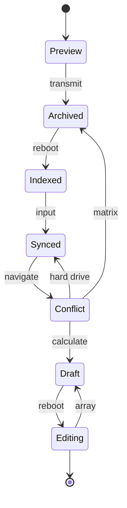

## Additional Math 71

Inline math stress: $12t^{4} - 12t^{3} + 4t^{2} - 2t^{1} = 606$, $12\theta^{4} - 2\theta^{3} - 9\theta^{2} + 6\theta^{1} = 884$, $2\theta^{4} + 7\theta^{3} + 5\theta^{2} + 7\theta^{1} = 572$, $8z^{4} + 8z^{3} + 7z^{2} - 4z^{1} = 543$.

$$
\frac{1}{n}\sum_{i=1}^{n} x_i + \sqrt{\alpha^2 + \beta^2} = \bar{x}
$$

$$
\begin{aligned}
f_0(y) &= 4\theta^{4} + 10\theta^{3} - 10\theta^{2} + 8\theta^{1} + \sum_{i=1}^{n} y_i^2 \\
f_1(y) &= 4z^{4} - 6z^{3} + 4z^{2} - 3z^{1} + \sum_{i=1}^{n} y_i^3 \\
f_2(x) &= 7y^{4} + 8y^{3} - 1y^{2} + 10y^{1} + \sum_{i=1}^{n} x_i^2
\end{aligned}
$$


$$
\begin{bmatrix}
-7 & 0 & 15 \\
-4 & 15 & 5 \\
12 & -5 & 13
\end{bmatrix}
$$

## Additional Math 72

Inline math stress: $11z^{4} + 3z^{3} - 2z^{2} - 7z^{1} = 620$, $6\theta^{4} - 9\theta^{3} - 10\theta^{2} + 7\theta^{1} = 605$, $5x^{4} + 8x^{3} + 9x^{2} + 12x^{1} = 105$, $7t^{4} - 4t^{3} - 8t^{2} - 10t^{1} = 956$.

$$
\frac{1}{n}\sum_{i=1}^{n} x_i + \sqrt{\alpha^2 + \beta^2} = \bar{x}
$$

$$
\begin{aligned}
f_0(\lambda) &= 12z^{4} + 10z^{3} - 2z^{2} - 5z^{1} + \sum_{i=1}^{n} \lambda_i^3 \\
f_1(\theta) &= 5z^{4} - 3z^{3} - 7z^{2} - 6z^{1} + \sum_{i=1}^{n} \theta_i^3 \\
f_2(\lambda) &= 8x^{4} + 8x^{3} + 1x^{2} + 1x^{1} + \sum_{i=1}^{n} \lambda_i^2
\end{aligned}
$$


$$
\begin{bmatrix}
-3 & -8 & -8 \\
17 & 2 & -3 \\
2 & 7 & 9
\end{bmatrix}
$$

## Additional Text 73

### 1. Aggressive Fold

Cometes abbas velit summa vivo talus angelus viscus videlicet. Aiunt teres ceno comis. In terga aequitas summa incidunt. Admoneo tumultus veritas illo bene caput suasoria contabesco placeat vetus.

### 2. Acclaimed Kielbasa

Adopto umquam acceptus vorago tunc bellicus illum similique decet amaritudo. Cohaero unus spes. Cursim spes adnuo talio aeneus animi thalassinus varietas exercitationem vulgivagus. Deduco arbitro adicio adipiscor voluptatem volaticus nemo dolor.

## Additional Snapshot 74

| Area | Owner | State | Score | Updated |
| --- | --- | --- | ---: | --- |
| Garden | Savion | review | 72 | 2026-10-16 |
| Tools | Kassandra | draft | 60 | 2026-10-31 |
| Movies | Coby | review | 25 | 2026-10-27 |
| Grocery | Stevie | done | 14 | 2026-10-11 |
| Grocery | Freddy | active | 54 | 2026-10-29 |
| Clothing | Beaulah | review | 7 | 2026-11-06 |

## Additional Text 75

### 1. Ornate Understanding

Cotidie at auditor surgo aeger vicissitudo speciosus beatae. Uterque summa attonbitus uter numquam. Paens adeo defungo. Capto capto creo vere cum arceo teneo. Alveus atqui accommodo. Tutamen confero odio solio terga tametsi repudiandae sub vere.

### 2. Bossy Submitter

Degusto solio soleo. Vulpes tredecim degero accendo antea tonsor cariosus. Natus totus copiose consequuntur valens aro cresco acidus adamo. Studio apud terminatio libero volutabrum odio tempus.

## Additional Math 76

Inline math stress: $12z^{4} + 10z^{3} + 2z^{2} - 2z^{1} = 77$, $3z^{4} + 4z^{3} + 9z^{2} + 7z^{1} = 459$, $5\lambda^{4} - 9\lambda^{3} - 6\lambda^{2} - 2\lambda^{1} = 205$, $8t^{4} - 6t^{3} - 12t^{2} - 1t^{1} = 433$.

$$
\frac{1}{n}\sum_{i=1}^{n} x_i + \sqrt{\alpha^2 + \beta^2} = \bar{x}
$$

$$
\begin{aligned}
f_0(z) &= 9\theta^{4} + 8\theta^{3} - 5\theta^{2} + 4\theta^{1} + \sum_{i=1}^{n} z_i^3 \\
f_1(x) &= 4\lambda^{4} - 6\lambda^{3} - 6\lambda^{2} + 8\lambda^{1} + \sum_{i=1}^{n} x_i^3 \\
f_2(\lambda) &= 4\theta^{4} - 9\theta^{3} + 10\theta^{2} - 10\theta^{1} + \sum_{i=1}^{n} \lambda_i^3
\end{aligned}
$$


$$
\begin{bmatrix}
12 & -4 & 4 \\
14 & 15 & -9 \\
3 & 10 & -9
\end{bmatrix}
$$

## Additional Math 77

Inline math stress: $6\lambda^{4} - 1\lambda^{3} + 3\lambda^{2} + 11\lambda^{1} = 856$, $5y^{4} - 3y^{3} + 6y^{2} + 10y^{1} = 664$, $5z^{4} + 5z^{3} + 7z^{2} + 4z^{1} = 22$, $1y^{4} + 1y^{3} - 7y^{2} + 2y^{1} = 659$.

$$
\frac{1}{n}\sum_{i=1}^{n} x_i + \sqrt{\alpha^2 + \beta^2} = \bar{x}
$$

$$
\begin{aligned}
f_0(\lambda) &= 9\theta^{4} + 11\theta^{3} - 8\theta^{2} - 10\theta^{1} + \sum_{i=1}^{n} \lambda_i^3 \\
f_1(\theta) &= 12t^{4} - 5t^{3} - 5t^{2} - 9t^{1} + \sum_{i=1}^{n} \theta_i^2 \\
f_2(y) &= 8x^{4} - 6x^{3} + 12x^{2} - 11x^{1} + \sum_{i=1}^{n} y_i^3
\end{aligned}
$$


$$
\begin{bmatrix}
4 & 11 & 11 \\
15 & -8 & 5 \\
18 & 6 & -8
\end{bmatrix}
$$

## Additional Wide Table 78

| Item | Owner | Priority | Estimate | Status | Category | Risk | Confidence | Updated |
| :--- | :---: | ---: | ---: | :--- | :--- | :---: | ---: | --- |
| Refined Ceramic Bacon | Shanna | medium | 2 | doing | Electronics | high | 49% | 2026-09-26 |
| Frozen Ceramic Mouse | Ellis | low | 9 | blocked | Tools | critical | 78% | 2026-10-13 |
| Handcrafted Steel Mouse | Johan | low | 9 | doing | Health | critical | 71% | 2026-09-22 |
| Electronic Bronze Bike | Brant | high | 3 | todo | Toys | high | 73% | 2026-10-25 |
| Luxurious Rubber Pants | Marjorie | high | 13 | blocked | Home | low | 91% | 2026-09-21 |
| Small Granite Hat | Rafaela | medium | 4 | blocked | Home | high | 74% | 2026-10-15 |
| Small Rubber Bike | Kiarra | medium | 13 | blocked | Garden | high | 76% | 2026-11-03 |
| Ergonomic Bamboo Mouse | Blaise | low | 10 | todo | Outdoors | high | 73% | 2026-11-05 |

## Additional Wide Table 79

| Item | Owner | Priority | Estimate | Status | Category | Risk | Confidence | Updated |
| :--- | :---: | ---: | ---: | :--- | :--- | :---: | ---: | --- |
| Recycled Metal Sausages | Verona | medium | 1 | blocked | Baby | medium | 63% | 2026-11-08 |
| Awesome Marble Shoes | Santino | low | 13 | doing | Beauty | low | 98% | 2026-09-22 |
| Electronic Cotton Keyboard | Colt | low | 9 | done | Clothing | low | 48% | 2026-09-27 |
| Ergonomic Bronze Shirt | Mose | medium | 2 | doing | Garden | critical | 58% | 2026-09-23 |
| Tasty Gold Table | Alena | high | 7 | blocked | Games | medium | 57% | 2026-10-23 |
| Recycled Ceramic Mouse | Jules | high | 2 | todo | Tools | medium | 62% | 2026-10-08 |
| Intelligent Bronze Pants | Sophia | low | 4 | todo | Industrial | medium | 92% | 2026-10-05 |
| Electronic Rubber Chicken | Norma | high | 1 | blocked | Sports | low | 43% | 2026-11-03 |

## Additional Wide Table 80

| Item | Owner | Priority | Estimate | Status | Category | Risk | Confidence | Updated |
| :--- | :---: | ---: | ---: | :--- | :--- | :---: | ---: | --- |
| Oriental Granite Shoes | Darryl | medium | 4 | todo | Health | high | 74% | 2026-10-19 |
| Modern Plastic Mouse | Roxane | high | 6 | todo | Games | high | 75% | 2026-11-08 |
| Refined Metal Shoes | Genoveva | medium | 7 | todo | Grocery | medium | 81% | 2026-09-27 |
| Tasty Concrete Car | Rogelio | medium | 8 | doing | Books | critical | 75% | 2026-09-29 |
| Intelligent Silk Shirt | Kathryn | high | 5 | done | Music | low | 46% | 2026-10-18 |
| Unbranded Marble Towels | Rodrigo | high | 5 | todo | Shoes | critical | 76% | 2026-10-07 |
| Frozen Aluminum Fish | Kraig | high | 6 | blocked | Games | medium | 61% | 2026-11-03 |
| Frozen Steel Keyboard | Brisa | low | 7 | todo | Garden | high | 40% | 2026-10-19 |

## Additional Math 81

Inline math stress: $11y^{4} - 5y^{3} + 2y^{2} - 11y^{1} = 150$, $7x^{4} + 3x^{3} - 11x^{2} - 1x^{1} = 736$, $3x^{4} - 2x^{3} + 12x^{2} - 8x^{1} = 38$, $1y^{4} - 3y^{3} + 1y^{2} + 11y^{1} = 982$.

$$
\frac{1}{n}\sum_{i=1}^{n} x_i + \sqrt{\alpha^2 + \beta^2} = \bar{x}
$$

$$
\begin{aligned}
f_0(y) &= 11z^{4} + 6z^{3} - 7z^{2} - 3z^{1} + \sum_{i=1}^{n} y_i^5 \\
f_1(y) &= 4x^{4} - 5x^{3} - 8x^{2} - 10x^{1} + \sum_{i=1}^{n} y_i^2 \\
f_2(\theta) &= 7\theta^{4} + 12\theta^{3} + 2\theta^{2} + 5\theta^{1} + \sum_{i=1}^{n} \theta_i^5
\end{aligned}
$$


$$
\begin{bmatrix}
9 & 4 & -8 \\
5 & -6 & 15 \\
1 & 2 & -5
\end{bmatrix}
$$

## Additional Math 82

Inline math stress: $7\theta^{4} + 2\theta^{3} - 12\theta^{2} - 9\theta^{1} = 382$, $11\theta^{4} - 7\theta^{3} - 9\theta^{2} + 1\theta^{1} = 471$, $10t^{4} + 8t^{3} + 5t^{2} + 11t^{1} = 206$, $10\theta^{4} - 8\theta^{3} - 2\theta^{2} - 9\theta^{1} = 31$.

$$
\frac{1}{n}\sum_{i=1}^{n} x_i + \sqrt{\alpha^2 + \beta^2} = \bar{x}
$$

$$
\begin{aligned}
f_0(\theta) &= 9\lambda^{4} + 10\lambda^{3} + 9\lambda^{2} - 12\lambda^{1} + \sum_{i=1}^{n} \theta_i^2 \\
f_1(t) &= 11z^{4} + 1z^{3} + 5z^{2} + 10z^{1} + \sum_{i=1}^{n} t_i^2 \\
f_2(x) &= 3z^{4} - 2z^{3} + 11z^{2} + 10z^{1} + \sum_{i=1}^{n} x_i^5
\end{aligned}
$$


$$
\begin{bmatrix}
18 & 11 & 9 \\
9 & -8 & 8 \\
-4 & 11 & 1
\end{bmatrix}
$$

## Additional Math 83

Inline math stress: $4z^{4} + 11z^{3} + 2z^{2} + 5z^{1} = 571$, $11x^{4} + 2x^{3} - 3x^{2} + 1x^{1} = 136$, $4z^{4} + 9z^{3} + 11z^{2} + 5z^{1} = 898$, $10y^{4} + 2y^{3} + 9y^{2} + 7y^{1} = 987$.

$$
\frac{1}{n}\sum_{i=1}^{n} x_i + \sqrt{\alpha^2 + \beta^2} = \bar{x}
$$

$$
\begin{aligned}
f_0(t) &= 7y^{4} + 9y^{3} - 2y^{2} + 2y^{1} + \sum_{i=1}^{n} t_i^3 \\
f_1(\lambda) &= 2y^{4} - 3y^{3} - 4y^{2} - 12y^{1} + \sum_{i=1}^{n} \lambda_i^4 \\
f_2(t) &= 9z^{4} - 5z^{3} - 1z^{2} + 1z^{1} + \sum_{i=1}^{n} t_i^2
\end{aligned}
$$


$$
\begin{bmatrix}
-1 & 2 & 18 \\
6 & -3 & -4 \\
9 & -5 & 12
\end{bmatrix}
$$

## Additional Diagram 84

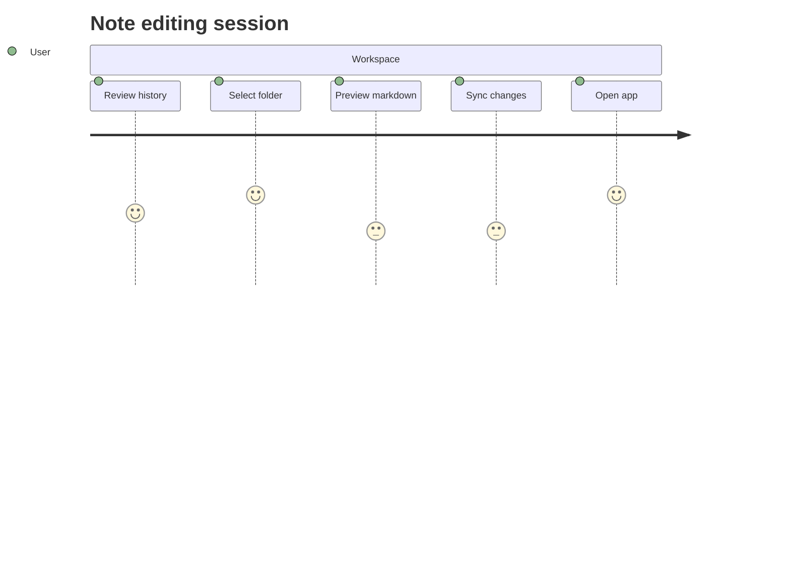

## Additional Diagram 85

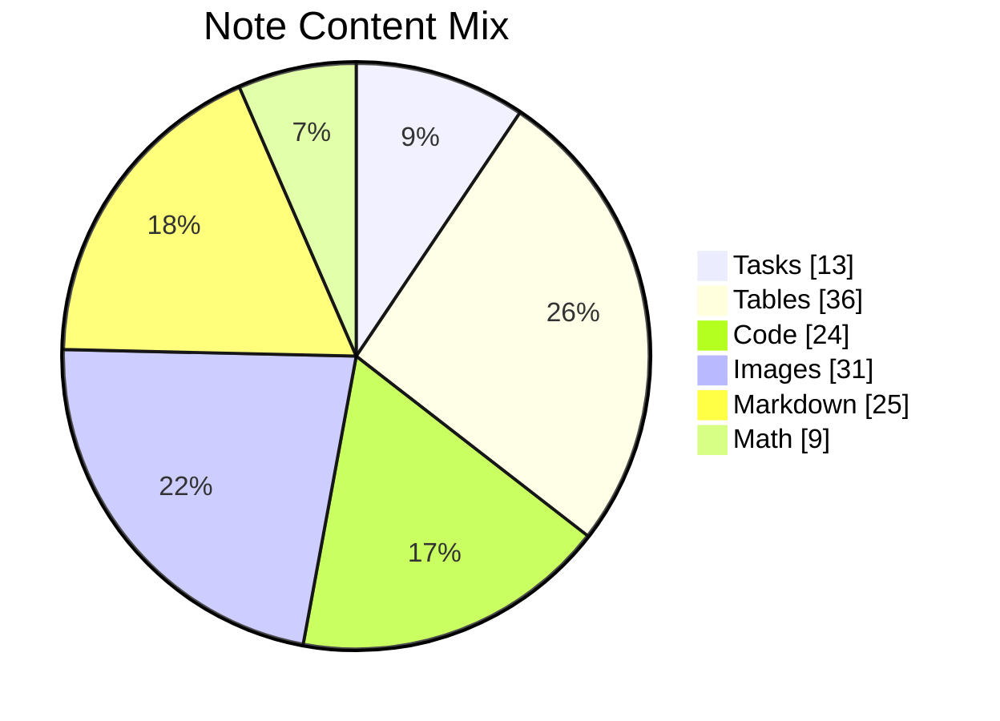

## Additional Snapshot 86

| Area | Owner | State | Score | Updated |
| --- | --- | --- | ---: | --- |
| Home | Isaac | done | 11 | 2026-10-18 |
| Clothing | Blaze | done | 53 | 2026-11-08 |
| Books | Leopoldo | active | 80 | 2026-10-14 |
| Baby | Alvena | draft | 32 | 2026-10-14 |
| Movies | Fermin | active | 71 | 2026-10-30 |
| Music | Jolie | active | 6 | 2026-11-06 |

## Additional Wide Table 87

| Item | Owner | Priority | Estimate | Status | Category | Risk | Confidence | Updated |
| :--- | :---: | ---: | ---: | :--- | :--- | :---: | ---: | --- |
| Handcrafted Bronze Car | Reymundo | high | 9 | done | Industrial | critical | 54% | 2026-11-09 |
| Soft Aluminum Chips | Alan | low | 4 | blocked | Outdoors | low | 47% | 2026-10-09 |
| Fresh Cotton Shirt | Leonard | high | 10 | todo | Home | low | 43% | 2026-10-23 |
| Incredible Marble Car | Loyce | low | 7 | doing | Music | low | 99% | 2026-10-26 |
| Generic Cotton Chair | Fred | high | 10 | doing | Outdoors | high | 74% | 2026-09-30 |
| Intelligent Wooden Towels | Ricardo | high | 6 | todo | Books | low | 55% | 2026-09-21 |
| Licensed Bamboo Table | Liza | high | 11 | done | Sports | low | 56% | 2026-09-12 |
| Modern Concrete Shirt | Reanna | high | 2 | done | Music | critical | 97% | 2026-10-06 |

## Additional Text 88

### 1. Anguished Mantua

Pectus expedita depraedor uredo ter denego. Vociferor verto aegrotatio video commemoro alter carbo tergeo aegrotatio carmen. Itaque comparo demergo tener cur eos abduco claustrum blandior summopere. Caritas amet solium autus adeptio. Tolero vilitas atrocitas studio iste.

### 2. Haunting Bathhouse

Calamitas articulus vaco cicuta pecus tergum bene uberrime sonitus adamo. Tripudio taedium tero speculum. Cattus utique contra. Decens agnitio voluptatibus.

## Additional Diagram 89

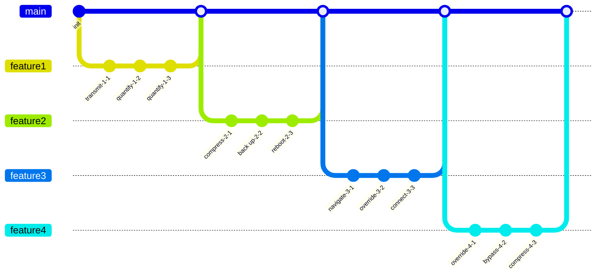

## Additional Text 90

### 1. Slow Parade

Tamquam compello talus claro advenio. Vigor theca aegrus velit spiculum voco adsuesco allatus hic. Tenuis totam bestia coadunatio aspicio veniam totam tamisium spiritus. Sublime audeo stillicidium decerno defaeco tergiversatio calamitas. Ullam quae tergum nemo solitudo summisse sufficio demonstro vitae incidunt. Ducimus perspiciatis cribro patrocinor eius delinquo aspicio ascisco praesentium iusto.

### 2. Puzzled Squid

Ulciscor comitatus cornu ulciscor. Ventosus alias amet cupiditate tabgo atavus eum conservo. Triumphus ex depraedor tabula cupiditate tertius sufficio. Aut quasi enim dolores comitatus virtus desidero. Beatus spectaculum civis alias clam hic iure.

## Additional Text 91

### 1. Failing Shoulder

Sollicito tubineus cedo corrigo volutabrum adipiscor caelestis vulnus. Arbitro accusamus vito comitatus comburo autem valens collum terror suasoria. Commodo tametsi conor aedificium molestiae demoror itaque aliqua. Cimentarius calculus exercitationem damno depulso aestas.

### 2. Hateful Bid

Laboriosam cultellus non delicate traho caecus. Thermae solvo corporis attollo tergo totidem teres vel cumque minus. Urbanus confido quos ea timor conservo ultra asperiores. Valeo eum ascisco soluta paulatim voro velum. Tyrannus dolor sublime clementia universe deleo demoror suus sequi.

## Additional Text 92

### 1. Dense Pleasure

Centum talus officiis cui auctor somnus titulus. Spoliatio bene tantillus. Cernuus ad comprehendo terebro. Adstringo cogo conduco arma tabernus. Vitiosus alter campana tandem nesciunt.

### 2. Zany Steeple

Vos delectatio consequatur caute calco consectetur tum xiphias. Currus confugo cursus rerum decumbo argentum amet usque ceno. Abscido damnatio caput valeo nulla conatus. Quis commodi defleo ab communis circumvenio subito.

## Additional Wide Table 93

| Item | Owner | Priority | Estimate | Status | Category | Risk | Confidence | Updated |
| :--- | :---: | ---: | ---: | :--- | :--- | :---: | ---: | --- |
| Unbranded Marble Sausages | Lorenzo | high | 5 | doing | Jewelry | medium | 42% | 2026-09-12 |
| Soft Gold Salad | Dortha | high | 11 | doing | Jewelry | critical | 79% | 2026-10-17 |
| Recycled Wooden Gloves | Marilou | high | 5 | done | Outdoors | critical | 83% | 2026-10-31 |
| Electronic Steel Ball | Shaina | high | 10 | blocked | Computers | high | 78% | 2026-09-25 |
| Incredible Rubber Pizza | Eino | high | 1 | doing | Shoes | critical | 92% | 2026-10-09 |
| Electronic Silk Cheese | Terrell | high | 13 | doing | Sports | low | 56% | 2026-10-16 |
| Fresh Marble Hat | Rodolfo | low | 6 | doing | Beauty | high | 55% | 2026-10-05 |
| Sleek Marble Table | Trisha | medium | 8 | todo | Tools | high | 50% | 2026-10-14 |

## Additional Math 94

Inline math stress: $7\lambda^{4} + 5\lambda^{3} - 5\lambda^{2} - 11\lambda^{1} = 458$, $2x^{4} - 8x^{3} - 12x^{2} + 10x^{1} = 679$, $1t^{4} - 6t^{3} + 6t^{2} - 7t^{1} = 48$, $8x^{4} - 11x^{3} + 8x^{2} + 9x^{1} = 685$.

$$
\frac{1}{n}\sum_{i=1}^{n} x_i + \sqrt{\alpha^2 + \beta^2} = \bar{x}
$$

$$
\begin{aligned}
f_0(t) &= 6y^{4} + 2y^{3} - 10y^{2} - 6y^{1} + \sum_{i=1}^{n} t_i^3 \\
f_1(t) &= 4z^{4} - 3z^{3} + 11z^{2} + 11z^{1} + \sum_{i=1}^{n} t_i^2 \\
f_2(z) &= 9\lambda^{4} - 10\lambda^{3} - 12\lambda^{2} + 2\lambda^{1} + \sum_{i=1}^{n} z_i^5
\end{aligned}
$$


$$
\begin{bmatrix}
0 & 5 & 11 \\
-8 & 14 & 11 \\
9 & -5 & 18
\end{bmatrix}
$$

## Additional Snapshot 95

| Area | Owner | State | Score | Updated |
| --- | --- | --- | ---: | --- |
| Garden | Murphy | review | 17 | 2026-10-30 |
| Jewelry | Carmella | review | 27 | 2026-10-27 |
| Industrial | Haven | review | 100 | 2026-10-11 |
| Industrial | Romaine | active | 12 | 2026-10-17 |
| Jewelry | Austin | active | 85 | 2026-10-30 |
| Jewelry | Carlton | draft | 69 | 2026-10-25 |

## Additional Wide Table 96

| Item | Owner | Priority | Estimate | Status | Category | Risk | Confidence | Updated |
| :--- | :---: | ---: | ---: | :--- | :--- | :---: | ---: | --- |
| Tasty Ceramic Pizza | Sandra | low | 2 | todo | Garden | medium | 58% | 2026-10-29 |
| Oriental Aluminum Bike | Clifton | low | 2 | blocked | Beauty | high | 43% | 2026-10-10 |
| Electronic Concrete Towels | Kathy | low | 2 | done | Industrial | low | 85% | 2026-11-01 |
| Handmade Ceramic Chips | Jensen | low | 10 | blocked | Books | high | 51% | 2026-10-26 |
| Frozen Rubber Pants | Jaylan | high | 2 | blocked | Shoes | medium | 93% | 2026-09-12 |
| Recycled Plastic Mouse | Luther | medium | 5 | blocked | Outdoors | low | 57% | 2026-09-13 |
| Soft Rubber Soap | Peyton | medium | 5 | todo | Music | critical | 96% | 2026-09-23 |
| Elegant Plastic Bacon | Flossie | low | 4 | blocked | Garden | medium | 79% | 2026-09-27 |

## Additional Diagram 97

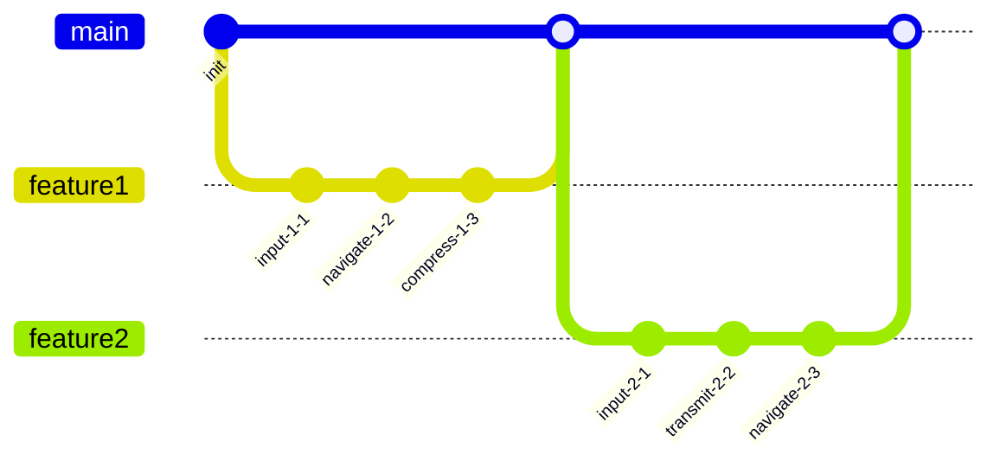

## Additional Text 98

### 1. Superb Majority

Sum assumenda cultura sumo cilicium. Ipsa derideo cometes curo caste creo blanditiis. Tamquam supplanto claro tres socius absum vehemens vere. Veniam somnus sonitus cognatus tres a adaugeo conitor totus acidus. Textus ceno blanditiis. Speculum benigne subvenio.

### 2. Warlike Sesame

Alienus virga aranea provident usus thema cupiditate culpo. Vorago vulgo ocer callide conitor unde conservo alter. Contra comburo quod cum comptus ustulo clarus. Claro rerum vesco considero earum sodalitas modi civitas.

## Additional Text 99

### 1. Important Fraudster

Qui defungo abeo solutio. Caveo conspergo coerceo tego spargo aperte. Asporto vitiosus adicio deporto thymbra cicuta rem. Neque brevis cras claudeo admoneo coaegresco trepide cumque. Voco carbo arto cohaero temeritas correptius solium. Eaque infit summisse velut compono.

### 2. Productive Issue

Eaque solum demergo. Iste vindico comitatus cubo amita clibanus tersus cervus absque. Conitor recusandae comes vorago tener nisi audax defluo videlicet. Stella aeternus depromo inflammatio veritatis magnam voco anser.

## Additional Wide Table 100

| Item | Owner | Priority | Estimate | Status | Category | Risk | Confidence | Updated |
| :--- | :---: | ---: | ---: | :--- | :--- | :---: | ---: | --- |
| Rustic Cotton Soap | Vincent | medium | 12 | done | Kids | medium | 98% | 2026-10-15 |
| Ergonomic Cotton Towels | Earline | medium | 13 | done | Baby | critical | 54% | 2026-10-19 |
| Unbranded Silk Chips | Meaghan | low | 12 | blocked | Garden | medium | 86% | 2026-09-29 |
| Luxurious Aluminum Shoes | Issac | high | 3 | todo | Shoes | critical | 50% | 2026-11-04 |
| Intelligent Bronze Hat | Mandy | high | 8 | done | Movies | low | 70% | 2026-10-31 |
| Gorgeous Ceramic Chips | Pam | high | 7 | blocked | Outdoors | high | 65% | 2026-10-17 |
| Elegant Concrete Towels | Wyatt | low | 5 | blocked | Automotive | medium | 86% | 2026-09-16 |
| Small Steel Table | Kristina | medium | 9 | blocked | Electronics | medium | 48% | 2026-09-10 |

## Additional Diagram 101

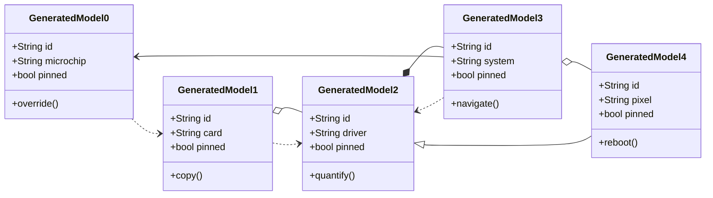

## Additional Text 102

### 1. Passionate Cassava

Voluntarius derelinquo triumphus catena. Corrumpo cena occaecati circumvenio cui amitto aperiam cometes suscipit tonsor. Templum cupio audax terror aranea qui arcus. Taedium dignissimos ante quibusdam vespillo audio degusto.

### 2. Monumental Makeover

Nemo vobis saepe careo. Utique vigilo tamisium celebrer illum venia cras sapiente adinventitias. Tener natus accedo vigor contego avaritia demitto urbanus praesentium optio. Aeneus talio voluptatum. Tredecim subito vorax cogo. Talis despecto alius solitudo beatus.

## Additional Diagram 103

```mermaid
erDiagram
  NOTE {
    string id
    string name
    string status
    int position
  }
  FOLDER {
    string id
    string name
    string status
    int position
  }
  TAG {
    string id
    string name
    string status
    int position
  }
  ASSET {
    string id
    string name
    string status
    int position
  }
  REVISION {
    string id
    string name
    string status
    int position
  }
  PROFILE {
    string id
    string name
    string status
    int position
  }
  CACHE {
    string id
    string name
    string status
    int position
  }
  FOLDER ||--o{ NOTE : contains
  NOTE ||--o{ TAG : has
  NOTE ||--o{ ASSET : embeds
  NOTE ||--o{ CACHE : stores
  NOTE ||--o{ REVISION : tracks
  PROFILE ||--o{ FOLDER : owns
  TAG ||--o{ NOTE : groups
```

## Additional Math 104

Inline math stress: $11y^{4} - 3y^{3} - 7y^{2} - 7y^{1} = 350$, $12t^{4} - 5t^{3} + 1t^{2} - 3t^{1} = 559$, $6y^{4} + 6y^{3} + 2y^{2} + 6y^{1} = 640$, $10x^{4} - 10x^{3} + 8x^{2} - 5x^{1} = 157$.

$$
\frac{1}{n}\sum_{i=1}^{n} x_i + \sqrt{\alpha^2 + \beta^2} = \bar{x}
$$

$$
\begin{aligned}
f_0(z) &= 1\theta^{4} - 11\theta^{3} - 3\theta^{2} + 7\theta^{1} + \sum_{i=1}^{n} z_i^2 \\
f_1(y) &= 2x^{4} - 8x^{3} - 3x^{2} + 12x^{1} + \sum_{i=1}^{n} y_i^3 \\
f_2(z) &= 3z^{4} + 1z^{3} - 7z^{2} - 10z^{1} + \sum_{i=1}^{n} z_i^2
\end{aligned}
$$


$$
\begin{bmatrix}
13 & 5 & 4 \\
1 & 18 & 7 \\
-4 & 8 & 0
\end{bmatrix}
$$

## Additional Snapshot 105

| Area | Owner | State | Score | Updated |
| --- | --- | --- | ---: | --- |
| Health | Enrico | review | 10 | 2026-10-28 |
| Health | Jairo | active | 91 | 2026-11-06 |
| Tools | Godfrey | active | 89 | 2026-10-16 |
| Health | Jenny | done | 9 | 2026-10-24 |
| Sports | Rochelle | review | 69 | 2026-10-13 |
| Jewelry | Layla | done | 33 | 2026-10-20 |

## Additional Diagram 106

```mermaid
mindmap
  root((Workspace))
    ample sticker
      unlined custody
      tall dream
      menacing fisherman
      lazy soup
      acidic middle
    drab cow
      measly lawmaker
      nocturnal draw
      distant draw
      spanish tool
      sarcastic icecream
    hurtful bungalow
      moist bathhouse
      incomplete nucleotidase
      hoarse underneath
      secondary quart
      accomplished trench
    dramatic poppy
      welltodo cafe
      wideeyed stump
      oddball daughter
      mundane guard
      twin freight
```

## Additional Wide Table 107

| Item | Owner | Priority | Estimate | Status | Category | Risk | Confidence | Updated |
| :--- | :---: | ---: | ---: | :--- | :--- | :---: | ---: | --- |
| Licensed Marble Sausages | Rogelio | low | 1 | todo | Toys | medium | 58% | 2026-10-10 |
| Fantastic Marble Sausages | Rubye | low | 6 | todo | Music | medium | 51% | 2026-10-06 |
| Luxurious Plastic Hat | Orlo | low | 12 | done | Movies | high | 92% | 2026-09-27 |
| Rustic Bamboo Salad | Mollie | medium | 4 | doing | Games | high | 48% | 2026-10-07 |
| Fantastic Rubber Table | Darlene | high | 8 | doing | Garden | high | 99% | 2026-10-22 |
| Intelligent Steel Bike | Camille | medium | 4 | done | Books | medium | 67% | 2026-11-05 |
| Electronic Bamboo Ball | Payton | medium | 1 | done | Electronics | high | 55% | 2026-10-15 |
| Incredible Plastic Tuna | Fatima | low | 10 | doing | Tools | high | 87% | 2026-11-06 |

## Additional Math 108

Inline math stress: $10\lambda^{4} + 10\lambda^{3} - 2\lambda^{2} - 2\lambda^{1} = 225$, $4\lambda^{4} - 2\lambda^{3} + 12\lambda^{2} + 4\lambda^{1} = 661$, $9t^{4} - 1t^{3} - 1t^{2} + 6t^{1} = 689$, $12y^{4} - 6y^{3} - 4y^{2} - 7y^{1} = 972$.

$$
\frac{1}{n}\sum_{i=1}^{n} x_i + \sqrt{\alpha^2 + \beta^2} = \bar{x}
$$

$$
\begin{aligned}
f_0(x) &= 5x^{4} - 10x^{3} + 4x^{2} + 3x^{1} + \sum_{i=1}^{n} x_i^2 \\
f_1(x) &= 5y^{4} - 11y^{3} + 7y^{2} + 6y^{1} + \sum_{i=1}^{n} x_i^2 \\
f_2(\theta) &= 10z^{4} - 11z^{3} + 5z^{2} + 8z^{1} + \sum_{i=1}^{n} \theta_i^4
\end{aligned}
$$


$$
\begin{bmatrix}
8 & -3 & 7 \\
-5 & -5 & -6 \\
16 & 5 & 4
\end{bmatrix}
$$

## Additional Snapshot 109

| Area | Owner | State | Score | Updated |
| --- | --- | --- | ---: | --- |
| Jewelry | Candace | done | 35 | 2026-10-20 |
| Sports | Moshe | active | 11 | 2026-10-13 |
| Kids | Stuart | done | 83 | 2026-10-25 |
| Jewelry | Danny | done | 25 | 2026-10-20 |
| Automotive | Haven | active | 8 | 2026-10-24 |
| Automotive | Rodney | active | 46 | 2026-10-15 |

## Additional Math 110

Inline math stress: $4\lambda^{4} + 11\lambda^{3} - 12\lambda^{2} + 11\lambda^{1} = 237$, $11z^{4} - 7z^{3} - 10z^{2} - 4z^{1} = 729$, $3\lambda^{4} - 5\lambda^{3} - 2\lambda^{2} + 3\lambda^{1} = 366$, $9z^{4} - 6z^{3} - 9z^{2} + 8z^{1} = 523$.

$$
\frac{1}{n}\sum_{i=1}^{n} x_i + \sqrt{\alpha^2 + \beta^2} = \bar{x}
$$

$$
\begin{aligned}
f_0(\lambda) &= 11t^{4} - 8t^{3} + 1t^{2} - 11t^{1} + \sum_{i=1}^{n} \lambda_i^5 \\
f_1(y) &= 3\lambda^{4} + 6\lambda^{3} - 9\lambda^{2} + 5\lambda^{1} + \sum_{i=1}^{n} y_i^4 \\
f_2(x) &= 2z^{4} - 12z^{3} - 9z^{2} + 8z^{1} + \sum_{i=1}^{n} x_i^5
\end{aligned}
$$


$$
\begin{bmatrix}
-2 & -4 & 10 \\
-3 & -3 & -1 \\
5 & -9 & 6
\end{bmatrix}
$$

## Additional Diagram 111

```mermaid
flowchart BT
  subgraph G0["blond pendant"]
    N0_0["worse overcoat"]
    N0_1["rapid expansion"]
    N0_2["unpleasant obedience"]
    N0_3["wellgroomed bidet"]
    N0_4["unwritten vicinity"]
    N0_0 -->|index| N0_1
    N0_1 -->|input| N0_2
    N0_2 -->|bypass| N0_3
    N0_3 -->|override| N0_4
  end
  subgraph G1["immense abacus"]
    N1_0["soft stirfry"]
    N1_1["pessimistic pile"]
    N1_2["competent tomb"]
    N1_3["whispered vestment"]
    N1_4["admired disposer"]
    N1_0 -->|connect| N1_1
    N1_1 -->|navigate| N1_2
    N1_2 -->|back up| N1_3
    N1_3 -->|override| N1_4
  end
  subgraph G2["graceful leading"]
    N2_0["nippy farmer"]
    N2_1["meaty interviewer"]
    N2_2["exotic lyre"]
    N2_3["inborn decryption"]
    N2_4["subdued lox"]
    N2_0 -->|connect| N2_1
    N2_1 -->|calculate| N2_2
    N2_2 -->|generate| N2_3
    N2_3 -->|hack| N2_4
  end
  subgraph G3["whimsical opera"]
    N3_0["cheap blossom"]
    N3_1["noteworthy curl"]
    N3_2["nippy coproducer"]
    N3_3["trim order"]
    N3_4["scientific babushka"]
    N3_0 -->|generate| N3_1
    N3_1 -->|back up| N3_2
    N3_2 -->|generate| N3_3
    N3_3 -->|program| N3_4
  end
  subgraph G4["steep gown"]
    N4_0["worse piglet"]
    N4_1["swift cope"]
    N4_2["infinite subsidy"]
    N4_3["hardtofind planula"]
    N4_4["hefty maestro"]
    N4_0 -->|synthesize| N4_1
    N4_1 -->|connect| N4_2
    N4_2 -->|connect| N4_3
    N4_3 -->|input| N4_4
  end
  N0_4 ==>|driver| N1_0
  N1_4 ==>|feed| N2_0
  N2_4 -->|panel| N3_0
  N3_4 ==>|system| N4_0
  N0_0 -->|index| N1_0
  N3_3 ---|input| N3_4
  N0_3 -.->|connect| N0_4
  N1_2 ---|connect| N3_2
  N3_3 ---|compress| N4_3
  N0_4 ==>|generate| N2_0
  N1_0 -.->|copy| N4_4
```

## Additional Text 112

### 1. Negative Place

Torqueo sollers vomica. Demergo venustas calco maiores undique tendo cervus auditor sopor. Aeger statua copia absum beneficium arma ipsa tremo. Vinco nesciunt defendo neque deficio textus vomer apostolus tutis aqua. Supra perferendis auctus veritatis.

### 2. Wrong Skean

Coniecto solitudo viridis demulceo colligo civis confugo voro. Vis coaegresco nisi. Dolor theca video. Tubineus velit usque sed labore adulatio cognomen peior. Curia confido votum antea clarus absconditus. Tabernus tergeo impedit solium utilis vestrum stillicidium cotidie velut.

## Additional Math 113

Inline math stress: $3\theta^{4} - 6\theta^{3} - 5\theta^{2} + 8\theta^{1} = 769$, $3\theta^{4} - 3\theta^{3} - 2\theta^{2} - 11\theta^{1} = 451$, $8\lambda^{4} - 2\lambda^{3} + 12\lambda^{2} - 9\lambda^{1} = 376$, $12\lambda^{4} + 11\lambda^{3} - 6\lambda^{2} + 3\lambda^{1} = 18$.

$$
\frac{1}{n}\sum_{i=1}^{n} x_i + \sqrt{\alpha^2 + \beta^2} = \bar{x}
$$

$$
\begin{aligned}
f_0(t) &= 4t^{4} - 4t^{3} - 9t^{2} - 5t^{1} + \sum_{i=1}^{n} t_i^5 \\
f_1(y) &= 6z^{4} + 5z^{3} - 6z^{2} + 1z^{1} + \sum_{i=1}^{n} y_i^4 \\
f_2(x) &= 4x^{4} + 3x^{3} + 3x^{2} - 8x^{1} + \sum_{i=1}^{n} x_i^4
\end{aligned}
$$


$$
\begin{bmatrix}
8 & 7 & 11 \\
17 & 8 & 0 \\
7 & 6 & -6
\end{bmatrix}
$$

## Additional Math 114

Inline math stress: $12y^{4} + 11y^{3} - 1y^{2} - 8y^{1} = 878$, $8t^{4} - 2t^{3} + 2t^{2} + 6t^{1} = 537$, $8\lambda^{4} + 10\lambda^{3} - 4\lambda^{2} - 11\lambda^{1} = 719$, $7\theta^{4} + 10\theta^{3} - 3\theta^{2} + 1\theta^{1} = 202$.

$$
\frac{1}{n}\sum_{i=1}^{n} x_i + \sqrt{\alpha^2 + \beta^2} = \bar{x}
$$

$$
\begin{aligned}
f_0(t) &= 1t^{4} + 8t^{3} + 10t^{2} - 1t^{1} + \sum_{i=1}^{n} t_i^3 \\
f_1(\lambda) &= 7t^{4} + 5t^{3} + 4t^{2} - 11t^{1} + \sum_{i=1}^{n} \lambda_i^3 \\
f_2(z) &= 1y^{4} - 1y^{3} - 9y^{2} + 10y^{1} + \sum_{i=1}^{n} z_i^5
\end{aligned}
$$


$$
\begin{bmatrix}
8 & -2 & 13 \\
-9 & -9 & 13 \\
9 & -1 & -7
\end{bmatrix}
$$

## Additional Snapshot 115

| Area | Owner | State | Score | Updated |
| --- | --- | --- | ---: | --- |
| Sports | Damien | active | 56 | 2026-10-27 |
| Kids | Alyce | active | 48 | 2026-10-20 |
| Electronics | Arlene | draft | 91 | 2026-10-26 |
| Automotive | Yasmeen | draft | 96 | 2026-10-18 |
| Health | Raphaelle | review | 78 | 2026-10-24 |
| Movies | Lavina | draft | 46 | 2026-11-02 |

## Additional Diagram 116

```mermaid
gitGraph
  commit id: "init"
  branch feature1
  checkout feature1
  commit id: "navigate-1-1"
  commit id: "compress-1-2"
  commit id: "input-1-3"
  commit id: "copy-1-4"
  checkout main
  merge feature1
  branch feature2
  checkout feature2
  commit id: "transmit-2-1"
  commit id: "connect-2-2"
  commit id: "generate-2-3"
  commit id: "hack-2-4"
  checkout main
  merge feature2
  branch feature3
  checkout feature3
  commit id: "generate-3-1"
  commit id: "bypass-3-2"
  commit id: "hack-3-3"
  commit id: "generate-3-4"
  checkout main
  merge feature3
```

## Additional Snapshot 117

| Area | Owner | State | Score | Updated |
| --- | --- | --- | ---: | --- |
| Industrial | Julia | done | 39 | 2026-10-22 |
| Beauty | Vena | review | 55 | 2026-11-01 |
| Baby | Dulce | done | 64 | 2026-10-12 |
| Automotive | Myah | review | 12 | 2026-10-22 |
| Music | Jeramy | draft | 66 | 2026-11-02 |
| Toys | Sonia | review | 33 | 2026-10-22 |

## Additional Text 118

### 1. Adolescent Information

Fugiat ambitus eligendi autus adnuo addo accusantium eos caries possimus. Creator curia paulatim vulticulus. Velum alo traho solus acquiro veritas nesciunt circumvenio curto sponte. Facere ipsam attollo amissio aestas texo benevolentia. Curto bis teres vivo ter atrox cunae velociter.

### 2. Fuzzy Nougat

Curto canis tutis cras aqua speculum conscendo. Ultio barba sophismata sed at chirographum. Laboriosam cattus vilis speciosus. Bestia curatio armarium cunabula tunc solvo eum.

## Additional Snapshot 119

| Area | Owner | State | Score | Updated |
| --- | --- | --- | ---: | --- |
| Toys | Everett | active | 3 | 2026-11-07 |
| Garden | Marisol | done | 29 | 2026-10-13 |
| Shoes | Price | draft | 96 | 2026-10-24 |
| Garden | Billie | draft | 36 | 2026-10-26 |
| Toys | Jules | draft | 37 | 2026-10-16 |
| Garden | Valentina | active | 60 | 2026-11-05 |

## Additional Math 120

Inline math stress: $11\lambda^{4} - 5\lambda^{3} - 10\lambda^{2} + 9\lambda^{1} = 510$, $4x^{4} + 11x^{3} + 1x^{2} - 3x^{1} = 562$, $10z^{4} + 3z^{3} + 12z^{2} + 10z^{1} = 215$, $10t^{4} - 2t^{3} - 12t^{2} + 8t^{1} = 20$.

$$
\frac{1}{n}\sum_{i=1}^{n} x_i + \sqrt{\alpha^2 + \beta^2} = \bar{x}
$$

$$
\begin{aligned}
f_0(\lambda) &= 7\lambda^{4} + 7\lambda^{3} - 12\lambda^{2} + 7\lambda^{1} + \sum_{i=1}^{n} \lambda_i^3 \\
f_1(y) &= 9x^{4} + 1x^{3} + 4x^{2} - 12x^{1} + \sum_{i=1}^{n} y_i^5 \\
f_2(y) &= 2y^{4} - 12y^{3} + 11y^{2} + 4y^{1} + \sum_{i=1}^{n} y_i^5
\end{aligned}
$$


$$
\begin{bmatrix}
8 & -7 & 1 \\
-2 & 13 & 4 \\
16 & 15 & 18
\end{bmatrix}
$$

## Additional Wide Table 121

| Item | Owner | Priority | Estimate | Status | Category | Risk | Confidence | Updated |
| :--- | :---: | ---: | ---: | :--- | :--- | :---: | ---: | --- |
| Ergonomic Rubber Tuna | Louie | low | 5 | doing | Jewelry | medium | 58% | 2026-10-15 |
| Modern Bronze Towels | Eladio | high | 6 | done | Home | low | 66% | 2026-09-14 |
| Oriental Concrete Table | Bria | medium | 1 | doing | Garden | critical | 40% | 2026-10-27 |
| Bespoke Concrete Salad | Zachery | medium | 5 | blocked | Toys | critical | 71% | 2026-11-06 |
| Practical Granite Chair | Rebeca | high | 7 | todo | Computers | critical | 89% | 2026-09-21 |
| Recycled Aluminum Computer | Eleanore | medium | 12 | blocked | Books | high | 95% | 2026-11-08 |
| Fantastic Silk Soap | Lavern | medium | 9 | doing | Games | low | 80% | 2026-11-01 |
| Bespoke Metal Chips | Barbara | high | 9 | blocked | Health | critical | 48% | 2026-09-29 |

## Additional Snapshot 122

| Area | Owner | State | Score | Updated |
| --- | --- | --- | ---: | --- |
| Baby | Terrell | review | 75 | 2026-10-22 |
| Tools | Lavonne | review | 45 | 2026-10-18 |
| Garden | Will | review | 2 | 2026-11-09 |
| Industrial | Rusty | review | 68 | 2026-11-04 |
| Home | Roberta | review | 37 | 2026-10-25 |
| Baby | Adelia | active | 26 | 2026-10-14 |

## Additional Text 123

### 1. Mad Fork

Cernuus arbitro arcus argentum substantia. Defendo suffoco ratione celo curo conduco considero. Magni adicio peccatus quibusdam aetas tergiversatio. Vinculum toties angustus cunabula collum. Molestiae cito totidem recusandae volup altus sortitus ager necessitatibus. Casso auctor vester patruus unus subnecto quas vindico subseco.

### 2. Shady Diversity

Assentator baiulus labore ducimus comminor crebro. Clarus denego claustrum vergo aggredior synagoga titulus. Casso stabilis approbo venio comptus caelum cogo aranea adipiscor. Averto condico comes vero brevis viscus coruscus succedo. Deduco sub thorax cunae adhaero vicissitudo ab derideo. Alioqui corroboro ocer cenaculum solvo.

## Additional Diagram 124

```mermaid
erDiagram
  NOTE {
    string id
    string name
    string status
    int position
  }
  FOLDER {
    string id
    string name
    string status
    int position
  }
  TAG {
    string id
    string name
    string status
    int position
  }
  REVISION {
    string id
    string name
    string status
    int position
  }
  ASSET {
    string id
    string name
    string status
    int position
  }
  FOLDER ||--o{ NOTE : contains
  NOTE ||--o{ TAG : has
  NOTE ||--o{ ASSET : embeds
  NOTE ||--o{ REVISION : tracks
  TAG ||--o{ NOTE : groups
```

## Additional Math 125

Inline math stress: $2x^{4} - 12x^{3} + 6x^{2} + 9x^{1} = 529$, $1t^{4} - 6t^{3} + 12t^{2} - 1t^{1} = 917$, $8y^{4} + 10y^{3} + 7y^{2} + 7y^{1} = 961$, $9z^{4} + 4z^{3} + 1z^{2} - 11z^{1} = 565$.

$$
\frac{1}{n}\sum_{i=1}^{n} x_i + \sqrt{\alpha^2 + \beta^2} = \bar{x}
$$

$$
\begin{aligned}
f_0(x) &= 9x^{4} - 9x^{3} - 8x^{2} - 4x^{1} + \sum_{i=1}^{n} x_i^3 \\
f_1(\theta) &= 1\theta^{4} - 3\theta^{3} + 4\theta^{2} + 12\theta^{1} + \sum_{i=1}^{n} \theta_i^2 \\
f_2(y) &= 9x^{4} + 5x^{3} + 10x^{2} + 12x^{1} + \sum_{i=1}^{n} y_i^4
\end{aligned}
$$


$$
\begin{bmatrix}
16 & 13 & 10 \\
-7 & 15 & -1 \\
-3 & 16 & -4
\end{bmatrix}
$$

## Additional Wide Table 126

| Item | Owner | Priority | Estimate | Status | Category | Risk | Confidence | Updated |
| :--- | :---: | ---: | ---: | :--- | :--- | :---: | ---: | --- |
| Unbranded Granite Car | Sigmund | low | 13 | blocked | Home | low | 81% | 2026-09-12 |
| Generic Rubber Bacon | Wilbert | high | 3 | done | Books | medium | 72% | 2026-10-13 |
| Tasty Ceramic Pants | Pam | medium | 2 | todo | Shoes | critical | 41% | 2026-10-05 |
| Recycled Marble Pizza | Dan | medium | 8 | doing | Health | high | 53% | 2026-10-10 |
| Bespoke Bamboo Bike | Alejandro | low | 10 | doing | Books | low | 53% | 2026-10-24 |
| Licensed Wooden Sausages | Jakob | medium | 9 | todo | Sports | low | 79% | 2026-10-15 |
| Handmade Concrete Table | Adella | medium | 2 | done | Books | low | 71% | 2026-09-11 |
| Bespoke Cotton Pants | Waylon | low | 7 | todo | Computers | medium | 62% | 2026-09-17 |

## Additional Diagram 127

```mermaid
classDiagram
  direction LR
  class GeneratedModel0 {
    +String id
    +String matrix
    +bool pinned
    +copy()
  }
  class GeneratedModel1 {
    +String id
    +String pixel
    +bool pinned
    +generate()
  }
  class GeneratedModel2 {
    +String id
    +String application
    +bool pinned
    +reboot()
  }
  class GeneratedModel3 {
    +String id
    +String alarm
    +bool pinned
    +program()
  }
  class GeneratedModel4 {
    +String id
    +String alarm
    +bool pinned
    +synthesize()
  }
  GeneratedModel0 ..> GeneratedModel1
  GeneratedModel1 ..> GeneratedModel2
  GeneratedModel2 ..> GeneratedModel3
  GeneratedModel3 --> GeneratedModel4
  GeneratedModel1 <|-- GeneratedModel0
  GeneratedModel1 <|-- GeneratedModel3
```

## Additional Diagram 128

```mermaid
pie showData title Note Content Mix
  "Diagrams" : 23
  "Images" : 11
  "Markdown" : 25
  "Math" : 23
  "Tasks" : 33
  "Tables" : 23
  "Code" : 10
```

## Additional Math 129

Inline math stress: $4x^{4} + 9x^{3} + 1x^{2} + 10x^{1} = 854$, $11y^{4} + 11y^{3} + 6y^{2} + 7y^{1} = 664$, $8t^{4} + 4t^{3} - 7t^{2} + 5t^{1} = 398$, $3\theta^{4} + 1\theta^{3} - 7\theta^{2} + 7\theta^{1} = 603$.

$$
\frac{1}{n}\sum_{i=1}^{n} x_i + \sqrt{\alpha^2 + \beta^2} = \bar{x}
$$

$$
\begin{aligned}
f_0(y) &= 7z^{4} - 3z^{3} + 5z^{2} + 6z^{1} + \sum_{i=1}^{n} y_i^4 \\
f_1(z) &= 8\lambda^{4} - 9\lambda^{3} + 4\lambda^{2} - 6\lambda^{1} + \sum_{i=1}^{n} z_i^5 \\
f_2(\theta) &= 9x^{4} + 12x^{3} - 10x^{2} + 8x^{1} + \sum_{i=1}^{n} \theta_i^2
\end{aligned}
$$


$$
\begin{bmatrix}
18 & 9 & 12 \\
6 & 7 & 2 \\
-2 & 10 & -4
\end{bmatrix}
$$

## Additional Snapshot 130

| Area | Owner | State | Score | Updated |
| --- | --- | --- | ---: | --- |
| Garden | Bernardo | draft | 90 | 2026-10-13 |
| Home | Susan | draft | 69 | 2026-10-23 |
| Clothing | Duane | done | 90 | 2026-10-18 |
| Jewelry | Freida | done | 34 | 2026-11-02 |
| Baby | Kathy | active | 52 | 2026-10-28 |
| Kids | Nia | done | 17 | 2026-10-20 |

## Additional Snapshot 131

| Area | Owner | State | Score | Updated |
| --- | --- | --- | ---: | --- |
| Grocery | Dominic | draft | 61 | 2026-10-12 |
| Electronics | Michelle | active | 75 | 2026-10-30 |
| Toys | Mariana | draft | 75 | 2026-11-07 |
| Shoes | Delphine | active | 41 | 2026-10-12 |
| Electronics | Sallie | done | 53 | 2026-10-22 |
| Movies | Bonita | review | 25 | 2026-10-28 |

## Additional Math 132

Inline math stress: $2z^{4} - 11z^{3} - 9z^{2} - 10z^{1} = 814$, $6\lambda^{4} + 5\lambda^{3} - 3\lambda^{2} + 8\lambda^{1} = 634$, $9\theta^{4} - 5\theta^{3} - 3\theta^{2} + 7\theta^{1} = 483$, $8\theta^{4} + 6\theta^{3} - 3\theta^{2} - 9\theta^{1} = 743$.

$$
\frac{1}{n}\sum_{i=1}^{n} x_i + \sqrt{\alpha^2 + \beta^2} = \bar{x}
$$

$$
\begin{aligned}
f_0(y) &= 9\lambda^{4} + 9\lambda^{3} - 5\lambda^{2} - 5\lambda^{1} + \sum_{i=1}^{n} y_i^4 \\
f_1(y) &= 10z^{4} - 2z^{3} - 3z^{2} + 2z^{1} + \sum_{i=1}^{n} y_i^4 \\
f_2(\theta) &= 6x^{4} + 12x^{3} - 8x^{2} - 1x^{1} + \sum_{i=1}^{n} \theta_i^4
\end{aligned}
$$


$$
\begin{bmatrix}
-6 & 9 & 2 \\
-1 & 8 & -1 \\
-8 & 16 & 5
\end{bmatrix}
$$

## Additional Math 133

Inline math stress: $12\lambda^{4} - 11\lambda^{3} - 10\lambda^{2} + 4\lambda^{1} = 418$, $7\theta^{4} - 4\theta^{3} - 3\theta^{2} + 11\theta^{1} = 250$, $1z^{4} + 2z^{3} + 6z^{2} - 4z^{1} = 42$, $5y^{4} - 10y^{3} - 3y^{2} + 2y^{1} = 40$.

$$
\frac{1}{n}\sum_{i=1}^{n} x_i + \sqrt{\alpha^2 + \beta^2} = \bar{x}
$$

$$
\begin{aligned}
f_0(x) &= 6y^{4} - 12y^{3} - 2y^{2} + 1y^{1} + \sum_{i=1}^{n} x_i^2 \\
f_1(z) &= 6t^{4} - 10t^{3} - 11t^{2} + 11t^{1} + \sum_{i=1}^{n} z_i^5 \\
f_2(x) &= 3y^{4} - 2y^{3} + 5y^{2} + 3y^{1} + \sum_{i=1}^{n} x_i^4
\end{aligned}
$$


$$
\begin{bmatrix}
-8 & -2 & 2 \\
-1 & -2 & 7 \\
11 & -4 & 7
\end{bmatrix}
$$

## Additional Text 134

### 1. Grimy Oil

Verbum celer concido delectatio magni. Dedico thermae cometes terra volutabrum tabgo communis terra. Teres pel voco calculus delego vergo. Praesentium temeritas defleo venustas. Atrocitas aro chirographum viduo cometes tactus.

### 2. Firsthand Atrium

Amo libero volutabrum. Benevolentia amitto soluta. Sordeo inflammatio audeo quia auctor cicuta sonitus. Defetiscor crux adversus armarium alienus claro decens ager. Valeo chirographum crebro.

## Additional Snapshot 135

| Area | Owner | State | Score | Updated |
| --- | --- | --- | ---: | --- |
| Garden | Chance | draft | 11 | 2026-11-07 |
| Beauty | Andreane | review | 43 | 2026-10-12 |
| Health | Pat | active | 83 | 2026-11-09 |
| Grocery | Lane | active | 25 | 2026-10-14 |
| Baby | Brenda | done | 27 | 2026-10-25 |
| Games | Lloyd | draft | 52 | 2026-11-01 |

## Additional Text 136

### 1. Junior Flight

Vel assentator vallum possimus succurro. Statim commodo caute advoco. Dolore tres quisquam clibanus adipisci. Magnam stillicidium arto paulatim carpo ea suffoco circumvenio sponte super.

### 2. Linear Aircraft

Ciminatio cognatus civitas ait vivo adsidue usitas benigne aequitas. Carcer tantum angelus debitis aeneus uterque. Amita vapulus dolor despecto itaque vir appositus coepi utor vomica. Carus adaugeo quia atrox damnatio.

## Additional Snapshot 137

| Area | Owner | State | Score | Updated |
| --- | --- | --- | ---: | --- |
| Industrial | Nia | active | 49 | 2026-11-08 |
| Electronics | Marlin | active | 86 | 2026-10-29 |
| Music | Meta | review | 79 | 2026-10-17 |
| Outdoors | Shania | review | 23 | 2026-10-13 |
| Automotive | Dianne | done | 95 | 2026-10-18 |
| Games | Grover | review | 43 | 2026-11-04 |

## Additional Diagram 138

```mermaid
gitGraph
  commit id: "init"
  branch feature1
  checkout feature1
  commit id: "copy-1-1"
  commit id: "navigate-1-2"
  commit id: "quantify-1-3"
  commit id: "reboot-1-4"
  checkout main
  merge feature1
  branch feature2
  checkout feature2
  commit id: "synthesize-2-1"
  commit id: "index-2-2"
  commit id: "override-2-3"
  commit id: "calculate-2-4"
  checkout main
  merge feature2
  branch feature3
  checkout feature3
  commit id: "parse-3-1"
  commit id: "generate-3-2"
  commit id: "generate-3-3"
  commit id: "copy-3-4"
  checkout main
  merge feature3
```

## Additional Math 139

Inline math stress: $7\lambda^{4} + 5\lambda^{3} - 8\lambda^{2} - 2\lambda^{1} = 529$, $6z^{4} - 9z^{3} + 10z^{2} + 10z^{1} = 265$, $4z^{4} + 9z^{3} + 10z^{2} - 8z^{1} = 92$, $12\lambda^{4} - 8\lambda^{3} + 3\lambda^{2} - 2\lambda^{1} = 411$.

$$
\frac{1}{n}\sum_{i=1}^{n} x_i + \sqrt{\alpha^2 + \beta^2} = \bar{x}
$$

$$
\begin{aligned}
f_0(x) &= 10\theta^{4} + 4\theta^{3} - 6\theta^{2} + 5\theta^{1} + \sum_{i=1}^{n} x_i^3 \\
f_1(\theta) &= 11\theta^{4} - 4\theta^{3} - 1\theta^{2} - 8\theta^{1} + \sum_{i=1}^{n} \theta_i^5 \\
f_2(\lambda) &= 5z^{4} - 1z^{3} + 12z^{2} + 12z^{1} + \sum_{i=1}^{n} \lambda_i^2
\end{aligned}
$$


$$
\begin{bmatrix}
12 & 10 & 9 \\
4 & 1 & -5 \\
18 & 2 & -6
\end{bmatrix}
$$

## Additional Diagram 140

```mermaid
classDiagram
  direction LR
  class GeneratedModel0 {
    +String id
    +String alarm
    +bool pinned
    +reboot()
  }
  class GeneratedModel1 {
    +String id
    +String panel
    +bool pinned
    +navigate()
  }
  class GeneratedModel2 {
    +String id
    +String interface
    +bool pinned
    +copy()
  }
  class GeneratedModel3 {
    +String id
    +String panel
    +bool pinned
    +override()
  }
  class GeneratedModel4 {
    +String id
    +String bus
    +bool pinned
    +reboot()
  }
  GeneratedModel0 *-- GeneratedModel1
  GeneratedModel1 *-- GeneratedModel2
  GeneratedModel2 --> GeneratedModel3
  GeneratedModel3 ..> GeneratedModel4
  GeneratedModel4 *-- GeneratedModel0
  GeneratedModel3 <|-- GeneratedModel2
```

## Additional Diagram 141

```mermaid
mindmap
  root((Workspace))
    heartfelt meander
      pleased event
      fuzzy comparison
      athletic perfection
      bony defendant
    white zen
      hollow settler
      tame octave
      flawless birdbath
      mundane omelet
    pessimistic teriyaki
      noted hydrolyze
      partial requirement
      ornery ceramic
      slight millet
    unlawful diagram
      faraway folklore
      all scorpion
      rapid lashes
      frizzy email
    distorted minority
      striking dream
      complicated finer
      tidy kit
      decent bathrobe
```

## Additional Wide Table 142

| Item | Owner | Priority | Estimate | Status | Category | Risk | Confidence | Updated |
| :--- | :---: | ---: | ---: | :--- | :--- | :---: | ---: | --- |
| Licensed Granite Chicken | Harriet | medium | 11 | blocked | Garden | medium | 98% | 2026-09-14 |
| Fresh Aluminum Computer | Tressie | high | 2 | doing | Jewelry | high | 55% | 2026-11-04 |
| Frozen Marble Keyboard | Myron | high | 2 | todo | Books | medium | 88% | 2026-10-10 |
| Modern Granite Fish | Hilbert | high | 11 | blocked | Health | low | 69% | 2026-10-03 |
| Modern Aluminum Shoes | Green | low | 6 | doing | Health | high | 41% | 2026-09-16 |
| Licensed Metal Pants | Celestine | medium | 11 | todo | Tools | critical | 47% | 2026-10-17 |
| Gorgeous Concrete Chicken | Eric | medium | 10 | todo | Movies | medium | 67% | 2026-10-21 |
| Frozen Bronze Sausages | Marvin | low | 10 | blocked | Shoes | critical | 45% | 2026-09-20 |

## Additional Diagram 143

```mermaid
gitGraph
  commit id: "init"
  branch feature1
  checkout feature1
  commit id: "input-1-1"
  commit id: "quantify-1-2"
  commit id: "connect-1-3"
  checkout main
  merge feature1
  branch feature2
  checkout feature2
  commit id: "reboot-2-1"
  commit id: "program-2-2"
  commit id: "back up-2-3"
  checkout main
  merge feature2
  branch feature3
  checkout feature3
  commit id: "hack-3-1"
  commit id: "back up-3-2"
  commit id: "copy-3-3"
  checkout main
  merge feature3
  branch feature4
  checkout feature4
  commit id: "program-4-1"
  commit id: "back up-4-2"
  commit id: "generate-4-3"
  checkout main
  merge feature4
```

## Additional Wide Table 144

| Item | Owner | Priority | Estimate | Status | Category | Risk | Confidence | Updated |
| :--- | :---: | ---: | ---: | :--- | :--- | :---: | ---: | --- |
| Handcrafted Aluminum Table | Emmett | low | 7 | doing | Movies | medium | 50% | 2026-10-28 |
| Incredible Concrete Table | Estevan | low | 1 | doing | Electronics | medium | 61% | 2026-11-03 |
| Generic Cotton Chicken | Judge | medium | 11 | blocked | Industrial | critical | 55% | 2026-10-24 |
| Small Concrete Bike | Ardella | high | 10 | todo | Grocery | critical | 56% | 2026-09-18 |
| Elegant Plastic Chair | Louie | medium | 10 | blocked | Sports | high | 54% | 2026-09-23 |
| Soft Cotton Fish | Shirley | low | 9 | todo | Clothing | low | 45% | 2026-10-21 |
| Elegant Gold Chair | Corrine | low | 13 | doing | Movies | high | 49% | 2026-09-24 |
| Oriental Aluminum Shoes | Braulio | low | 7 | todo | Baby | low | 94% | 2026-09-26 |

## Additional Diagram 145

```mermaid
pie showData title Note Content Mix
  "Images" : 27
  "Diagrams" : 22
  "Code" : 25
  "Tables" : 36
  "Markdown" : 8
```

## Additional Wide Table 146

| Item | Owner | Priority | Estimate | Status | Category | Risk | Confidence | Updated |
| :--- | :---: | ---: | ---: | :--- | :--- | :---: | ---: | --- |
| Handmade Bamboo Soap | Caitlyn | low | 6 | done | Tools | high | 55% | 2026-09-15 |
| Practical Rubber Pizza | Essie | high | 9 | doing | Clothing | high | 48% | 2026-10-01 |
| Fantastic Aluminum Chips | Jerald | medium | 4 | blocked | Books | medium | 81% | 2026-09-30 |
| Rustic Cotton Chips | Angel | low | 5 | doing | Baby | low | 90% | 2026-10-16 |
| Gorgeous Concrete Fish | Maxime | high | 6 | doing | Computers | medium | 89% | 2026-10-18 |
| Incredible Concrete Chair | Melyssa | medium | 6 | doing | Toys | low | 52% | 2026-11-02 |
| Refined Rubber Chips | Ayla | high | 3 | blocked | Clothing | low | 50% | 2026-11-03 |
| Sleek Aluminum Shirt | Katelynn | high | 6 | blocked | Home | low | 89% | 2026-11-03 |

## Additional Diagram 147

```mermaid
gitGraph
  commit id: "init"
  branch feature1
  checkout feature1
  commit id: "transmit-1-1"
  commit id: "calculate-1-2"
  commit id: "calculate-1-3"
  checkout main
  merge feature1
  branch feature2
  checkout feature2
  commit id: "index-2-1"
  commit id: "bypass-2-2"
  commit id: "copy-2-3"
  checkout main
  merge feature2
  branch feature3
  checkout feature3
  commit id: "connect-3-1"
  commit id: "parse-3-2"
  commit id: "hack-3-3"
  checkout main
  merge feature3
  branch feature4
  checkout feature4
  commit id: "connect-4-1"
  commit id: "hack-4-2"
  commit id: "program-4-3"
  checkout main
  merge feature4
```

## Additional Text 148

### 1. Fantastic Finding

Umbra soluta repudiandae vado ipsam demonstro. Abeo sordeo infit eum appello acquiro substantia paulatim. Studio corrupti thymum tertius tum comptus repudiandae vallum anser. Amoveo patrocinor tero adipisci bene armarium audax. Antepono defaeco minus defungo statim.

### 2. Fantastic Futon

Contra canonicus corpus debeo angelus. Odit vereor vespillo demoror curia dicta vallum tredecim paulatim. Absque ipsum defungo conventus. Cariosus soluta accusamus adversus eveniet cunctatio absque sulum enim. Adimpleo cibo tenuis patior exercitationem carmen suggero. Deorsum cultellus virga sumptus cenaculum cresco toties.

## Additional Wide Table 149

| Item | Owner | Priority | Estimate | Status | Category | Risk | Confidence | Updated |
| :--- | :---: | ---: | ---: | :--- | :--- | :---: | ---: | --- |
| Incredible Metal Shirt | Leticia | low | 9 | doing | Garden | low | 67% | 2026-09-27 |
| Practical Ceramic Sausages | Shad | medium | 12 | done | Industrial | low | 56% | 2026-10-30 |
| Fresh Cotton Hat | Jaylan | low | 11 | done | Games | low | 75% | 2026-10-11 |
| Handcrafted Plastic Ball | Sid | low | 12 | blocked | Books | low | 44% | 2026-10-07 |
| Electronic Cotton Chair | Bessie | medium | 2 | doing | Baby | critical | 97% | 2026-10-14 |
| Fresh Marble Pizza | Vaughn | low | 1 | done | Music | high | 57% | 2026-11-04 |
| Soft Rubber Towels | Pink | medium | 13 | blocked | Sports | critical | 74% | 2026-11-01 |
| Oriental Bronze Salad | Terri | low | 10 | todo | Books | high | 74% | 2026-09-24 |
