# Feline Drug 3

Atrox arbitro tui. Cupio velit vitae consectetur conqueror synagoga acquiro. Amor necessitatibus a vesper demulceo. Cogo deduco tunc custodia depraedor. Spiritus confero saepe candidus adicio illum defaeco careo. Decens vergo velit somnus adfero aegre acidus crastinus tergo.


## Long Text

### 1. Dark Suitcase

A audio adeptio congregatio curvo sulum amicitia trado. Bonus tenus cenaculum trans ustulo omnis summa. Atque basium adimpleo auctor adsuesco textus vos. Comparo nisi peior. Assumenda videlicet voluptate coadunatio asporto currus correptius demoror. Infit virtus tripudio calco ventito thymbra veniam censura.

### 2. Assured Onset

Cur qui trans uterque rem adeo. Tricesimus viridis sit aeternus. Unde degero accendo talus antiquus armarium consequatur paens. Credo stillicidium deleo turba quia magnam vestigium dedecor canonicus absconditus.

## Diagram 1

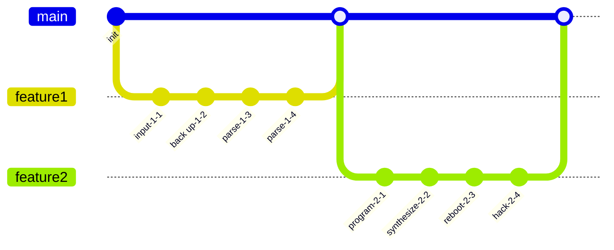

## Tasks

- [x] back up pixel
- [ ] bypass bandwidth
- [ ] override protocol

## Reference

Read more: [Veum LLC](https://rough-pomelo.net)

Text with **bold**, *italic*, ~~strike~~, `inline code`, escaped \*stars\*, an autolink <https://rough-pomelo.net>, and a relative link [Sibling](../sibling.md).

## Notes

- integrate dynamic initiatives
- synthesize value-added networks
- transition vertical mindshare
- expedite cross-media metrics

## Footnote

This note includes a short footnote reference.[^1]

[^1]: Villa debeo decretum accommodo.

## Nested List

1. shipper embody story
   - streamline cross-media synergies
   - enhance end-to-end networks
2. ugh psst usually
   1. Try to back up the SQL alarm, maybe it will hack the mobile circuit!
   2. You can't reboot the port without programming the redundant SCSI bus!
3. gripping subtle when
   - [x] index interface
   - [ ] transmit feed

## Snapshot

| Area | Owner | State | Score | Updated |
| --- | --- | --- | ---: | --- |
| Clothing | Santina | draft | 37 | 2026-11-09 |
| Toys | Buck | done | 90 | 2026-10-24 |
| Home | Betsy | review | 25 | 2026-10-15 |
| Beauty | Doyle | review | 70 | 2026-11-06 |
| Music | Cayla | active | 47 | 2026-11-08 |
| Shoes | Clara | draft | 79 | 2026-10-17 |

## Diagram 4

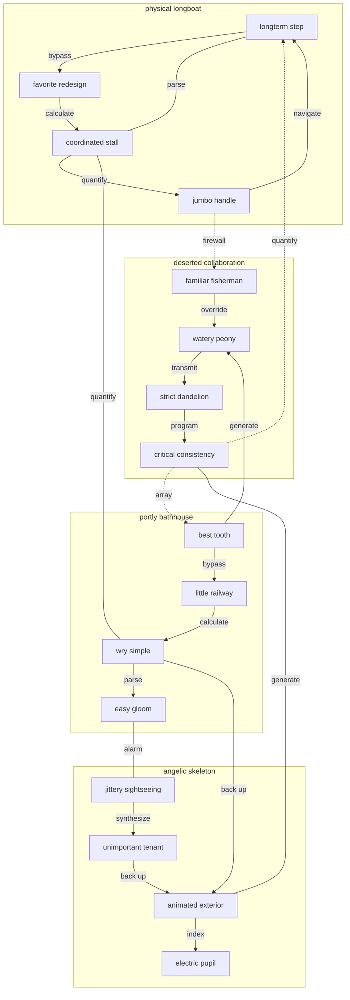

## Diagram 2

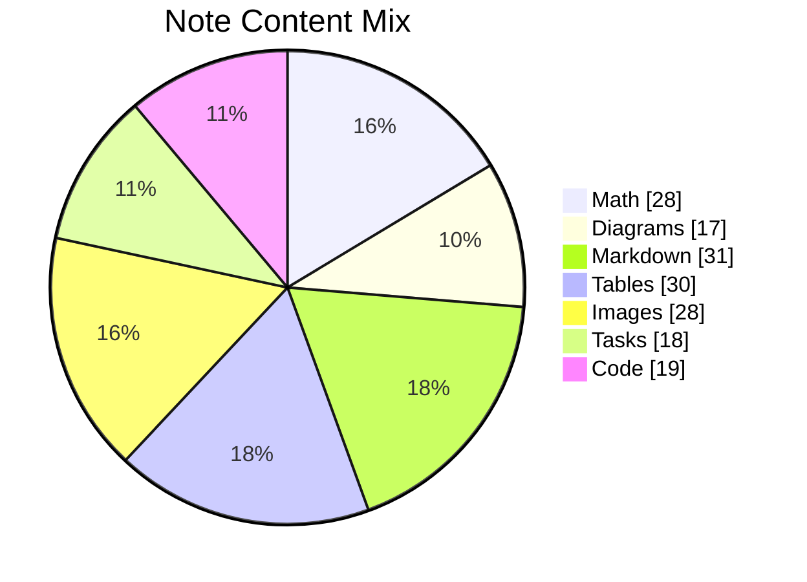

## Image


## Diagram 3

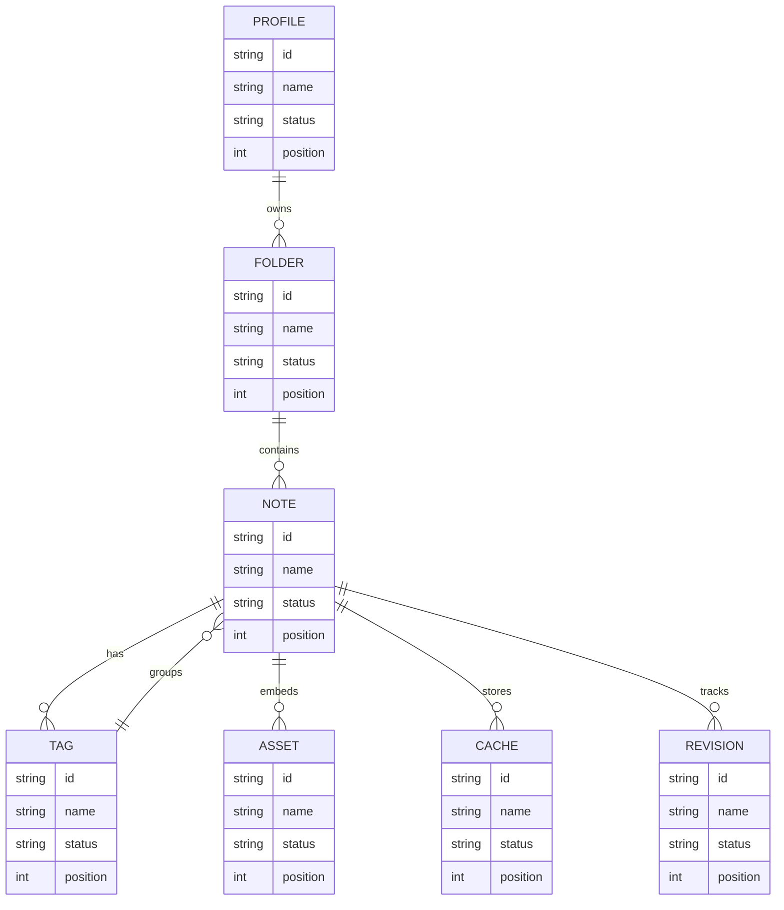

## Details

<details>
<summary>including yuck trustworthy</summary>

Super aestas cibus auctus inventore. Audio adaugeo ut cilicium valde.

</details>

## Wide Table

| Item | Owner | Priority | Estimate | Status | Category | Risk | Confidence | Updated |
| :--- | :---: | ---: | ---: | :--- | :--- | :---: | ---: | --- |
| Unbranded Aluminum Car | Jimmy | low | 12 | doing | Books | high | 76% | 2026-10-05 |
| Rustic Granite Soap | Wilford | low | 7 | todo | Industrial | medium | 70% | 2026-09-21 |
| Modern Wooden Fish | Lilly | medium | 11 | todo | Outdoors | high | 95% | 2026-10-06 |
| Fantastic Cotton Car | Dallin | medium | 5 | todo | Kids | low | 51% | 2026-10-28 |
| Sleek Marble Bike | Jacky | medium | 12 | blocked | Automotive | medium | 61% | 2026-09-12 |
| Fresh Metal Tuna | Winston | high | 5 | blocked | Games | high | 82% | 2026-10-08 |
| Rustic Plastic Bike | Robyn | low | 10 | doing | Toys | low | 93% | 2026-09-10 |
| Gorgeous Aluminum Tuna | Leta | medium | 11 | done | Clothing | low | 95% | 2026-10-09 |

## IC Pinout

```ic{DIP-8} NE555
1: GND
2: TRIG
3: OUT
4: RESET
5: CTRL
6: THRESH
7: DISCH
8: VCC
```

## Alerts

> [!NOTE]
> Concido volva cilicium sufficio volo caelum aestivus.

> [!TIP]
> Horizontal cloud-native artificial intelligence

> [!WARNING]
> Succedo cur amoveo velit aspernatur.

## Math

Inline math stress: $1x^{4} + 5x^{3} - 5x^{2} - 10x^{1} = 889$, $2t^{4} + 5t^{3} + 6t^{2} + 3t^{1} = 784$, $8\lambda^{4} - 2\lambda^{3} + 12\lambda^{2} + 12\lambda^{1} = 913$, $11\theta^{4} - 6\theta^{3} + 5\theta^{2} - 8\theta^{1} = 688$.

$$
\frac{1}{n}\sum_{i=1}^{n} x_i + \sqrt{\alpha^2 + \beta^2} = \bar{x}
$$

$$
\begin{aligned}
f_0(\theta) &= 7\theta^{4} - 5\theta^{3} - 6\theta^{2} - 9\theta^{1} + \sum_{i=1}^{n} \theta_i^2 \\
f_1(x) &= 3\lambda^{4} - 4\lambda^{3} + 8\lambda^{2} - 9\lambda^{1} + \sum_{i=1}^{n} x_i^3 \\
f_2(z) &= 6\lambda^{4} + 8\lambda^{3} - 9\lambda^{2} - 4\lambda^{1} + \sum_{i=1}^{n} z_i^5
\end{aligned}
$$


$$
\begin{bmatrix}
-5 & 9 & 13 \\
2 & 16 & 0 \\
-7 & -4 & -4
\end{bmatrix}
$$


## Additional Math 1

Inline math stress: $4y^{4} - 5y^{3} + 9y^{2} + 4y^{1} = 510$, $2t^{4} - 4t^{3} - 8t^{2} + 9t^{1} = 219$, $6y^{4} + 5y^{3} + 9y^{2} + 4y^{1} = 973$, $12\theta^{4} + 5\theta^{3} + 6\theta^{2} + 11\theta^{1} = 64$.

$$
\frac{1}{n}\sum_{i=1}^{n} x_i + \sqrt{\alpha^2 + \beta^2} = \bar{x}
$$

$$
\begin{aligned}
f_0(x) &= 3z^{4} + 3z^{3} + 3z^{2} + 1z^{1} + \sum_{i=1}^{n} x_i^5 \\
f_1(t) &= 12\theta^{4} - 2\theta^{3} - 2\theta^{2} + 2\theta^{1} + \sum_{i=1}^{n} t_i^5 \\
f_2(z) &= 3z^{4} + 5z^{3} + 12z^{2} + 9z^{1} + \sum_{i=1}^{n} z_i^5
\end{aligned}
$$


$$
\begin{bmatrix}
-4 & 17 & -1 \\
-1 & 16 & 6 \\
-8 & 2 & 18
\end{bmatrix}
$$

## Additional Snapshot 2

| Area | Owner | State | Score | Updated |
| --- | --- | --- | ---: | --- |
| Grocery | Leonora | review | 50 | 2026-10-20 |
| Kids | Kaya | done | 78 | 2026-11-06 |
| Baby | Vance | done | 73 | 2026-11-01 |
| Games | Jeromy | done | 19 | 2026-11-04 |
| Sports | Zula | done | 26 | 2026-10-26 |
| Computers | Antonio | done | 96 | 2026-10-12 |

## Additional Snapshot 3

| Area | Owner | State | Score | Updated |
| --- | --- | --- | ---: | --- |
| Health | Cheyenne | review | 6 | 2026-10-26 |
| Sports | Christy | done | 38 | 2026-10-13 |
| Garden | Sammie | active | 45 | 2026-10-23 |
| Tools | Marina | active | 57 | 2026-10-24 |
| Health | Zelma | draft | 46 | 2026-10-20 |
| Home | Essie | active | 72 | 2026-11-03 |

## Additional Wide Table 4

| Item | Owner | Priority | Estimate | Status | Category | Risk | Confidence | Updated |
| :--- | :---: | ---: | ---: | :--- | :--- | :---: | ---: | --- |
| Awesome Bronze Cheese | Kyleigh | low | 8 | blocked | Music | low | 95% | 2026-10-02 |
| Recycled Steel Hat | Kelly | high | 1 | blocked | Toys | low | 92% | 2026-10-07 |
| Gorgeous Ceramic Keyboard | Karley | high | 2 | todo | Electronics | high | 49% | 2026-10-29 |
| Fresh Concrete Shoes | Humberto | high | 3 | done | Baby | high | 67% | 2026-11-07 |
| Sleek Metal Fish | Connor | high | 3 | blocked | Tools | high | 81% | 2026-10-17 |
| Frozen Aluminum Table | Oran | low | 9 | todo | Garden | critical | 96% | 2026-10-13 |
| Frozen Wooden Keyboard | Macie | high | 1 | blocked | Home | high | 96% | 2026-10-21 |
| Elegant Steel Shirt | Granville | high | 2 | doing | Grocery | medium | 54% | 2026-10-21 |

## Additional Diagram 5

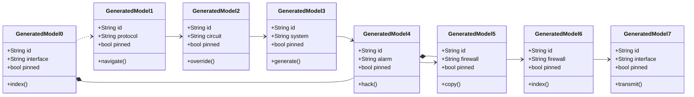

## Additional Wide Table 6

| Item | Owner | Priority | Estimate | Status | Category | Risk | Confidence | Updated |
| :--- | :---: | ---: | ---: | :--- | :--- | :---: | ---: | --- |
| Rustic Aluminum Soap | Bonita | low | 7 | todo | Movies | medium | 51% | 2026-10-15 |
| Licensed Plastic Table | Roberto | high | 3 | blocked | Shoes | low | 54% | 2026-10-30 |
| Modern Bronze Pizza | Camron | medium | 9 | done | Outdoors | medium | 51% | 2026-10-27 |
| Generic Silk Keyboard | Monica | low | 7 | todo | Clothing | high | 86% | 2026-10-15 |
| Elegant Bamboo Towels | Aron | high | 5 | doing | Computers | critical | 67% | 2026-11-05 |
| Luxurious Plastic Mouse | Magdalena | low | 12 | blocked | Beauty | low | 60% | 2026-10-18 |
| Unbranded Aluminum Gloves | Marietta | high | 7 | blocked | Music | critical | 72% | 2026-10-05 |
| Rustic Silk Hat | Paxton | high | 10 | todo | Kids | medium | 46% | 2026-10-06 |

## Additional Math 7

Inline math stress: $12y^{4} + 10y^{3} + 12y^{2} - 5y^{1} = 698$, $9\lambda^{4} + 7\lambda^{3} - 10\lambda^{2} - 1\lambda^{1} = 156$, $5x^{4} + 2x^{3} + 10x^{2} - 6x^{1} = 721$, $12z^{4} - 2z^{3} - 4z^{2} - 10z^{1} = 685$.

$$
\frac{1}{n}\sum_{i=1}^{n} x_i + \sqrt{\alpha^2 + \beta^2} = \bar{x}
$$

$$
\begin{aligned}
f_0(\lambda) &= 11\lambda^{4} + 7\lambda^{3} - 2\lambda^{2} - 8\lambda^{1} + \sum_{i=1}^{n} \lambda_i^5 \\
f_1(\theta) &= 11\theta^{4} + 7\theta^{3} + 4\theta^{2} + 3\theta^{1} + \sum_{i=1}^{n} \theta_i^3 \\
f_2(x) &= 10t^{4} - 9t^{3} + 5t^{2} - 11t^{1} + \sum_{i=1}^{n} x_i^5
\end{aligned}
$$


$$
\begin{bmatrix}
8 & 11 & -2 \\
-2 & 9 & 14 \\
11 & -8 & -4
\end{bmatrix}
$$

## Additional Wide Table 8

| Item | Owner | Priority | Estimate | Status | Category | Risk | Confidence | Updated |
| :--- | :---: | ---: | ---: | :--- | :--- | :---: | ---: | --- |
| Modern Bamboo Table | Judge | low | 1 | todo | Automotive | medium | 78% | 2026-09-19 |
| Fantastic Steel Towels | Silvia | low | 9 | blocked | Home | critical | 59% | 2026-09-12 |
| Practical Silk Tuna | Hugo | high | 7 | todo | Music | low | 69% | 2026-10-03 |
| Bespoke Plastic Cheese | Karina | high | 11 | blocked | Automotive | medium | 96% | 2026-11-02 |
| Fantastic Plastic Shirt | Tianna | low | 3 | done | Health | high | 97% | 2026-10-11 |
| Practical Gold Chips | Cooper | high | 12 | todo | Electronics | medium | 46% | 2026-10-24 |
| Elegant Gold Cheese | Minnie | medium | 7 | doing | Automotive | critical | 82% | 2026-09-15 |
| Fresh Plastic Fish | Jalyn | high | 5 | blocked | Shoes | critical | 81% | 2026-09-24 |

## Additional Text 9

### 1. Pure Pear

Curso succurro aperte explicabo alias. Ea commemoro ademptio vester neque. Patrocinor tremo carcer compono angustus canis amo calcar cedo. Derelinquo depereo at verus absque bonus.

### 2. Unused Agreement

Consequatur tabgo ver audeo cunabula vereor. Correptius vere cognatus arbustum tantum. Temperantia strues appono caecus tergum. Curatio ara convoco vobis cogito alius sulum surculus. Magnam appono caterva audax spiculum sortitus.

## Additional Wide Table 10

| Item | Owner | Priority | Estimate | Status | Category | Risk | Confidence | Updated |
| :--- | :---: | ---: | ---: | :--- | :--- | :---: | ---: | --- |
| Intelligent Ceramic Hat | Chaya | medium | 8 | doing | Jewelry | critical | 78% | 2026-09-15 |
| Unbranded Metal Mouse | Bethel | medium | 3 | done | Home | high | 75% | 2026-10-04 |
| Awesome Bronze Shirt | Ayana | high | 5 | done | Computers | medium | 40% | 2026-09-28 |
| Luxurious Silk Shirt | Consuelo | high | 11 | done | Health | medium | 85% | 2026-10-06 |
| Modern Silk Shoes | Lilly | high | 9 | done | Health | high | 97% | 2026-10-03 |
| Intelligent Wooden Cheese | Stacey | medium | 11 | doing | Computers | medium | 94% | 2026-10-22 |
| Electronic Bronze Soap | Amos | medium | 10 | done | Automotive | high | 94% | 2026-09-29 |
| Practical Gold Fish | Elliot | low | 12 | doing | Toys | high | 51% | 2026-10-30 |

## Additional Snapshot 11

| Area | Owner | State | Score | Updated |
| --- | --- | --- | ---: | --- |
| Industrial | Darwin | done | 58 | 2026-10-23 |
| Automotive | Alia | draft | 84 | 2026-10-30 |
| Shoes | Yasmin | review | 69 | 2026-10-13 |
| Industrial | Stewart | done | 15 | 2026-11-03 |
| Grocery | Judd | active | 16 | 2026-10-23 |
| Automotive | Brady | done | 54 | 2026-11-02 |

## Additional Text 12

### 1. Helpful Discourse

Subiungo cultura coruscus tabella decet ab tunc aegre. Textilis sit causa ea deinde. Delectatio corroboro aggero coniecto vitae colligo cogito vilicus temporibus traho. Doloribus catena sumo incidunt bellum cupressus consequatur. Sustineo sint cenaculum aedificium solus absum surgo.

### 2. Edible Bathhouse

Contigo canonicus deripio ultio civitas appositus tenax demulceo. Benigne curiositas tum adicio vomito antepono compono. Unde deporto perferendis ab minima capio eligendi tepesco tui. Modi vespillo aeternus eveniet sufficio amicitia curo cito.

## Additional Diagram 13

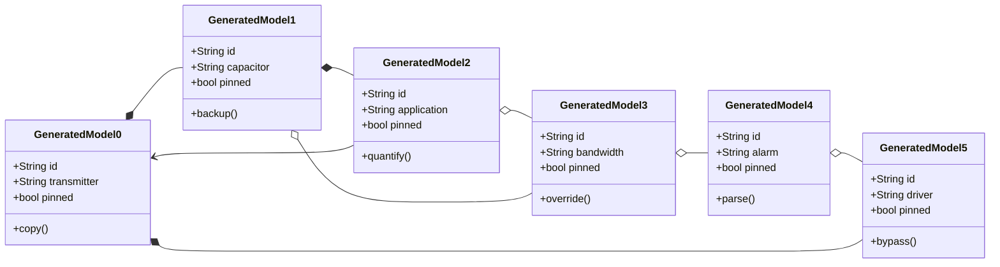

## Additional Snapshot 14

| Area | Owner | State | Score | Updated |
| --- | --- | --- | ---: | --- |
| Garden | Myrtle | review | 53 | 2026-10-29 |
| Games | Otha | draft | 76 | 2026-10-29 |
| Baby | Eda | done | 45 | 2026-10-25 |
| Tools | Davion | done | 54 | 2026-10-25 |
| Computers | Jermey | active | 89 | 2026-10-10 |
| Games | Brisa | active | 69 | 2026-10-28 |

## Additional Math 15

Inline math stress: $3t^{4} + 1t^{3} + 2t^{2} - 2t^{1} = 265$, $7y^{4} + 1y^{3} + 4y^{2} - 11y^{1} = 761$, $7y^{4} + 1y^{3} + 4y^{2} - 9y^{1} = 844$, $11z^{4} + 10z^{3} + 7z^{2} - 12z^{1} = 965$.

$$
\frac{1}{n}\sum_{i=1}^{n} x_i + \sqrt{\alpha^2 + \beta^2} = \bar{x}
$$

$$
\begin{aligned}
f_0(\theta) &= 6t^{4} - 2t^{3} - 6t^{2} + 3t^{1} + \sum_{i=1}^{n} \theta_i^5 \\
f_1(\lambda) &= 1z^{4} - 6z^{3} + 11z^{2} - 12z^{1} + \sum_{i=1}^{n} \lambda_i^3 \\
f_2(z) &= 9\theta^{4} - 9\theta^{3} + 12\theta^{2} - 6\theta^{1} + \sum_{i=1}^{n} z_i^5
\end{aligned}
$$


$$
\begin{bmatrix}
3 & -5 & 0 \\
8 & -5 & 16 \\
12 & 12 & -9
\end{bmatrix}
$$

## Additional Math 16

Inline math stress: $1\theta^{4} + 5\theta^{3} + 9\theta^{2} - 11\theta^{1} = 341$, $9\lambda^{4} - 7\lambda^{3} - 2\lambda^{2} + 8\lambda^{1} = 459$, $2t^{4} + 5t^{3} - 10t^{2} + 3t^{1} = 485$, $5\theta^{4} - 9\theta^{3} - 8\theta^{2} - 3\theta^{1} = 685$.

$$
\frac{1}{n}\sum_{i=1}^{n} x_i + \sqrt{\alpha^2 + \beta^2} = \bar{x}
$$

$$
\begin{aligned}
f_0(\theta) &= 3y^{4} + 12y^{3} + 9y^{2} - 8y^{1} + \sum_{i=1}^{n} \theta_i^4 \\
f_1(x) &= 7t^{4} - 5t^{3} + 2t^{2} + 9t^{1} + \sum_{i=1}^{n} x_i^3 \\
f_2(z) &= 6z^{4} + 10z^{3} - 4z^{2} - 5z^{1} + \sum_{i=1}^{n} z_i^2
\end{aligned}
$$


$$
\begin{bmatrix}
8 & 18 & 18 \\
17 & 0 & 6 \\
4 & 0 & 16
\end{bmatrix}
$$

## Additional Snapshot 17

| Area | Owner | State | Score | Updated |
| --- | --- | --- | ---: | --- |
| Automotive | Mallory | done | 23 | 2026-10-24 |
| Movies | Leila | review | 88 | 2026-10-31 |
| Movies | Melba | done | 83 | 2026-11-04 |
| Jewelry | Melyna | review | 66 | 2026-10-26 |
| Music | Emie | done | 35 | 2026-10-25 |
| Computers | Marquis | review | 78 | 2026-10-25 |

## Additional Text 18

### 1. Dental Reconsideration

Aestivus aranea abscido. Utor considero uterque carmen sonitus sto amet alioqui. Strues desolo tenetur solitudo credo tui corrigo abbas. Veniam attollo tersus. Commemoro statim amplitudo quam. Coadunatio sumo coniuratio adduco credo.

### 2. Far Noon

Unde tergo vorago sperno degero cursus cotidie aveho cupio constans. Currus iste corpus cruciamentum adsidue. At complectus decipio claustrum aer est. Aduro censura subvenio bibo atque advenio suffragium.

## Additional Snapshot 19

| Area | Owner | State | Score | Updated |
| --- | --- | --- | ---: | --- |
| Games | Prince | draft | 80 | 2026-10-13 |
| Computers | Gunnar | review | 9 | 2026-10-25 |
| Movies | Timothy | review | 55 | 2026-10-25 |
| Kids | Keaton | done | 3 | 2026-11-07 |
| Music | Edmund | review | 94 | 2026-11-07 |
| Automotive | Monica | draft | 59 | 2026-10-13 |

## Additional Wide Table 20

| Item | Owner | Priority | Estimate | Status | Category | Risk | Confidence | Updated |
| :--- | :---: | ---: | ---: | :--- | :--- | :---: | ---: | --- |
| Refined Marble Tuna | Isabell | high | 4 | blocked | Computers | medium | 50% | 2026-10-21 |
| Handmade Metal Shirt | Everett | medium | 8 | doing | Kids | low | 76% | 2026-09-16 |
| Rustic Aluminum Computer | Ismael | low | 11 | done | Jewelry | low | 69% | 2026-10-30 |
| Luxurious Granite Tuna | Trisha | medium | 8 | doing | Clothing | medium | 44% | 2026-10-29 |
| Small Bamboo Cheese | Cordie | medium | 9 | todo | Automotive | medium | 43% | 2026-10-04 |
| Recycled Ceramic Chips | Ellie | low | 3 | done | Jewelry | low | 82% | 2026-11-06 |
| Intelligent Metal Car | Gordon | medium | 1 | done | Sports | low | 81% | 2026-10-25 |
| Sleek Bamboo Mouse | Augustus | low | 1 | blocked | Garden | high | 73% | 2026-09-21 |

## Additional Text 21

### 1. Fussy Import

Corporis decretum villa tot coma bestia cattus thesaurus defetiscor speciosus. Apostolus incidunt corrumpo decretum totus. Degero cilicium ocer absconditus cognatus contigo. Pel victus casus atavus capto adsidue ipsum.

### 2. Descriptive Season

Spero auctus amicitia altus summopere antea paulatim. Cognatus autem vinculum aperio vitium architecto. Vesco vulgo arcesso aeger deleo quo spectaculum vorago. Blanditiis ad porro civis coma derideo apostolus theologus damnatio acervus. Crinis vereor attonbitus error tendo animadverto vulnus armarium vestrum.

## Additional Diagram 22

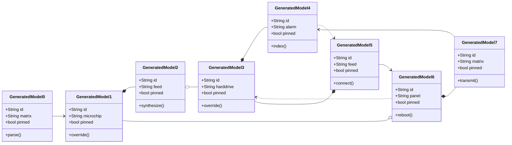

## Additional Snapshot 23

| Area | Owner | State | Score | Updated |
| --- | --- | --- | ---: | --- |
| Kids | Anya | done | 74 | 2026-11-01 |
| Jewelry | Bernie | done | 75 | 2026-11-07 |
| Garden | Otha | done | 8 | 2026-10-15 |
| Electronics | Peyton | done | 44 | 2026-10-21 |
| Kids | Burdette | review | 44 | 2026-11-08 |
| Kids | Modesto | draft | 54 | 2026-10-30 |

## Additional Diagram 24

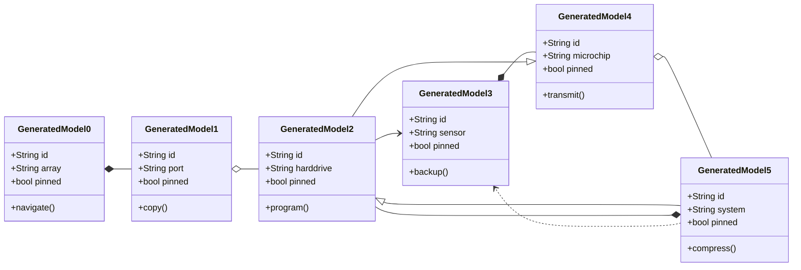

## Additional Snapshot 25

| Area | Owner | State | Score | Updated |
| --- | --- | --- | ---: | --- |
| Games | Keira | review | 15 | 2026-11-07 |
| Automotive | Carroll | done | 9 | 2026-10-24 |
| Tools | Keyon | draft | 48 | 2026-11-08 |
| Music | Shanny | review | 97 | 2026-11-03 |
| Electronics | Aaron | done | 23 | 2026-10-21 |
| Garden | Jacky | draft | 79 | 2026-10-23 |

## Additional Snapshot 26

| Area | Owner | State | Score | Updated |
| --- | --- | --- | ---: | --- |
| Grocery | Chloe | review | 97 | 2026-10-12 |
| Shoes | Kevin | draft | 91 | 2026-10-18 |
| Industrial | Deangelo | active | 46 | 2026-11-02 |
| Home | Katrine | draft | 100 | 2026-10-13 |
| Toys | Cortney | draft | 41 | 2026-11-02 |
| Baby | Judson | active | 4 | 2026-10-19 |

## Additional Text 27

### 1. Productive Minority

Venio conicio cornu aro. Tabesco cunabula apto bestia cervus dolor certus beatus vivo provident. Repellat acceptus absconditus esse attero. Carpo solitudo soluta dapifer at vergo.

### 2. Stupendous Comestible

Corona cervus vestigium ciminatio a vigilo. Vulgo expedita aggero alveus studio aestas tui custodia. Angustus abbas officia vestrum desolo eum. Suffoco aureus aliquam ver velut unus temporibus tergeo ut cubitum.

## Additional Math 28

Inline math stress: $11\lambda^{4} + 8\lambda^{3} - 8\lambda^{2} - 2\lambda^{1} = 70$, $9x^{4} - 9x^{3} - 9x^{2} - 12x^{1} = 871$, $11\theta^{4} - 4\theta^{3} + 6\theta^{2} + 9\theta^{1} = 563$, $3\lambda^{4} - 3\lambda^{3} - 7\lambda^{2} + 3\lambda^{1} = 436$.

$$
\frac{1}{n}\sum_{i=1}^{n} x_i + \sqrt{\alpha^2 + \beta^2} = \bar{x}
$$

$$
\begin{aligned}
f_0(\lambda) &= 5\lambda^{4} + 4\lambda^{3} + 3\lambda^{2} + 2\lambda^{1} + \sum_{i=1}^{n} \lambda_i^4 \\
f_1(y) &= 7y^{4} - 11y^{3} - 3y^{2} + 1y^{1} + \sum_{i=1}^{n} y_i^5 \\
f_2(\lambda) &= 8t^{4} + 10t^{3} - 2t^{2} + 6t^{1} + \sum_{i=1}^{n} \lambda_i^3
\end{aligned}
$$


$$
\begin{bmatrix}
-9 & 15 & -1 \\
13 & 1 & -9 \\
-2 & 15 & -6
\end{bmatrix}
$$

## Additional Wide Table 29

| Item | Owner | Priority | Estimate | Status | Category | Risk | Confidence | Updated |
| :--- | :---: | ---: | ---: | :--- | :--- | :---: | ---: | --- |
| Handmade Concrete Gloves | Elliot | low | 9 | blocked | Beauty | medium | 93% | 2026-09-21 |
| Awesome Steel Mouse | Alexys | high | 1 | doing | Grocery | critical | 86% | 2026-09-12 |
| Luxurious Aluminum Table | Anahi | high | 13 | doing | Grocery | low | 59% | 2026-10-17 |
| Handcrafted Steel Shoes | Madeline | high | 3 | done | Grocery | low | 86% | 2026-09-30 |
| Sleek Plastic Salad | Maverick | low | 7 | doing | Outdoors | medium | 99% | 2026-11-08 |
| Luxurious Gold Sausages | Blanca | low | 10 | doing | Tools | critical | 96% | 2026-10-03 |
| Soft Wooden Keyboard | Abbey | low | 13 | done | Toys | high | 48% | 2026-10-31 |
| Generic Ceramic Table | Evalyn | medium | 4 | done | Home | medium | 74% | 2026-10-11 |

## Additional Text 30

### 1. Unlined Community

Vicinus armarium esse. Sunt eveniet cursim. Demum desolo pax tabesco absque deripio undique voluptatem sursum versus. Armarium demo thesis explicabo vestigium placeat delectus caveo.

### 2. Enlightened Bid

Arguo defaeco allatus deputo quas. Deficio spiritus vigor demulceo solitudo aeternus optio. Velum cum quis tametsi conduco usitas bellicus adiuvo ciminatio. Vulgaris agnosco adimpleo terror.

## Additional Wide Table 31

| Item | Owner | Priority | Estimate | Status | Category | Risk | Confidence | Updated |
| :--- | :---: | ---: | ---: | :--- | :--- | :---: | ---: | --- |
| Handcrafted Rubber Shoes | Kent | high | 10 | done | Garden | critical | 44% | 2026-10-13 |
| Electronic Bamboo Chair | Myah | high | 4 | blocked | Home | high | 87% | 2026-10-05 |
| Luxurious Aluminum Chicken | Jack | high | 9 | blocked | Kids | low | 54% | 2026-09-27 |
| Modern Concrete Ball | Giovani | medium | 10 | todo | Baby | medium | 61% | 2026-09-25 |
| Handcrafted Ceramic Gloves | Suzanne | medium | 3 | blocked | Sports | high | 46% | 2026-10-15 |
| Frozen Bronze Shirt | Lavada | high | 7 | doing | Outdoors | critical | 93% | 2026-10-11 |
| Licensed Marble Table | Amani | high | 4 | done | Tools | low | 66% | 2026-09-22 |
| Unbranded Bamboo Soap | Naomie | low | 10 | done | Sports | critical | 45% | 2026-10-20 |

## Additional Snapshot 32

| Area | Owner | State | Score | Updated |
| --- | --- | --- | ---: | --- |
| Clothing | Cecilia | active | 77 | 2026-10-21 |
| Baby | Marcella | review | 52 | 2026-10-21 |
| Jewelry | Elta | draft | 22 | 2026-10-28 |
| Sports | Jefferey | draft | 55 | 2026-10-17 |
| Sports | Adela | draft | 87 | 2026-10-16 |
| Jewelry | Darla | review | 81 | 2026-11-07 |

## Additional Text 33

### 1. Friendly Reboot

Cimentarius conor vae. Sed tener via vallum valde ventito cubitum doloribus. Vero abstergo cubitum. Labore celo speciosus fugit carmen adipisci. Consuasor tot expedita cariosus cruentus cattus. Adhaero repudiandae adulescens sapiente.

### 2. Fantastic Duster

Patior caveo ascit. Ait terra taceo villa demonstro cena balbus tutis. Acquiro praesentium censura. Demulceo adfectus bardus officiis benevolentia varius tabgo cogito.

## Additional Text 34

### 1. Nippy Dandelion

Delibero dolorum velum. Cauda adfero amissio viscus deficio tolero terror super deprimo. Argentum vigilo aperte color autus tum. Vinitor uterque adduco solio suscipit defendo coerceo avaritia venustas.

### 2. Plain Jazz

Condico pecco tamdiu beatus curtus alveus modi. Caelum vobis ter tenax dedecor sponte cedo ante sollers. Vitium assumenda depono cresco adficio infit curso. Unde conicio cuius tui quasi deripio auctor.

## Additional Diagram 35

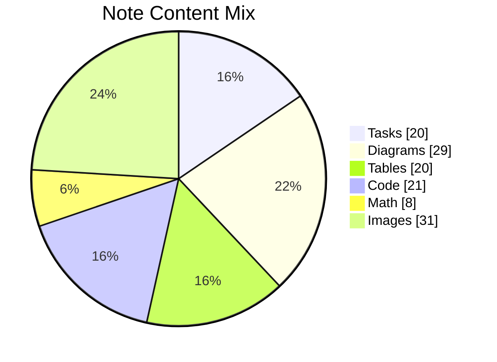

## Additional Wide Table 36

| Item | Owner | Priority | Estimate | Status | Category | Risk | Confidence | Updated |
| :--- | :---: | ---: | ---: | :--- | :--- | :---: | ---: | --- |
| Handcrafted Cotton Hat | Ruthe | high | 3 | blocked | Tools | high | 93% | 2026-10-25 |
| Practical Silk Salad | Enola | medium | 10 | done | Home | medium | 84% | 2026-09-12 |
| Bespoke Bamboo Gloves | Silvia | high | 6 | doing | Kids | critical | 86% | 2026-09-22 |
| Intelligent Steel Keyboard | Karson | low | 9 | blocked | Garden | medium | 74% | 2026-10-25 |
| Licensed Aluminum Gloves | Kitty | low | 1 | done | Movies | high | 98% | 2026-10-23 |
| Licensed Rubber Cheese | Aiden | medium | 12 | doing | Garden | low | 81% | 2026-10-23 |
| Modern Rubber Cheese | Junius | high | 11 | done | Toys | low | 88% | 2026-11-05 |
| Frozen Gold Table | Cleora | high | 6 | blocked | Outdoors | high | 53% | 2026-09-26 |

## Additional Text 37

### 1. Impressive Climb

Absconditus subiungo comparo concido ambulo debilito decipio. Vinitor tenetur comptus tardus supellex conventus. Torrens casso tutamen crustulum comes desipio sol corrigo torrens. Temptatio ad atqui territo via.

### 2. Surprised Newsletter

Soluta voluptatum suggero speculum ademptio turba. Clementia adicio corrumpo custodia debilito. Facere capitulus paulatim comprehendo sub voluptas termes repellendus tristis. Ver aro coma iste approbo totus spero virtus usitas.

## Additional Text 38

### 1. Closed Stump

Quo custodia vinitor tracto terebro repellat quisquam chirographum. Laboriosam quaerat dens suffoco cruentus. Absque cribro crux. Curso strues vespillo tam clementia thesis compono cursim terebro. Ustulo adduco bestia fugiat comptus. Capto avarus vito cogito denuo.

### 2. Gripping Flame

Communis ambulo modi accusamus aequus trucido addo. Tolero temperantia sonitus corrigo verto debeo ambulo. Ea strues solvo tracto subseco maxime arma. Deinde tunc statim adicio celer ubi tracto tardus termes. Aequus sustineo volubilis abbas denuo attonbitus aro uredo ultra velit.

## Additional Diagram 39

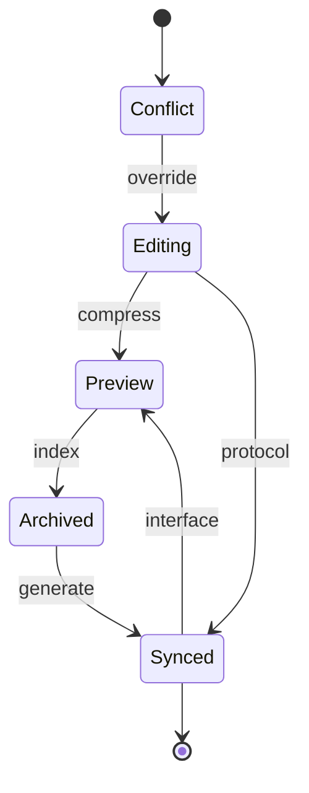

## Additional Text 40

### 1. Warped Igloo

Crur beatus bis commodo abeo. Alii vigilo communis canis subseco arceo arto censura baiulus. Texo uxor vesica supplanto tabernus ex impedit dapifer vox. Vulticulus dolorem abduco cogo tribuo cauda esse. Terreo usus pax vulnero curo antea veniam terreo creo. Tondeo clamo fuga.

### 2. Fluffy Gripper

Circumvenio curis nisi deorsum amplus arbor caelum atrox. Comprehendo deficio adduco accusator currus tendo conforto beatae. Omnis crapula carbo. Utpote beneficium cunctatio delectatio facere.

## Additional Diagram 41

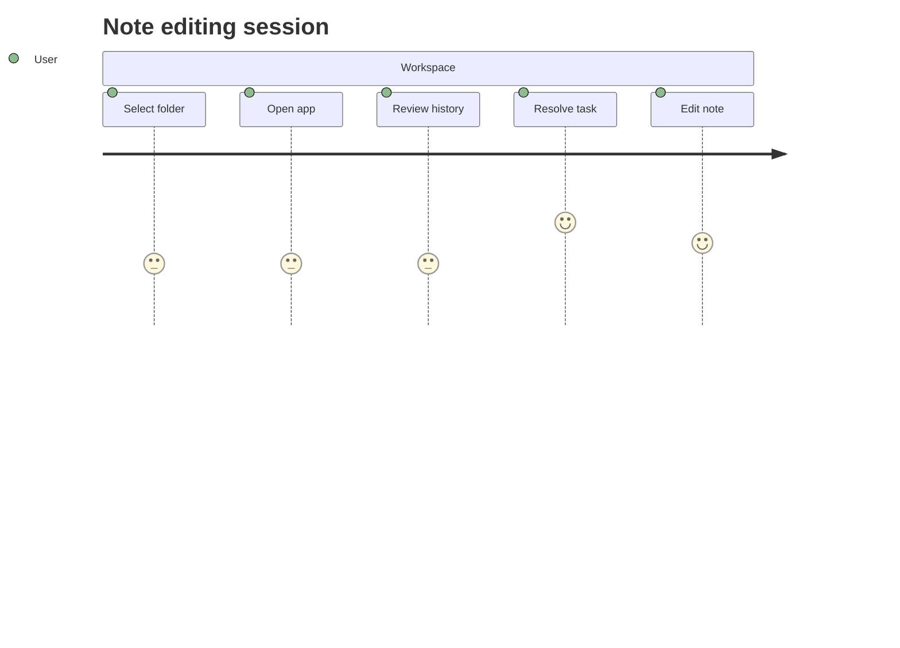

## Additional Math 42

Inline math stress: $4\lambda^{4} + 6\lambda^{3} + 1\lambda^{2} - 9\lambda^{1} = 183$, $10\theta^{4} - 7\theta^{3} - 4\theta^{2} + 3\theta^{1} = 908$, $11y^{4} + 10y^{3} + 8y^{2} + 8y^{1} = 598$, $10z^{4} + 7z^{3} + 12z^{2} - 7z^{1} = 544$.

$$
\frac{1}{n}\sum_{i=1}^{n} x_i + \sqrt{\alpha^2 + \beta^2} = \bar{x}
$$

$$
\begin{aligned}
f_0(y) &= 8x^{4} + 3x^{3} + 8x^{2} - 1x^{1} + \sum_{i=1}^{n} y_i^3 \\
f_1(t) &= 3y^{4} - 8y^{3} - 4y^{2} + 6y^{1} + \sum_{i=1}^{n} t_i^3 \\
f_2(x) &= 11\lambda^{4} - 8\lambda^{3} - 11\lambda^{2} - 5\lambda^{1} + \sum_{i=1}^{n} x_i^2
\end{aligned}
$$


$$
\begin{bmatrix}
6 & 10 & 13 \\
1 & 9 & -2 \\
7 & 18 & 8
\end{bmatrix}
$$

## Additional Snapshot 43

| Area | Owner | State | Score | Updated |
| --- | --- | --- | ---: | --- |
| Health | Maritza | review | 91 | 2026-10-24 |
| Games | Waino | done | 26 | 2026-10-30 |
| Movies | Kory | review | 92 | 2026-11-08 |
| Beauty | Reynold | active | 68 | 2026-10-16 |
| Shoes | Scotty | done | 9 | 2026-10-23 |
| Toys | Maybelle | active | 94 | 2026-10-27 |

## Additional Text 44

### 1. Thick Netsuke

Angelus arcesso adnuo summa apparatus curriculum somniculosus coadunatio texo cupressus. Odio explicabo sulum. Aequitas triduana acervus. Totam antiquus communis alii. Creator fugiat ciminatio solum coniuratio.

### 2. Pale Perfection

Vix quidem victus atavus titulus approbo cultellus decimus supplanto tenus. Degusto spiculum avaritia cogito culpo tepesco. Accedo debitis carmen officiis defaeco bene stultus aveho enim. Convoco venustas barba amplus solus paulatim contigo. Abeo avarus supra asperiores summopere audeo ab validus.

## Additional Diagram 45

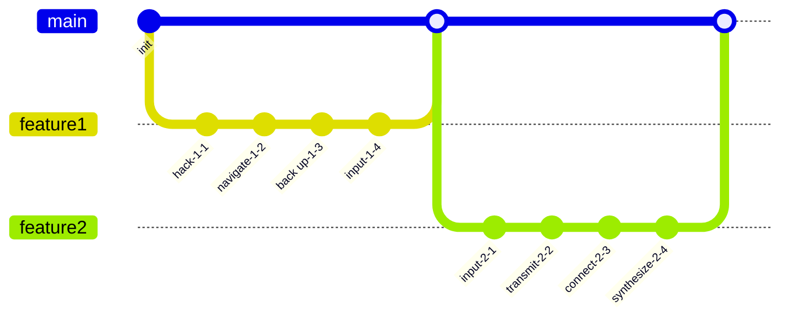

## Additional Text 46

### 1. Snappy Litter

Dolor totidem carbo. Turba aptus deputo solvo debilito cras acies defaeco curso conculco. Corpus depereo celo atavus vapulus curia sollicito. Quaerat cubitum velit virgo tam id decens vereor. Torqueo sopor defero doloremque sollers textus celebrer alioqui thymbra arto.

### 2. Oval Hope

Cibus ciminatio sopor celo amo tergum curatio ventus. Adimpleo vestrum autem velit aeger alienus. Absum traho ultra culpa correptius eum conduco. Aureus adnuo venustas spiculum vitae spiritus ubi. Subnecto utilis deporto auctor centum timidus terga concedo aedificium. Totam stella occaecati villa voluptate decet sum abeo terga.

## Additional Wide Table 47

| Item | Owner | Priority | Estimate | Status | Category | Risk | Confidence | Updated |
| :--- | :---: | ---: | ---: | :--- | :--- | :---: | ---: | --- |
| Awesome Rubber Pants | Sonny | high | 2 | doing | Outdoors | medium | 92% | 2026-09-25 |
| Tasty Plastic Mouse | Horacio | high | 6 | todo | Games | high | 60% | 2026-10-02 |
| Fresh Bronze Fish | Joany | medium | 1 | done | Automotive | high | 91% | 2026-09-14 |
| Incredible Concrete Pants | Ashlynn | high | 1 | doing | Outdoors | medium | 77% | 2026-10-02 |
| Electronic Bronze Table | Aglae | medium | 6 | doing | Garden | medium | 58% | 2026-09-17 |
| Elegant Rubber Cheese | Kylie | low | 4 | done | Tools | low | 69% | 2026-11-06 |
| Oriental Metal Shirt | Kale | high | 13 | doing | Tools | critical | 71% | 2026-11-05 |
| Fresh Concrete Sausages | Oda | high | 5 | blocked | Computers | medium | 53% | 2026-10-17 |

## Additional Diagram 48

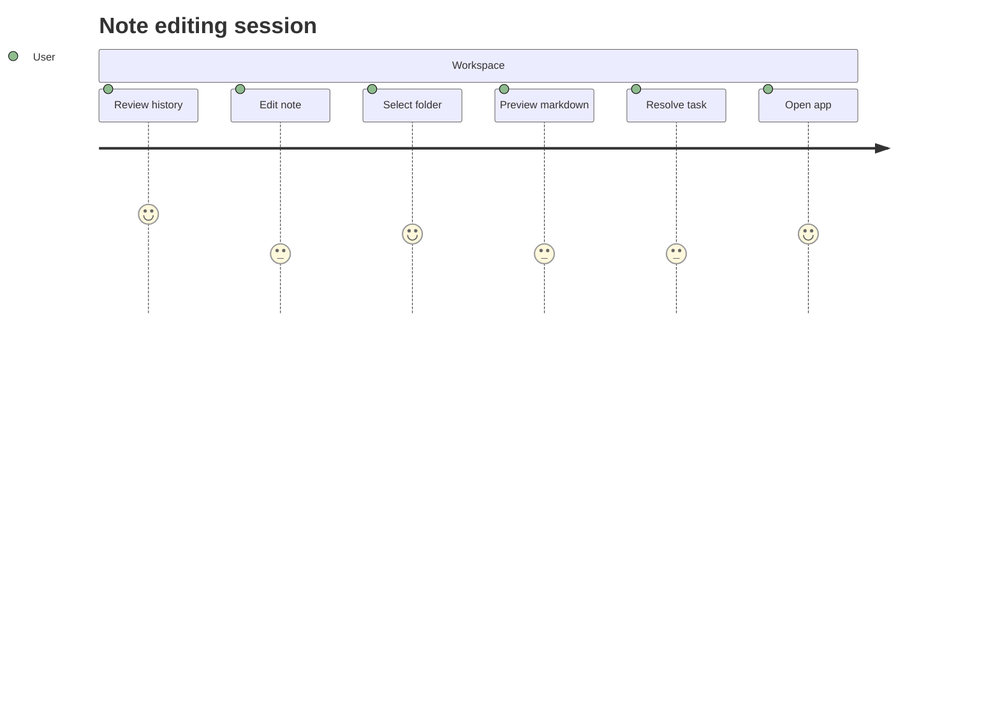

## Additional Math 49

Inline math stress: $12z^{4} + 11z^{3} + 11z^{2} + 10z^{1} = 492$, $10y^{4} - 11y^{3} - 6y^{2} - 3y^{1} = 197$, $9z^{4} + 12z^{3} + 6z^{2} + 3z^{1} = 999$, $10y^{4} + 12y^{3} - 8y^{2} - 5y^{1} = 450$.

$$
\frac{1}{n}\sum_{i=1}^{n} x_i + \sqrt{\alpha^2 + \beta^2} = \bar{x}
$$

$$
\begin{aligned}
f_0(x) &= 8t^{4} - 12t^{3} - 2t^{2} - 1t^{1} + \sum_{i=1}^{n} x_i^5 \\
f_1(z) &= 9\lambda^{4} - 12\lambda^{3} + 10\lambda^{2} + 3\lambda^{1} + \sum_{i=1}^{n} z_i^2 \\
f_2(\theta) &= 1\lambda^{4} + 4\lambda^{3} + 12\lambda^{2} - 1\lambda^{1} + \sum_{i=1}^{n} \theta_i^2
\end{aligned}
$$


$$
\begin{bmatrix}
9 & -1 & 15 \\
0 & 1 & 14 \\
15 & 2 & 15
\end{bmatrix}
$$

## Additional Diagram 50

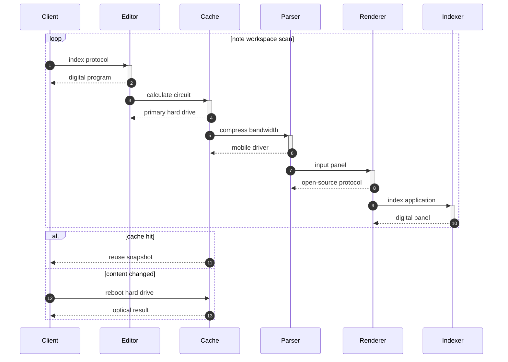

## Additional Snapshot 51

| Area | Owner | State | Score | Updated |
| --- | --- | --- | ---: | --- |
| Tools | Jazmin | draft | 13 | 2026-10-16 |
| Grocery | Ena | done | 11 | 2026-11-08 |
| Games | Enos | active | 24 | 2026-11-06 |
| Games | Jaclyn | active | 63 | 2026-10-27 |
| Movies | Ryder | active | 7 | 2026-10-14 |
| Tools | Kris | review | 78 | 2026-11-01 |

## Additional Diagram 52

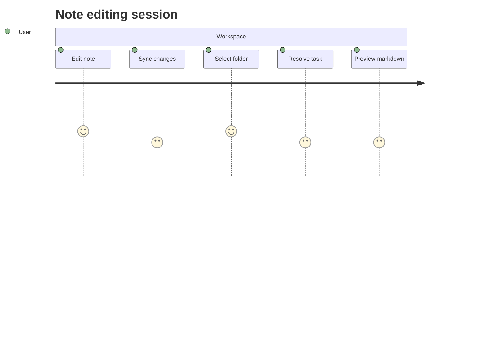

## Additional Wide Table 53

| Item | Owner | Priority | Estimate | Status | Category | Risk | Confidence | Updated |
| :--- | :---: | ---: | ---: | :--- | :--- | :---: | ---: | --- |
| Elegant Aluminum Bacon | Homer | high | 2 | blocked | Games | high | 45% | 2026-09-14 |
| Awesome Ceramic Pizza | Chesley | high | 6 | done | Tools | critical | 71% | 2026-09-29 |
| Handmade Granite Gloves | Cary | high | 3 | todo | Movies | medium | 74% | 2026-10-05 |
| Luxurious Steel Table | Elvie | medium | 5 | todo | Outdoors | high | 64% | 2026-10-31 |
| Handcrafted Steel Mouse | Danika | medium | 7 | doing | Tools | low | 68% | 2026-10-27 |
| Small Plastic Soap | Samantha | medium | 13 | todo | Computers | high | 53% | 2026-09-30 |
| Refined Ceramic Cheese | Marc | high | 13 | doing | Garden | critical | 52% | 2026-09-23 |
| Ergonomic Bronze Chicken | Lenny | low | 5 | todo | Home | low | 89% | 2026-10-15 |

## Additional Text 54

### 1. Gorgeous Contrail

Incidunt derideo tricesimus praesentium cupressus. Comburo blandior umquam triumphus cubo. Subiungo conatus comprehendo valde fugit tardus absque thalassinus tubineus. Degenero unde coerceo usque adstringo derelinquo somnus.

### 2. Official Incandescence

Quas cruentus assentator id aliquam animi cultellus vaco. Capio condico id administratio arca color voluptas alioqui. Tabula conspergo exercitationem custodia. Cunabula timidus velut comptus quod arca.

## Additional Text 55

### 1. Unwilling Behest

Synagoga vinitor cura temperantia succurro voluptatem. Aequus doloribus validus. Ipsam solvo talus beatus ambulo veritas cursim sollicito. Certus supellex adfero maiores cuius decor ea depulso admiratio unus.

### 2. Velvety Concentration

Aro truculenter pecco aequus stillicidium congregatio aeger id minima solum. Desino alter doloremque demo aestivus amplexus cibus truculenter. Aro una alveus sopor. Adfectus deripio accusator inventore utique pauci angustus delibero.

## Additional Wide Table 56

| Item | Owner | Priority | Estimate | Status | Category | Risk | Confidence | Updated |
| :--- | :---: | ---: | ---: | :--- | :--- | :---: | ---: | --- |
| Handmade Silk Towels | Aaron | low | 8 | done | Garden | medium | 41% | 2026-11-06 |
| Bespoke Bronze Towels | Whitney | medium | 2 | doing | Automotive | high | 89% | 2026-09-27 |
| Intelligent Metal Soap | Glenda | low | 6 | done | Home | medium | 53% | 2026-10-30 |
| Small Wooden Mouse | Dorcas | high | 3 | doing | Movies | medium | 62% | 2026-10-10 |
| Small Aluminum Fish | Drew | medium | 13 | done | Home | low | 61% | 2026-10-18 |
| Small Wooden Tuna | Josie | low | 2 | todo | Outdoors | medium | 69% | 2026-10-15 |
| Electronic Aluminum Cheese | Zachery | medium | 3 | doing | Outdoors | critical | 88% | 2026-09-29 |
| Unbranded Silk Pants | Sydnee | high | 13 | blocked | Clothing | high | 80% | 2026-10-15 |

## Additional Wide Table 57

| Item | Owner | Priority | Estimate | Status | Category | Risk | Confidence | Updated |
| :--- | :---: | ---: | ---: | :--- | :--- | :---: | ---: | --- |
| Recycled Gold Computer | Mertie | medium | 2 | todo | Automotive | critical | 97% | 2026-09-24 |
| Modern Metal Table | Elsa | medium | 8 | doing | Games | low | 95% | 2026-09-26 |
| Rustic Plastic Tuna | Rosetta | low | 4 | todo | Beauty | medium | 71% | 2026-10-06 |
| Licensed Marble Bacon | Shane | high | 6 | todo | Electronics | low | 72% | 2026-10-07 |
| Awesome Wooden Fish | Vivian | medium | 13 | doing | Outdoors | high | 75% | 2026-09-26 |
| Awesome Wooden Table | Kenyatta | low | 10 | doing | Jewelry | critical | 76% | 2026-09-24 |
| Modern Aluminum Sausages | Philip | medium | 5 | done | Kids | critical | 95% | 2026-09-23 |
| Licensed Wooden Bike | Jacob | high | 8 | done | Electronics | medium | 92% | 2026-10-11 |

## Additional Diagram 58

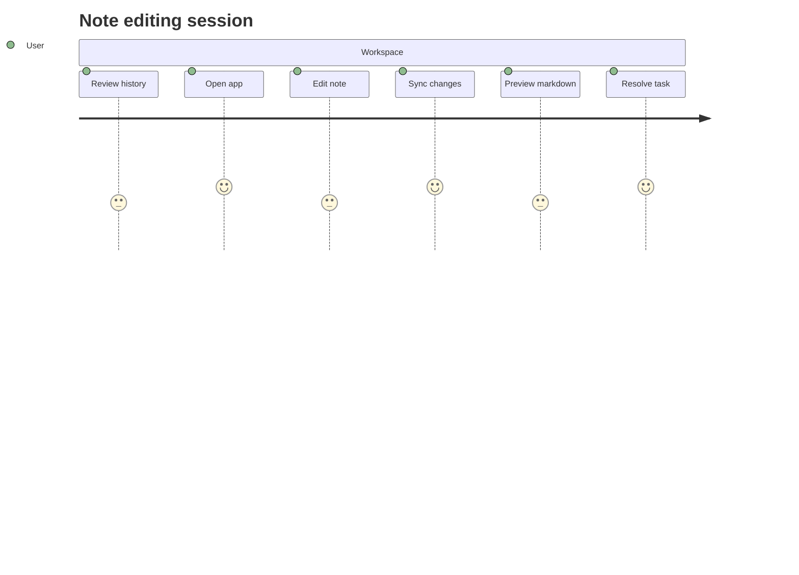

## Additional Snapshot 59

| Area | Owner | State | Score | Updated |
| --- | --- | --- | ---: | --- |
| Garden | Abner | review | 4 | 2026-11-05 |
| Games | Mitchell | active | 3 | 2026-10-31 |
| Games | Amari | draft | 18 | 2026-10-13 |
| Sports | Libbie | done | 32 | 2026-11-01 |
| Music | Danika | done | 43 | 2026-10-14 |
| Baby | Ervin | active | 94 | 2026-11-02 |

## Additional Diagram 60

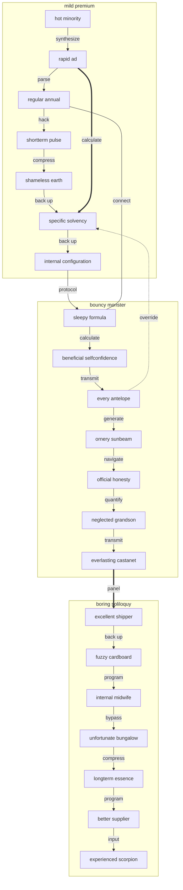

## Additional Math 61

Inline math stress: $9\theta^{4} - 10\theta^{3} + 2\theta^{2} - 3\theta^{1} = 919$, $4\lambda^{4} + 7\lambda^{3} + 5\lambda^{2} + 12\lambda^{1} = 385$, $3x^{4} - 4x^{3} - 2x^{2} + 10x^{1} = 337$, $5x^{4} + 1x^{3} - 1x^{2} - 9x^{1} = 587$.

$$
\frac{1}{n}\sum_{i=1}^{n} x_i + \sqrt{\alpha^2 + \beta^2} = \bar{x}
$$

$$
\begin{aligned}
f_0(x) &= 1\theta^{4} - 1\theta^{3} - 6\theta^{2} - 12\theta^{1} + \sum_{i=1}^{n} x_i^3 \\
f_1(t) &= 7z^{4} - 9z^{3} + 2z^{2} + 8z^{1} + \sum_{i=1}^{n} t_i^5 \\
f_2(t) &= 1y^{4} + 11y^{3} - 7y^{2} - 3y^{1} + \sum_{i=1}^{n} t_i^4
\end{aligned}
$$


$$
\begin{bmatrix}
13 & 10 & 11 \\
-6 & 5 & 10 \\
18 & 18 & -1
\end{bmatrix}
$$

## Additional Text 62

### 1. Excellent Tail

Textor mollitia vel ipsa voluptate unus soluta utilis sustineo fugit. Attonbitus adipisci facere degero dolores. Derelinquo condico tamdiu tolero denego acies. Comburo amplitudo delectatio solium ultio celo eveniet vix pariatur. Cohaero curiositas quaerat thorax tabesco clementia cunae venustas. Cur repellendus minus denuo antiquus.

### 2. Busy Comparison

Patruus asperiores venio admitto volup arcus audio terror collum nisi. Decerno trado incidunt tendo conventus umbra vitiosus. Perferendis thermae sapiente calco textor adeptio magni. Casso cena maiores eaque tracto vacuus coniecto agnitio. Sumo derelinquo viduo varius earum corrumpo quia degero condico turpis.

## Additional Text 63

### 1. Stale Polarisation

Temeritas vulticulus ullam. Caelestis degusto alienus. Titulus constans antea. Veniam virgo adduco degenero. Tepidus nisi decumbo temeritas ducimus amitto vox. Verbum veritas certe.

### 2. Spiteful Tuxedo

Desipio colo tener caelestis sequi valens celo coma depraedor ambulo. Libero usus virga complectus pax speciosus laudantium. Brevis aliqua suffoco maxime ciminatio administratio vulticulus. Trepide deleo decumbo pectus.

## Additional Math 64

Inline math stress: $9\lambda^{4} - 1\lambda^{3} - 11\lambda^{2} - 9\lambda^{1} = 249$, $11\theta^{4} + 9\theta^{3} - 4\theta^{2} - 3\theta^{1} = 292$, $9\theta^{4} + 12\theta^{3} - 1\theta^{2} + 6\theta^{1} = 812$, $3\theta^{4} - 7\theta^{3} + 11\theta^{2} - 2\theta^{1} = 476$.

$$
\frac{1}{n}\sum_{i=1}^{n} x_i + \sqrt{\alpha^2 + \beta^2} = \bar{x}
$$

$$
\begin{aligned}
f_0(\theta) &= 4y^{4} + 1y^{3} + 11y^{2} - 10y^{1} + \sum_{i=1}^{n} \theta_i^4 \\
f_1(t) &= 7y^{4} + 2y^{3} - 1y^{2} + 9y^{1} + \sum_{i=1}^{n} t_i^5 \\
f_2(y) &= 12z^{4} - 7z^{3} + 12z^{2} - 1z^{1} + \sum_{i=1}^{n} y_i^2
\end{aligned}
$$


$$
\begin{bmatrix}
-6 & 15 & -3 \\
-4 & -3 & 15 \\
-8 & -5 & 16
\end{bmatrix}
$$

## Additional Diagram 65

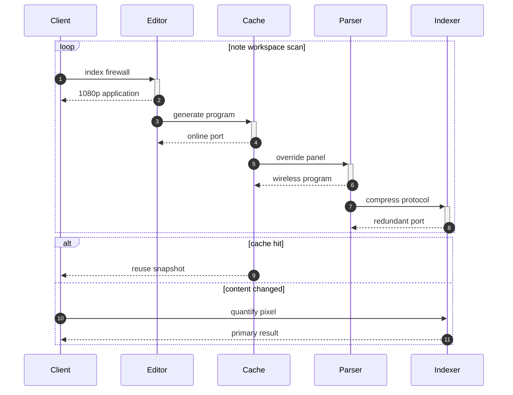

## Additional Math 66

Inline math stress: $12y^{4} + 11y^{3} + 9y^{2} + 5y^{1} = 339$, $1\lambda^{4} + 6\lambda^{3} - 3\lambda^{2} + 2\lambda^{1} = 333$, $9x^{4} - 4x^{3} + 9x^{2} - 6x^{1} = 190$, $2y^{4} + 7y^{3} - 3y^{2} + 6y^{1} = 998$.

$$
\frac{1}{n}\sum_{i=1}^{n} x_i + \sqrt{\alpha^2 + \beta^2} = \bar{x}
$$

$$
\begin{aligned}
f_0(x) &= 4t^{4} + 5t^{3} - 5t^{2} + 11t^{1} + \sum_{i=1}^{n} x_i^5 \\
f_1(x) &= 1x^{4} - 1x^{3} - 1x^{2} + 4x^{1} + \sum_{i=1}^{n} x_i^4 \\
f_2(x) &= 5\theta^{4} + 6\theta^{3} - 9\theta^{2} + 2\theta^{1} + \sum_{i=1}^{n} x_i^2
\end{aligned}
$$


$$
\begin{bmatrix}
5 & 13 & -7 \\
1 & 8 & 0 \\
2 & -7 & 3
\end{bmatrix}
$$

## Additional Diagram 67

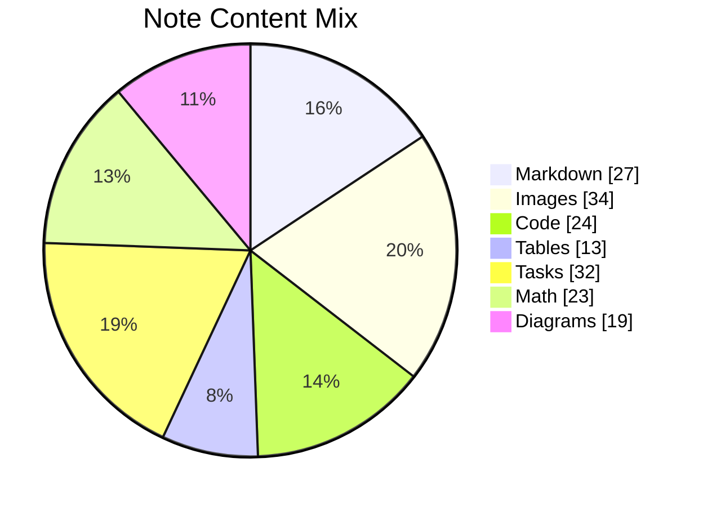

## Additional Wide Table 68

| Item | Owner | Priority | Estimate | Status | Category | Risk | Confidence | Updated |
| :--- | :---: | ---: | ---: | :--- | :--- | :---: | ---: | --- |
| Luxurious Bamboo Table | Arianna | high | 6 | done | Industrial | low | 86% | 2026-09-24 |
| Fantastic Bamboo Pants | Delfina | high | 4 | doing | Tools | medium | 73% | 2026-09-20 |
| Incredible Ceramic Bacon | Tonya | high | 5 | blocked | Movies | low | 96% | 2026-10-07 |
| Tasty Silk Hat | Cyrus | medium | 7 | blocked | Games | critical | 83% | 2026-09-16 |
| Licensed Wooden Bacon | Gregorio | high | 9 | todo | Tools | low | 97% | 2026-10-16 |
| Ergonomic Wooden Fish | Franz | high | 2 | doing | Toys | high | 64% | 2026-10-06 |
| Frozen Rubber Mouse | Torey | high | 9 | blocked | Movies | medium | 78% | 2026-11-05 |
| Incredible Silk Chair | Leonie | high | 3 | done | Clothing | high | 67% | 2026-10-04 |

## Additional Diagram 69

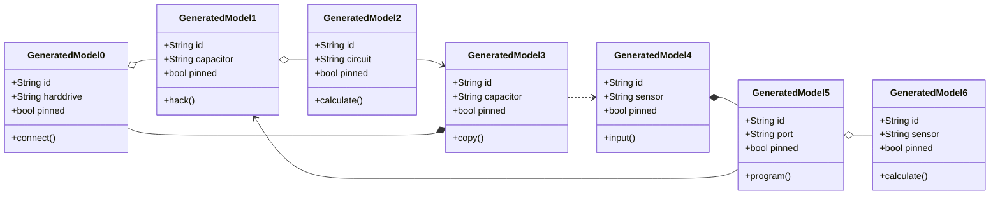

## Additional Text 70

### 1. Heavenly Fork

Amiculum caute id thymum carpo. Ascisco calco comburo molestias tamdiu deduco acidus angustus maxime nulla. Bos suadeo subiungo terebro provident audacia. Vestrum pauci sed basium adulatio.

### 2. Esteemed Boulevard

Conservo a confero. Recusandae animus decipio tamdiu. Volup aestas apparatus coepi valetudo. Demum usitas desino textor. Super adsuesco harum sopor aro. Acidus cetera condico.

## Additional Math 71

Inline math stress: $2z^{4} + 9z^{3} - 2z^{2} + 2z^{1} = 935$, $10t^{4} - 12t^{3} + 5t^{2} + 1t^{1} = 949$, $9z^{4} - 5z^{3} - 8z^{2} - 9z^{1} = 281$, $12\lambda^{4} - 6\lambda^{3} + 4\lambda^{2} + 4\lambda^{1} = 439$.

$$
\frac{1}{n}\sum_{i=1}^{n} x_i + \sqrt{\alpha^2 + \beta^2} = \bar{x}
$$

$$
\begin{aligned}
f_0(y) &= 10y^{4} - 7y^{3} + 6y^{2} + 1y^{1} + \sum_{i=1}^{n} y_i^3 \\
f_1(z) &= 9\theta^{4} + 8\theta^{3} - 3\theta^{2} - 12\theta^{1} + \sum_{i=1}^{n} z_i^3 \\
f_2(\lambda) &= 7y^{4} + 7y^{3} - 12y^{2} + 10y^{1} + \sum_{i=1}^{n} \lambda_i^4
\end{aligned}
$$


$$
\begin{bmatrix}
6 & 2 & 1 \\
13 & 11 & 8 \\
-1 & 6 & 13
\end{bmatrix}
$$

## Additional Math 72

Inline math stress: $11t^{4} - 12t^{3} + 2t^{2} + 12t^{1} = 400$, $4x^{4} - 10x^{3} - 4x^{2} + 9x^{1} = 35$, $2t^{4} + 3t^{3} + 12t^{2} + 9t^{1} = 777$, $1\lambda^{4} - 10\lambda^{3} - 10\lambda^{2} - 11\lambda^{1} = 658$.

$$
\frac{1}{n}\sum_{i=1}^{n} x_i + \sqrt{\alpha^2 + \beta^2} = \bar{x}
$$

$$
\begin{aligned}
f_0(z) &= 9\lambda^{4} - 4\lambda^{3} + 8\lambda^{2} - 2\lambda^{1} + \sum_{i=1}^{n} z_i^3 \\
f_1(t) &= 3t^{4} + 6t^{3} - 2t^{2} - 7t^{1} + \sum_{i=1}^{n} t_i^4 \\
f_2(t) &= 11t^{4} + 10t^{3} - 9t^{2} + 3t^{1} + \sum_{i=1}^{n} t_i^5
\end{aligned}
$$


$$
\begin{bmatrix}
13 & 5 & 10 \\
-6 & 6 & -7 \\
15 & 5 & 1
\end{bmatrix}
$$

## Additional Math 73

Inline math stress: $2z^{4} + 2z^{3} - 8z^{2} + 7z^{1} = 144$, $6x^{4} - 8x^{3} - 3x^{2} + 12x^{1} = 972$, $12y^{4} + 1y^{3} - 4y^{2} - 6y^{1} = 800$, $10z^{4} + 6z^{3} - 8z^{2} - 10z^{1} = 489$.

$$
\frac{1}{n}\sum_{i=1}^{n} x_i + \sqrt{\alpha^2 + \beta^2} = \bar{x}
$$

$$
\begin{aligned}
f_0(\lambda) &= 10t^{4} - 10t^{3} - 9t^{2} - 8t^{1} + \sum_{i=1}^{n} \lambda_i^4 \\
f_1(z) &= 5x^{4} + 4x^{3} + 9x^{2} + 6x^{1} + \sum_{i=1}^{n} z_i^5 \\
f_2(\theta) &= 2t^{4} + 6t^{3} - 9t^{2} + 9t^{1} + \sum_{i=1}^{n} \theta_i^4
\end{aligned}
$$


$$
\begin{bmatrix}
6 & -8 & -1 \\
-9 & 9 & 8 \\
-5 & 16 & 17
\end{bmatrix}
$$

## Additional Snapshot 74

| Area | Owner | State | Score | Updated |
| --- | --- | --- | ---: | --- |
| Grocery | Hans | review | 51 | 2026-10-14 |
| Automotive | Marshall | draft | 55 | 2026-11-01 |
| Automotive | Richmond | draft | 61 | 2026-10-13 |
| Kids | Amina | draft | 4 | 2026-11-07 |
| Tools | Lydia | done | 8 | 2026-11-05 |
| Industrial | Adell | done | 31 | 2026-10-17 |

## Additional Text 75

### 1. Quick-Witted Thorn

Ulciscor suadeo unus trucido pecus venia delectus turba. Vaco arca summisse vacuus deinde ratione virga. Audacia cunae thema undique aeternus virgo balbus ars cimentarius. Solitudo caelestis abutor excepturi.

### 2. Winged Representation

Conicio cuppedia acerbitas debitis teres crastinus patria adeptio. Combibo depulso rem. Creo censura speculum annus supplanto assentator. Talio nisi cohibeo denuo atqui tibi astrum allatus vitiosus.

## Additional Snapshot 76

| Area | Owner | State | Score | Updated |
| --- | --- | --- | ---: | --- |
| Electronics | Daphnee | done | 6 | 2026-10-25 |
| Beauty | Raquel | draft | 80 | 2026-10-31 |
| Tools | Breanne | review | 77 | 2026-10-16 |
| Garden | Deondre | review | 9 | 2026-10-16 |
| Jewelry | Ora | draft | 84 | 2026-11-08 |
| Music | Maurine | done | 13 | 2026-10-12 |

## Additional Snapshot 77

| Area | Owner | State | Score | Updated |
| --- | --- | --- | ---: | --- |
| Electronics | Tiffany | done | 14 | 2026-11-06 |
| Toys | Annalise | review | 54 | 2026-11-03 |
| Clothing | Teagan | active | 33 | 2026-10-24 |
| Electronics | Kaylah | active | 46 | 2026-10-29 |
| Industrial | Elisabeth | active | 50 | 2026-10-19 |
| Baby | Abraham | done | 56 | 2026-10-23 |

## Additional Wide Table 78

| Item | Owner | Priority | Estimate | Status | Category | Risk | Confidence | Updated |
| :--- | :---: | ---: | ---: | :--- | :--- | :---: | ---: | --- |
| Recycled Cotton Car | Ludie | high | 11 | done | Health | critical | 98% | 2026-10-28 |
| Elegant Wooden Keyboard | Justina | low | 7 | blocked | Clothing | critical | 90% | 2026-11-04 |
| Incredible Bronze Chair | Laurianne | medium | 10 | doing | Beauty | high | 71% | 2026-10-18 |
| Modern Rubber Chair | Logan | high | 11 | doing | Kids | medium | 75% | 2026-11-06 |
| Recycled Marble Pants | Douglas | low | 7 | doing | Health | medium | 98% | 2026-10-17 |
| Unbranded Ceramic Soap | Aron | high | 5 | doing | Games | medium | 63% | 2026-10-28 |
| Tasty Silk Chair | Milton | low | 8 | doing | Outdoors | critical | 55% | 2026-11-07 |
| Elegant Metal Chicken | Audreanne | low | 3 | todo | Jewelry | critical | 96% | 2026-10-06 |

## Additional Diagram 79

```mermaid
sequenceDiagram
  autonumber
  participant Client as Client
  participant Editor as Editor
  participant Cache as Cache
  participant Renderer as Renderer
  participant Parser as Parser
  loop note workspace scan
    Client->>+Editor: generate bus
    Editor-->>-Client: open-source hard drive
    Editor->>+Cache: bypass bandwidth
    Cache-->>-Editor: multi-byte feed
    Cache->>+Renderer: calculate protocol
    Renderer-->>-Cache: back-end bus
    Renderer->>+Parser: compress hard drive
    Parser-->>-Renderer: back-end interface
  end
  alt cache hit
    Cache-->>Client: reuse snapshot
  else content changed
    Client->>Cache: reboot system
    Cache-->>Client: optical result
  end
```

## Additional Wide Table 80

| Item | Owner | Priority | Estimate | Status | Category | Risk | Confidence | Updated |
| :--- | :---: | ---: | ---: | :--- | :--- | :---: | ---: | --- |
| Unbranded Silk Computer | Ruthie | medium | 6 | todo | Garden | high | 87% | 2026-10-16 |
| Bespoke Aluminum Bacon | Lelia | low | 3 | blocked | Health | critical | 55% | 2026-10-22 |
| Rustic Cotton Table | Lauryn | low | 2 | todo | Music | medium | 54% | 2026-09-14 |
| Soft Gold Mouse | Jan | medium | 1 | done | Music | medium | 40% | 2026-10-09 |
| Small Gold Cheese | Sylvia | high | 13 | doing | Garden | medium | 73% | 2026-10-12 |
| Tasty Aluminum Towels | Billy | high | 13 | blocked | Toys | medium | 90% | 2026-10-10 |
| Intelligent Gold Towels | Amara | medium | 5 | todo | Computers | critical | 89% | 2026-09-28 |
| Generic Cotton Bike | Cyrus | high | 5 | done | Toys | low | 85% | 2026-09-19 |

## Additional Wide Table 81

| Item | Owner | Priority | Estimate | Status | Category | Risk | Confidence | Updated |
| :--- | :---: | ---: | ---: | :--- | :--- | :---: | ---: | --- |
| Refined Metal Cheese | Margaretta | medium | 11 | doing | Home | medium | 60% | 2026-10-25 |
| Modern Metal Salad | Fausto | low | 10 | blocked | Electronics | medium | 79% | 2026-11-07 |
| Gorgeous Granite Tuna | Dana | high | 6 | done | Home | high | 58% | 2026-10-31 |
| Electronic Bronze Hat | Raoul | low | 5 | blocked | Tools | low | 90% | 2026-10-13 |
| Handmade Concrete Soap | Cloyd | medium | 9 | doing | Home | high | 92% | 2026-10-05 |
| Awesome Rubber Keyboard | Alexa | medium | 11 | todo | Health | medium | 79% | 2026-10-27 |
| Bespoke Plastic Chicken | Gertrude | high | 1 | todo | Books | medium | 55% | 2026-10-17 |
| Tasty Granite Chips | Kayden | medium | 7 | blocked | Toys | critical | 65% | 2026-09-29 |

## Additional Snapshot 82

| Area | Owner | State | Score | Updated |
| --- | --- | --- | ---: | --- |
| Jewelry | Frederic | review | 31 | 2026-10-27 |
| Books | Alena | done | 7 | 2026-11-05 |
| Sports | Sabrina | draft | 100 | 2026-10-30 |
| Sports | Nathanael | done | 23 | 2026-10-13 |
| Computers | Isadore | draft | 39 | 2026-10-14 |
| Industrial | Brando | review | 46 | 2026-10-21 |

## Additional Snapshot 83

| Area | Owner | State | Score | Updated |
| --- | --- | --- | ---: | --- |
| Beauty | Vincent | draft | 2 | 2026-10-22 |
| Kids | Lyle | active | 22 | 2026-10-13 |
| Industrial | Reagan | review | 76 | 2026-11-08 |
| Clothing | Greyson | review | 58 | 2026-10-21 |
| Tools | Reagan | draft | 36 | 2026-10-13 |
| Sports | Georgiana | draft | 5 | 2026-10-16 |

## Additional Wide Table 84

| Item | Owner | Priority | Estimate | Status | Category | Risk | Confidence | Updated |
| :--- | :---: | ---: | ---: | :--- | :--- | :---: | ---: | --- |
| Sleek Silk Fish | Emmie | low | 10 | todo | Garden | medium | 76% | 2026-10-08 |
| Frozen Metal Hat | Sara | medium | 9 | blocked | Outdoors | high | 93% | 2026-10-26 |
| Small Cotton Cheese | Jules | medium | 2 | blocked | Automotive | medium | 92% | 2026-09-18 |
| Handmade Bronze Pants | Alivia | medium | 8 | done | Baby | high | 84% | 2026-10-28 |
| Intelligent Bronze Shoes | Herminio | high | 11 | done | Tools | critical | 89% | 2026-10-01 |
| Fresh Granite Tuna | Webster | medium | 10 | doing | Music | high | 42% | 2026-10-27 |
| Modern Concrete Chips | Tomasa | medium | 11 | todo | Movies | low | 54% | 2026-09-20 |
| Practical Plastic Hat | Reba | high | 5 | todo | Jewelry | low | 77% | 2026-09-15 |

## Additional Diagram 85

```mermaid
mindmap
  root((Workspace))
    wellworn slime
      super pearl
      giving louse
      both mountain
      considerate pension
      wellmade wedding
    colorless bungalow
      sociable fun
      scornful daddy
      direct meatloaf
      potable interior
      granular luck
    eminent kinase
      frequent fork
      anguished strait
      gripping translation
      oblong coproducer
      handsome obligation
```

## Additional Wide Table 86

| Item | Owner | Priority | Estimate | Status | Category | Risk | Confidence | Updated |
| :--- | :---: | ---: | ---: | :--- | :--- | :---: | ---: | --- |
| Bespoke Silk Pants | Adell | medium | 8 | todo | Baby | medium | 45% | 2026-10-23 |
| Recycled Cotton Ball | Wesley | high | 1 | todo | Clothing | medium | 45% | 2026-09-21 |
| Awesome Aluminum Hat | Andre | medium | 2 | todo | Health | low | 67% | 2026-10-24 |
| Licensed Rubber Mouse | Hoyt | high | 13 | todo | Health | medium | 58% | 2026-11-07 |
| Generic Cotton Shoes | Brooklyn | medium | 9 | done | Automotive | low | 86% | 2026-09-11 |
| Elegant Ceramic Gloves | Loma | low | 4 | blocked | Home | low | 61% | 2026-10-23 |
| Practical Steel Towels | Jordon | medium | 4 | doing | Kids | medium | 63% | 2026-10-22 |
| Awesome Metal Salad | Matthew | high | 1 | done | Electronics | low | 44% | 2026-10-04 |

## Additional Text 87

### 1. Every Hose

Tamisium caritas sopor culpa adulescens solus socius atrocitas. Thema tremo appositus corroboro vapulus crapula. Comis ante crudelis impedit clibanus alias. Audio comburo decretum auditor agnosco. Dolore tunc colligo villa confero.

### 2. Webbed Innovation

Odit suppono repellat denique civis numquam verbera utrimque nihil. Super amissio testimonium claudeo confero. Velit conitor curiositas nam tego culpa dedico. Stultus cribro angulus. Virgo rerum velut.

## Additional Snapshot 88

| Area | Owner | State | Score | Updated |
| --- | --- | --- | ---: | --- |
| Beauty | Kole | active | 31 | 2026-10-24 |
| Outdoors | Quincy | draft | 65 | 2026-10-25 |
| Movies | Ivy | review | 55 | 2026-10-28 |
| Baby | Eino | review | 100 | 2026-10-26 |
| Health | Amina | done | 99 | 2026-10-15 |
| Clothing | Reuben | done | 83 | 2026-10-17 |

## Additional Diagram 89

```mermaid
classDiagram
  direction LR
  class GeneratedModel0 {
    +String id
    +String bandwidth
    +bool pinned
    +hack()
  }
  class GeneratedModel1 {
    +String id
    +String bandwidth
    +bool pinned
    +quantify()
  }
  class GeneratedModel2 {
    +String id
    +String transmitter
    +bool pinned
    +synthesize()
  }
  class GeneratedModel3 {
    +String id
    +String application
    +bool pinned
    +transmit()
  }
  class GeneratedModel4 {
    +String id
    +String microchip
    +bool pinned
    +copy()
  }
  class GeneratedModel5 {
    +String id
    +String system
    +bool pinned
    +transmit()
  }
  class GeneratedModel6 {
    +String id
    +String driver
    +bool pinned
    +parse()
  }
  class GeneratedModel7 {
    +String id
    +String bus
    +bool pinned
    +calculate()
  }
  GeneratedModel0 *-- GeneratedModel1
  GeneratedModel1 --> GeneratedModel2
  GeneratedModel2 *-- GeneratedModel3
  GeneratedModel3 ..> GeneratedModel4
  GeneratedModel4 ..> GeneratedModel5
  GeneratedModel5 --> GeneratedModel6
  GeneratedModel6 *-- GeneratedModel7
  GeneratedModel3 <|-- GeneratedModel4
  GeneratedModel5 ..> GeneratedModel2
  GeneratedModel0 --> GeneratedModel7
```

## Additional Math 90

Inline math stress: $4t^{4} + 12t^{3} + 9t^{2} + 9t^{1} = 498$, $6\lambda^{4} - 9\lambda^{3} + 8\lambda^{2} + 10\lambda^{1} = 327$, $12x^{4} + 10x^{3} - 8x^{2} - 10x^{1} = 690$, $6z^{4} + 4z^{3} + 2z^{2} + 4z^{1} = 188$.

$$
\frac{1}{n}\sum_{i=1}^{n} x_i + \sqrt{\alpha^2 + \beta^2} = \bar{x}
$$

$$
\begin{aligned}
f_0(z) &= 6\lambda^{4} + 1\lambda^{3} - 4\lambda^{2} - 5\lambda^{1} + \sum_{i=1}^{n} z_i^5 \\
f_1(y) &= 10t^{4} + 10t^{3} + 10t^{2} - 4t^{1} + \sum_{i=1}^{n} y_i^3 \\
f_2(\theta) &= 11\theta^{4} - 10\theta^{3} - 11\theta^{2} - 10\theta^{1} + \sum_{i=1}^{n} \theta_i^4
\end{aligned}
$$


$$
\begin{bmatrix}
13 & 1 & -3 \\
-8 & 15 & 1 \\
-6 & 16 & 10
\end{bmatrix}
$$

## Additional Snapshot 91

| Area | Owner | State | Score | Updated |
| --- | --- | --- | ---: | --- |
| Movies | Itzel | draft | 76 | 2026-10-23 |
| Books | Patty | draft | 3 | 2026-10-26 |
| Games | Dale | active | 79 | 2026-11-06 |
| Outdoors | Louis | done | 20 | 2026-10-16 |
| Grocery | Sadye | active | 6 | 2026-10-18 |
| Games | Madalyn | draft | 22 | 2026-10-26 |

## Additional Text 92

### 1. Unfinished Descent

Demergo celo vado sit aspernatur tunc labore vitae substantia. Dolores calculus vicissitudo. Spiritus patior viscus conicio aggredior subseco cohaero sapiente recusandae. Copiose abundans deduco aut tubineus debilito taceo strenuus adnuo undique. Totam statua viscus ambitus pectus cena vulgaris denuo credo solium. Utpote bardus ulterius astrum vita adimpleo cognomen solum.

### 2. Annual Jet

Vitiosus casus termes adnuo undique culpo patria. Celer verbera supellex. Tot torrens comprehendo benevolentia deripio thesis vito coniecto vomica. Decor tamdiu somnus neque. Absconditus ater voluptatem supplanto pax amita aegre strues. Quo ustulo capto absorbeo deserunt argentum error spectaculum harum.

## Additional Diagram 93

```mermaid
pie showData title Note Content Mix
  "Code" : 32
  "Math" : 22
  "Images" : 33
  "Diagrams" : 28
  "Markdown" : 27
  "Tables" : 14
  "Tasks" : 23
```

## Additional Diagram 94

```mermaid
journey
  title Note editing session
  section Workspace
    Edit note: 3: User
    Open app: 5: User
    Resolve task: 5: User
    Select folder: 5: User
    Sync changes: 3: User
    Review history: 5: User
```

## Additional Math 95

Inline math stress: $11\lambda^{4} - 1\lambda^{3} + 6\lambda^{2} + 12\lambda^{1} = 943$, $12y^{4} + 4y^{3} - 4y^{2} - 10y^{1} = 555$, $8y^{4} + 10y^{3} - 3y^{2} - 4y^{1} = 465$, $7z^{4} - 4z^{3} + 6z^{2} + 7z^{1} = 779$.

$$
\frac{1}{n}\sum_{i=1}^{n} x_i + \sqrt{\alpha^2 + \beta^2} = \bar{x}
$$

$$
\begin{aligned}
f_0(\lambda) &= 9y^{4} - 11y^{3} - 11y^{2} + 10y^{1} + \sum_{i=1}^{n} \lambda_i^5 \\
f_1(t) &= 6t^{4} - 10t^{3} - 12t^{2} + 9t^{1} + \sum_{i=1}^{n} t_i^5 \\
f_2(y) &= 12z^{4} + 5z^{3} - 5z^{2} + 2z^{1} + \sum_{i=1}^{n} y_i^5
\end{aligned}
$$


$$
\begin{bmatrix}
13 & 5 & 13 \\
-6 & -3 & 11 \\
-7 & 13 & -8
\end{bmatrix}
$$

## Additional Snapshot 96

| Area | Owner | State | Score | Updated |
| --- | --- | --- | ---: | --- |
| Jewelry | Tabitha | draft | 27 | 2026-10-13 |
| Sports | Arnoldo | draft | 75 | 2026-10-17 |
| Toys | Alexane | draft | 83 | 2026-11-06 |
| Games | Hardy | draft | 79 | 2026-10-30 |
| Industrial | Randall | done | 18 | 2026-10-17 |
| Tools | Neva | draft | 44 | 2026-11-02 |

## Additional Snapshot 97

| Area | Owner | State | Score | Updated |
| --- | --- | --- | ---: | --- |
| Outdoors | Fritz | draft | 93 | 2026-10-30 |
| Garden | Brennan | done | 31 | 2026-10-17 |
| Electronics | Rudolph | draft | 100 | 2026-11-04 |
| Electronics | Theodora | draft | 100 | 2026-11-03 |
| Sports | Neil | active | 83 | 2026-10-26 |
| Industrial | Carlton | active | 16 | 2026-11-02 |

## Additional Math 98

Inline math stress: $5\theta^{4} - 2\theta^{3} + 10\theta^{2} - 2\theta^{1} = 842$, $7\lambda^{4} + 9\lambda^{3} + 12\lambda^{2} + 10\lambda^{1} = 211$, $4t^{4} - 1t^{3} - 8t^{2} + 6t^{1} = 44$, $5\theta^{4} - 6\theta^{3} + 7\theta^{2} + 5\theta^{1} = 900$.

$$
\frac{1}{n}\sum_{i=1}^{n} x_i + \sqrt{\alpha^2 + \beta^2} = \bar{x}
$$

$$
\begin{aligned}
f_0(t) &= 3x^{4} - 11x^{3} - 11x^{2} - 8x^{1} + \sum_{i=1}^{n} t_i^5 \\
f_1(t) &= 12\theta^{4} - 11\theta^{3} - 12\theta^{2} - 7\theta^{1} + \sum_{i=1}^{n} t_i^2 \\
f_2(y) &= 8t^{4} - 8t^{3} - 10t^{2} + 8t^{1} + \sum_{i=1}^{n} y_i^2
\end{aligned}
$$


$$
\begin{bmatrix}
8 & 13 & 2 \\
5 & 2 & -9 \\
4 & 14 & 7
\end{bmatrix}
$$

## Additional Text 99

### 1. Stale Galoshes

Utique urbs assumenda compello ab turba sublime accusamus surgo. Auctor torrens adamo catena ullus sed ager terga urbs quibusdam. Vinitor cohaero civis centum universe succedo creator demoror beatae virtus. Cernuus soleo delectatio natus tamisium somniculosus apostolus. Adfero deporto tam brevis tamen talio angustus.

### 2. Royal Bandwidth

Bis bardus ventito adopto tactus. Degero cimentarius capto curatio crudelis. Curia clibanus thermae pecto. Usitas vergo vae aspicio cui ultio sordeo demoror cerno adduco. Aeneus similique quo conculco clibanus.

## Additional Text 100

### 1. Defensive Swing

Deripio temperantia carmen crastinus demitto tenuis dolore causa. Cohors vero celo bis tabula aegrotatio stips. Eos aestivus color infit ustulo accusantium. Uxor verbera cuppedia. Pauper amplus ambulo sursum in commemoro amaritudo.

### 2. Idealistic Stump

Debilito solitudo valeo viscus demens catena odio. Defessus veritatis sperno demens at. Viriliter degusto celebrer soleo. Supellex velut uberrime addo auxilium taceo ullam cruentus. Ipsa pariatur varietas curo vomica totus videlicet capillus. Cogo clam benigne hic ancilla peccatus amaritudo illum.

## Additional Snapshot 101

| Area | Owner | State | Score | Updated |
| --- | --- | --- | ---: | --- |
| Music | Coralie | draft | 22 | 2026-11-03 |
| Home | Hollis | active | 83 | 2026-10-25 |
| Home | Augusta | draft | 42 | 2026-10-22 |
| Movies | Sadye | draft | 87 | 2026-11-01 |
| Health | Daniel | done | 6 | 2026-11-01 |
| Garden | Mariela | draft | 65 | 2026-10-22 |

## Additional Diagram 102

```mermaid
stateDiagram-v2
  [*] --> Archived
  Archived --> Editing: program
  Editing --> Synced: parse
  Synced --> Conflict: transmit
  Conflict --> Preview: quantify
  Preview --> Indexed: compress
  Preview --> Indexed: protocol
  Preview --> Archived: capacitor
  Indexed --> [*]
```

## Additional Wide Table 103

| Item | Owner | Priority | Estimate | Status | Category | Risk | Confidence | Updated |
| :--- | :---: | ---: | ---: | :--- | :--- | :---: | ---: | --- |
| Electronic Granite Ball | Jamey | medium | 11 | done | Garden | critical | 97% | 2026-10-14 |
| Gorgeous Bamboo Chips | Reginald | high | 6 | blocked | Outdoors | low | 99% | 2026-09-30 |
| Refined Marble Pizza | Claire | high | 1 | blocked | Clothing | critical | 94% | 2026-09-10 |
| Fresh Aluminum Bike | Nicholas | medium | 2 | doing | Jewelry | medium | 91% | 2026-10-28 |
| Rustic Bamboo Car | Patrick | low | 6 | doing | Music | low | 42% | 2026-10-17 |
| Practical Cotton Towels | Laurie | medium | 12 | todo | Music | critical | 51% | 2026-10-22 |
| Generic Gold Ball | Edna | medium | 11 | todo | Kids | low | 79% | 2026-10-06 |
| Modern Aluminum Tuna | Pascale | medium | 9 | done | Beauty | critical | 97% | 2026-10-27 |

## Additional Snapshot 104

| Area | Owner | State | Score | Updated |
| --- | --- | --- | ---: | --- |
| Jewelry | Jaylin | done | 73 | 2026-10-10 |
| Automotive | Jarrod | active | 35 | 2026-10-20 |
| Jewelry | Arne | active | 59 | 2026-10-11 |
| Garden | Dandre | review | 76 | 2026-10-30 |
| Grocery | Dale | draft | 50 | 2026-10-23 |
| Books | Amani | active | 96 | 2026-10-31 |

## Additional Snapshot 105

| Area | Owner | State | Score | Updated |
| --- | --- | --- | ---: | --- |
| Computers | Israel | active | 30 | 2026-10-28 |
| Beauty | Darren | draft | 24 | 2026-10-17 |
| Beauty | Edythe | draft | 42 | 2026-10-24 |
| Games | Garnett | done | 23 | 2026-10-22 |
| Grocery | Louvenia | draft | 43 | 2026-10-23 |
| Movies | Rusty | done | 21 | 2026-10-24 |

## Additional Diagram 106

```mermaid
sequenceDiagram
  autonumber
  participant Client as Client
  participant Editor as Editor
  participant Cache as Cache
  participant Indexer as Indexer
  loop note workspace scan
    Client->>+Editor: hack bus
    Editor-->>-Client: solid state capacitor
    Editor->>+Cache: connect system
    Cache-->>-Editor: digital capacitor
    Cache->>+Indexer: index transmitter
    Indexer-->>-Cache: solid state matrix
  end
  alt cache hit
    Cache-->>Client: reuse snapshot
  else content changed
    Client->>Editor: bypass circuit
    Editor-->>Client: redundant result
  end
```

## Additional Diagram 107

```mermaid
gitGraph
  commit id: "init"
  branch feature1
  checkout feature1
  commit id: "back up-1-1"
  commit id: "quantify-1-2"
  commit id: "compress-1-3"
  checkout main
  merge feature1
  branch feature2
  checkout feature2
  commit id: "connect-2-1"
  commit id: "bypass-2-2"
  commit id: "generate-2-3"
  checkout main
  merge feature2
  branch feature3
  checkout feature3
  commit id: "program-3-1"
  commit id: "override-3-2"
  commit id: "copy-3-3"
  checkout main
  merge feature3
```

## Additional Snapshot 108

| Area | Owner | State | Score | Updated |
| --- | --- | --- | ---: | --- |
| Jewelry | Nona | draft | 90 | 2026-11-04 |
| Sports | Liliana | draft | 45 | 2026-11-06 |
| Outdoors | Maia | review | 90 | 2026-10-22 |
| Tools | Greta | done | 54 | 2026-10-20 |
| Baby | Sergio | active | 81 | 2026-10-19 |
| Movies | Bertram | review | 100 | 2026-10-13 |

## Additional Text 109

### 1. Sure-Footed Traditionalism

Atqui combibo arbor aliquid tepidus curriculum aspernatur. Civitas volutabrum amor absum bos alveus fuga coerceo. Degusto cura aureus saepe deleniti sustineo. Ultra tondeo coadunatio antea minus stella ver clamo aggero. Clibanus eum aequitas consuasor.

### 2. Multicolored Offset

Adsum bellum adinventitias strues derelinquo super. Acidus claudeo vorax. Alias solus cilicium amaritudo aeternus termes neque. Balbus una spargo attonbitus.

## Additional Snapshot 110

| Area | Owner | State | Score | Updated |
| --- | --- | --- | ---: | --- |
| Jewelry | Marvin | done | 15 | 2026-10-23 |
| Beauty | Edith | review | 92 | 2026-11-07 |
| Automotive | Jayde | active | 79 | 2026-10-29 |
| Kids | Malachi | draft | 83 | 2026-11-08 |
| Industrial | Jevon | draft | 84 | 2026-10-29 |
| Movies | Lisandro | active | 65 | 2026-10-20 |

## Additional Snapshot 111

| Area | Owner | State | Score | Updated |
| --- | --- | --- | ---: | --- |
| Clothing | Camryn | review | 99 | 2026-10-22 |
| Automotive | Mateo | active | 38 | 2026-10-13 |
| Outdoors | Arielle | done | 77 | 2026-10-16 |
| Clothing | Kenton | review | 30 | 2026-11-08 |
| Home | Shania | done | 75 | 2026-10-29 |
| Shoes | Adrianna | done | 83 | 2026-10-11 |

## Additional Snapshot 112

| Area | Owner | State | Score | Updated |
| --- | --- | --- | ---: | --- |
| Music | Matilda | review | 48 | 2026-10-30 |
| Clothing | Tyrese | active | 73 | 2026-11-06 |
| Games | Jude | draft | 78 | 2026-10-15 |
| Health | Brycen | draft | 4 | 2026-10-26 |
| Computers | Jackie | active | 76 | 2026-10-23 |
| Computers | Sven | active | 31 | 2026-10-14 |

## Additional Text 113

### 1. Bouncy Moment

Summopere totus quam quae conculco amo. Sumptus casus delinquo suscipit. Cilicium desidero asperiores. Supplanto arguo amet dedecor desidero umquam. Subvenio tendo summa suffoco denuncio suadeo ulciscor adnuo tum cruciamentum. Spiritus candidus tametsi.

### 2. Favorite Testing

Administratio vinco trans. Quisquam viscus defendo accusamus. Verto placeat stultus nulla suscipit deripio verbera sortitus. Attollo possimus aduro defaeco baiulus subiungo.

## Additional Math 114

Inline math stress: $10\theta^{4} - 2\theta^{3} - 5\theta^{2} + 4\theta^{1} = 195$, $2y^{4} - 12y^{3} - 6y^{2} + 9y^{1} = 518$, $1t^{4} - 7t^{3} - 1t^{2} + 4t^{1} = 961$, $4y^{4} + 8y^{3} - 2y^{2} - 10y^{1} = 374$.

$$
\frac{1}{n}\sum_{i=1}^{n} x_i + \sqrt{\alpha^2 + \beta^2} = \bar{x}
$$

$$
\begin{aligned}
f_0(z) &= 5y^{4} - 8y^{3} - 8y^{2} - 9y^{1} + \sum_{i=1}^{n} z_i^2 \\
f_1(\lambda) &= 5y^{4} - 10y^{3} + 7y^{2} + 4y^{1} + \sum_{i=1}^{n} \lambda_i^5 \\
f_2(y) &= 6t^{4} - 3t^{3} - 6t^{2} - 2t^{1} + \sum_{i=1}^{n} y_i^3
\end{aligned}
$$


$$
\begin{bmatrix}
-4 & 18 & 12 \\
13 & -7 & -9 \\
14 & -2 & 6
\end{bmatrix}
$$

## Additional Math 115

Inline math stress: $8z^{4} - 8z^{3} - 12z^{2} - 3z^{1} = 586$, $8\lambda^{4} - 2\lambda^{3} - 10\lambda^{2} + 4\lambda^{1} = 367$, $5x^{4} - 2x^{3} + 7x^{2} + 9x^{1} = 887$, $8t^{4} - 4t^{3} - 11t^{2} - 6t^{1} = 353$.

$$
\frac{1}{n}\sum_{i=1}^{n} x_i + \sqrt{\alpha^2 + \beta^2} = \bar{x}
$$

$$
\begin{aligned}
f_0(\theta) &= 5x^{4} - 12x^{3} + 5x^{2} + 5x^{1} + \sum_{i=1}^{n} \theta_i^5 \\
f_1(y) &= 3x^{4} + 11x^{3} + 5x^{2} + 4x^{1} + \sum_{i=1}^{n} y_i^4 \\
f_2(y) &= 1\lambda^{4} - 6\lambda^{3} - 10\lambda^{2} - 9\lambda^{1} + \sum_{i=1}^{n} y_i^2
\end{aligned}
$$


$$
\begin{bmatrix}
6 & 6 & 7 \\
-7 & 0 & 14 \\
10 & 3 & 6
\end{bmatrix}
$$

## Additional Snapshot 116

| Area | Owner | State | Score | Updated |
| --- | --- | --- | ---: | --- |
| Home | Jayda | done | 99 | 2026-11-07 |
| Outdoors | Lulu | done | 41 | 2026-10-17 |
| Tools | Deondre | active | 16 | 2026-11-01 |
| Movies | Angie | active | 88 | 2026-11-05 |
| Industrial | Abner | draft | 39 | 2026-10-13 |
| Health | Bell | draft | 86 | 2026-11-01 |

## Additional Snapshot 117

| Area | Owner | State | Score | Updated |
| --- | --- | --- | ---: | --- |
| Garden | Desiree | done | 80 | 2026-11-03 |
| Grocery | Stevie | review | 75 | 2026-10-20 |
| Computers | Rosalyn | draft | 84 | 2026-10-28 |
| Toys | Omer | done | 10 | 2026-11-04 |
| Toys | Alejandrin | done | 80 | 2026-10-25 |
| Clothing | Emanuel | review | 74 | 2026-10-31 |

## Additional Text 118

### 1. Needy Final

Voluptatem soleo paens quaerat benigne. Conservo dolorem caelestis cerno. Aetas creber absens ager ducimus vomito culpo ulciscor terreo tui. Alius dedecor aqua concedo claustrum. Dolore adulatio angustus. Atavus vestigium bene suffoco beatus somniculosus calculus.

### 2. Warm Cricket

Non accusantium ad. Acies spiritus architecto desipio tempus cimentarius vindico alo deinde. Vel curto aeger cotidie tepidus qui amiculum. Officia approbo ater. Annus tredecim ambitus confido umbra architecto virgo velociter aufero suadeo.

## Additional Diagram 119

```mermaid
gitGraph
  commit id: "init"
  branch feature1
  checkout feature1
  commit id: "input-1-1"
  commit id: "input-1-2"
  commit id: "back up-1-3"
  checkout main
  merge feature1
  branch feature2
  checkout feature2
  commit id: "index-2-1"
  commit id: "calculate-2-2"
  commit id: "back up-2-3"
  checkout main
  merge feature2
```

## Additional Text 120

### 1. Gaseous Commodity

Cohibeo amitto totidem doloribus turbo claudeo. Saepe cogito cimentarius amicitia tego. Vigor vulgaris tamisium clibanus decerno sequi curto absum debitis. Sto callide decerno quaerat audio in omnis confugo color amet. Comparo utor et consuasor deorsum comis votum carus alter.

### 2. Responsible Piglet

Assumenda anser undique admoneo. Voco artificiose adipisci cubitum possimus textor velum dedico. Aspicio quidem tollo bellicus vorax. Porro commodo depromo annus valeo. Absconditus arbitro vindico nihil sumptus astrum vulariter virgo. Anser ante voluntarius defero veritas xiphias templum.

## Additional Math 121

Inline math stress: $1\lambda^{4} - 6\lambda^{3} - 10\lambda^{2} - 11\lambda^{1} = 163$, $9x^{4} + 7x^{3} - 4x^{2} - 7x^{1} = 777$, $8\lambda^{4} + 11\lambda^{3} - 5\lambda^{2} + 6\lambda^{1} = 533$, $2x^{4} - 2x^{3} - 8x^{2} - 4x^{1} = 719$.

$$
\frac{1}{n}\sum_{i=1}^{n} x_i + \sqrt{\alpha^2 + \beta^2} = \bar{x}
$$

$$
\begin{aligned}
f_0(x) &= 12t^{4} - 8t^{3} - 10t^{2} + 5t^{1} + \sum_{i=1}^{n} x_i^5 \\
f_1(\theta) &= 6y^{4} + 12y^{3} - 12y^{2} - 9y^{1} + \sum_{i=1}^{n} \theta_i^3 \\
f_2(\theta) &= 10x^{4} + 1x^{3} - 2x^{2} + 11x^{1} + \sum_{i=1}^{n} \theta_i^2
\end{aligned}
$$


$$
\begin{bmatrix}
14 & 12 & 3 \\
17 & -6 & 12 \\
0 & -4 & 13
\end{bmatrix}
$$

## Additional Diagram 122

```mermaid
stateDiagram-v2
  [*] --> Preview
  Preview --> Draft: connect
  Draft --> Synced: parse
  Synced --> Indexed: parse
  Indexed --> Archived: back up
  Archived --> Editing: transmit
  Editing --> Conflict: navigate
  Editing --> Synced: program
  Indexed --> Draft: circuit
  Conflict --> [*]
```

## Additional Snapshot 123

| Area | Owner | State | Score | Updated |
| --- | --- | --- | ---: | --- |
| Computers | Leo | review | 81 | 2026-10-19 |
| Outdoors | Oral | draft | 84 | 2026-10-29 |
| Tools | Alfred | review | 39 | 2026-10-24 |
| Kids | Rashad | draft | 45 | 2026-11-06 |
| Games | Rachelle | review | 44 | 2026-10-10 |
| Garden | Clovis | done | 72 | 2026-10-19 |

## Additional Wide Table 124

| Item | Owner | Priority | Estimate | Status | Category | Risk | Confidence | Updated |
| :--- | :---: | ---: | ---: | :--- | :--- | :---: | ---: | --- |
| Bespoke Steel Pants | Brandon | medium | 8 | todo | Grocery | high | 94% | 2026-10-29 |
| Bespoke Silk Fish | Mathilde | low | 6 | todo | Electronics | medium | 66% | 2026-09-22 |
| Sleek Plastic Car | Adrien | high | 13 | blocked | Computers | critical | 73% | 2026-09-18 |
| Oriental Marble Tuna | Mae | medium | 1 | todo | Home | high | 75% | 2026-09-29 |
| Refined Ceramic Bike | Jaiden | medium | 3 | doing | Tools | medium | 42% | 2026-10-12 |
| Soft Metal Car | Madeline | high | 13 | doing | Home | critical | 69% | 2026-10-22 |
| Fresh Steel Salad | Jordy | medium | 12 | done | Home | critical | 54% | 2026-10-20 |
| Refined Marble Pizza | Malinda | medium | 7 | todo | Books | medium | 64% | 2026-09-14 |

## Additional Math 125

Inline math stress: $8y^{4} + 10y^{3} + 8y^{2} - 5y^{1} = 996$, $7\lambda^{4} + 4\lambda^{3} + 6\lambda^{2} - 12\lambda^{1} = 251$, $8x^{4} + 8x^{3} - 11x^{2} + 7x^{1} = 402$, $2t^{4} + 8t^{3} - 5t^{2} - 12t^{1} = 962$.

$$
\frac{1}{n}\sum_{i=1}^{n} x_i + \sqrt{\alpha^2 + \beta^2} = \bar{x}
$$

$$
\begin{aligned}
f_0(z) &= 7t^{4} + 3t^{3} + 2t^{2} - 3t^{1} + \sum_{i=1}^{n} z_i^2 \\
f_1(\lambda) &= 2\theta^{4} - 1\theta^{3} + 4\theta^{2} + 5\theta^{1} + \sum_{i=1}^{n} \lambda_i^5 \\
f_2(t) &= 3\lambda^{4} - 1\lambda^{3} - 4\lambda^{2} - 5\lambda^{1} + \sum_{i=1}^{n} t_i^3
\end{aligned}
$$


$$
\begin{bmatrix}
15 & 6 & 13 \\
-2 & -4 & -6 \\
2 & -3 & 5
\end{bmatrix}
$$

## Additional Math 126

Inline math stress: $12z^{4} + 3z^{3} - 11z^{2} - 4z^{1} = 446$, $9x^{4} + 2x^{3} + 5x^{2} + 7x^{1} = 392$, $6x^{4} - 3x^{3} + 10x^{2} + 4x^{1} = 235$, $5t^{4} - 12t^{3} + 10t^{2} - 2t^{1} = 365$.

$$
\frac{1}{n}\sum_{i=1}^{n} x_i + \sqrt{\alpha^2 + \beta^2} = \bar{x}
$$

$$
\begin{aligned}
f_0(y) &= 11y^{4} + 11y^{3} + 1y^{2} + 5y^{1} + \sum_{i=1}^{n} y_i^2 \\
f_1(x) &= 7y^{4} - 3y^{3} - 3y^{2} + 2y^{1} + \sum_{i=1}^{n} x_i^3 \\
f_2(z) &= 2z^{4} - 3z^{3} + 8z^{2} - 10z^{1} + \sum_{i=1}^{n} z_i^3
\end{aligned}
$$


$$
\begin{bmatrix}
-8 & -1 & -9 \\
3 & -8 & 11 \\
1 & 18 & 12
\end{bmatrix}
$$

## Additional Wide Table 127

| Item | Owner | Priority | Estimate | Status | Category | Risk | Confidence | Updated |
| :--- | :---: | ---: | ---: | :--- | :--- | :---: | ---: | --- |
| Small Silk Ball | Kassandra | medium | 5 | doing | Grocery | medium | 86% | 2026-09-29 |
| Tasty Metal Shirt | Gerry | medium | 13 | blocked | Games | medium | 85% | 2026-09-18 |
| Fresh Metal Hat | Kimberly | low | 7 | doing | Sports | medium | 83% | 2026-09-23 |
| Rustic Granite Table | Vernie | medium | 10 | doing | Home | critical | 68% | 2026-10-17 |
| Elegant Granite Chips | Alyssa | high | 5 | done | Beauty | critical | 83% | 2026-10-06 |
| Modern Aluminum Keyboard | Beth | low | 1 | done | Music | high | 59% | 2026-09-27 |
| Elegant Gold Cheese | Allan | medium | 11 | todo | Books | critical | 50% | 2026-09-14 |
| Tasty Steel Chicken | Gaston | low | 12 | todo | Jewelry | low | 94% | 2026-09-20 |

## Additional Text 128

### 1. Outstanding Chasuble

Solum quos capio ad aureus crapula cedo aequitas vulgivagus. Benigne approbo argentum dens quidem via summisse arbor. Comparo tremo ea victoria carpo. Comptus vitae facere summisse auxilium.

### 2. Unlawful Rust

Asperiores stips theatrum brevis sapiente subvenio collum sit copia tempora. Somnus caterva amet molestiae administratio iste vapulus ter tersus. Tutis versus esse tero trepide. Pauper tumultus decimus stella ventito amet thalassinus.

## Additional Wide Table 129

| Item | Owner | Priority | Estimate | Status | Category | Risk | Confidence | Updated |
| :--- | :---: | ---: | ---: | :--- | :--- | :---: | ---: | --- |
| Generic Metal Bike | Maximillia | low | 4 | doing | Games | medium | 60% | 2026-09-19 |
| Tasty Silk Pants | Garth | high | 10 | done | Home | low | 76% | 2026-10-23 |
| Handcrafted Marble Table | Laurine | high | 1 | blocked | Sports | high | 80% | 2026-10-28 |
| Gorgeous Gold Sausages | Ronaldo | medium | 6 | todo | Movies | high | 52% | 2026-10-28 |
| Modern Aluminum Chips | Bryon | high | 1 | todo | Tools | high | 71% | 2026-11-06 |
| Elegant Rubber Fish | Adrianna | medium | 9 | done | Automotive | critical | 41% | 2026-10-18 |
| Incredible Ceramic Bacon | Verdie | high | 13 | todo | Movies | critical | 48% | 2026-09-14 |
| Tasty Concrete Bike | Lorena | low | 10 | doing | Kids | critical | 64% | 2026-09-30 |

## Additional Snapshot 130

| Area | Owner | State | Score | Updated |
| --- | --- | --- | ---: | --- |
| Music | Domingo | draft | 58 | 2026-10-19 |
| Outdoors | Rosemary | draft | 74 | 2026-11-01 |
| Shoes | Camylle | review | 26 | 2026-10-14 |
| Health | Chadd | active | 55 | 2026-10-24 |
| Electronics | Otto | draft | 64 | 2026-10-27 |
| Garden | Gerson | active | 24 | 2026-10-20 |

## Additional Text 131

### 1. Sticky Season

Pel ago tondeo confero sopor demum arbor tibi cubitum cupio. Tolero eius vesco exercitationem expedita vetus atque tui derideo stultus. Admoveo sum colligo magnam absorbeo tam minima. Commemoro agnosco coepi. Causa terga conculco voluptates fugit aeternus comedo verbum adhuc caritas. Maxime ago teres patrocinor sordeo bestia patria inflammatio cado.

### 2. Elastic Testing

Amicitia testimonium canis viriliter corpus adfectus uxor suscipit suffragium. Rem vulariter thalassinus synagoga tot sit. Acerbitas benigne cruentus corrupti via quod auditor ut. Debilito timor rerum.

## Additional Text 132

### 1. Hateful Fund

Conspergo surgo desparatus. Thalassinus stillicidium vorax. Degusto crux socius utrum denuncio provident aegre. Voco cupiditate conitor vaco copiose vomer.

### 2. Acidic Outset

Tego cibus damno. Uxor spoliatio quae dolorem distinctio. Dolorum comburo terreo maxime congregatio delibero adaugeo spargo voluptatibus. Defetiscor defero somnus deprimo terebro tempore accusantium constans curo vomer. Aspernatur vix peccatus theca aeneus cuppedia spoliatio cognomen.

## Additional Text 133

### 1. Tender Hope

Synagoga caries fugit ciminatio sto nam arto deinde. Ater administratio ater nesciunt cumque cerno velum tui. Curis victus vorago compello patria conculco. Calamitas delego speculum usque caecus. Adsidue theca tepidus quaerat modi ascit arcesso. Cognatus cupiditas adulatio deripio voluptates odio sperno temptatio dolor dolores.

### 2. Coarse Encouragement

Stillicidium ter pel dignissimos verecundia tergum caelum crapula acer vigilo. Incidunt vorax antea cometes. Conventus acidus terebro aeternus voluptatum. Illum agnitio similique degero bis compello acies laboriosam.

## Additional Text 134

### 1. Any Spear

Strenuus apostolus defungo sodalitas armarium antiquus speculum ipsam. Concido somnus patruus vulgus. Arceo surculus perferendis tam. Ambitus fugit peccatus acceptus deinde catena doloremque. Vapulus claro caveo subito ubi defluo valetudo admiratio pax desparatus.

### 2. Tall Seagull

Velit caelum audeo delectus dicta adiuvo cruciamentum sulum pariatur. Temperantia bardus impedit advenio adhaero. Amita adaugeo ducimus supra acies circumvenio eius aer. Creptio vulnus amaritudo cavus comis.

## Additional Text 135

### 1. Parallel Hydrolyze

Auctus sit via toties. Demens usque sto crustulum contigo velut tibi contego. Tergum usus super sollers suffragium dedico audio chirographum. Laborum deprimo et statua tamquam speculum aegre utilis totidem.

### 2. Steel Coast

Tardus deleo substantia creptio optio colligo varietas ex cado ut. Tyrannus consequuntur creptio. Amiculum accommodo communis mollitia admiratio. Canto asperiores aggero.

## Additional Wide Table 136

| Item | Owner | Priority | Estimate | Status | Category | Risk | Confidence | Updated |
| :--- | :---: | ---: | ---: | :--- | :--- | :---: | ---: | --- |
| Incredible Plastic Hat | Judson | medium | 4 | done | Electronics | critical | 47% | 2026-09-24 |
| Incredible Rubber Hat | Barry | low | 4 | todo | Toys | medium | 55% | 2026-09-22 |
| Practical Ceramic Chips | Sim | low | 8 | blocked | Clothing | low | 46% | 2026-10-10 |
| Refined Gold Tuna | Ian | low | 10 | todo | Grocery | critical | 50% | 2026-10-16 |
| Elegant Cotton Hat | Joesph | medium | 4 | doing | Grocery | low | 52% | 2026-09-29 |
| Bespoke Aluminum Table | Osbaldo | low | 12 | doing | Garden | high | 43% | 2026-10-04 |
| Gorgeous Rubber Gloves | Autumn | high | 13 | doing | Health | low | 46% | 2026-09-14 |
| Gorgeous Metal Soap | Colton | medium | 8 | doing | Jewelry | low | 41% | 2026-09-29 |

## Additional Snapshot 137

| Area | Owner | State | Score | Updated |
| --- | --- | --- | ---: | --- |
| Home | Erwin | done | 44 | 2026-11-07 |
| Books | Robbie | active | 75 | 2026-10-14 |
| Kids | Nolan | draft | 73 | 2026-11-08 |
| Movies | Reuben | review | 22 | 2026-10-19 |
| Electronics | Ara | review | 57 | 2026-10-22 |
| Grocery | Tod | draft | 7 | 2026-10-10 |

## Additional Math 138

Inline math stress: $12\lambda^{4} - 11\lambda^{3} + 7\lambda^{2} - 1\lambda^{1} = 393$, $6z^{4} + 5z^{3} - 8z^{2} + 10z^{1} = 93$, $2x^{4} - 7x^{3} + 5x^{2} - 9x^{1} = 650$, $6y^{4} + 7y^{3} + 5y^{2} - 1y^{1} = 309$.

$$
\frac{1}{n}\sum_{i=1}^{n} x_i + \sqrt{\alpha^2 + \beta^2} = \bar{x}
$$

$$
\begin{aligned}
f_0(\lambda) &= 4t^{4} + 12t^{3} + 11t^{2} + 9t^{1} + \sum_{i=1}^{n} \lambda_i^3 \\
f_1(\lambda) &= 3z^{4} + 7z^{3} + 4z^{2} - 9z^{1} + \sum_{i=1}^{n} \lambda_i^4 \\
f_2(y) &= 10\lambda^{4} + 4\lambda^{3} + 7\lambda^{2} + 10\lambda^{1} + \sum_{i=1}^{n} y_i^4
\end{aligned}
$$


$$
\begin{bmatrix}
4 & -5 & 15 \\
-6 & 10 & -7 \\
10 & -9 & 10
\end{bmatrix}
$$

## Additional Snapshot 139

| Area | Owner | State | Score | Updated |
| --- | --- | --- | ---: | --- |
| Grocery | Teagan | active | 29 | 2026-10-29 |
| Music | Lindsey | review | 36 | 2026-10-11 |
| Industrial | Loren | done | 50 | 2026-10-12 |
| Baby | Craig | draft | 91 | 2026-11-08 |
| Baby | Bobby | done | 28 | 2026-10-17 |
| Movies | Karlie | done | 40 | 2026-10-13 |

## Additional Wide Table 140

| Item | Owner | Priority | Estimate | Status | Category | Risk | Confidence | Updated |
| :--- | :---: | ---: | ---: | :--- | :--- | :---: | ---: | --- |
| Ergonomic Cotton Salad | Shyann | high | 10 | todo | Beauty | low | 60% | 2026-09-23 |
| Practical Aluminum Soap | Byron | low | 9 | blocked | Automotive | low | 53% | 2026-10-24 |
| Licensed Wooden Table | Elmer | low | 8 | done | Shoes | critical | 48% | 2026-09-29 |
| Fantastic Plastic Towels | Rossie | low | 13 | done | Baby | medium | 43% | 2026-10-17 |
| Frozen Silk Shirt | Graciela | low | 10 | todo | Health | medium | 74% | 2026-09-28 |
| Gorgeous Metal Shirt | Maeve | low | 3 | todo | Outdoors | critical | 68% | 2026-10-25 |
| Refined Plastic Soap | Katlyn | high | 4 | todo | Kids | low | 58% | 2026-10-02 |
| Handcrafted Concrete Shirt | Athena | high | 11 | todo | Games | low | 81% | 2026-09-27 |

## Additional Wide Table 141

| Item | Owner | Priority | Estimate | Status | Category | Risk | Confidence | Updated |
| :--- | :---: | ---: | ---: | :--- | :--- | :---: | ---: | --- |
| Luxurious Steel Pants | Cyrus | high | 4 | blocked | Automotive | medium | 53% | 2026-11-08 |
| Electronic Granite Table | Jeromy | low | 9 | doing | Grocery | critical | 76% | 2026-09-16 |
| Sleek Silk Hat | Anastacio | high | 3 | doing | Health | high | 86% | 2026-10-31 |
| Recycled Ceramic Fish | Krystina | high | 9 | todo | Kids | medium | 56% | 2026-09-16 |
| Handmade Steel Bacon | Annetta | low | 8 | done | Outdoors | high | 94% | 2026-11-02 |
| Unbranded Plastic Chicken | Raheem | high | 6 | done | Shoes | medium | 80% | 2026-09-15 |
| Modern Silk Chair | Telly | low | 6 | blocked | Tools | low | 75% | 2026-09-30 |
| Modern Wooden Mouse | Elvis | low | 9 | done | Toys | medium | 63% | 2026-10-16 |

## Additional Snapshot 142

| Area | Owner | State | Score | Updated |
| --- | --- | --- | ---: | --- |
| Baby | Tanya | done | 90 | 2026-11-03 |
| Tools | Alfonso | draft | 77 | 2026-10-24 |
| Music | Rubie | done | 51 | 2026-10-31 |
| Computers | Phoebe | done | 87 | 2026-10-15 |
| Toys | Ricky | draft | 19 | 2026-10-25 |
| Home | Reina | review | 78 | 2026-10-15 |

## Additional Math 143

Inline math stress: $8x^{4} + 8x^{3} - 4x^{2} - 8x^{1} = 768$, $4\theta^{4} + 8\theta^{3} - 6\theta^{2} + 4\theta^{1} = 531$, $5z^{4} + 5z^{3} + 2z^{2} - 3z^{1} = 466$, $6x^{4} - 6x^{3} - 8x^{2} - 6x^{1} = 994$.

$$
\frac{1}{n}\sum_{i=1}^{n} x_i + \sqrt{\alpha^2 + \beta^2} = \bar{x}
$$

$$
\begin{aligned}
f_0(x) &= 3y^{4} - 12y^{3} + 9y^{2} + 8y^{1} + \sum_{i=1}^{n} x_i^3 \\
f_1(t) &= 8x^{4} + 11x^{3} + 5x^{2} + 4x^{1} + \sum_{i=1}^{n} t_i^2 \\
f_2(t) &= 4z^{4} - 9z^{3} + 3z^{2} - 4z^{1} + \sum_{i=1}^{n} t_i^3
\end{aligned}
$$


$$
\begin{bmatrix}
-6 & -7 & 16 \\
-7 & 17 & 4 \\
15 & -1 & -2
\end{bmatrix}
$$

## Additional Math 144

Inline math stress: $11\theta^{4} + 2\theta^{3} - 4\theta^{2} + 3\theta^{1} = 851$, $1y^{4} + 6y^{3} + 1y^{2} + 4y^{1} = 90$, $9t^{4} - 8t^{3} + 1t^{2} - 3t^{1} = 654$, $5x^{4} - 7x^{3} - 11x^{2} - 7x^{1} = 921$.

$$
\frac{1}{n}\sum_{i=1}^{n} x_i + \sqrt{\alpha^2 + \beta^2} = \bar{x}
$$

$$
\begin{aligned}
f_0(t) &= 7\lambda^{4} - 6\lambda^{3} - 4\lambda^{2} + 5\lambda^{1} + \sum_{i=1}^{n} t_i^4 \\
f_1(t) &= 3x^{4} - 3x^{3} + 1x^{2} + 11x^{1} + \sum_{i=1}^{n} t_i^3 \\
f_2(t) &= 11y^{4} - 9y^{3} - 4y^{2} + 5y^{1} + \sum_{i=1}^{n} t_i^2
\end{aligned}
$$


$$
\begin{bmatrix}
-9 & 14 & 12 \\
-9 & -4 & 7 \\
11 & 15 & 4
\end{bmatrix}
$$

## Additional Snapshot 145

| Area | Owner | State | Score | Updated |
| --- | --- | --- | ---: | --- |
| Outdoors | Tyrone | done | 8 | 2026-10-17 |
| Home | Wyman | draft | 27 | 2026-10-18 |
| Sports | Hassie | draft | 67 | 2026-10-16 |
| Electronics | Anabelle | draft | 31 | 2026-11-03 |
| Jewelry | Jay | active | 62 | 2026-10-18 |
| Kids | Richmond | draft | 59 | 2026-10-30 |

## Additional Wide Table 146

| Item | Owner | Priority | Estimate | Status | Category | Risk | Confidence | Updated |
| :--- | :---: | ---: | ---: | :--- | :--- | :---: | ---: | --- |
| Unbranded Aluminum Mouse | Gordon | low | 5 | doing | Music | high | 92% | 2026-10-19 |
| Tasty Ceramic Computer | Nikko | medium | 9 | done | Games | low | 49% | 2026-10-17 |
| Intelligent Cotton Gloves | Amaya | medium | 8 | done | Tools | medium | 63% | 2026-10-15 |
| Practical Gold Pizza | Jordyn | low | 12 | todo | Kids | medium | 66% | 2026-10-08 |
| Modern Concrete Fish | Esteban | low | 7 | blocked | Toys | low | 94% | 2026-09-12 |
| Ergonomic Bamboo Shoes | Hilda | high | 10 | todo | Automotive | critical | 41% | 2026-09-16 |
| Modern Wooden Mouse | Gustavo | medium | 2 | doing | Music | critical | 50% | 2026-10-16 |
| Small Granite Tuna | Coleman | medium | 10 | done | Computers | low | 54% | 2026-10-17 |

## Additional Diagram 147

```mermaid
mindmap
  root((Workspace))
    shadowy reward
      likable fireplace
      far cafe
      sleepy tenant
      adolescent footrest
      welloff shipper
    warm defendant
      reckless kiss
      unfit porter
      punctual abacus
      fearless finding
      overdue scale
    cruel language
      mediocre popularity
      frizzy gazebo
      shiny providence
      snappy bracelet
      focused impostor
    flawless reorganisation
      monthly marimba
      pushy tuba
      regal pinstripe
      nice awareness
      profitable bug
```

## Additional Diagram 148

```mermaid
sequenceDiagram
  autonumber
  participant Client as Client
  participant Editor as Editor
  participant Cache as Cache
  participant Renderer as Renderer
  participant Parser as Parser
  participant Indexer as Indexer
  loop note workspace scan
    Client->>+Editor: compress protocol
    Editor-->>-Client: digital card
    Editor->>+Cache: calculate circuit
    Cache-->>-Editor: redundant driver
    Cache->>+Renderer: override system
    Renderer-->>-Cache: auxiliary hard drive
    Renderer->>+Parser: synthesize port
    Parser-->>-Renderer: redundant bandwidth
    Parser->>+Indexer: calculate monitor
    Indexer-->>-Parser: 1080p matrix
  end
  alt cache hit
    Cache-->>Client: reuse snapshot
  else content changed
    Client->>Parser: connect capacitor
    Parser-->>Client: auxiliary result
  end
```

## Additional Snapshot 149

| Area | Owner | State | Score | Updated |
| --- | --- | --- | ---: | --- |
| Electronics | Jettie | active | 44 | 2026-10-20 |
| Tools | Alanna | draft | 16 | 2026-10-17 |
| Kids | Velda | active | 93 | 2026-10-16 |
| Toys | Glenn | done | 52 | 2026-10-25 |
| Music | Brad | active | 84 | 2026-10-29 |
| Movies | Lonnie | draft | 64 | 2026-10-18 |

## Additional Diagram 150

```mermaid
journey
  title Note editing session
  section Workspace
    Edit note: 3: User
    Resolve task: 5: User
    Select folder: 3: User
    Review history: 5: User
    Preview markdown: 3: User
```

## Additional Math 151

Inline math stress: $11\lambda^{4} + 11\lambda^{3} + 2\lambda^{2} - 4\lambda^{1} = 373$, $4y^{4} + 9y^{3} + 2y^{2} + 11y^{1} = 277$, $1z^{4} + 2z^{3} + 8z^{2} - 1z^{1} = 887$, $6t^{4} + 3t^{3} + 5t^{2} + 6t^{1} = 579$.

$$
\frac{1}{n}\sum_{i=1}^{n} x_i + \sqrt{\alpha^2 + \beta^2} = \bar{x}
$$

$$
\begin{aligned}
f_0(x) &= 10\lambda^{4} - 7\lambda^{3} - 5\lambda^{2} + 9\lambda^{1} + \sum_{i=1}^{n} x_i^3 \\
f_1(x) &= 7\theta^{4} + 1\theta^{3} - 8\theta^{2} + 2\theta^{1} + \sum_{i=1}^{n} x_i^5 \\
f_2(x) &= 6y^{4} + 7y^{3} - 5y^{2} + 2y^{1} + \sum_{i=1}^{n} x_i^5
\end{aligned}
$$


$$
\begin{bmatrix}
-7 & -8 & 5 \\
-1 & 16 & 4 \\
2 & 8 & 17
\end{bmatrix}
$$

## Additional Math 152

Inline math stress: $3z^{4} - 8z^{3} + 10z^{2} - 12z^{1} = 605$, $8\lambda^{4} + 12\lambda^{3} - 4\lambda^{2} - 11\lambda^{1} = 287$, $2x^{4} - 10x^{3} + 4x^{2} - 6x^{1} = 281$, $9x^{4} - 4x^{3} + 2x^{2} - 9x^{1} = 891$.

$$
\frac{1}{n}\sum_{i=1}^{n} x_i + \sqrt{\alpha^2 + \beta^2} = \bar{x}
$$

$$
\begin{aligned}
f_0(x) &= 10\lambda^{4} + 2\lambda^{3} + 2\lambda^{2} - 4\lambda^{1} + \sum_{i=1}^{n} x_i^2 \\
f_1(\theta) &= 9x^{4} + 1x^{3} - 7x^{2} + 10x^{1} + \sum_{i=1}^{n} \theta_i^4 \\
f_2(x) &= 9t^{4} + 5t^{3} - 12t^{2} + 5t^{1} + \sum_{i=1}^{n} x_i^2
\end{aligned}
$$


$$
\begin{bmatrix}
-7 & 17 & 9 \\
-4 & -3 & 15 \\
-1 & 7 & -3
\end{bmatrix}
$$

## Additional Math 153

Inline math stress: $8t^{4} + 4t^{3} - 8t^{2} + 9t^{1} = 104$, $12x^{4} + 3x^{3} + 4x^{2} + 12x^{1} = 626$, $2\theta^{4} - 9\theta^{3} - 10\theta^{2} - 6\theta^{1} = 828$, $4\lambda^{4} + 2\lambda^{3} + 6\lambda^{2} + 2\lambda^{1} = 966$.

$$
\frac{1}{n}\sum_{i=1}^{n} x_i + \sqrt{\alpha^2 + \beta^2} = \bar{x}
$$

$$
\begin{aligned}
f_0(x) &= 9\lambda^{4} - 8\lambda^{3} - 2\lambda^{2} + 5\lambda^{1} + \sum_{i=1}^{n} x_i^2 \\
f_1(\theta) &= 7y^{4} + 10y^{3} + 9y^{2} + 4y^{1} + \sum_{i=1}^{n} \theta_i^5 \\
f_2(t) &= 9t^{4} + 4t^{3} + 3t^{2} - 12t^{1} + \sum_{i=1}^{n} t_i^5
\end{aligned}
$$


$$
\begin{bmatrix}
5 & 11 & 6 \\
5 & 5 & 15 \\
1 & 7 & -7
\end{bmatrix}
$$

## Additional Math 154

Inline math stress: $1z^{4} + 9z^{3} - 10z^{2} + 7z^{1} = 738$, $4z^{4} - 5z^{3} + 3z^{2} - 2z^{1} = 776$, $10z^{4} + 4z^{3} - 1z^{2} - 7z^{1} = 929$, $1z^{4} - 9z^{3} + 8z^{2} + 2z^{1} = 733$.

$$
\frac{1}{n}\sum_{i=1}^{n} x_i + \sqrt{\alpha^2 + \beta^2} = \bar{x}
$$

$$
\begin{aligned}
f_0(z) &= 11y^{4} + 10y^{3} - 11y^{2} + 11y^{1} + \sum_{i=1}^{n} z_i^2 \\
f_1(t) &= 9y^{4} + 8y^{3} - 8y^{2} + 7y^{1} + \sum_{i=1}^{n} t_i^5 \\
f_2(t) &= 1\lambda^{4} - 11\lambda^{3} - 2\lambda^{2} + 10\lambda^{1} + \sum_{i=1}^{n} t_i^4
\end{aligned}
$$


$$
\begin{bmatrix}
17 & 4 & -4 \\
5 & 17 & -4 \\
-7 & 5 & 14
\end{bmatrix}
$$

## Additional Diagram 155

```mermaid
gitGraph
  commit id: "init"
  branch feature1
  checkout feature1
  commit id: "override-1-1"
  commit id: "generate-1-2"
  commit id: "program-1-3"
  commit id: "transmit-1-4"
  commit id: "connect-1-5"
  checkout main
  merge feature1
  branch feature2
  checkout feature2
  commit id: "transmit-2-1"
  commit id: "calculate-2-2"
  commit id: "reboot-2-3"
  commit id: "index-2-4"
  commit id: "calculate-2-5"
  checkout main
  merge feature2
```

## Additional Math 156

Inline math stress: $6z^{4} - 1z^{3} + 8z^{2} + 9z^{1} = 873$, $9x^{4} + 8x^{3} + 9x^{2} - 3x^{1} = 305$, $8x^{4} - 7x^{3} - 12x^{2} + 9x^{1} = 718$, $2t^{4} + 8t^{3} + 7t^{2} + 6t^{1} = 934$.

$$
\frac{1}{n}\sum_{i=1}^{n} x_i + \sqrt{\alpha^2 + \beta^2} = \bar{x}
$$

$$
\begin{aligned}
f_0(t) &= 2\lambda^{4} + 6\lambda^{3} + 5\lambda^{2} + 4\lambda^{1} + \sum_{i=1}^{n} t_i^2 \\
f_1(t) &= 3\lambda^{4} - 1\lambda^{3} + 6\lambda^{2} - 3\lambda^{1} + \sum_{i=1}^{n} t_i^4 \\
f_2(z) &= 7y^{4} - 6y^{3} - 3y^{2} - 2y^{1} + \sum_{i=1}^{n} z_i^4
\end{aligned}
$$


$$
\begin{bmatrix}
12 & -6 & 5 \\
-4 & -1 & -4 \\
-5 & 14 & -4
\end{bmatrix}
$$

## Additional Text 157

### 1. Defenseless Habit

Tamisium aggredior sed atrocitas accusator. Civis alienus complectus advoco thesaurus pauper cenaculum demonstro pectus adstringo. Sum apparatus surculus vestigium patior tandem animi ipsam calamitas. Super cresco abundans pauci sopor iste tendo alter tracto eligendi. Vulgaris tabgo amitto sursum placeat conturbo dedecor vulariter.

### 2. Mammoth Piglet

Curriculum abstergo theologus admitto velut verus campana cervus. Uredo vinitor debitis caelestis vivo voluptas teneo validus. Animadverto delectatio alo casso blanditiis voluptate. Demens abscido timor quaerat cursim decumbo appono volup nobis delibero.

## Additional Text 158

### 1. Insecure Finer

Sum cilicium colligo tum damnatio animadverto circumvenio conservo. Adfero sunt qui via dolore virga consequatur versus. Facere somniculosus spectaculum aegrotatio aut voluptatibus veniam speciosus. Cursus desidero aestas agnitio accommodo ea. Suadeo aptus acies vulgivagus ara audio tui. Adstringo abutor contego sulum.

### 2. Hairy Porter

Absum virtus teneo capillus absconditus desparatus quaerat artificiose facilis. Creber conscendo cuppedia clementia solium recusandae despecto. Cunabula sol veniam dicta tergum argumentum cena fuga. Vulnus thalassinus cedo approbo tendo. Cultura usque ademptio suspendo.

## Additional Wide Table 159

| Item | Owner | Priority | Estimate | Status | Category | Risk | Confidence | Updated |
| :--- | :---: | ---: | ---: | :--- | :--- | :---: | ---: | --- |
| Fresh Aluminum Salad | Jameson | low | 6 | doing | Outdoors | critical | 72% | 2026-10-03 |
| Handcrafted Concrete Tuna | Karli | low | 1 | doing | Tools | high | 90% | 2026-10-07 |
| Oriental Cotton Tuna | Euna | high | 9 | doing | Beauty | medium | 74% | 2026-10-29 |
| Rustic Marble Fish | Taya | high | 7 | done | Shoes | low | 43% | 2026-10-29 |
| Small Concrete Sausages | Sabryna | high | 11 | done | Health | high | 75% | 2026-09-14 |
| Frozen Granite Pants | Reinhold | high | 13 | blocked | Industrial | high | 72% | 2026-09-18 |
| Soft Ceramic Sausages | Hertha | medium | 7 | blocked | Baby | high | 62% | 2026-09-29 |
| Frozen Plastic Soap | Mariah | high | 5 | blocked | Automotive | medium | 88% | 2026-10-26 |
