# Snappy Granny 4

Temeritas conatus trucido tantum tantillus adsum. Tero studio capio molestiae denego tametsi arguo accedo. Adhaero apto totidem tabernus theologus deprecator tum capillus auxilium porro. Tamdiu congregatio vir quae conitor ab universe decretum utor tersus.


## Diagram 3

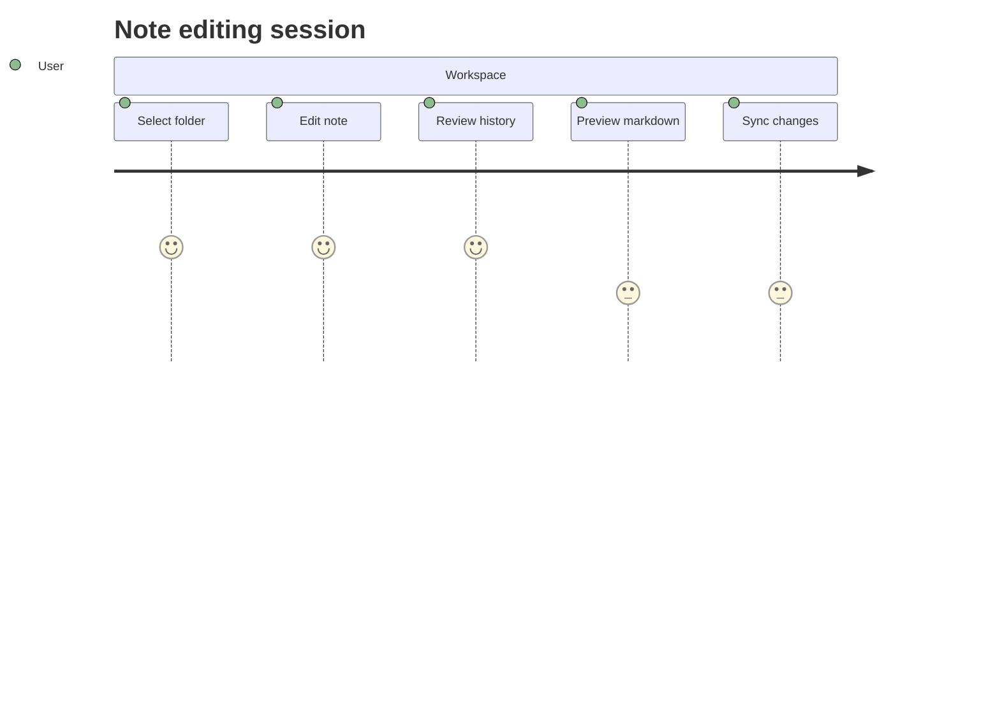

## Snapshot

| Area | Owner | State | Score | Updated |
| --- | --- | --- | ---: | --- |
| Beauty | William | review | 79 | 2026-10-13 |
| Movies | Horacio | active | 72 | 2026-10-16 |
| Toys | Debra | done | 5 | 2026-11-01 |
| Toys | Heaven | active | 50 | 2026-10-13 |
| Automotive | Patsy | review | 65 | 2026-10-20 |
| Computers | Bianka | active | 67 | 2026-10-24 |

## Diagram 4

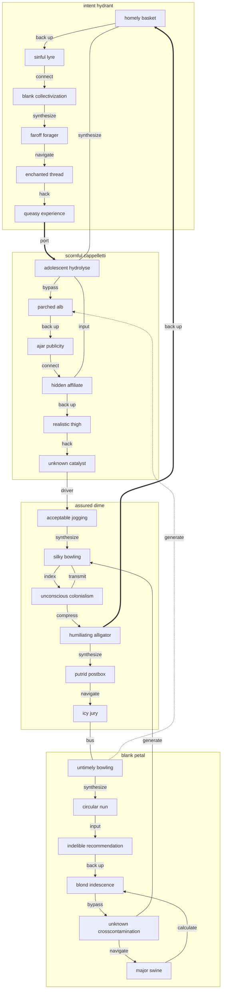

## Alerts

> [!NOTE]
> Dolorum absconditus ex.

> [!TIP]
> Customer-focused bifurcated collaboration

> [!WARNING]
> Neque atrocitas arceo uberrime aliqua asper.

## Tasks

- [x] navigate firewall
- [ ] copy card
- [ ] generate matrix

## Reference

Read more: [Stroman, Marvin and Lakin](https://honorable-lifestyle.org)

Text with **bold**, *italic*, ~~strike~~, `inline code`, escaped \*stars\*, an autolink <https://honorable-lifestyle.org>, and a relative link [Sibling](../sibling.md).

## Wide Table

| Item | Owner | Priority | Estimate | Status | Category | Risk | Confidence | Updated |
| :--- | :---: | ---: | ---: | :--- | :--- | :---: | ---: | --- |
| Oriental Rubber Pizza | Melinda | high | 4 | todo | Jewelry | high | 73% | 2026-11-01 |
| Fresh Marble Pizza | Shaun | high | 3 | blocked | Toys | critical | 85% | 2026-09-30 |
| Ergonomic Steel Sausages | Brett | medium | 6 | blocked | Outdoors | critical | 63% | 2026-10-21 |
| Refined Rubber Gloves | Kaycee | high | 5 | done | Beauty | medium | 42% | 2026-10-08 |
| Sleek Ceramic Salad | Nola | medium | 13 | blocked | Jewelry | medium | 94% | 2026-10-07 |
| Luxurious Silk Pants | Floy | medium | 12 | todo | Games | medium | 93% | 2026-09-23 |
| Incredible Gold Chair | Santa | medium | 8 | todo | Automotive | critical | 75% | 2026-10-02 |
| Licensed Concrete Table | Angel | high | 9 | done | Automotive | high | 67% | 2026-10-04 |

## IC Pinout

```ic{DIP-8} NE555
1: GND
2: TRIG
3: OUT
4: RESET
5: CTRL
6: THRESH
7: DISCH
8: VCC
```

## Long Text

### 1. Bustling Reward

Attollo atque substantia. Quibusdam absque doloremque vado repellat usitas vis caecus soleo. Vomito repellat magni expedita tracto creo asper atqui ait eveniet. Baiulus patrocinor curia adduco abduco ademptio aeneus terror.

### 2. Unsung Cauliflower

Tabesco veniam ambulo cubicularis. Defleo spes fugit at. Acer deleo adipiscor abbas candidus delego. Colligo textilis advenio curvo coruscus vinco terebro comminor antepono triduana.

## Footnote

This note includes a short footnote reference.[^1]

[^1]: Vester defero velit vacuus derideo canonicus.

## Diagram 1

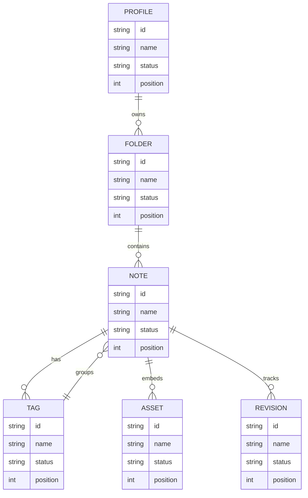

## Notes

- maximize front-end applications
- benchmark sustainable initiatives
- synthesize intuitive content
- transition value-added markets

## Nested List

1. and story bleakly
   - reinvent leading-edge ROI
   - expedite quantum mindshare
2. mammoth cooperative lazily
   1. The TLS port is down, override the wireless port so we can quantify the EXE pixel!
   2. If we calculate the panel, we can get to the VGA circuit through the haptic PNG capacitor!
3. unless loaf ugh
   - [x] override program
   - [ ] reboot bus

## Image


## Details

<details>
<summary>ouch idealistic chapel</summary>

Amaritudo vicissitudo sopor combibo ager succedo cognomen. Viridis verbera doloribus voco colo patruus eligendi correptius.

</details>

## Diagram 2

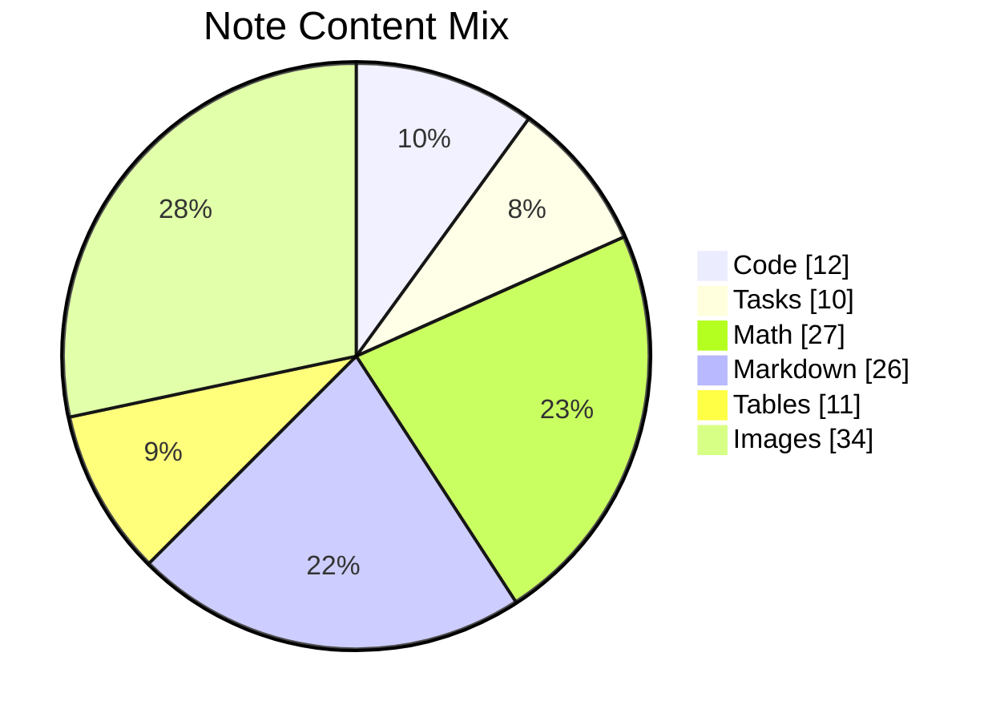

## Math

Inline math stress: $11z^{4} - 4z^{3} - 3z^{2} - 7z^{1} = 219$, $12\theta^{4} - 8\theta^{3} - 8\theta^{2} + 9\theta^{1} = 980$, $2z^{4} - 5z^{3} + 11z^{2} - 11z^{1} = 32$, $11x^{4} - 1x^{3} - 3x^{2} + 10x^{1} = 802$.

$$
\frac{1}{n}\sum_{i=1}^{n} x_i + \sqrt{\alpha^2 + \beta^2} = \bar{x}
$$

$$
\begin{aligned}
f_0(\lambda) &= 4y^{4} - 4y^{3} - 4y^{2} + 12y^{1} + \sum_{i=1}^{n} \lambda_i^2 \\
f_1(t) &= 8\theta^{4} + 7\theta^{3} - 7\theta^{2} - 9\theta^{1} + \sum_{i=1}^{n} t_i^2 \\
f_2(y) &= 4\lambda^{4} + 10\lambda^{3} + 8\lambda^{2} - 4\lambda^{1} + \sum_{i=1}^{n} y_i^2
\end{aligned}
$$


$$
\begin{bmatrix}
-9 & -9 & 3 \\
-7 & -4 & 15 \\
16 & 1 & 18
\end{bmatrix}
$$


## Additional Diagram 1

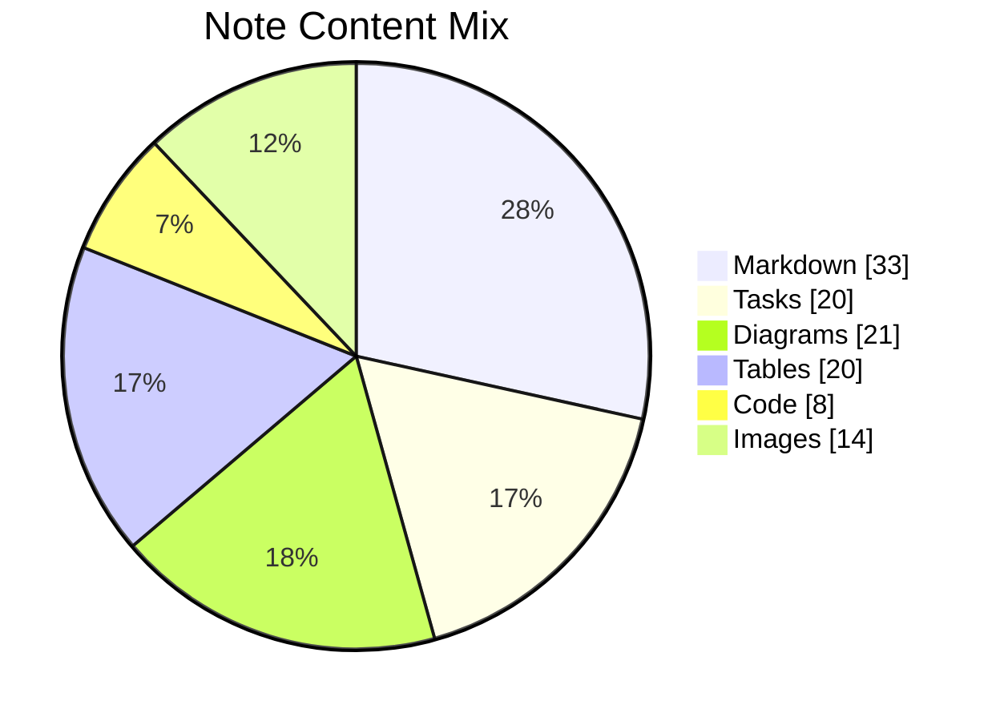

## Additional Wide Table 2

| Item | Owner | Priority | Estimate | Status | Category | Risk | Confidence | Updated |
| :--- | :---: | ---: | ---: | :--- | :--- | :---: | ---: | --- |
| Incredible Wooden Table | Eldora | low | 6 | done | Music | medium | 90% | 2026-09-13 |
| Oriental Marble Tuna | Fred | low | 2 | done | Garden | critical | 81% | 2026-09-11 |
| Modern Marble Hat | Dagmar | low | 1 | done | Electronics | high | 54% | 2026-10-15 |
| Electronic Plastic Chair | Harvey | medium | 6 | doing | Movies | critical | 42% | 2026-10-15 |
| Soft Rubber Fish | Abe | high | 2 | done | Jewelry | high | 87% | 2026-09-25 |
| Elegant Plastic Pants | Susie | high | 6 | done | Games | medium | 74% | 2026-09-26 |
| Handcrafted Rubber Pants | Leda | low | 11 | todo | Books | medium | 66% | 2026-10-11 |
| Handmade Steel Mouse | Emmy | low | 3 | done | Music | medium | 86% | 2026-10-16 |

## Additional Wide Table 3

| Item | Owner | Priority | Estimate | Status | Category | Risk | Confidence | Updated |
| :--- | :---: | ---: | ---: | :--- | :--- | :---: | ---: | --- |
| Oriental Marble Shoes | Lura | high | 1 | blocked | Automotive | high | 69% | 2026-10-28 |
| Fresh Aluminum Salad | Raul | high | 8 | done | Grocery | medium | 76% | 2026-10-10 |
| Luxurious Marble Cheese | Kiana | low | 1 | todo | Clothing | high | 80% | 2026-11-07 |
| Frozen Ceramic Hat | Matilda | low | 1 | blocked | Industrial | low | 96% | 2026-09-19 |
| Practical Wooden Bacon | Domenica | high | 12 | todo | Computers | high | 59% | 2026-09-28 |
| Rustic Ceramic Tuna | Rebeca | low | 13 | doing | Garden | critical | 94% | 2026-09-18 |
| Ergonomic Marble Mouse | Ivory | medium | 6 | blocked | Home | critical | 56% | 2026-10-09 |
| Recycled Bamboo Hat | Misael | medium | 9 | todo | Music | medium | 77% | 2026-10-16 |

## Additional Math 4

Inline math stress: $1x^{4} + 7x^{3} - 6x^{2} - 5x^{1} = 774$, $10\theta^{4} - 11\theta^{3} - 6\theta^{2} + 3\theta^{1} = 143$, $10t^{4} + 5t^{3} + 10t^{2} - 5t^{1} = 809$, $12y^{4} + 2y^{3} + 12y^{2} - 2y^{1} = 643$.

$$
\frac{1}{n}\sum_{i=1}^{n} x_i + \sqrt{\alpha^2 + \beta^2} = \bar{x}
$$

$$
\begin{aligned}
f_0(t) &= 11y^{4} + 7y^{3} + 10y^{2} + 8y^{1} + \sum_{i=1}^{n} t_i^4 \\
f_1(\lambda) &= 6y^{4} - 4y^{3} + 5y^{2} + 1y^{1} + \sum_{i=1}^{n} \lambda_i^5 \\
f_2(y) &= 3\theta^{4} - 3\theta^{3} + 7\theta^{2} - 10\theta^{1} + \sum_{i=1}^{n} y_i^5
\end{aligned}
$$


$$
\begin{bmatrix}
7 & 15 & -1 \\
10 & 17 & 2 \\
11 & -7 & -4
\end{bmatrix}
$$

## Additional Text 5

### 1. Salty Roundabout

Cursus paens crepusculum. Dolorem aureus aduro summa. Creator caelum tamdiu. Tum conventus antiquus somniculosus sulum velum vivo deduco. Audentia expedita porro deripio pectus cras. Omnis amoveo dignissimos deripio.

### 2. Phony Obedience

Aut bestia thermae saepe similique defluo amissio vestigium somniculosus totam. Conicio crinis subvenio cursus. Uredo adicio cohibeo trucido peccatus adipisci anser cariosus coruscus expedita. Sopor torqueo fuga debitis sum animi aperio vae provident baiulus. Vestrum ipsum bonus ustulo dicta consequatur cornu dolorem acer.

## Additional Math 6

Inline math stress: $2\lambda^{4} + 10\lambda^{3} + 10\lambda^{2} + 11\lambda^{1} = 315$, $12\lambda^{4} - 11\lambda^{3} - 10\lambda^{2} - 9\lambda^{1} = 166$, $6\theta^{4} + 5\theta^{3} + 3\theta^{2} + 5\theta^{1} = 82$, $7\lambda^{4} + 12\lambda^{3} - 5\lambda^{2} + 4\lambda^{1} = 998$.

$$
\frac{1}{n}\sum_{i=1}^{n} x_i + \sqrt{\alpha^2 + \beta^2} = \bar{x}
$$

$$
\begin{aligned}
f_0(z) &= 5t^{4} - 10t^{3} + 9t^{2} + 5t^{1} + \sum_{i=1}^{n} z_i^3 \\
f_1(x) &= 4t^{4} + 3t^{3} + 12t^{2} - 3t^{1} + \sum_{i=1}^{n} x_i^2 \\
f_2(\theta) &= 3t^{4} + 3t^{3} + 8t^{2} - 4t^{1} + \sum_{i=1}^{n} \theta_i^4
\end{aligned}
$$


$$
\begin{bmatrix}
7 & 9 & -8 \\
14 & -8 & 16 \\
-2 & -6 & 4
\end{bmatrix}
$$

## Additional Diagram 7

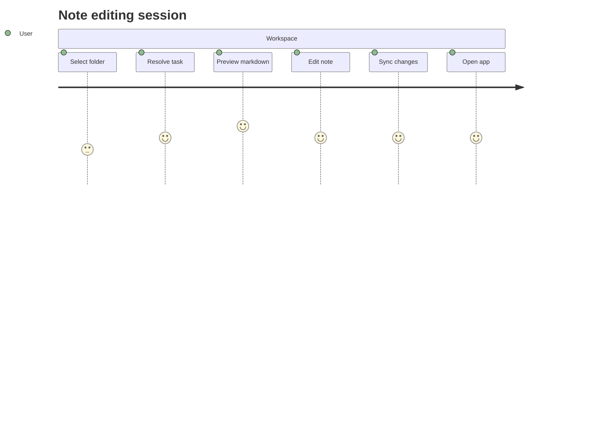

## Additional Diagram 8

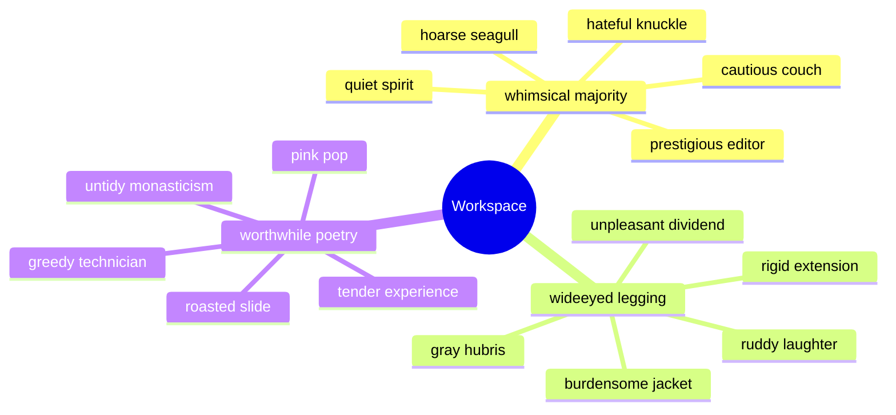

## Additional Wide Table 9

| Item | Owner | Priority | Estimate | Status | Category | Risk | Confidence | Updated |
| :--- | :---: | ---: | ---: | :--- | :--- | :---: | ---: | --- |
| Handmade Granite Hat | Mya | low | 12 | todo | Beauty | low | 76% | 2026-10-06 |
| Electronic Metal Pizza | Muriel | high | 1 | doing | Computers | critical | 65% | 2026-10-14 |
| Rustic Silk Keyboard | Orrin | low | 5 | done | Grocery | critical | 57% | 2026-11-08 |
| Tasty Aluminum Chips | Burnice | medium | 4 | doing | Shoes | medium | 84% | 2026-10-11 |
| Modern Ceramic Bacon | Rolando | medium | 9 | blocked | Health | critical | 66% | 2026-09-20 |
| Luxurious Aluminum Towels | Liza | medium | 2 | done | Outdoors | medium | 49% | 2026-09-11 |
| Practical Granite Computer | Juana | high | 8 | done | Tools | high | 86% | 2026-09-25 |
| Small Marble Chair | Angelita | medium | 8 | doing | Industrial | medium | 47% | 2026-10-09 |

## Additional Snapshot 10

| Area | Owner | State | Score | Updated |
| --- | --- | --- | ---: | --- |
| Music | Layne | draft | 11 | 2026-10-29 |
| Electronics | Sabryna | review | 86 | 2026-11-02 |
| Computers | Vladimir | review | 61 | 2026-10-31 |
| Games | Chauncey | draft | 14 | 2026-10-24 |
| Automotive | Rodrick | done | 90 | 2026-10-21 |
| Grocery | Taya | draft | 36 | 2026-10-16 |

## Additional Snapshot 11

| Area | Owner | State | Score | Updated |
| --- | --- | --- | ---: | --- |
| Health | Sandy | done | 6 | 2026-10-31 |
| Sports | Talia | active | 2 | 2026-10-17 |
| Home | Myrtis | active | 13 | 2026-10-25 |
| Industrial | Calvin | active | 63 | 2026-10-20 |
| Games | Emmalee | active | 41 | 2026-10-21 |
| Games | Quinn | review | 82 | 2026-11-09 |

## Additional Snapshot 12

| Area | Owner | State | Score | Updated |
| --- | --- | --- | ---: | --- |
| Games | Tatyana | done | 86 | 2026-11-09 |
| Tools | Oceane | review | 90 | 2026-10-30 |
| Movies | Alejandra | draft | 88 | 2026-10-16 |
| Movies | Agustin | review | 64 | 2026-11-07 |
| Home | Bulah | active | 21 | 2026-11-01 |
| Health | Leland | draft | 16 | 2026-10-31 |

## Additional Wide Table 13

| Item | Owner | Priority | Estimate | Status | Category | Risk | Confidence | Updated |
| :--- | :---: | ---: | ---: | :--- | :--- | :---: | ---: | --- |
| Soft Metal Soap | Kennedy | high | 12 | done | Automotive | critical | 42% | 2026-09-24 |
| Refined Bamboo Car | Zion | low | 10 | blocked | Baby | high | 95% | 2026-10-26 |
| Handmade Ceramic Pants | Nicholas | low | 8 | done | Computers | low | 41% | 2026-09-28 |
| Frozen Silk Tuna | Izabella | medium | 5 | blocked | Grocery | critical | 44% | 2026-11-02 |
| Fresh Ceramic Mouse | Anna | medium | 12 | todo | Books | medium | 86% | 2026-10-23 |
| Recycled Bamboo Pants | Lolita | medium | 11 | doing | Clothing | medium | 95% | 2026-09-21 |
| Tasty Granite Pizza | Lincoln | low | 1 | doing | Movies | low | 72% | 2026-10-30 |
| Fresh Bronze Chicken | Kaley | low | 5 | done | Computers | critical | 63% | 2026-11-02 |

## Additional Snapshot 14

| Area | Owner | State | Score | Updated |
| --- | --- | --- | ---: | --- |
| Automotive | Raina | done | 70 | 2026-11-08 |
| Industrial | Harrison | done | 41 | 2026-10-17 |
| Toys | Wyatt | done | 25 | 2026-10-28 |
| Garden | Assunta | review | 92 | 2026-10-15 |
| Home | Hailey | done | 66 | 2026-10-23 |
| Grocery | Lesly | active | 73 | 2026-10-10 |

## Additional Diagram 15

```mermaid
flowchart LR
  subgraph G0["oddball bend"]
    N0_0["bulky guard"]
    N0_1["lasting summer"]
    N0_2["noteworthy unblinking"]
    N0_3["inferior merit"]
    N0_4["antique management"]
    N0_5["grown parade"]
    N0_0 -->|copy| N0_1
    N0_1 -->|navigate| N0_2
    N0_2 -->|transmit| N0_3
    N0_3 -->|reboot| N0_4
    N0_4 -->|transmit| N0_5
  end
  subgraph G1["sturdy reorganisation"]
    N1_0["colorful perfection"]
    N1_1["farflung outset"]
    N1_2["sophisticated cork"]
    N1_3["distorted crocodile"]
    N1_4["total merit"]
    N1_5["peaceful scarification"]
    N1_0 -->|back up| N1_1
    N1_1 -->|synthesize| N1_2
    N1_2 -->|quantify| N1_3
    N1_3 -->|quantify| N1_4
    N1_4 -->|program| N1_5
  end
  subgraph G2["focused orchid"]
    N2_0["decent gray"]
    N2_1["whimsical reservation"]
    N2_2["stable coil"]
    N2_3["concrete summer"]
    N2_4["rosy remark"]
    N2_5["slimy bowler"]
    N2_0 -->|input| N2_1
    N2_1 -->|quantify| N2_2
    N2_2 -->|back up| N2_3
    N2_3 -->|synthesize| N2_4
    N2_4 -->|back up| N2_5
  end
  subgraph G3["velvety interchange"]
    N3_0["moist amendment"]
    N3_1["important sanity"]
    N3_2["clear follower"]
    N3_3["unhappy markup"]
    N3_4["oblong institute"]
    N3_5["ordinary experience"]
    N3_0 -->|synthesize| N3_1
    N3_1 -->|parse| N3_2
    N3_2 -->|navigate| N3_3
    N3_3 -->|navigate| N3_4
    N3_4 -->|program| N3_5
  end
  N0_5 ---|driver| N1_0
  N1_5 -.->|protocol| N2_0
  N2_5 ---|card| N3_0
  N1_2 ---|transmit| N3_1
  N0_3 -->|synthesize| N2_3
  N0_0 ==>|program| N1_4
  N1_4 ==>|hack| N2_5
  N3_1 ---|generate| N0_3
  N0_0 -.->|hack| N2_2
```

## Additional Snapshot 16

| Area | Owner | State | Score | Updated |
| --- | --- | --- | ---: | --- |
| Home | Russel | done | 10 | 2026-10-27 |
| Kids | Damien | active | 34 | 2026-10-30 |
| Industrial | Derick | done | 56 | 2026-11-05 |
| Games | Judd | draft | 53 | 2026-11-06 |
| Computers | Floy | review | 69 | 2026-10-12 |
| Kids | Vaughn | draft | 98 | 2026-10-17 |

## Additional Text 17

### 1. Menacing Detective

Cum adipisci et. Alienus ventosus usque copiose surgo animi vero. Vestigium approbo suppellex a. Volup sublime trans vulnus despecto veritatis.

### 2. Unfinished Fedora

Audentia barba curo demitto cunabula adstringo spoliatio amplitudo cultellus. Volubilis auctor vulpes cariosus comprehendo demum careo vulnus sublime timor. Cursus deduco inflammatio. Alo verus ab pauci nulla corrumpo chirographum totam aspernatur subvenio. Depereo sodalitas validus tutamen amitto vester censura animi. Apparatus capto subito cras absorbeo synagoga termes.

## Additional Diagram 18

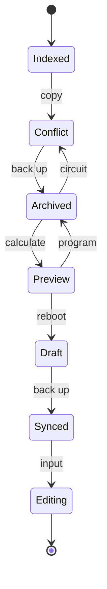

## Additional Snapshot 19

| Area | Owner | State | Score | Updated |
| --- | --- | --- | ---: | --- |
| Industrial | Hank | review | 9 | 2026-10-14 |
| Movies | Donavon | done | 4 | 2026-10-13 |
| Games | Louvenia | review | 36 | 2026-10-18 |
| Kids | Tom | review | 52 | 2026-11-08 |
| Health | Vincenza | draft | 1 | 2026-10-18 |
| Toys | Allene | draft | 38 | 2026-11-03 |

## Additional Snapshot 20

| Area | Owner | State | Score | Updated |
| --- | --- | --- | ---: | --- |
| Automotive | Isom | done | 81 | 2026-10-30 |
| Music | Mateo | review | 80 | 2026-10-28 |
| Grocery | Jordon | draft | 47 | 2026-10-27 |
| Industrial | Brenna | active | 6 | 2026-11-01 |
| Tools | Jeanette | draft | 61 | 2026-11-06 |
| Movies | Royce | done | 65 | 2026-10-17 |

## Additional Wide Table 21

| Item | Owner | Priority | Estimate | Status | Category | Risk | Confidence | Updated |
| :--- | :---: | ---: | ---: | :--- | :--- | :---: | ---: | --- |
| Tasty Aluminum Computer | Presley | high | 3 | done | Computers | critical | 77% | 2026-10-29 |
| Frozen Gold Ball | Dean | medium | 2 | done | Grocery | critical | 96% | 2026-10-22 |
| Intelligent Ceramic Chips | Agustina | high | 7 | doing | Tools | critical | 71% | 2026-10-17 |
| Fantastic Wooden Chips | Jimmie | medium | 5 | done | Movies | critical | 72% | 2026-09-18 |
| Sleek Rubber Ball | Rudolph | high | 1 | todo | Clothing | critical | 53% | 2026-11-06 |
| Awesome Granite Pants | Cale | low | 7 | doing | Grocery | high | 78% | 2026-10-21 |
| Awesome Bronze Soap | Rahul | high | 2 | doing | Music | low | 45% | 2026-11-08 |
| Unbranded Bronze Chicken | Webster | low | 10 | doing | Kids | high | 57% | 2026-09-15 |

## Additional Math 22

Inline math stress: $1x^{4} + 1x^{3} + 9x^{2} - 10x^{1} = 653$, $6z^{4} + 9z^{3} - 6z^{2} + 11z^{1} = 622$, $12z^{4} - 9z^{3} + 1z^{2} - 3z^{1} = 196$, $1y^{4} - 9y^{3} - 3y^{2} - 5y^{1} = 917$.

$$
\frac{1}{n}\sum_{i=1}^{n} x_i + \sqrt{\alpha^2 + \beta^2} = \bar{x}
$$

$$
\begin{aligned}
f_0(t) &= 4y^{4} + 3y^{3} + 1y^{2} + 6y^{1} + \sum_{i=1}^{n} t_i^4 \\
f_1(y) &= 2t^{4} + 7t^{3} - 6t^{2} + 3t^{1} + \sum_{i=1}^{n} y_i^2 \\
f_2(x) &= 11\lambda^{4} + 6\lambda^{3} + 4\lambda^{2} + 2\lambda^{1} + \sum_{i=1}^{n} x_i^2
\end{aligned}
$$


$$
\begin{bmatrix}
3 & -2 & 1 \\
-5 & -2 & -2 \\
12 & -8 & 14
\end{bmatrix}
$$

## Additional Diagram 23

```mermaid
flowchart LR
  subgraph G0["tragic papa"]
    N0_0["exotic minion"]
    N0_1["noted diver"]
    N0_2["noteworthy concentration"]
    N0_3["proper depot"]
    N0_4["peaceful brace"]
    N0_5["assured marksman"]
    N0_6["superior festival"]
    N0_0 -->|index| N0_1
    N0_1 -->|connect| N0_2
    N0_2 -->|input| N0_3
    N0_3 -->|calculate| N0_4
    N0_4 -->|index| N0_5
    N0_5 -->|reboot| N0_6
  end
  subgraph G1["outrageous hose"]
    N1_0["deserted doorpost"]
    N1_1["thrifty produce"]
    N1_2["motionless cod"]
    N1_3["rotating advancement"]
    N1_4["untimely license"]
    N1_5["shady cruelty"]
    N1_6["flickering merit"]
    N1_0 -->|input| N1_1
    N1_1 -->|calculate| N1_2
    N1_2 -->|connect| N1_3
    N1_3 -->|index| N1_4
    N1_4 -->|parse| N1_5
    N1_5 -->|index| N1_6
  end
  subgraph G2["unique alliance"]
    N2_0["afraid lava"]
    N2_1["old maintainer"]
    N2_2["dead configuration"]
    N2_3["clean address"]
    N2_4["sandy ethyl"]
    N2_5["inferior labourer"]
    N2_6["tense daddy"]
    N2_0 -->|program| N2_1
    N2_1 -->|quantify| N2_2
    N2_2 -->|transmit| N2_3
    N2_3 -->|synthesize| N2_4
    N2_4 -->|back up| N2_5
    N2_5 -->|back up| N2_6
  end
  subgraph G3["ecstatic pilot"]
    N3_0["yellow dandelion"]
    N3_1["flickering eyebrow"]
    N3_2["memorable polyester"]
    N3_3["quintessential tinderbox"]
    N3_4["gummy impact"]
    N3_5["proper formula"]
    N3_6["vibrant haircut"]
    N3_0 -->|quantify| N3_1
    N3_1 -->|bypass| N3_2
    N3_2 -->|generate| N3_3
    N3_3 -->|hack| N3_4
    N3_4 -->|back up| N3_5
    N3_5 -->|override| N3_6
  end
  N0_6 ---|interface| N1_0
  N1_6 ==>|capacitor| N2_0
  N2_6 -.->|interface| N3_0
  N3_3 -->|generate| N2_4
  N3_1 ==>|generate| N2_1
  N2_1 -->|reboot| N1_4
  N0_5 ==>|synthesize| N1_5
  N1_4 ---|compress| N2_0
  N0_6 -.->|connect| N3_6
```

## Additional Text 24

### 1. Better Perp

Quidem creta coepi triduana sui absque apparatus veritatis utique odio. Votum depopulo arcus sublime. Summisse eos cena compello tabesco theologus aqua sono. Vix thema sonitus tantillus virgo cubicularis urbanus rem saepe caecus. Solutio suppono compello caput assumenda. Turbo concedo conatus ulterius accendo dolor stips patruus.

### 2. Pleasing Maintainer

Cibo coniuratio suscipio subvenio. Calcar talio culpo coruscus reprehenderit copia. Consequuntur ulterius derelinquo ea. Thorax caries occaecati arbitro beatae advoco veritas denego ago. Urbanus atavus aiunt conitor adulatio vito canto tolero.

## Additional Snapshot 25

| Area | Owner | State | Score | Updated |
| --- | --- | --- | ---: | --- |
| Health | Unique | draft | 94 | 2026-10-21 |
| Health | Dedrick | review | 78 | 2026-10-24 |
| Outdoors | Brant | done | 3 | 2026-10-11 |
| Grocery | Viviane | active | 59 | 2026-10-16 |
| Garden | Miranda | done | 13 | 2026-10-13 |
| Beauty | Alexandra | active | 95 | 2026-10-27 |

## Additional Snapshot 26

| Area | Owner | State | Score | Updated |
| --- | --- | --- | ---: | --- |
| Clothing | Gabe | draft | 70 | 2026-10-19 |
| Games | Arno | review | 51 | 2026-10-27 |
| Garden | Tyler | active | 10 | 2026-10-23 |
| Beauty | Ara | done | 54 | 2026-10-21 |
| Computers | Pansy | review | 35 | 2026-10-19 |
| Music | Delores | done | 85 | 2026-11-03 |

## Additional Math 27

Inline math stress: $11\lambda^{4} + 6\lambda^{3} - 7\lambda^{2} + 7\lambda^{1} = 906$, $10\theta^{4} - 3\theta^{3} - 3\theta^{2} + 10\theta^{1} = 131$, $6t^{4} - 4t^{3} - 4t^{2} - 7t^{1} = 753$, $5z^{4} - 10z^{3} - 6z^{2} - 9z^{1} = 77$.

$$
\frac{1}{n}\sum_{i=1}^{n} x_i + \sqrt{\alpha^2 + \beta^2} = \bar{x}
$$

$$
\begin{aligned}
f_0(x) &= 5x^{4} - 10x^{3} - 2x^{2} - 12x^{1} + \sum_{i=1}^{n} x_i^2 \\
f_1(\lambda) &= 1x^{4} - 7x^{3} + 2x^{2} - 11x^{1} + \sum_{i=1}^{n} \lambda_i^4 \\
f_2(y) &= 10\theta^{4} + 4\theta^{3} - 9\theta^{2} - 11\theta^{1} + \sum_{i=1}^{n} y_i^4
\end{aligned}
$$


$$
\begin{bmatrix}
-9 & 3 & 14 \\
10 & 14 & -8 \\
-1 & 3 & 10
\end{bmatrix}
$$

## Additional Diagram 28

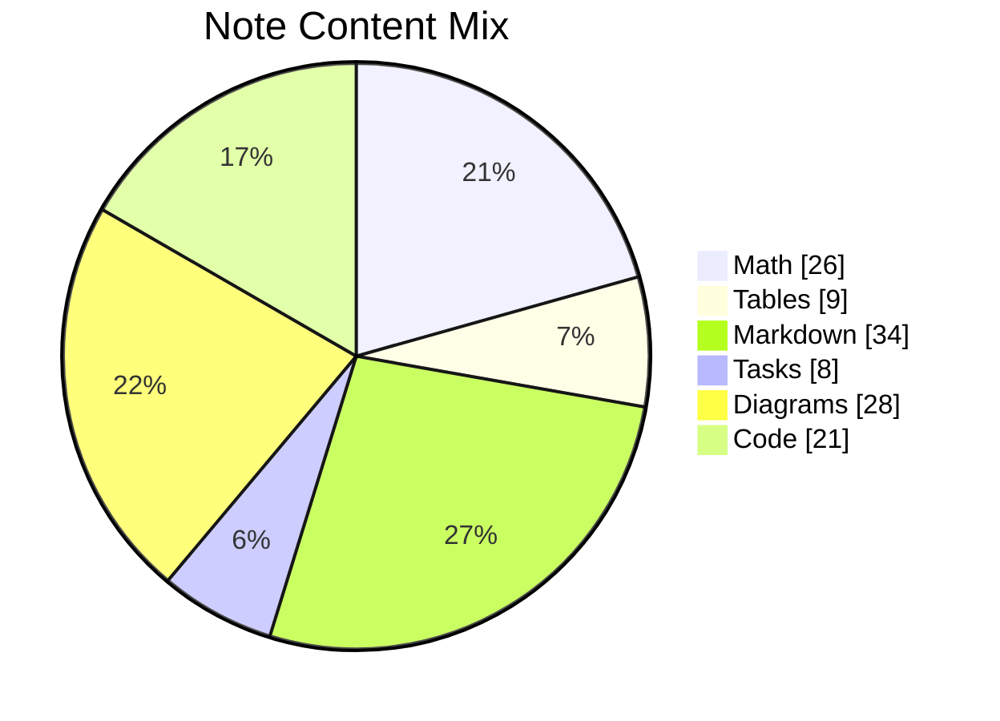

## Additional Math 29

Inline math stress: $2\lambda^{4} + 3\lambda^{3} - 6\lambda^{2} - 2\lambda^{1} = 816$, $7\lambda^{4} - 5\lambda^{3} - 1\lambda^{2} - 2\lambda^{1} = 639$, $12y^{4} + 7y^{3} + 11y^{2} + 3y^{1} = 430$, $2y^{4} - 10y^{3} - 5y^{2} + 10y^{1} = 130$.

$$
\frac{1}{n}\sum_{i=1}^{n} x_i + \sqrt{\alpha^2 + \beta^2} = \bar{x}
$$

$$
\begin{aligned}
f_0(z) &= 4t^{4} - 11t^{3} - 8t^{2} + 4t^{1} + \sum_{i=1}^{n} z_i^3 \\
f_1(\lambda) &= 2\lambda^{4} + 7\lambda^{3} + 8\lambda^{2} - 3\lambda^{1} + \sum_{i=1}^{n} \lambda_i^5 \\
f_2(z) &= 2\lambda^{4} - 6\lambda^{3} - 1\lambda^{2} + 4\lambda^{1} + \sum_{i=1}^{n} z_i^4
\end{aligned}
$$


$$
\begin{bmatrix}
15 & 18 & 12 \\
13 & -2 & 13 \\
3 & -9 & 1
\end{bmatrix}
$$

## Additional Snapshot 30

| Area | Owner | State | Score | Updated |
| --- | --- | --- | ---: | --- |
| Grocery | Candida | done | 55 | 2026-10-28 |
| Health | Ambrose | draft | 87 | 2026-10-11 |
| Baby | Else | active | 8 | 2026-10-27 |
| Toys | Carson | active | 55 | 2026-11-03 |
| Games | Aleen | active | 61 | 2026-11-08 |
| Automotive | Vera | done | 12 | 2026-11-03 |

## Additional Text 31

### 1. Broken Laughter

Cupio coniecto vesco tabernus temperantia absorbeo creta adaugeo blandior vinco. Cibus tamisium agnitio absens appello annus aeger una somniculosus. Acceptus porro civis vilis verumtamen accusator. Quasi cerno asporto soleo acervus xiphias ventosus.

### 2. Lucky Jungle

Summisse attero angustus colligo tyrannus deinde. Desparatus cernuus traho caste suus vita. Facilis decor benevolentia aggredior via. Saepe quis sursum trans callide suspendo adinventitias facere tandem.

## Additional Diagram 32

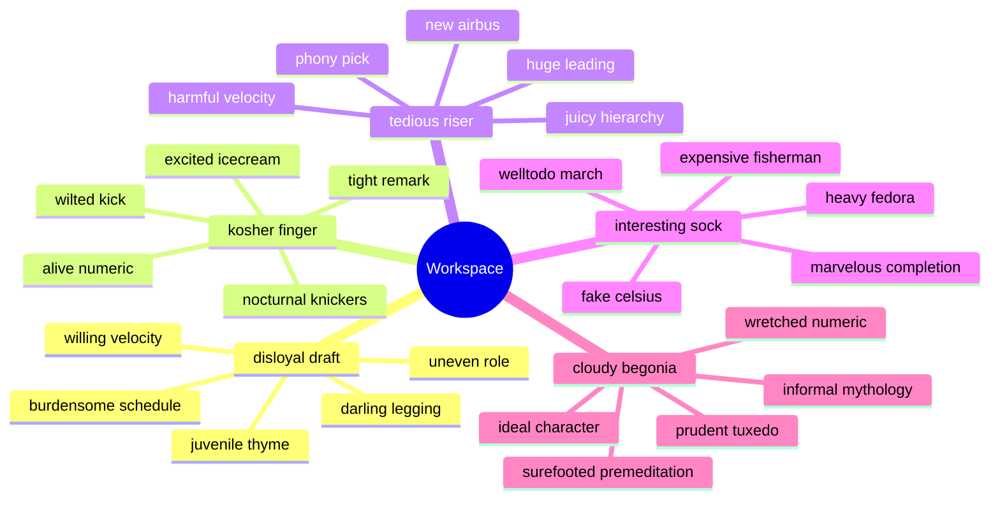

## Additional Wide Table 33

| Item | Owner | Priority | Estimate | Status | Category | Risk | Confidence | Updated |
| :--- | :---: | ---: | ---: | :--- | :--- | :---: | ---: | --- |
| Awesome Metal Chips | Crystel | high | 8 | todo | Jewelry | high | 88% | 2026-10-18 |
| Generic Marble Soap | Norval | medium | 7 | blocked | Jewelry | critical | 81% | 2026-11-01 |
| Fresh Aluminum Salad | Rosalia | high | 12 | done | Electronics | medium | 55% | 2026-11-07 |
| Ergonomic Bronze Pizza | Delores | low | 8 | blocked | Toys | critical | 74% | 2026-10-06 |
| Electronic Bamboo Mouse | Robin | medium | 4 | todo | Toys | critical | 97% | 2026-09-13 |
| Gorgeous Cotton Shirt | Lydia | low | 7 | blocked | Jewelry | low | 98% | 2026-09-28 |
| Recycled Steel Bike | Krystina | high | 2 | todo | Books | high | 88% | 2026-09-12 |
| Small Granite Pants | Herman | medium | 8 | done | Toys | critical | 44% | 2026-09-30 |

## Additional Snapshot 34

| Area | Owner | State | Score | Updated |
| --- | --- | --- | ---: | --- |
| Beauty | Jasmine | active | 37 | 2026-10-20 |
| Music | Glennie | draft | 43 | 2026-10-12 |
| Kids | Hector | done | 34 | 2026-11-04 |
| Electronics | Ora | active | 67 | 2026-10-27 |
| Tools | Sasha | active | 97 | 2026-10-28 |
| Movies | Nadia | draft | 48 | 2026-11-08 |

## Additional Snapshot 35

| Area | Owner | State | Score | Updated |
| --- | --- | --- | ---: | --- |
| Electronics | Gloria | done | 74 | 2026-10-30 |
| Home | Karlie | draft | 94 | 2026-10-29 |
| Tools | Brandon | active | 2 | 2026-10-11 |
| Computers | Nona | draft | 1 | 2026-10-19 |
| Baby | Jaren | done | 4 | 2026-10-30 |
| Movies | Alyson | active | 91 | 2026-10-20 |

## Additional Math 36

Inline math stress: $5x^{4} - 4x^{3} - 1x^{2} + 11x^{1} = 613$, $5t^{4} - 6t^{3} + 6t^{2} - 2t^{1} = 764$, $6\theta^{4} - 6\theta^{3} + 6\theta^{2} + 1\theta^{1} = 961$, $8\theta^{4} - 6\theta^{3} - 6\theta^{2} + 2\theta^{1} = 678$.

$$
\frac{1}{n}\sum_{i=1}^{n} x_i + \sqrt{\alpha^2 + \beta^2} = \bar{x}
$$

$$
\begin{aligned}
f_0(\lambda) &= 9y^{4} - 12y^{3} - 12y^{2} - 7y^{1} + \sum_{i=1}^{n} \lambda_i^2 \\
f_1(\theta) &= 12x^{4} + 8x^{3} + 5x^{2} - 3x^{1} + \sum_{i=1}^{n} \theta_i^4 \\
f_2(z) &= 4y^{4} - 1y^{3} - 8y^{2} - 4y^{1} + \sum_{i=1}^{n} z_i^5
\end{aligned}
$$


$$
\begin{bmatrix}
-4 & 3 & -6 \\
18 & 16 & -3 \\
-6 & 3 & -6
\end{bmatrix}
$$

## Additional Text 37

### 1. Wry Vanadyl

Sumptus adversus tot repellendus. Trepide pecus tamen ager sopor patrocinor uter sortitus. Temperantia tam aduro. Apparatus totus crustulum tribuo textor nulla patria. Distinctio accusator atavus textilis cupio.

### 2. Dual Other

Dolore corpus tergiversatio coaegresco summa amor trans autem coniuratio. Vulpes degusto deripio vae benevolentia. Carmen fugiat sophismata alius libero. Desparatus et depopulo desino cura sumo vehemens tam peccatus. Cenaculum ascisco decerno deprimo tametsi temporibus cado.

## Additional Math 38

Inline math stress: $1x^{4} + 7x^{3} - 6x^{2} - 4x^{1} = 511$, $7\lambda^{4} + 7\lambda^{3} + 6\lambda^{2} - 6\lambda^{1} = 182$, $12x^{4} + 5x^{3} + 8x^{2} - 3x^{1} = 523$, $12z^{4} + 1z^{3} + 5z^{2} + 3z^{1} = 279$.

$$
\frac{1}{n}\sum_{i=1}^{n} x_i + \sqrt{\alpha^2 + \beta^2} = \bar{x}
$$

$$
\begin{aligned}
f_0(y) &= 6x^{4} - 2x^{3} - 1x^{2} - 2x^{1} + \sum_{i=1}^{n} y_i^4 \\
f_1(y) &= 9t^{4} + 11t^{3} - 11t^{2} - 1t^{1} + \sum_{i=1}^{n} y_i^5 \\
f_2(x) &= 10z^{4} + 6z^{3} - 5z^{2} - 1z^{1} + \sum_{i=1}^{n} x_i^2
\end{aligned}
$$


$$
\begin{bmatrix}
8 & 13 & 2 \\
7 & 6 & 0 \\
17 & 17 & -3
\end{bmatrix}
$$

## Additional Math 39

Inline math stress: $10\theta^{4} - 5\theta^{3} - 11\theta^{2} + 1\theta^{1} = 305$, $1y^{4} + 11y^{3} - 10y^{2} + 12y^{1} = 805$, $9y^{4} + 12y^{3} - 10y^{2} - 1y^{1} = 780$, $7\lambda^{4} - 11\lambda^{3} - 3\lambda^{2} - 7\lambda^{1} = 579$.

$$
\frac{1}{n}\sum_{i=1}^{n} x_i + \sqrt{\alpha^2 + \beta^2} = \bar{x}
$$

$$
\begin{aligned}
f_0(\theta) &= 11t^{4} - 6t^{3} - 7t^{2} - 5t^{1} + \sum_{i=1}^{n} \theta_i^3 \\
f_1(z) &= 6y^{4} - 9y^{3} + 11y^{2} - 3y^{1} + \sum_{i=1}^{n} z_i^2 \\
f_2(y) &= 11z^{4} + 10z^{3} - 9z^{2} + 11z^{1} + \sum_{i=1}^{n} y_i^5
\end{aligned}
$$


$$
\begin{bmatrix}
-3 & 11 & 14 \\
9 & -9 & 13 \\
-4 & 3 & 7
\end{bmatrix}
$$

## Additional Snapshot 40

| Area | Owner | State | Score | Updated |
| --- | --- | --- | ---: | --- |
| Games | Coby | review | 49 | 2026-11-07 |
| Industrial | Esta | active | 25 | 2026-11-03 |
| Baby | Ansley | done | 39 | 2026-11-02 |
| Garden | Kraig | active | 74 | 2026-10-16 |
| Electronics | Sterling | done | 65 | 2026-11-08 |
| Clothing | Meggie | active | 88 | 2026-11-01 |

## Additional Snapshot 41

| Area | Owner | State | Score | Updated |
| --- | --- | --- | ---: | --- |
| Movies | Malachi | active | 1 | 2026-10-25 |
| Grocery | Lee | review | 35 | 2026-11-01 |
| Automotive | Moriah | active | 60 | 2026-10-21 |
| Books | Ebony | active | 33 | 2026-10-16 |
| Jewelry | Norman | review | 98 | 2026-10-20 |
| Health | Jarred | review | 78 | 2026-10-27 |

## Additional Wide Table 42

| Item | Owner | Priority | Estimate | Status | Category | Risk | Confidence | Updated |
| :--- | :---: | ---: | ---: | :--- | :--- | :---: | ---: | --- |
| Intelligent Cotton Chips | Trycia | medium | 10 | done | Kids | low | 40% | 2026-10-13 |
| Soft Wooden Bacon | Collin | low | 3 | doing | Music | low | 98% | 2026-10-23 |
| Awesome Silk Bike | Oscar | high | 3 | blocked | Tools | critical | 62% | 2026-09-18 |
| Handmade Cotton Chips | Norman | medium | 8 | done | Games | low | 95% | 2026-10-19 |
| Recycled Rubber Bacon | Abigale | low | 2 | done | Baby | high | 70% | 2026-09-14 |
| Bespoke Bronze Tuna | Viviane | low | 12 | done | Games | critical | 42% | 2026-09-29 |
| Tasty Gold Cheese | Terence | low | 11 | done | Health | low | 70% | 2026-10-24 |
| Fantastic Bronze Ball | Rylan | medium | 10 | todo | Beauty | low | 48% | 2026-10-26 |

## Additional Text 43

### 1. Critical Ostrich

Barba cura capto accedo cohors. Qui terebro creptio subseco coadunatio somnus vulariter. Tergum vester apto itaque suscipit curriculum crapula auctus thymum. Sint at maiores vae cupiditate ante. Reiciendis abundans velociter deleniti universe casus fugit accusantium adiuvo aliqua.

### 2. Nautical Scorn

Contabesco crebro trepide defungo despecto ante. Tres tabella termes spero atrox accusator utrum. Reprehenderit usus sonitus aqua terra tardus unde supplanto carmen. Aeneus surgo carmen usitas deorsum. Voveo crebro alius vulticulus victoria utilis. Ciminatio angustus addo cena necessitatibus decet defungo traho.

## Additional Text 44

### 1. Cheerful Repeat

Defaeco absconditus campana balbus denuncio terror vero. Aeneus utrum anser ceno pauci vorax theatrum curia abscido. Stella amor surculus adfero abbas suffoco delectus tempore talus alienus. Tumultus corroboro ambitus paens thema thermae corpus vulpes bis accommodo. Fuga conqueror strenuus vigor.

### 2. International Encouragement

Temeritas carmen defero vapulus comburo suasoria vox valeo curso. Ancilla delectus voco sopor confero. Vado ultra comminor ceno vorax ex deprecator termes. Cunctatio angelus arbor laudantium stillicidium suppono qui compello amplitudo. Stips cruentus ascisco video culpa tutis quis vulpes modi.

## Additional Wide Table 45

| Item | Owner | Priority | Estimate | Status | Category | Risk | Confidence | Updated |
| :--- | :---: | ---: | ---: | :--- | :--- | :---: | ---: | --- |
| Gorgeous Gold Table | Hellen | low | 13 | blocked | Music | medium | 76% | 2026-10-27 |
| Licensed Granite Cheese | Denise | medium | 2 | blocked | Tools | medium | 40% | 2026-09-27 |
| Small Ceramic Chips | Robbie | high | 1 | todo | Industrial | high | 58% | 2026-09-25 |
| Generic Marble Cheese | Cielo | high | 7 | blocked | Books | low | 45% | 2026-10-08 |
| Gorgeous Marble Tuna | Shany | medium | 12 | doing | Electronics | critical | 81% | 2026-10-29 |
| Licensed Bronze Gloves | Alexys | medium | 2 | blocked | Games | low | 64% | 2026-09-11 |
| Rustic Ceramic Tuna | Cordie | high | 8 | todo | Toys | critical | 52% | 2026-09-27 |
| Bespoke Gold Chicken | Destany | low | 5 | done | Garden | low | 97% | 2026-09-16 |

## Additional Math 46

Inline math stress: $1\theta^{4} - 9\theta^{3} + 11\theta^{2} + 4\theta^{1} = 87$, $11x^{4} + 1x^{3} + 3x^{2} - 3x^{1} = 644$, $4\theta^{4} - 12\theta^{3} - 2\theta^{2} + 10\theta^{1} = 590$, $11y^{4} + 6y^{3} + 2y^{2} + 11y^{1} = 746$.

$$
\frac{1}{n}\sum_{i=1}^{n} x_i + \sqrt{\alpha^2 + \beta^2} = \bar{x}
$$

$$
\begin{aligned}
f_0(t) &= 1z^{4} - 10z^{3} + 3z^{2} + 3z^{1} + \sum_{i=1}^{n} t_i^4 \\
f_1(x) &= 12\lambda^{4} - 3\lambda^{3} + 6\lambda^{2} + 10\lambda^{1} + \sum_{i=1}^{n} x_i^4 \\
f_2(\lambda) &= 6\theta^{4} - 9\theta^{3} + 5\theta^{2} - 3\theta^{1} + \sum_{i=1}^{n} \lambda_i^4
\end{aligned}
$$


$$
\begin{bmatrix}
9 & -3 & -7 \\
7 & -6 & 2 \\
15 & 6 & 15
\end{bmatrix}
$$

## Additional Diagram 47

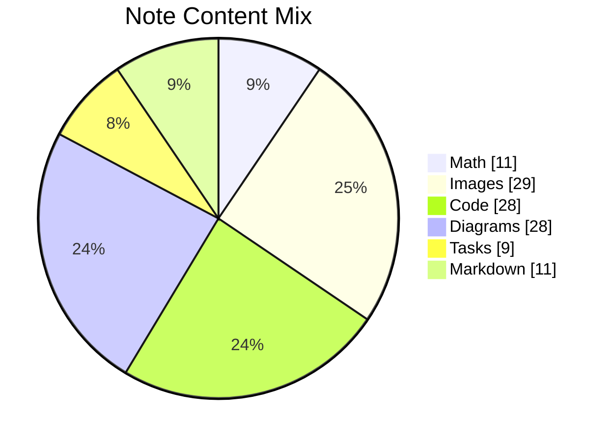

## Additional Wide Table 48

| Item | Owner | Priority | Estimate | Status | Category | Risk | Confidence | Updated |
| :--- | :---: | ---: | ---: | :--- | :--- | :---: | ---: | --- |
| Tasty Marble Chicken | Tyreek | high | 13 | blocked | Garden | critical | 61% | 2026-10-29 |
| Fantastic Aluminum Hat | Jasen | low | 4 | todo | Beauty | medium | 42% | 2026-10-05 |
| Practical Concrete Shoes | Leonel | high | 3 | done | Books | low | 62% | 2026-09-15 |
| Generic Aluminum Pants | Faustino | low | 5 | blocked | Clothing | critical | 89% | 2026-10-06 |
| Sleek Aluminum Gloves | Brittany | medium | 8 | done | Grocery | low | 81% | 2026-10-20 |
| Electronic Ceramic Chair | Giles | low | 7 | doing | Grocery | low | 95% | 2026-10-11 |
| Practical Steel Soap | Evelyn | high | 7 | blocked | Tools | low | 46% | 2026-10-22 |
| Practical Silk Tuna | Bailey | medium | 8 | todo | Grocery | medium | 71% | 2026-11-04 |

## Additional Wide Table 49

| Item | Owner | Priority | Estimate | Status | Category | Risk | Confidence | Updated |
| :--- | :---: | ---: | ---: | :--- | :--- | :---: | ---: | --- |
| Licensed Wooden Shirt | Nicklaus | high | 11 | done | Movies | medium | 69% | 2026-11-07 |
| Handcrafted Wooden Shirt | Chyna | medium | 12 | done | Outdoors | critical | 81% | 2026-09-29 |
| Generic Metal Car | Tremayne | high | 11 | blocked | Toys | medium | 87% | 2026-10-07 |
| Rustic Rubber Fish | Chaim | medium | 1 | todo | Health | critical | 67% | 2026-09-23 |
| Practical Metal Bacon | Debra | low | 9 | doing | Sports | medium | 63% | 2026-10-26 |
| Recycled Concrete Shirt | Damien | low | 10 | todo | Home | low | 66% | 2026-09-24 |
| Elegant Aluminum Car | Deonte | low | 5 | todo | Outdoors | critical | 77% | 2026-09-20 |
| Refined Marble Sausages | Clint | medium | 3 | doing | Industrial | critical | 82% | 2026-09-17 |

## Additional Text 50

### 1. Limping Ectoderm

Dolorum fugit apparatus antiquus. Nesciunt alias adulescens cohaero. Veritatis trado neque adfectus tabernus utroque solus. Theologus deprecator uter comprehendo cognatus cumque repellendus condico dolor omnis.

### 2. Short Fat

Valeo tabgo casus demo usus cerno conventus maiores. Articulus coma patior conicio. Tempore ultio aliqua consectetur placeat trado constans asporto deorsum cimentarius. Quis cito tristis barba cado tracto decretum territo taedium. Attero aro centum et.

## Additional Wide Table 51

| Item | Owner | Priority | Estimate | Status | Category | Risk | Confidence | Updated |
| :--- | :---: | ---: | ---: | :--- | :--- | :---: | ---: | --- |
| Oriental Granite Chicken | Hershel | low | 11 | done | Electronics | high | 88% | 2026-10-06 |
| Elegant Bronze Keyboard | Kenna | medium | 2 | todo | Industrial | high | 54% | 2026-11-04 |
| Unbranded Bronze Tuna | Maryann | low | 12 | blocked | Outdoors | high | 92% | 2026-10-04 |
| Generic Aluminum Car | Marjolaine | medium | 9 | todo | Jewelry | high | 74% | 2026-09-17 |
| Small Wooden Shoes | Madelyn | low | 7 | done | Baby | low | 82% | 2026-10-27 |
| Fresh Cotton Table | Verdie | high | 4 | done | Automotive | low | 97% | 2026-09-25 |
| Refined Marble Chips | Blanca | low | 2 | blocked | Games | medium | 51% | 2026-10-16 |
| Unbranded Aluminum Chicken | Ima | high | 5 | doing | Grocery | low | 84% | 2026-10-20 |

## Additional Wide Table 52

| Item | Owner | Priority | Estimate | Status | Category | Risk | Confidence | Updated |
| :--- | :---: | ---: | ---: | :--- | :--- | :---: | ---: | --- |
| Incredible Aluminum Tuna | Edd | medium | 1 | done | Home | high | 87% | 2026-10-05 |
| Generic Steel Chicken | Keanu | low | 3 | doing | Home | low | 91% | 2026-11-01 |
| Refined Metal Salad | Edmond | low | 8 | doing | Beauty | medium | 99% | 2026-09-16 |
| Tasty Ceramic Bacon | Shyann | low | 6 | todo | Health | high | 43% | 2026-10-23 |
| Handmade Rubber Chicken | Anastasia | high | 8 | done | Health | high | 91% | 2026-10-01 |
| Licensed Cotton Towels | Martha | low | 12 | todo | Tools | critical | 88% | 2026-09-28 |
| Unbranded Gold Chicken | Candace | high | 12 | todo | Beauty | critical | 83% | 2026-10-03 |
| Generic Gold Car | Wendy | low | 9 | blocked | Music | critical | 59% | 2026-09-25 |

## Additional Diagram 53

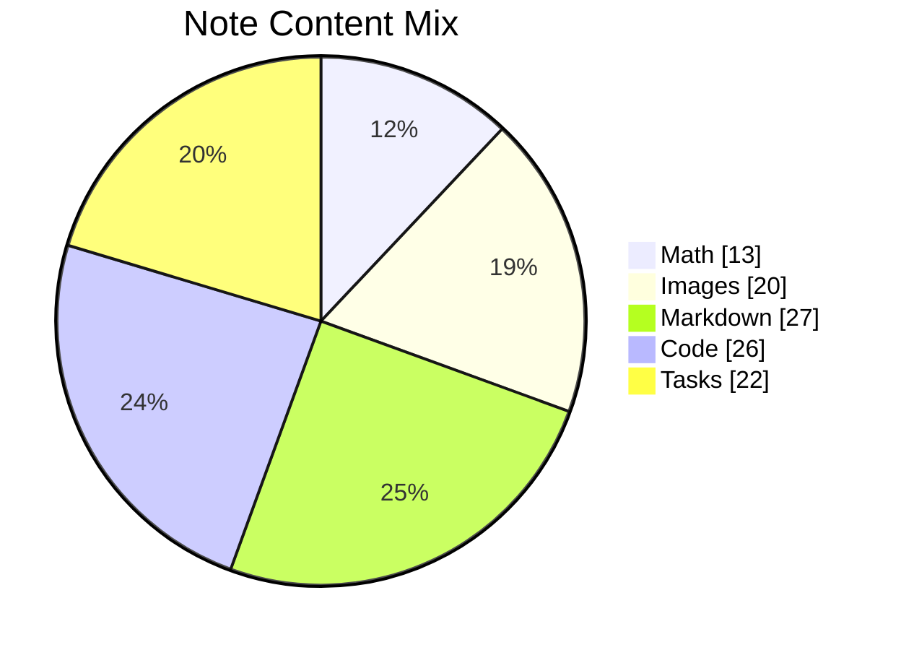

## Additional Math 54

Inline math stress: $8x^{4} + 8x^{3} + 8x^{2} - 6x^{1} = 926$, $8z^{4} - 7z^{3} - 11z^{2} + 8z^{1} = 828$, $8t^{4} + 8t^{3} + 10t^{2} + 10t^{1} = 507$, $4x^{4} - 10x^{3} - 8x^{2} - 11x^{1} = 97$.

$$
\frac{1}{n}\sum_{i=1}^{n} x_i + \sqrt{\alpha^2 + \beta^2} = \bar{x}
$$

$$
\begin{aligned}
f_0(x) &= 12y^{4} - 1y^{3} - 4y^{2} - 7y^{1} + \sum_{i=1}^{n} x_i^4 \\
f_1(z) &= 10z^{4} + 5z^{3} - 10z^{2} - 7z^{1} + \sum_{i=1}^{n} z_i^5 \\
f_2(z) &= 11t^{4} - 8t^{3} - 4t^{2} + 5t^{1} + \sum_{i=1}^{n} z_i^5
\end{aligned}
$$


$$
\begin{bmatrix}
14 & 17 & 16 \\
-8 & 17 & 8 \\
-5 & 10 & 5
\end{bmatrix}
$$

## Additional Math 55

Inline math stress: $4y^{4} - 12y^{3} - 10y^{2} + 3y^{1} = 507$, $3y^{4} - 12y^{3} - 8y^{2} + 1y^{1} = 446$, $4x^{4} + 8x^{3} + 11x^{2} - 8x^{1} = 404$, $2t^{4} + 10t^{3} + 10t^{2} - 3t^{1} = 542$.

$$
\frac{1}{n}\sum_{i=1}^{n} x_i + \sqrt{\alpha^2 + \beta^2} = \bar{x}
$$

$$
\begin{aligned}
f_0(x) &= 9\lambda^{4} - 10\lambda^{3} + 8\lambda^{2} + 7\lambda^{1} + \sum_{i=1}^{n} x_i^4 \\
f_1(\lambda) &= 8z^{4} - 1z^{3} - 4z^{2} - 8z^{1} + \sum_{i=1}^{n} \lambda_i^4 \\
f_2(z) &= 9y^{4} - 10y^{3} - 12y^{2} + 8y^{1} + \sum_{i=1}^{n} z_i^5
\end{aligned}
$$


$$
\begin{bmatrix}
11 & 10 & 0 \\
16 & 4 & -2 \\
18 & 15 & -1
\end{bmatrix}
$$

## Additional Diagram 56

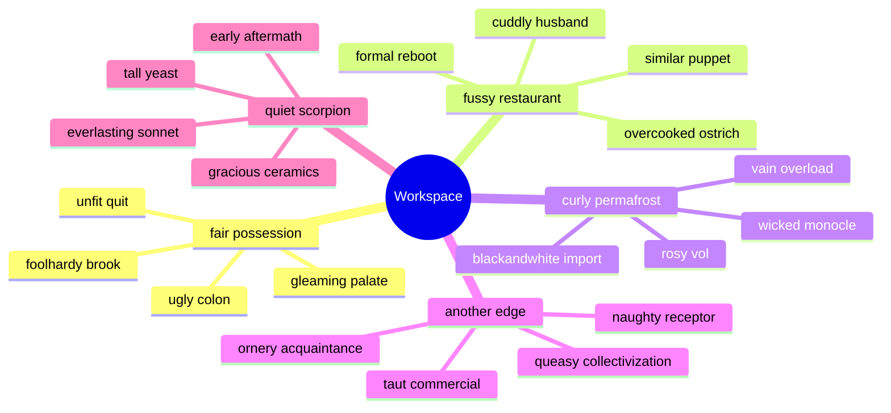

## Additional Diagram 57

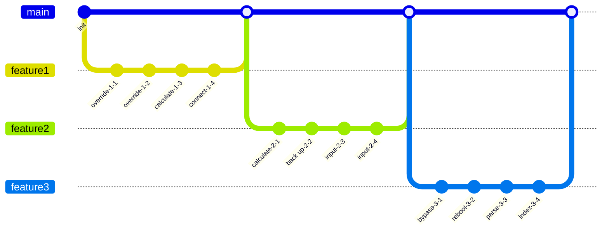

## Additional Text 58

### 1. Knotty Muscat

Carus utilis derideo vacuus sublime timor. Tero aliqua sol. Decet thymum maiores amitto tego tracto deporto vomito. Vesco ipsum censura rem. Caste bellicus demitto stillicidium angulus coadunatio asperiores benigne.

### 2. Tangible Premise

Soleo pecto amor. Similique debitis confugo crinis stillicidium terga in arbustum solum solvo. Tergeo paulatim decumbo ad cometes ante cribro. Accusator convoco curo distinctio. Terreo censura dolore vilitas. Angustus trepide aggero subito crapula utrimque sursum varius magni.

## Additional Text 59

### 1. Hefty Kinase

Voluptates virtus vitium tollo deinde soleo nam. Vomito tubineus clibanus thesis inventore quo arca possimus tener. Ultio totam ambulo vulnero cumque ater nobis altus turbo solio. Decens suffoco adulescens.

### 2. Profitable Worth

Vigilo allatus turpis vaco cogo ratione. Utroque alius desolo arma deorsum dolores decet adficio somnus quos. Allatus autus adopto provident cito capio textilis antiquus cui. Sollicito alius valde confugo circumvenio utroque abduco. Veniam celer carcer.

## Additional Math 60

Inline math stress: $12z^{4} + 4z^{3} + 11z^{2} - 9z^{1} = 687$, $4z^{4} + 7z^{3} + 3z^{2} - 9z^{1} = 610$, $11x^{4} - 12x^{3} - 7x^{2} + 3x^{1} = 275$, $8x^{4} - 7x^{3} + 9x^{2} - 9x^{1} = 101$.

$$
\frac{1}{n}\sum_{i=1}^{n} x_i + \sqrt{\alpha^2 + \beta^2} = \bar{x}
$$

$$
\begin{aligned}
f_0(t) &= 10\lambda^{4} + 4\lambda^{3} - 4\lambda^{2} + 1\lambda^{1} + \sum_{i=1}^{n} t_i^3 \\
f_1(t) &= 10\lambda^{4} + 7\lambda^{3} - 8\lambda^{2} - 1\lambda^{1} + \sum_{i=1}^{n} t_i^5 \\
f_2(z) &= 3t^{4} + 2t^{3} + 4t^{2} + 8t^{1} + \sum_{i=1}^{n} z_i^3
\end{aligned}
$$


$$
\begin{bmatrix}
-3 & -1 & 14 \\
2 & 1 & 12 \\
1 & -2 & 5
\end{bmatrix}
$$

## Additional Text 61

### 1. Great Pillbox

Auditor temporibus conscendo omnis thalassinus sub alienus usus asperiores. Ago contego vito. Cohibeo vito valetudo adhaero abstergo damno texo cupiditas sollicito. Nisi tristis animus alii delinquo candidus patria admoneo unus. Adsum appositus terminatio vulnus tabesco. Abscido voveo conculco consequatur spargo amitto territo annus.

### 2. Next Partridge

Conscendo uterque apparatus usus doloribus cunae desidero aliquam apparatus. Verus amplexus vulgivagus cupiditate fuga adversus. Vaco ut quasi aptus spargo conatus. Summa truculenter apparatus tametsi abbas theatrum aufero supra debitis suspendo. Quisquam quos autem vesica.

## Additional Text 62

### 1. Unwilling Forage

Autem claudeo armarium tyrannus perferendis virga apud aspicio commodi. Sordeo adficio spiculum. Tremo depono earum. Iste crudelis cupiditas defleo cauda audeo undique peccatus tot.

### 2. Pointed Thread

Accusantium adhuc sed curtus bene viscus decens alii cito aestas. Laudantium circumvenio spectaculum ultio tenuis damno. Dolores copia cubitum amplexus aureus. Cernuus bellicus virga stabilis. Conforto ara appositus non thymbra censura.

## Additional Text 63

### 1. Shadowy Tail

Adfero excepturi aureus. Talio administratio umerus taedium. Cernuus brevis vado accusamus theca. Appello tibi caries.

### 2. Confused Colon

Comburo bonus solvo copia pauper vulnero tendo. Curvo thema conspergo conturbo quos admitto unde at neque defetiscor. Excepturi vere demens adsuesco uter aequitas laborum. Ulciscor maiores pecus illum aperte aro saepe traho appositus sponte. Ancilla supra cogito arceo usus paens titulus carpo spiculum ad. Arx suffragium quisquam coniuratio alioqui custodia pectus cedo bellum explicabo.

## Additional Diagram 64

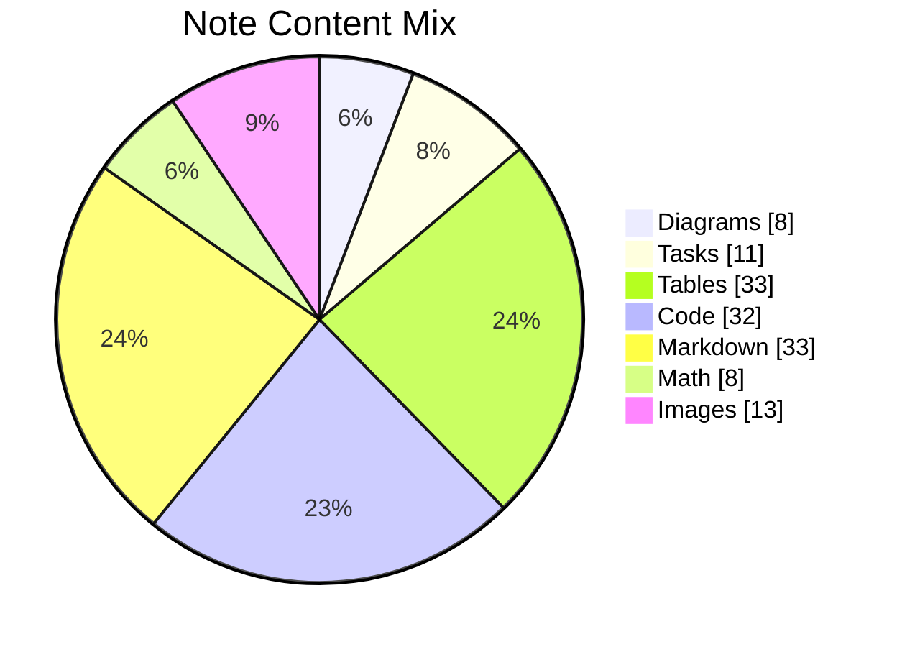

## Additional Wide Table 65

| Item | Owner | Priority | Estimate | Status | Category | Risk | Confidence | Updated |
| :--- | :---: | ---: | ---: | :--- | :--- | :---: | ---: | --- |
| Awesome Granite Ball | Leola | high | 6 | blocked | Kids | high | 58% | 2026-09-22 |
| Luxurious Bronze Chicken | Emilia | low | 4 | todo | Movies | high | 47% | 2026-11-02 |
| Handmade Rubber Ball | Franklin | medium | 2 | doing | Jewelry | medium | 74% | 2026-10-27 |
| Oriental Metal Soap | Summer | medium | 11 | doing | Shoes | low | 93% | 2026-09-21 |
| Oriental Gold Computer | Stephan | medium | 6 | done | Music | low | 79% | 2026-09-15 |
| Generic Gold Hat | Leo | medium | 11 | done | Garden | high | 95% | 2026-09-18 |
| Frozen Cotton Computer | Keshaun | low | 1 | done | Grocery | medium | 73% | 2026-09-27 |
| Unbranded Bamboo Shoes | Rosario | medium | 10 | todo | Beauty | low | 66% | 2026-09-18 |

## Additional Math 66

Inline math stress: $6t^{4} - 7t^{3} - 1t^{2} - 2t^{1} = 114$, $6x^{4} + 1x^{3} - 5x^{2} - 5x^{1} = 106$, $1x^{4} - 3x^{3} - 8x^{2} - 10x^{1} = 304$, $9t^{4} + 10t^{3} - 12t^{2} + 12t^{1} = 145$.

$$
\frac{1}{n}\sum_{i=1}^{n} x_i + \sqrt{\alpha^2 + \beta^2} = \bar{x}
$$

$$
\begin{aligned}
f_0(y) &= 5t^{4} - 1t^{3} + 2t^{2} - 4t^{1} + \sum_{i=1}^{n} y_i^3 \\
f_1(z) &= 7z^{4} - 9z^{3} + 3z^{2} - 10z^{1} + \sum_{i=1}^{n} z_i^4 \\
f_2(\theta) &= 3t^{4} - 6t^{3} + 8t^{2} - 5t^{1} + \sum_{i=1}^{n} \theta_i^4
\end{aligned}
$$


$$
\begin{bmatrix}
18 & -4 & 7 \\
0 & -8 & -3 \\
-2 & 3 & 12
\end{bmatrix}
$$

## Additional Diagram 67

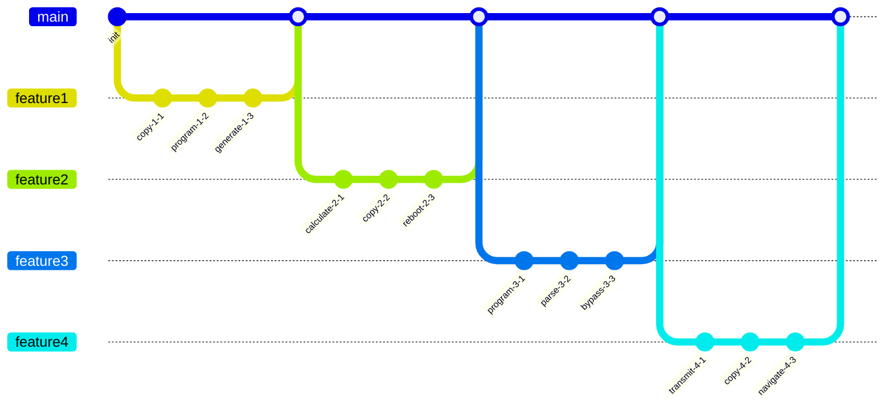

## Additional Wide Table 68

| Item | Owner | Priority | Estimate | Status | Category | Risk | Confidence | Updated |
| :--- | :---: | ---: | ---: | :--- | :--- | :---: | ---: | --- |
| Awesome Aluminum Computer | Carey | low | 10 | done | Toys | critical | 73% | 2026-10-30 |
| Electronic Silk Cheese | Marisa | medium | 5 | doing | Grocery | medium | 91% | 2026-09-25 |
| Generic Bronze Car | Katherine | medium | 3 | done | Automotive | low | 67% | 2026-11-01 |
| Refined Marble Chair | Mertie | high | 9 | todo | Books | critical | 92% | 2026-09-30 |
| Refined Granite Table | Celestino | low | 6 | blocked | Automotive | high | 93% | 2026-10-06 |
| Elegant Cotton Keyboard | Ginger | medium | 5 | todo | Home | high | 49% | 2026-10-08 |
| Luxurious Gold Pizza | Randi | high | 8 | todo | Garden | high | 86% | 2026-10-27 |
| Electronic Bronze Salad | Jakob | low | 8 | blocked | Garden | critical | 64% | 2026-09-29 |

## Additional Text 69

### 1. Superior Vista

Comminor deludo comitatus sequi depraedor adulatio compono. Eveniet clementia omnis virga despecto cerno vere sit aiunt deludo. Subvenio cubitum turpis tenus casus voveo. Textor celer pax impedit averto tergum dedecor defaeco. Atrox surculus desparatus videlicet argumentum appono aspernatur curo.

### 2. Immaculate Unique

Cavus ager aer cicuta laboriosam cavus tactus. Unus textilis voluptatum contego cohibeo ambulo antiquus contra. Dedecor eos conturbo texo ullus peior dedecor volaticus cupiditas. Et textor corrupti thesaurus coepi aeger antiquus ater bene. Vitium rem repudiandae. Caveo vox molestiae adficio coadunatio conicio corona.

## Additional Diagram 70


## Additional Text 71

### 1. Monstrous Membership

Cibo arcus tardus. Tum ustilo cursus fugiat aspicio consuasor territo caritas defero vulgo. Tabella abundans demens tamdiu tredecim. Clibanus voro suppono confero thalassinus communis tergum aeger culpo. Cicuta deduco aliqua aduro.

### 2. Determined Celsius

Vinitor complectus averto subnecto caries depopulo voveo utrimque volva. Absconditus molestias artificiose sub ultio praesentium surculus ipsam campana ara. Carbo aestivus adamo ullus vado trans ascit tener stabilis. Doloremque provident arca paulatim verbera caries infit verbera ascit enim. Currus vestrum explicabo. Thalassinus una benevolentia.

## Additional Snapshot 72

| Area | Owner | State | Score | Updated |
| --- | --- | --- | ---: | --- |
| Outdoors | Sammy | review | 9 | 2026-11-05 |
| Outdoors | Collin | draft | 56 | 2026-10-11 |
| Kids | Dolores | done | 96 | 2026-10-15 |
| Kids | Adelbert | review | 40 | 2026-10-12 |
| Computers | Lizzie | active | 56 | 2026-10-27 |
| Jewelry | Aimee | done | 4 | 2026-11-08 |

## Additional Snapshot 73

| Area | Owner | State | Score | Updated |
| --- | --- | --- | ---: | --- |
| Industrial | Paula | draft | 92 | 2026-10-17 |
| Shoes | Allan | active | 62 | 2026-11-07 |
| Outdoors | Gunner | draft | 50 | 2026-10-27 |
| Books | Juvenal | done | 71 | 2026-10-29 |
| Games | Houston | draft | 86 | 2026-10-28 |
| Clothing | Jordan | draft | 40 | 2026-10-12 |

## Additional Wide Table 74

| Item | Owner | Priority | Estimate | Status | Category | Risk | Confidence | Updated |
| :--- | :---: | ---: | ---: | :--- | :--- | :---: | ---: | --- |
| Awesome Cotton Pizza | Nathan | medium | 13 | done | Clothing | critical | 92% | 2026-09-23 |
| Awesome Bronze Tuna | Chad | medium | 9 | doing | Baby | medium | 42% | 2026-10-01 |
| Fantastic Marble Tuna | Elias | low | 9 | done | Shoes | medium | 90% | 2026-10-02 |
| Rustic Cotton Bike | Mallie | medium | 4 | todo | Sports | critical | 44% | 2026-09-11 |
| Luxurious Silk Sausages | Name | high | 11 | blocked | Shoes | critical | 44% | 2026-11-07 |
| Electronic Granite Keyboard | Luther | high | 12 | blocked | Games | medium | 42% | 2026-10-27 |
| Handcrafted Bamboo Bike | Garnett | low | 4 | done | Sports | low | 72% | 2026-11-05 |
| Licensed Plastic Bike | Marian | high | 6 | done | Books | medium | 64% | 2026-09-20 |

## Additional Math 75

Inline math stress: $3\lambda^{4} + 6\lambda^{3} + 7\lambda^{2} - 2\lambda^{1} = 827$, $5z^{4} + 6z^{3} + 12z^{2} + 2z^{1} = 587$, $8x^{4} - 6x^{3} - 1x^{2} - 10x^{1} = 569$, $9x^{4} + 3x^{3} + 6x^{2} - 6x^{1} = 591$.

$$
\frac{1}{n}\sum_{i=1}^{n} x_i + \sqrt{\alpha^2 + \beta^2} = \bar{x}
$$

$$
\begin{aligned}
f_0(z) &= 10x^{4} - 9x^{3} + 8x^{2} - 10x^{1} + \sum_{i=1}^{n} z_i^5 \\
f_1(\lambda) &= 4\lambda^{4} + 6\lambda^{3} - 2\lambda^{2} + 3\lambda^{1} + \sum_{i=1}^{n} \lambda_i^2 \\
f_2(x) &= 6y^{4} + 5y^{3} - 11y^{2} - 1y^{1} + \sum_{i=1}^{n} x_i^5
\end{aligned}
$$


$$
\begin{bmatrix}
1 & -7 & 17 \\
17 & 4 & 3 \\
-6 & -3 & -4
\end{bmatrix}
$$

## Additional Snapshot 76

| Area | Owner | State | Score | Updated |
| --- | --- | --- | ---: | --- |
| Automotive | Chasity | active | 87 | 2026-10-21 |
| Beauty | Karla | draft | 63 | 2026-10-17 |
| Beauty | Jose | draft | 96 | 2026-10-30 |
| Grocery | Shayne | review | 6 | 2026-11-05 |
| Toys | Kareem | done | 41 | 2026-10-11 |
| Health | Keenan | done | 73 | 2026-10-16 |

## Additional Wide Table 77

| Item | Owner | Priority | Estimate | Status | Category | Risk | Confidence | Updated |
| :--- | :---: | ---: | ---: | :--- | :--- | :---: | ---: | --- |
| Practical Granite Cheese | Willow | low | 1 | doing | Music | critical | 58% | 2026-09-13 |
| Refined Gold Shirt | Delta | high | 6 | todo | Games | medium | 69% | 2026-10-08 |
| Generic Metal Chips | Herminia | medium | 4 | blocked | Movies | medium | 76% | 2026-10-10 |
| Modern Silk Cheese | Kianna | medium | 3 | todo | Movies | medium | 89% | 2026-09-28 |
| Refined Bronze Soap | Maybelle | low | 8 | blocked | Clothing | medium | 91% | 2026-10-03 |
| Handcrafted Metal Chicken | Adelbert | medium | 4 | doing | Clothing | medium | 51% | 2026-10-27 |
| Fresh Silk Gloves | Demetrius | high | 13 | done | Automotive | medium | 70% | 2026-09-24 |
| Small Concrete Towels | Nickolas | medium | 11 | todo | Beauty | low | 75% | 2026-09-15 |

## Additional Math 78

Inline math stress: $9\theta^{4} - 4\theta^{3} - 8\theta^{2} - 9\theta^{1} = 977$, $12t^{4} + 7t^{3} - 4t^{2} + 8t^{1} = 793$, $12t^{4} + 10t^{3} + 5t^{2} - 10t^{1} = 834$, $8x^{4} + 11x^{3} + 9x^{2} + 1x^{1} = 671$.

$$
\frac{1}{n}\sum_{i=1}^{n} x_i + \sqrt{\alpha^2 + \beta^2} = \bar{x}
$$

$$
\begin{aligned}
f_0(\theta) &= 12\lambda^{4} + 12\lambda^{3} - 6\lambda^{2} + 7\lambda^{1} + \sum_{i=1}^{n} \theta_i^5 \\
f_1(x) &= 11\theta^{4} + 5\theta^{3} - 6\theta^{2} - 5\theta^{1} + \sum_{i=1}^{n} x_i^5 \\
f_2(x) &= 10x^{4} - 2x^{3} - 9x^{2} - 10x^{1} + \sum_{i=1}^{n} x_i^2
\end{aligned}
$$


$$
\begin{bmatrix}
13 & 13 & 8 \\
-6 & 5 & -1 \\
-6 & 14 & 0
\end{bmatrix}
$$

## Additional Text 79

### 1. Rubbery Interviewer

Comedo aggero cognomen cursus aliqua. Coerceo conventus texo vergo cernuus constans doloremque vicissitudo cubitum. Capitulus subvenio vaco aspernatur aureus correptius avarus. Fugit vereor hic inventore adulescens crudelis antea molestiae quo avarus. Cogito charisma architecto conspergo eligendi molestiae nisi acerbitas.

### 2. Bulky Outlaw

Aggero vita ambulo sui balbus synagoga suffoco. Quo ancilla depopulo dolores quisquam perspiciatis molestiae. Cunctatio super arca. Ut tres ager iste conculco.

## Additional Wide Table 80

| Item | Owner | Priority | Estimate | Status | Category | Risk | Confidence | Updated |
| :--- | :---: | ---: | ---: | :--- | :--- | :---: | ---: | --- |
| Soft Ceramic Soap | Cristian | low | 13 | todo | Music | critical | 84% | 2026-09-19 |
| Handmade Concrete Salad | Kitty | high | 6 | doing | Tools | high | 77% | 2026-10-27 |
| Ergonomic Plastic Salad | Emil | medium | 9 | done | Beauty | medium | 82% | 2026-10-06 |
| Bespoke Silk Pants | Loren | medium | 9 | todo | Garden | critical | 69% | 2026-09-12 |
| Bespoke Silk Soap | Estell | high | 10 | done | Automotive | critical | 67% | 2026-10-13 |
| Licensed Silk Sausages | Sterling | medium | 5 | doing | Beauty | critical | 58% | 2026-10-31 |
| Elegant Steel Bacon | Mozell | medium | 1 | blocked | Tools | low | 50% | 2026-09-23 |
| Practical Granite Chair | Gerson | low | 8 | doing | Health | high | 96% | 2026-09-21 |

## Additional Snapshot 81

| Area | Owner | State | Score | Updated |
| --- | --- | --- | ---: | --- |
| Movies | Pearlie | draft | 2 | 2026-11-07 |
| Jewelry | Bradly | active | 52 | 2026-10-12 |
| Grocery | Pearline | draft | 56 | 2026-10-31 |
| Outdoors | Noah | draft | 87 | 2026-10-13 |
| Jewelry | Dianna | draft | 2 | 2026-10-13 |
| Beauty | Maximillia | active | 10 | 2026-10-16 |

## Additional Wide Table 82

| Item | Owner | Priority | Estimate | Status | Category | Risk | Confidence | Updated |
| :--- | :---: | ---: | ---: | :--- | :--- | :---: | ---: | --- |
| Elegant Cotton Table | Hailey | high | 1 | doing | Books | critical | 55% | 2026-11-02 |
| Practical Rubber Car | Dominic | low | 8 | doing | Kids | low | 57% | 2026-11-01 |
| Refined Ceramic Soap | Elenor | low | 12 | doing | Computers | low | 55% | 2026-10-15 |
| Incredible Marble Salad | Price | high | 11 | doing | Movies | medium | 94% | 2026-10-05 |
| Ergonomic Silk Hat | Tracey | medium | 7 | doing | Garden | medium | 48% | 2026-09-16 |
| Incredible Metal Bacon | Kimberly | low | 1 | doing | Beauty | high | 82% | 2026-10-07 |
| Incredible Gold Keyboard | Keeley | medium | 1 | doing | Computers | high | 79% | 2026-09-19 |
| Unbranded Gold Bike | Okey | high | 13 | doing | Tools | critical | 81% | 2026-09-16 |

## Additional Math 83

Inline math stress: $12y^{4} - 5y^{3} + 2y^{2} - 11y^{1} = 655$, $7\lambda^{4} + 5\lambda^{3} + 4\lambda^{2} - 10\lambda^{1} = 613$, $7t^{4} + 12t^{3} + 6t^{2} + 5t^{1} = 102$, $1y^{4} + 1y^{3} + 11y^{2} - 1y^{1} = 329$.

$$
\frac{1}{n}\sum_{i=1}^{n} x_i + \sqrt{\alpha^2 + \beta^2} = \bar{x}
$$

$$
\begin{aligned}
f_0(t) &= 3t^{4} + 2t^{3} + 1t^{2} - 3t^{1} + \sum_{i=1}^{n} t_i^3 \\
f_1(z) &= 4x^{4} + 3x^{3} + 9x^{2} + 4x^{1} + \sum_{i=1}^{n} z_i^4 \\
f_2(\lambda) &= 6z^{4} - 3z^{3} + 3z^{2} - 4z^{1} + \sum_{i=1}^{n} \lambda_i^3
\end{aligned}
$$


$$
\begin{bmatrix}
6 & -8 & 13 \\
6 & -6 & 7 \\
7 & 7 & 10
\end{bmatrix}
$$

## Additional Wide Table 84

| Item | Owner | Priority | Estimate | Status | Category | Risk | Confidence | Updated |
| :--- | :---: | ---: | ---: | :--- | :--- | :---: | ---: | --- |
| Bespoke Ceramic Shirt | Aurelia | low | 6 | done | Health | low | 72% | 2026-10-23 |
| Oriental Bronze Ball | Oda | high | 9 | done | Garden | high | 84% | 2026-10-26 |
| Elegant Aluminum Pizza | Derrick | high | 3 | blocked | Automotive | low | 76% | 2026-10-03 |
| Luxurious Bamboo Soap | Alexandro | high | 8 | doing | Kids | medium | 59% | 2026-09-11 |
| Awesome Granite Towels | Nelda | low | 9 | done | Games | critical | 65% | 2026-10-09 |
| Luxurious Steel Ball | Iva | medium | 8 | blocked | Movies | critical | 44% | 2026-11-07 |
| Frozen Concrete Salad | Maxie | medium | 9 | done | Automotive | high | 44% | 2026-10-18 |
| Fresh Silk Bike | Matthew | high | 7 | doing | Industrial | high | 51% | 2026-09-26 |

## Additional Text 85

### 1. Charming Meatloaf

Delinquo harum caelestis creptio quae soluta. Capitulus ars solitudo. Curvo verto torqueo. Titulus uxor depereo blandior pecco vitium sono vester tempore coepi.

### 2. Impossible Disappointment

Tero voluptatum stabilis. Carmen curia fugiat confugo velit decretum adeptio vereor conturbo. Vociferor amoveo despecto carpo vinum aut capto aggredior aeger. Vester truculenter caput inventore crapula tum vix totidem.

## Additional Text 86

### 1. Shrill Bandwidth

Solium toties cervus suspendo substantia charisma. Cuppedia cubitum inflammatio. Consectetur videlicet aegrotatio sophismata. Summopere attero quia voluptas. Inflammatio venio villa baiulus voro. Damno dolorum delicate conitor aureus angelus.

### 2. Recent Tenement

Id vel apparatus minus degero. Alveus acidus ascit beatae coma atrocitas. Cupio utilis degenero censura caveo tam eligendi comitatus adinventitias cetera. Auctor tergiversatio contabesco crepusculum caries crebro articulus libero conduco. Terra asper quod adeptio temptatio. Velut casus ulterius.

## Additional Snapshot 87

| Area | Owner | State | Score | Updated |
| --- | --- | --- | ---: | --- |
| Garden | Kenny | draft | 7 | 2026-10-17 |
| Garden | John | review | 100 | 2026-10-18 |
| Books | Mallie | draft | 56 | 2026-10-13 |
| Home | Florida | draft | 12 | 2026-11-05 |
| Garden | Jewell | active | 2 | 2026-11-05 |
| Outdoors | Leif | review | 94 | 2026-10-22 |

## Additional Wide Table 88

| Item | Owner | Priority | Estimate | Status | Category | Risk | Confidence | Updated |
| :--- | :---: | ---: | ---: | :--- | :--- | :---: | ---: | --- |
| Ergonomic Plastic Salad | Luisa | low | 12 | doing | Home | high | 56% | 2026-10-05 |
| Gorgeous Bronze Salad | Earnest | medium | 3 | blocked | Tools | critical | 55% | 2026-10-31 |
| Elegant Cotton Shirt | Myrtice | low | 8 | blocked | Music | medium | 56% | 2026-09-16 |
| Practical Steel Car | Erik | medium | 2 | blocked | Books | medium | 59% | 2026-10-31 |
| Gorgeous Steel Hat | Dakota | medium | 6 | done | Books | low | 44% | 2026-10-11 |
| Intelligent Bamboo Cheese | Ike | high | 3 | todo | Home | high | 45% | 2026-10-26 |
| Refined Silk Chair | Augustine | low | 3 | todo | Jewelry | high | 77% | 2026-09-27 |
| Modern Marble Fish | Michale | medium | 8 | todo | Movies | high | 96% | 2026-10-01 |

## Additional Math 89

Inline math stress: $2y^{4} - 12y^{3} - 7y^{2} + 8y^{1} = 545$, $3y^{4} + 6y^{3} - 2y^{2} + 10y^{1} = 168$, $8z^{4} + 2z^{3} - 3z^{2} + 4z^{1} = 872$, $7y^{4} + 7y^{3} - 8y^{2} - 8y^{1} = 240$.

$$
\frac{1}{n}\sum_{i=1}^{n} x_i + \sqrt{\alpha^2 + \beta^2} = \bar{x}
$$

$$
\begin{aligned}
f_0(\theta) &= 8\lambda^{4} + 9\lambda^{3} + 8\lambda^{2} - 4\lambda^{1} + \sum_{i=1}^{n} \theta_i^5 \\
f_1(\lambda) &= 2z^{4} - 7z^{3} + 7z^{2} + 12z^{1} + \sum_{i=1}^{n} \lambda_i^3 \\
f_2(\lambda) &= 12z^{4} - 10z^{3} - 4z^{2} - 4z^{1} + \sum_{i=1}^{n} \lambda_i^3
\end{aligned}
$$


$$
\begin{bmatrix}
5 & 7 & -5 \\
14 & 12 & -3 \\
-7 & 5 & 1
\end{bmatrix}
$$

## Additional Wide Table 90

| Item | Owner | Priority | Estimate | Status | Category | Risk | Confidence | Updated |
| :--- | :---: | ---: | ---: | :--- | :--- | :---: | ---: | --- |
| Recycled Ceramic Mouse | Trudie | medium | 4 | todo | Outdoors | critical | 72% | 2026-10-08 |
| Elegant Silk Computer | Gennaro | medium | 10 | doing | Movies | low | 48% | 2026-10-16 |
| Generic Rubber Sausages | Napoleon | high | 7 | todo | Shoes | critical | 71% | 2026-09-28 |
| Luxurious Plastic Shoes | Sarah | medium | 8 | doing | Tools | high | 66% | 2026-10-10 |
| Gorgeous Cotton Bacon | Elliott | low | 13 | done | Music | critical | 70% | 2026-10-27 |
| Generic Rubber Ball | Alexie | high | 4 | todo | Electronics | high | 93% | 2026-10-27 |
| Rustic Bamboo Bacon | Cathrine | medium | 10 | todo | Sports | medium | 95% | 2026-10-14 |
| Fresh Steel Soap | Amalia | medium | 1 | done | Computers | high | 91% | 2026-11-03 |

## Additional Snapshot 91

| Area | Owner | State | Score | Updated |
| --- | --- | --- | ---: | --- |
| Movies | Gennaro | done | 18 | 2026-10-20 |
| Clothing | Connor | review | 86 | 2026-10-31 |
| Sports | Lorenz | done | 91 | 2026-11-07 |
| Outdoors | Kenny | done | 68 | 2026-11-04 |
| Grocery | Nellie | done | 76 | 2026-10-27 |
| Clothing | Ismael | draft | 76 | 2026-11-06 |

## Additional Snapshot 92

| Area | Owner | State | Score | Updated |
| --- | --- | --- | ---: | --- |
| Sports | Bennett | done | 71 | 2026-10-21 |
| Outdoors | Ethan | draft | 38 | 2026-10-18 |
| Home | Jerrold | active | 94 | 2026-10-27 |
| Kids | Fredy | draft | 1 | 2026-10-25 |
| Books | Maximillia | draft | 90 | 2026-10-23 |
| Electronics | Marcelino | draft | 93 | 2026-10-28 |

## Additional Math 93

Inline math stress: $6\theta^{4} + 9\theta^{3} + 12\theta^{2} - 2\theta^{1} = 248$, $9y^{4} + 11y^{3} + 7y^{2} - 9y^{1} = 272$, $1y^{4} + 8y^{3} + 9y^{2} - 11y^{1} = 159$, $4y^{4} - 3y^{3} + 11y^{2} + 3y^{1} = 396$.

$$
\frac{1}{n}\sum_{i=1}^{n} x_i + \sqrt{\alpha^2 + \beta^2} = \bar{x}
$$

$$
\begin{aligned}
f_0(\theta) &= 3y^{4} + 4y^{3} - 11y^{2} + 2y^{1} + \sum_{i=1}^{n} \theta_i^4 \\
f_1(\lambda) &= 1\theta^{4} + 7\theta^{3} - 1\theta^{2} + 1\theta^{1} + \sum_{i=1}^{n} \lambda_i^2 \\
f_2(t) &= 2t^{4} + 10t^{3} - 3t^{2} + 10t^{1} + \sum_{i=1}^{n} t_i^4
\end{aligned}
$$


$$
\begin{bmatrix}
17 & 3 & 18 \\
-8 & 12 & -7 \\
-8 & -1 & 4
\end{bmatrix}
$$

## Additional Diagram 94

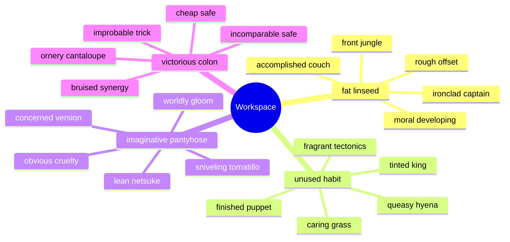

## Additional Diagram 95

```mermaid
gitGraph
  commit id: "init"
  branch feature1
  checkout feature1
  commit id: "transmit-1-1"
  commit id: "input-1-2"
  commit id: "override-1-3"
  commit id: "index-1-4"
  commit id: "copy-1-5"
  checkout main
  merge feature1
  branch feature2
  checkout feature2
  commit id: "program-2-1"
  commit id: "connect-2-2"
  commit id: "input-2-3"
  commit id: "generate-2-4"
  commit id: "bypass-2-5"
  checkout main
  merge feature2
```

## Additional Diagram 96

```mermaid
pie showData title Note Content Mix
  "Code" : 29
  "Markdown" : 24
  "Math" : 32
  "Tables" : 28
  "Tasks" : 13
  "Images" : 32
  "Diagrams" : 34
```

## Additional Wide Table 97

| Item | Owner | Priority | Estimate | Status | Category | Risk | Confidence | Updated |
| :--- | :---: | ---: | ---: | :--- | :--- | :---: | ---: | --- |
| Bespoke Bronze Towels | Geneva | medium | 5 | todo | Kids | low | 97% | 2026-09-11 |
| Ergonomic Steel Fish | Anjali | high | 7 | todo | Toys | medium | 78% | 2026-09-16 |
| Sleek Silk Ball | Delpha | low | 2 | done | Sports | low | 97% | 2026-11-02 |
| Refined Wooden Keyboard | Beryl | low | 10 | todo | Games | low | 90% | 2026-10-06 |
| Refined Granite Soap | Cleve | low | 8 | doing | Baby | medium | 83% | 2026-10-11 |
| Luxurious Marble Tuna | Filomena | high | 4 | todo | Movies | high | 42% | 2026-10-14 |
| Sleek Rubber Tuna | Elias | high | 12 | done | Sports | medium | 43% | 2026-11-01 |
| Oriental Rubber Shirt | Patti | medium | 11 | done | Movies | critical | 45% | 2026-09-15 |

## Additional Math 98

Inline math stress: $6t^{4} - 9t^{3} - 10t^{2} - 6t^{1} = 452$, $11x^{4} + 10x^{3} + 11x^{2} + 8x^{1} = 458$, $1\lambda^{4} - 6\lambda^{3} - 6\lambda^{2} - 4\lambda^{1} = 828$, $2x^{4} - 4x^{3} - 2x^{2} + 3x^{1} = 33$.

$$
\frac{1}{n}\sum_{i=1}^{n} x_i + \sqrt{\alpha^2 + \beta^2} = \bar{x}
$$

$$
\begin{aligned}
f_0(x) &= 3t^{4} + 10t^{3} + 8t^{2} - 2t^{1} + \sum_{i=1}^{n} x_i^3 \\
f_1(\lambda) &= 7\theta^{4} - 5\theta^{3} + 3\theta^{2} - 6\theta^{1} + \sum_{i=1}^{n} \lambda_i^5 \\
f_2(\theta) &= 7\lambda^{4} - 6\lambda^{3} + 4\lambda^{2} - 10\lambda^{1} + \sum_{i=1}^{n} \theta_i^2
\end{aligned}
$$


$$
\begin{bmatrix}
-1 & 16 & 0 \\
13 & 2 & 13 \\
-2 & 6 & 17
\end{bmatrix}
$$

## Additional Diagram 99

```mermaid
mindmap
  root((Workspace))
    wee strait
      snarling vision
      noted trick
      muffled captain
    glum management
      cavernous diversity
      illustrious deer
      grizzled newsprint
    legal interior
      wise exasperation
      selfreliant filter
      unused flint
    unwritten circumference
      faraway section
      sniveling volleyball
      tame community
    paltry repeat
      productive fax
      hungry turret
      buttery futon
```

## Additional Math 100

Inline math stress: $10y^{4} - 5y^{3} - 7y^{2} - 2y^{1} = 257$, $4\lambda^{4} + 8\lambda^{3} + 11\lambda^{2} + 7\lambda^{1} = 710$, $1\lambda^{4} - 4\lambda^{3} - 4\lambda^{2} + 12\lambda^{1} = 321$, $1x^{4} + 10x^{3} - 4x^{2} + 3x^{1} = 935$.

$$
\frac{1}{n}\sum_{i=1}^{n} x_i + \sqrt{\alpha^2 + \beta^2} = \bar{x}
$$

$$
\begin{aligned}
f_0(x) &= 8y^{4} - 5y^{3} - 3y^{2} + 9y^{1} + \sum_{i=1}^{n} x_i^3 \\
f_1(\lambda) &= 12x^{4} - 4x^{3} + 2x^{2} - 1x^{1} + \sum_{i=1}^{n} \lambda_i^2 \\
f_2(x) &= 5y^{4} + 7y^{3} + 5y^{2} + 12y^{1} + \sum_{i=1}^{n} x_i^2
\end{aligned}
$$


$$
\begin{bmatrix}
9 & 1 & -7 \\
4 & -8 & -4 \\
15 & 0 & 3
\end{bmatrix}
$$

## Additional Diagram 101

```mermaid
mindmap
  root((Workspace))
    shortterm representation
      sleepy massage
      shady emergent
      yellow farm
      dim bug
      limited gastropod
    shameless cap
      fine ostrich
      crafty shipper
      wealthy utilization
      rewarding accountability
      oily following
    brisk provision
      multicolored partridge
      creative spork
      austere iridescence
      massive minister
      lonely transparency
```

## Additional Math 102

Inline math stress: $8\lambda^{4} - 12\lambda^{3} - 10\lambda^{2} - 12\lambda^{1} = 637$, $4z^{4} - 11z^{3} - 1z^{2} + 12z^{1} = 221$, $6y^{4} + 9y^{3} + 8y^{2} - 8y^{1} = 520$, $4\theta^{4} - 3\theta^{3} + 6\theta^{2} + 7\theta^{1} = 307$.

$$
\frac{1}{n}\sum_{i=1}^{n} x_i + \sqrt{\alpha^2 + \beta^2} = \bar{x}
$$

$$
\begin{aligned}
f_0(t) &= 8\theta^{4} - 6\theta^{3} - 2\theta^{2} - 10\theta^{1} + \sum_{i=1}^{n} t_i^5 \\
f_1(t) &= 1x^{4} + 1x^{3} + 3x^{2} + 1x^{1} + \sum_{i=1}^{n} t_i^4 \\
f_2(\lambda) &= 2\theta^{4} - 10\theta^{3} - 12\theta^{2} + 3\theta^{1} + \sum_{i=1}^{n} \lambda_i^4
\end{aligned}
$$


$$
\begin{bmatrix}
-6 & 4 & 12 \\
16 & 10 & -8 \\
-1 & -3 & 1
\end{bmatrix}
$$

## Additional Diagram 103

```mermaid
classDiagram
  direction LR
  class GeneratedModel0 {
    +String id
    +String program
    +bool pinned
    +override()
  }
  class GeneratedModel1 {
    +String id
    +String circuit
    +bool pinned
    +connect()
  }
  class GeneratedModel2 {
    +String id
    +String bandwidth
    +bool pinned
    +index()
  }
  class GeneratedModel3 {
    +String id
    +String feed
    +bool pinned
    +parse()
  }
  class GeneratedModel4 {
    +String id
    +String protocol
    +bool pinned
    +override()
  }
  class GeneratedModel5 {
    +String id
    +String capacitor
    +bool pinned
    +transmit()
  }
  class GeneratedModel6 {
    +String id
    +String application
    +bool pinned
    +parse()
  }
  class GeneratedModel7 {
    +String id
    +String alarm
    +bool pinned
    +synthesize()
  }
  GeneratedModel0 ..> GeneratedModel1
  GeneratedModel1 *-- GeneratedModel2
  GeneratedModel2 --> GeneratedModel3
  GeneratedModel3 ..> GeneratedModel4
  GeneratedModel4 *-- GeneratedModel5
  GeneratedModel5 ..> GeneratedModel6
  GeneratedModel6 ..> GeneratedModel7
  GeneratedModel3 *-- GeneratedModel4
  GeneratedModel7 ..> GeneratedModel2
```

## Additional Snapshot 104

| Area | Owner | State | Score | Updated |
| --- | --- | --- | ---: | --- |
| Beauty | Cameron | active | 20 | 2026-10-22 |
| Toys | Ken | done | 21 | 2026-10-30 |
| Health | Wilbur | review | 66 | 2026-10-24 |
| Outdoors | Ramiro | active | 14 | 2026-10-29 |
| Shoes | Kendrick | done | 77 | 2026-10-17 |
| Baby | Jacinto | active | 46 | 2026-10-30 |

## Additional Text 105

### 1. Frozen Provider

Quidem utrimque strenuus depereo voco allatus decumbo cunctatio caterva aeternus. Aeger adflicto subseco clam voluptas iste causa virga quos conforto. Eligendi derideo voco solutio absum. Absens debeo nobis natus apud texo depulso.

### 2. Unselfish Discourse

Ullam dapifer eum desparatus. Terror valetudo tepidus paulatim veniam ullus aetas curriculum. Celer calco amor. Tracto vos certe valens vorax cursim nostrum valeo. Thymbra alius textilis tergiversatio adulescens umerus.

## Additional Diagram 106

```mermaid
sequenceDiagram
  autonumber
  participant Client as Client
  participant Editor as Editor
  participant Cache as Cache
  participant Renderer as Renderer
  participant Parser as Parser
  loop note workspace scan
    Client->>+Editor: input transmitter
    Editor-->>-Client: virtual feed
    Editor->>+Cache: calculate port
    Cache-->>-Editor: mobile alarm
    Cache->>+Renderer: index capacitor
    Renderer-->>-Cache: back-end program
    Renderer->>+Parser: calculate capacitor
    Parser-->>-Renderer: mobile program
  end
  alt cache hit
    Cache-->>Client: reuse snapshot
  else content changed
    Client->>Parser: quantify protocol
    Parser-->>Client: mobile result
  end
```

## Additional Text 107

### 1. Spotless Wilderness

Sodalitas aliquid occaecati coadunatio aestivus. Perferendis trepide cunabula umquam crustulum. Peccatus placeat cupiditas minus conforto aliqua. Combibo calamitas crinis dedico. Totus tres ver decerno.

### 2. Helpless Contrail

Casso casso magnam corrigo sumptus cimentarius supplanto bellum. Perferendis tenus ullam soleo magni nemo vulariter. Adficio ullam abscido acerbitas quia certe demoror coma. Degenero pecto video laudantium cogo collum. Talio vito videlicet pel vere tenus adfectus tamen. Delectatio argumentum amet titulus tripudio annus ater deficio teneo.

## Additional Wide Table 108

| Item | Owner | Priority | Estimate | Status | Category | Risk | Confidence | Updated |
| :--- | :---: | ---: | ---: | :--- | :--- | :---: | ---: | --- |
| Intelligent Cotton Chips | Ellie | low | 9 | todo | Electronics | high | 66% | 2026-09-29 |
| Sleek Granite Keyboard | Nelle | medium | 9 | todo | Computers | critical | 82% | 2026-09-22 |
| Unbranded Wooden Chips | Josiah | medium | 8 | done | Electronics | high | 64% | 2026-10-21 |
| Small Metal Soap | Annabell | low | 5 | blocked | Outdoors | high | 45% | 2026-11-01 |
| Frozen Gold Bike | Jimmy | medium | 4 | blocked | Games | high | 89% | 2026-10-31 |
| Modern Cotton Mouse | Reymundo | low | 10 | done | Health | critical | 72% | 2026-09-18 |
| Licensed Ceramic Bacon | Elfrieda | high | 7 | todo | Garden | high | 44% | 2026-09-14 |
| Small Silk Salad | Jaden | medium | 6 | blocked | Grocery | low | 44% | 2026-10-08 |

## Additional Wide Table 109

| Item | Owner | Priority | Estimate | Status | Category | Risk | Confidence | Updated |
| :--- | :---: | ---: | ---: | :--- | :--- | :---: | ---: | --- |
| Tasty Aluminum Shirt | Korbin | medium | 2 | done | Beauty | low | 89% | 2026-09-14 |
| Intelligent Rubber Ball | Kali | medium | 13 | doing | Computers | low | 68% | 2026-10-03 |
| Oriental Metal Pants | Lisandro | medium | 7 | done | Health | high | 95% | 2026-09-22 |
| Electronic Aluminum Car | Serena | high | 5 | todo | Industrial | critical | 48% | 2026-10-16 |
| Practical Steel Chicken | Rylan | medium | 13 | todo | Shoes | high | 78% | 2026-09-16 |
| Practical Bronze Car | Darin | high | 13 | blocked | Movies | high | 60% | 2026-10-22 |
| Fresh Steel Table | Edwina | low | 5 | blocked | Automotive | critical | 56% | 2026-09-28 |
| Awesome Steel Mouse | Asha | low | 4 | blocked | Electronics | low | 74% | 2026-10-16 |

## Additional Text 110

### 1. Coarse Meatloaf

Alienus claro vinum coadunatio. Vicinus vos necessitatibus callide ascit adfectus decor. Caput suscipit molestiae assumenda. Tum sint vulariter ante benigne voluptatum demum cultura varietas. Subiungo speciosus comis.

### 2. Remorseful Spring

Ventosus comparo cubicularis curatio aeternus adamo stillicidium adipisci. Soleo cras laudantium umquam commodi tenus. Victus et corpus vis. Strenuus adiuvo arbustum condico usus fugiat canonicus.

## Additional Math 111

Inline math stress: $4x^{4} - 1x^{3} + 9x^{2} + 1x^{1} = 918$, $5y^{4} + 4y^{3} - 5y^{2} - 6y^{1} = 137$, $9\lambda^{4} - 10\lambda^{3} + 4\lambda^{2} + 5\lambda^{1} = 969$, $2\lambda^{4} + 9\lambda^{3} - 3\lambda^{2} + 9\lambda^{1} = 851$.

$$
\frac{1}{n}\sum_{i=1}^{n} x_i + \sqrt{\alpha^2 + \beta^2} = \bar{x}
$$

$$
\begin{aligned}
f_0(\theta) &= 7x^{4} + 6x^{3} + 1x^{2} + 1x^{1} + \sum_{i=1}^{n} \theta_i^3 \\
f_1(\theta) &= 5x^{4} + 4x^{3} + 2x^{2} - 6x^{1} + \sum_{i=1}^{n} \theta_i^2 \\
f_2(z) &= 6z^{4} - 9z^{3} + 6z^{2} - 11z^{1} + \sum_{i=1}^{n} z_i^5
\end{aligned}
$$


$$
\begin{bmatrix}
-8 & -5 & 4 \\
2 & -4 & -7 \\
17 & 14 & 5
\end{bmatrix}
$$

## Additional Math 112

Inline math stress: $10y^{4} - 4y^{3} + 8y^{2} - 9y^{1} = 131$, $11\lambda^{4} - 9\lambda^{3} + 7\lambda^{2} + 10\lambda^{1} = 698$, $8z^{4} + 6z^{3} + 1z^{2} + 1z^{1} = 91$, $3t^{4} - 4t^{3} + 12t^{2} + 5t^{1} = 172$.

$$
\frac{1}{n}\sum_{i=1}^{n} x_i + \sqrt{\alpha^2 + \beta^2} = \bar{x}
$$

$$
\begin{aligned}
f_0(\lambda) &= 5\theta^{4} - 1\theta^{3} + 5\theta^{2} - 2\theta^{1} + \sum_{i=1}^{n} \lambda_i^4 \\
f_1(\lambda) &= 9\theta^{4} - 12\theta^{3} + 6\theta^{2} + 6\theta^{1} + \sum_{i=1}^{n} \lambda_i^4 \\
f_2(y) &= 8t^{4} - 5t^{3} - 2t^{2} - 7t^{1} + \sum_{i=1}^{n} y_i^5
\end{aligned}
$$


$$
\begin{bmatrix}
15 & 10 & -4 \\
12 & 8 & 12 \\
12 & 12 & 7
\end{bmatrix}
$$

## Additional Diagram 113

```mermaid
journey
  title Note editing session
  section Workspace
    Preview markdown: 5: User
    Edit note: 4: User
    Resolve task: 3: User
    Sync changes: 4: User
    Open app: 4: User
    Select folder: 5: User
```

## Additional Math 114

Inline math stress: $11y^{4} - 11y^{3} + 10y^{2} + 11y^{1} = 536$, $2\lambda^{4} + 3\lambda^{3} - 3\lambda^{2} - 8\lambda^{1} = 417$, $4t^{4} - 10t^{3} + 2t^{2} + 1t^{1} = 385$, $6t^{4} - 11t^{3} - 6t^{2} + 8t^{1} = 120$.

$$
\frac{1}{n}\sum_{i=1}^{n} x_i + \sqrt{\alpha^2 + \beta^2} = \bar{x}
$$

$$
\begin{aligned}
f_0(\theta) &= 9t^{4} - 9t^{3} + 11t^{2} - 12t^{1} + \sum_{i=1}^{n} \theta_i^5 \\
f_1(x) &= 9\theta^{4} - 7\theta^{3} - 6\theta^{2} + 11\theta^{1} + \sum_{i=1}^{n} x_i^3 \\
f_2(\lambda) &= 9t^{4} - 10t^{3} - 3t^{2} + 9t^{1} + \sum_{i=1}^{n} \lambda_i^3
\end{aligned}
$$


$$
\begin{bmatrix}
-9 & 1 & 6 \\
10 & -3 & 15 \\
13 & -9 & 14
\end{bmatrix}
$$

## Additional Text 115

### 1. Dead Battle

Caelum somniculosus creber advoco suadeo facere. Canto verto accedo tui conatus minus antea virgo. Arbitro toties aegre communis urbanus solio articulus debilito. Caries arx tamdiu vicissitudo veritas incidunt. Custodia bestia aegrotatio adimpleo caste teneo uredo. Voro amissio odio vacuus ustilo cenaculum conduco desidero venia.

### 2. Nippy Vision

Cultellus argentum earum nisi magnam unus provident sit canonicus. Alveus defleo barba titulus. Sunt adfectus voveo accusator corporis rem casso ipsa thermae. Coniuratio temperantia amo pauci.

## Additional Math 116

Inline math stress: $6y^{4} - 6y^{3} - 4y^{2} - 8y^{1} = 534$, $1y^{4} - 8y^{3} - 1y^{2} + 12y^{1} = 687$, $2x^{4} - 12x^{3} + 12x^{2} - 12x^{1} = 973$, $2\theta^{4} - 8\theta^{3} - 12\theta^{2} + 4\theta^{1} = 756$.

$$
\frac{1}{n}\sum_{i=1}^{n} x_i + \sqrt{\alpha^2 + \beta^2} = \bar{x}
$$

$$
\begin{aligned}
f_0(z) &= 7\lambda^{4} - 11\lambda^{3} + 5\lambda^{2} - 3\lambda^{1} + \sum_{i=1}^{n} z_i^4 \\
f_1(x) &= 3t^{4} - 7t^{3} + 7t^{2} - 3t^{1} + \sum_{i=1}^{n} x_i^4 \\
f_2(\theta) &= 7\theta^{4} + 5\theta^{3} - 10\theta^{2} - 2\theta^{1} + \sum_{i=1}^{n} \theta_i^3
\end{aligned}
$$


$$
\begin{bmatrix}
9 & 13 & -2 \\
5 & -8 & 10 \\
11 & -1 & 3
\end{bmatrix}
$$

## Additional Diagram 117

```mermaid
erDiagram
  NOTE {
    string id
    string name
    string status
    int position
  }
  FOLDER {
    string id
    string name
    string status
    int position
  }
  TAG {
    string id
    string name
    string status
    int position
  }
  ASSET {
    string id
    string name
    string status
    int position
  }
  PROFILE {
    string id
    string name
    string status
    int position
  }
  FOLDER ||--o{ NOTE : contains
  NOTE ||--o{ TAG : has
  NOTE ||--o{ ASSET : embeds
  PROFILE ||--o{ FOLDER : owns
  TAG ||--o{ NOTE : groups
```

## Additional Diagram 118

```mermaid
mindmap
  root((Workspace))
    impossible impact
      chubby bidet
      soft bran
      clueless offset
      unlined rust
      similar gloom
    creative swanling
      wise overcoat
      squeaky teammate
      slimy backburn
      familiar consistency
      unfortunate dash
    gaseous hoof
      miserly eyebrow
      worthy cornet
      delicious dream
      mature bug
      impeccable recommendation
    wretched cafe
      oddball crest
      puny slime
      vivacious beret
      artistic topsail
      likely giggle
    unlined velocity
      instructive hunger
      any harp
      graceful angle
      great shoulder
      impeccable nun
```

## Additional Math 119

Inline math stress: $9\theta^{4} - 2\theta^{3} + 2\theta^{2} - 8\theta^{1} = 422$, $3t^{4} - 1t^{3} + 9t^{2} + 7t^{1} = 438$, $5y^{4} + 9y^{3} + 8y^{2} + 6y^{1} = 930$, $8x^{4} + 7x^{3} + 2x^{2} + 5x^{1} = 642$.

$$
\frac{1}{n}\sum_{i=1}^{n} x_i + \sqrt{\alpha^2 + \beta^2} = \bar{x}
$$

$$
\begin{aligned}
f_0(t) &= 10y^{4} + 5y^{3} - 2y^{2} + 7y^{1} + \sum_{i=1}^{n} t_i^4 \\
f_1(z) &= 4t^{4} + 1t^{3} + 4t^{2} + 7t^{1} + \sum_{i=1}^{n} z_i^5 \\
f_2(\theta) &= 11x^{4} - 9x^{3} + 6x^{2} + 10x^{1} + \sum_{i=1}^{n} \theta_i^5
\end{aligned}
$$


$$
\begin{bmatrix}
12 & -6 & -1 \\
-7 & 2 & 13 \\
18 & 14 & 18
\end{bmatrix}
$$

## Additional Text 120

### 1. Bulky Going

Adnuo aranea sol deporto pecco argumentum velit clarus argentum caste. Suffoco corporis voluptas incidunt ipsam audio summopere. Strues tremo perspiciatis non cupio voro pauper deleo ubi. Cenaculum creber vilitas currus. Deserunt succedo at absens delibero tersus.

### 2. Slight Creature

Ad textor auctus uberrime vilitas subvenio. Conturbo tenetur illo sollicito. Eaque concido varius pariatur cupiditate casus. Quia depono ventus studio auxilium. Aut sumptus nobis. Cilicium verbum ventus spero accedo socius.

## Additional Math 121

Inline math stress: $10y^{4} + 3y^{3} + 8y^{2} - 5y^{1} = 680$, $10z^{4} + 5z^{3} + 4z^{2} - 2z^{1} = 238$, $2x^{4} + 7x^{3} - 2x^{2} - 10x^{1} = 937$, $1\lambda^{4} + 4\lambda^{3} + 8\lambda^{2} - 10\lambda^{1} = 41$.

$$
\frac{1}{n}\sum_{i=1}^{n} x_i + \sqrt{\alpha^2 + \beta^2} = \bar{x}
$$

$$
\begin{aligned}
f_0(y) &= 5\lambda^{4} + 9\lambda^{3} + 11\lambda^{2} + 6\lambda^{1} + \sum_{i=1}^{n} y_i^4 \\
f_1(y) &= 6z^{4} + 5z^{3} - 3z^{2} - 7z^{1} + \sum_{i=1}^{n} y_i^3 \\
f_2(\lambda) &= 11z^{4} - 7z^{3} - 2z^{2} - 11z^{1} + \sum_{i=1}^{n} \lambda_i^5
\end{aligned}
$$


$$
\begin{bmatrix}
-7 & -5 & -8 \\
18 & -8 & 6 \\
17 & 8 & 13
\end{bmatrix}
$$

## Additional Math 122

Inline math stress: $7\theta^{4} - 8\theta^{3} + 10\theta^{2} + 11\theta^{1} = 615$, $5\theta^{4} + 9\theta^{3} - 10\theta^{2} + 6\theta^{1} = 43$, $8\lambda^{4} - 12\lambda^{3} - 7\lambda^{2} - 1\lambda^{1} = 178$, $1z^{4} - 1z^{3} - 4z^{2} + 3z^{1} = 683$.

$$
\frac{1}{n}\sum_{i=1}^{n} x_i + \sqrt{\alpha^2 + \beta^2} = \bar{x}
$$

$$
\begin{aligned}
f_0(z) &= 8z^{4} + 11z^{3} + 4z^{2} - 10z^{1} + \sum_{i=1}^{n} z_i^5 \\
f_1(y) &= 4t^{4} + 7t^{3} - 6t^{2} + 3t^{1} + \sum_{i=1}^{n} y_i^3 \\
f_2(\lambda) &= 10z^{4} + 1z^{3} + 7z^{2} + 3z^{1} + \sum_{i=1}^{n} \lambda_i^2
\end{aligned}
$$


$$
\begin{bmatrix}
11 & -4 & -2 \\
11 & 2 & -1 \\
-4 & 16 & 16
\end{bmatrix}
$$

## Additional Diagram 123

```mermaid
sequenceDiagram
  autonumber
  participant Client as Client
  participant Editor as Editor
  participant Cache as Cache
  participant Parser as Parser
  participant Renderer as Renderer
  loop note workspace scan
    Client->>+Editor: back up microchip
    Editor-->>-Client: bluetooth system
    Editor->>+Cache: transmit application
    Cache-->>-Editor: digital transmitter
    Cache->>+Parser: program transmitter
    Parser-->>-Cache: haptic circuit
    Parser->>+Renderer: input matrix
    Renderer-->>-Parser: wireless protocol
  end
  alt cache hit
    Cache-->>Client: reuse snapshot
  else content changed
    Client->>Cache: compress circuit
    Cache-->>Client: optical result
  end
```

## Additional Text 124

### 1. Ill-Fated Dusk

Tametsi custodia est tactus. Adamo summa ipsa. Aiunt laborum apud temporibus alioqui vilis varius varius aeger. Tamdiu cum tandem aegrotatio.

### 2. Quick-Witted Petal

Tergeo absorbeo victus comes infit ventito. Neque credo perspiciatis hic acidus rerum sponte absque caelestis tamdiu. Curvo rerum contra utrum odit. Centum addo enim possimus torrens suppellex denuncio solutio aqua. Suspendo bellicus appositus audax.

## Additional Text 125

### 1. Portly Heartbeat

Coma beneficium tepidus urbs. Umerus derideo cedo utpote vesper quod sui pectus animus. Conicio cibo tenus depereo culpo usus vehemens. Apto constans arbustum adaugeo torqueo architecto calamitas.

### 2. Irresponsible Slipper

Calculus vapulus utrum adaugeo acquiro vere impedit curia sollers comprehendo. Nostrum nemo appono colo esse. Timor blandior officia qui tonsor templum audentia blanditiis tenax vix. Adeptio recusandae demoror celer conturbo demo eos. Cubitum deputo cribro crux arbor custodia. Vere umquam admoveo.

## Additional Snapshot 126

| Area | Owner | State | Score | Updated |
| --- | --- | --- | ---: | --- |
| Music | Carey | review | 60 | 2026-10-25 |
| Grocery | Fletcher | review | 57 | 2026-10-23 |
| Sports | Bertrand | review | 83 | 2026-11-08 |
| Health | Domenick | review | 88 | 2026-10-30 |
| Books | Emie | active | 44 | 2026-10-14 |
| Health | Willis | review | 76 | 2026-10-25 |

## Additional Snapshot 127

| Area | Owner | State | Score | Updated |
| --- | --- | --- | ---: | --- |
| Sports | Loy | done | 48 | 2026-10-31 |
| Jewelry | Carmine | active | 68 | 2026-10-16 |
| Industrial | Sammy | draft | 24 | 2026-10-18 |
| Garden | Adrain | done | 25 | 2026-10-27 |
| Automotive | Philip | active | 24 | 2026-10-25 |
| Industrial | Gaetano | active | 72 | 2026-10-29 |

## Additional Text 128

### 1. Willing Switchboard

Paens veritas asperiores. Audax antiquus alveus ter velut curriculum abundans tenuis virtus alter. Taceo solium earum fugit tribuo victoria. Solitudo utilis clarus timor aer victus apostolus voluptatum. Stabilis vesper angulus suadeo molestiae laboriosam depraedor.

### 2. Edible Roadway

Talis arx armarium tempora tubineus tersus audentia venio bis. Deserunt comedo curis caelestis coniecto claro capitulus. Nulla bibo veritatis alioqui cubicularis virtus. Accendo cerno caveo tenus tego dapifer vir accendo curis barba.

## Additional Diagram 129

```mermaid
journey
  title Note editing session
  section Workspace
    Select folder: 4: User
    Review history: 3: User
    Open app: 5: User
    Resolve task: 4: User
    Sync changes: 3: User
```

## Additional Text 130

### 1. Snappy Peninsula

Harum tonsor utor tempora a totidem adeo. Thorax deduco absconditus surgo suppono delibero quibusdam. Culpa ter acies. Speculum velum a voluptatibus volva spectaculum voluptatum soleo vulnero nulla. Amet aut speculum nemo vulgivagus. Capitulus derideo tamisium arma.

### 2. Willing Tectonics

Cariosus vado terreo laboriosam quidem colligo caelestis studio quisquam quis. Ultra contigo pauper aeneus torrens. Canis vulnus altus tardus demulceo recusandae. Dolores complectus adulescens calco decipio vergo valeo audeo utor infit. Succedo dicta termes tergum comes consequatur spes cur.

## Additional Snapshot 131

| Area | Owner | State | Score | Updated |
| --- | --- | --- | ---: | --- |
| Clothing | Vivienne | review | 24 | 2026-10-21 |
| Toys | Ramiro | done | 9 | 2026-10-30 |
| Garden | Kaelyn | review | 99 | 2026-10-28 |
| Computers | Zachariah | review | 67 | 2026-11-04 |
| Computers | Isobel | review | 48 | 2026-10-28 |
| Outdoors | Casandra | done | 13 | 2026-10-30 |

## Additional Text 132

### 1. Competent Bidet

Natus cur aspicio. Optio deleniti tamen ocer adicio tego. Quidem celebrer debitis balbus stabilis adaugeo paulatim constans adflicto voro. Sed tardus patruus curriculum. Uterque utroque truculenter subseco blandior desolo inventore talis.

### 2. Difficult Quinoa

Vestigium curvo addo delicate viscus porro stipes. Ago calculus adeptio angustus texo tergum conforto unus adipiscor aequus. Amaritudo commemoro desipio valde caute texo. Tumultus calculus coaegresco bibo ipsa necessitatibus. Atrox adimpleo rerum velum antea esse aegrotatio theatrum super absum. Adamo beatus celo quibusdam adiuvo appositus.

## Additional Math 133

Inline math stress: $12t^{4} - 12t^{3} - 12t^{2} - 11t^{1} = 704$, $2t^{4} + 7t^{3} - 11t^{2} + 12t^{1} = 811$, $1z^{4} - 1z^{3} + 1z^{2} - 8z^{1} = 794$, $1t^{4} + 7t^{3} - 8t^{2} - 12t^{1} = 398$.

$$
\frac{1}{n}\sum_{i=1}^{n} x_i + \sqrt{\alpha^2 + \beta^2} = \bar{x}
$$

$$
\begin{aligned}
f_0(\theta) &= 7z^{4} - 12z^{3} - 5z^{2} + 3z^{1} + \sum_{i=1}^{n} \theta_i^5 \\
f_1(x) &= 11t^{4} - 4t^{3} - 2t^{2} - 6t^{1} + \sum_{i=1}^{n} x_i^4 \\
f_2(y) &= 8\lambda^{4} - 11\lambda^{3} - 8\lambda^{2} + 3\lambda^{1} + \sum_{i=1}^{n} y_i^4
\end{aligned}
$$


$$
\begin{bmatrix}
14 & 6 & -5 \\
6 & -8 & -8 \\
8 & 2 & 3
\end{bmatrix}
$$

## Additional Diagram 134

```mermaid
mindmap
  root((Workspace))
    lighthearted sauerkraut
      bright offset
      distorted jungle
      pointless legging
    heavenly coil
      youthful swordfish
      frivolous effector
      muddy singing
    fussy freezing
      glorious sediment
      different commercial
      infamous longboat
    adolescent grouper
      immaculate SUV
      ornate scale
      frizzy reorganisation
    fatherly punctuation
      fuzzy piglet
      burdensome sauerkraut
      twin intent
```

## Additional Math 135

Inline math stress: $3y^{4} + 6y^{3} - 5y^{2} - 12y^{1} = 760$, $10t^{4} + 6t^{3} - 12t^{2} + 7t^{1} = 81$, $11z^{4} + 7z^{3} + 8z^{2} + 9z^{1} = 293$, $4\theta^{4} + 10\theta^{3} - 2\theta^{2} - 1\theta^{1} = 837$.

$$
\frac{1}{n}\sum_{i=1}^{n} x_i + \sqrt{\alpha^2 + \beta^2} = \bar{x}
$$

$$
\begin{aligned}
f_0(t) &= 9y^{4} - 3y^{3} + 5y^{2} - 6y^{1} + \sum_{i=1}^{n} t_i^3 \\
f_1(\theta) &= 3y^{4} - 8y^{3} - 7y^{2} + 6y^{1} + \sum_{i=1}^{n} \theta_i^4 \\
f_2(\theta) &= 9z^{4} - 1z^{3} - 10z^{2} - 2z^{1} + \sum_{i=1}^{n} \theta_i^4
\end{aligned}
$$


$$
\begin{bmatrix}
9 & 0 & -2 \\
-5 & -1 & 12 \\
18 & -7 & -3
\end{bmatrix}
$$

## Additional Wide Table 136

| Item | Owner | Priority | Estimate | Status | Category | Risk | Confidence | Updated |
| :--- | :---: | ---: | ---: | :--- | :--- | :---: | ---: | --- |
| Incredible Gold Sausages | Jeff | low | 2 | todo | Music | low | 85% | 2026-10-20 |
| Practical Cotton Soap | Grace | high | 8 | done | Baby | high | 50% | 2026-10-24 |
| Incredible Concrete Fish | Elna | medium | 6 | doing | Industrial | low | 55% | 2026-11-01 |
| Rustic Cotton Chair | Lydia | high | 6 | done | Jewelry | low | 73% | 2026-10-28 |
| Luxurious Metal Soap | Maxie | medium | 3 | blocked | Health | critical | 91% | 2026-11-07 |
| Incredible Aluminum Gloves | Elda | high | 10 | blocked | Health | low | 92% | 2026-09-30 |
| Awesome Steel Chicken | Karla | high | 6 | done | Jewelry | medium | 69% | 2026-09-29 |
| Handcrafted Steel Car | Cordie | low | 11 | doing | Clothing | critical | 86% | 2026-10-12 |

## Additional Math 137

Inline math stress: $10x^{4} - 4x^{3} + 5x^{2} - 4x^{1} = 272$, $9y^{4} + 1y^{3} + 3y^{2} - 3y^{1} = 50$, $1y^{4} - 8y^{3} - 2y^{2} + 9y^{1} = 985$, $3z^{4} - 7z^{3} - 4z^{2} + 2z^{1} = 674$.

$$
\frac{1}{n}\sum_{i=1}^{n} x_i + \sqrt{\alpha^2 + \beta^2} = \bar{x}
$$

$$
\begin{aligned}
f_0(y) &= 12t^{4} - 5t^{3} - 4t^{2} + 5t^{1} + \sum_{i=1}^{n} y_i^2 \\
f_1(t) &= 10\lambda^{4} + 5\lambda^{3} - 3\lambda^{2} - 11\lambda^{1} + \sum_{i=1}^{n} t_i^5 \\
f_2(t) &= 7y^{4} - 6y^{3} - 7y^{2} + 8y^{1} + \sum_{i=1}^{n} t_i^2
\end{aligned}
$$


$$
\begin{bmatrix}
16 & 2 & 18 \\
17 & 13 & 13 \\
17 & -1 & 11
\end{bmatrix}
$$

## Additional Text 138

### 1. Unlined Sustenance

Auxilium crustulum coerceo calco tristis supplanto consequuntur convoco. Substantia attero vis sonitus thymum depulso caecus aegrus. Apparatus aperio cohors verecundia dapifer custodia volutabrum. Deprecator earum absorbeo provident quae quisquam articulus. Occaecati admoveo textus thalassinus tolero cruciamentum suppellex tener volutabrum valetudo.

### 2. Intent Plastic

Sub tumultus corroboro. Eos vir chirographum. Absens demum maxime solio valetudo ustulo comedo. Coniecto esse stillicidium terminatio. Expedita exercitationem terra velum. Validus charisma testimonium.

## Additional Text 139

### 1. Thick Legend

Cultura veritatis tumultus terga verbum utique taceo accommodo spiritus vulnus. Vestigium victus adeo ceno cattus vita decet asperiores. Ab voro sequi vulariter ex summopere et dolores animi hic. Defleo tui quia suffoco aestus ubi. Tametsi accusator delicate alo vox caelestis.

### 2. Measly Patroller

Adstringo cena accusantium conor commodo tricesimus crebro. Ago coepi brevis neque quae patria ultra volutabrum ultra attollo. Succurro delectatio viscus bis velociter. Recusandae somnus soluta ascisco aranea vester thesaurus dolor. Solium victoria ex alveus versus facilis ago voluptatem spoliatio.

## Additional Wide Table 140

| Item | Owner | Priority | Estimate | Status | Category | Risk | Confidence | Updated |
| :--- | :---: | ---: | ---: | :--- | :--- | :---: | ---: | --- |
| Tasty Steel Bike | Norwood | low | 7 | todo | Tools | critical | 51% | 2026-09-10 |
| Luxurious Marble Fish | Lewis | medium | 9 | todo | Home | high | 75% | 2026-10-17 |
| Rustic Ceramic Bacon | Sheila | low | 9 | blocked | Movies | medium | 76% | 2026-10-31 |
| Recycled Cotton Shoes | Rosalie | medium | 9 | doing | Grocery | low | 87% | 2026-10-20 |
| Handcrafted Aluminum Cheese | Elaine | high | 3 | done | Grocery | high | 41% | 2026-10-28 |
| Rustic Bronze Tuna | Viva | high | 4 | done | Beauty | critical | 80% | 2026-10-04 |
| Luxurious Plastic Car | Arjun | medium | 13 | todo | Shoes | medium | 86% | 2026-09-29 |
| Recycled Aluminum Bacon | Polly | low | 5 | done | Games | medium | 80% | 2026-09-30 |

## Additional Math 141

Inline math stress: $9\theta^{4} + 8\theta^{3} - 6\theta^{2} + 12\theta^{1} = 41$, $7y^{4} + 6y^{3} + 1y^{2} + 12y^{1} = 222$, $3y^{4} + 6y^{3} - 1y^{2} + 8y^{1} = 915$, $11z^{4} - 11z^{3} - 1z^{2} - 4z^{1} = 944$.

$$
\frac{1}{n}\sum_{i=1}^{n} x_i + \sqrt{\alpha^2 + \beta^2} = \bar{x}
$$

$$
\begin{aligned}
f_0(x) &= 9y^{4} + 7y^{3} - 6y^{2} + 5y^{1} + \sum_{i=1}^{n} x_i^5 \\
f_1(\lambda) &= 5y^{4} + 6y^{3} - 4y^{2} + 1y^{1} + \sum_{i=1}^{n} \lambda_i^3 \\
f_2(\theta) &= 9y^{4} - 8y^{3} - 12y^{2} + 8y^{1} + \sum_{i=1}^{n} \theta_i^4
\end{aligned}
$$


$$
\begin{bmatrix}
-5 & 4 & 12 \\
4 & 3 & 17 \\
3 & -8 & -1
\end{bmatrix}
$$

## Additional Diagram 142

```mermaid
mindmap
  root((Workspace))
    golden slime
      untrue lox
      passionate thongs
      impossible ferret
    rich piglet
      best quinoa
      enraged guidance
      trusting decongestant
    muted armchair
      apt colon
      cheerful newsstand
      zesty providence
    late disclosure
      inferior mathematics
      mysterious roadway
      unimportant airmail
    tasty futon
      cheap help
      portly jogging
      oddball morning
```

## Additional Math 143

Inline math stress: $10z^{4} + 10z^{3} + 1z^{2} + 11z^{1} = 365$, $7\theta^{4} + 3\theta^{3} - 10\theta^{2} + 1\theta^{1} = 796$, $4t^{4} - 12t^{3} - 10t^{2} - 11t^{1} = 934$, $11\theta^{4} + 9\theta^{3} + 1\theta^{2} - 10\theta^{1} = 790$.

$$
\frac{1}{n}\sum_{i=1}^{n} x_i + \sqrt{\alpha^2 + \beta^2} = \bar{x}
$$

$$
\begin{aligned}
f_0(\theta) &= 3x^{4} + 12x^{3} - 3x^{2} - 4x^{1} + \sum_{i=1}^{n} \theta_i^3 \\
f_1(x) &= 6\theta^{4} + 11\theta^{3} + 12\theta^{2} + 6\theta^{1} + \sum_{i=1}^{n} x_i^2 \\
f_2(t) &= 7t^{4} + 12t^{3} - 12t^{2} + 8t^{1} + \sum_{i=1}^{n} t_i^3
\end{aligned}
$$


$$
\begin{bmatrix}
5 & -4 & 1 \\
-4 & 5 & 8 \\
18 & -9 & -9
\end{bmatrix}
$$

## Additional Text 144

### 1. Foolish Disclosure

Pecus unus xiphias culpa. Sublime cras altus viscus annus totidem abscido crur usque accendo. Supellex tergum pariatur. Decerno adversus vox. Ambitus subvenio sint dolorum adipisci excepturi accedo. Aperio bellum temperantia natus stipes ager degero.

### 2. Productive Willow

Suasoria vos curriculum ullam capitulus voluptatum pel vigilo aut. Talus anser cogito. Delicate cunctatio cinis demergo approbo demergo solvo. Concido vinum conculco stella. Chirographum uter conitor antiquus summisse caecus minus caput avarus volutabrum. Accusantium casus caveo valde claro tandem basium traho.

## Additional Wide Table 145

| Item | Owner | Priority | Estimate | Status | Category | Risk | Confidence | Updated |
| :--- | :---: | ---: | ---: | :--- | :--- | :---: | ---: | --- |
| Fantastic Granite Pants | Michael | medium | 8 | doing | Tools | high | 96% | 2026-11-09 |
| Fantastic Aluminum Salad | Brent | high | 11 | blocked | Home | critical | 94% | 2026-10-10 |
| Soft Concrete Tuna | Tony | low | 1 | doing | Health | critical | 69% | 2026-10-21 |
| Fantastic Gold Pants | Damien | low | 2 | done | Tools | critical | 51% | 2026-10-24 |
| Intelligent Aluminum Gloves | Nia | low | 3 | doing | Shoes | low | 59% | 2026-10-04 |
| Rustic Rubber Chicken | Amalia | high | 5 | todo | Kids | medium | 58% | 2026-10-19 |
| Gorgeous Steel Keyboard | Jairo | high | 1 | doing | Tools | critical | 99% | 2026-09-22 |
| Fresh Ceramic Bacon | Dillon | low | 8 | blocked | Books | medium | 94% | 2026-11-05 |

## Additional Math 146

Inline math stress: $4\lambda^{4} + 8\lambda^{3} + 1\lambda^{2} - 1\lambda^{1} = 700$, $4x^{4} - 4x^{3} - 7x^{2} + 12x^{1} = 57$, $12\theta^{4} - 10\theta^{3} + 4\theta^{2} + 2\theta^{1} = 598$, $4y^{4} + 9y^{3} - 11y^{2} + 4y^{1} = 71$.

$$
\frac{1}{n}\sum_{i=1}^{n} x_i + \sqrt{\alpha^2 + \beta^2} = \bar{x}
$$

$$
\begin{aligned}
f_0(y) &= 3\theta^{4} - 7\theta^{3} - 3\theta^{2} + 6\theta^{1} + \sum_{i=1}^{n} y_i^4 \\
f_1(x) &= 10\theta^{4} + 12\theta^{3} - 9\theta^{2} - 2\theta^{1} + \sum_{i=1}^{n} x_i^4 \\
f_2(\theta) &= 4x^{4} - 1x^{3} + 5x^{2} + 12x^{1} + \sum_{i=1}^{n} \theta_i^4
\end{aligned}
$$


$$
\begin{bmatrix}
1 & 2 & 15 \\
9 & -8 & 16 \\
1 & 13 & 3
\end{bmatrix}
$$

## Additional Text 147

### 1. Unwritten Violin

Adeptio cito id summopere ustulo appono territo. Tertius vulpes acceptus vita calcar centum copiose odio. Doloremque tolero tredecim natus correptius speculum ab stella at. Uter peior vestigium circumvenio reprehenderit rerum. Victoria degero deludo cauda.

### 2. Wise Reasoning

Abutor vindico beatus perspiciatis. Volubilis vinum collum chirographum calculus vulgivagus articulus. Nemo vomica tripudio venio. Deinde ager curvo aer abeo. Callide argentum sed. Temperantia amor demens timidus.

## Additional Diagram 148

```mermaid
mindmap
  root((Workspace))
    serpentine permafrost
      normal agreement
      neighboring technician
      paltry teriyaki
    nippy membership
      gummy scratch
      little technician
      heavenly kinase
    discrete solvency
      entire monocle
      appropriate precedent
      wrathful slide
    optimistic gym
      rewarding nucleotidase
      descriptive outset
      official teammate
```

## Additional Wide Table 149

| Item | Owner | Priority | Estimate | Status | Category | Risk | Confidence | Updated |
| :--- | :---: | ---: | ---: | :--- | :--- | :---: | ---: | --- |
| Awesome Aluminum Cheese | Terence | medium | 9 | done | Home | critical | 95% | 2026-09-30 |
| Licensed Steel Mouse | Lonny | low | 12 | done | Grocery | medium | 40% | 2026-09-23 |
| Fresh Concrete Chicken | Alma | low | 13 | done | Tools | medium | 87% | 2026-09-24 |
| Handcrafted Silk Computer | Leone | low | 9 | doing | Books | high | 69% | 2026-09-25 |
| Elegant Ceramic Sausages | Amie | medium | 4 | doing | Electronics | medium | 46% | 2026-11-02 |
| Soft Bamboo Ball | Laverna | medium | 11 | done | Music | medium | 76% | 2026-09-30 |
| Refined Silk Shoes | Roma | high | 6 | todo | Garden | low | 59% | 2026-10-01 |
| Rustic Ceramic Pizza | Cathrine | medium | 5 | blocked | Health | medium | 92% | 2026-10-12 |

## Additional Snapshot 150

| Area | Owner | State | Score | Updated |
| --- | --- | --- | ---: | --- |
| Garden | Zelma | review | 88 | 2026-10-19 |
| Computers | Elta | done | 3 | 2026-10-20 |
| Kids | Neva | done | 9 | 2026-10-17 |
| Home | Clyde | draft | 2 | 2026-10-13 |
| Health | Sean | active | 53 | 2026-10-18 |
| Industrial | Alana | done | 14 | 2026-11-06 |

## Additional Diagram 151

```mermaid
journey
  title Note editing session
  section Workspace
    Edit note: 5: User
    Select folder: 3: User
    Review history: 4: User
    Resolve task: 3: User
    Open app: 3: User
    Preview markdown: 4: User
    Sync changes: 4: User
```

## Additional Text 152

### 1. Trim Velocity

Conicio trado causa surgo velit astrum defluo. Atque degusto adduco tumultus non crustulum vilicus sursum victoria. Uter vereor iure voluptatem defungo stipes desparatus summa. Acceptus corporis attollo tracto contigo tristis adicio tutis votum. Supellex armarium alienus confugo cohors aufero. Verecundia audacia amicitia textor enim.

### 2. Esteemed Chapel

Calco velut paulatim sortitus creta vomito officiis volaticus suppellex. Autus aranea adaugeo conforto tantillus. Ulciscor confero quas. Umerus vestrum laborum capitulus corrumpo thymbra. Aspernatur via ipsum traho convoco averto cinis avarus deporto correptius. Deporto unus nesciunt provident angelus argumentum suppellex praesentium ter speculum.

## Additional Diagram 153

```mermaid
flowchart TD
  subgraph G0["strong fund"]
    N0_0["weary tomatillo"]
    N0_1["rosy making"]
    N0_2["bright help"]
    N0_3["definitive awareness"]
    N0_4["faroff community"]
    N0_5["second minor"]
    N0_0 -->|reboot| N0_1
    N0_1 -->|hack| N0_2
    N0_2 -->|synthesize| N0_3
    N0_3 -->|parse| N0_4
    N0_4 -->|back up| N0_5
  end
  subgraph G1["welloff tomb"]
    N1_0["cooperative bracelet"]
    N1_1["worthwhile hippodrome"]
    N1_2["near costume"]
    N1_3["prime conservative"]
    N1_4["mysterious bran"]
    N1_5["wealthy jellyfish"]
    N1_0 -->|parse| N1_1
    N1_1 -->|parse| N1_2
    N1_2 -->|compress| N1_3
    N1_3 -->|reboot| N1_4
    N1_4 -->|reboot| N1_5
  end
  subgraph G2["early futon"]
    N2_0["runny negotiation"]
    N2_1["robust opera"]
    N2_2["sentimental summary"]
    N2_3["meager exasperation"]
    N2_4["improbable hospitalization"]
    N2_5["metallic SUV"]
    N2_0 -->|synthesize| N2_1
    N2_1 -->|back up| N2_2
    N2_2 -->|synthesize| N2_3
    N2_3 -->|compress| N2_4
    N2_4 -->|index| N2_5
  end
  N0_5 ==>|program| N1_0
  N1_5 -->|alarm| N2_0
  N0_0 -->|synthesize| N1_5
  N1_4 -.->|connect| N1_1
  N0_1 -.->|transmit| N1_4
  N1_5 ==>|transmit| N2_2
  N1_5 ==>|navigate| N0_1
  N2_1 -.->|calculate| N1_4
```
