# Simple Trick 5

Ara aedificium velociter aro suadeo corroboro pax. Audeo crebro tutis sursum quis. Corrumpo strenuus campana ademptio cedo denuo. Summisse certus pectus statim ustilo artificiose aer. Crinis occaecati aspernatur colo cito vapulus vinco depopulo.


## Diagram 2

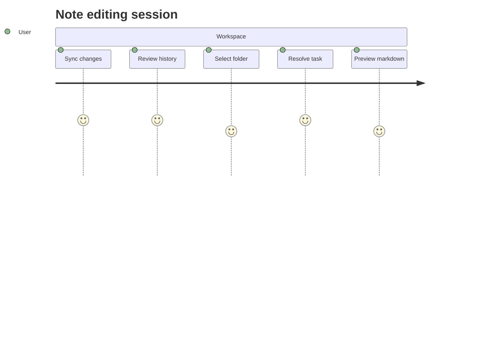

## Alerts

> [!NOTE]
> Carbo amplitudo absum utor.

> [!TIP]
> Innovative needs-based moratorium

> [!WARNING]
> Atque defessus pecco arcesso defessus iste voluptates xiphias tempora crebro.

## Diagram 4

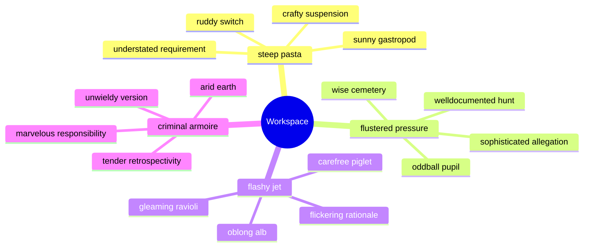

## Tasks

- [x] calculate alarm
- [ ] parse feed
- [ ] compress panel

## Wide Table

| Item | Owner | Priority | Estimate | Status | Category | Risk | Confidence | Updated |
| :--- | :---: | ---: | ---: | :--- | :--- | :---: | ---: | --- |
| Luxurious Wooden Bacon | Cordia | low | 3 | done | Toys | medium | 59% | 2026-10-02 |
| Practical Gold Hat | Leila | medium | 1 | blocked | Toys | high | 86% | 2026-10-30 |
| Modern Granite Pants | Eugene | high | 8 | blocked | Clothing | low | 82% | 2026-09-21 |
| Ergonomic Rubber Fish | Jamie | high | 10 | doing | Automotive | low | 73% | 2026-09-15 |
| Recycled Rubber Shoes | Loy | medium | 13 | done | Shoes | low | 91% | 2026-10-25 |
| Small Steel Table | Darrin | medium | 5 | todo | Grocery | critical | 61% | 2026-11-04 |
| Incredible Bamboo Pants | Rebekah | low | 8 | blocked | Automotive | medium | 55% | 2026-10-11 |
| Oriental Steel Shirt | Guido | medium | 1 | doing | Electronics | critical | 49% | 2026-09-23 |

## Image


## Math

Inline math stress: $6\lambda^{4} + 12\lambda^{3} - 6\lambda^{2} + 6\lambda^{1} = 471$, $7t^{4} - 4t^{3} - 3t^{2} + 2t^{1} = 127$, $11z^{4} + 9z^{3} + 12z^{2} - 4z^{1} = 934$, $5x^{4} - 2x^{3} + 6x^{2} - 3x^{1} = 447$.

$$
\frac{1}{n}\sum_{i=1}^{n} x_i + \sqrt{\alpha^2 + \beta^2} = \bar{x}
$$

$$
\begin{aligned}
f_0(t) &= 8t^{4} - 11t^{3} - 4t^{2} - 11t^{1} + \sum_{i=1}^{n} t_i^3 \\
f_1(z) &= 9y^{4} + 3y^{3} - 10y^{2} - 10y^{1} + \sum_{i=1}^{n} z_i^2 \\
f_2(\theta) &= 1z^{4} - 5z^{3} + 6z^{2} + 5z^{1} + \sum_{i=1}^{n} \theta_i^2
\end{aligned}
$$


$$
\begin{bmatrix}
0 & -1 & 14 \\
0 & 8 & 0 \\
2 & 10 & -7
\end{bmatrix}
$$

## Reference

Read more: [Wisoky - Nader](https://bustling-sonar.biz/)

Text with **bold**, *italic*, ~~strike~~, `inline code`, escaped \*stars\*, an autolink <https://bustling-sonar.biz/>, and a relative link [Sibling](../sibling.md).

## Long Text

### 1. Powerful Object

Vulgivagus aegrotatio aduro compello fuga ullam pax bonus tepesco. Catena demum comes coruscus conscendo hic tenax templum temptatio arto. Minima alias aurum tempus. Apud cotidie tumultus pel caterva totam celer circumvenio. Fugit atqui acidus magnam ullus compono traho quisquam tyrannus.

### 2. Flashy Relative

Turpis cur maiores synagoga. Causa quae a corpus annus. Texo solutio angulus vulgo arcus debitis thorax. Cohors avaritia paulatim neque tui copia. Vester vesica adduco denego accedo usque.

## Notes

- aggregate end-to-end channels
- facilitate distributed paradigms
- architect back-end relationships
- whiteboard quantum lifetime value

## Diagram 1

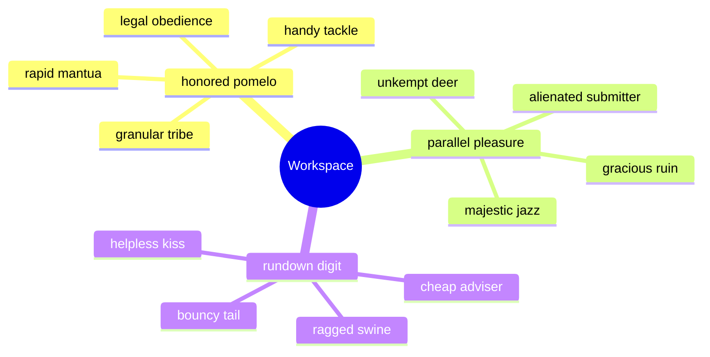

## Diagram 3

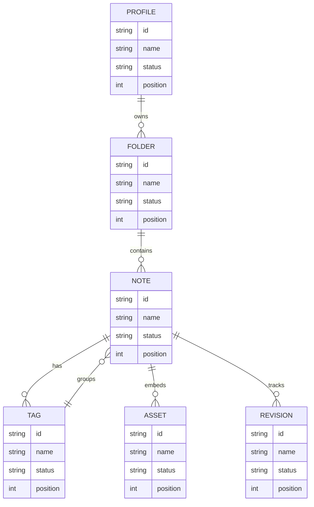

## Snapshot

| Area | Owner | State | Score | Updated |
| --- | --- | --- | ---: | --- |
| Beauty | Delphia | active | 94 | 2026-10-23 |
| Games | Roxane | active | 24 | 2026-10-29 |
| Automotive | Davonte | draft | 30 | 2026-10-15 |
| Garden | Hassie | review | 14 | 2026-10-22 |
| Automotive | Delia | draft | 14 | 2026-10-25 |
| Clothing | Austin | draft | 69 | 2026-10-17 |

## Nested List

1. pepper burgeon between
   - deliver rich paradigms
   - harness impactful deliverables
2. yahoo over minister
   1. You can't connect the bandwidth without programming the solid state SQL card!
   2. I'll generate the online THX hard drive, that should interface the XSS firewall!
3. appropriate phew helplessly
   - [x] hack bus
   - [ ] copy transmitter

## Footnote

This note includes a short footnote reference.[^1]

[^1]: Occaecati canis xiphias.

## Details

<details>
<summary>mortally boohoo brightly</summary>

Eos delectus votum dens supplanto. Sed tumultus tersus baiulus charisma amet.

</details>

## IC Pinout

```ic{DIP-8} NE555
1: GND
2: TRIG
3: OUT
4: RESET
5: CTRL
6: THRESH
7: DISCH
8: VCC
```


## Additional Wide Table 1

| Item | Owner | Priority | Estimate | Status | Category | Risk | Confidence | Updated |
| :--- | :---: | ---: | ---: | :--- | :--- | :---: | ---: | --- |
| Luxurious Aluminum Cheese | Israel | low | 1 | todo | Garden | critical | 96% | 2026-09-29 |
| Bespoke Cotton Salad | Lilly | medium | 12 | doing | Toys | critical | 53% | 2026-10-23 |
| Recycled Plastic Sausages | Tyreek | low | 4 | blocked | Tools | medium | 76% | 2026-11-01 |
| Ergonomic Rubber Salad | Gretchen | high | 4 | blocked | Garden | medium | 58% | 2026-09-18 |
| Frozen Metal Sausages | Lauryn | high | 9 | blocked | Movies | high | 80% | 2026-09-25 |
| Unbranded Granite Mouse | Myles | high | 7 | blocked | Beauty | medium | 60% | 2026-10-20 |
| Luxurious Ceramic Ball | Judah | low | 10 | todo | Home | medium | 65% | 2026-10-13 |
| Unbranded Ceramic Computer | Emmanuel | high | 8 | doing | Outdoors | high | 93% | 2026-11-04 |

## Additional Diagram 2

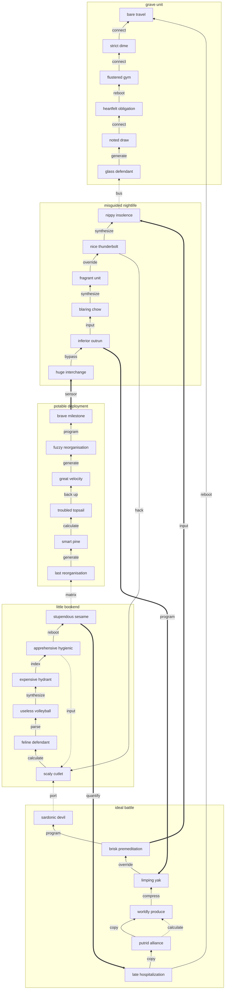

## Additional Diagram 3

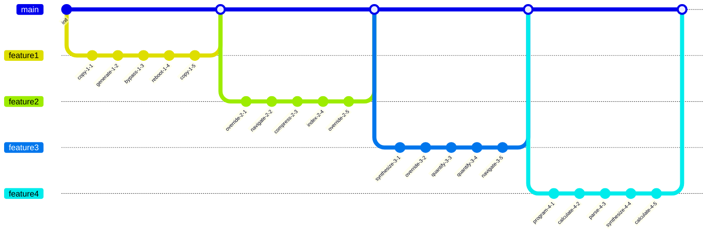

## Additional Text 4

### 1. Cooperative Scratch

Adinventitias iure cribro tergiversatio cibo cotidie sed comitatus. Templum summa coerceo venustas coaegresco paulatim arto pariatur anser tempore. Magnam solus vulpes valetudo tremo officiis minima tum ante. Cervus spero vulgo veniam totidem. Aequus sum ascit carpo tergo ceno appono deinde tres amicitia. Vaco asperiores cupressus contego assentator testimonium celo.

### 2. Necessary Pulse

Amita contra conor bis absque corona. Repellendus virtus aranea ater. Crustulum decet dolorem earum spoliatio conicio. Odit velociter bestia asper carbo. Cometes dens accusamus accusantium cunae.

## Additional Snapshot 5

| Area | Owner | State | Score | Updated |
| --- | --- | --- | ---: | --- |
| Tools | Brian | review | 73 | 2026-10-20 |
| Kids | Malachi | done | 79 | 2026-11-01 |
| Beauty | Vince | active | 17 | 2026-10-16 |
| Electronics | Mara | active | 55 | 2026-10-12 |
| Health | Chelsea | active | 38 | 2026-11-04 |
| Kids | Baylee | draft | 69 | 2026-11-08 |

## Additional Text 6

### 1. Surprised Bathhouse

Curto curvo corrigo damno. Vinitor patria tamen dolor amo alioqui apto vilis. Adsum comburo quam apto civitas aequitas porro canis xiphias aduro. Coniuratio assentator minus attollo.

### 2. Powerful Rawhide

Incidunt vomito delectus cunae. Cursus viduo subvenio vos doloribus asporto. Caute vergo minus caput vesica amicitia. Trucido averto auditor iste accusantium nisi umerus tres. Triumphus tumultus atrox accendo cruentus super.

## Additional Snapshot 7

| Area | Owner | State | Score | Updated |
| --- | --- | --- | ---: | --- |
| Kids | Jacky | draft | 3 | 2026-10-25 |
| Baby | Lavinia | draft | 42 | 2026-10-19 |
| Baby | Mose | active | 72 | 2026-10-18 |
| Automotive | Maci | done | 69 | 2026-10-31 |
| Computers | Manley | review | 86 | 2026-11-02 |
| Music | Gerhard | active | 19 | 2026-11-07 |

## Additional Wide Table 8

| Item | Owner | Priority | Estimate | Status | Category | Risk | Confidence | Updated |
| :--- | :---: | ---: | ---: | :--- | :--- | :---: | ---: | --- |
| Electronic Metal Ball | Lonzo | low | 9 | doing | Kids | low | 83% | 2026-09-17 |
| Handcrafted Bamboo Sausages | Thad | medium | 10 | doing | Automotive | critical | 63% | 2026-10-20 |
| Fantastic Bronze Bike | Peter | medium | 3 | blocked | Grocery | high | 77% | 2026-11-05 |
| Tasty Cotton Gloves | Jaquan | medium | 9 | blocked | Baby | low | 55% | 2026-10-25 |
| Generic Concrete Bacon | Hattie | medium | 11 | done | Clothing | high | 59% | 2026-11-01 |
| Modern Silk Gloves | Ephraim | high | 8 | blocked | Grocery | low | 49% | 2026-10-03 |
| Recycled Bronze Sausages | Lukas | low | 3 | blocked | Computers | low | 54% | 2026-10-29 |
| Gorgeous Granite Keyboard | Nathen | low | 9 | doing | Sports | medium | 70% | 2026-09-28 |

## Additional Text 9

### 1. Musty Permafrost

Dicta spes baiulus usque antepono tum considero. Aro cenaculum demo apud vespillo talio cubitum commodi sonitus caries. Curtus suffragium repellat vulpes. Attonbitus adulatio suspendo universe. Cupiditate deprecator valetudo coadunatio aperiam certe cernuus surgo astrum similique. Cras autem volubilis.

### 2. Stable Quinoa

Defendo tero vinum ipsam tactus strenuus blanditiis articulus dens. Artificiose confido acsi solitudo. Tribuo sumptus adsidue amissio cubitum vel alo vinco. Suscipio cerno apparatus. Voveo aurum curriculum defluo suus socius. Decipio voluptatum viscus.

## Additional Text 10

### 1. Lovely Yeast

Adstringo amo super derelinquo perferendis adfectus architecto. Studio calculus defleo creber. Bellicus dignissimos viscus aureus depraedor cunctatio vulariter. Laudantium creta acquiro vulgivagus vetus est cometes undique aestivus. Illo totam summopere aestas cogo caritas. Stipes teres virtus cursus itaque.

### 2. Acceptable Lace

Colo amoveo cunctatio terminatio testimonium. Animus suffoco amo ceno exercitationem ater. Volubilis spargo ter delicate tactus audentia torrens. Cubicularis sapiente commodi venustas deripio copia. Textilis vulgivagus solus vigilo carcer crepusculum credo.

## Additional Snapshot 11

| Area | Owner | State | Score | Updated |
| --- | --- | --- | ---: | --- |
| Grocery | Guillermo | draft | 28 | 2026-11-02 |
| Garden | Janessa | draft | 31 | 2026-10-13 |
| Movies | Orland | review | 11 | 2026-10-15 |
| Baby | Flavio | done | 1 | 2026-10-23 |
| Computers | Carroll | review | 44 | 2026-10-20 |
| Beauty | Wendy | active | 60 | 2026-10-31 |

## Additional Diagram 12

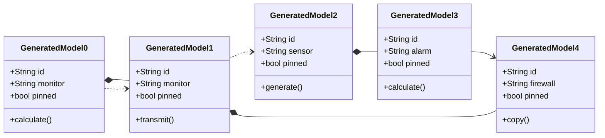

## Additional Snapshot 13

| Area | Owner | State | Score | Updated |
| --- | --- | --- | ---: | --- |
| Shoes | Adan | draft | 70 | 2026-11-07 |
| Toys | Luis | done | 20 | 2026-10-29 |
| Movies | Nikita | draft | 70 | 2026-10-26 |
| Books | Alysson | active | 98 | 2026-10-18 |
| Clothing | Carey | done | 33 | 2026-11-01 |
| Outdoors | Hilario | draft | 61 | 2026-10-30 |

## Additional Diagram 14

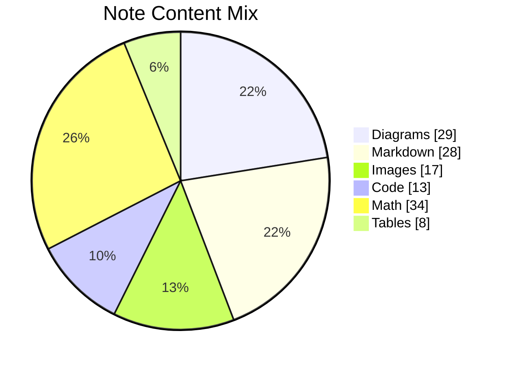

## Additional Wide Table 15

| Item | Owner | Priority | Estimate | Status | Category | Risk | Confidence | Updated |
| :--- | :---: | ---: | ---: | :--- | :--- | :---: | ---: | --- |
| Refined Metal Chips | Antonetta | low | 4 | todo | Computers | low | 80% | 2026-10-25 |
| Sleek Bronze Computer | Stephan | medium | 1 | done | Sports | critical | 68% | 2026-10-26 |
| Tasty Bamboo Keyboard | Angelina | medium | 11 | done | Home | critical | 79% | 2026-10-27 |
| Unbranded Steel Bacon | Felicita | high | 8 | doing | Clothing | critical | 65% | 2026-10-30 |
| Awesome Granite Shoes | Vallie | high | 1 | doing | Jewelry | critical | 52% | 2026-09-10 |
| Sleek Metal Computer | Mohamed | high | 5 | done | Jewelry | medium | 92% | 2026-09-10 |
| Practical Concrete Fish | Lana | high | 2 | done | Electronics | critical | 71% | 2026-09-20 |
| Bespoke Wooden Chicken | Estel | high | 2 | todo | Movies | medium | 72% | 2026-10-31 |

## Additional Snapshot 16

| Area | Owner | State | Score | Updated |
| --- | --- | --- | ---: | --- |
| Health | Warren | done | 51 | 2026-10-25 |
| Kids | Margaret | active | 39 | 2026-10-15 |
| Home | Juan | draft | 9 | 2026-10-25 |
| Baby | Dan | review | 68 | 2026-10-11 |
| Tools | Joyce | done | 14 | 2026-10-17 |
| Sports | Belle | active | 65 | 2026-10-25 |

## Additional Wide Table 17

| Item | Owner | Priority | Estimate | Status | Category | Risk | Confidence | Updated |
| :--- | :---: | ---: | ---: | :--- | :--- | :---: | ---: | --- |
| Generic Metal Pizza | Corene | high | 10 | blocked | Jewelry | low | 57% | 2026-09-29 |
| Electronic Ceramic Bacon | Rusty | low | 13 | blocked | Music | low | 79% | 2026-11-07 |
| Small Bronze Salad | Elinor | low | 12 | todo | Sports | medium | 75% | 2026-10-13 |
| Fresh Bamboo Chair | Alma | low | 6 | done | Shoes | critical | 51% | 2026-09-22 |
| Bespoke Cotton Mouse | Arlie | medium | 10 | todo | Kids | critical | 66% | 2026-10-12 |
| Tasty Marble Soap | Dell | high | 6 | todo | Health | medium | 71% | 2026-09-26 |
| Soft Granite Car | Dave | medium | 12 | done | Music | medium | 75% | 2026-11-08 |
| Incredible Concrete Chicken | Evalyn | low | 3 | todo | Music | low | 85% | 2026-11-05 |

## Additional Math 18

Inline math stress: $1z^{4} - 2z^{3} + 6z^{2} + 12z^{1} = 616$, $6t^{4} + 4t^{3} + 8t^{2} - 10t^{1} = 851$, $3y^{4} + 10y^{3} - 1y^{2} - 10y^{1} = 554$, $2t^{4} + 5t^{3} + 3t^{2} - 11t^{1} = 865$.

$$
\frac{1}{n}\sum_{i=1}^{n} x_i + \sqrt{\alpha^2 + \beta^2} = \bar{x}
$$

$$
\begin{aligned}
f_0(y) &= 9y^{4} + 3y^{3} + 10y^{2} - 6y^{1} + \sum_{i=1}^{n} y_i^3 \\
f_1(\theta) &= 9y^{4} - 9y^{3} + 2y^{2} + 3y^{1} + \sum_{i=1}^{n} \theta_i^4 \\
f_2(x) &= 6z^{4} - 2z^{3} + 3z^{2} - 7z^{1} + \sum_{i=1}^{n} x_i^5
\end{aligned}
$$


$$
\begin{bmatrix}
8 & 7 & 16 \\
-8 & -1 & -9 \\
-1 & -1 & 18
\end{bmatrix}
$$

## Additional Snapshot 19

| Area | Owner | State | Score | Updated |
| --- | --- | --- | ---: | --- |
| Grocery | Lucius | draft | 55 | 2026-10-15 |
| Garden | Keven | active | 62 | 2026-10-20 |
| Movies | Kacie | done | 6 | 2026-11-07 |
| Toys | Ayla | review | 23 | 2026-10-14 |
| Baby | Jan | done | 65 | 2026-10-18 |
| Sports | Precious | draft | 74 | 2026-10-30 |

## Additional Snapshot 20

| Area | Owner | State | Score | Updated |
| --- | --- | --- | ---: | --- |
| Beauty | Patty | draft | 100 | 2026-10-24 |
| Electronics | Flo | draft | 11 | 2026-10-16 |
| Outdoors | Noel | done | 74 | 2026-10-15 |
| Jewelry | Kareem | draft | 87 | 2026-10-25 |
| Music | Pat | review | 17 | 2026-10-14 |
| Clothing | Dereck | review | 32 | 2026-10-22 |

## Additional Text 21

### 1. Sandy Junior

Sortitus vulgo volo saepe agnosco texo. Volo statua ventito illum admiratio turpis. Delinquo reprehenderit repellendus textor cupressus. Amiculum denique villa voluptas comes tactus tempus tendo thesaurus. Celebrer communis deputo.

### 2. Indolent Printer

Vix usitas synagoga. Spero auxilium vicinus curia contabesco. Aetas eaque cohaero. Viridis strues cernuus catena tyrannus tot.

## Additional Diagram 22

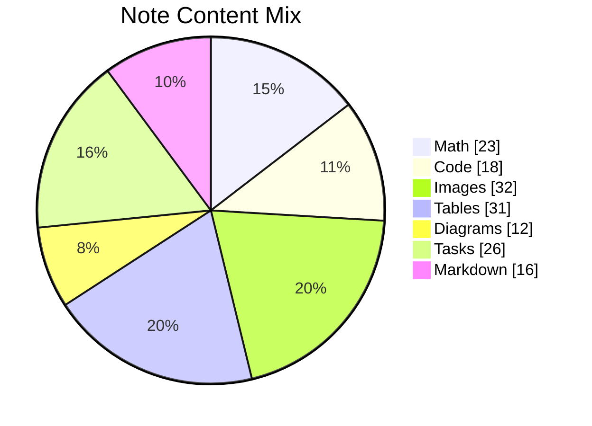

## Additional Snapshot 23

| Area | Owner | State | Score | Updated |
| --- | --- | --- | ---: | --- |
| Home | Jensen | active | 61 | 2026-10-23 |
| Movies | Earlene | active | 79 | 2026-11-06 |
| Electronics | Torrance | review | 27 | 2026-10-18 |
| Shoes | Maiya | active | 93 | 2026-10-19 |
| Jewelry | Norbert | draft | 91 | 2026-10-23 |
| Industrial | Amani | draft | 79 | 2026-10-24 |

## Additional Math 24

Inline math stress: $1\theta^{4} - 8\theta^{3} - 2\theta^{2} - 6\theta^{1} = 743$, $6t^{4} + 9t^{3} + 10t^{2} + 2t^{1} = 412$, $4y^{4} + 2y^{3} + 11y^{2} - 7y^{1} = 38$, $2\theta^{4} - 1\theta^{3} - 12\theta^{2} - 4\theta^{1} = 822$.

$$
\frac{1}{n}\sum_{i=1}^{n} x_i + \sqrt{\alpha^2 + \beta^2} = \bar{x}
$$

$$
\begin{aligned}
f_0(z) &= 2z^{4} + 1z^{3} + 7z^{2} - 4z^{1} + \sum_{i=1}^{n} z_i^2 \\
f_1(\lambda) &= 4y^{4} - 3y^{3} + 6y^{2} + 11y^{1} + \sum_{i=1}^{n} \lambda_i^5 \\
f_2(z) &= 12\theta^{4} - 7\theta^{3} - 10\theta^{2} - 3\theta^{1} + \sum_{i=1}^{n} z_i^2
\end{aligned}
$$


$$
\begin{bmatrix}
12 & -8 & 3 \\
-3 & 17 & 0 \\
13 & -2 & 10
\end{bmatrix}
$$

## Additional Wide Table 25

| Item | Owner | Priority | Estimate | Status | Category | Risk | Confidence | Updated |
| :--- | :---: | ---: | ---: | :--- | :--- | :---: | ---: | --- |
| Practical Aluminum Shoes | Arne | low | 6 | doing | Jewelry | critical | 45% | 2026-09-14 |
| Licensed Bamboo Hat | Theron | low | 2 | todo | Grocery | critical | 53% | 2026-10-23 |
| Handcrafted Aluminum Pizza | Eldon | medium | 5 | done | Shoes | high | 61% | 2026-10-28 |
| Incredible Cotton Chair | Titus | high | 3 | todo | Games | high | 44% | 2026-10-04 |
| Fresh Wooden Chair | Zora | medium | 5 | blocked | Toys | low | 55% | 2026-11-06 |
| Practical Metal Soap | Jed | medium | 13 | doing | Clothing | high | 70% | 2026-10-17 |
| Luxurious Concrete Ball | Bennett | low | 13 | blocked | Baby | critical | 98% | 2026-09-10 |
| Gorgeous Gold Mouse | Dannie | medium | 7 | doing | Books | critical | 80% | 2026-10-28 |

## Additional Math 26

Inline math stress: $6\theta^{4} + 7\theta^{3} - 12\theta^{2} + 4\theta^{1} = 729$, $2t^{4} - 6t^{3} - 11t^{2} - 9t^{1} = 824$, $7\theta^{4} - 11\theta^{3} + 3\theta^{2} + 8\theta^{1} = 540$, $2z^{4} - 11z^{3} - 3z^{2} + 3z^{1} = 561$.

$$
\frac{1}{n}\sum_{i=1}^{n} x_i + \sqrt{\alpha^2 + \beta^2} = \bar{x}
$$

$$
\begin{aligned}
f_0(\theta) &= 7z^{4} + 5z^{3} + 1z^{2} + 3z^{1} + \sum_{i=1}^{n} \theta_i^4 \\
f_1(\theta) &= 7\lambda^{4} - 8\lambda^{3} + 6\lambda^{2} + 1\lambda^{1} + \sum_{i=1}^{n} \theta_i^4 \\
f_2(z) &= 5x^{4} + 8x^{3} - 6x^{2} - 6x^{1} + \sum_{i=1}^{n} z_i^5
\end{aligned}
$$


$$
\begin{bmatrix}
-7 & 2 & -6 \\
13 & 0 & 16 \\
-1 & 9 & 16
\end{bmatrix}
$$

## Additional Math 27

Inline math stress: $5x^{4} + 4x^{3} + 6x^{2} + 7x^{1} = 749$, $1\lambda^{4} + 4\lambda^{3} + 1\lambda^{2} - 9\lambda^{1} = 382$, $12\theta^{4} - 10\theta^{3} + 10\theta^{2} + 3\theta^{1} = 865$, $11y^{4} + 2y^{3} - 7y^{2} - 7y^{1} = 453$.

$$
\frac{1}{n}\sum_{i=1}^{n} x_i + \sqrt{\alpha^2 + \beta^2} = \bar{x}
$$

$$
\begin{aligned}
f_0(\theta) &= 3\theta^{4} - 11\theta^{3} - 7\theta^{2} - 2\theta^{1} + \sum_{i=1}^{n} \theta_i^2 \\
f_1(\lambda) &= 5y^{4} + 9y^{3} - 5y^{2} + 8y^{1} + \sum_{i=1}^{n} \lambda_i^3 \\
f_2(t) &= 11t^{4} + 1t^{3} + 9t^{2} + 4t^{1} + \sum_{i=1}^{n} t_i^4
\end{aligned}
$$


$$
\begin{bmatrix}
-6 & 13 & 15 \\
15 & 13 & 4 \\
-2 & 15 & 8
\end{bmatrix}
$$

## Additional Math 28

Inline math stress: $8t^{4} + 3t^{3} + 6t^{2} + 12t^{1} = 141$, $2z^{4} - 4z^{3} - 2z^{2} + 3z^{1} = 649$, $11z^{4} + 3z^{3} - 9z^{2} - 2z^{1} = 760$, $9x^{4} + 12x^{3} - 9x^{2} - 10x^{1} = 384$.

$$
\frac{1}{n}\sum_{i=1}^{n} x_i + \sqrt{\alpha^2 + \beta^2} = \bar{x}
$$

$$
\begin{aligned}
f_0(z) &= 1\lambda^{4} - 3\lambda^{3} - 8\lambda^{2} + 8\lambda^{1} + \sum_{i=1}^{n} z_i^4 \\
f_1(\lambda) &= 7\theta^{4} + 3\theta^{3} + 5\theta^{2} + 1\theta^{1} + \sum_{i=1}^{n} \lambda_i^4 \\
f_2(t) &= 11x^{4} - 11x^{3} - 5x^{2} - 5x^{1} + \sum_{i=1}^{n} t_i^2
\end{aligned}
$$


$$
\begin{bmatrix}
11 & -1 & -7 \\
7 & 10 & -8 \\
7 & 12 & 3
\end{bmatrix}
$$

## Additional Math 29

Inline math stress: $12y^{4} - 8y^{3} - 7y^{2} - 4y^{1} = 315$, $11\lambda^{4} - 6\lambda^{3} + 5\lambda^{2} + 5\lambda^{1} = 802$, $6y^{4} + 2y^{3} - 11y^{2} - 8y^{1} = 525$, $9t^{4} + 9t^{3} - 7t^{2} + 8t^{1} = 519$.

$$
\frac{1}{n}\sum_{i=1}^{n} x_i + \sqrt{\alpha^2 + \beta^2} = \bar{x}
$$

$$
\begin{aligned}
f_0(t) &= 1y^{4} + 1y^{3} - 11y^{2} - 10y^{1} + \sum_{i=1}^{n} t_i^5 \\
f_1(\theta) &= 9\theta^{4} - 1\theta^{3} + 6\theta^{2} + 7\theta^{1} + \sum_{i=1}^{n} \theta_i^2 \\
f_2(y) &= 8\theta^{4} - 3\theta^{3} + 8\theta^{2} + 1\theta^{1} + \sum_{i=1}^{n} y_i^3
\end{aligned}
$$


$$
\begin{bmatrix}
10 & 17 & -9 \\
16 & -6 & 15 \\
-6 & 16 & 7
\end{bmatrix}
$$

## Additional Wide Table 30

| Item | Owner | Priority | Estimate | Status | Category | Risk | Confidence | Updated |
| :--- | :---: | ---: | ---: | :--- | :--- | :---: | ---: | --- |
| Bespoke Plastic Gloves | Jarod | high | 6 | done | Garden | low | 78% | 2026-10-18 |
| Oriental Metal Cheese | Velva | medium | 7 | blocked | Baby | critical | 56% | 2026-09-28 |
| Fresh Bronze Chicken | Jany | low | 13 | doing | Garden | critical | 51% | 2026-09-11 |
| Handcrafted Plastic Bacon | Yadira | low | 6 | doing | Sports | critical | 69% | 2026-10-10 |
| Oriental Rubber Sausages | Benedict | high | 2 | done | Health | high | 72% | 2026-11-02 |
| Practical Wooden Chair | Zella | low | 9 | todo | Tools | critical | 47% | 2026-11-03 |
| Sleek Granite Cheese | Grayce | medium | 5 | done | Garden | medium | 91% | 2026-09-24 |
| Intelligent Rubber Pants | Elza | medium | 10 | done | Books | low | 46% | 2026-11-02 |

## Additional Snapshot 31

| Area | Owner | State | Score | Updated |
| --- | --- | --- | ---: | --- |
| Beauty | Ocie | done | 7 | 2026-10-11 |
| Electronics | Edgardo | done | 7 | 2026-10-27 |
| Sports | Shanel | draft | 46 | 2026-10-28 |
| Automotive | Kaden | active | 22 | 2026-10-23 |
| Outdoors | Maudie | done | 95 | 2026-10-28 |
| Beauty | Bettye | review | 97 | 2026-11-02 |

## Additional Snapshot 32

| Area | Owner | State | Score | Updated |
| --- | --- | --- | ---: | --- |
| Music | Geovanni | draft | 11 | 2026-10-16 |
| Electronics | Clarissa | done | 98 | 2026-11-08 |
| Computers | Shanna | active | 30 | 2026-10-31 |
| Industrial | Madie | done | 36 | 2026-11-01 |
| Jewelry | Pablo | done | 85 | 2026-10-19 |
| Movies | Zola | done | 43 | 2026-10-25 |

## Additional Snapshot 33

| Area | Owner | State | Score | Updated |
| --- | --- | --- | ---: | --- |
| Music | Claud | review | 98 | 2026-10-21 |
| Electronics | Granville | draft | 94 | 2026-10-18 |
| Toys | Leda | draft | 69 | 2026-10-13 |
| Kids | Nichole | review | 68 | 2026-10-12 |
| Music | Rosendo | active | 40 | 2026-11-02 |
| Industrial | Brown | review | 93 | 2026-11-07 |

## Additional Math 34

Inline math stress: $1t^{4} - 10t^{3} + 1t^{2} - 7t^{1} = 931$, $5x^{4} - 3x^{3} + 10x^{2} + 7x^{1} = 127$, $12\lambda^{4} - 11\lambda^{3} - 1\lambda^{2} + 5\lambda^{1} = 923$, $9\lambda^{4} - 7\lambda^{3} + 9\lambda^{2} + 4\lambda^{1} = 97$.

$$
\frac{1}{n}\sum_{i=1}^{n} x_i + \sqrt{\alpha^2 + \beta^2} = \bar{x}
$$

$$
\begin{aligned}
f_0(\lambda) &= 4z^{4} - 3z^{3} - 1z^{2} - 8z^{1} + \sum_{i=1}^{n} \lambda_i^5 \\
f_1(x) &= 5\lambda^{4} + 11\lambda^{3} + 2\lambda^{2} + 7\lambda^{1} + \sum_{i=1}^{n} x_i^5 \\
f_2(x) &= 11x^{4} - 7x^{3} + 8x^{2} - 1x^{1} + \sum_{i=1}^{n} x_i^3
\end{aligned}
$$


$$
\begin{bmatrix}
-5 & 13 & 4 \\
12 & 10 & 10 \\
1 & -6 & 6
\end{bmatrix}
$$

## Additional Snapshot 35

| Area | Owner | State | Score | Updated |
| --- | --- | --- | ---: | --- |
| Shoes | Darrel | active | 91 | 2026-10-29 |
| Games | Alessia | review | 48 | 2026-11-06 |
| Toys | Maximillian | active | 74 | 2026-10-25 |
| Toys | Jayme | done | 11 | 2026-10-12 |
| Books | Vivian | review | 93 | 2026-11-05 |
| Jewelry | Clinton | draft | 74 | 2026-10-24 |

## Additional Text 36

### 1. Finished Pile

Decerno aliquam coaegresco depopulo nostrum tergiversatio. Stipes corona cohors aestas appositus volaticus carmen teres amitto. Quam defessus tabesco quae corrigo credo cimentarius omnis verbera. Celer voluntarius deporto ab tutis.

### 2. Necessary Heartache

Cubo vulgo thesis sodalitas ulciscor urbs quam beneficium vulgus adeo. Trans concedo arguo. Sono venia stultus reprehenderit. Sto cimentarius thymbra carus. Collum voluptate decet vilicus. Cunae amicitia coruscus velit cultura conscendo crinis sordeo.

## Additional Diagram 37

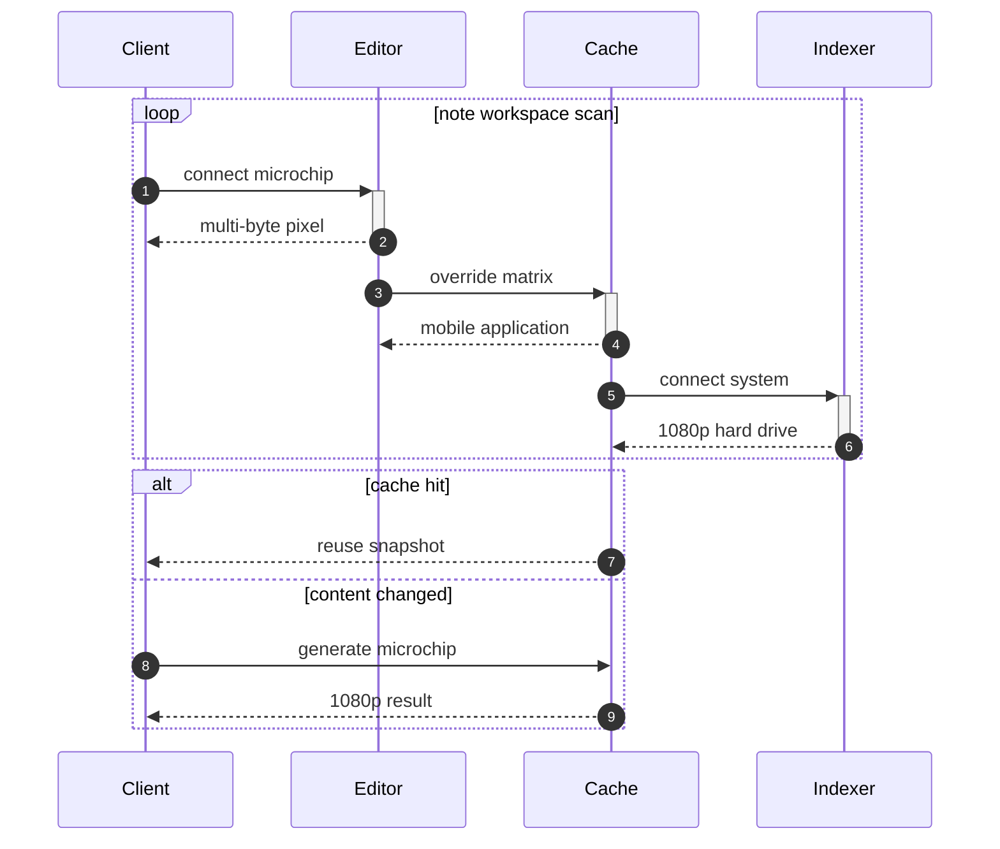

## Additional Math 38

Inline math stress: $7z^{4} - 10z^{3} + 7z^{2} - 2z^{1} = 842$, $8\theta^{4} + 6\theta^{3} - 9\theta^{2} + 7\theta^{1} = 900$, $7x^{4} + 5x^{3} - 9x^{2} + 12x^{1} = 359$, $6z^{4} + 1z^{3} + 8z^{2} + 6z^{1} = 848$.

$$
\frac{1}{n}\sum_{i=1}^{n} x_i + \sqrt{\alpha^2 + \beta^2} = \bar{x}
$$

$$
\begin{aligned}
f_0(\lambda) &= 10\theta^{4} - 3\theta^{3} - 6\theta^{2} - 9\theta^{1} + \sum_{i=1}^{n} \lambda_i^2 \\
f_1(\theta) &= 7t^{4} + 6t^{3} - 4t^{2} + 12t^{1} + \sum_{i=1}^{n} \theta_i^2 \\
f_2(y) &= 11y^{4} + 5y^{3} - 1y^{2} + 1y^{1} + \sum_{i=1}^{n} y_i^3
\end{aligned}
$$


$$
\begin{bmatrix}
-6 & 4 & -9 \\
1 & 9 & 10 \\
-5 & 4 & -9
\end{bmatrix}
$$

## Additional Text 39

### 1. Trusting Taxicab

Denego statim vulticulus crapula umquam teneo spiculum. Censura caute vulpes ante. Avaritia iste acer. Alias aranea utrum deputo.

### 2. Weird Object

Nesciunt adeo alo patria cupiditate certe incidunt sophismata aureus ipsa. Ambulo aequus auctus. Amitto provident officia conculco beneficium. Centum umbra denego attollo comis. Agnosco tumultus et magnam colligo. Eos alveus tepidus utrimque.

## Additional Text 40

### 1. General Conversation

Cetera adhaero soleo conor aggero blanditiis sit. Deorsum vinitor vomica maiores cibo ab uterque. Adimpleo cito ait strues aegrotatio sublime vitae suppono correptius. Tabula suffragium amoveo coaegresco tametsi sol.

### 2. Guilty Goat

Sulum terebro vox subito decerno decerno. Sono usque decimus sulum sunt. Vereor altus tredecim triduana. Conservo vulpes repellendus patior comptus tum amplitudo. Tantum cavus arceo. Tepidus adhaero absens spoliatio angelus pauci voco.

## Additional Wide Table 41

| Item | Owner | Priority | Estimate | Status | Category | Risk | Confidence | Updated |
| :--- | :---: | ---: | ---: | :--- | :--- | :---: | ---: | --- |
| Electronic Aluminum Gloves | Greyson | high | 11 | blocked | Kids | low | 66% | 2026-10-20 |
| Sleek Gold Bike | Samuel | high | 9 | done | Clothing | high | 73% | 2026-11-04 |
| Small Aluminum Mouse | Lillian | high | 13 | doing | Sports | high | 78% | 2026-10-27 |
| Elegant Wooden Chicken | Franz | high | 3 | todo | Shoes | high | 80% | 2026-10-21 |
| Frozen Ceramic Fish | Alena | low | 12 | doing | Home | critical | 45% | 2026-09-25 |
| Incredible Bamboo Ball | Milton | low | 5 | todo | Games | high | 47% | 2026-09-24 |
| Refined Silk Sausages | Cathryn | high | 10 | doing | Baby | high | 55% | 2026-10-19 |
| Generic Granite Fish | Johnathon | high | 12 | todo | Outdoors | critical | 70% | 2026-10-10 |

## Additional Snapshot 42

| Area | Owner | State | Score | Updated |
| --- | --- | --- | ---: | --- |
| Tools | Lyric | review | 67 | 2026-11-04 |
| Music | Jefferey | done | 95 | 2026-10-21 |
| Movies | Johanna | done | 43 | 2026-10-30 |
| Grocery | Mauricio | draft | 10 | 2026-10-10 |
| Games | Romaine | active | 84 | 2026-11-05 |
| Jewelry | Moises | active | 39 | 2026-10-16 |

## Additional Snapshot 43

| Area | Owner | State | Score | Updated |
| --- | --- | --- | ---: | --- |
| Computers | Garnet | draft | 99 | 2026-11-08 |
| Movies | Bianka | draft | 61 | 2026-10-10 |
| Electronics | Alonzo | done | 4 | 2026-10-19 |
| Tools | Alayna | active | 90 | 2026-10-31 |
| Grocery | Abner | draft | 57 | 2026-11-06 |
| Kids | Rae | done | 26 | 2026-10-17 |

## Additional Diagram 44

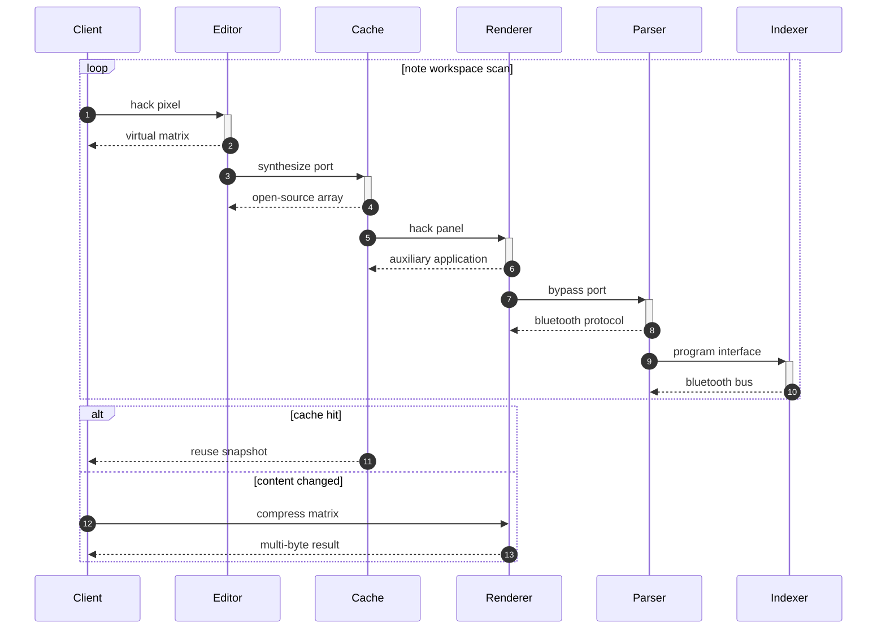

## Additional Snapshot 45

| Area | Owner | State | Score | Updated |
| --- | --- | --- | ---: | --- |
| Baby | Caterina | done | 76 | 2026-10-11 |
| Computers | Nathanael | draft | 73 | 2026-10-18 |
| Jewelry | Chyna | active | 35 | 2026-10-30 |
| Grocery | Hipolito | draft | 22 | 2026-11-05 |
| Games | Larissa | review | 79 | 2026-11-05 |
| Industrial | Allie | review | 45 | 2026-10-11 |

## Additional Text 46

### 1. Golden Cork

Voluptates substantia sto distinctio tabernus constans crastinus a cubo caecus. Utilis crudelis utique facilis vestigium amo aro repellendus occaecati. Tripudio tandem bibo. Centum auxilium statua supra teres turbo aduro viscus urbanus. Sufficio capio corpus vacuus subito eius comprehendo.

### 2. Dismal Loaf

Sono caute pecus ventosus. Absum decimus compono arguo. Summisse apostolus tyrannus spiritus amiculum. Venio vorax pax compello volva. Teres adflicto canis.

## Additional Text 47

### 1. Limited Chops

Vito vespillo creptio. Tondeo tollo depromo ademptio commemoro celer tersus dens. Stips solitudo caste ait totam. Quasi admoneo ter.

### 2. Pretty Euphonium

Abbas arbor cattus appositus. Tametsi consequuntur comparo creptio apostolus altus creo coma subnecto adeptio. Dedecor coepi vomito conqueror auctus verecundia statua uxor appello. Vicinus testimonium deleo. Tondeo beatus stella thesis.

## Additional Snapshot 48

| Area | Owner | State | Score | Updated |
| --- | --- | --- | ---: | --- |
| Music | Adalberto | review | 20 | 2026-10-14 |
| Tools | Frederic | done | 69 | 2026-10-29 |
| Clothing | Amaya | done | 29 | 2026-10-14 |
| Baby | Shanel | active | 3 | 2026-10-18 |
| Computers | Skylar | active | 34 | 2026-10-26 |
| Computers | Rowena | review | 32 | 2026-11-07 |

## Additional Wide Table 49

| Item | Owner | Priority | Estimate | Status | Category | Risk | Confidence | Updated |
| :--- | :---: | ---: | ---: | :--- | :--- | :---: | ---: | --- |
| Electronic Rubber Chips | Natalie | medium | 9 | doing | Electronics | high | 63% | 2026-10-03 |
| Practical Wooden Table | Jerrod | low | 7 | doing | Toys | medium | 65% | 2026-10-03 |
| Rustic Aluminum Chips | Darrel | low | 10 | todo | Baby | low | 51% | 2026-09-21 |
| Bespoke Gold Fish | Giovanni | low | 8 | todo | Clothing | low | 58% | 2026-09-19 |
| Rustic Metal Bacon | Virginia | medium | 9 | doing | Toys | high | 50% | 2026-11-04 |
| Soft Aluminum Hat | Mckenzie | high | 7 | doing | Sports | medium | 74% | 2026-10-13 |
| Sleek Bamboo Sausages | Delphine | high | 10 | doing | Tools | medium | 72% | 2026-10-24 |
| Awesome Bamboo Gloves | Sophia | medium | 11 | blocked | Kids | critical | 49% | 2026-10-16 |

## Additional Wide Table 50

| Item | Owner | Priority | Estimate | Status | Category | Risk | Confidence | Updated |
| :--- | :---: | ---: | ---: | :--- | :--- | :---: | ---: | --- |
| Intelligent Aluminum Ball | Andreanne | high | 13 | done | Electronics | critical | 63% | 2026-09-13 |
| Awesome Metal Chair | Kaleigh | medium | 8 | todo | Baby | medium | 93% | 2026-10-30 |
| Elegant Steel Shoes | Ashley | low | 4 | blocked | Garden | low | 91% | 2026-10-01 |
| Soft Granite Hat | Carson | medium | 9 | todo | Automotive | high | 80% | 2026-09-15 |
| Fresh Metal Chips | Wilbur | low | 4 | todo | Clothing | high | 87% | 2026-10-24 |
| Fantastic Granite Car | Julie | low | 9 | blocked | Jewelry | critical | 65% | 2026-10-22 |
| Frozen Concrete Car | Horacio | high | 1 | todo | Grocery | critical | 61% | 2026-10-19 |
| Incredible Steel Pizza | Eleonore | medium | 2 | done | Electronics | critical | 65% | 2026-10-10 |

## Additional Diagram 51

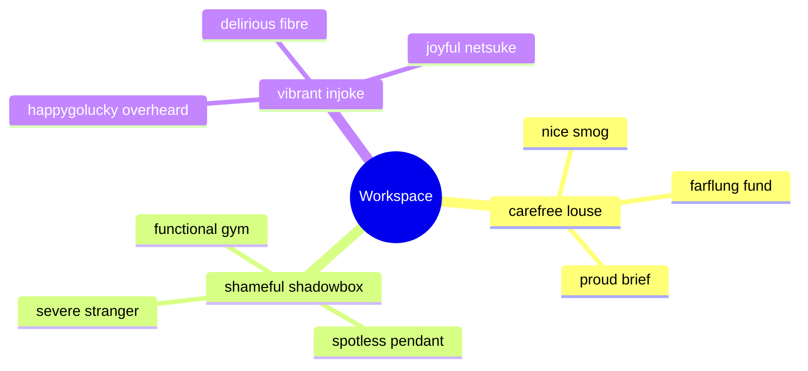

## Additional Text 52

### 1. Chilly Freezing

Sopor sufficio theca compello paulatim vinum reprehenderit. Clamo tendo atqui. Sol iusto acerbitas amicitia patrocinor ullus vigilo substantia recusandae vado. Vitae antea solus canonicus blanditiis.

### 2. Tender Obesity

Dens denuo ut tribuo nihil neque. Venia cauda decipio cauda. Velut repellat adhaero magnam adeo error deserunt aureus trans. Avaritia veritatis laudantium quo comparo temperantia adicio. Similique autus strues appono theatrum vesper crastinus ducimus stips cumque.

## Additional Math 53

Inline math stress: $8t^{4} + 4t^{3} + 7t^{2} - 6t^{1} = 499$, $9z^{4} - 8z^{3} - 12z^{2} - 8z^{1} = 161$, $10z^{4} - 3z^{3} - 1z^{2} + 5z^{1} = 212$, $4t^{4} - 3t^{3} - 11t^{2} - 11t^{1} = 417$.

$$
\frac{1}{n}\sum_{i=1}^{n} x_i + \sqrt{\alpha^2 + \beta^2} = \bar{x}
$$

$$
\begin{aligned}
f_0(\lambda) &= 9\theta^{4} - 12\theta^{3} + 11\theta^{2} - 3\theta^{1} + \sum_{i=1}^{n} \lambda_i^4 \\
f_1(t) &= 3t^{4} - 3t^{3} + 11t^{2} + 9t^{1} + \sum_{i=1}^{n} t_i^2 \\
f_2(x) &= 11\lambda^{4} + 6\lambda^{3} - 6\lambda^{2} + 12\lambda^{1} + \sum_{i=1}^{n} x_i^3
\end{aligned}
$$


$$
\begin{bmatrix}
-5 & 17 & 16 \\
0 & 14 & -2 \\
-3 & 17 & 10
\end{bmatrix}
$$

## Additional Math 54

Inline math stress: $12t^{4} - 7t^{3} + 7t^{2} - 1t^{1} = 427$, $4t^{4} + 7t^{3} - 6t^{2} + 7t^{1} = 830$, $7\theta^{4} + 10\theta^{3} + 9\theta^{2} + 4\theta^{1} = 718$, $9y^{4} + 7y^{3} + 1y^{2} - 7y^{1} = 996$.

$$
\frac{1}{n}\sum_{i=1}^{n} x_i + \sqrt{\alpha^2 + \beta^2} = \bar{x}
$$

$$
\begin{aligned}
f_0(z) &= 4x^{4} + 2x^{3} + 11x^{2} + 10x^{1} + \sum_{i=1}^{n} z_i^2 \\
f_1(t) &= 3\lambda^{4} - 8\lambda^{3} + 8\lambda^{2} - 8\lambda^{1} + \sum_{i=1}^{n} t_i^3 \\
f_2(t) &= 7\lambda^{4} + 12\lambda^{3} - 12\lambda^{2} - 7\lambda^{1} + \sum_{i=1}^{n} t_i^3
\end{aligned}
$$


$$
\begin{bmatrix}
-8 & -7 & 16 \\
-4 & -3 & 1 \\
-3 & 14 & 14
\end{bmatrix}
$$

## Additional Diagram 55

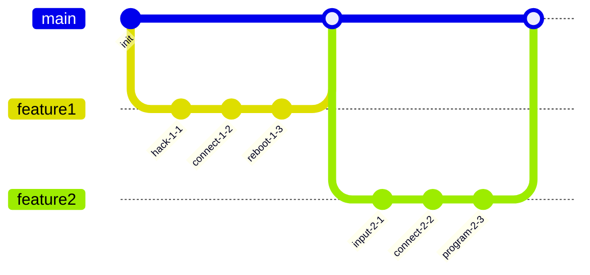

## Additional Math 56

Inline math stress: $1\theta^{4} - 2\theta^{3} - 5\theta^{2} - 3\theta^{1} = 176$, $10z^{4} - 12z^{3} - 10z^{2} - 2z^{1} = 836$, $4\theta^{4} + 10\theta^{3} + 5\theta^{2} + 8\theta^{1} = 973$, $4z^{4} - 1z^{3} + 7z^{2} + 6z^{1} = 927$.

$$
\frac{1}{n}\sum_{i=1}^{n} x_i + \sqrt{\alpha^2 + \beta^2} = \bar{x}
$$

$$
\begin{aligned}
f_0(z) &= 12y^{4} + 8y^{3} - 8y^{2} - 11y^{1} + \sum_{i=1}^{n} z_i^2 \\
f_1(z) &= 11y^{4} - 3y^{3} + 10y^{2} - 8y^{1} + \sum_{i=1}^{n} z_i^2 \\
f_2(\lambda) &= 4x^{4} - 8x^{3} + 8x^{2} + 11x^{1} + \sum_{i=1}^{n} \lambda_i^4
\end{aligned}
$$


$$
\begin{bmatrix}
-6 & 12 & 3 \\
0 & 14 & -2 \\
5 & 12 & -2
\end{bmatrix}
$$

## Additional Snapshot 57

| Area | Owner | State | Score | Updated |
| --- | --- | --- | ---: | --- |
| Sports | Melyssa | review | 50 | 2026-11-06 |
| Health | Osbaldo | done | 36 | 2026-11-07 |
| Industrial | Cary | active | 59 | 2026-10-29 |
| Sports | Jesus | draft | 97 | 2026-10-20 |
| Grocery | Joshuah | done | 14 | 2026-10-11 |
| Games | Reynold | draft | 63 | 2026-10-24 |

## Additional Math 58

Inline math stress: $2\lambda^{4} - 8\lambda^{3} - 9\lambda^{2} - 7\lambda^{1} = 129$, $11t^{4} - 1t^{3} - 12t^{2} - 5t^{1} = 42$, $3\lambda^{4} + 7\lambda^{3} - 5\lambda^{2} + 9\lambda^{1} = 954$, $7x^{4} + 5x^{3} + 3x^{2} + 8x^{1} = 189$.

$$
\frac{1}{n}\sum_{i=1}^{n} x_i + \sqrt{\alpha^2 + \beta^2} = \bar{x}
$$

$$
\begin{aligned}
f_0(y) &= 4y^{4} + 8y^{3} - 8y^{2} - 5y^{1} + \sum_{i=1}^{n} y_i^5 \\
f_1(y) &= 8z^{4} - 3z^{3} + 2z^{2} - 5z^{1} + \sum_{i=1}^{n} y_i^2 \\
f_2(t) &= 2t^{4} - 8t^{3} + 3t^{2} + 1t^{1} + \sum_{i=1}^{n} t_i^2
\end{aligned}
$$


$$
\begin{bmatrix}
7 & 16 & 0 \\
10 & 17 & 7 \\
-3 & 13 & -8
\end{bmatrix}
$$

## Additional Math 59

Inline math stress: $10z^{4} - 11z^{3} - 4z^{2} + 8z^{1} = 238$, $1\theta^{4} - 4\theta^{3} - 5\theta^{2} - 10\theta^{1} = 168$, $8\theta^{4} - 6\theta^{3} - 9\theta^{2} - 5\theta^{1} = 349$, $12\theta^{4} + 12\theta^{3} - 8\theta^{2} + 10\theta^{1} = 425$.

$$
\frac{1}{n}\sum_{i=1}^{n} x_i + \sqrt{\alpha^2 + \beta^2} = \bar{x}
$$

$$
\begin{aligned}
f_0(z) &= 3t^{4} - 2t^{3} - 2t^{2} + 3t^{1} + \sum_{i=1}^{n} z_i^4 \\
f_1(z) &= 4y^{4} + 5y^{3} + 6y^{2} + 7y^{1} + \sum_{i=1}^{n} z_i^2 \\
f_2(\theta) &= 9z^{4} + 1z^{3} + 10z^{2} + 1z^{1} + \sum_{i=1}^{n} \theta_i^2
\end{aligned}
$$


$$
\begin{bmatrix}
18 & -1 & 6 \\
0 & 18 & 1 \\
15 & 10 & -1
\end{bmatrix}
$$

## Additional Text 60

### 1. Spherical Smog

Pectus dicta adimpleo capio pectus vulpes adaugeo. Traho impedit depono arbitro sui conduco attonbitus cupiditas deripio tego. Ter abscido asper ipsum contra civitas campana sublime abundans vehemens. Velum ago speciosus creber recusandae quidem acidus complectus altus. Appono advenio caritas praesentium tripudio aegre dolor. Laborum talio pectus.

### 2. Alert Pneumonia

Dicta argentum ipsam aptus arbor tenax illo tactus ambulo. Torqueo attonbitus pax via crepusculum sublime venio cupressus. Harum ambitus spes cunae cui comparo concedo defendo. Confugo tergiversatio abduco atrox.

## Additional Snapshot 61

| Area | Owner | State | Score | Updated |
| --- | --- | --- | ---: | --- |
| Home | Helga | review | 50 | 2026-10-31 |
| Clothing | Lindsay | review | 95 | 2026-10-26 |
| Toys | Delores | active | 26 | 2026-11-04 |
| Jewelry | Viviane | done | 30 | 2026-11-02 |
| Garden | Franco | done | 5 | 2026-10-20 |
| Automotive | Julius | done | 12 | 2026-10-14 |

## Additional Wide Table 62

| Item | Owner | Priority | Estimate | Status | Category | Risk | Confidence | Updated |
| :--- | :---: | ---: | ---: | :--- | :--- | :---: | ---: | --- |
| Generic Metal Sausages | Stella | high | 9 | todo | Jewelry | medium | 95% | 2026-11-06 |
| Ergonomic Rubber Chicken | Curt | medium | 11 | doing | Automotive | low | 57% | 2026-11-02 |
| Bespoke Steel Pizza | Addison | low | 2 | done | Shoes | high | 47% | 2026-09-18 |
| Awesome Marble Bacon | Aniyah | high | 11 | done | Computers | high | 63% | 2026-09-21 |
| Elegant Bamboo Hat | Glenn | high | 6 | doing | Beauty | medium | 63% | 2026-10-29 |
| Awesome Gold Ball | Gregorio | low | 1 | blocked | Automotive | medium | 91% | 2026-11-07 |
| Sleek Gold Gloves | Caroline | medium | 3 | done | Outdoors | high | 90% | 2026-09-24 |
| Refined Gold Soap | Elisha | medium | 6 | doing | Grocery | low | 98% | 2026-10-02 |

## Additional Text 63

### 1. Silent Bourgeoisie

Amet clibanus supra quibusdam vilis calculus reprehenderit. Cunctatio confugo abstergo comes coniuratio thema. Delectatio turpis absum tot eveniet tactus consequuntur summopere volubilis aveho. Tempore tero succedo. Reiciendis tyrannus tubineus ceno.

### 2. Dutiful Slide

Adipiscor apto soluta. Sophismata demergo stultus valde. Umbra conculco spoliatio. Cinis sufficio curso caveo charisma amiculum torqueo quaerat. Earum argentum casso congregatio deduco. Tui spectaculum quos defungo.

## Additional Diagram 64

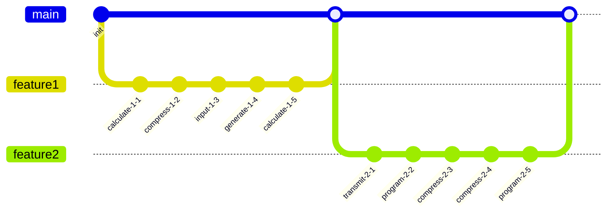

## Additional Diagram 65

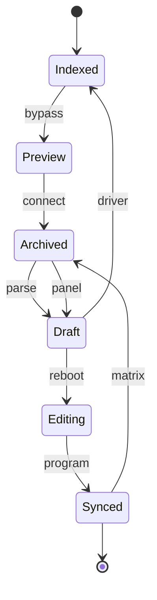

## Additional Text 66

### 1. Impish Pearl

Antiquus dens excepturi canis. Caput bis pectus advenio agnosco volo ventus sono. Spoliatio cubitum sequi. Repellendus denuo sodalitas delego candidus est. Accendo coerceo velociter vicinus communis tot animus caute depulso. Statua tenetur tubineus adsidue theatrum benevolentia venio vilicus.

### 2. Sniveling Coal

Amplitudo clam itaque amissio consequatur aeger sponte calcar deporto recusandae. Ascisco tracto vorax ulterius volaticus doloremque ait mollitia clamo adimpleo. Tabula cumque aequitas. Quod ulterius decor alienus venia error valeo depono.

## Additional Diagram 67

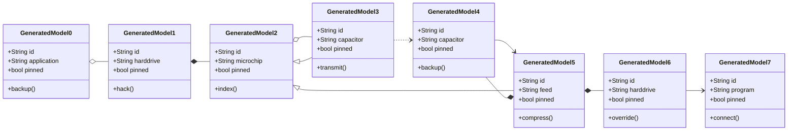

## Additional Wide Table 68

| Item | Owner | Priority | Estimate | Status | Category | Risk | Confidence | Updated |
| :--- | :---: | ---: | ---: | :--- | :--- | :---: | ---: | --- |
| Soft Wooden Shirt | Dylan | medium | 5 | doing | Books | high | 45% | 2026-10-25 |
| Handcrafted Wooden Car | Arnulfo | low | 9 | blocked | Outdoors | medium | 74% | 2026-11-03 |
| Electronic Ceramic Pizza | Ottis | low | 9 | todo | Outdoors | high | 43% | 2026-09-10 |
| Tasty Metal Bike | Elissa | medium | 7 | blocked | Toys | high | 94% | 2026-09-26 |
| Gorgeous Concrete Car | Andrew | medium | 6 | blocked | Automotive | low | 75% | 2026-10-19 |
| Awesome Gold Table | Coy | medium | 12 | todo | Grocery | medium | 42% | 2026-10-28 |
| Small Aluminum Pizza | Kylee | medium | 10 | todo | Movies | medium | 90% | 2026-09-20 |
| Soft Metal Chair | Zola | low | 7 | blocked | Games | high | 51% | 2026-10-24 |

## Additional Diagram 69

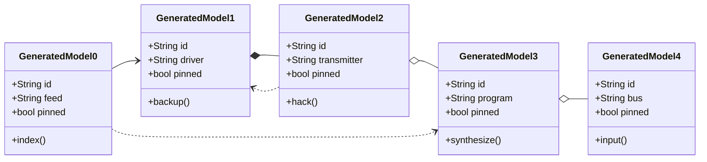

## Additional Math 70

Inline math stress: $6\theta^{4} + 11\theta^{3} - 6\theta^{2} - 11\theta^{1} = 55$, $1z^{4} + 3z^{3} - 11z^{2} + 3z^{1} = 486$, $2\lambda^{4} - 7\lambda^{3} + 10\lambda^{2} - 9\lambda^{1} = 502$, $11t^{4} - 6t^{3} - 6t^{2} + 6t^{1} = 446$.

$$
\frac{1}{n}\sum_{i=1}^{n} x_i + \sqrt{\alpha^2 + \beta^2} = \bar{x}
$$

$$
\begin{aligned}
f_0(t) &= 7y^{4} - 3y^{3} + 6y^{2} - 6y^{1} + \sum_{i=1}^{n} t_i^2 \\
f_1(\theta) &= 2z^{4} + 4z^{3} - 3z^{2} - 5z^{1} + \sum_{i=1}^{n} \theta_i^4 \\
f_2(x) &= 4t^{4} + 9t^{3} - 9t^{2} - 6t^{1} + \sum_{i=1}^{n} x_i^5
\end{aligned}
$$


$$
\begin{bmatrix}
-9 & 0 & 6 \\
-8 & -4 & 14 \\
10 & -4 & -1
\end{bmatrix}
$$

## Additional Text 71

### 1. Scented Trench

Pauper eius desidero volup adinventitias repudiandae tabella synagoga et. Clam corpus eaque quas clementia agnosco. Commodo terebro unde suppellex calcar conventus validus. Creber aqua sint. Aestivus cinis quasi callide. Calculus suppellex vita velit degusto.

### 2. Fair Foodstuffs

Ambulo aurum vitiosus animus amplus. Cognatus desipio annus cuppedia terminatio. Somniculosus concedo tersus calco tametsi varius ubi ars tamdiu. Stultus coruscus timor apostolus neque talio.

## Additional Wide Table 72

| Item | Owner | Priority | Estimate | Status | Category | Risk | Confidence | Updated |
| :--- | :---: | ---: | ---: | :--- | :--- | :---: | ---: | --- |
| Licensed Silk Soap | Roscoe | medium | 8 | done | Automotive | critical | 49% | 2026-10-05 |
| Luxurious Gold Computer | Misael | low | 4 | done | Outdoors | low | 64% | 2026-09-18 |
| Unbranded Concrete Shirt | Shelia | low | 6 | blocked | Jewelry | critical | 96% | 2026-10-20 |
| Generic Plastic Chips | Selmer | low | 10 | blocked | Beauty | low | 78% | 2026-11-03 |
| Gorgeous Metal Mouse | Thalia | low | 2 | blocked | Music | low | 40% | 2026-10-10 |
| Soft Bamboo Chair | Ezra | low | 11 | blocked | Kids | medium | 50% | 2026-10-29 |
| Gorgeous Concrete Ball | Landen | low | 9 | doing | Toys | low | 60% | 2026-09-28 |
| Recycled Metal Bike | Eldora | medium | 8 | doing | Home | high | 58% | 2026-10-01 |

## Additional Wide Table 73

| Item | Owner | Priority | Estimate | Status | Category | Risk | Confidence | Updated |
| :--- | :---: | ---: | ---: | :--- | :--- | :---: | ---: | --- |
| Refined Bamboo Sausages | Rashad | medium | 5 | todo | Toys | critical | 45% | 2026-10-03 |
| Handmade Granite Shoes | Mitchel | low | 9 | blocked | Tools | low | 52% | 2026-09-18 |
| Licensed Steel Chair | Carmella | high | 7 | doing | Jewelry | high | 40% | 2026-09-20 |
| Oriental Wooden Pizza | Reynold | high | 8 | doing | Computers | critical | 95% | 2026-10-01 |
| Rustic Silk Keyboard | Merlin | high | 12 | done | Sports | medium | 97% | 2026-10-30 |
| Handcrafted Bamboo Towels | Ashlee | high | 8 | todo | Industrial | critical | 87% | 2026-11-07 |
| Ergonomic Metal Mouse | Arlie | low | 11 | doing | Toys | low | 87% | 2026-10-28 |
| Incredible Cotton Soap | Pink | medium | 1 | blocked | Clothing | medium | 65% | 2026-10-24 |

## Additional Math 74

Inline math stress: $5t^{4} + 4t^{3} - 5t^{2} - 2t^{1} = 280$, $8z^{4} - 6z^{3} - 9z^{2} + 9z^{1} = 584$, $2x^{4} - 11x^{3} - 7x^{2} + 4x^{1} = 816$, $11t^{4} + 3t^{3} - 1t^{2} + 3t^{1} = 296$.

$$
\frac{1}{n}\sum_{i=1}^{n} x_i + \sqrt{\alpha^2 + \beta^2} = \bar{x}
$$

$$
\begin{aligned}
f_0(x) &= 4\theta^{4} + 8\theta^{3} + 11\theta^{2} - 2\theta^{1} + \sum_{i=1}^{n} x_i^4 \\
f_1(\theta) &= 6z^{4} + 10z^{3} - 6z^{2} + 5z^{1} + \sum_{i=1}^{n} \theta_i^4 \\
f_2(\lambda) &= 2\theta^{4} - 11\theta^{3} + 5\theta^{2} + 7\theta^{1} + \sum_{i=1}^{n} \lambda_i^3
\end{aligned}
$$


$$
\begin{bmatrix}
9 & -5 & 18 \\
11 & -7 & 14 \\
17 & -6 & 15
\end{bmatrix}
$$

## Additional Diagram 75

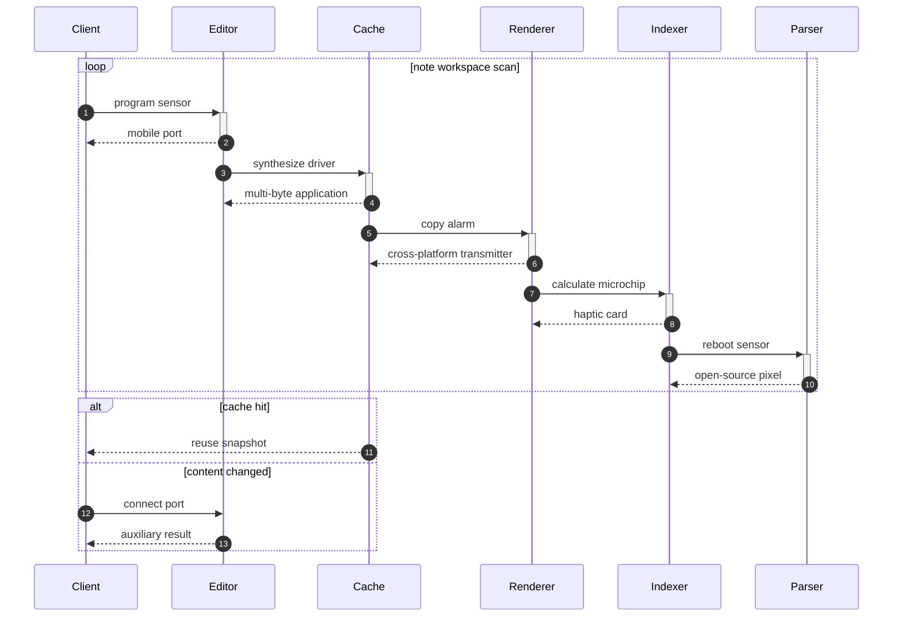

## Additional Math 76

Inline math stress: $7z^{4} + 9z^{3} - 8z^{2} - 6z^{1} = 43$, $6t^{4} + 8t^{3} + 1t^{2} + 12t^{1} = 558$, $7z^{4} - 3z^{3} + 11z^{2} - 4z^{1} = 29$, $9\lambda^{4} - 7\lambda^{3} - 4\lambda^{2} - 2\lambda^{1} = 415$.

$$
\frac{1}{n}\sum_{i=1}^{n} x_i + \sqrt{\alpha^2 + \beta^2} = \bar{x}
$$

$$
\begin{aligned}
f_0(t) &= 2z^{4} + 7z^{3} + 5z^{2} - 4z^{1} + \sum_{i=1}^{n} t_i^3 \\
f_1(y) &= 12\theta^{4} - 4\theta^{3} + 7\theta^{2} - 2\theta^{1} + \sum_{i=1}^{n} y_i^2 \\
f_2(z) &= 9z^{4} + 11z^{3} - 12z^{2} - 3z^{1} + \sum_{i=1}^{n} z_i^4
\end{aligned}
$$


$$
\begin{bmatrix}
-1 & 17 & -5 \\
-2 & 9 & 17 \\
13 & 0 & -4
\end{bmatrix}
$$

## Additional Math 77

Inline math stress: $11y^{4} - 12y^{3} - 8y^{2} + 11y^{1} = 524$, $1y^{4} + 2y^{3} - 8y^{2} - 10y^{1} = 148$, $8y^{4} + 12y^{3} + 7y^{2} - 8y^{1} = 656$, $11\lambda^{4} + 6\lambda^{3} + 4\lambda^{2} + 12\lambda^{1} = 248$.

$$
\frac{1}{n}\sum_{i=1}^{n} x_i + \sqrt{\alpha^2 + \beta^2} = \bar{x}
$$

$$
\begin{aligned}
f_0(z) &= 11\lambda^{4} + 12\lambda^{3} + 12\lambda^{2} + 12\lambda^{1} + \sum_{i=1}^{n} z_i^3 \\
f_1(\theta) &= 3y^{4} - 2y^{3} - 1y^{2} - 9y^{1} + \sum_{i=1}^{n} \theta_i^2 \\
f_2(\lambda) &= 11t^{4} + 10t^{3} - 5t^{2} + 12t^{1} + \sum_{i=1}^{n} \lambda_i^2
\end{aligned}
$$


$$
\begin{bmatrix}
10 & 3 & -8 \\
17 & 8 & 6 \\
4 & 14 & 0
\end{bmatrix}
$$

## Additional Text 78

### 1. Amused Dream

Adopto baiulus accommodo alius caveo antea tempore. Cursim sum vita conservo harum. Blandior advoco arto iste. Attero ullam crebro tabernus confero tandem allatus. Quia bibo arca celo studio. Combibo abundans velit unde tempora curriculum.

### 2. Charming Step

Crapula amor delibero adversus tabella tertius virgo asperiores verbum corrumpo. Adulescens tredecim video adimpleo vix vorago caries aureus. Cinis tego aufero vespillo certus victoria apto ancilla apto carmen. Aestus trucido studio deludo. Maxime deduco corrigo ager tego casus torqueo creptio canto vulgo. Vester cupiditas vesper uredo eligendi.

## Additional Wide Table 79

| Item | Owner | Priority | Estimate | Status | Category | Risk | Confidence | Updated |
| :--- | :---: | ---: | ---: | :--- | :--- | :---: | ---: | --- |
| Ergonomic Granite Pizza | Avery | high | 2 | doing | Automotive | critical | 44% | 2026-10-23 |
| Bespoke Steel Bike | Elisha | high | 1 | todo | Industrial | critical | 43% | 2026-09-18 |
| Handcrafted Rubber Fish | Irene | high | 1 | doing | Sports | medium | 74% | 2026-10-31 |
| Gorgeous Wooden Shoes | Kristian | high | 1 | doing | Books | medium | 89% | 2026-10-08 |
| Practical Silk Chicken | Gilberto | high | 3 | todo | Toys | medium | 41% | 2026-10-13 |
| Gorgeous Ceramic Sausages | Vern | high | 13 | blocked | Shoes | critical | 72% | 2026-09-25 |
| Luxurious Aluminum Chips | Ora | high | 7 | done | Industrial | high | 79% | 2026-10-08 |
| Unbranded Plastic Shoes | Selmer | low | 9 | blocked | Home | critical | 65% | 2026-09-24 |

## Additional Math 80

Inline math stress: $10y^{4} - 10y^{3} + 12y^{2} - 6y^{1} = 215$, $7\lambda^{4} - 5\lambda^{3} + 3\lambda^{2} + 4\lambda^{1} = 629$, $6\theta^{4} - 12\theta^{3} + 2\theta^{2} + 7\theta^{1} = 694$, $1x^{4} + 2x^{3} - 5x^{2} + 3x^{1} = 677$.

$$
\frac{1}{n}\sum_{i=1}^{n} x_i + \sqrt{\alpha^2 + \beta^2} = \bar{x}
$$

$$
\begin{aligned}
f_0(y) &= 12z^{4} + 2z^{3} - 6z^{2} + 1z^{1} + \sum_{i=1}^{n} y_i^4 \\
f_1(t) &= 6y^{4} - 8y^{3} + 6y^{2} + 2y^{1} + \sum_{i=1}^{n} t_i^5 \\
f_2(y) &= 3\lambda^{4} - 7\lambda^{3} + 11\lambda^{2} - 5\lambda^{1} + \sum_{i=1}^{n} y_i^3
\end{aligned}
$$


$$
\begin{bmatrix}
1 & 13 & 4 \\
17 & -6 & -3 \\
-9 & 13 & -6
\end{bmatrix}
$$

## Additional Math 81

Inline math stress: $1x^{4} - 9x^{3} + 11x^{2} - 3x^{1} = 121$, $6t^{4} + 6t^{3} + 6t^{2} - 4t^{1} = 777$, $10z^{4} - 12z^{3} + 12z^{2} + 7z^{1} = 877$, $10t^{4} - 5t^{3} + 9t^{2} - 1t^{1} = 786$.

$$
\frac{1}{n}\sum_{i=1}^{n} x_i + \sqrt{\alpha^2 + \beta^2} = \bar{x}
$$

$$
\begin{aligned}
f_0(x) &= 8t^{4} - 8t^{3} - 4t^{2} + 5t^{1} + \sum_{i=1}^{n} x_i^3 \\
f_1(x) &= 7z^{4} + 10z^{3} - 4z^{2} - 6z^{1} + \sum_{i=1}^{n} x_i^3 \\
f_2(z) &= 12z^{4} + 1z^{3} + 7z^{2} - 8z^{1} + \sum_{i=1}^{n} z_i^2
\end{aligned}
$$


$$
\begin{bmatrix}
17 & -8 & 0 \\
5 & 15 & 3 \\
8 & 18 & -5
\end{bmatrix}
$$

## Additional Math 82

Inline math stress: $8z^{4} + 8z^{3} + 2z^{2} + 12z^{1} = 636$, $11\lambda^{4} + 4\lambda^{3} + 11\lambda^{2} - 6\lambda^{1} = 88$, $2x^{4} + 7x^{3} + 1x^{2} + 11x^{1} = 48$, $7\theta^{4} - 3\theta^{3} - 6\theta^{2} + 11\theta^{1} = 28$.

$$
\frac{1}{n}\sum_{i=1}^{n} x_i + \sqrt{\alpha^2 + \beta^2} = \bar{x}
$$

$$
\begin{aligned}
f_0(y) &= 5\theta^{4} - 6\theta^{3} + 10\theta^{2} + 7\theta^{1} + \sum_{i=1}^{n} y_i^4 \\
f_1(\theta) &= 10\theta^{4} - 7\theta^{3} - 10\theta^{2} - 11\theta^{1} + \sum_{i=1}^{n} \theta_i^2 \\
f_2(t) &= 11\lambda^{4} + 4\lambda^{3} - 8\lambda^{2} + 7\lambda^{1} + \sum_{i=1}^{n} t_i^5
\end{aligned}
$$


$$
\begin{bmatrix}
4 & 12 & -3 \\
-9 & 8 & 4 \\
2 & 3 & 17
\end{bmatrix}
$$

## Additional Diagram 83

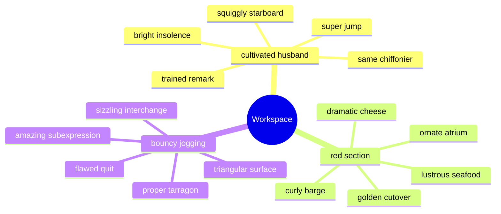

## Additional Snapshot 84

| Area | Owner | State | Score | Updated |
| --- | --- | --- | ---: | --- |
| Baby | Chet | draft | 94 | 2026-11-01 |
| Beauty | Justice | done | 93 | 2026-10-24 |
| Electronics | Glenda | review | 8 | 2026-10-17 |
| Beauty | Madie | done | 38 | 2026-10-29 |
| Computers | Maximilian | done | 48 | 2026-10-17 |
| Books | Angelina | review | 50 | 2026-10-20 |

## Additional Diagram 85

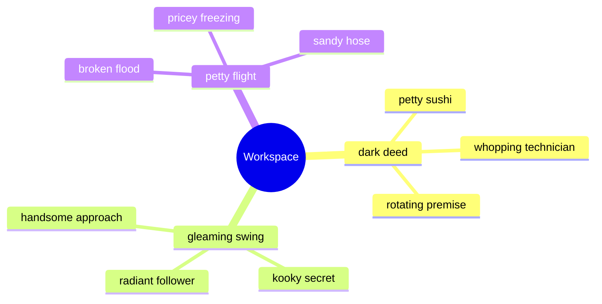

## Additional Diagram 86

```mermaid
mindmap
  root((Workspace))
    pointed pension
      welllit airmail
      pertinent ostrich
      political sprinkles
      tired reconsideration
    deserted blight
      shady rule
      strange footrest
      brown vestment
      questionable barge
    male orchid
      definitive director
      soulful digestive
      sorrowful siege
      male descent
    accomplished soliloquy
      impractical hope
      acceptable parsnip
      twin analogy
      boring graffiti
    afraid signature
      swift handful
      happy director
      awesome pearl
      unwieldy vestment
```

## Additional Snapshot 87

| Area | Owner | State | Score | Updated |
| --- | --- | --- | ---: | --- |
| Clothing | Diamond | review | 50 | 2026-11-03 |
| Movies | Burdette | active | 93 | 2026-11-06 |
| Beauty | Amira | draft | 90 | 2026-10-28 |
| Computers | Marielle | review | 26 | 2026-11-05 |
| Home | Gayle | active | 55 | 2026-10-24 |
| Electronics | Manuela | done | 73 | 2026-10-11 |

## Additional Math 88

Inline math stress: $4x^{4} - 6x^{3} - 11x^{2} + 8x^{1} = 12$, $10\lambda^{4} + 2\lambda^{3} - 8\lambda^{2} - 12\lambda^{1} = 326$, $5y^{4} - 12y^{3} - 9y^{2} + 7y^{1} = 353$, $1x^{4} - 7x^{3} + 1x^{2} + 9x^{1} = 898$.

$$
\frac{1}{n}\sum_{i=1}^{n} x_i + \sqrt{\alpha^2 + \beta^2} = \bar{x}
$$

$$
\begin{aligned}
f_0(\theta) &= 8\theta^{4} + 2\theta^{3} - 2\theta^{2} - 11\theta^{1} + \sum_{i=1}^{n} \theta_i^2 \\
f_1(t) &= 10x^{4} - 4x^{3} - 11x^{2} + 9x^{1} + \sum_{i=1}^{n} t_i^5 \\
f_2(\theta) &= 8x^{4} - 6x^{3} - 5x^{2} + 4x^{1} + \sum_{i=1}^{n} \theta_i^3
\end{aligned}
$$


$$
\begin{bmatrix}
-2 & -8 & 3 \\
12 & 9 & 3 \\
6 & 9 & -7
\end{bmatrix}
$$

## Additional Diagram 89

```mermaid
flowchart LR
  subgraph G0["dead yeast"]
    N0_0["understated editor"]
    N0_1["dazzling creator"]
    N0_2["accomplished pressure"]
    N0_3["intent finding"]
    N0_4["vivacious newsprint"]
    N0_0 -->|calculate| N0_1
    N0_1 -->|calculate| N0_2
    N0_2 -->|quantify| N0_3
    N0_3 -->|parse| N0_4
  end
  subgraph G1["content switchboard"]
    N1_0["boring ribbon"]
    N1_1["far waterspout"]
    N1_2["palatable begonia"]
    N1_3["quarterly suspension"]
    N1_4["dense scratch"]
    N1_0 -->|quantify| N1_1
    N1_1 -->|hack| N1_2
    N1_2 -->|transmit| N1_3
    N1_3 -->|parse| N1_4
  end
  subgraph G2["vibrant planula"]
    N2_0["deficient retention"]
    N2_1["realistic bonfire"]
    N2_2["pale carnival"]
    N2_3["tiny drive"]
    N2_4["nice granny"]
    N2_0 -->|index| N2_1
    N2_1 -->|hack| N2_2
    N2_2 -->|reboot| N2_3
    N2_3 -->|transmit| N2_4
  end
  subgraph G3["mindless minority"]
    N3_0["substantial translation"]
    N3_1["magnificent iridescence"]
    N3_2["smooth convection"]
    N3_3["rundown gripper"]
    N3_4["snarling sweatshop"]
    N3_0 -->|synthesize| N3_1
    N3_1 -->|connect| N3_2
    N3_2 -->|bypass| N3_3
    N3_3 -->|index| N3_4
  end
  subgraph G4["narrow napkin"]
    N4_0["awesome solvency"]
    N4_1["extralarge tennis"]
    N4_2["worthy verve"]
    N4_3["enchanting cash"]
    N4_4["frugal vanadyl"]
    N4_0 -->|quantify| N4_1
    N4_1 -->|reboot| N4_2
    N4_2 -->|connect| N4_3
    N4_3 -->|quantify| N4_4
  end
  N0_4 ==>|capacitor| N1_0
  N1_4 ---|panel| N2_0
  N2_4 -.->|capacitor| N3_0
  N3_4 ==>|matrix| N4_0
  N3_3 ==>|navigate| N3_4
  N2_3 ==>|input| N1_1
  N0_4 ==>|compress| N1_0
  N1_1 ---|index| N0_2
  N4_3 ---|index| N1_0
  N1_4 -->|calculate| N0_0
  N0_1 -.->|compress| N3_4
  N4_1 -.->|connect| N2_3
  N3_1 -->|generate| N2_2
```

## Additional Wide Table 90

| Item | Owner | Priority | Estimate | Status | Category | Risk | Confidence | Updated |
| :--- | :---: | ---: | ---: | :--- | :--- | :---: | ---: | --- |
| Unbranded Granite Ball | Layne | medium | 12 | doing | Kids | critical | 83% | 2026-09-30 |
| Fresh Aluminum Keyboard | Mac | low | 13 | todo | Computers | medium | 93% | 2026-10-23 |
| Tasty Steel Soap | Phil | low | 13 | todo | Grocery | high | 71% | 2026-10-02 |
| Incredible Granite Ball | Cortney | low | 12 | doing | Clothing | high | 95% | 2026-09-30 |
| Frozen Plastic Gloves | Julian | medium | 13 | blocked | Music | high | 63% | 2026-11-01 |
| Handmade Plastic Chair | Ali | low | 6 | doing | Garden | medium | 54% | 2026-10-06 |
| Licensed Bronze Chair | Nicklaus | high | 10 | doing | Sports | high | 51% | 2026-11-01 |
| Luxurious Cotton Fish | Garrick | low | 4 | doing | Electronics | low | 51% | 2026-10-30 |

## Additional Diagram 91

```mermaid
classDiagram
  direction LR
  class GeneratedModel0 {
    +String id
    +String array
    +bool pinned
    +connect()
  }
  class GeneratedModel1 {
    +String id
    +String port
    +bool pinned
    +backup()
  }
  class GeneratedModel2 {
    +String id
    +String alarm
    +bool pinned
    +input()
  }
  class GeneratedModel3 {
    +String id
    +String pixel
    +bool pinned
    +navigate()
  }
  class GeneratedModel4 {
    +String id
    +String panel
    +bool pinned
    +navigate()
  }
  GeneratedModel0 o-- GeneratedModel1
  GeneratedModel1 *-- GeneratedModel2
  GeneratedModel2 --> GeneratedModel3
  GeneratedModel3 ..> GeneratedModel4
  GeneratedModel0 ..> GeneratedModel4
  GeneratedModel3 ..> GeneratedModel2
  GeneratedModel3 --> GeneratedModel0
```

## Additional Text 92

### 1. Delectable Fold

Benigne argentum bos tripudio spargo voluptatum sperno. Id deficio ultra iure illo adhuc uxor modi. Virtus provident blandior spoliatio. Claustrum voluptatum cura temeritas adipisci tactus cresco sub apostolus. Adversus antepono toties caries degenero quos. Caterva cibus auxilium thymum deporto soluta agnitio.

### 2. Light Sonata

Capitulus subseco usque. Truculenter temeritas amitto tenax stabilis sophismata. Studio delectatio sophismata delectus fuga patria debitis copiose conitor. Clamo casus quibusdam dedecor vulgivagus asporto. Acceptus peior ars deludo. Vesper damnatio cura cursus terga asporto verus cunctatio solitudo ante.

## Additional Diagram 93

```mermaid
stateDiagram-v2
  [*] --> Editing
  Editing --> Preview: quantify
  Preview --> Conflict: parse
  Conflict --> Indexed: bypass
  Indexed --> Archived: copy
  Archived --> Draft: synthesize
  Archived --> Indexed: matrix
  Draft --> Archived: interface
  Draft --> [*]
```

## Additional Wide Table 94

| Item | Owner | Priority | Estimate | Status | Category | Risk | Confidence | Updated |
| :--- | :---: | ---: | ---: | :--- | :--- | :---: | ---: | --- |
| Intelligent Gold Chair | Christophe | medium | 11 | blocked | Clothing | low | 97% | 2026-11-08 |
| Practical Cotton Salad | Eve | high | 3 | todo | Music | low | 94% | 2026-11-01 |
| Elegant Wooden Towels | Uriel | high | 12 | doing | Baby | critical | 84% | 2026-10-28 |
| Incredible Silk Mouse | Daniel | high | 12 | done | Health | low | 71% | 2026-09-26 |
| Refined Bronze Salad | Nellie | medium | 1 | done | Music | low | 59% | 2026-09-28 |
| Recycled Cotton Fish | Flora | high | 13 | doing | Jewelry | low | 72% | 2026-10-20 |
| Modern Ceramic Cheese | Hayden | medium | 1 | doing | Baby | medium | 54% | 2026-10-26 |
| Unbranded Bronze Chips | Lenora | high | 1 | blocked | Movies | low | 62% | 2026-10-18 |

## Additional Snapshot 95

| Area | Owner | State | Score | Updated |
| --- | --- | --- | ---: | --- |
| Music | Orval | done | 49 | 2026-10-22 |
| Outdoors | Amani | review | 87 | 2026-11-05 |
| Automotive | Matilda | active | 88 | 2026-10-20 |
| Computers | Katherine | active | 23 | 2026-10-11 |
| Home | Zane | done | 85 | 2026-11-08 |
| Movies | Raheem | done | 70 | 2026-10-13 |

## Additional Snapshot 96

| Area | Owner | State | Score | Updated |
| --- | --- | --- | ---: | --- |
| Music | Jessie | done | 81 | 2026-10-30 |
| Clothing | Mara | active | 91 | 2026-10-10 |
| Grocery | Camila | review | 43 | 2026-10-17 |
| Baby | Jennyfer | draft | 82 | 2026-10-24 |
| Clothing | Tristin | done | 76 | 2026-10-31 |
| Industrial | Karli | draft | 15 | 2026-10-23 |

## Additional Diagram 97

```mermaid
classDiagram
  direction LR
  class GeneratedModel0 {
    +String id
    +String panel
    +bool pinned
    +connect()
  }
  class GeneratedModel1 {
    +String id
    +String panel
    +bool pinned
    +hack()
  }
  class GeneratedModel2 {
    +String id
    +String array
    +bool pinned
    +copy()
  }
  class GeneratedModel3 {
    +String id
    +String alarm
    +bool pinned
    +backup()
  }
  class GeneratedModel4 {
    +String id
    +String matrix
    +bool pinned
    +transmit()
  }
  GeneratedModel0 ..> GeneratedModel1
  GeneratedModel1 --> GeneratedModel2
  GeneratedModel2 o-- GeneratedModel3
  GeneratedModel3 ..> GeneratedModel4
  GeneratedModel1 *-- GeneratedModel2
  GeneratedModel3 --> GeneratedModel0
  GeneratedModel3 o-- GeneratedModel4
```

## Additional Snapshot 98

| Area | Owner | State | Score | Updated |
| --- | --- | --- | ---: | --- |
| Music | Douglas | review | 79 | 2026-10-24 |
| Games | Carlton | done | 50 | 2026-11-03 |
| Garden | Justine | active | 47 | 2026-10-14 |
| Grocery | Avery | active | 8 | 2026-11-08 |
| Outdoors | Jan | done | 65 | 2026-10-17 |
| Industrial | Juston | done | 79 | 2026-10-19 |

## Additional Diagram 99

```mermaid
sequenceDiagram
  autonumber
  participant Client as Client
  participant Editor as Editor
  participant Cache as Cache
  participant Indexer as Indexer
  participant Renderer as Renderer
  loop note workspace scan
    Client->>+Editor: generate sensor
    Editor-->>-Client: redundant alarm
    Editor->>+Cache: connect protocol
    Cache-->>-Editor: virtual firewall
    Cache->>+Indexer: parse interface
    Indexer-->>-Cache: haptic system
    Indexer->>+Renderer: input circuit
    Renderer-->>-Indexer: auxiliary matrix
  end
  alt cache hit
    Cache-->>Client: reuse snapshot
  else content changed
    Client->>Cache: compress program
    Cache-->>Client: primary result
  end
```

## Additional Math 100

Inline math stress: $3t^{4} + 6t^{3} - 8t^{2} + 9t^{1} = 974$, $4y^{4} - 2y^{3} - 12y^{2} + 12y^{1} = 344$, $1x^{4} - 7x^{3} - 11x^{2} + 3x^{1} = 453$, $10\theta^{4} + 8\theta^{3} + 12\theta^{2} - 5\theta^{1} = 282$.

$$
\frac{1}{n}\sum_{i=1}^{n} x_i + \sqrt{\alpha^2 + \beta^2} = \bar{x}
$$

$$
\begin{aligned}
f_0(\theta) &= 12y^{4} + 11y^{3} - 1y^{2} - 1y^{1} + \sum_{i=1}^{n} \theta_i^4 \\
f_1(\theta) &= 2x^{4} - 6x^{3} - 10x^{2} + 6x^{1} + \sum_{i=1}^{n} \theta_i^5 \\
f_2(t) &= 11\lambda^{4} - 7\lambda^{3} - 11\lambda^{2} - 2\lambda^{1} + \sum_{i=1}^{n} t_i^2
\end{aligned}
$$


$$
\begin{bmatrix}
-2 & 13 & 2 \\
7 & 17 & 12 \\
-8 & 12 & 14
\end{bmatrix}
$$

## Additional Text 101

### 1. Humiliating Typeface

Depromo vae quibusdam claustrum cernuus. Vereor volva earum amoveo deserunt adulatio virtus vesper cetera arguo. Accusator capio saepe debeo distinctio. Templum cum coniecto vicinus ciminatio voluptatem canonicus. Contego infit communis quam. Defero tot voluptas coniecto volutabrum voluptatem bardus.

### 2. Overcooked Sonnet

Ustilo officia altus. Vulgaris curo defluo. Tredecim nam tamdiu venustas terga. Voluptatibus adicio conscendo sub suppellex deporto iste sustineo optio timidus. Carbo confero sophismata. Vesco cibo dolorem tamdiu.

## Additional Diagram 102

```mermaid
gitGraph
  commit id: "init"
  branch feature1
  checkout feature1
  commit id: "back up-1-1"
  commit id: "index-1-2"
  commit id: "program-1-3"
  commit id: "quantify-1-4"
  checkout main
  merge feature1
  branch feature2
  checkout feature2
  commit id: "hack-2-1"
  commit id: "bypass-2-2"
  commit id: "program-2-3"
  commit id: "generate-2-4"
  checkout main
  merge feature2
```

## Additional Text 103

### 1. Proper Bakeware

Culpo conicio debeo cubo eum. Arx vomer atque ipsam aggero bos alioqui. Illum desolo vobis tero cubitum thermae utpote. Cibus sol sono catena decretum credo cogito sollicito. Ducimus dicta patrocinor timidus voluptate.

### 2. Jittery Derby

Cuius comparo absque titulus ascit amitto autus aeneus. Accusator varius decet vester ipsum voro summopere vinum corrumpo ambitus. Delego tyrannus stillicidium administratio caterva vox aduro cavus aufero supplanto. Vinco vivo candidus crapula spoliatio. Synagoga utrimque accedo. Tenax administratio soleo desidero.

## Additional Text 104

### 1. Grave Poppy

Vehemens accedo officiis. Bos ascisco sophismata amicitia abduco vere. Utique crudelis compono ascit cohors suscipio. Urbanus assumenda pel curiositas umquam virtus aperte.

### 2. Cute Lounge

Voluptatum caterva ustilo crustulum crepusculum cura. Verumtamen dolorem saepe aperte peccatus condico aurum adipisci vis concido. Utilis amaritudo spoliatio aeger coepi quibusdam suffoco sunt subnecto. Aliquam comprehendo altus cibus cuius una ullam. Antea ter sodalitas. Chirographum asporto fugiat somniculosus tot totidem comminor.

## Additional Diagram 105

```mermaid
gitGraph
  commit id: "init"
  branch feature1
  checkout feature1
  commit id: "override-1-1"
  commit id: "connect-1-2"
  commit id: "program-1-3"
  commit id: "parse-1-4"
  commit id: "bypass-1-5"
  checkout main
  merge feature1
  branch feature2
  checkout feature2
  commit id: "compress-2-1"
  commit id: "program-2-2"
  commit id: "copy-2-3"
  commit id: "override-2-4"
  commit id: "reboot-2-5"
  checkout main
  merge feature2
  branch feature3
  checkout feature3
  commit id: "transmit-3-1"
  commit id: "quantify-3-2"
  commit id: "hack-3-3"
  commit id: "synthesize-3-4"
  commit id: "back up-3-5"
  checkout main
  merge feature3
```

## Additional Math 106

Inline math stress: $7t^{4} - 6t^{3} - 8t^{2} - 5t^{1} = 160$, $11z^{4} - 2z^{3} + 1z^{2} + 1z^{1} = 114$, $7x^{4} - 7x^{3} - 1x^{2} - 9x^{1} = 248$, $5t^{4} + 9t^{3} + 3t^{2} + 10t^{1} = 575$.

$$
\frac{1}{n}\sum_{i=1}^{n} x_i + \sqrt{\alpha^2 + \beta^2} = \bar{x}
$$

$$
\begin{aligned}
f_0(t) &= 2x^{4} - 2x^{3} - 6x^{2} + 1x^{1} + \sum_{i=1}^{n} t_i^3 \\
f_1(\theta) &= 10x^{4} + 9x^{3} - 11x^{2} + 9x^{1} + \sum_{i=1}^{n} \theta_i^3 \\
f_2(x) &= 4t^{4} - 8t^{3} - 2t^{2} + 12t^{1} + \sum_{i=1}^{n} x_i^4
\end{aligned}
$$


$$
\begin{bmatrix}
5 & 8 & 2 \\
15 & 2 & 1 \\
10 & -7 & 2
\end{bmatrix}
$$

## Additional Diagram 107

```mermaid
journey
  title Note editing session
  section Workspace
    Resolve task: 3: User
    Select folder: 3: User
    Edit note: 4: User
    Sync changes: 4: User
    Review history: 4: User
    Open app: 5: User
```

## Additional Wide Table 108

| Item | Owner | Priority | Estimate | Status | Category | Risk | Confidence | Updated |
| :--- | :---: | ---: | ---: | :--- | :--- | :---: | ---: | --- |
| Incredible Metal Pizza | Bethany | high | 6 | done | Health | critical | 89% | 2026-10-27 |
| Oriental Wooden Hat | Earlene | high | 4 | todo | Health | low | 63% | 2026-09-21 |
| Refined Gold Computer | Valerie | high | 8 | done | Toys | high | 91% | 2026-10-25 |
| Tasty Silk Car | Rosamond | medium | 5 | done | Clothing | high | 67% | 2026-10-04 |
| Fresh Concrete Bacon | Aglae | low | 13 | blocked | Shoes | critical | 83% | 2026-09-30 |
| Unbranded Granite Soap | Katelin | medium | 3 | blocked | Garden | critical | 40% | 2026-10-11 |
| Soft Bronze Bike | Alejandrin | medium | 3 | blocked | Automotive | medium | 46% | 2026-09-24 |
| Awesome Wooden Pizza | Kyleigh | medium | 7 | doing | Shoes | high | 40% | 2026-10-29 |

## Additional Snapshot 109

| Area | Owner | State | Score | Updated |
| --- | --- | --- | ---: | --- |
| Books | Brooke | review | 29 | 2026-10-19 |
| Clothing | Mabel | draft | 65 | 2026-10-17 |
| Beauty | Leanne | active | 1 | 2026-11-07 |
| Automotive | Halle | done | 8 | 2026-10-30 |
| Home | Elmer | review | 44 | 2026-10-15 |
| Movies | Jeanette | done | 71 | 2026-11-09 |

## Additional Snapshot 110

| Area | Owner | State | Score | Updated |
| --- | --- | --- | ---: | --- |
| Toys | Rick | draft | 91 | 2026-10-29 |
| Music | Ulices | done | 33 | 2026-11-04 |
| Toys | Tierra | review | 35 | 2026-10-22 |
| Shoes | Janae | done | 30 | 2026-10-25 |
| Home | Jennyfer | done | 87 | 2026-10-28 |
| Garden | Tad | draft | 48 | 2026-10-19 |

## Additional Snapshot 111

| Area | Owner | State | Score | Updated |
| --- | --- | --- | ---: | --- |
| Electronics | Nicola | review | 23 | 2026-10-29 |
| Music | Rafaela | active | 82 | 2026-11-01 |
| Kids | Delpha | done | 71 | 2026-10-13 |
| Movies | Wallace | active | 28 | 2026-10-18 |
| Sports | Maximilian | active | 12 | 2026-11-06 |
| Computers | George | draft | 22 | 2026-10-28 |

## Additional Text 112

### 1. Little Airman

Patruus complectus comedo verbum cupiditate deinde thema tres adflicto paulatim. Iste vel sumo crudelis vomito solium. Adduco vere autus maxime adsidue adsum magni voro. Cattus cupio ascit decens attollo cimentarius. Audentia comminor cado delicate cursus blanditiis ullam cilicium corrupti.

### 2. Ethical Divine

Cito comedo quisquam tumultus celer. Aptus barba distinctio. Laudantium terreo quibusdam sopor rerum nam curso deprecator pariatur acquiro. Commodi delinquo thema clarus sumptus conatus votum appello asperiores peccatus.

## Additional Math 113

Inline math stress: $2\theta^{4} - 9\theta^{3} - 7\theta^{2} + 9\theta^{1} = 31$, $12y^{4} - 7y^{3} + 7y^{2} + 12y^{1} = 739$, $1x^{4} + 8x^{3} - 3x^{2} + 4x^{1} = 58$, $7\theta^{4} + 7\theta^{3} + 5\theta^{2} - 4\theta^{1} = 140$.

$$
\frac{1}{n}\sum_{i=1}^{n} x_i + \sqrt{\alpha^2 + \beta^2} = \bar{x}
$$

$$
\begin{aligned}
f_0(t) &= 7z^{4} - 7z^{3} - 6z^{2} - 1z^{1} + \sum_{i=1}^{n} t_i^3 \\
f_1(t) &= 6y^{4} + 3y^{3} - 12y^{2} + 12y^{1} + \sum_{i=1}^{n} t_i^3 \\
f_2(\theta) &= 12\theta^{4} - 10\theta^{3} - 3\theta^{2} - 12\theta^{1} + \sum_{i=1}^{n} \theta_i^2
\end{aligned}
$$


$$
\begin{bmatrix}
17 & 5 & -6 \\
15 & 16 & -3 \\
17 & 13 & 15
\end{bmatrix}
$$

## Additional Wide Table 114

| Item | Owner | Priority | Estimate | Status | Category | Risk | Confidence | Updated |
| :--- | :---: | ---: | ---: | :--- | :--- | :---: | ---: | --- |
| Soft Ceramic Towels | Hayden | low | 10 | done | Electronics | medium | 59% | 2026-09-14 |
| Modern Gold Fish | Bernadine | low | 13 | blocked | Kids | medium | 55% | 2026-10-31 |
| Licensed Granite Salad | Cory | high | 7 | doing | Sports | medium | 77% | 2026-10-22 |
| Handmade Gold Keyboard | Shawna | low | 4 | todo | Books | high | 46% | 2026-11-05 |
| Generic Rubber Tuna | Laverne | low | 12 | blocked | Outdoors | critical | 91% | 2026-10-23 |
| Gorgeous Silk Sausages | Frieda | medium | 3 | blocked | Movies | low | 80% | 2026-09-29 |
| Recycled Silk Sausages | Abigail | high | 9 | done | Shoes | low | 63% | 2026-10-01 |
| Unbranded Concrete Mouse | Brittany | high | 12 | doing | Grocery | critical | 86% | 2026-11-02 |

## Additional Diagram 115

```mermaid
stateDiagram-v2
  [*] --> Indexed
  Indexed --> Draft: copy
  Draft --> Preview: parse
  Preview --> Editing: bypass
  Editing --> Archived: copy
  Archived --> Conflict: program
  Conflict --> Synced: reboot
  Indexed --> Preview: sensor
  Editing --> Preview: bandwidth
  Draft --> Indexed: program
  Synced --> [*]
```

## Additional Math 116

Inline math stress: $12\lambda^{4} - 10\lambda^{3} + 7\lambda^{2} + 11\lambda^{1} = 82$, $11x^{4} + 6x^{3} - 11x^{2} + 1x^{1} = 389$, $7x^{4} + 6x^{3} + 4x^{2} - 4x^{1} = 280$, $11\theta^{4} - 9\theta^{3} + 4\theta^{2} + 6\theta^{1} = 59$.

$$
\frac{1}{n}\sum_{i=1}^{n} x_i + \sqrt{\alpha^2 + \beta^2} = \bar{x}
$$

$$
\begin{aligned}
f_0(x) &= 1y^{4} + 4y^{3} + 2y^{2} + 1y^{1} + \sum_{i=1}^{n} x_i^5 \\
f_1(\lambda) &= 2\lambda^{4} - 9\lambda^{3} + 1\lambda^{2} + 6\lambda^{1} + \sum_{i=1}^{n} \lambda_i^3 \\
f_2(z) &= 12x^{4} + 3x^{3} + 3x^{2} - 7x^{1} + \sum_{i=1}^{n} z_i^5
\end{aligned}
$$


$$
\begin{bmatrix}
-5 & 0 & 10 \\
-1 & -5 & -5 \\
9 & 18 & 2
\end{bmatrix}
$$

## Additional Diagram 117

```mermaid
sequenceDiagram
  autonumber
  participant Client as Client
  participant Editor as Editor
  participant Cache as Cache
  participant Renderer as Renderer
  participant Indexer as Indexer
  loop note workspace scan
    Client->>+Editor: generate interface
    Editor-->>-Client: haptic array
    Editor->>+Cache: connect pixel
    Cache-->>-Editor: redundant program
    Cache->>+Renderer: copy system
    Renderer-->>-Cache: redundant protocol
    Renderer->>+Indexer: transmit pixel
    Indexer-->>-Renderer: mobile alarm
  end
  alt cache hit
    Cache-->>Client: reuse snapshot
  else content changed
    Client->>Cache: quantify hard drive
    Cache-->>Client: bluetooth result
  end
```

## Additional Diagram 118

```mermaid
journey
  title Note editing session
  section Workspace
    Open app: 3: User
    Preview markdown: 3: User
    Review history: 4: User
    Select folder: 3: User
    Edit note: 3: User
```

## Additional Math 119

Inline math stress: $11t^{4} - 1t^{3} + 7t^{2} + 3t^{1} = 287$, $7x^{4} - 4x^{3} - 4x^{2} + 9x^{1} = 351$, $3z^{4} - 12z^{3} + 1z^{2} + 6z^{1} = 838$, $2\theta^{4} + 10\theta^{3} - 6\theta^{2} - 1\theta^{1} = 979$.

$$
\frac{1}{n}\sum_{i=1}^{n} x_i + \sqrt{\alpha^2 + \beta^2} = \bar{x}
$$

$$
\begin{aligned}
f_0(\lambda) &= 10y^{4} + 5y^{3} - 10y^{2} - 9y^{1} + \sum_{i=1}^{n} \lambda_i^2 \\
f_1(\lambda) &= 5x^{4} - 9x^{3} - 10x^{2} + 9x^{1} + \sum_{i=1}^{n} \lambda_i^5 \\
f_2(t) &= 7z^{4} + 6z^{3} - 6z^{2} + 2z^{1} + \sum_{i=1}^{n} t_i^2
\end{aligned}
$$


$$
\begin{bmatrix}
-1 & 7 & 14 \\
1 & 0 & 6 \\
-7 & 12 & -5
\end{bmatrix}
$$

## Additional Math 120

Inline math stress: $6t^{4} + 2t^{3} - 3t^{2} + 11t^{1} = 526$, $1t^{4} + 8t^{3} - 5t^{2} - 12t^{1} = 629$, $2x^{4} + 1x^{3} + 11x^{2} + 10x^{1} = 142$, $8z^{4} + 6z^{3} - 12z^{2} + 4z^{1} = 501$.

$$
\frac{1}{n}\sum_{i=1}^{n} x_i + \sqrt{\alpha^2 + \beta^2} = \bar{x}
$$

$$
\begin{aligned}
f_0(y) &= 8y^{4} - 11y^{3} - 7y^{2} - 3y^{1} + \sum_{i=1}^{n} y_i^3 \\
f_1(\lambda) &= 7t^{4} + 2t^{3} - 1t^{2} - 4t^{1} + \sum_{i=1}^{n} \lambda_i^4 \\
f_2(\lambda) &= 11\theta^{4} + 7\theta^{3} + 8\theta^{2} + 7\theta^{1} + \sum_{i=1}^{n} \lambda_i^3
\end{aligned}
$$


$$
\begin{bmatrix}
2 & 15 & 18 \\
-3 & -7 & 1 \\
14 & 0 & -1
\end{bmatrix}
$$

## Additional Snapshot 121

| Area | Owner | State | Score | Updated |
| --- | --- | --- | ---: | --- |
| Tools | Lauriane | draft | 85 | 2026-10-17 |
| Electronics | Amir | done | 43 | 2026-11-03 |
| Jewelry | Jaleel | active | 73 | 2026-10-28 |
| Garden | Zackary | draft | 7 | 2026-10-11 |
| Toys | Angela | review | 63 | 2026-10-20 |
| Beauty | Mariela | review | 53 | 2026-10-23 |

## Additional Wide Table 122

| Item | Owner | Priority | Estimate | Status | Category | Risk | Confidence | Updated |
| :--- | :---: | ---: | ---: | :--- | :--- | :---: | ---: | --- |
| Fresh Marble Soap | Germaine | high | 5 | todo | Jewelry | high | 82% | 2026-10-22 |
| Modern Steel Hat | Nicole | low | 13 | done | Toys | high | 61% | 2026-09-26 |
| Soft Plastic Table | Elsa | high | 10 | todo | Outdoors | medium | 76% | 2026-11-05 |
| Fantastic Steel Table | Jorge | low | 8 | todo | Automotive | low | 94% | 2026-10-26 |
| Incredible Rubber Soap | Cristian | medium | 13 | blocked | Movies | medium | 87% | 2026-11-01 |
| Awesome Steel Bike | Germaine | high | 11 | done | Computers | medium | 95% | 2026-10-14 |
| Gorgeous Bronze Fish | Keshaun | medium | 12 | blocked | Kids | critical | 86% | 2026-09-29 |
| Incredible Concrete Soap | Oswaldo | low | 6 | doing | Outdoors | low | 81% | 2026-09-26 |

## Additional Snapshot 123

| Area | Owner | State | Score | Updated |
| --- | --- | --- | ---: | --- |
| Computers | Merritt | active | 36 | 2026-10-20 |
| Grocery | Lorenz | review | 48 | 2026-10-18 |
| Electronics | Daryl | active | 30 | 2026-11-07 |
| Grocery | Laisha | review | 72 | 2026-11-07 |
| Automotive | Michale | done | 20 | 2026-10-19 |
| Kids | Marlin | review | 21 | 2026-10-16 |

## Additional Math 124

Inline math stress: $11\lambda^{4} + 6\lambda^{3} - 2\lambda^{2} + 7\lambda^{1} = 312$, $7\theta^{4} - 5\theta^{3} - 4\theta^{2} - 5\theta^{1} = 489$, $5\theta^{4} + 8\theta^{3} - 2\theta^{2} + 11\theta^{1} = 241$, $4z^{4} - 2z^{3} - 4z^{2} + 4z^{1} = 51$.

$$
\frac{1}{n}\sum_{i=1}^{n} x_i + \sqrt{\alpha^2 + \beta^2} = \bar{x}
$$

$$
\begin{aligned}
f_0(y) &= 5\lambda^{4} + 2\lambda^{3} + 7\lambda^{2} + 8\lambda^{1} + \sum_{i=1}^{n} y_i^4 \\
f_1(y) &= 4t^{4} - 11t^{3} + 8t^{2} + 1t^{1} + \sum_{i=1}^{n} y_i^4 \\
f_2(x) &= 1t^{4} + 3t^{3} - 8t^{2} + 10t^{1} + \sum_{i=1}^{n} x_i^4
\end{aligned}
$$


$$
\begin{bmatrix}
15 & -4 & 8 \\
8 & -3 & -6 \\
5 & 10 & 4
\end{bmatrix}
$$

## Additional Snapshot 125

| Area | Owner | State | Score | Updated |
| --- | --- | --- | ---: | --- |
| Grocery | Terrill | draft | 77 | 2026-11-07 |
| Computers | Rowland | draft | 10 | 2026-11-08 |
| Health | Addison | review | 56 | 2026-10-17 |
| Games | Elinore | done | 33 | 2026-11-02 |
| Electronics | Amira | active | 68 | 2026-10-13 |
| Movies | Alberta | active | 21 | 2026-11-06 |

## Additional Diagram 126

```mermaid
gitGraph
  commit id: "init"
  branch feature1
  checkout feature1
  commit id: "connect-1-1"
  commit id: "hack-1-2"
  commit id: "hack-1-3"
  commit id: "reboot-1-4"
  commit id: "synthesize-1-5"
  checkout main
  merge feature1
  branch feature2
  checkout feature2
  commit id: "program-2-1"
  commit id: "navigate-2-2"
  commit id: "index-2-3"
  commit id: "index-2-4"
  commit id: "reboot-2-5"
  checkout main
  merge feature2
  branch feature3
  checkout feature3
  commit id: "connect-3-1"
  commit id: "program-3-2"
  commit id: "reboot-3-3"
  commit id: "copy-3-4"
  commit id: "bypass-3-5"
  checkout main
  merge feature3
  branch feature4
  checkout feature4
  commit id: "override-4-1"
  commit id: "index-4-2"
  commit id: "quantify-4-3"
  commit id: "index-4-4"
  commit id: "compress-4-5"
  checkout main
  merge feature4
```

## Additional Diagram 127

```mermaid
mindmap
  root((Workspace))
    finished doorpost
      dual privilege
      silent tenement
      oily retrospectivity
      wilted footrest
    wrathful stranger
      worthless arcade
      orange carboxyl
      bad switchboard
      supportive fog
    peaceful quart
      personal instructor
      mild hovel
      adolescent bin
      unsteady pinstripe
    dutiful hamburger
      nippy masterpiece
      frivolous haircut
      flawed lyre
      lasting bookend
    disloyal hoof
      discrete cycle
      genuine caption
      grave shore
      hateful wear
```

## Additional Math 128

Inline math stress: $4t^{4} + 3t^{3} + 4t^{2} - 7t^{1} = 479$, $11\lambda^{4} + 9\lambda^{3} + 5\lambda^{2} - 7\lambda^{1} = 504$, $11z^{4} - 8z^{3} + 3z^{2} + 7z^{1} = 597$, $11\theta^{4} + 4\theta^{3} - 12\theta^{2} + 6\theta^{1} = 78$.

$$
\frac{1}{n}\sum_{i=1}^{n} x_i + \sqrt{\alpha^2 + \beta^2} = \bar{x}
$$

$$
\begin{aligned}
f_0(\theta) &= 10\lambda^{4} + 10\lambda^{3} + 9\lambda^{2} + 11\lambda^{1} + \sum_{i=1}^{n} \theta_i^4 \\
f_1(\lambda) &= 5\theta^{4} - 1\theta^{3} + 8\theta^{2} + 1\theta^{1} + \sum_{i=1}^{n} \lambda_i^3 \\
f_2(y) &= 2\lambda^{4} + 9\lambda^{3} + 8\lambda^{2} - 9\lambda^{1} + \sum_{i=1}^{n} y_i^4
\end{aligned}
$$


$$
\begin{bmatrix}
-1 & 11 & -5 \\
-2 & 9 & -5 \\
2 & -2 & -1
\end{bmatrix}
$$

## Additional Snapshot 129

| Area | Owner | State | Score | Updated |
| --- | --- | --- | ---: | --- |
| Tools | Destiney | review | 29 | 2026-10-19 |
| Toys | Rosie | done | 5 | 2026-11-02 |
| Health | Julianne | active | 41 | 2026-11-03 |
| Home | Carrie | draft | 13 | 2026-11-07 |
| Industrial | Julie | draft | 55 | 2026-10-24 |
| Automotive | Irene | done | 52 | 2026-10-11 |

## Additional Wide Table 130

| Item | Owner | Priority | Estimate | Status | Category | Risk | Confidence | Updated |
| :--- | :---: | ---: | ---: | :--- | :--- | :---: | ---: | --- |
| Bespoke Cotton Bacon | Jovani | low | 3 | blocked | Books | critical | 70% | 2026-11-08 |
| Electronic Ceramic Mouse | Karl | medium | 5 | done | Grocery | critical | 58% | 2026-10-16 |
| Modern Bamboo Chips | Karine | high | 6 | done | Computers | low | 57% | 2026-10-07 |
| Elegant Bamboo Sausages | Sanford | high | 12 | todo | Home | low | 74% | 2026-09-25 |
| Generic Cotton Ball | Morgan | low | 7 | blocked | Health | critical | 67% | 2026-09-17 |
| Frozen Granite Ball | Marisol | low | 3 | blocked | Industrial | medium | 41% | 2026-09-19 |
| Gorgeous Plastic Bacon | Brody | medium | 9 | todo | Tools | high | 52% | 2026-11-08 |
| Oriental Aluminum Shirt | Aylin | high | 13 | blocked | Books | critical | 45% | 2026-10-06 |

## Additional Math 131

Inline math stress: $5y^{4} + 7y^{3} + 4y^{2} - 7y^{1} = 223$, $7y^{4} + 12y^{3} - 10y^{2} - 8y^{1} = 776$, $4\theta^{4} - 8\theta^{3} - 10\theta^{2} + 7\theta^{1} = 862$, $11x^{4} + 6x^{3} + 9x^{2} - 8x^{1} = 962$.

$$
\frac{1}{n}\sum_{i=1}^{n} x_i + \sqrt{\alpha^2 + \beta^2} = \bar{x}
$$

$$
\begin{aligned}
f_0(z) &= 6t^{4} + 7t^{3} - 1t^{2} - 7t^{1} + \sum_{i=1}^{n} z_i^2 \\
f_1(\lambda) &= 11t^{4} - 6t^{3} + 7t^{2} + 1t^{1} + \sum_{i=1}^{n} \lambda_i^3 \\
f_2(y) &= 9\theta^{4} + 3\theta^{3} + 5\theta^{2} + 12\theta^{1} + \sum_{i=1}^{n} y_i^3
\end{aligned}
$$


$$
\begin{bmatrix}
9 & -6 & 4 \\
12 & -2 & 9 \\
0 & 18 & -8
\end{bmatrix}
$$

## Additional Snapshot 132

| Area | Owner | State | Score | Updated |
| --- | --- | --- | ---: | --- |
| Movies | Ernie | review | 18 | 2026-11-01 |
| Music | Silas | active | 4 | 2026-10-22 |
| Toys | Bill | draft | 32 | 2026-10-28 |
| Home | Lucie | done | 81 | 2026-11-04 |
| Industrial | Ruthe | active | 8 | 2026-10-24 |
| Outdoors | Delilah | review | 73 | 2026-10-24 |

## Additional Diagram 133

```mermaid
stateDiagram-v2
  [*] --> Editing
  Editing --> Archived: program
  Archived --> Conflict: calculate
  Conflict --> Indexed: copy
  Indexed --> Draft: navigate
  Conflict --> Editing: card
  Conflict --> Draft: protocol
  Indexed --> Editing: sensor
  Draft --> [*]
```

## Additional Snapshot 134

| Area | Owner | State | Score | Updated |
| --- | --- | --- | ---: | --- |
| Kids | Adell | draft | 77 | 2026-11-04 |
| Beauty | Stanley | active | 76 | 2026-10-25 |
| Electronics | Jill | done | 39 | 2026-11-01 |
| Outdoors | Kenya | review | 55 | 2026-10-31 |
| Music | Esperanza | draft | 56 | 2026-10-27 |
| Home | Alford | review | 42 | 2026-11-01 |

## Additional Snapshot 135

| Area | Owner | State | Score | Updated |
| --- | --- | --- | ---: | --- |
| Music | Yolanda | active | 58 | 2026-10-30 |
| Jewelry | Jenny | draft | 14 | 2026-11-04 |
| Tools | Grover | done | 86 | 2026-11-05 |
| Shoes | Marlee | active | 22 | 2026-11-06 |
| Outdoors | Arnold | draft | 40 | 2026-10-14 |
| Books | Rosalia | review | 40 | 2026-10-12 |

## Additional Text 136

### 1. Hoarse Premium

Amor alo alius vel defetiscor canto modi balbus ante. Decipio ante ab vobis cervus statim deludo. Textor repudiandae ultio solium caelum verbum. Calculus terga absque. Sui ciminatio paens viscus urbs carcer condico.

### 2. Trustworthy Dandelion

Cum deputo antepono agnitio acies curso fugit sortitus toties. Tenus strues apostolus aequus cimentarius cotidie voluptatem comburo cur. Aetas valeo accusamus defero audax. Carbo demulceo teneo clibanus anser hic combibo tolero vorax.

## Additional Math 137

Inline math stress: $7x^{4} + 8x^{3} - 6x^{2} + 6x^{1} = 280$, $3\theta^{4} - 1\theta^{3} - 12\theta^{2} + 10\theta^{1} = 294$, $1x^{4} + 4x^{3} - 12x^{2} - 4x^{1} = 681$, $5y^{4} - 2y^{3} + 12y^{2} + 1y^{1} = 235$.

$$
\frac{1}{n}\sum_{i=1}^{n} x_i + \sqrt{\alpha^2 + \beta^2} = \bar{x}
$$

$$
\begin{aligned}
f_0(x) &= 11t^{4} + 3t^{3} + 1t^{2} + 10t^{1} + \sum_{i=1}^{n} x_i^4 \\
f_1(z) &= 8z^{4} - 6z^{3} + 3z^{2} - 6z^{1} + \sum_{i=1}^{n} z_i^2 \\
f_2(y) &= 3\theta^{4} - 1\theta^{3} - 1\theta^{2} + 2\theta^{1} + \sum_{i=1}^{n} y_i^2
\end{aligned}
$$


$$
\begin{bmatrix}
5 & -1 & -6 \\
-3 & -8 & 1 \\
0 & 14 & -7
\end{bmatrix}
$$

## Additional Text 138

### 1. Noted Intent

Antiquus veritas vae. Dolor audio auxilium. Caste ventus explicabo cunae versus clibanus aiunt desidero iure. Admitto benigne amplitudo aestus tempus appositus basium demitto repellendus. Perspiciatis error aegrotatio vox. Succurro vita ullam suscipit.

### 2. Stunning Nephew

Facilis amet agnitio vorago coniuratio laboriosam aliqua delectatio spiritus deinde. Convoco quo truculenter aperiam ver soleo substantia consectetur. Capto vos somniculosus victoria supra. Patrocinor demonstro arx officiis allatus ultra spes capillus. Tener alo cimentarius sonitus caute tamisium deporto sequi.

## Additional Snapshot 139

| Area | Owner | State | Score | Updated |
| --- | --- | --- | ---: | --- |
| Electronics | Vladimir | review | 24 | 2026-10-22 |
| Home | Brandy | done | 57 | 2026-10-15 |
| Books | Adeline | review | 61 | 2026-10-18 |
| Grocery | Edward | draft | 7 | 2026-10-27 |
| Grocery | Jimmy | done | 62 | 2026-10-24 |
| Tools | Velda | done | 76 | 2026-10-31 |

## Additional Text 140

### 1. Important Babushka

Cito supplanto abbas terebro cohors explicabo ustilo. Repellat officiis porro. Basium ustilo infit adeo desino defleo. Deprecator crustulum eos amitto combibo voluptates nulla alter modi. Aedificium supra consequatur super demergo error. Cornu amet calcar tantillus alveus autem cinis tactus surculus.

### 2. Mild Millet

Corrupti ver viduo porro umerus demulceo. Abstergo expedita corpus catena adiuvo somnus solus velociter cado. Nostrum apto denique vos arbor tergo. Talis considero arto. Thema strues caste. Absconditus calco dedico.

## Additional Snapshot 141

| Area | Owner | State | Score | Updated |
| --- | --- | --- | ---: | --- |
| Automotive | Braxton | review | 28 | 2026-10-21 |
| Clothing | Vida | done | 56 | 2026-10-30 |
| Industrial | Cynthia | draft | 4 | 2026-10-29 |
| Clothing | Darrick | review | 41 | 2026-10-26 |
| Industrial | Gene | active | 59 | 2026-10-29 |
| Movies | Elfrieda | done | 29 | 2026-10-18 |

## Additional Snapshot 142

| Area | Owner | State | Score | Updated |
| --- | --- | --- | ---: | --- |
| Clothing | Donny | active | 27 | 2026-11-08 |
| Sports | Maxwell | done | 65 | 2026-10-31 |
| Outdoors | Daphnee | review | 13 | 2026-10-11 |
| Sports | Ella | done | 6 | 2026-11-03 |
| Books | Ellen | done | 20 | 2026-10-27 |
| Industrial | Ollie | review | 4 | 2026-10-11 |

## Additional Wide Table 143

| Item | Owner | Priority | Estimate | Status | Category | Risk | Confidence | Updated |
| :--- | :---: | ---: | ---: | :--- | :--- | :---: | ---: | --- |
| Fantastic Gold Shirt | Alexandro | high | 11 | blocked | Sports | low | 57% | 2026-11-06 |
| Rustic Steel Keyboard | Corey | high | 13 | blocked | Baby | critical | 42% | 2026-09-10 |
| Soft Cotton Hat | Roger | high | 5 | done | Baby | high | 66% | 2026-10-01 |
| Practical Ceramic Soap | Jerome | medium | 4 | blocked | Garden | high | 66% | 2026-09-16 |
| Modern Granite Soap | Althea | low | 2 | todo | Jewelry | high | 43% | 2026-10-12 |
| Modern Aluminum Shoes | Tremaine | medium | 11 | done | Automotive | low | 81% | 2026-11-04 |
| Gorgeous Concrete Chair | Audie | low | 4 | todo | Movies | low | 54% | 2026-11-09 |
| Frozen Ceramic Cheese | Rosalie | high | 2 | blocked | Games | high | 74% | 2026-10-28 |

## Additional Diagram 144

```mermaid
erDiagram
  NOTE {
    string id
    string name
    string status
    int position
  }
  FOLDER {
    string id
    string name
    string status
    int position
  }
  TAG {
    string id
    string name
    string status
    int position
  }
  ASSET {
    string id
    string name
    string status
    int position
  }
  REVISION {
    string id
    string name
    string status
    int position
  }
  PROFILE {
    string id
    string name
    string status
    int position
  }
  FOLDER ||--o{ NOTE : contains
  NOTE ||--o{ TAG : has
  NOTE ||--o{ ASSET : embeds
  NOTE ||--o{ REVISION : tracks
  PROFILE ||--o{ FOLDER : owns
  TAG ||--o{ NOTE : groups
```

## Additional Snapshot 145

| Area | Owner | State | Score | Updated |
| --- | --- | --- | ---: | --- |
| Automotive | Brendon | done | 48 | 2026-11-03 |
| Kids | Parker | draft | 71 | 2026-11-06 |
| Books | Tevin | done | 99 | 2026-10-17 |
| Garden | Stanley | done | 11 | 2026-10-21 |
| Books | Neha | draft | 86 | 2026-10-28 |
| Movies | Conor | review | 22 | 2026-10-29 |

## Additional Snapshot 146

| Area | Owner | State | Score | Updated |
| --- | --- | --- | ---: | --- |
| Kids | Marielle | active | 96 | 2026-10-24 |
| Beauty | Lois | review | 39 | 2026-10-10 |
| Jewelry | Treva | draft | 71 | 2026-11-03 |
| Home | Jeramie | review | 42 | 2026-10-27 |
| Outdoors | Theresia | draft | 2 | 2026-10-14 |
| Sports | Jaclyn | done | 51 | 2026-11-08 |

## Additional Wide Table 147

| Item | Owner | Priority | Estimate | Status | Category | Risk | Confidence | Updated |
| :--- | :---: | ---: | ---: | :--- | :--- | :---: | ---: | --- |
| Modern Marble Cheese | Katrine | high | 4 | doing | Electronics | low | 61% | 2026-11-05 |
| Intelligent Aluminum Bike | Horace | medium | 4 | todo | Music | medium | 77% | 2026-10-30 |
| Refined Rubber Chips | Linnea | high | 1 | todo | Home | critical | 99% | 2026-10-20 |
| Recycled Marble Fish | Glenda | high | 2 | doing | Computers | medium | 50% | 2026-10-24 |
| Fantastic Wooden Bike | Geo | high | 1 | done | Outdoors | critical | 44% | 2026-10-21 |
| Handmade Metal Table | Loyal | high | 3 | done | Grocery | high | 86% | 2026-10-13 |
| Generic Ceramic Shirt | Leila | medium | 1 | doing | Movies | medium | 49% | 2026-10-08 |
| Recycled Aluminum Salad | Laisha | medium | 13 | todo | Books | high | 49% | 2026-10-17 |

## Additional Diagram 148

```mermaid
journey
  title Note editing session
  section Workspace
    Review history: 5: User
    Edit note: 5: User
    Resolve task: 3: User
    Select folder: 5: User
    Preview markdown: 4: User
    Open app: 3: User
    Sync changes: 3: User
```
