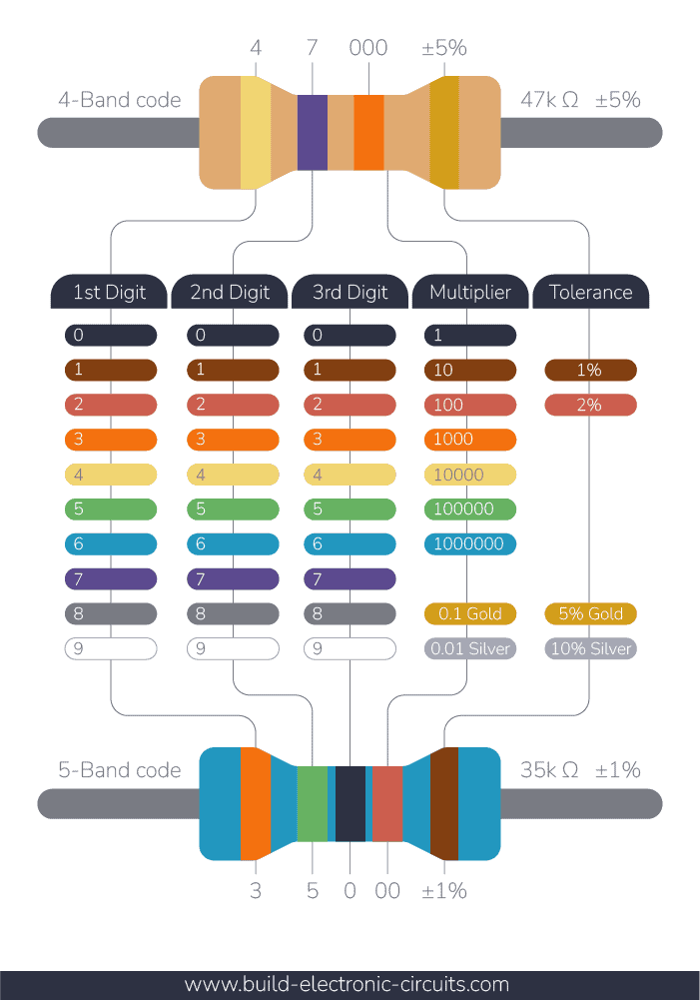

# Rezistor

Elektr tokini cheklovchi passiv komponent.

## Asosiy formulalar
$$ V = I × R $$

$$ P = V × I $$

$$ P = I² × R $$

$$ P = V² / R $$

## Ulanish

**Ketma-ket**

$$ R = R1 + R2 + ... $$

**Parallel**

$$ 1/R = 1/R1 + 1/R2 + ... $$

## Amaliy formulalar

**Voltage Divider**

```text
Vout = Vin × R2 / (R1 + R2)
```

**LED rezistori**

$$ R = (Vs - Vf) / I $$

### Ranglar orqali qarshilik aniqlash

